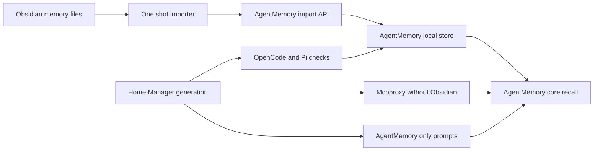
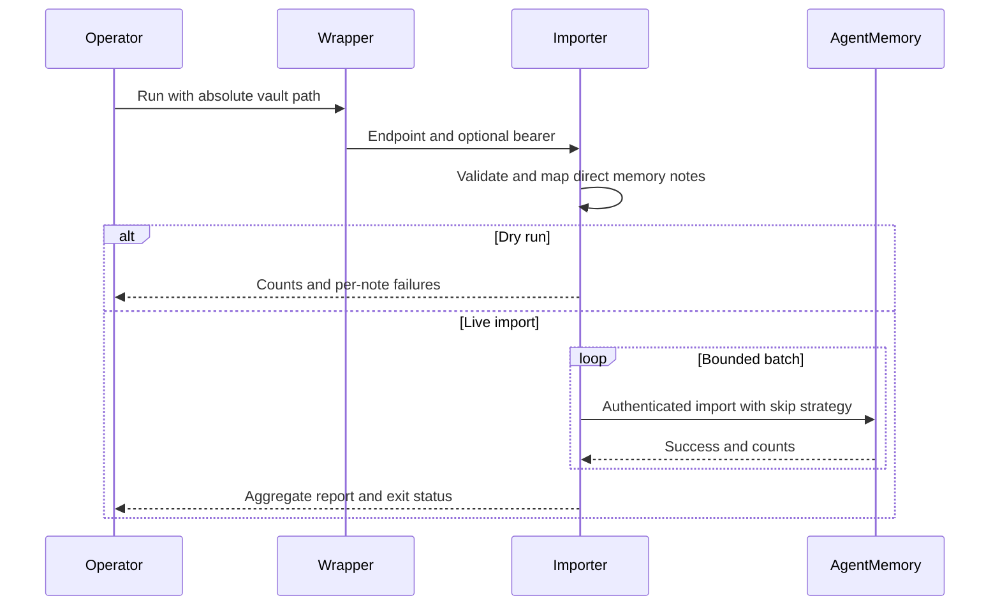
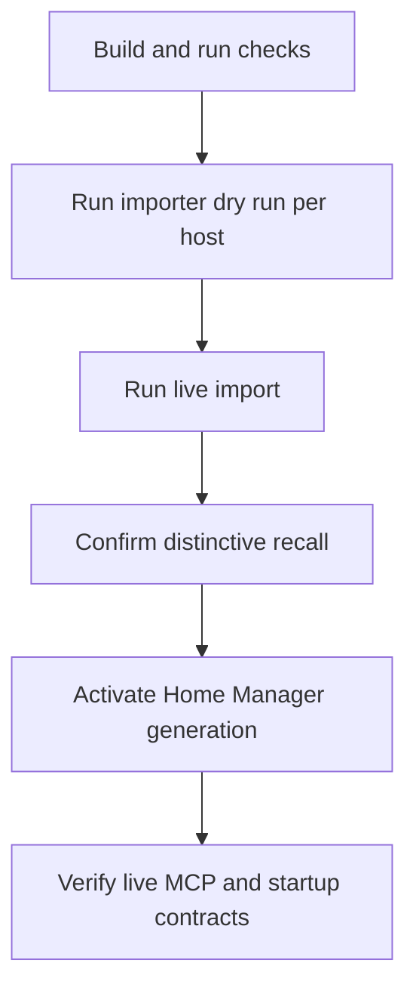

# Design Document

## Overview

This feature adds a one-shot Obsidian-memory importer beside the existing
AgentMemory runtime, then removes Obsidian from managed MCP, startup, and prompt
surfaces. It is a hard cut with deterministic retry, not a synchronization or
rollback system.

### Goals

- Import direct `memories/*.md` notes into each selected local AgentMemory.
- Preserve useful note content, metadata, and source provenance.
- Make AgentMemory the only live agent memory contract.
- Remove Obsidian without weakening mcpproxy or AgentMemory preflight.

### Non-Goals

- Import other vault directories or nested notes.
- Reconcile changed or renamed notes after import.
- Delete the source vault or Obsidian desktop application.
- Add rollback, journaling, scheduling, watching, or cross-host state.
- Change AgentMemory capture, indexing, consolidation, or recall semantics.

## Boundary Commitments

### This Spec Owns

- The source-note boundary, note-to-memory mapping, import report, and retry
  identity for `agentmemory-import-obsidian`.
- Removal of the managed Obsidian MCP package, server, vault-path option, and
  host values.
- Removal of Obsidian from OpenCode and Pi preflight contracts.
- AgentMemory-only active memory instructions and retirement of the vault
  curator, vault synthesizer, and memory-sync execution path.
- Focused import, render, preflight, prompt, and live-recall validation.

### Out of Boundary

- Obsidian vault data, the Obsidian desktop cask, and historical `.kiro` specs.
- Cavemem data and non-Obsidian runtime behavior.
- AgentMemory REST, KV, BM25, auto-forget, and core MCP implementation changes.
- Source-note redaction, semantic deduplication, or post-import updates.
- Recovery beyond rerunning deterministic skip imports.

### Allowed Dependencies

- Pinned AgentMemory `e04ba888` and its authenticated `0.9.29` import contract.
- Node.js 22, Node built-ins, and `js-yaml` 4.1.1 from the existing importer
  dependency package.
- Existing Keychain bearer resolution in `programs.agentmemory`.
- Home Manager's mcpproxy source/runtime-copy wrapper and launchd service.
- AgentMemory's stock core tools routed through mcpproxy.

The importer does not call Obsidian MCP, mutate the vault, or depend on OpenCode.

### Revalidation Triggers

- AgentMemory changes `Memory`, `ExportData`, import response, authentication,
  ID-prefix, or request-size contracts.
- The canonical source-note frontmatter or `memories/` layout changes.
- mcpproxy stops rebuilding its private runtime config at process start.
- OpenCode or Pi changes prompt composition, agent registration, or preflight
  extension points.
- A production host selects a memory backend other than AgentMemory.

## Architecture

### Existing Architecture Analysis

- AgentMemory already owns daemon lifecycle, bearer lookup, MCP registration,
  and a Cavemem-history importer.
- mcpproxy renders a declarative source config, then copies it to private runtime
  state when launchd starts the daemon.
- OpenCode composes global instructions and agent catalogs in Home Manager; Pi
  packages a separate instruction file and preflight adapter.
- Obsidian dependencies are configuration and prompt consumers, not an
  AgentMemory runtime dependency.

### Architecture Pattern & Boundary Map



**Architecture Integration**:

- Selected pattern: independent thin importer plus declarative hard cut.
- Dependency direction: note types and validation → mapping → batching → HTTP
  submission → CLI report. Configuration and prompt retirement do not import
  importer internals.
- Existing patterns preserved: Node 22 wrappers, Keychain lookup, bounded JSON
  import, Home Manager rendering, launchd-managed mcpproxy, and node:test.
- New component rationale: Markdown memories have a different source schema and
  lifecycle from the existing SQLite history importer.
- No shared importer library is introduced. The small protocol constants are
  duplicated deliberately to avoid refactoring the existing migration tool.

### Technology Stack

| Layer | Choice / Version | Role | Notes |
|---|---|---|---|
| CLI | Node.js 22 TypeScript stripping | Parse, map, batch, report | Matches existing importer |
| Parsing | `js-yaml` 4.1.1 | Validate optional YAML frontmatter | Existing vendored dependency |
| Service | AgentMemory 0.9.29 at `e04ba888` | Persist and index memory records | Existing authenticated daemon |
| Infrastructure | Nix, Home Manager, launchd, mcpproxy 0.52.1 | Package and activate hard cut | No new service |
| Tests | Node `node:test` and Nix render checks | Contract and host validation | Existing harnesses |

## File Structure Plan

### New Files

```text
scripts/
├── agentmemory-import-obsidian.ts   # Source validation, mapping, batching, report
└── agentmemory-import-obsidian.nix  # Managed endpoint, bearer, Node and NODE_PATH
tests/agentmemory-opencode/
├── import-obsidian.test.js          # Unit, mock API, package and recall contracts
└── fixtures/obsidian-import/        # Small canonical and malformed note fixtures
```

### Runtime and Packaging Changes

- `home-manager/common/agentmemory.nix` — install the new importer beside the
  existing history importer.
- `home-manager/mcp/default.nix` — remove the Obsidian base server, required
  vault option, installed package, and stale comments; add a rendered-config
  generation hash that forces the launchd service to reload changed inventory.
- `overlays/mcp-servers.nix` — remove the `mcp-obsidian` package definition;
  retain importer dependencies used elsewhere.
- `configurations/{personal,shopify}/home-manager/default.nix` — remove host
  vault-path values.
- `home-manager/common/opencode.nix` — simplify mcpproxy preflight and remove
  vault-agent registration and generated curator variants.
- `scripts/pi-agent-status.nix` — require AgentMemory but not Obsidian.
- `home-manager/common/cavemem.nix` — stop installing the obsolete
  Obsidian-to-Cavemem importer.
- `home-manager/common/default.nix` — remove memory-sync module loading and
  backend-driven enablement.
- `scripts/opencode-nono-launcher.nix` — align preflight comments with the live
  check sequence.

### Prompt Changes

- `home-manager/common/{agents-agentmemory.md,agents-cavemem.md,agents.md,agents-cc-sdd.md}`
  — make AgentMemory the active recall/save contract and remove vault rules.
- `home-manager/common/pi-agent/instructions.md` — replace the mandatory
  Obsidian call with AgentMemory guidance.
- `home-manager/common/agents/{nix-pkg,nvim-tailor,security-auditor}.md` — replace
  vault paths and note writes with AgentMemory searches and saves.
- `home-manager/common/subagent-context-budget/instructions/memory-mcpproxy.md`,
  `plugin.ts`, `budgets.nix`, and `smoke-catalog.json` — update duplicate memory
  fragments and remove vault-only roles.
- `configurations/shopify/home-manager/agents/{yb-issue-validator,yb-sleuth,yb-backlog-validator,stack-captain,yb-fix-pr-author,yb-issue-oneshot}.md`
  and
  `configurations/shopify/home-manager/skills/{create-yb-fix-pr,validate-yb-issue}/SKILL.md`
  — replace Obsidian recall, output paths, and writes with AgentMemory handoffs.
- `configurations/shopify/home-manager/opencode.nix` — remove Obsidian-preserving
  generated variants and load updated source prompts directly.

### Retired Files

- `home-manager/common/agents/{vault-curator,vault-synthesizer}.md`
- `home-manager/common/memory-sync.nix`
- `scripts/memory-sync.nix`
- `tests/memory-sync/contract.test.js`
- `scripts/{cavemem-import-vault.js,cavemem-import-vault.nix}`
- `home-manager/common/subagent-context-budget/instructions/role-fragments/{vault-curation,vault-synthesis}.md`

Historical specs remain unchanged.

### Test and Check Changes

- `tests/agentmemory-opencode/{preflight,instructions-contract,module-render,matrix,backend-selection,host-render,core-surface}.test.js`,
  `pi-compatibility.test.mjs`, and `host-matrix.nix` — replace preservation
  assertions with hard-cut assertions and remove required vault options.
- `tests/pi-agent/{guidance,mcpproxy-adapter}.test.mjs` and
  `tests/pi-agent/fixtures/{status.nix,mcpproxy-server.mjs}` — remove Obsidian
  from guidance and mandatory upstreams.
- `tests/subagent-context-budget/` — remove vault profiles and verify the
  AgentMemory memory fragment in source and plugin copies.
- `tests/{ast-grep-mcp,grep-app-mcp}/hm-render.test.js` — update base-server
  inventories.
- `flake.nix` — add the new importer check, remove memory-sync check wiring, and
  update host-matrix inputs.

## System Flows

### Import Flow



The importer sorts source paths before mapping and batching. Batch failure does
not undo earlier batches; unsaved identities remain eligible on rerun.

### Hard-Cut Flow



No automatic gate coordinates hosts. Each host executes the flow independently.

## Requirements Traceability

| Requirement IDs | Summary | Components | Contracts / Flows |
|---|---|---|---|
| 1.1, 1.2, 1.3, 1.4, 1.5 | Restrict and protect source files | Importer Core | Source contract, Import Flow |
| 2.1, 2.2, 2.3, 2.4, 2.5, 2.6, 2.7 | Preserve valid memory data | Importer Core | Mapping contract |
| 3.1, 3.2, 3.3, 3.4, 3.5, 3.6, 3.7, 3.8, 3.9, 3.10, 3.11 | Execute and report one-shot import | Managed Import Command | CLI, batch, API, Import Flow |
| 4.1, 4.2, 4.3, 4.4, 4.5, 4.6 | Support deterministic reruns | Importer Core | Identity and recovery contracts |
| 5.1, 5.2, 5.3, 5.4, 5.5 | Remove managed Obsidian MCP | MCP Inventory Cutover | Render and Hard-Cut Flow |
| 6.1, 6.2, 6.3, 6.4, 6.5, 6.6 | Remove Obsidian startup dependency | Startup Cutover | OpenCode and Pi preflight contracts |
| 7.1, 7.2, 7.3, 7.4, 7.5, 7.6, 7.7 | Establish AgentMemory-only prompts | Prompt Contract Cutover | Prompt and catalog contracts |

## Components and Interfaces

| Component | Domain | Intent | Requirements | Dependencies | Contracts |
|---|---|---|---|---|---|
| Importer Core | Migration | Convert safe Markdown notes to valid memory records | 1.1–4.6 | Node, js-yaml | Service, Batch |
| Managed Import Command | Packaging | Supply endpoint and bearer to the importer | 3.1–3.11 | AgentMemory module, Keychain | Service, API |
| MCP Inventory Cutover | Runtime | Remove Obsidian and refresh live inventory | 5.1–5.5 | Home Manager, launchd, mcpproxy | State |
| Startup Cutover | Runtime | Retain only live dependency checks | 6.1–6.6 | mcpproxy, AgentMemory | Service |
| Prompt Contract Cutover | Agent configuration | Route recall and saves only to AgentMemory | 7.1–7.7 | mcpproxy core tools | Service, State |

### Migration

#### Importer Core

**Responsibilities & Constraints**

- Accept one absolute vault root and operate only on direct `.md` children of
  its real `memories` directory.
- Use `lstat` and real-path containment; symlinks and non-regular entries are
  skipped even when their targets are inside the vault.
- Parse YAML as `unknown`, validate supported fields, and ignore unknown keys.
- Produce complete `Memory` records before serialization; no unsafe casts or
  `any` types are permitted.
- Keep source content immutable and keep all run state in memory.

**Dependencies**

- Inbound: Managed Import Command — validated CLI arguments (P0).
- Outbound: AgentMemory import endpoint — persistence and skip result (P0).
- External: `js-yaml` 4.1.1 — frontmatter parsing only (P1).

**Contracts**: Service [x] / Batch [x]

##### Service Interface

```typescript
type MemoryType =
  | "pattern"
  | "preference"
  | "architecture"
  | "bug"
  | "workflow"
  | "fact";

interface SourceOptions {
  vaultPath: string;
}

type ImportMode =
  | { kind: "dry-run" }
  | { kind: "live"; endpoint: string; bearer: string };

interface ImportedMemory {
  id: string;
  createdAt: string;
  updatedAt: string;
  type: MemoryType;
  title: string;
  content: string;
  concepts: string[];
  files: string[];
  sessionIds: string[];
  strength: number;
  version: number;
  isLatest: boolean;
  project?: string;
  origin: {
    channel: "import";
    detail: string;
    capturedAt: string;
  };
}

interface ImportExportData {
  version: "0.9.29";
  exportedAt: string;
  sessions: [];
  observations: Record<string, never[]>;
  memories: ImportedMemory[];
  summaries: [];
}

interface ImportRequest {
  exportData: ImportExportData;
  strategy: "skip";
}

interface ImportSuccess {
  success: true;
  strategy: "skip";
  sessions: number;
  observations: number;
  memories: number;
  summaries: number;
  skipped: number;
}

interface ImportLogicalFailure {
  success: false;
  error: string;
}

type ImportResponse = ImportSuccess | ImportLogicalFailure;

type NoteOutcome =
  | { kind: "prepared"; relativePath: string; memory: ImportedMemory }
  | { kind: "skipped"; relativePath: string; reason: string }
  | { kind: "failed"; relativePath: string; reason: string };

interface ImportCounts {
  discovered: number;
  eligible: number;
  imported: number;
  alreadyPresent: number;
  skipped: number;
  failed: number;
}

interface ImportIssue {
  relativePath: string;
  reason: string;
}

interface ImportReport {
  sourcePath: string;
  dryRun: boolean;
  counts: ImportCounts;
  batches: { submitted: number; succeeded: number; failed: number };
  skipped: ImportIssue[];
  failures: ImportIssue[];
}

interface ObsidianImporter {
  prepare(options: SourceOptions): Promise<readonly NoteOutcome[]>;
  execute(options: SourceOptions, mode: ImportMode): Promise<ImportReport>;
}
```

Preconditions: the vault path is absolute. The `live` mode requires a non-empty
endpoint and bearer by type. Postconditions: the source tree is unchanged; every
submitted record has passed local validation. Invariant: one normalized path
produces one identity.

##### Mapping Contract

| Target field | Source / rule |
|---|---|
| `id` | `mem_obsidian_` plus SHA-256 of normalized `memories/<filename>` |
| `createdAt` | Valid frontmatter date, filename date prefix, then file mtime |
| `updatedAt` | Same as `createdAt` |
| `type` | First source-order tag matching `MemoryType`; otherwise `fact` |
| `title` | First level-one heading; otherwise filename stem |
| `content` | Markdown body byte-for-byte after frontmatter removal |
| `concepts` | Unique source-order topical tags excluding `memory` and the project value, plus the unique `obsidian-source:<relative-path>` |
| `files` | The normalized `memories/<filename>` source path |
| `sessionIds` | Empty; legacy session values remain in `origin.detail` |
| `strength`, `version`, `isLatest` | `1`, `1`, `true` |
| `project` | Non-empty frontmatter project when present |
| `origin` | Import channel, run timestamp, and stable JSON detail containing source path, tags, and legacy sessions |

Frontmatter is optional. An opening delimiter without a closing delimiter,
invalid YAML, or an invalid type for `date`, `project`, `tags`, or `sessions`
is malformed. Empty body content is invalid. Unknown frontmatter keys do not
block import.

##### Batch Contract

- Envelope: `ImportRequest` with run-start `exportedAt`, empty sessions,
  observations, and summaries, populated memories, and `strategy: "skip"`.
- Limits: at most 10,000 memory records and serialized body size strictly below
  8 MiB per request.
- Ordering: lexical source path order.
- Oversize: a record that cannot fit alone becomes a per-note failure.
- Recovery: accepted batches remain accepted; failed and unsent identities are
  retried by rerunning.
- Validation: runtime guards validate every `ImportedMemory` and the complete
  `ImportRequest` before serialization; TypeScript annotations are not treated
  as runtime validation.

#### Managed Import Command

**Responsibilities & Constraints**

- Expose `agentmemory-import-obsidian <absolute-vault-path>`, `--dry-run`, and
  `--help`; no path is baked into Nix configuration.
- Resolve the configured AgentMemory endpoint and Keychain bearer using the
  existing import-wrapper pattern.
- Skip bearer lookup for help and dry-run.
- Emit one JSON report to stdout and concise diagnostics to stderr.

**Contracts**: Service [x] / API [x]

##### API Contract

| Method | Endpoint | Request | Success | Failure |
|---|---|---|---|---|
| POST | `/agentmemory/import` | `ImportRequest` | HTTP success and valid `ImportSuccess` | 400/401, transport, invalid JSON, `ImportLogicalFailure`, invalid counts |

Authentication failure is terminal. A batch transport or logical failure is
recorded and later independent batches continue. Any failed eligible note makes
the final exit status non-zero.

For a submitted batch of `N` memories, success validation requires
`strategy === "skip"`, zero sessions/observations/summaries, non-negative integer
counts, and `memories + skipped === N`. Persistence success does not prove index
success; the live recall check remains separate.

The report follows `ImportReport`. Dry runs set target-dependent imported,
already-present, and batch counts to zero. Reports never contain the bearer or
full note bodies.

### Runtime Cutover

#### MCP Inventory Cutover

- Remove the Obsidian package, base-server entry, option, and host values.
- Add the rendered config hash to the launchd agent's environment. An inventory
  change then changes the plist, causing Home Manager to reload the service.
- The existing wrapper refreshes and validates the private runtime copy on the
  new process start.
- Preserve all unrelated base and extra servers. Do not block an operator from
  explicitly adding a future unrelated extra server.

#### Startup Cutover

- OpenCode preflight order becomes mcpproxy unauthenticated `/healthz`, then the
  existing authenticated AgentMemory health check.
- Remove the mcpproxy admin-key lookup, server-list request, Obsidian filter, and
  Obsidian failure message from the OpenCode wrapper.
- Pi's mcpproxy adapter retains its four-tool validation but passes only
  `agentmemory` as the mandatory memory upstream.
- Nono continues to consume the composed preflight; it gains no new network or
  filesystem permission.

### Agent Configuration

#### Prompt Contract Cutover

- `agents-agentmemory.md` owns automatic-context, explicit recall, memory-save,
  lesson-save, and durable-memory selection rules.
- `agents.md` retains non-memory global rules only.
- Active agents discover AgentMemory tools through mcpproxy and return saved
  AgentMemory handoffs where prior contracts returned vault paths.
- A handoff contains `MEMORY_ID: <id>` and `MEMORY_QUERY: <distinctive title and
  concepts>`. Consumers recall by query and verify the returned record ID; they
  never attempt a get-by-ID operation that the core tool surface does not expose.
- Hardcoded memory-note references become AgentMemory topic/title search hints.
- Vault-only agents, context-budget profiles, smoke entries, and memory-sync are
  deleted rather than adapted.
- Historical specs and non-active prose may retain Obsidian provenance.

## Error Handling

| Category | Disposition | Exit impact |
|---|---|---|
| Missing or relative vault path | Abort before discovery | Non-zero |
| Missing/unreadable `memories` directory | Abort before target access | Non-zero |
| Symlink or non-regular entry | Skip with path and reason | Zero unless no other failure |
| Malformed frontmatter or invalid record | Skip with path and reason | Zero unless a target failure occurs |
| Single record exceeds batch limit | Continue with later notes | Non-zero |
| Missing bearer or authentication rejection | Stop live submissions | Non-zero |
| Batch transport or logical rejection | Record batch, continue where independent | Non-zero |
| Existing deterministic ID | Count as already present | Zero |

No state file, rollback action, or automatic retry loop is created.

## Testing Strategy

### Unit Tests

- Direct-child selection, lexical ordering, source immutability, symlink
  rejection, and real-path containment.
- Optional/invalid frontmatter, title fallback, timestamp fallback, exact body,
  type selection, recall-visible path/provenance, and deterministic IDs.
- Record validation, 10,000-record and 8-MiB boundaries, oversize isolation,
  exact request/response guards, count invariants, and report aggregation.
- Argument parsing and dry-run behavior without a bearer.

### Integration Tests

- Mock import responses for success, existing IDs, HTTP failure, logical
  rejection, invalid JSON/counts, authentication failure, and partial batches.
- Packaged command resolves the configured endpoint and a fake Keychain helper
  without leaking the bearer.
- Real packaged AgentMemory accepts a fixture memory and recalls its distinctive
  title/body term.
- Both host renders install the importer and omit Obsidian package, server,
  option values, and agent registrations.
- OpenCode and Pi preflights pass without Obsidian and retain AgentMemory failure
  behavior.

### Prompt and Catalog Tests

- Rendered global, Pi, common, Shopify, skill, and injected prompt surfaces have
  AgentMemory recall/save instructions and no Obsidian operation or vault path.
- Path-based producer/consumer prompts emit `MEMORY_ID` plus `MEMORY_QUERY`,
  recall by query, and verify the returned ID.
- Context-budget source fragments and `plugin.ts` stay byte-equivalent where the
  existing tests require mirrored content.
- Active agent and smoke catalogs contain no vault curator or synthesizer.

### Manual Cutover Validation

- Run dry-run and live import against each selected host vault path.
- Recall one distinctive imported memory through the AgentMemory core surface.
- Activate the generation, then verify live mcpproxy inventory, OpenCode
  preflight, Pi status, and absence of `agentmemory-import-obsidian` source
  mutations.

## Security Considerations

- The wrapper resolves the bearer at runtime and never includes it in reports,
  arguments, Nix store text, or diagnostics.
- Only loopback AgentMemory HTTP is configured by the module.
- Source traversal rejects symlinks and path escapes.
- Imported content is stored and indexed verbatim. This accepts the existing
  curated vault trust boundary and does not add redaction.
- Dry-run output contains paths and counts, not note bodies.

## Migration Strategy

- Build the complete generation and importer checks.
- Run the built importer in dry-run and live mode on each host chosen for
  migration; confirm one recall result.
- Activate the hard-cut generation on that host.
- Verify the live mcpproxy inventory and startup contracts.
- Rerun the importer after partial failure. Do not restore Obsidian MCP or alter
  already-imported records.
