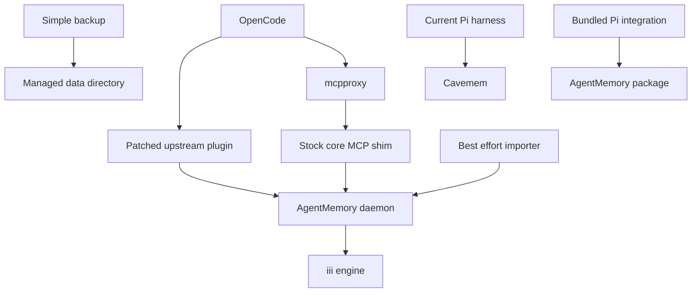
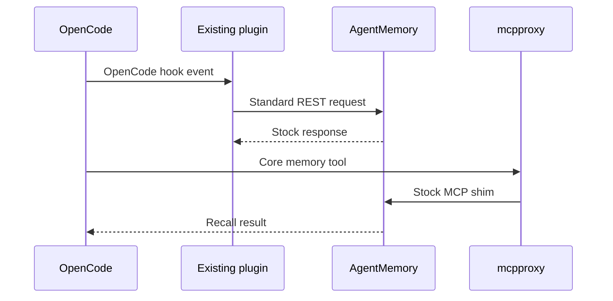

# Design: agentmemory-opencode-migration

## Overview
Replace cavemem only for OpenCode using AgentMemory's standard daemon, stock
core MCP shim, and patched existing OpenCode plugin. Prefer upstream behavior
over custom durability, security, migration, and consumer-compatibility layers.

### Goals

- Declaratively install AgentMemory and its existing OpenCode plugin.
- Provide ambient capture, automatic context, and core MCP recall.
- Import useful cavemem history with a rerunnable best-effort command.
- Preserve current Pi cavemem and future AgentMemory Pi compatibility.
- Cut the implementation plan to 22–26 bounded tasks.

### Non-Goals

- Custom capture relay, read facade, raw-event store, or iii persistence patch.
- Exact project/worktree isolation or hardened plugin credential separation.
- Transactional migration, automatic restore validation, or consumer parity.
- AgentMemory activation for Pi.

## Boundary Commitments

### This Spec Owns

- Pinned AgentMemory and iii packages, settings, launchd, and basic health.
- Inline patches to the existing upstream OpenCode plugin and its declarative
  installation.
- Stock core MCP registration through mcpproxy.
- One-shot cavemem import, simple stopped-state backup, cutover, and rollback.
- Disablement of OpenCode-only cavemem consumers.

### Out of Boundary

- New persistence or query contracts inside AgentMemory or iii-engine.
- Subprocess-proof bearer isolation inside OpenCode.
- Automatic AgentMemory-to-Obsidian promotion.
- Pi configuration, credentials, migration, or activation for AgentMemory.
- Recovery beyond stock AgentMemory behavior and rerunning failed imports.

### Allowed Dependencies

- AgentMemory commit `e04ba88819c365c9acf9d6661ea802143e728bd6`.
- iii-engine v0.11.2, Node 24, OpenCode v1.18.26, mcpproxy v0.52.1.
- AgentMemory's existing `plugin/opencode/agentmemory-capture.ts`, stock MCP
  shim, standard REST routes, and bundled `integrations/pi/` sources.
- Home Manager, launchd, nono, Keychain secret bridge, cavemem SQLite, restic,
  and Obsidian.

### Revalidation Triggers

- AgentMemory, iii, OpenCode, or mcpproxy version changes.
- Changes to the upstream OpenCode plugin filename/export or Pi source layout.
- Changes to stock core MCP tools, REST authentication, standard Pi routes, or
  AgentMemory data-directory layout.
- Re-enabling cavemem compaction augmentation, vault synthesis, or memory-sync.

## Architecture

### Existing Architecture Analysis

- OpenCode exposes only mcpproxy as MCP.
- Cavemem currently owns OpenCode capture and several optional consumers.
- Pi independently uses cavemem and must remain unchanged.
- AgentMemory already supplies the OpenCode and Pi integration sources.
- The current title and summary agents are disabled, reducing the known
  first-turn automatic-context race.

### Architecture Pattern and Boundary Map

Selected pattern: thin declarative integration around upstream AgentMemory.



Dependency direction is:

`Pinned Package → Home Manager Runtime → Existing Plugin and MCP → Consumer Cutover → Host Activation`.

### Technology Stack

| Layer | Choice / Version | Role |
|---|---|---|
| Package | AgentMemory `e04ba888` | Daemon, MCP shim, OpenCode/Pi integrations |
| Engine | iii-engine v0.11.2 | Stock AgentMemory persistence |
| Runtime | Node 24 and launchd | Managed local service |
| Host config | Nix and Home Manager | Files, environment, services, selection |
| Import | TypeScript plus SQLite | Best-effort cavemem transformation |
| Gateway | mcpproxy v0.52.1 | Stock core MCP exposure |

## File Structure Plan

### New Files

```text
overlays/
├── agentmemory.nix                         # AgentMemory and iii packages
├── agentmemory-deps/
│   ├── package.json                        # Audited dependency manifest
│   └── package-lock.json                   # Reproducible npm closure
└── agentmemory-patches/
    └── opencode-capture.patch              # Inline existing-plugin fixes
home-manager/common/
└── agentmemory.nix                         # Options, service, plugin, MCP, health
scripts/
├── agentmemory-import-cavemem.nix          # Import command package
├── agentmemory-import-cavemem.ts           # Snapshot, transform, bounded import
└── agentmemory-backup.nix                  # Stock-stop directory backup
tests/agentmemory-opencode/                  # Package, plugin, HM, import, Pi checks
```

### Modified Files

- `overlays/default.nix` — compose the AgentMemory package.
- `home-manager/common/default.nix` — import the AgentMemory module.
- `home-manager/common/cavemem.nix` — gate only OpenCode-owned wiring while
  preserving the Pi runtime.
- `home-manager/common/opencode.nix` — select the memory backend and instructions.
- `home-manager/common/opencode-nono.nix` — allow standard AgentMemory REST and
  bearer environment access without granting its data directory.
- `home-manager/common/session-compaction.nix` — disable cavemem augmentation
  under AgentMemory.
- `home-manager/common/agents.md` — replace OpenCode cavemem guidance with stock
  AgentMemory MCP guidance while preserving manual Obsidian rules.
- `home-manager/common/memory-sync.nix` — disable memory-sync under AgentMemory.
- Both host Home Manager defaults — select AgentMemory for OpenCode.
- `flake.nix` — register focused package and integration checks.

### Preserved Paths

- `home-manager/common/pi-agent/**`
- `overlays/pi-agent/**`
- `scripts/pi-agent-*`
- `tests/pi-agent/**`
- AgentMemory upstream `integrations/pi/**`
- Cavemem package, Pi patches, Pi data, mcpproxy upstream, and Pi backup.

## System Flows

### Capture and Recall



The plugin uses the standard bearer from OpenCode's environment and stock REST
timeouts. No durable relay or custom retry path exists.

### History Import


Rerunning with deterministic IDs and stock `skip` behavior is the recovery path.

## Requirements Traceability

| Requirement IDs | Summary | Components | Flow |
|---|---|---|---|
| 1.1, 1.2, 1.3, 1.4, 1.5, 1.6, 1.7 | Declarative install | Package, AgentMemoryModule, ExistingPluginPatch | Activation |
| 2.1, 2.2, 2.3, 2.4, 2.5, 2.6, 2.7, 2.8 | Existing plugin capture | ExistingPluginPatch, AgentMemoryRuntime | Capture |
| 3.1, 3.2, 3.3, 3.4, 3.5, 3.6, 3.7 | Stock MCP recall | StockMcpIntegration, Preflight | Recall |
| 4.1, 4.2, 4.3, 4.4, 4.5, 4.6, 4.7, 4.8 | Best-effort import | BestEffortImporter | Import |
| 5.1, 5.2, 5.3, 5.4, 5.5, 5.6 | Consumer cutover | ConsumerCutover, CavememBoundary | Activation |
| 6.1, 6.2, 6.3, 6.4, 6.5, 6.6, 6.7, 6.8 | Basic operations | AgentMemoryModule, SimpleBackup | Activation, backup |
| 7.1, 7.2, 7.3, 7.4, 7.5, 7.6, 7.7, 7.8 | Pi and rollback | Package, CavememBoundary, HostActivation | Activation |

## Components and Interfaces

| Component | Intent | Requirements | Dependencies |
|---|---|---|---|
| Package | Build pinned AgentMemory, iii, and integration assets | 1.1, 1.5, 7.3-7.5 | Nix, npm |
| AgentMemoryModule | Render settings, launchd, plugin, MCP, and health | 1.2-1.7, 3.1-3.5, 6.1-6.4 | Package, HM |
| ExistingPluginPatch | Correct high-value current OpenCode capture gaps | 1.4-1.5, 2.1-2.8 | Upstream plugin, REST |
| StockMcpIntegration | Register core stock tools through mcpproxy | 3.1-3.7 | Stock MCP shim |
| BestEffortImporter | Transform and batch cavemem rows | 4.1-4.8 | SQLite snapshot, import route |
| ConsumerCutover | Disable unported cavemem consumers and update prompts | 5.1-5.6 | OpenCode config |
| SimpleBackup | Stop, copy managed data, restart | 6.5-6.6 | Stock stop, restic |
| CavememBoundary | Preserve current Pi cavemem | 7.1-7.2, 7.6-7.8 | Cavemem module |
| ValidationSuite | Verify package, capture, import, rollout, and Pi | all | Flake checks |

### Package and Runtime

- `buildNpmPackage` uses a repository-owned lock for AgentMemory at `e04ba888`.
- The package includes iii-engine v0.11.2 for both supported Darwin systems.
- The package retains upstream `plugin/opencode/**`, `integrations/pi/**`,
  metadata, commands, and licenses.
- Home Manager renders the standard AgentMemory environment and launchd service
  with managed data/runtime directories and loopback ports.
- The service uses upstream start, stop, storage, indexing, and consolidation.

### ExistingPluginPatch

The patch applies directly to
`plugin/opencode/agentmemory-capture.ts` and retains the
`AgentmemoryCapturePlugin` named export.

It changes only:

- current OpenCode event names;
- completed assistant text and reasoning capture;
- running, completed, and failed tool-state capture;
- idle summary and normal `dispose()` session end;
- managed endpoint, project, and secret configuration.

It retains stock REST calls, timeout behavior, automatic context injection,
compression, truncation, session handling, and unaffected hooks. Home Manager
symlinks only this patched entrypoint into OpenCode's plugin directory; no
duplicate settings registration or helper plugin tree exists.

### StockMcpIntegration

- Register `@agentmemory/mcp` under mcpproxy with `AGENTMEMORY_TOOLS=core`.
- OpenCode continues to see only mcpproxy.
- Mcpproxy applies its existing effect policy to core write tools.
- Preflight checks daemon health before launch. Mid-session fallback behavior is
  accepted rather than wrapped.

### BestEffortImporter

```typescript
interface LegacyImportRecord {
  id: string;
  sessionId: string;
  project: string;
  timestamp: string;
  narrative: string;
  type: string;
  origin: { channel: "import"; detail: string; capturedAt: string };
}
```

- Create the source snapshot with SQLite Online Backup.
- Skip `ide=pi`, `ide=obsidian-migration`, and explicit importer markers.
- Treat remaining `ide=unknown` sessions as OpenCode history.
- Derive IDs from source session/table/row identity.
- Submit standard import payloads below 8 MiB with `skip` semantics.
- Report sessions, observations, summaries, skipped rows, and failed batches.
- Do not create a journal or attempt rollback of accepted batches.

### ConsumerCutover

- The backend selector controls OpenCode plugin, health, instructions, and
  compaction augmentation.
- AgentMemory mode disables cavemem context augmentation, vault-synthesizer
  registration, and memory-sync packaging.
- Manual Obsidian recall/writes and vault-curator remain.
- The retained cavemem mode restores prior OpenCode behavior on rollback.

### SimpleBackup

- Invoke the stock AgentMemory stop path and wait for its processes/listeners to
  exit within a fixed timeout.
- Copy the entire managed data directory into the existing backup destination,
  then restart the service.
- Report stop, copy, and restart failures.
- Do not claim a flush barrier, transactional snapshot, or tested restore.

### Pi Compatibility

- Current Pi remains on cavemem with no source changes.
- The AgentMemory package retains the unchanged bundled Pi factory, helper,
  nested metadata, and standard REST routes.
- A compatibility test loads the factory against the selected Pi extension API
  and mocked standard routes. It does not create host wiring or credentials.

## Error Handling

- Evaluation errors: unsupported system, missing package, invalid option.
- Preflight errors: daemon unhealthy, MCP unavailable, or Obsidian unavailable.
- Plugin errors: log standard REST failure and continue OpenCode.
- Import errors: report the failed row/batch and continue where independent;
  rerun with skip semantics.
- Backup errors: report the failed stop/copy/restart phase.

## Security Considerations

- Bind AgentMemory to loopback and configure a bearer.
- Supply the bearer to the in-process existing plugin through the OpenCode
  environment.
- Do not grant OpenCode direct access to AgentMemory's data directory.
- Model-invoked subprocesses may inherit the bearer and reach the loopback REST
  endpoint. This is an accepted consequence of removing the custom capture
  transport and is not described as a hardened boundary.
- Mcpproxy remains the only MCP endpoint configured in OpenCode.

## Testing Strategy

### Unit Tests

- Existing-plugin event mapping and preserved export/provenance.
- Import filtering, deterministic IDs, batch sizing, and count reports.
- Backend selection and instruction rendering.

### Integration Tests

- AgentMemory package and daemon health on both Darwin systems.
- OpenCode plugin capture for prompt, assistant, tool, idle, and dispose.
- Stock core MCP discovery and recall through mcpproxy.
- Simple backup stop/copy/restart behavior.

### End-to-End and Compatibility Tests

- Both host renderings, AgentMemory cutover, and cavemem rollback.
- Import rerun with skipped deterministic IDs and one malformed batch.
- Existing Pi cavemem suite unchanged.
- Bundled AgentMemory Pi factory loaded against mocked standard routes without
  activation.
