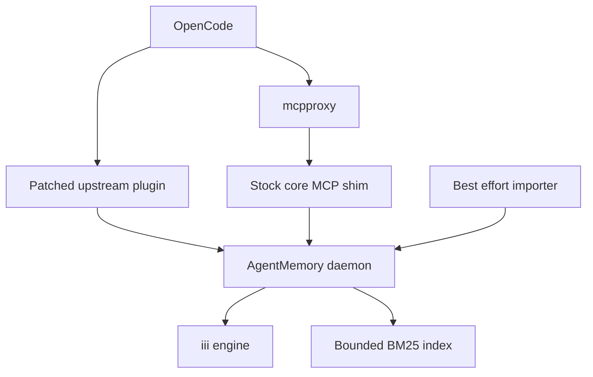
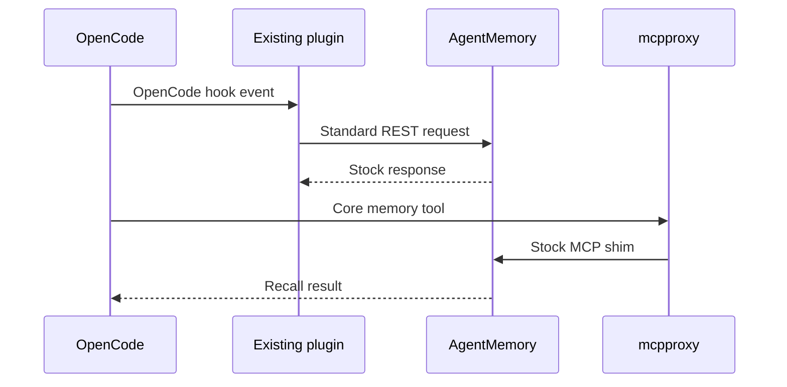

# Design: agentmemory-opencode-migration

## Overview
Replace cavemem for OpenCode using AgentMemory's daemon, core MCP shim, and
patched OpenCode plugin. Add only the operational bounds proven necessary by the
migrated corpus.

### Goals

- Declaratively install AgentMemory and its existing OpenCode plugin.
- Provide ambient capture, automatic context, and core MCP recall.
- Import useful cavemem history with a rerunnable best-effort command.
- Keep large-corpus indexing, import, and health operable.

### Non-Goals

- Custom capture relay, read facade, raw-event store, or iii persistence patch.
- Exact project/worktree isolation or hardened plugin credential separation.
- Transactional migration, automatic restore validation, or consumer parity.
- Stopping the AgentMemory runtime for a backup or providing a stopped-runtime
  backup command.
- General replacement of AgentMemory's query or persistence architecture beyond
  the bounded BM25 safety policy.
- OpenCode rollback activation, migration reversal, and rollback validation.

## Boundary Commitments

### This Spec Owns

- Pinned AgentMemory and iii packages, settings, launchd, and basic health.
- Inline patches to the existing upstream OpenCode plugin and its declarative
  installation.
- Stock core MCP registration through mcpproxy.
- One-shot cavemem import and cutover.
- Disablement of OpenCode-only cavemem consumers.
- BM25 capacity/persistence limits, importer scalability, authenticated CLI
  wrappers, and degraded-but-usable health semantics.

### Out of Boundary

- New persistence or query contracts beyond the bounded BM25 exception.
- Subprocess-proof bearer isolation inside OpenCode.
- Automatic AgentMemory-to-Obsidian promotion.
- Runtime backup and restore workflows.
- OpenCode rollback activation and validation.
- Recovery beyond stock AgentMemory behavior and rerunning failed imports.

### Allowed Dependencies

- AgentMemory commit `e04ba88819c365c9acf9d6661ea802143e728bd6`.
- iii-engine v0.11.2, Node 24 for AgentMemory, Node 22 for native SQLite import,
  OpenCode v1.18.26, and mcpproxy v0.52.1.
- AgentMemory's existing `plugin/opencode/agentmemory-capture.ts`, stock MCP
  shim, and standard REST routes.
- Home Manager, launchd, nono, Keychain secret bridge, cavemem SQLite,
  coreutils, and Obsidian.

### Revalidation Triggers

- AgentMemory, iii, OpenCode, or mcpproxy version changes.
- Changes to the upstream OpenCode plugin filename/export, SearchIndex shape,
  native importer ABI, core MCP tools, REST authentication, health statuses, or
  AgentMemory data-directory layout.
- Imported corpus growth across the 50,000 persistence or 100,000 live-index
  thresholds.
- Personal host activation before `agentmemory-bearer` is encrypted.
- Re-enabling cavemem compaction augmentation, vault synthesis, or memory-sync.

## Architecture

### Existing Architecture Analysis

- OpenCode exposes only mcpproxy as MCP.
- Cavemem currently owns OpenCode capture and several optional consumers.
- AgentMemory already supplies the OpenCode integration source.
- The current title and summary agents are disabled, reducing the known
  first-turn automatic-context race.

### Architecture Pattern and Boundary Map

Selected pattern: thin declarative integration around upstream AgentMemory.



Dependency direction is:

`Pinned Package → Home Manager Runtime → Existing Plugin and MCP → Operational Bounds → Consumer Cutover → Host Activation`.

### Technology Stack

| Layer | Choice / Version | Role |
|---|---|---|
| Package | AgentMemory `e04ba888` | Daemon, MCP shim, OpenCode integration |
| Engine | iii-engine v0.11.2 | Stock AgentMemory persistence |
| Runtime | Node 24 and launchd | Managed local service |
| Host config | Nix and Home Manager | Files, environment, services, selection |
| Import | Node 22, TypeScript, better-sqlite3 | Best-effort cavemem transformation |
| Gateway | mcpproxy v0.52.1 | Stock core MCP exposure |

## File Structure Plan

### New Files

```text
overlays/
├── agentmemory.nix                         # AgentMemory and iii packages
├── agentmemory-deps/
│   ├── package.json                        # Audited dependency manifest
│   └── package-lock.json                   # Reproducible npm closure
└── agentmemory-patches/
    ├── opencode-capture.patch              # Inline existing-plugin fixes
    └── bm25-index-cap.patch                # Live/persistence memory bounds
home-manager/common/
└── agentmemory.nix                         # Options, service, plugin, MCP, health
scripts/
├── agentmemory-import-cavemem.nix          # Import command package
├── agentmemory-import-cavemem.ts           # Snapshot, transform, bounded import
└── agentmemory-status.nix                  # Authenticated managed health
tests/agentmemory-opencode/                  # Package, plugin, HM, and import checks
```

### Modified Files

- `overlays/default.nix` — compose the AgentMemory package.
- `home-manager/common/default.nix` — import the AgentMemory module.
- `home-manager/common/cavemem.nix` — retain existing adjacent cavemem assets.
- `home-manager/common/opencode.nix` — select the memory backend and instructions.
- `home-manager/common/opencode-nono.nix` — allow standard AgentMemory REST and
  bearer environment access without granting its data directory.
- `home-manager/common/session-compaction.nix` — disable cavemem augmentation
  under AgentMemory.
- `home-manager/common/agents.md` — replace OpenCode cavemem guidance with stock
  AgentMemory MCP guidance while preserving manual Obsidian rules.
- `home-manager/common/memory-sync.nix` — disable memory-sync under AgentMemory.
- Both host Home Manager defaults — select AgentMemory for OpenCode.
- `flake.nix` — register focused package and integration checks.

### Preserved Paths

- Existing non-rollback Cavemem assets remain available only for the retained
  legacy backend path.

## System Flows

### Capture and Recall



The plugin uses the standard bearer from OpenCode's environment and stock REST
timeouts. No durable relay or custom retry path exists.

### History Import


Rerunning with deterministic IDs and stock `skip` behavior is the recovery path.

## Requirements Traceability

| Requirement IDs | Summary | Components | Flow |
|---|---|---|---|
| 1.1, 1.2, 1.3, 1.4, 1.5, 1.6, 1.7 | Declarative install | Package, AgentMemoryModule, ExistingPluginPatch | Activation |
| 2.1-2.10 | Existing plugin capture and bounded indexing | ExistingPluginPatch, OperationalBounds | Capture |
| 3.1-3.7 | Stock MCP recall | StockMcpIntegration, AgentMemoryModule | Recall |
| 4.1-4.12 | Best-effort import | BestEffortImporter, OperationalBounds | Import |
| 5.1-5.6 | Consumer cutover | ConsumerCutover | Activation |
| 6.1-6.8 | Basic operations | AgentMemoryModule, OperationalBounds | Activation |

## Components and Interfaces

| Component | Intent | Requirements | Dependencies |
|---|---|---|---|
| Package | Build pinned AgentMemory, iii, and integration assets | 1.1, 1.5 | Nix, npm |
| AgentMemoryModule | Render settings, launchd, plugin, MCP, health, and CLI wrappers | 1.2-1.7, 3.1-3.5, 6.1-6.4, 6.6-6.8 | Package, HM |
| ExistingPluginPatch | Correct high-value current OpenCode capture gaps | 1.4-1.5, 2.1-2.8 | Upstream plugin, REST |
| StockMcpIntegration | Register core stock tools through mcpproxy | 3.1-3.7 | Stock MCP shim |
| BestEffortImporter | Transform and batch cavemem rows | 4.1-4.12 | SQLite snapshot, import route |
| ConsumerCutover | Disable unported cavemem consumers and update prompts | 5.1-5.6 | OpenCode config |
| OperationalBounds | Bound BM25 and importer behavior | 2.9-2.10, 4.9-4.12, 6.5 | Package, HM |
| ValidationSuite | Verify package, capture, import, and host rollout | all | Flake checks |

### Package and Runtime

- `buildNpmPackage` uses a repository-owned lock for AgentMemory at `e04ba888`.
- The package includes iii-engine v0.11.2 for both supported Darwin systems.
- The package retains upstream `plugin/opencode/**`, metadata, commands, and
  licenses.
- Home Manager renders the standard AgentMemory environment and launchd service
  with managed data/runtime directories and loopback ports.
- The service uses upstream start, stop, storage, and consolidation.
- `bm25-index-cap.patch` keeps the newest 100,000 indexed entries and rejects
  serialization above 50,000 without deleting KV observations.

### ExistingPluginPatch

The patch applies directly to
`plugin/opencode/agentmemory-capture.ts` and retains the
`AgentmemoryCapturePlugin` named export.

It changes only:

- current OpenCode event names;
- completed assistant text and reasoning capture;
- running, completed, and failed tool-state capture;
- idle summary and normal `dispose()` session end;
- managed endpoint, project, and secret configuration.

It retains stock REST calls, timeout behavior, automatic context injection,
compression, truncation, session handling, and unaffected hooks. Home Manager
symlinks only this patched entrypoint into OpenCode's plugin directory; no
duplicate settings registration or helper plugin tree exists.

### StockMcpIntegration

- Register `@agentmemory/mcp` under mcpproxy with `AGENTMEMORY_TOOLS=core`.
- OpenCode continues to see only mcpproxy.
- Mcpproxy applies its existing effect policy to core write tools.
- Preflight checks daemon health before launch. Mid-session fallback behavior is
  accepted rather than wrapped.

### BestEffortImporter

```typescript
interface LegacyImportRecord {
  id: string;
  sessionId: string;
  project: string;
  timestamp: string;
  narrative: string;
  type: string;
  origin: { channel: "import"; detail: string; capturedAt: string };
}
```

- Create the source snapshot with SQLite Online Backup.
- Run `better-sqlite3` and the importer under the same Node 22 ABI.
- Skip sessions with positive non-OpenCode or importer-generated provenance.
- Treat remaining `ide=unknown` sessions as OpenCode history.
- Derive IDs from source session/table/row identity.
- Submit standard import payloads below 8 MiB with `skip` semantics.
- Use linear record preparation and conservative byte accounting; serialize each
  completed batch once.
- Stream dry-run JSON records and report interactive progress on stderr.
- Bake the configured REST endpoint and resolve the bearer only for real imports.
- Report sessions, observations, summaries, skipped rows, and failed batches.
- Do not create a journal or attempt rollback of accepted batches.

### ConsumerCutover

- The backend selector controls OpenCode plugin, health, instructions, and
  compaction augmentation.
- AgentMemory mode disables cavemem context augmentation, vault-synthesizer
  registration, and memory-sync packaging.
- AgentMemory mode forces cavemem compaction augmentation off; an option override
  cannot re-enable it.
- Manual Obsidian recall/writes and vault-curator remain.

## Error Handling

- Evaluation errors: unsupported system, missing package, invalid option.
- Preflight errors: daemon critical/unavailable, MCP unavailable, bearer
  unavailable, or Obsidian unavailable. HTTP-200 degraded remains usable.
- Plugin errors: log standard REST failure and continue OpenCode.
- Import errors: report the failed row/batch and continue where independent;
  rerun with skip semantics.

## Security Considerations

- Bind AgentMemory to loopback and configure a bearer.
- Supply the bearer to the in-process existing plugin through the OpenCode
  environment.
- Do not grant OpenCode direct access to AgentMemory's data directory.
- Model-invoked subprocesses may inherit the bearer and reach the loopback REST
  endpoint. This is an accepted consequence of removing the custom capture
  transport and is not described as a hardened boundary.
- Mcpproxy remains the only MCP endpoint configured in OpenCode.
- Personal evaluation may retain a bearer reference before ciphertext exists;
  personal activation must provision the encrypted key.

## Testing Strategy

### Unit Tests

- Existing-plugin event mapping and preserved export/provenance.
- Import filtering, deterministic IDs, batch sizing, and count reports.
- BM25 FIFO capacity and pre-serialization persistence refusal.
- Keychain-backed CLI/status wrappers and degraded health handling.
- Backend selection and instruction rendering.

### Integration Tests

- AgentMemory package and daemon health on both Darwin systems.
- OpenCode plugin capture for prompt, assistant, tool, idle, and dispose.
- Stock core MCP discovery and recall through mcpproxy.
- Both host AgentMemory renderings.

### End-to-End and Compatibility Tests

- Both host renderings and AgentMemory cutover.
- Import rerun with skipped deterministic IDs and one malformed batch.
- Complete feature suite registered under `nix flake check` without omitting
  package, plugin, status, import, or host tests.
