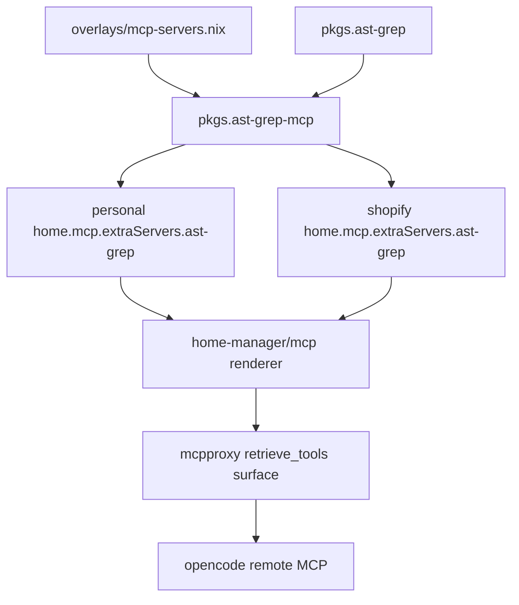

# Design Document

## Overview

The ast-grep MCP feature packages `ast-grep/ast-grep-mcp` and registers it as a stdio upstream through the existing mcpproxy Home Manager module on both nix-darwin hosts.

### Goals

- Add reproducible Nix packaging for the upstream Python MCP server.
- Make ast-grep structural search tools discoverable through mcpproxy on personal and Shopify hosts.
- Verify package and rendered config without live searches over user repositories.

### Non-Goals

- Direct opencode MCP wiring.
- New mcpproxy daemon behavior, ranking defaults, or routing modes.
- HTTP/SSE launchd service, port ownership, or background services.
- New secrets or required API keys.
- Automated `find_code` or `find_code_by_rule` calls against the repo.

## Boundary Commitments

### This Spec Owns

- `pkgs.ast-grep-mcp` package and executable launcher.
- Both-host `home.mcp.extraServers.ast-grep` declarations.
- A flake check that validates the package and rendered mcpproxy entries.
- Operator notes for post-switch discovery and explicit project path use.

### Out of Boundary

- `home-manager/mcp/default.nix` renderer semantics except consuming the existing option shape.
- Opencode's MCP remote config and wrapper preflight.
- Secret bridge, Keychain layout, file-sourced env, and startup gate policy.
- Default ast-grep project configs or organization-wide rule libraries.

### Allowed Dependencies

- Existing `overlays/mcp-servers.nix` package patterns.
- Existing `home.mcp.extraServers` option and mcpproxy renderer.
- Existing per-host Home Manager configs.
- `pkgs.ast-grep` and `pkgs.python313Packages` from the flake's nixpkgs input.

### Revalidation Triggers

- Upstream changes its Python entrypoint, CLI arguments, or transport defaults.
- Upstream requires secrets, a project path at startup, or a long-running HTTP/SSE process.
- Nixpkgs removes or renames required Python 3.13 packages.
- mcpproxy changes stdio server config shape.

## Architecture

### Existing Architecture Analysis

New MCP upstreams should be added as host config data under `home.mcp.extraServers`, not by changing opencode config or the mcpproxy renderer. The completed grep-app integration already provides package/register/check precedent; ast-grep differs by using Python plus an external CLI instead of Node.

### Architecture Pattern & Boundary Map



- Selected pattern: packaged stdio upstream registered through host config.
- Dependency direction: overlay package → host extra server → existing renderer → mcpproxy.
- No new daemon, port, or direct opencode entry is introduced.

### Technology Stack

| Layer | Choice | Role | Notes |
|-------|--------|------|-------|
| Package | Python wrapper derivation | Build/copy upstream server and expose launcher | Avoids requiring `uv sync` at runtime. |
| Runtime | Python 3.13 plus `ast-grep` CLI | MCP process spawned by mcpproxy | Launcher adds dependencies and CLI to runtime path. |
| Configuration | Home Manager `home.mcp.extraServers` | Host registration | Existing renderer translates to mcpproxy server array. |
| Verification | Node `node:test` plus Nix eval/build | Deterministic checks | No live repo searches. |

## File Structure Plan

### New Files

- `tests/ast-grep-mcp/hm-render.test.js` — Builds/evaluates package metadata and both host rendered mcpproxy entries.
- `tests/ast-grep-mcp/README.md` — Automated check notes and manual post-switch mcpproxy smoke guidance.

### Modified Files

- `overlays/mcp-servers.nix` — Adds `ast-grep-mcp` package.
- `configurations/personal/home-manager/default.nix` — Adds `extraServers.ast-grep` stdio entry.
- `configurations/shopify/home-manager/default.nix` — Adds `extraServers.ast-grep` stdio entry.
- `flake.nix` — Adds an `ast-grep-mcp` check that runs the render/package suite.

## Requirements Traceability

| Requirement | Summary | Components | Interfaces | Flows |
|-------------|---------|------------|------------|-------|
| 1.1-1.6 | Reproducible package | Package | Package executable | Build |
| 2.1-2.6 | Both-host registration | Host registration | `home.mcp.extraServers` | Render |
| 3.1-3.5 | mcpproxy discovery contract | Host registration, Validation | retrieve_tools/call wrapper expectation | Runtime route |
| 4.1-4.5 | Deterministic verification | Validation | Flake check | Test |
| 5.1-5.5 | Operator boundaries | Package, Host registration, Validation | Existing MCP contracts | Render/test |

## Components and Interfaces

| Component | Domain/Layer | Intent | Req Coverage | Key Dependencies | Contracts |
|-----------|--------------|--------|--------------|------------------|-----------|
| Package | Overlay | Build and expose ast-grep MCP | 1, 4, 5 | Upstream GitHub source P0, Python P0, ast-grep CLI P0 | Service |
| Host Registration | Home Manager | Add upstream on both hosts | 2, 3, 5 | Package P0, mcpproxy renderer P0 | State |
| Validation | Tests/flake | Prove package and render state | 4, 5 | Nix eval P0, Node test P1 | Test |

### Package

| Field | Detail |
|-------|--------|
| Intent | Provide a Nix-built executable for the upstream stdio MCP server. |
| Requirements | 1.1, 1.2, 1.3, 1.4, 1.5, 1.6, 4.1, 4.2, 5.3 |

**Responsibilities & Constraints**
- Pins upstream source to a commit.
- Uses Python 3.13 with `mcp`, `pydantic`, and `pyyaml` from nixpkgs.
- Adds `pkgs.ast-grep` to runtime `PATH`.
- Installs a wrapper executable named `ast-grep-mcp`.
- Supports `--help` as the finite smoke path.

**Service Interface**
```nix
pkgs.ast-grep-mcp = stdenv.mkDerivation {
  pname = "ast-grep-mcp";
  version = "0.1.0";
  src = fetchFromGitHub { owner = "ast-grep"; repo = "ast-grep-mcp"; ... };
};
```
- Preconditions: upstream source contains `main.py`; nixpkgs has the required Python packages and `ast-grep`.
- Postconditions: `${pkgs.ast-grep-mcp}/bin/ast-grep-mcp --help` exits cleanly and stdio mode starts when run without `--help`.
- Invariants: no local checkout, `uv sync`, or mutable Python environment is needed.

### Host Registration

| Field | Detail |
|-------|--------|
| Intent | Register ast-grep as a mcpproxy-spawned stdio upstream on both hosts. |
| Requirements | 2.1, 2.2, 2.3, 2.4, 2.5, 2.6, 3.1, 3.3, 3.4, 5.1, 5.2, 5.4 |

**State Contract**
```nix
home.mcp.extraServers.ast-grep = {
  command = "${pkgs.ast-grep-mcp}/bin/ast-grep-mcp";
};
```
- Preconditions: `home-manager/mcp` is imported and mcpproxy is enabled.
- Postconditions: rendered `mcp_config.json` includes a stdio server named `ast-grep`.
- Invariants: opencode still has only the mcpproxy remote MCP entry.

### Validation

| Field | Detail |
|-------|--------|
| Intent | Catch packaging and registration regressions without live structural searches. |
| Requirements | 4.1, 4.2, 4.3, 4.4, 4.5, 5.1, 5.2, 5.3, 5.5 |

**Test Contract**
- Build/evaluate `pkgs.ast-grep-mcp`.
- Assert the package exposes `bin/ast-grep-mcp`.
- Run `ast-grep-mcp --help` as the finite startup path.
- Render personal and Shopify Home Manager config and inspect the mcpproxy server list.
- Assert no direct opencode MCP entry for ast-grep exists.
- Avoid invoking `find_code`, `find_code_by_rule`, or searches against the repo.

## Testing Strategy

- Add `node --test tests/ast-grep-mcp/` as the local suite.
- Add `checks.aarch64-darwin.ast-grep-mcp` in `flake.nix` with Nix flakes enabled.
- Run package and render assertions inside a copied writable source.
- Include negative assertions proving no direct opencode MCP entry and no new secrets are added.
- Document manual post-switch discovery through mcpproxy `retrieve_tools`; keep ast-grep out of startup gates.

## Risks and Mitigations

| Risk | Mitigation |
|------|------------|
| Upstream has no release tags | Pin a commit hash and record the source in package metadata/tests. |
| `pyproject.toml` lacks a build-system table | Use a wrapper derivation that copies `main.py` and runs it with Nix Python dependencies. |
| Server cannot find `ast-grep` | Wrapper prepends `pkgs.ast-grep` to `PATH`; tests assert `--help` and wrapper output shape. |
| Search tools read large local trees | Automated checks never invoke search tools; README requires explicit operator-chosen paths. |
| Custom `sgconfig.yaml` varies by project | Leave config unset by default; document optional `--config` / `AST_GREP_CONFIG` as manual extension. |
