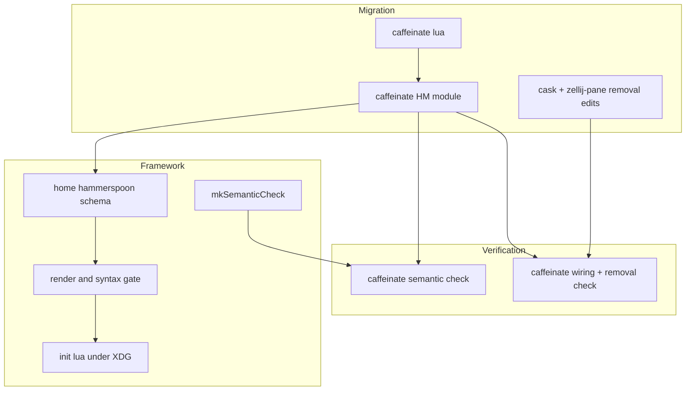
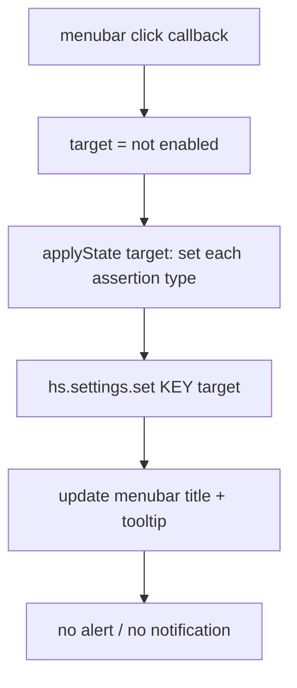
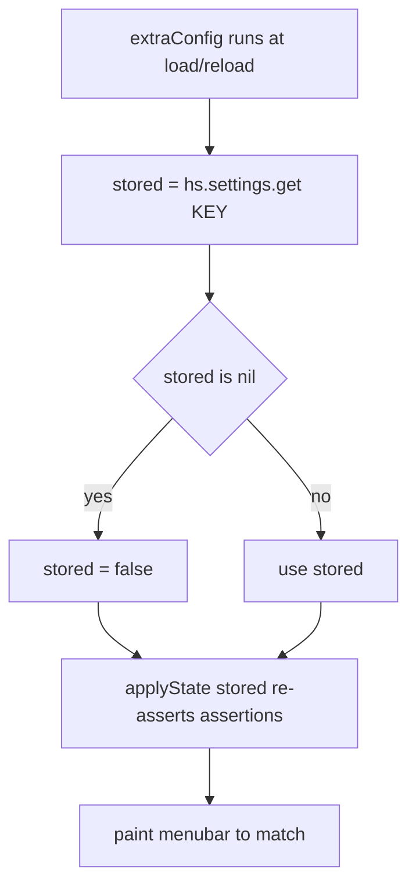

# Design Document

## Overview
**Purpose**: Replace the `domzilla-caffeine` menu-bar app (personal) and the always-on `caffeinate -dimsu` zellij pane (Shopify) with one declarative, menu-bar caffeinate toggle built on the implemented `hammerspoon-keybindings` framework, and remove both legacy mechanisms.
**Users**: The operator clicks a menu-bar item on either darwin host to enable or disable caffeinate; the icon shows the current state and toggling is silent.
**Impact**: Adds the framework's first menu-bar-only consumer (no keybinding), retiring a Homebrew-cask app on one host and a terminal-pinned process on the other.

### Goals
- A persistent menu-bar item whose click toggles caffeinate, with a state-distinct icon and no alert or notification.
- `caffeinate -dimsu`-equivalent sleep prevention while enabled (`displayIdle` + `systemIdle` + `system`).
- On/off state persisted across Hammerspoon reloads and restarts, re-asserted on load.
- The `domzilla-caffeine` cask (personal) and the `caffeinate -dimsu` zellij pane (Shopify) removed in the same change that delivers the toggle.
- Static flake-check coverage of the rendered config (semantic validity + per-host wiring/removal), host-free.

### Non-Goals
- The keybinding framework, Hammerspoon install, XDG config location, auto-reload, syntax gate, and generic action types (owned by `hammerspoon-keybindings`).
- A global hotkey for caffeinate; timed/scheduled/auto-off caffeinate; per-application or battery-aware behavior.
- Preventing disk-idle sleep (`caffeinate -m` has no `hs.caffeinate` equivalent).
- The `hammerspoon-mic-mute` module (sibling consumer); runtime/behavioral verification on a host.

## Boundary Commitments

### This Spec Owns
- The caffeinate menu-bar Lua delivered through the framework's `extraConfig` (no keybinding).
- The caffeinate runtime: the assertion set apply/clear, `hs.settings` persistence and re-assert on init, the menu-bar item create/paint, the click-to-toggle handler, and the silent (no-alert) toggle path.
- The legacy teardown: removing the `domzilla-caffeine` cask (personal) and the `caffeinate -dimsu` zellij pane (Shopify).
- The verification checks for this feature: the caffeinate live/isolated semantic check and the per-host wiring/removal assertions.

### Out of Boundary
- The `home.hammerspoon` options schema, renderer, syntax gate, `mkSemanticCheck` derivation, install, launchd agent, and Accessibility documentation (framework).
- The `hammerspoon-mic-mute` module, its binding, and its flake checks (sibling) — not edited.
- The framework's and the mic-mute's existing flake checks — this spec adds attrs beside them, never edits them.
- Disk-idle (`-m`) prevention; any keybinding or hotkey.

### Allowed Dependencies
- The framework `home.hammerspoon.extraConfig` option (`types.lines`) and the renderer postcondition that `extraConfig` is emitted into `init.lua` and runs at load/reload.
- The framework's reused `mkSemanticCheck` derivation and `hammerspoonHsAnnotations`, and `render.nix` (for rendering a host's config string in the wiring check).
- Hammerspoon runtime APIs: `hs.caffeinate` (`set`, `get`, `toggle`), `hs.menubar` (`new`, `setClickCallback`, `setTitle`, `setTooltip`), `hs.settings` (`set`, `get`).
- The personal darwin `homebrew.casks` list (`configurations/personal/default.nix`) and the Shopify zellij layout module (`configurations/shopify/home-manager/zellij.nix`).

### Revalidation Triggers
- A change to the framework `extraConfig` option or to the renderer emitting `extraConfig` at load → re-check delivery and the load-time init.
- A change to `mkSemanticCheck`'s signature or the host-config eval path (`darwinConfigurations.<host>.config.home-manager.users.<user>.home.hammerspoon`) → re-check verification.
- A Hammerspoon version bump that changes the `hs.caffeinate`/`menubar`/`settings` API surface → re-check the Lua against regenerated annotations.
- A future consumer that also drives `hs.caffeinate` or adds a competing always-on menu-bar item → coordinate single ownership of the caffeinate assertions.

## Architecture

### Existing Architecture Analysis
- The framework is implemented and enabled: `home.hammerspoon.enable = true` is set once in `home-manager/common/default.nix`, which already imports `./hammerspoon-keybindings` and `./hammerspoon-mic-mute`; both hosts inherit it.
- `hammerspoon-mic-mute` is the working menu-bar consumer precedent (plain-upvalue `hs.menubar`, an `updateMenubar` painter, a toggle). This feature clones that shape minus the keybinding and minus `hs.alert`.
- The legacy mechanisms live in per-host files, not `common-darwin`: the cask in `configurations/personal/default.nix:55`; the pane in `configurations/shopify/home-manager/zellij.nix:41-44` (with a layout comment at line 14). The toggle is delivered via `home-manager/common` (both hosts); the removals are per-host.
- Both hosts are `aarch64-darwin`; the shared module is darwin-only in practice (no platform guard needed).

### Architecture Pattern & Boundary Map
Pattern: a thin, menu-bar-only consumer module layered on the framework. Dependency direction (left never imports right): `caffeinate lua → caffeinate HM module → framework schema → render+gate → init.lua`. Verification reads each host's live config; teardown edits two per-host files.



Key decisions: the caffeinate logic lives in a real `.lua` file read into `extraConfig`, so it is `stylua`-formattable and runs at load/reload. With no keybinding, the toggle and state are plain locals (no global needed, unlike mic-mute's bind action). The menu-bar item uses `setClickCallback` with no attached menu, so a single click invokes the toggle directly with no dropdown.

### Technology Stack
| Layer | Choice / Version | Role in Feature | Notes |
|-------|------------------|-----------------|-------|
| Runtime | Hammerspoon 1.1.1 `hs.caffeinate`, `hs.menubar`, `hs.settings` | Sleep assertions, menu-bar toggle/indicator, persistence | Symbols verified against 1.1.1 docs (research.md) |
| Config generation | Framework `render.nix` + `checked-config.nix` (reused) | Inline `extraConfig`; syntax gate blocks `switch` | Not modified |
| Install / system | nix-darwin `homebrew.casks` (personal); zellij HM layout (Shopify) | Legacy teardown | Per-host files |
| Verification | Framework `mkSemanticCheck` + `nix eval`/`render.nix` asserts | Semantic validity + wiring/removal | aarch64-darwin-gated; host-free |

## File Structure Plan

### Created
```
home-manager/common/hammerspoon-caffeinate/
├── default.nix       # HM module: sets home.hammerspoon.extraConfig = readFile ./caffeinate.lua
│                     #   (no keybindings; menu-bar only)
└── caffeinate.lua    # Runtime: plain-upvalue menubar + enabled flag, applyState over the
                      #   assertion set, hs.settings persist + re-assert on init, setClickCallback
                      #   toggle, distinct on/off title; NO hs.alert. Carries a stable sentinel comment.
```

### Modified Files
- `home-manager/common/default.nix` — add `./hammerspoon-caffeinate` to `imports`.
- `configurations/personal/default.nix` — remove `"domzilla-caffeine"` from `homebrew.casks`.
- `configurations/shopify/home-manager/zellij.nix` — remove the `caffeinate -dimsu` pane node from the `stats` tab and drop its mention in the layout comment; the right column keeps the `mcpproxy tui` pane.
- `flake.nix` — in the existing aarch64-gated `hammerspoonChecks` block, add `hammerspoon-caffeinate-semantic` and `hammerspoon-caffeinate-wiring` beside the existing checks (existing checks unchanged).

### Deleted
- None.

## System Flows

Toggle via menu-bar click (R1, R2, R3, R4):


Load / reload init and persistence (R5):


Assertions are per-process and dropped on `hs.reload()`/quit, so `applyState` re-runs on every load to restore them from the persisted boolean. The `system`/`systemIdle` assertions are honored by macOS on AC power only; `displayIdle` is the dominant always-on assertion.

## Requirements Traceability
| Requirement | Summary | Components | Interfaces | Flows |
|-------------|---------|------------|------------|-------|
| 1.1 | Persistent menu-bar item | Caffeinate Lua | `hs.menubar.new` | Toggle |
| 1.2 | Click enables when disabled | Caffeinate Lua | `setClickCallback` → setState(true) | Toggle |
| 1.3 | Click disables when enabled | Caffeinate Lua | `setClickCallback` → setState(false) | Toggle |
| 1.4 | Direct click, no dropdown | Caffeinate Lua | `setClickCallback`, no `setMenu` | Toggle |
| 2.1 | Prevent display sleep | Caffeinate Lua | `hs.caffeinate.set("displayIdle", on)` | Toggle / Init |
| 2.2 | Prevent system idle-sleep | Caffeinate Lua | `set("systemIdle", on)` | Toggle / Init |
| 2.3 | Prevent system sleep on AC | Caffeinate Lua | `set("system", on)` | Toggle / Init |
| 2.4 | Allow sleep when disabled | Caffeinate Lua | `applyState(false)` clears all | Toggle |
| 3.1 | Enabled indicator distinct | Caffeinate Lua | `setTitle` enabled glyph | Toggle / Init |
| 3.2 | Disabled indicator distinct | Caffeinate Lua | `setTitle` disabled glyph | Toggle / Init |
| 3.3 | Indicator updates on change | Caffeinate Lua | `updateMenubar` | Toggle / Init |
| 4.1 | No on-screen alert | Caffeinate Lua | absence of `hs.alert` | Toggle |
| 4.2 | No notification/banner/sound | Caffeinate Lua | absence of notify APIs | Toggle |
| 5.1 | Persist toggled state | Caffeinate Lua | `hs.settings.set` | Toggle |
| 5.2 | Restore enabled + re-assert | Caffeinate Lua | `hs.settings.get` → `applyState` | Init |
| 5.3 | Restore disabled state | Caffeinate Lua | `hs.settings.get` → `applyState` | Init |
| 5.4 | Indicator reflects restored state | Caffeinate Lua | `updateMenubar` | Init |
| 5.5 | Default disabled when unset | Caffeinate Lua | `get` nil → false | Init |
| 6.1 | No `domzilla-caffeine` cask | Caffeinate Teardown | `homebrew.casks` (personal) | - |
| 6.2 | No `caffeinate -dimsu` pane | Caffeinate Teardown | zellij layout (Shopify) | - |
| 6.3 | Caffeine app gone on switch | Caffeinate Teardown | `cleanup = "zap"` | - |
| 6.4 | Toggle lands with removal | Caffeinate HM Module, Teardown | same change set | - |
| 7.1 | Rendered config semantically valid | Verification | `mkSemanticCheck` | - |
| 7.2 | Toggle present both hosts | Verification | `render.nix` + sentinel assert | - |
| 7.3 | Legacy mechanisms absent | Verification | `nix eval` asserts | - |
| 7.4 | Checks host-free | Verification | eval + build only | - |

## Components and Interfaces

| Component | Layer | Intent | Req Coverage | Key Dependencies (P0/P1) | Contracts |
|-----------|-------|--------|--------------|--------------------------|-----------|
| Caffeinate Lua | Runtime | Toggle, assertions, persistence, indicator | 1.1-1.4, 2.1-2.4, 3.1-3.3, 4.1-4.2, 5.1-5.5 | hs.caffeinate/menubar/settings (P0) | State |
| Caffeinate HM Module | Home Manager | Deliver Lua via extraConfig (no binding) | 6.4 | framework schema (P0) | Service |
| Caffeinate Teardown | nix-darwin / HM | Remove cask + zellij pane | 6.1-6.4 | homebrew.casks, zellij layout (P0) | State |
| Verification | flake checks | Semantic + wiring/removal asserts | 7.1-7.4, 6.1-6.2 | mkSemanticCheck (P0), host eval/render (P0) | Batch |

### Runtime

#### Caffeinate Lua
| Field | Detail |
|-------|--------|
| Intent | The caffeinate runtime: menu-bar toggle, assertion set, persistence, indicator |
| Requirements | 1.1-1.4, 2.1-2.4, 3.1-3.3, 4.1-4.2, 5.1-5.5 |

**Responsibilities & Constraints**
- Defines, as chunk-local upvalues, the menu-bar object (`local caffeineMenubar = hs.menubar.new()`), the logical state (`local enabled`), the persistence key (`local SETTINGS_KEY = "caffeinate.enabled"`), and the assertion set (`local SLEEP_TYPES = { "displayIdle", "systemIdle", "system" }`). Runs top-level at load (re-run on each `hs.reload`).
- **Object-handle rule (semantic-check constraint, verified)**: the `hs.menubar` handle MUST be a plain upvalue, never a `nil`-initialized table field. The generated annotations carry no `---@return` for `hs.menubar.new`, so a plain local stays untyped and its method calls (`:setTitle`, `:setTooltip`, `:setClickCallback`) pass the semantic check; a `nil`-init table field would be inferred to a concrete type and false-positive `undefined-field`. See research.md.
- `applyState(on)`: for each `t` in `SLEEP_TYPES`, call `hs.caffeinate.set(t, on)` (re-assert; 2.1-2.4). Clears all when `on` is false.
- `updateMenubar()`: set a distinct title per state — enabled `"☕"`, disabled `"💤"` (concrete glyphs are an implementation choice; they must be visually distinct; 3.1-3.3) — plus a state tooltip. Guards on a non-nil `caffeineMenubar`.
- `setState(on)`: set `enabled = on`; `applyState(on)`; `hs.settings.set(SETTINGS_KEY, on)` (5.1); `updateMenubar()`. Emits no `hs.alert` and posts no notification (4.1-4.2).
- Click handler: `caffeineMenubar:setClickCallback(function() setState(not enabled) end)` with no `setMenu`, so a single click toggles directly (1.2-1.4).
- Init: `local stored = hs.settings.get(SETTINGS_KEY)`; if `stored == nil` treat as `false` (5.5); `setState(stored)` to re-assert and paint to match the restored state (5.2-5.4). Because assertions are per-process, this re-assert on every load is what restores them after a reload/restart.
- Retention: the menu-bar upvalue and `enabled` are captured by the click callback (retained by Hammerspoon for the session), so they are not garbage-collected.

**Contracts**: State
- State model: `enabled` is the single logical source of truth; the persisted `SETTINGS_KEY` boolean mirrors it and survives reload/restart (NSUserDefaults domain `org.hammerspoon.Hammerspoon`). The live `hs.caffeinate` assertions are process-local and reconstructed from the persisted boolean on init.
- The menu-bar item shows distinct enabled/disabled titles (3.1-3.2) and updates on every state change and on init (3.3, 5.4).

**Implementation Notes**
- Integration: delivered verbatim into `init.lua` via the framework `extraConfig`; syntax-validated by the framework gate at `switch`; semantically validated by the Verification check in CI. Carries a stable sentinel comment (e.g. `-- hammerspoon-caffeinate: menu-bar toggle`) that the wiring check asserts on (7.2).
- No Accessibility dependency: `hs.caffeinate` uses IOKit power assertions and `hs.menubar` needs no grant, so the toggle works whether or not the framework's one-time Accessibility grant is in place.
- Risks: object GC (mitigated by the retained upvalue); `caffeinate -m` disk-idle has no equivalent (documented gap, accepted); `system`/`systemIdle` are AC-only (macOS behavior, reflected in R2.3).

#### Caffeinate HM Module
| Field | Detail |
|-------|--------|
| Intent | Deliver the caffeinate Lua through the framework (no keybinding) |
| Requirements | 6.4 |

**Responsibilities & Constraints**
- Sets `home.hammerspoon.extraConfig = builtins.readFile ./caffeinate.lua`. Sets no `keybindings` (menu-bar only).
- Imported from `home-manager/common/default.nix`, so the toggle reaches both hosts through the shared config. No platform guard (darwin-only consumers).

**Contracts**: Service
- Consumes the framework schema; module-merge concatenates this `extraConfig` with the mic-mute consumer's. No `enable` coupling: the framework renders these only when `home.hammerspoon.enable` is true (it is).

**Implementation Notes**
- Integration: the renderer emits all `extraConfig` chunks into `init.lua` ahead of the (mic-mute) bind; the caffeinate chunk is self-contained and order-independent of the bind.

### System

#### Caffeinate Teardown
| Field | Detail |
|-------|--------|
| Intent | Remove the legacy caffeinate mechanisms, atomically with the toggle |
| Requirements | 6.1, 6.2, 6.3, 6.4 |

**Responsibilities & Constraints**
- Remove `"domzilla-caffeine"` from `homebrew.casks` in `configurations/personal/default.nix` (6.1). On the next `darwin-rebuild switch`, `homebrew.onActivation.cleanup = "zap"` (repo default) uninstalls the Caffeine app (6.3).
- Remove the `caffeinate -dimsu` pane node from the Shopify zellij `stats` tab and its layout-comment mention in `configurations/shopify/home-manager/zellij.nix` (6.2); the `mcpproxy tui` pane remains.
- Lands in the same change set as the Caffeinate HM Module so caffeinate is never absent on a switched host (6.4).

**Contracts**: State
- Post-state: no `domzilla-caffeine` cask in the personal config; no `caffeinate` command pane in the Shopify rendered zellij layout.

### Verification

#### Verification
| Field | Detail |
|-------|--------|
| Intent | Prove the rendered config is semantically valid and wired, and the legacy mechanisms are gone, host-free |
| Requirements | 7.1, 7.2, 7.3, 7.4, 6.1, 6.2 |

**Responsibilities & Constraints**
- `hammerspoon-caffeinate-semantic`: build `mkSemanticCheck` over an isolated caffeinate cfg `{ keybindings = []; extraConfig = builtins.readFile ./caffeinate.lua; reloadOnConfigChange = true; }`. Building it proves the caffeinate Lua's `hs.*` references exist — `hs.caffeinate.set/get/toggle`, `hs.menubar.new`, `hs.settings.set/get` (7.1). Object-method calls pass under the object-handle rule; the load-bearing coverage is `hs.*` path existence. Isolated input keeps ownership independent of the mic-mute consumer. aarch64-gated, host-free (7.4).
- `hammerspoon-caffeinate-wiring`: per-host (`ShopifyLaptop`, `Brandons-MacBook-Pro`) `nix eval` assertions, mirroring the framework's host-wiring pattern. Render each host's live `home.hammerspoon` cfg via `render.nix` and assert the output contains the caffeinate sentinel comment (7.2). Assert `"domzilla-caffeine"` is absent from the personal host's `homebrew.casks` (6.1, 7.3). Assert the Shopify host's rendered `xdg.configFile."zellij/layouts/default.kdl".text` contains no `command "caffeinate"` (6.2, 7.3).

**Contracts**: Batch
- Trigger: `nix flake check` on `aarch64-darwin`. Output: success markers; failure on a nonexistent `hs` symbol, a missing caffeinate sentinel on either host, a residual `domzilla-caffeine` cask, or a residual `caffeinate` zellij pane.
- Both attrs are added inside the framework's existing `hammerspoonChecks` `optionalAttrs (system == "aarch64-darwin")` block; the framework's and mic-mute's attrs are not modified.

## Data Models

### Caffeinate state (Lua upvalues + persisted setting)
- Scalar: `enabled : bool` — the logical toggle, the single source of truth.
- Object handle: `caffeineMenubar : hs.menubar` — a plain upvalue (not a table field; object-handle rule).
- Persisted: `hs.settings` key `caffeinate.enabled : bool` — mirrors `enabled`, survives reload/restart, defaults to `false` when unset.
- Invariants: on init, `enabled` is derived from the persisted setting (false if nil) and the live assertions are reconstructed via `applyState`; the menu-bar title always matches `enabled`.

## Error Handling

### Error Strategy
- **Unset persisted state**: `hs.settings.get` returns nil → treated as disabled (5.5; not an error).
- **Disk-idle not supported**: `caffeinate -m` has no `hs.caffeinate` type → out of scope, documented; `displayIdle`+`systemIdle`+`system` are the achievable set.
- **Invalid Lua (build-time)**: the framework syntax gate (`luac -p`) fails `darwin-rebuild switch` (framework-owned).
- **Nonexistent `hs` symbol (CI)**: `hammerspoon-caffeinate-semantic` fails `nix flake check` (7.1), never a rebuild.

### Monitoring
- No new logging surface; the Hammerspoon console is the runtime log, and the flake checks are the pre-activation gate.

## Testing Strategy

### Build / Static (automated, host-free)
- `hammerspoon-caffeinate-semantic` builds `mkSemanticCheck` over the caffeinate config and succeeds (7.1).
- `hammerspoon-caffeinate-wiring` asserts the caffeinate sentinel is present in both hosts' rendered config (7.2), the `domzilla-caffeine` cask is absent (6.1/7.3), and the Shopify zellij layout has no `caffeinate` pane (6.2/7.3).
- Inherited: the framework syntax gate over the live config blocks `switch` on invalid caffeinate Lua.

### Manual Smoke (operator, runtime — out of automated scope)
- Clicking the menu-bar item toggles caffeinate with no alert/notification (1.1-1.4, 4.1-4.2); the icon changes between distinct on/off glyphs (3.1-3.3); the display does not sleep while enabled and sleeps normally when disabled (2.1-2.4); after a config rebuild (reload) the prior state is restored (5.1-5.4); after `switch`, the Caffeine app is gone on the personal host (6.3).

## Security Considerations
- No new powerful grant: `hs.caffeinate` power assertions and `hs.menubar` need no TCC/Accessibility permission, so this feature adds no entitlement beyond what Hammerspoon already has. The caffeinate Lua is operator-authored, trusted input, delivered through the same syntax/semantic gates as any framework config.
