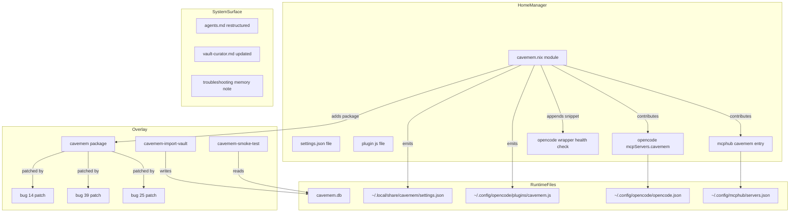
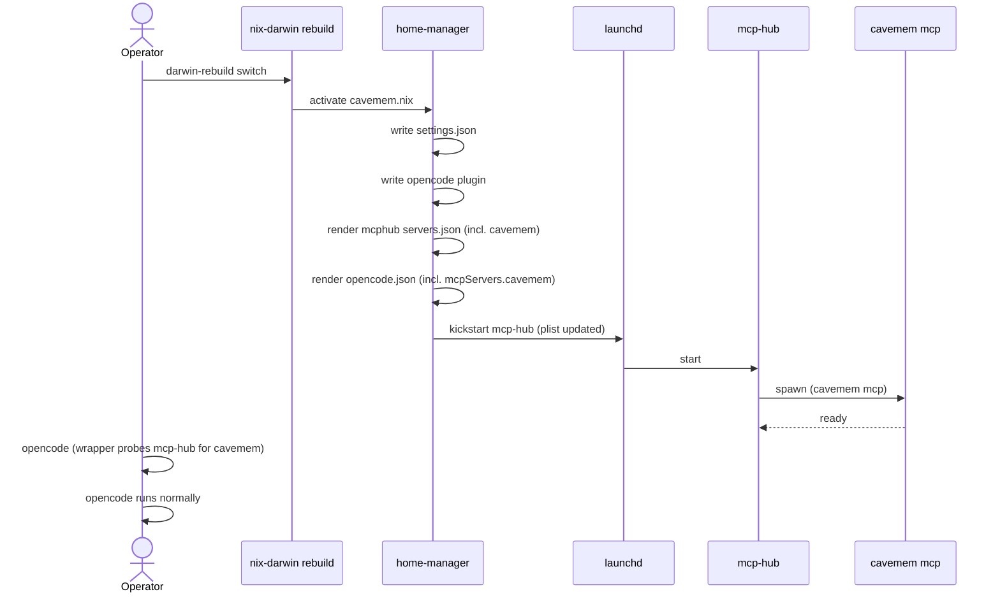
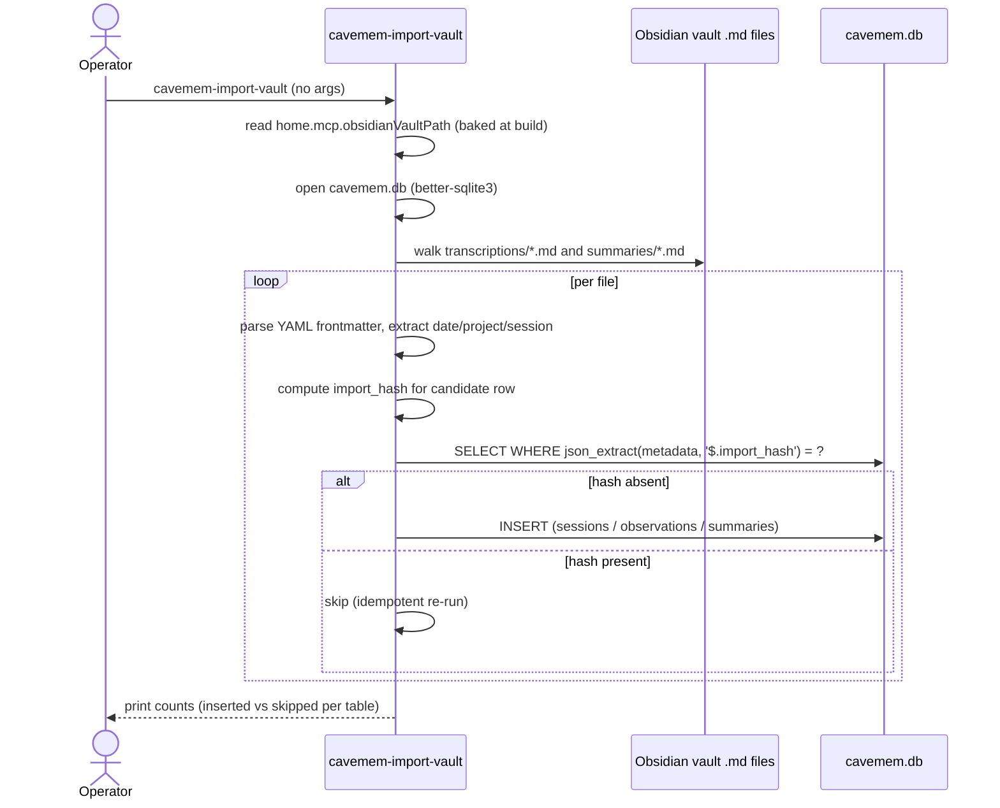
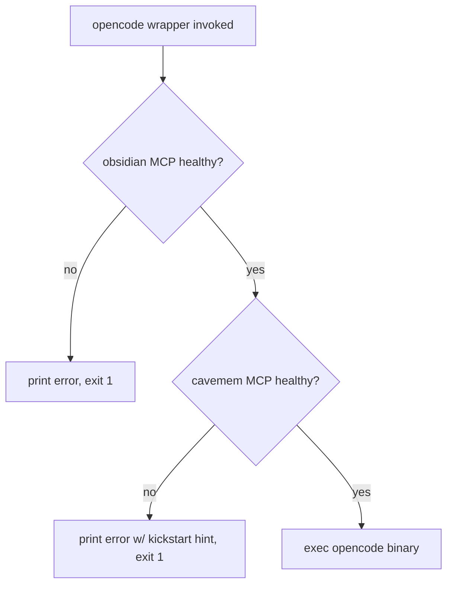

# Design Document: cavemem-integration

## Overview

**Purpose**: Make JuliusBrussee/cavemem the ambient capture layer for opencode
sessions on this nix-darwin host fleet by vendoring it with three
upstream-deferred bug fixes patched in, wiring it into opencode entirely
through home-manager (no `cavemem install`), restructuring AGENTS.md so
agents stop spending context on transcription/summary bookkeeping that
cavemem now handles automatically, and migrating the existing 111
transcription + 91 summary `.md` notes into cavemem.db via a custom
SQLite-direct importer.

**Users**: The two-host nix-darwin operator (Shopify + personal) is the only
direct user. Downstream specs (`vault-synthesizer-agent`, `memory-sync-cli`,
the `sqlite-backup` extension) are downstream consumers of the contracts
this spec stabilizes.

**Impact**: Removes ~150 lines of transcription/summary instructions from
`home-manager/common/agents.md`, reclaiming agent context budget. Keeps
the curated-memory workflow exactly as-is. Adds one new daemon to
mcphub's launchd-managed server set. Adds one new failure mode to the
opencode wrapper (cavemem MCP unreachable → refuse to start), matching
the existing obsidian invariant.

### Goals

- Cavemem v0.2.1 + 3 patches available on PATH on both hosts via the
  overlay.
- Cavemem MCP wired into mcphub and opencode through home-manager only;
  zero imperative configuration.
- Existing 111 + 91 transcription/summary notes migrated into cavemem.db
  idempotently.
- AGENTS.md restructured so transcription/summary write rules are gone,
  memory creation rules remain intact and well-anchored.
- Opencode wrapper refuses to start when cavemem MCP is unreachable.
- Three smoke tests prove the patched bugs are actually fixed at runtime.

### Non-Goals

- Vault-synthesizer subagent (separate spec).
- `memory-sync` orchestration command (separate spec).
- Adding cavemem.db to the sqlite-backup target list (separate
  existing-spec extension).
- Cross-host cavemem.db sync.
- Auto-scheduled cavemem maintenance (compaction, vacuum, reindex).
- A roundtripping cavemem → `.md` exporter.
- Patching cavemem bugs unrelated to this integration (#11, #18, #20,
  #28, #37 stay upstream's problem).

## Boundary Commitments

### This Spec Owns

- The cavemem package definition in `overlays/mcp-servers.nix`,
  including the three `.patch` files in `overlays/`.
- The home-manager module at `home-manager/common/cavemem.nix` and
  every option it exposes (`home.cavemem.*`).
- The vendored opencode plugin source at
  `home-manager/common/opencode-plugins/cavemem.js`.
- The cavemem mcphub server entry (server name: literal `cavemem`).
- The cavemem `mcpServers.cavemem` entry contributed via
  `programs.opencode.settings.mcpServers`.
- The opencode wrapper extension that probes cavemem MCP availability.
- The restructured `home-manager/common/agents.md`.
- The updated `home-manager/common/agents/vault-curator.md`.
- The custom importer script package and its source at
  `scripts/cavemem-import-vault.nix`.
- The smoke-test script package at `scripts/cavemem-smoke-test.nix`.
- The Obsidian troubleshooting memory note (Requirement 11).

### Out of Boundary

- The vault-synthesizer subagent definition (consumer of this spec's
  cavemem MCP and AGENTS.md memory block).
- The `memory-sync` orchestration command.
- Adding `cavemem.db` to the sqlite-backup manifest's database list.
- Cross-host sync of cavemem.db.
- Modifying or replacing existing transcription/summary `.md` files
  after migration (they remain on disk as historical archives).
- Any change to the existing `home.mcp.obsidianVaultPath` option or
  the obsidian MCP wiring.
- Any change to the existing memory note format, memory criteria
  rules, or vault-curator behavior beyond the topology update.

### Allowed Dependencies

- `pkgs.unstable.nodejs` (or whatever Node nixpkgs 25.11 currently
  pins) for the cavemem package and the importer script.
- `pkgs.makeWrapper` for the cavemem binary wrapper (matches
  `mcp-obsidian` pattern).
- `pkgs.writeShellApplication` for the importer and smoke-test
  scripts (matches `cc-sdd-init` and `sqlite-backup` pattern).
- The existing `home.mcp.extraServers` option and
  `programs.opencode.settings.mcpServers` surface — no new abstraction
  is introduced for either.
- `home.mcp.obsidianVaultPath` is read by the importer at module
  evaluation time (not modified).
- The existing `home.opencode.wrapperCommands` list is appended to
  for the cavemem health check; no new option is introduced.

### Revalidation Triggers

- Cavemem version bump (any change to upstream package version): the
  three patches MUST be re-cherry-picked and the smoke tests MUST be
  re-run; the vendored plugin source MAY also need a refresh.
- Cavemem schema migration (new column on `sessions`/`observations`/
  `summaries`): the importer's content-hash mechanism survives, but
  insert column lists must be revisited.
- Mcphub server name change for cavemem: would invalidate the
  vault-synthesizer agent's tool allow-list (Requirement 10.AC2).
- AGENTS.md memory block heading or anchor change: would invalidate
  the synthesizer agent's quote-verbatim assumption (Requirement
  10.AC3). Removing either `sessions:` placeholder shape (Requirement
  6.AC4) would break either human-driven or synthesizer-driven memory
  writes.
- Cavemem MCP tool rename, removal, or replacement (any of
  `list_sessions`, `timeline`, `get_observations`, `search`): would
  invalidate the vault-synthesizer-agent's tool allow-list
  (Requirement 10.AC6); caught at runtime by the smoke test
  (Requirement 9.AC6) before the version bump lands.
- Vendored plugin source path change: would invalidate the
  version-bump procedure that updates package and plugin together
  (Requirement 10.AC4).
- Embedding provider option shape change: downstream specs do not
  read these directly, but settings.json shape downstream of the
  options does affect cavemem behavior; document in the troubleshooting
  memory.
- Vault path change (`home.mcp.obsidianVaultPath`): the importer reads
  this; rename would force a one-time re-run.

## Architecture

### Existing Architecture Analysis

**MCP server pattern**: Existing MCP servers (obsidian, github, nixos,
gcloud-mcp, etc.) follow a single shape — packaged in
`overlays/mcp-servers.nix` (or a sibling overlay), wired into mcphub
via `xdg.configFile."mcphub/servers.json"` in `home-manager/mcp/default.nix`.
The `home.mcp.extraServers` option lets host-level modules contribute
servers without modifying the central servers.json render. Cavemem
joins this set; no abstraction change.

**Opencode wiring**: `programs.opencode.settings` is an attrset that
HM serializes into `~/.config/opencode/opencode.json`. Adding
`mcpServers.cavemem` is a single attrset addition in the cavemem HM
module. The wrapper at `home-manager/common/opencode.nix` provides
the `home.opencode.wrapperCommands` list option; the cavemem health
check appends one shell snippet to that list. No new opencode
abstraction.

**Script packaging**: `scripts/cc-sdd-init.nix` and
`scripts/sqlite-backup-cli.nix` use `pkgs.writeShellApplication`. The
importer and smoke-test scripts follow the same pattern. The importer
additionally needs `node` plus a vendored `node_modules` with
`better-sqlite3` and `js-yaml`; this is shipped as a `buildNpmPackage`
sub-derivation referenced by the script wrapper.

**Vault path resolution**: `home.mcp.obsidianVaultPath` is mandatory
on every host today (asserted in `home-manager/mcp/default.nix`).
The importer reads it through Nix interpolation at module eval time
so the operator never has to pass `--vault` at the command line.

### Architecture Pattern & Boundary Map



**Architecture Integration**:

- Selected pattern: vendor + patch overlay package combined with a
  declarative-only home-manager module. No new abstraction layers.
- Domain/feature boundaries: package (overlay) vs configuration (HM
  module) vs documentation (agents.md, vault-curator.md, memory note)
  vs operator scripts (importer, smoke-test). Each seam is reviewable
  independently.
- Existing patterns preserved: `mcp-obsidian` packaging shape,
  `home.mcp.extraServers` extension, `programs.opencode.settings`
  contribution, `home.opencode.wrapperCommands` append,
  `writeShellApplication` script wrapping.
- New components rationale: cavemem package (no other source); cavemem
  HM module (option surface for the operator); vendored plugin (avoids
  `cavemem install`); importer (cavemem's broken `cavemem import`);
  smoke tests (regression safety net for patches).
- Steering compliance: declarative-first invariant maintained;
  macOS-only target reflected in patch and smoke-test scope; no GPL
  contamination (cavemem MIT, dependencies MIT/Apache).

### Technology Stack

| Layer | Choice / Version | Role in Feature | Notes |
|-------|------------------|-----------------|-------|
| CLI / Daemon | cavemem v0.2.1 (vendored from JuliusBrussee/cavemem) | Ambient capture, MCP server, search backend | Three `.patch` files cherry-picked from upstream PRs |
| Embedding (default) | Xenova/all-MiniLM-L6-v2 via `@xenova/transformers` | Local vector embedding for hybrid search | Bundled with cavemem; ONNX runtime included |
| Storage | SQLite (better-sqlite3 binding) | Sessions / observations / summaries / FTS5 / embeddings | Single file at `${home.cavemem.dataDir}/cavemem.db` |
| Importer runtime | nodejs 24 (matches host default), better-sqlite3, js-yaml | Reads `.md` notes, INSERTs into cavemem.db | Vendored via `buildNpmPackage` sub-derivation |
| Smoke-test runtime | bash + `pkgs.sqlite` + `pkgs.jq` | Asserts on patched-bug behavior at runtime | `writeShellApplication` |
| HM module | nix (home-manager 25.11) | Declarative options + file generation | New module at `home-manager/common/cavemem.nix` |
| Opencode wrapper | bash snippet appended via `home.opencode.wrapperCommands` | Pre-launch cavemem MCP probe | Reuses existing `wrapperCommands` list option |
| Mcphub server | mcp-hub launchd agent | Hosts cavemem MCP at `/api/...` over local HTTP | Reuses existing `extraServers` extension |

## File Structure Plan

### Directory Structure

```
overlays/
├── mcp-servers.nix                          # Cavemem package added alongside mcp-obsidian
├── cavemem-14-hook-payload-shape.patch      # Bug #14 fix (PR #31, commit f2e2f49)
├── cavemem-39-session-start-cwd-filter.patch # Bug #39 fix (PR #21)
└── cavemem-25-search-alpha-doc.patch        # Bug #25 fix (PR #31)

home-manager/common/
├── cavemem.nix                              # New HM module (option surface + file gen + wiring)
├── agents.md                                # Restructured: transcription/summary removed, memories kept
├── agents/
│   └── vault-curator.md                     # Updated: vault topology section reflects archives
└── opencode-plugins/
    └── cavemem.js                           # Vendored opencode plugin source

home-manager/mcp/
└── default.nix                              # Modified: cavemem entry contributed via host-level extraServers
                                             # (no change to this file's option surface; the cavemem.nix
                                             # module wires cavemem in via home.mcp.extraServers)

scripts/
├── cavemem-import-vault.nix                 # New: writeShellApplication wrapping a Node script
└── cavemem-smoke-test.nix                   # New: writeShellApplication wrapping bash + sqlite + jq

home-manager/common/opencode.nix             # Modified: cavemem health check snippet appended via
                                             # the cavemem.nix module's home.opencode.wrapperCommands
                                             # contribution (no new option introduced)

configurations/                               # Each host's HM profile imports cavemem.nix and
                                             # sets home.cavemem.enable = true
```

### Modified Files

- `overlays/mcp-servers.nix` — adds the cavemem package definition
  (mirrors `mcp-obsidian` shape, plus a `patches = [ ... ]` attribute).
- `home-manager/common/agents.md` — removes the Transcription and
  Session Summary sections; replaces them with an "Ambient capture
  (cavemem)" pointer; updates the Startup Check to require both MCP
  servers; preserves Memory Recall, Memories, Obsidian Tool
  Reference, Tag Guidelines verbatim.
- `home-manager/common/agents/vault-curator.md` — updates the "Vault
  topology" section to mark `conversations/transcriptions/` and
  `conversations/summaries/` as archives; removes any rule that
  implies an agent writes into those directories.
- `home-manager/common/opencode.nix` — no direct edit; the cavemem HM
  module appends to `home.opencode.wrapperCommands` and that triggers
  the existing wrapper composition logic.
- Host HM profiles (`configurations/.../home-manager/...`, exact path
  determined at implementation time) — import `cavemem.nix` and set
  `home.cavemem.enable = true`. This is per-host wiring, not a code
  change to a shared file.

### New Files

- Each item in the directory tree above marked "New" or sitting in a
  new directory (`opencode-plugins/`) is created by this spec.

> Each file has one clear responsibility. The package, patches, and
> overlay-wiring sit in `overlays/`; the option surface and file
> generation sit in `home-manager/common/cavemem.nix`; the vendored
> plugin sits in `home-manager/common/opencode-plugins/`; the operator
> scripts sit in `scripts/`; the documentation lives in agents.md and
> vault-curator.md. There is no shared mutable state between files
> beyond the option values the HM module reads.

## System Flows

### First-time activation flow



### Migration flow (one-shot importer)



### Opencode wrapper pre-launch checks



The cavemem health check appends to the existing wrapperCommands list,
so the obsidian check runs first (preserves prior order). Either
failure aborts before exec; both must pass.

## Requirements Traceability

| Requirement | Summary | Components | Interfaces | Flows |
|-------------|---------|------------|------------|-------|
| 1.1 | cavemem package in overlay | CavememPackage | overlay attr `cavemem` | First-time activation |
| 1.2 | binary on PATH, --version works | CavememPackage | `bin/cavemem` wrapper | First-time activation |
| 1.3 | three patches applied | CavememPackage | `patches = [ ... ]` | n/a (build-time) |
| 1.4 | patch header naming PR/commit | CavememPackage | `.patch` file convention | n/a (build-time) |
| 1.5 | obsoleted patches removed on bump | CavememPackage | overlay attr maintenance | Revalidation Triggers |
| 2.1 | enable option | CavememModule | `home.cavemem.enable` | First-time activation |
| 2.2 | dataDir option with default | CavememModule | `home.cavemem.dataDir` | First-time activation |
| 2.3 | adds package when enabled | CavememModule | `home.packages` contribution | First-time activation |
| 2.4 | settings.json idempotent | CavememModule, SettingsJson | `home.file."${dataDir}/settings.json"` | First-time activation |
| 2.5 | plugin file from vendored source | CavememModule, OpencodePlugin | `xdg.configFile."opencode/plugins/cavemem.js"` | First-time activation |
| 2.6 | no imperative cavemem invocation | CavememModule | (negative assertion) | n/a |
| 2.7 | enable=false leaves nothing behind | CavememModule | `lib.mkIf` gating | n/a |
| 3.1 | embedding.provider enum | CavememModule | `home.cavemem.embedding.provider` | First-time activation |
| 3.2 | embedding.model option | CavememModule | `home.cavemem.embedding.model` | First-time activation |
| 3.3 | embedding endpoint/apiKey options | CavememModule | `home.cavemem.embedding.{endpoint,apiKey}` | First-time activation |
| 3.4 | local provider settings.json shape | SettingsJson | rendered JSON | First-time activation |
| 3.5 | ollama provider settings.json shape | SettingsJson | rendered JSON | First-time activation |
| 3.6 | openai provider + warn on missing key | CavememModule, SettingsJson | `lib.warn` + JSON | First-time activation |
| 3.7 | none provider settings.json shape | SettingsJson | rendered JSON | First-time activation |
| 4.1 | mcphub cavemem entry added | CavememModule, McphubExtraServers | `home.mcp.extraServers.cavemem` | First-time activation |
| 4.2 | server name is literal `cavemem` | McphubExtraServers | attr key | (contract) |
| 4.3 | opencode mcpServers.cavemem entry | CavememModule, OpencodeSettings | `programs.opencode.settings.mcpServers.cavemem` | First-time activation |
| 4.4 | reachable after rebuild + kickstart | McphubExtraServers, mcp-hub | mcphub HTTP API | First-time activation |
| 4.5 | no direct opencode.json write | CavememModule | (negative assertion) | n/a |
| 5.1 | cavemem health check in wrapper | OpencodeWrapperHealthCheck | `home.opencode.wrapperCommands` append | Wrapper pre-launch |
| 5.2 | actionable error on failure | OpencodeWrapperHealthCheck | bash snippet stderr | Wrapper pre-launch |
| 5.3 | failure msg names cavemem + hint | OpencodeWrapperHealthCheck | bash snippet stderr | Wrapper pre-launch |
| 5.4 | skipped when enable=false | OpencodeWrapperHealthCheck | `lib.mkIf` gating | n/a |
| 5.5 | both checks run; either fails | OpencodeWrapperHealthCheck | append (preserves obsidian first) | Wrapper pre-launch |
| 6.1 | Transcription section removed | AgentsMdRestructure | `home-manager/common/agents.md` | n/a (doc) |
| 6.2 | Session Summary section removed | AgentsMdRestructure | `home-manager/common/agents.md` | n/a (doc) |
| 6.3 | Ambient capture replacement | AgentsMdRestructure | `home-manager/common/agents.md` | n/a (doc) |
| 6.4 | Memories section preserved (intent + dual-shape `sessions:` placeholder) | AgentsMdRestructure | `home-manager/common/agents.md` (anchored) | n/a (doc) |
| 6.5 | Memory Recall preserved | AgentsMdRestructure | `home-manager/common/agents.md` | n/a (doc) |
| 6.6 | Obsidian tool ref + tag guidelines | AgentsMdRestructure | `home-manager/common/agents.md` | n/a (doc) |
| 6.7 | Startup Check requires both MCPs | AgentsMdRestructure | `home-manager/common/agents.md` | n/a (doc) |
| 7.1-7.4 | vault-curator.md updates | VaultCuratorUpdate | `home-manager/common/agents/vault-curator.md` | n/a (doc) |
| 8.1 | importer script exposed | ImporterScript | `pkgs.cavemem-import-vault` | Migration |
| 8.2 | walks vault transcriptions+summaries | ImporterScript | filesystem walk | Migration |
| 8.3 | inserts sessions + observations per transcription | ImporterScript | better-sqlite3 INSERTs | Migration |
| 8.4 | inserts summaries per summary file | ImporterScript | better-sqlite3 INSERT | Migration |
| 8.5 | idempotent (content-hash dedup) | ImporterScript | `import_hash` in metadata | Migration |
| 8.6 | uses better-sqlite3 against dataDir/cavemem.db | ImporterScript | better-sqlite3 binding | Migration |
| 8.7 | actionable error if cavemem.db missing | ImporterScript | preflight + stderr | Migration |
| 8.8 | prints summary counts at end | ImporterScript | stdout | Migration |
| 9.1 | bug #14 smoke (non-empty input/output) | SmokeTestScript | bash + sqlite | Smoke test |
| 9.2 | bug #39 smoke (no cross-cwd leak) | SmokeTestScript | bash + sqlite | Smoke test |
| 9.3 | bug #25 smoke (search.alpha doc) | SmokeTestScript | `cavemem config show` parse | Smoke test |
| 9.4 | exit 0 only when all pass; label failures | SmokeTestScript | exit code + stderr | Smoke test |
| 9.5 | idempotent via temp dataDir | SmokeTestScript | `mktemp -d` | Smoke test |
| 9.6 | smoke asserts four MCP tools present | SmokeTestScript | mcphub `/api/servers/cavemem` probe OR `cavemem mcp` stdio `tools/list` | Smoke test |
| 10.1 | dataDir is canonical for downstream | CavememModule | option description | (contract) |
| 10.2 | mcphub server name = `cavemem` | McphubExtraServers | (contract) | (contract) |
| 10.3 | Memories block well-anchored | AgentsMdRestructure | heading + comment markers | (contract) |
| 10.4 | plugin source single path | OpencodePlugin | `home-manager/common/opencode-plugins/cavemem.js` | (contract) |
| 10.5 | option descriptions name consumers | CavememModule | option `description` strings | (contract) |
| 10.6 | four MCP tool names locked | McphubExtraServers, SmokeTestScript | tool list documented in McphubExtraServers Service Interface; smoke asserts at runtime | (contract) |
| 11.1 | troubleshooting memory note | TroubleshootingMemory | `memories/<date>-cavemem-integration.md` | n/a (doc) |
| 11.2 | troubleshooting checklist | TroubleshootingMemory | (memory body) | n/a (doc) |
| 11.3 | references upstream bug IDs + patches | TroubleshootingMemory | (memory body) | n/a (doc) |

## Components and Interfaces

| Component | Domain/Layer | Intent | Req Coverage | Key Dependencies | Contracts |
|-----------|--------------|--------|--------------|------------------|-----------|
| CavememPackage | Overlay | Build patched cavemem v0.2.1 binary | 1.1, 1.2, 1.3, 1.4, 1.5 | nodejs (P0), buildNpmPackage (P0), upstream cavemem source (P0), three .patch files (P0) | Service |
| CavememModule | Home-manager | Option surface + activation orchestration | 2.1–2.7, 3.1–3.7, 4.1, 4.3, 4.5, 5.1, 5.4, 5.5, 10.1, 10.5 | CavememPackage (P0), McphubExtraServers (P0), OpencodeSettings (P0), OpencodeWrapperHealthCheck (P0), home.mcp.obsidianVaultPath (P1) | State |
| SettingsJson | Home-manager | Rendered cavemem settings.json | 2.4, 3.4, 3.5, 3.6, 3.7 | CavememModule options (P0) | State |
| OpencodePlugin | Home-manager | Vendored opencode plugin file | 2.5, 10.4 | xdg.configFile (P0) | State |
| McphubExtraServers | Home-manager | Cavemem entry in mcphub servers.json | 4.1, 4.2, 4.4, 10.2, 10.6 | mcp-hub launchd agent (P0), CavememPackage (P0) | Service |
| OpencodeSettings | Home-manager | mcpServers.cavemem in opencode.json | 4.3, 4.5 | programs.opencode.settings (P0) | State |
| OpencodeWrapperHealthCheck | Home-manager | Pre-launch cavemem MCP probe | 5.1, 5.2, 5.3, 5.4, 5.5 | home.opencode.wrapperCommands (P0), curl (P1) | Service |
| AgentsMdRestructure | Documentation | Restructured agents.md | 6.1–6.7, 10.3 | (doc only) | n/a |
| VaultCuratorUpdate | Documentation | Updated vault-curator.md | 7.1–7.4 | (doc only) | n/a |
| ImporterScript | Operator script | One-shot vault → cavemem.db migration | 8.1–8.8 | nodejs + better-sqlite3 + js-yaml (P0), CavememModule.dataDir (P0), home.mcp.obsidianVaultPath (P0) | Batch |
| SmokeTestScript | Operator script | Patch verification at runtime + MCP tool surface lock | 9.1–9.6 | CavememPackage (P0), pkgs.sqlite (P0), pkgs.jq (P0), mcp-hub HTTP API or `cavemem mcp` stdio (P0) | Batch |
| TroubleshootingMemory | Documentation | Operator-facing troubleshooting note | 11.1, 11.2, 11.3 | Obsidian vault | n/a |

### Overlay

#### CavememPackage

| Field | Detail |
|-------|--------|
| Intent | Build the patched cavemem v0.2.1 binary |
| Requirements | 1.1, 1.2, 1.3, 1.4, 1.5 |

**Responsibilities & Constraints**

- Owns the `cavemem` overlay attribute.
- Pinned to upstream tag `v0.2.1`; patches re-cherry-pick on bump.
- Bundled `bin/cavemem` exposed via `makeWrapper` so the daemon starts
  from a stable absolute path.

**Dependencies**

- Inbound: `CavememModule` consumes `pkgs.cavemem` (P0)
- Outbound: `nodejs`, `buildNpmPackage`, `importNpmLock`, `makeWrapper`,
  `fetchFromGitHub` (P0)
- External: upstream cavemem source at `JuliusBrussee/cavemem@v0.2.1` (P0)

**Contracts**: Service [x] / API [ ] / Event [ ] / Batch [ ] / State [ ]

##### Service Interface

The package exposes a `bin/cavemem` executable. Subcommands consumed by
this spec:

- `cavemem mcp` — long-running MCP server over stdio
- `cavemem search <query>` — search interface (used by smoke tests and
  ad-hoc operator queries)
- `cavemem config show` — emits resolved settings as JSON (used by
  smoke tests for the bug #25 verification)
- `cavemem hook run <event>` — invoked by the opencode plugin

Preconditions: `${dataDir}/cavemem.db` exists or cavemem will create it
on first run.
Postconditions: subcommand-dependent; MCP server runs until SIGTERM.
Invariants: writes only inside `${dataDir}` and (transiently) the
worker port on 127.0.0.1.

**Implementation Notes**

- Integration: mirrors `mcp-obsidian` block in
  `overlays/mcp-servers.nix`. The `patches` attribute receives the
  three `.patch` files via Nix path expressions.
- Validation: build success implies patches apply cleanly; smoke
  tests validate runtime behavior of the patched code paths.
- Risks: upstream version bump invalidates patches; mitigated by
  Requirement 11 troubleshooting note documenting the re-cherry-pick
  procedure.

### Home-manager

#### CavememModule

| Field | Detail |
|-------|--------|
| Intent | Option surface + declarative wiring for cavemem |
| Requirements | 2.1, 2.2, 2.3, 2.4, 2.5, 2.6, 2.7, 3.1–3.7, 4.1, 4.3, 4.5, 5.1, 5.4, 5.5, 10.1, 10.5 |

**Responsibilities & Constraints**

- Defines `home.cavemem.{enable, dataDir, embedding.{provider, model,
  endpoint, apiKey}, compression.intensity}` options.
- Conditionally adds the package, generates settings.json, generates
  the opencode plugin, contributes the mcphub entry, contributes the
  opencode `mcpServers.cavemem` entry, and appends the wrapper health
  check snippet.
- Never invokes any `cavemem <subcommand>` imperatively.
- All file writes are home-manager-managed (`home.file`,
  `xdg.configFile`); no `home.activation` scripts that mutate state.

**Dependencies**

- Inbound: per-host HM profile imports this module and toggles
  `home.cavemem.enable` (P0)
- Outbound: `pkgs.cavemem` (P0), `programs.opencode.settings` (P0),
  `home.mcp.extraServers` (P0), `home.opencode.wrapperCommands` (P0),
  `home.mcp.obsidianVaultPath` (read-only, P1, for the importer)
- External: none

**Contracts**: Service [ ] / API [ ] / Event [ ] / Batch [ ] / State [x]

##### State Management

- State model: pure-functional options → derived files. No mutable
  state owned by the module.
- Persistence & consistency: file writes happen at activation; cavemem
  reads them at process start. Re-rendering is idempotent.
- Concurrency strategy: not applicable (single-writer activation).

**Implementation Notes**

- Integration: imported by per-host HM profiles. The module's
  `config = lib.mkIf cfg.enable { ... }` gates every contribution.
- Validation: `lib.warn` fires when `embedding.provider == "openai"`
  and `apiKey` is unset (Requirement 3.6).
- Risks: option rename would break downstream consumers; option
  descriptions explicitly name downstream consumers (Requirement 10.5)
  to make the contract visible.

#### SettingsJson

| Field | Detail |
|-------|--------|
| Intent | Render cavemem settings.json from module options |
| Requirements | 2.4, 3.4, 3.5, 3.6, 3.7 |

**Responsibilities & Constraints**

- Pure function from `home.cavemem.embedding.*` and other options
  to `${dataDir}/settings.json` content.
- Output uses `builtins.toJSON` (or equivalent) so the file is
  byte-stable across rebuilds.

**Dependencies**

- Inbound: `CavememModule` (P0)
- Outbound: `home.file."${dataDir}/settings.json"` (P0)

**Contracts**: State [x]

##### State Management

The rendered file's keys mirror cavemem's `~/.cavemem/settings.json`
schema (`embedding.provider`, `embedding.model`, optional
`embedding.endpoint` and `embedding.apiKey`,
`compression.intensity`, etc.). Other keys (`workerPort`, `logLevel`,
`privacy.{excludePatterns,redactSecrets}`, `search.{alpha,
defaultLimit}`) are passed through with cavemem-default values unless
the operator overrides them via the module options.

#### OpencodePlugin

| Field | Detail |
|-------|--------|
| Intent | Ship the opencode plugin file from a vendored source |
| Requirements | 2.5, 10.4 |

**Responsibilities & Constraints**

- The plugin source lives at
  `home-manager/common/opencode-plugins/cavemem.js`.
- Source is vendored from cavemem's installer-generated plugin (with
  the bug #14 payload-shape fix already applied; the package patch
  ensures the bundled CLI matches).
- Emitted via `xdg.configFile."opencode/plugins/cavemem.js".source = ./opencode-plugins/cavemem.js;`
  so HM owns the path.

**Dependencies**

- Inbound: `CavememModule` (P0)
- Outbound: `xdg.configFile` (P0)

**Contracts**: State [x]

#### McphubExtraServers

| Field | Detail |
|-------|--------|
| Intent | Add the `cavemem` entry to mcphub's servers.json; document the locked MCP tool surface |
| Requirements | 4.1, 4.2, 4.4, 10.2, 10.6 |

**Responsibilities & Constraints**

- Server name is the literal string `cavemem`.
- Command points at the wrapped `${pkgs.cavemem}/bin/cavemem` with
  `args = [ "mcp" ]`.
- Contributed via `home.mcp.extraServers.cavemem = { ... }` so the
  central `home-manager/mcp/default.nix` renderer picks it up.

**Dependencies**

- Inbound: `CavememModule` (P0)
- Outbound: `home.mcp.extraServers` (P0), mcp-hub launchd agent (P0)

**Contracts**: Service [x]

##### Service Interface

The mcphub agent exposes cavemem MCP as one of the servers reachable at
`http://localhost:37373/api/...`. The vault-synthesizer-agent spec will
target this server by its literal name (Requirement 10.2).

The cavemem MCP server exposes four tools that downstream consumers
depend on by literal name (Requirement 10.AC6):

| cavemem tool name | mcphub-prefixed form (as opencode sees it) |
|-------------------|--------------------------------------------|
| `list_sessions` | `hub_cavemem__list_sessions` |
| `timeline` | `hub_cavemem__timeline` |
| `get_observations` | `hub_cavemem__get_observations` |
| `search` | `hub_cavemem__search` |

A cavemem version bump that renames, removes, or replaces any of these
four tools is a breaking contract change for the
vault-synthesizer-agent. The smoke-test script (Requirement 9.AC6,
SmokeTestScript component) catches such drift at runtime by probing
either mcphub's `/api/servers/cavemem` endpoint for the tools list or
by invoking `cavemem mcp` over stdio and inspecting the `tools/list`
response, then asserting all four literal names are present.

#### OpencodeSettings

| Field | Detail |
|-------|--------|
| Intent | Add `mcpServers.cavemem` to opencode.json via `programs.opencode.settings` |
| Requirements | 4.3, 4.5 |

**Responsibilities & Constraints**

- Contributes a single attrset addition to
  `programs.opencode.settings.mcpServers.cavemem`.
- Never writes opencode.json directly.

**Dependencies**

- Inbound: `CavememModule` (P0)
- Outbound: `programs.opencode.settings` (P0)

**Contracts**: State [x]

#### OpencodeWrapperHealthCheck

| Field | Detail |
|-------|--------|
| Intent | Refuse to start opencode if cavemem MCP is unreachable |
| Requirements | 5.1, 5.2, 5.3, 5.4, 5.5 |

**Responsibilities & Constraints**

- Appends one shell snippet to `home.opencode.wrapperCommands`.
- Snippet is a `curl` probe of the mcphub HTTP API filtered for
  cavemem-server readiness (or a generic mcp-hub `/api/servers/cavemem`
  probe; exact endpoint chosen at implementation time).
- Failure prints an error naming cavemem and includes a `launchctl
  kickstart` hint (matches obsidian check style).
- Gated by `lib.mkIf cfg.enable` so disabled hosts skip the check.

**Dependencies**

- Inbound: `CavememModule` (P0)
- Outbound: `home.opencode.wrapperCommands` (P0)
- External: `/usr/bin/curl` (P0; absolute path matches obsidian check)

**Contracts**: Service [x]

##### Service Interface

The snippet runs before opencode is exec'd. Exit code 0 → continue;
exit code 1 → wrapper aborts before exec.

### Documentation

#### AgentsMdRestructure

| Field | Detail |
|-------|--------|
| Intent | Remove transcription/summary write rules; keep memory rules verbatim and well-anchored |
| Requirements | 6.1–6.7, 10.3 |

**Responsibilities & Constraints**

- Deletes the existing "Transcription" and "Session Summary" sections.
- Inserts a replacement "Ambient capture (cavemem)" section that
  explains transcription/summary are now automatic.
- Updates the "Startup Check" section to require both obsidian and
  cavemem MCP availability.
- Preserves "Memory Recall", "Obsidian Tool Reference", and
  "Tag Guidelines" verbatim.
- Preserves the semantic intent of the "Memories" section (note
  format, when-to-create rules, deduplication rules, tag guidelines).
  The frontmatter `sessions:` placeholder is the one intentional
  deviation from byte-for-byte preservation: it is evolved to document
  two acceptable shapes so both human-driven memories and the
  downstream vault-synthesizer-agent can populate it correctly
  (Requirement 6.AC4):
    - `{session-timestamp}` (e.g., `2026-05-13T143022`) — used by
      human-driven memory writes; matches the existing convention.
    - `cavemem-session-<id>` (e.g., `cavemem-session-1234`) — used by
      synthesizer-generated memory writes; `<id>` is cavemem's SQLite
      auto-increment session identifier so the memory traces back to
      the source observations.
  Rationale: the synthesizer (separate spec) needs cavemem session IDs
  in the `sessions:` list for traceability back to source observations.
  The pre-existing timestamp convention does not encode that linkage,
  so the placeholder must accept both shapes. The synthesizer's
  quote-verbatim guarantee is preserved because the criteria, format,
  dedup rules, and tag guidelines are unchanged; only the placeholder
  example evolves.
- Wraps the "Memories" block in clearly-named anchor markers (heading
  + HTML comment delimiters such as `<!-- BEGIN: memory-criteria -->` /
  `<!-- END: memory-criteria -->`) so the synthesizer agent can
  extract it programmatically.

**Implementation Notes**

- Integration: the file is consumed by opencode at runtime via
  `programs.opencode.rules` composition (see existing `opencode.nix`
  composition). No build-time validation is needed beyond reading the
  file successfully.
- Validation: a smoke check in CI (or manual review) verifies the
  anchor markers exist exactly once each AND that the `sessions:`
  placeholder block within the anchor markers documents both
  acceptable shapes.
- Risks: anchor rename would break the downstream synthesizer
  (Revalidation Trigger). Removing either placeholder shape would
  break either human-driven memory writes (timestamp) or
  synthesizer-driven memory writes (`cavemem-session-<id>`).

#### VaultCuratorUpdate

| Field | Detail |
|-------|--------|
| Intent | Reflect the new vault topology in the curator agent definition |
| Requirements | 7.1–7.4 |

**Responsibilities & Constraints**

- Removes any wording that implies an agent writes to
  `conversations/transcriptions/` or `conversations/summaries/`.
- Updates the "Vault topology" section to mark those directories as
  archives.
- Adds an explicit instruction that the curator must not modify those
  directories during curation passes.
- Memory-dedup, MOC-proposal, and tag-hygiene workflows are unchanged.

#### TroubleshootingMemory

| Field | Detail |
|-------|--------|
| Intent | One Obsidian memory note explaining the new split + troubleshooting |
| Requirements | 11.1, 11.2, 11.3 |

**Responsibilities & Constraints**

- Lives at `memories/<date>-cavemem-integration-overview.md` in the
  vault.
- Explains the cavemem-vs-Obsidian responsibility split; lists the
  three patched bug IDs and the patch filenames; documents the most
  likely failure modes; references the importer and smoke-test
  scripts; documents the dataDir path.
- Tagged with `memory`, `nix-config`, `cavemem`, `memory-system`,
  `opencode`, `troubleshooting`.

### Operator scripts

#### ImporterScript

| Field | Detail |
|-------|--------|
| Intent | One-shot vault → cavemem.db migration via direct SQLite writes |
| Requirements | 8.1–8.8 |

**Responsibilities & Constraints**

- Packaged via `pkgs.writeShellApplication { name = "cavemem-import-vault"; ... }`
  whose `text` invokes `node` against a vendored Node script.
- The Node script lives at `scripts/cavemem-import-vault.js` (or
  embedded in the writeShellApplication's text via a Nix path); it
  imports `better-sqlite3` and `js-yaml` from a vendored
  `node_modules` produced by a sibling `buildNpmPackage` derivation.
- Reads `home.mcp.obsidianVaultPath` and `home.cavemem.dataDir`
  baked at build time.
- Idempotency via `import_hash` field in each row's `metadata` JSON.

**Dependencies**

- Inbound: operator (P0)
- Outbound: nodejs (P0), better-sqlite3 (P0), js-yaml (P0),
  cavemem.db at `${dataDir}/cavemem.db` (P0)

**Contracts**: Batch [x]

##### Batch / Job Contract

- Trigger: operator runs `cavemem-import-vault` (no args).
- Input / validation: walks `<vault>/conversations/transcriptions/*.md`
  and `<vault>/conversations/summaries/*.md`; each file's frontmatter
  is parsed by `js-yaml`; files whose frontmatter fails to parse are
  skipped with a warning logged to stderr.
- Output / destination: rows in cavemem.db's sessions / observations /
  summaries tables; counts printed to stdout.
- Idempotency & recovery: hash-based dedup ensures re-runs do not
  duplicate. Recovery is "re-run" — partial failures simply leave the
  already-inserted rows in place, and the next run skips them.

#### SmokeTestScript

| Field | Detail |
|-------|--------|
| Intent | Verify the three patched bugs are fixed at runtime + assert the four-tool MCP surface is intact |
| Requirements | 9.1–9.6 |

**Responsibilities & Constraints**

- Packaged via `pkgs.writeShellApplication { name = "cavemem-smoke-test"; ... }`.
- Runs cavemem against a temporary `dataDir` (created via `mktemp -d`
  and removed on exit via trap).
- Four independent verification steps (three patched-bug checks +
  one MCP tool surface check); exits 0 only when all four pass; on
  failure, identifies the specific failed step on stderr.

**Dependencies**

- Inbound: operator or CI (P0)
- Outbound: `pkgs.cavemem` (P0), `pkgs.sqlite` (P0), `pkgs.jq` (P0)

**Contracts**: Batch [x]

##### Batch / Job Contract

- Trigger: operator runs `cavemem-smoke-test` (no args).
- Input / validation: stages a temp dataDir; runs `cavemem hook run
  post-tool-use` with a known JSON payload; runs `cavemem config show`
  and parses the `search.alpha` description; for the cwd-leak test,
  runs two `cavemem hook run session-start` invocations from two
  distinct cwd values and asserts the second's prior-context query
  does not return the first's session; for the MCP tool surface
  check (Requirement 9.AC6), either probes mcphub's
  `/api/servers/cavemem` for its tools list OR launches `cavemem mcp`
  over stdio, sends a `tools/list` JSON-RPC request, and parses the
  response — in either case asserts the four literal tool names
  (`list_sessions`, `timeline`, `get_observations`, `search`) all
  appear.
- Output / destination: `OK` or `FAIL: <step>` lines on stdout / stderr;
  exit code 0 / non-zero.
- Idempotency & recovery: temp dataDir means re-runs are independent.

## Data Models

### Domain Model

cavemem owns three core entities:

- **Session** — represents a single agent session bound to an IDE +
  cwd. Has a start time, optional end time, and a metadata JSON blob.
- **Observation** — append-only row inside a session. Carries a
  `kind` (prompt / response / tool-use / etc.), the content (after
  cavemem's compression pass), an `intensity` indicating compression
  level, a timestamp, and a metadata JSON blob.
- **Summary** — a compressed digest of a session at one of two
  scopes (`turn` or `session`).

The importer writes synthetic Sessions (one per migrated transcription
file), Observations (one per `## Exchange N` block, alternating
prompt/response), and Summaries (one per migrated summary file).

### Logical Data Model

Tables (cavemem's schema, untouched by this spec):

- `sessions(id INTEGER PK, ide TEXT, cwd TEXT, started_at INTEGER,
  ended_at INTEGER, metadata TEXT)`
- `observations(id INTEGER PK, session_id INTEGER FK, kind TEXT,
  content TEXT, compressed INTEGER, intensity TEXT, ts INTEGER,
  metadata TEXT)`
- `summaries(id INTEGER PK, session_id INTEGER FK, scope TEXT,
  content TEXT, ...)`
- `observations_fts` — FTS5 virtual table maintained by triggers
- `embeddings(observation_id PK, model TEXT, dim INTEGER, vec BLOB)`

WAL mode is enabled by cavemem at first run.

### Importer Synthesis Rules

For each transcription `.md`:

- **Session row**: `id` auto-assigned; `ide = "obsidian-migration"`;
  `cwd = "<unknown>"`; `started_at` derived from the file's
  frontmatter `date` (interpreted as 00:00:00 UTC of that date, in
  ms); `ended_at = NULL`; `metadata = JSON({ "migrated": true,
  "source_file": "<vault-relative-path>", "session_marker":
  "<frontmatter session value>", "import_hash": "<sha256>" })`.
- **Observation rows**: one per `## Exchange N` block, parsed for
  `**User:**` (kind=`prompt`) and `**Assistant:**` (kind=`response`)
  bodies; `content` is the raw body text; `compressed = 0`,
  `intensity = "none"` (the migration intentionally preserves
  original prose without re-compression so the operator can re-import
  semantics are not lost); `ts` derived from session date; `metadata`
  carries the same `import_hash` field.

For each summary `.md`:

- **Summary row**: `session_id` resolved by looking up the
  matching transcription session via the `session_marker` value (or
  `NULL` if no matching transcription); `scope = "session"`;
  `content` is the body of the summary file with frontmatter
  stripped; metadata-equivalent fields (where the schema permits)
  carry the `import_hash`.

### Idempotency Mechanism

Each candidate row carries an `import_hash` value in its `metadata`
JSON column. The hash is `sha256` of a canonical concatenation of the
source file path + the content fragment that would be inserted. Before
any INSERT, the importer runs:

```sql
SELECT 1 FROM <table>
WHERE json_extract(metadata, '$.import_hash') = ?
LIMIT 1;
```

A non-empty result skips the insert and increments the "skipped"
counter for that table.

## Error Handling

### Error Strategy

- **Build-time**: patch failures abort the cavemem build with the
  standard `patch -p1` error. This is desirable — a bumped upstream
  that breaks a patch should fail loudly.
- **Module evaluation**: invalid embedding configurations (e.g.
  `provider = "openai"` with no `apiKey`) emit a `lib.warn` so the
  build proceeds with a default API key reference but the operator
  is alerted; only fundamentally invalid combinations (none reachable
  through the option types) would fail evaluation.
- **Activation**: `home.file` and `xdg.configFile` writes follow
  HM's standard activation contract — failures abort activation.
- **Runtime opencode wrapper**: cavemem MCP probe failure prints to
  stderr and exits 1 before exec; the user sees the failure
  immediately.
- **Runtime importer**: missing cavemem.db → exit 1 with an actionable
  message naming the path. Per-file parse errors → log to stderr,
  skip the file, continue. Per-row INSERT errors → propagate the
  error and abort (forces operator to investigate the schema
  mismatch).
- **Runtime smoke tests**: any verification step's failure → label
  the step on stderr and exit non-zero.

### Error Categories and Responses

- **Build errors**: patch context drift on a version bump → operator
  re-cherry-picks per the troubleshooting memory.
- **Activation errors**: HM template render failures → standard HM
  output; uncommon for this spec.
- **Runtime errors (wrapper)**: cavemem MCP not reachable → operator
  follows the printed `launchctl kickstart` hint; falls back to
  inspecting `~/Library/Logs/mcp-hub.log`.
- **Runtime errors (importer)**: cavemem.db missing → operator runs
  `cavemem` once to bootstrap the schema. Frontmatter parse failure
  → operator inspects the warned-on file and either fixes the
  frontmatter or accepts the skip.

### Monitoring

- mcp-hub already logs to `~/Library/Logs/mcp-hub.log` and
  `~/Library/Logs/mcp-hub-error.log`. Cavemem's stderr ends up in
  those.
- The smoke test is the primary regression detector for the three
  patches; the troubleshooting memory recommends running it after
  every cavemem version bump.

## Testing Strategy

### Unit / Build-Level Tests

- The cavemem package builds successfully with all three patches
  applied (build-time verification; failure aborts the rebuild).
- `nix flake check` (or the host's equivalent rebuild dry-run)
  passes with `home.cavemem.enable = true` on each host.
- The importer's Node script is type-checked or linted by whatever
  the repo's Node convention is at implementation time (best-effort;
  the script is small and primarily I/O).

### Integration Tests

- After a rebuild that toggles `home.cavemem.enable` to true and a
  `launchctl kickstart` of mcp-hub, `curl
  http://localhost:37373/api/servers/cavemem` (or the equivalent
  mcphub API path) returns a healthy response (Requirement 4.4).
- After the same rebuild, `opencode --version` (against the wrapped
  binary) completes successfully (proves both health checks pass).
- The importer run against a populated vault inserts the expected
  number of rows; a second run inserts zero new rows (Requirement
  8.5 idempotency).

### Smoke Tests (Patch Verification)

- The three smoke-test verifications described under SmokeTestScript
  cover Requirements 9.1, 9.2, and 9.3. These are runnable on demand
  by the operator and are the canonical regression detector for the
  patches.

### Manual Verification

- After AGENTS.md restructure: open any opencode session and confirm
  no "transcription" or "summary" instruction triggers; confirm a
  memory write still works through the unchanged Memories section.
- After the troubleshooting memory note ships: spot-check that the
  note renders in Obsidian and that the linked patch filenames exist.

## Security Considerations

- Cavemem's worker binds 127.0.0.1 only (per upstream design); no new
  network exposure is introduced.
- The `apiKey` option for the OpenAI embedding provider is a string
  option. Operators who use it should source it via the existing
  SOPS-bridge pattern (see `mcp-secrets-sops-nix`); the option's
  description names that flow. This spec does not introduce new
  secrets handling — it leaves the decision to the operator.
- The importer reads the Obsidian vault (sensitive content) and writes
  to cavemem.db (also sensitive). Both paths are inside `$HOME`; no
  network I/O.
- The smoke tests use a temp `dataDir` so they do not pollute the
  operator's real cavemem.db.

## Performance & Scalability

- Cavemem hooks are required to complete < 150ms p95 (upstream
  invariant). Our patches do not change that.
- The importer is a one-shot operation with at most a few hundred
  source files. No streaming or chunking is required.
- The smoke tests exercise small, synthetic payloads only.

## Migration Strategy

This integration is a one-way migration: existing transcription and
summary `.md` files are imported into cavemem.db once (Requirement 8).
After import, the source `.md` files remain on disk as historical
archives — no deletion is performed and none is recommended (the
operator may archive or delete them manually if desired).

There is no rollback story for the cavemem.db rows themselves; if the
operator wants to start over, they can delete `cavemem.db` and re-run
the importer.

## Supporting References

- See `research.md` for detailed discovery findings (upstream patch
  sources, packaging shape, schema, hook payload shape, vault
  inventory).
- `memories/2026-05-09-cavemem-architecture.md` and
  `memories/2026-05-13-cavemem-viability-recheck.md` are the
  canonical upstream-state references.
- `overlays/mcp-servers.nix` (mcp-obsidian block) is the closest
  packaging precedent.
- `home-manager/common/opencode.nix` (lines 55–61) is the obsidian
  health-check precedent that this spec extends.
- `scripts/cc-sdd-init.nix` and `scripts/sqlite-backup-cli.nix` are
  the script-packaging precedents.
