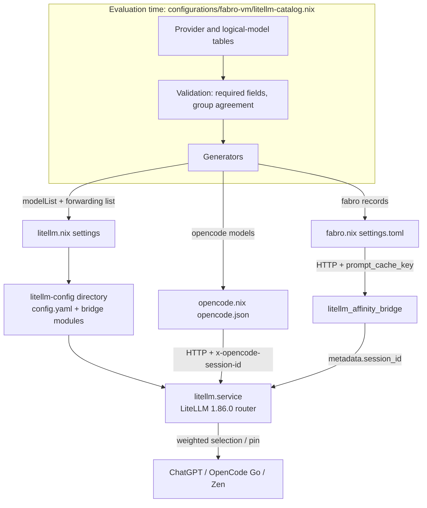
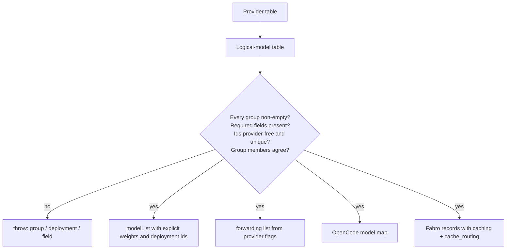
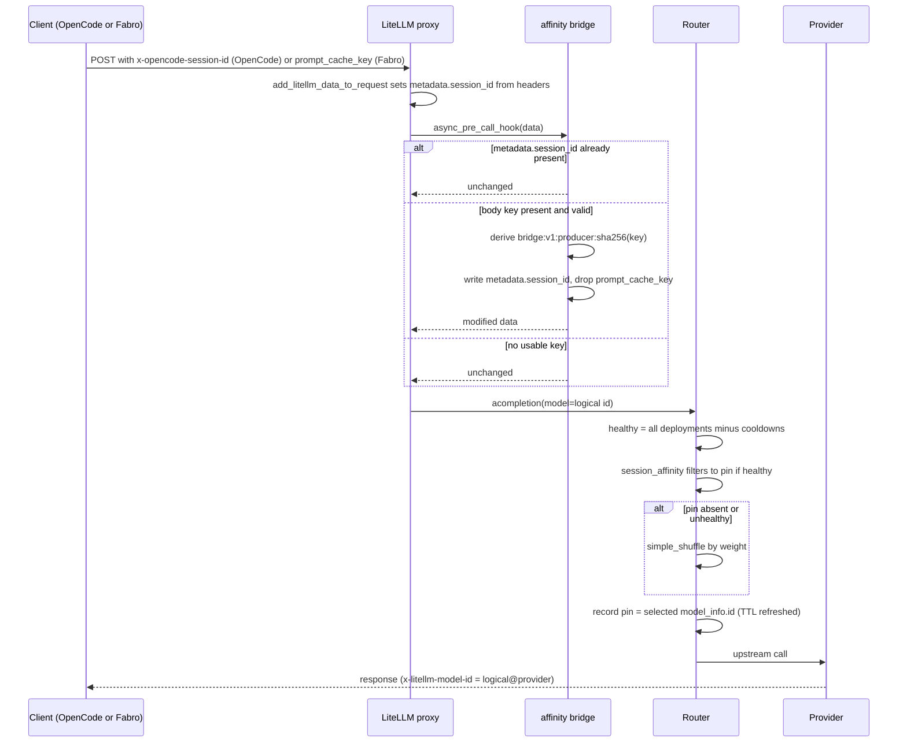
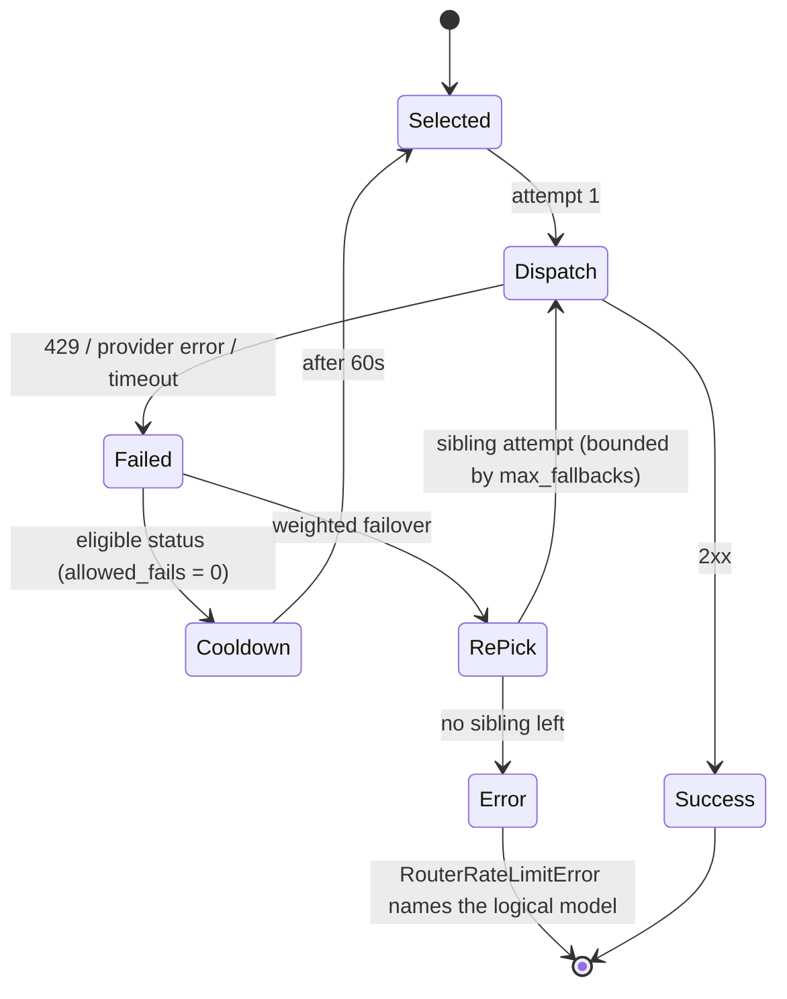
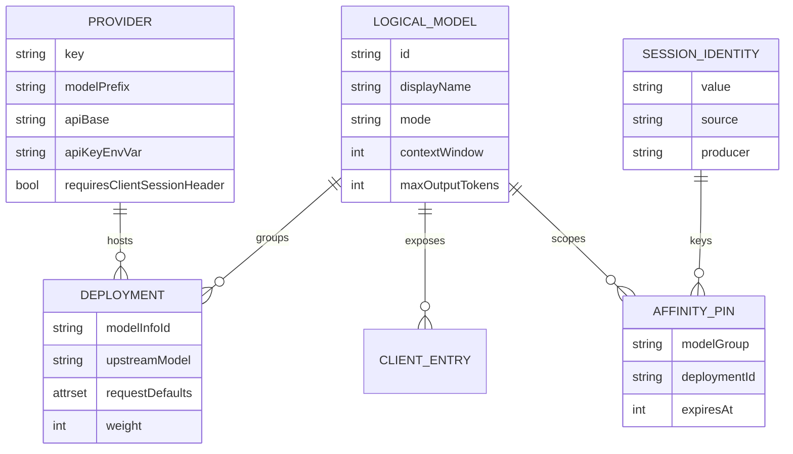
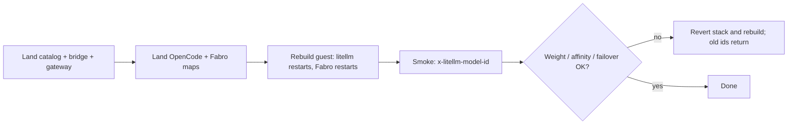

# Design Document

## Overview

This design turns the fabro-vm gateway into a declarative model registry whose
single Nix catalog generates the LiteLLM deployment list and both client model
surfaces, while the pinned 1.86.0 router supplies weighted placement, session
affinity, failover, and cooldown; one in-process callback bridges Fabro's
`prompt_cache_key` into `metadata.session_id`, while OpenCode's native session
header needs no bridge. The problem and approach are in `brief.md`, the
behavioral contract is in `requirements.md`, and external findings are in
`research.md`.

### Goals

- One provider-agnostic client-callable id per logical model, with no provider
  name in any id and no provider choice in either client.
- Weighted placement across the deployments of a unified group.
- Conversation-stable routing from OpenCode's header and from Fabro's body
  cache key, with header precedence and producer-scoped namespacing.
- Within-group retries, weighted failover, and cooldown with no cross-model
  fallback.
- A single catalog source that generates the gateway `model_list`, the OpenCode
  model map, and the Fabro model records.
- Deterministic eval checks plus an operator smoke that covers what the router
  randomizes.

### Non-Goals

- Cross-model or cross-logical-model fallbacks.
- A bare `x-session-id` contract, or any Fabro/OpenCode software change.
- Redis, multi-instance affinity, or affinity surviving a gateway restart.
- Per-deployment header forwarding.
- Provisioning new subscriptions, credentials, or providers.
- The unused macOS `programs.litellm` launchd module.
- Virtual keys, budgets, or spend reporting.

## Boundary Commitments

### This Spec Owns

- The deployment catalog file and its validation/generation functions.
- The gateway's `model_list`, router settings, header-forwarding list, and the
  generated config directory that carries the session bridge.
- The pure session-identity rules and the in-process bridge callback.
- The OpenCode model map and Fabro model records that point at the catalog ids.
- The routing checks, the affinity-bridge tests, the operator runbook, and the
  fabro-vm handoff updates.

### Out of Boundary

- The nixpkgs `services.litellm` module, its `DynamicUser` unit, health gate,
  state dir, and sops template.
- LiteLLM, OpenCode, or Fabro upgrades; the pinned versions are the contract.
- The ChatGPT device-flow login and credential provisioning.
- The macOS Home Manager `programs.litellm` module and its render tests, which
  must keep evaluating but are not changed.
- Client-side balancing, provider-pinning switches, or prompt/agent behavior.
- Cost accounting, cache-hit reporting, and capacity planning.

### Allowed Dependencies

- LiteLLM 1.86.0 from the pinned nixpkgs (`services.litellm`,
  `litellm_settings`, `router_settings`, and the router's pre-call checks).
- `configurations/fabro-vm/{litellm,opencode,fabro}.nix`, the fabro-vm sops
  templates `litellm-env`, `fabro-env`, and `opencode-env`.
- OpenCode 1.19.0 (`pkgs.opencode-pinned`) and its `x-opencode-session-id`
  header.
- Fabro 0.386.0-nightly.0 (`pkgs.fabro`) and its `caching` / `cache_routing`
  capability keys.
- `pkgs.python3` from the LiteLLM package environment for the callback, and
  `pkgs.python3` plus `pkgs.nodejs` for the checks.

### Revalidation Triggers

- A LiteLLM bump changes `session_affinity`, `enable_weighted_failover`,
  `deployment_affinity_ttl_seconds`, `get_instance_fn`, or the callback hook
  signature.
- A nixpkgs `services.litellm` change alters `ExecStart`, the config path, or
  the environment handling.
- OpenCode changes session-header emission or the provider-id prefix rule.
- Fabro changes `cache_routing`, `prompt_cache_key`, or the capability schema.
- A provider's request defaults, wire mode, or context window changes.
- A change alters how `max_fallbacks` is derived from the catalog, or a
  LiteLLM bump changes how the fallback depth is counted.

## Architecture

### Existing Architecture Analysis

- `configurations/fabro-vm/litellm.nix` is the live gateway. It uses the
  nixpkgs `services.litellm` module on `127.0.0.1:4000`, loads
  `LITELLM_MASTER_KEY` and `OPENCODE_API_KEY` from the sops-rendered
  `litellm-env` file, pins `CHATGPT_TOKEN_DIR` under the state dir, and gates
  startup with `litellm-health-gate`.
- Its `model_list` (lines 151-240) is hand-written and provider-scoped:
  `chatgpt/*`, `opencode-go/*`, and `opencode-zen/*`. There is no
  `router_settings`. The only `litellm_settings` entry is
  `model_group_settings.forward_client_headers_to_llm_api` with the
  `opencode-go/*` and `opencode-zen/*` prefixes.
- `configurations/fabro-vm/opencode.nix` builds `opencode.json` with the
  provider id `opencode-litellm` and a model map keyed by the same
  provider-scoped ids. The provider id must keep starting with `opencode` for
  the extra OpenCode headers; it is not a model id.
- `configurations/fabro-vm/fabro.nix` generates `settings.toml` with
  `llm.providers.litellm` model records, a static
  `default_headers."x-opencode-session"`, and per-model limits and
  capabilities. Fabro hard-requires `litellm.service`; a gateway restart also
  restarts Fabro and clears in-memory router state.
- `home-manager/common/litellm.nix` is the unused macOS launchd module. Its
  only live consumers are `tests/litellm-service/hm-render.test.js` and the
  `litellm-service` flake check; this spec leaves both alone.
- Existing verification is split between the pure `fabro-vm-guest-eval`
  assertion chain in `flake.nix`, the Node suites under `tests/`, and the
  `litellm-service` check. The new routing verification follows the
  `tests/fabro-sandbox` and `tests/litellm-service` pattern: copy the source
  into a `runCommand` sandbox and run `nix eval` plus `node --test`.

### Architecture Pattern & Boundary Map

Pattern: one pure model registry, three consumers, and one in-process request
hook. The catalog is evaluation data, not runtime state; every consumer is a
generated projection of it. The only runtime logic this spec adds is the
session-identity bridge.



**Architecture Integration**:

- Selected pattern: declarative registry plus generated projections. It keeps
  one authoritative model list and removes the chance that the gateway and a
  client disagree about an id.
- Domain boundaries: the catalog owns model composition and client-visible
  metadata; `litellm.nix` owns routing policy; the Python module owns session
  identity only; the clients own transport and credentials.
- Existing patterns preserved: NixOS modules under `configurations/fabro-vm/`,
  pure helper modules in `scripts/` or beside the module for eval-time reuse,
  Node test suites copying the repo into a `runCommand`, and the sops env
  template for every credential.
- New components rationale: the catalog is needed for requirement 2; the pure
  identity module is needed to test namespacing without LiteLLM; the bridge is
  needed because Fabro emits a body key rather than a header.
- Steering compliance: declarative Nix only, no secrets in the store, no
  imperative installers, and no upstream fork.

### Technology Stack

| Layer | Choice / Version | Role in Feature | Notes |
|-------|------------------|-----------------|-------|
| Gateway | LiteLLM 1.86.0 (`pkgs.litellm`) | Router, proxy, affinity, cooldown, failover | Feature ceiling; all options verified against this package |
| Service module | nixpkgs `services.litellm` (pinned) | Unit, state dir, env file, YAML rendering | `ExecStart` is overridden to the bridge-aware config directory |
| Catalog | Nix (`lib`) | Model registry and validation | Pure evaluation, no IFD |
| Bridge | Python 3.13 from the LiteLLM package env | `CustomLogger.async_pre_call_hook` | In-process; no new service or socket |
| Client A | OpenCode 1.19.0 (`pkgs.opencode-pinned`) | Sends `x-opencode-session-id` | Provider id stays `opencode-litellm` |
| Client B | Fabro 0.386.0-nightly.0 (`pkgs.fabro`) | Sends `prompt_cache_key` when `cache_routing` is set | No Fabro code change |
| Checks | Node 22 (`pkgs.nodejs`) + `nix eval` | Catalog, gateway, and client-surface assertions | Mirrors `tests/fabro-sandbox` |
| Bridge tests | Python 3 (`pkgs.python3`) stdlib `unittest` | Pure identity rules | No LiteLLM import required |

## File Structure Plan

### Directory Structure

```
configurations/fabro-vm/
├── litellm-catalog.nix              # NEW: provider + logical-model tables,
│                                    #      validation, gateway and client generators
├── litellm_affinity_bridge.py       # NEW: CustomLogger pre-call hook
├── litellm_session_identity.py      # NEW: pure identity/namespace rules
├── litellm.nix                      # MODIFIED: consume catalog, router settings,
│                                    #           bridge config dir, forwarding list
├── opencode.nix                     # MODIFIED: consume catalog model map
└── fabro.nix                        # MODIFIED: consume catalog model records

tests/litellm-routing/
├── helpers.js                       # NEW: nix eval helpers (copy of the repo pattern)
├── catalog.test.js                  # NEW: table validations and failure messages
├── gateway.test.js                  # NEW: model_list, router, forwarding, config dir
└── clients.test.js                  # NEW: OpenCode/Fabro parity and legacy-id scan

tests/litellm-affinity-bridge/
└── test_session_identity.py         # NEW: precedence, namespacing, malformed input

docs/
├── litellm-routing-runbook.md       # NEW: catalog edits, TTL/weights, smoke
└── opencode-fabro-vm-handoff.md     # MODIFIED: ids, forwarding, affinity notes

flake.nix                            # MODIFIED: two new checks
```

### Modified Files

- `configurations/fabro-vm/litellm.nix` — remove the hand-written `model_list`
  and the provider-prefix forwarding list; import the catalog; add
  `router_settings`; set `litellm_settings.callbacks`; build and point the
  service at the bridge-aware config directory; add `PYTHONPATH` and
  `PYTHONDONTWRITEBYTECODE`; rewrite the header comment that describes
  provider-scoped ids and prefix forwarding.
- `configurations/fabro-vm/opencode.nix` — replace the nine provider-scoped
  model entries with the catalog's map; set the default model to the catalog's
  default; leave the provider block and the absence of static headers intact;
  update the header comment that attributes forwarding to the provider prefix.
- `configurations/fabro-vm/fabro.nix` — replace the nine model records with the
  catalog's records; remove `go-gpt-6-luna`; set every record's `api_model` to a
  catalog id; keep `default_headers."x-opencode-session"` with a comment that it
  is not the affinity identity; derive the default model from the catalog.
- `flake.nix` — add `checks.<system>.litellm-routing` and
  `checks.<system>.litellm-affinity-bridge`, following the existing
  `litellm-service` and `fabro-sandbox-tests` `runCommand` shape.
- `docs/opencode-fabro-vm-handoff.md` — update the model map, the forwarding
  section, the Fabro model table, and the "add a model" instructions so no
  current step names a provider-scoped id.

## System Flows

### Catalog evaluation



The generator forces validation before returning any projection. Building the
gateway or either client therefore fails Nix evaluation, not runtime, on a
malformed catalog. Projection order follows the table's ordered deployment
list and the sorted logical-model keys, so repeated evaluation yields an
identical catalog.

### Request placement and affinity



The bridge runs before routing. Header-derived identity wins because
`add_litellm_data_to_request` writes it before the pre-call hook. A request
with no identity skips the write, so the router has no `session_id` and places
by weight without touching another conversation's pin.

### Failover and cooldown



`num_retries` is `0`, so a failed attempt is not repeated on the same
deployment; `enable_weighted_failover` re-picks inside the group. The first
cooldown-eligible failure removes the deployment from placement and from
affinity selection; a pinned conversation then lands on a healthy sibling and
the next request re-pins it there.

## Requirements Traceability

| Requirement | Summary | Components | Interfaces / Contracts | Flows |
|-------------|---------|------------|------------------------|-------|
| 1.1 | Exactly one client id per logical model | Deployment Catalog, Gateway Configuration | `Catalog.logicalModels`, `modelList` | Catalog evaluation |
| 1.2 | No provider name in client ids | Deployment Catalog | Id validation | Catalog evaluation |
| 1.3 | Same upstream → one unified group | Deployment Catalog | `logicalModels.gpt-6-luna` | Catalog evaluation |
| 1.4 | Semantic differences → separate models | Deployment Catalog | Group agreement validation | Catalog evaluation |
| 1.5 | Single-deployment ids use the same form | Deployment Catalog | `logicalModels` schema | Catalog evaluation |
| 1.6 | Removed provider-scoped ids are unknown | Gateway Configuration | No aliases; `model_list` only from catalog | Request placement |
| 1.7 | No id resolves to zero deployments | Deployment Catalog | Non-empty deployment validation | Catalog evaluation |
| 2.1 | Table declares provider, upstream, mode, defaults, weight | Deployment Catalog | Table schema | Catalog evaluation |
| 2.2 | Add provider/model/weight without code changes | Deployment Catalog, Client Surfaces | Generated projections | Catalog evaluation |
| 2.3 | Repeated evaluation is identical | Deployment Catalog | Pure function; ordered projections | Catalog evaluation |
| 2.4 | Conflicting group members fail eval with names | Deployment Catalog | `conflict` error message | Catalog evaluation |
| 2.5 | Missing field fails eval with names | Deployment Catalog | `missingField` error message | Catalog evaluation |
| 2.6 | Credentials from env, never in artifact | Gateway Configuration, Routing Checks | `os.environ/<VAR>` references | — |
| 2.7 | Table is the only source of served ids | Gateway Configuration | `model_list = catalog.modelList` | — |
| 3.1 | Weighted placement across available deployments | Gateway Configuration | `routing_strategy = "simple-shuffle"`, `weight` | Request placement |
| 3.2 | Missing weight equals siblings | Deployment Catalog | Weight default `1` emitted for every deployment | Catalog evaluation |
| 3.3 | New placement uses weights and availability only | Gateway Configuration | No `rpm`/`tpm`; cooldown filter | Request placement |
| 3.4 | Selected deployment recorded as the pin | Session Affinity (native) | `session_affinity` pre-call check | Request placement |
| 3.5 | Weight change applies on reload | Deployment Catalog, Gateway Configuration | Regenerated `model_list` | Catalog evaluation |
| 3.6 | Observed share tracks configured weights | Operator Runbook | Smoke step 1 | — |
| 4.1 | Unexpired pin wins | Session Affinity (native) | `session_affinity` filter | Request placement |
| 4.2 | Identity from client session header | Session Identity Resolver, LiteLLM header extraction | `existing_session_id` | Request placement |
| 4.3 | Identity from body cache key when no header | Session Identity Bridge | `derive_session_identity` | Request placement |
| 4.4 | Header identity wins over body key | Session Identity Bridge | Precedence branch | Request placement |
| 4.5 | Producer-scoped namespace; no header/body collision | Session Identity Resolver | `bridge:v1:<producer>:<sha256>` | Request placement |
| 4.6 | Affinity keyed by logical model and session | Session Affinity (native) | Group-scoped cache key | Request placement |
| 4.7 | Pin held within TTL | Gateway Configuration | `deployment_affinity_ttl_seconds` | Request placement |
| 4.8 | Expired pin is a new placement | Session Affinity (native) | Cache TTL | Request placement |
| 4.9 | No identity → weight placement, no cross-talk | Session Identity Bridge, Gateway Configuration | No metadata write | Request placement |
| 4.10 | Restart clears pins | Session Affinity (native) | In-memory `DualCache` | — |
| 4.11 | Bridge is in-process, no extra hop | Session Identity Bridge | `litellm_settings.callbacks` | Request placement |
| 5.1 | 429 retried on a sibling | Gateway Configuration | `enable_weighted_failover` | Failover |
| 5.2 | Provider error/timeout retried on a sibling | Gateway Configuration | `enable_weighted_failover` | Failover |
| 5.3 | One success returned for one request | Router (native) | Internal fallback chain | Failover |
| 5.4 | Failed deployment excluded for a cooldown | Gateway Configuration | `allowed_fails = 0`, `cooldown_time = 60` | Failover |
| 5.5 | Cooldown overrides a pin | Session Affinity (native) | Cooldown filter before affinity | Failover |
| 5.6 | Cooldown expiry returns the deployment | Router (native) | `cooldown_time` | Failover |
| 5.7 | All failed → error names the logical model | Router (native) | `RouterRateLimitError(model=...)` / `Received Model Group=<logical>` | Failover |
| 5.8 | No cross-logical-model failover | Gateway Configuration | No `fallbacks` / `context_window_fallbacks` | Failover |
| 5.9 | In-group attempts bounded by config | Gateway Configuration | `num_retries = 0`, derived `max_fallbacks` | Failover |
| 6.1 | OpenCode lists each logical id once | OpenCode Model Surface | `catalog.opencode.models` | — |
| 6.2 | OpenCode default is served | OpenCode Model Surface | `catalog.opencode.defaultModel` | — |
| 6.3 | No static session header in OpenCode | OpenCode Model Surface | Provider block unchanged | — |
| 6.4 | OpenCode session header reaches gateway | OpenCode Model Surface, LiteLLM header extraction | `opencode-litellm` provider id | Request placement |
| 6.5 | Fabro `api_model` is the logical id | Fabro Model Surface | Generated record | — |
| 6.6 | Fabro request carries a cache key | Fabro Model Surface, Session Identity Bridge | `cache_routing`, `prompt_cache_key` | Request placement |
| 6.7 | Fabro advertises the key capability | Fabro Model Surface | `capabilities.cache_routing` | — |
| 6.8 | Static Fabro header is not the identity | Session Identity Resolver | `x-opencode-session` is not a session-id header | Request placement |
| 6.9 | Both surfaces change together; no removed ids | Client Surfaces, Routing Checks | Generated projections; legacy-id scan | Catalog evaluation |
| 7.1 | Forward headers to a deployment that needs them | Gateway Configuration | `forwardClientHeaders` | Request placement |
| 7.2 | Same forwarding to every sibling | Gateway Configuration | Group-scoped forwarding | Request placement |
| 7.3 | No forwarding where nobody needs it | Deployment Catalog, Gateway Configuration | Provider `requiresClientSessionHeader` | Catalog evaluation |
| 7.4 | No credentials or content-type forwarded | Gateway Configuration | LiteLLM `clean_headers` | — |
| 7.5 | Only the documented allowlist is forwarded | Operator Runbook | `x-*` minus `x-stainless-*`, plus `anthropic-beta` | — |
| 7.6 | No per-deployment filtering | Gateway Configuration | Model-group-scoped list | — |
| 8.1 | Checks verify client ids map to one logical model | Routing Checks | `clients.test.js` | — |
| 8.2 | Checks verify weights, TTL, retries, failover | Routing Checks | `gateway.test.js` | — |
| 8.3 | Checks verify group agreement | Routing Checks, Deployment Catalog | `catalog.test.js` | — |
| 8.4 | Checks fail on a removed provider-scoped id | Routing Checks | Legacy-id scan | — |
| 8.5 | Checks fail on a credential in rendered config | Routing Checks | Rendered YAML scan | — |
| 8.6 | Check failures name the offending entry | Deployment Catalog, Routing Checks | Error messages | — |
| 8.7 | Bridge tests cover precedence, namespacing, missing/malformed key | Affinity Bridge Tests | `test_session_identity.py` | — |
| 8.8 | Smoke documents weight, affinity, and forced-failure steps | Operator Runbook | Smoke section | — |
| 8.9 | Operator docs cover catalog edits and observation | Operator Runbook | Runbook sections | — |
| 8.10 | Docs and handoff name no provider-scoped id | Operator Runbook, Handoff | Doc updates | — |

## Components and Interfaces

### Summary

| Component | Layer | Intent | Req Coverage | Key Dependencies | Contracts |
|-----------|-------|--------|--------------|------------------|-----------|
| Deployment Catalog | Eval / data | Declare providers and logical models; validate; generate all projections | 1.1-1.5, 1.7, 2.1-2.5, 3.2, 3.5, 7.3, 8.6 | `lib` (P0) | Service (pure) |
| Gateway Configuration | Runtime config | Turn the catalog into LiteLLM settings and bridge packaging | 1.6, 2.6, 2.7, 3.1, 3.3, 3.5, 4.7, 5.1-5.9, 7.1-7.6 | Catalog (P0), `services.litellm` (P0) | Config |
| Session Identity Resolver | Logic | Pure precedence and namespace rules | 4.2-4.5, 6.8, 8.7 | stdlib (P0) | Service (pure) |
| Session Identity Bridge | Proxy hook | Promote `prompt_cache_key` into `metadata.session_id` | 4.3-4.5, 4.9, 4.11, 6.6 | Resolver (P0), LiteLLM `CustomLogger` (P0) | Service (hook) |
| OpenCode Model Surface | Client config | Expose exactly the catalog ids without static headers | 6.1-6.4, 6.9 | Catalog (P0), OpenCode 1.19.0 (P1) | Config |
| Fabro Model Surface | Client config | Expose the catalog ids with cache routing | 6.5-6.9 | Catalog (P0), Fabro 0.386 (P1) | Config |
| Routing Checks | Verification | Deterministic eval gate for catalog, gateway, clients, credentials | 8.1-8.6 | Node, `nix eval` (P0) | Batch |
| Affinity Bridge Tests | Verification | Deterministic gate for identity rules | 8.7 | Python stdlib (P0) | Batch |
| Operator Runbook | Verification | Operator edits and the manual smoke | 3.6, 7.5, 8.8-8.10 | Existing handoff (P1) | Doc |

### Catalog Layer

#### Deployment Catalog

| Field | Detail |
|-------|--------|
| Intent | Hold the only model composition data and generate every consumer projection |
| Requirements | 1.1-1.5, 1.7, 2.1-2.5, 3.2, 3.5, 7.3, 8.6 |

**Responsibilities & Constraints**

- Owns the provider table and the logical-model table in
  `configurations/fabro-vm/litellm-catalog.nix`.
- Validates required fields, non-empty groups, provider references, id shape
  (no `/`, no provider key token), id uniqueness, and group agreement before
  returning anything.
- Generates `modelList`, `forwardClientHeaders`, `opencode`, and `fabro`
  projections from the same table. No consumer adds or renames an id.
- Emits an explicit numeric weight for every deployment and an explicit
  `model_info.id` of `<logical>@<provider>`.
- Materializes a missing weight as `1`; when no deployment in a group declares
  a weight, the group is equal-weighted. The generated list never omits a
  weight.
- Must not reference host paths, secrets, or derivations; it is pure data.

**Dependencies**

- Inbound: none (pure Nix).
- Outbound: `lib` for list/attr helpers and assertion formatting (P0).
- External: none.

**Contracts**: Service [x] / API [ ] / Event [ ] / Batch [ ] / State [ ]

##### Service Interface

```nix
# configurations/fabro-vm/litellm-catalog.nix
{ lib }:
{
  # Pure constructor, exported for fixture-based failure tests.
  mkCatalog :: Table -> Catalog;

  # The repository's table, already validated.
  catalog :: Catalog;
}

Catalog = {
  logicalModels :: AttrSet LogicalModel;
  modelList :: [ ModelDeployment ];   # gateway projection, ordered
  forwardClientHeaders :: [ String ]; # logical ids needing x-* forwarding
  opencode = { defaultModel :: String; models :: AttrSet { name :: String; }; };
  fabro = { defaultModel :: String; models :: AttrSet FabroRecord; };
}

Table = {
  providers :: AttrSet Provider;
  logicalModels :: AttrSet LogicalModelInput;
}
```

- Preconditions: every `logicalModels` entry has at least one deployment; every
  `deployments[*].provider` names a `providers` key.
- Postconditions: `modelList` contains one deployment per
  `logicalModels[*].deployments[*]`; every deployment carries `weight` and
  `model_info.id`; `forwardClientHeaders` contains exactly the groups whose
  provider set includes `requiresClientSessionHeader = true`.
- Invariants: logical ids contain no `/` and no provider key token;
  `model_info.id` values are unique; a group's deployments agree on `mode`,
  `requestDefaults`, `contextWindow`, and `maxOutputTokens`.

##### Configuration Contract

| Field | Type | Required | Notes |
|-------|------|----------|-------|
| `providers.<name>.modelPrefix` | string | yes | e.g. `chatgpt/`, `openai/` |
| `providers.<name>.apiBase` | string / null | yes | upstream base URL; omitted when null |
| `providers.<name>.apiKeyEnvVar` | string / null | yes | emitted as `os.environ/<VAR>`; omitted when null |
| `providers.<name>.allowedOpenAIParams` | list of strings | yes | 1.86 param allowlist workaround |
| `providers.<name>.requiresClientSessionHeader` | bool | yes | drives forwarding |
| `logicalModels.<id>.displayName` | string | yes | both client surfaces |
| `logicalModels.<id>.deployments` | non-empty list | yes | ordered |
| `deployments[*].provider` | string | yes | provider key |
| `deployments[*].upstreamModel` | string | yes | provider-side id |
| `deployments[*].mode` | `"chat"` / `"responses"` | yes | client-visible wire mode |
| `deployments[*].requestDefaults` | attrset | yes | may be `{}`; `reasoning_effort` today |
| `deployments[*].contextWindow` | int | yes | -> `model_info.max_input_tokens` |
| `deployments[*].maxOutputTokens` | int | yes | -> `model_info.max_output_tokens` |
| `deployments[*].weight` | int >= 1 | no | defaults to `1`; emitted explicitly |
| `logicalModels.<id>.smallDefault` | bool | no | Fabro `small_default` |
| `logicalModels.<id>.reasoningEffortLevels` | list of strings | no | Fabro capability map |
| `logicalModels.<id>.fabroCapabilities` | attrset | no | overrides the `text`/`tools`/`reasoning` baseline; `caching` and `cache_routing` are always forced true |

**Implementation Notes**

- Integration: imported by `litellm.nix`, `opencode.nix`, `fabro.nix`, and the
  routing checks. It has no NixOS dependencies.
- Validation: required-field errors read
  `litellm-catalog: deployment '<logical>/<provider>' is missing field '<field>'`;
  conflict errors read
  `litellm-catalog: logical model '<id>' disagrees on <field>: '<dep-a>'=<a>, '<dep-b>'=<b>`.
  Both name every offending entry so requirement 8.6 is satisfied by the
  evaluator itself.
- Risks: the catalog is the only place that may contain provider-prefixed
  upstream ids. Client projections must never expose them.

##### Initial Catalog

| Logical id | Display | Deployments (provider → upstream, weight) | Mode | Default effort | Context / output |
|------------|---------|-------------------------------------------|------|----------------|------------------|
| `gpt-6-luna` | GPT-6 Luna | chatgpt → gpt-6-luna, 1; opencode-go → gpt-6-luna, 1 | responses | xhigh | 1,050,000 / 128,000 |
| `gpt-6-luna-none` | GPT-6 Luna (no thinking) | chatgpt → gpt-6-luna, 1 | responses | none | 1,050,000 / 128,000 |
| `gpt-6-astra` | GPT-6 Astra | chatgpt → gpt-6-astra, 1 | responses | xhigh | 1,050,000 / 128,000 |
| `gpt-6.1-sol` | GPT-6.1 Sol | chatgpt → gpt-6.1-sol, 1 | responses | xhigh | 1,050,000 / 128,000 |
| `deepseek-v4.1-flash` | DeepSeek V4.1 Flash | opencode-go → deepseek-v4.1-flash, 1 | chat | — | 1,000,000 / 384,000 |
| `glm-5.3-flash` | GLM-5.3 Flash | opencode-go → glm-5.3-flash, 1 | chat | — | 1,000,000 / 131,072 |
| `longcat-2.5-preview-free` | LongCat 2.5 Preview Free | opencode-go → longcat-2.5-preview-free, 1 | chat | — | 1,000,000 / 131,072 |
| `big-pickle` | Big Pickle | opencode-zen → big-pickle, 1 | chat | — | 200,000 / 32,000 |

`gpt-6-luna` is the only unified group. It pins `xhigh` on both deployments
because the existing ChatGPT entry already pins it and the OpenCode Go entry
advertises `xhigh` through Fabro's capability map; the no-thinking variant
stays a separate ChatGPT-only logical model. All deployments start at equal
weight; the operator changes the weights in the table.

Derived forwarding list: `gpt-6-luna`, `deepseek-v4.1-flash`,
`glm-5.3-flash`, `longcat-2.5-preview-free`, `big-pickle`. The three
ChatGPT-only groups are absent.

### Gateway Layer

#### Gateway Configuration

| Field | Detail |
|-------|--------|
| Intent | Project the catalog into a running LiteLLM 1.86.0 proxy with the affinity bridge |
| Requirements | 1.6, 2.6, 2.7, 3.1, 3.3, 3.5, 4.7, 5.1-5.9, 7.1-7.6 |

**Responsibilities & Constraints**

- Sets `model_list` only from `catalog.modelList`; sets
  `litellm_settings.model_group_settings.forward_client_headers_to_llm_api`
  only from `catalog.forwardClientHeaders`.
- Sets the router policy in `router_settings`:

  | Setting | Value | Reason |
  |---------|-------|--------|
  | `routing_strategy` | `"simple-shuffle"` | Weighted random placement over healthy deployments |
  | `num_retries` | `0` | No second attempt on the same failing deployment |
  | `max_fallbacks` | `max(largest group size - 1, 0)` | Derived bound; currently `1` because the largest group has two deployments |
  | `enable_weighted_failover` | `true` | Re-picks a sibling before the caller sees an error |
  | `allowed_fails` | `0` | First cooldown-eligible failure takes the deployment out |
  | `cooldown_time` | `60` | Seconds out of placement and affinity after failure |
  | `optional_pre_call_checks` | `[ "session_affinity" ]` | Enable session pins; `deployment_affinity` stays off |
  | `deployment_affinity_ttl_seconds` | `21600` | Six-hour idle TTL; refreshed by every request |

- Declares no `fallbacks`, `context_window_fallbacks`, or `model_group_alias`.
  Old provider-scoped ids therefore fail as unknown models and no request can
  cross logical models.
- Registers `litellm_settings.callbacks = [ "litellm_affinity_bridge.proxy_handler_instance" ]`.
- Builds one generated directory containing `config.yaml`,
  `litellm_affinity_bridge.py`, and `litellm_session_identity.py`, overrides
  `systemd.services.litellm.serviceConfig.ExecStart` with `lib.mkForce` to the
  same `litellm --host <host> --port <port> --config <dir>/config.yaml` shape
  the module used, and puts the directory on `PYTHONPATH` with
  `PYTHONDONTWRITEBYTECODE=1`.
- Leaves the existing health gate, state dir, `environmentFile`, and
  `CHATGPT_TOKEN_DIR` untouched.

**Dependencies**

- Inbound: Deployment Catalog (P0).
- Outbound: nixpkgs `services.litellm`, `pkgs.formats.yaml`, `pkgs.runCommand`
  (P0); LiteLLM 1.86.0 router (P0).
- External: sops-rendered `litellm-env` for `LITELLM_MASTER_KEY` and
  `OPENCODE_API_KEY` (P0).

**Contracts**: Service [ ] / API [ ] / Event [ ] / Batch [ ] / State [x]

##### State Management

- State model: the router's in-memory `DualCache` holds session pins keyed by
  `deployment_affinity:v1:session:<model_group>:<session_id>`; cooldowns are
  in the same in-process cache.
- Persistence: none. A gateway restart (which also restarts Fabro) clears all
  pins and cooldowns.
- Concurrency: the router's async cache handles concurrent reads/writes; the
  gateway is a single process.

**Implementation Notes**

- Integration: the nixpkgs module's `ExecStart` is overridden with
  `lib.mkForce`, so its own generated YAML path is unused; this module's
  generated directory is the only config the service loads. The routing check
  asserts the override and the directory name so this cannot silently regress.
- Validation: the module's `settings` value is the single input to the
  generated YAML; the routing check renders that value through
  `pkgs.formats.yaml` on the current system and scans the text.
- Risks: overriding `ExecStart` couples this module to the nixpkgs module's
  command shape. The revalidation trigger and the check make that visible.

#### Session Identity Bridge

| Field | Detail |
|-------|--------|
| Intent | Turn Fabro's body cache key into the router's `metadata.session_id` without a client change |
| Requirements | 4.3-4.5, 4.9, 4.11, 6.6 |

**Responsibilities & Constraints**

- Implements `CustomLogger.async_pre_call_hook(user_api_key_dict, cache, data,
  call_type)`; returns `data` unchanged when it has nothing to do.
- Reads the existing `metadata.session_id` (and `litellm_metadata.session_id`)
  first. If a non-empty value exists, it does nothing: LiteLLM's header
  extraction already won.
- Otherwise, when `data["prompt_cache_key"]` is present, remove it from the
  outbound body and from `data["proxy_server_request"]["body"]`, then derive
  an identity with the pure resolver and write it into `metadata` (and
  `litellm_metadata` when present). A malformed key is dropped but does not
  produce a session id, so the request is placed by weight.
- Never raises. A malformed key, missing headers, or an unexpected body shape
  returns the original `data`.
- Uses the `user-agent` from `data["proxy_server_request"]["headers"]` (looked
  up case-insensitively) as the producer discriminator.

**Dependencies**

- Inbound: Session Identity Resolver (P0).
- Outbound: LiteLLM `CustomLogger` and `proxy_server_request.headers` (P0).
- External: none.

**Contracts**: Service [x] / API [ ] / Event [ ] / Batch [ ] / State [ ]

##### Service Interface

```python
# litellm_affinity_bridge.py
class SessionIdentityBridge(CustomLogger):
    async def async_pre_call_hook(
        self, user_api_key_dict, cache, data: dict, call_type
    ) -> dict | None: ...

proxy_handler_instance = SessionIdentityBridge()
```

- Preconditions: `data` is the proxy request dict; it may lack `metadata`,
  `litellm_metadata`, `proxy_server_request`, or `prompt_cache_key`.
- Postconditions: either `data` is unchanged, or `prompt_cache_key` is absent
  from both the outbound body and the proxy request snapshot; a usable key also
  leaves a derived `session_id` in the metadata.
- Invariants: an existing `session_id` is never overwritten; a body-derived id
  always starts with `bridge:v1:`.

### Session Identity Layer

#### Session Identity Resolver

| Field | Detail |
|-------|--------|
| Intent | Own the precedence, validation, and namespacing rules as pure functions |
| Requirements | 4.2-4.5, 6.8, 8.7 |

**Responsibilities & Constraints**

- `existing_session_id(metadata_dicts)` returns the first non-empty
  `session_id` found, else `None`.
- `derive_session_identity(prompt_cache_key, user_agent)` returns `None` unless
  the key is a string, non-empty after stripping, at most 512 characters, and
  free of CR/LF/NUL. Otherwise it returns
  `bridge:v1:<producer>:<sha256 hex of the stripped key>`.
- `producer_tag(user_agent)` takes the product token before `/`, lowercases it,
  keeps `[a-z0-9._-]` up to 32 characters, and falls back to `unknown`. A new
  body-key producer must send a stable `User-Agent`; producers without one
  share the `unknown` namespace, which the runbook states.
- The `bridge:v1:` prefix is not a valid shape for any client session header,
  so a body-derived identity can never equal a header-derived one; the
  producer segment prevents cross-producer collisions on an identical raw key.

**Dependencies**

- Outbound: Python stdlib `hashlib`, `re` (P0).
- External: none; the module does not import LiteLLM.

**Contracts**: Service [x] / API [ ] / Event [ ] / Batch [ ] / State [ ]

##### Service Interface

```python
# litellm_session_identity.py
def existing_session_id(metadata_dicts: Sequence[Mapping]) -> str | None: ...
def producer_tag(user_agent: str | None) -> str: ...
def derive_session_identity(
    prompt_cache_key: object, user_agent: str | None
) -> str | None: ...
```

- Preconditions: none; every input may be missing or of the wrong type.
- Postconditions: `None` means "no identity to add"; any non-`None` value is
  safe to use as a router session id.
- Invariants: the function never raises on malformed input.

### Client Layer

#### OpenCode Model Surface

| Field | Detail |
|-------|--------|
| Intent | Expose every logical model once under its client-callable id |
| Requirements | 6.1-6.4, 6.9 |

**Responsibilities & Constraints**

- `opencodeSettings` keeps `provider.opencode-litellm` (the `opencode` prefix
  is required for the extra OpenCode headers) and the OpenCode-compatible
  base URL.
- `model = "opencode-litellm/${catalog.opencode.defaultModel}"`.
- `models = catalog.opencode.models`, with each key equal to a catalog logical
  id and each `name` equal to the catalog display name.
- Declares no static provider headers; OpenCode emits `x-opencode-session-id`
  itself.

**Dependencies**

- Inbound: Deployment Catalog (P0).
- External: OpenCode 1.19.0 (P1).

**Contracts**: Service [ ] / API [ ] / Event [ ] / Batch [ ] / State [ ]

##### Configuration Contract

| Key | Source | Invariant |
|-----|--------|-----------|
| `model` | `opencode-litellm/<defaultModel>` | the default is a catalog id |
| `provider.opencode-litellm.options.baseURL` | host constant | gateway loopback |
| `provider.opencode-litellm.models` | `catalog.opencode.models` | keys == catalog ids, no `/` |
| `provider.opencode-litellm.options.headers` | absent | no static session header |

#### Fabro Model Surface

| Field | Detail |
|-------|--------|
| Intent | Expose the same logical ids and make Fabro emit its cache key |
| Requirements | 6.5-6.9 |

**Responsibilities & Constraints**

- `llm.providers.litellm.models = catalog.fabro.models`; each record carries
  `display_name`, `api_model` (the logical id), `limits` from the group's
  context/output limits, and `capabilities`.
- Every record sets `caching = true` and `cache_routing = true`; the generator
  maps `reasoningEffortLevels` to `capabilities.reasoning_effort`. The
  `text`, `tools`, and `reasoning` baseline is true for every current model and
  can be overridden per model through `fabroCapabilities`.
- The local key for the LongCat model becomes
  `longcat-2.5-preview-free`, matching the catalog id; `go-gpt-6-luna` is
  deleted because the unified group is the only GPT-6 Luna record.
- `default_headers."x-opencode-session"` remains for the OpenCode Go upstream,
  with a comment that it is not the affinity identity.
- `default_model`, `cli.exec.model.name`, and `run.model.name` use
  `catalog.fabro.defaultModel`.

**Dependencies**

- Inbound: Deployment Catalog (P0).
- External: Fabro 0.386.0-nightly.0 (P1).

**Contracts**: Service [ ] / API [ ] / Event [ ] / Batch [ ] / State [ ]

##### Configuration Contract

| Key | Source | Invariant |
|-----|--------|-----------|
| `llm.providers.litellm.models.<key>.api_model` | catalog id | no `/`, catalog id |
| `.limits.context_tokens` | deployment `contextWindow` | equals the group's limit |
| `.limits.max_output_tokens` | deployment `maxOutputTokens` | equals the group's limit |
| `.capabilities.caching` | generator | `true` |
| `.capabilities.cache_routing` | generator | `true` |
| `.capabilities.reasoning_effort` | `reasoningEffortLevels` | omitted when empty |
| `.capabilities.text` / `.tools` / `.reasoning` | baseline plus `fabroCapabilities` | true unless overridden |
| `default_headers."x-opencode-session"` | host constant | not a session identity |

### Verification Layer

#### Routing Checks

| Field | Detail |
|-------|--------|
| Intent | Fail repository checks on catalog, gateway, client, or credential drift |
| Requirements | 8.1-8.6 |

**Responsibilities & Constraints**

- `tests/litellm-routing/catalog.test.js` imports the pure catalog with fixture
  tables and asserts the failure messages for conflicting mode/defaults/limits,
  a missing field, a group with zero deployments, and a provider-prefixed id.
- `gateway.test.js` evaluates the fabro-vm config and asserts:
  `model_list` equals the catalog projection; every deployment has a weight and
  a unique `model_info.id`; `routing_strategy`, `num_retries`,
  `max_fallbacks` (equal to `max(largest group size - 1, 0)`), `allowed_fails`,
  `cooldown_time`,
  `enable_weighted_failover`, `optional_pre_call_checks`, and
  `deployment_affinity_ttl_seconds` have the documented values;
  `deployment_affinity` is absent; the forwarding list equals the derived list;
  `callbacks` names the bridge; `PYTHONPATH` and the `ExecStart` override point
  at the config directory; the rendered YAML contains no literal credential
  (every present `api_key` is `os.environ/...`, and no sops placeholder or
  `sk-` value appears).
- `clients.test.js` asserts that `catalog.opencode.models` and
  `catalog.fabro.models` expose exactly the catalog ids; every Fabro record
  sets `caching` and `cache_routing`; Fabro limits equal the catalog limits;
  the default model exists; and neither client module retains a legacy
  provider-scoped literal.
- The check renders YAML with current-system `pkgs.formats.yaml` from the
  guest's `services.litellm.settings` value, so it does not build an
  `aarch64-linux` derivation on a Darwin host.

**Contracts**: Batch [x]

**Implementation Notes**

- Integration: `checks.<system>.litellm-routing` mirrors `litellm-service`: a
  `runCommand` with `nix` + `nodejs`, copying the source and running
  `node --test tests/litellm-routing/`.
- Validation: `nix eval --impure` with `builtins.getFlake`; no guest build.
- Risks: NixOS option names are checked by evaluation, so a rename fails
  loudly rather than silently.

#### Affinity Bridge Tests

| Field | Detail |
|-------|--------|
| Intent | Prove the identity rules without a running gateway |
| Requirements | 8.7 |

**Responsibilities & Constraints**

- `tests/litellm-affinity-bridge/test_session_identity.py` imports the pure
  module from `configurations/fabro-vm` and covers:
  1. header-derived identity wins over a body key;
  2. the same raw key with different producers yields different identities;
  3. no key yields `None`;
  4. malformed keys (non-string, empty/whitespace, over 512 characters, CR/LF)
     yield `None`;
  5. a body-derived identity never equals a plausible header value.
- `checks.<system>.litellm-affinity-bridge` runs the suite with `pkgs.python3`
  and `PYTHONPATH=configurations/fabro-vm`; a failing test fails the check.

**Contracts**: Batch [x]

#### Operator Runbook

| Field | Detail |
|-------|--------|
| Intent | Document catalog edits, the routing knobs, observation, and the manual smoke |
| Requirements | 3.6, 7.5, 8.8-8.10 |

**Responsibilities & Constraints**

- `docs/litellm-routing-runbook.md` states how to add a provider, model, or
  weight; where weights, the TTL, cooldowns, and retries are configured; the
  `x-litellm-model-id` observation point; the header-forwarding allowlist; the
  session-identity rules (including the stable-`User-Agent` requirement for a
  body-key producer); and the three smoke steps with expected observations.
- `docs/opencode-fabro-vm-handoff.md` is updated so its model map, Fabro table,
  forwarding section, and examples use only catalog ids.
- The smoke forces a deployment failure by temporarily pointing the OpenCode
  Go provider's `apiBase` at an unreachable loopback port, proving the sibling
  serves the request, then reverts.

**Contracts**: Doc [x]

## Data Models

### Domain Model



Business invariants: a logical model has at least one deployment; all its
deployments share mode, request defaults, and limits; ids are unique and
provider-free; a pin is scoped to one logical model and one session identity.

### Logical Data Model

**Catalog structure**:

| Entity | Identifier | Attributes | Referential rules |
|--------|------------|------------|-------------------|
| Provider | provider key | prefix, base URL, credential env var, allowed params, header requirement | referenced by deployments |
| Logical model | client-callable id | display name, optional Fabro flags | owns a non-empty ordered deployment list |
| Deployment | `<logical>@<provider>` | upstream id, mode, defaults, limits, weight | provider must exist; id unique |

**Consistency and integrity**: validation is a total function over the table
and runs on every evaluation. A group disagreement is an error, not a warning.
Generated projections are derived values; there is no second source of truth.

**Generated gateway record** (contract shape, not full config):

```nix
{
  model_name = "gpt-6-luna";
  model_info = {
    id = "gpt-6-luna@chatgpt";
    mode = "responses";
    max_input_tokens = 1050000;
    max_output_tokens = 128000;
  };
  litellm_params = {
    model = "chatgpt/gpt-6-luna";
    reasoning_effort = "xhigh";
    allowed_openai_params = [ "reasoning_effort" ];
    weight = 1;
  };
}
```

**Generated client shapes**:

- OpenCode: `{ "<logical>" = { name = "<displayName>"; }; }`.
- Fabro: `{ "<local key>" = { display_name; api_model = "<logical>"; limits;
  capabilities; small_default; }; }`.
- Session identity: `bridge:v1:<producer>:<sha256 hex>`.

### Physical Data Model

- **Gateway config directory** (store path, built by `pkgs.runCommand`):
  `config.yaml`, `litellm_affinity_bridge.py`, `litellm_session_identity.py`.
  Read-only; `PYTHONDONTWRITEBYTECODE=1` avoids cache writes.
- **Affinity cache**: in-process `DualCache`; keys
  `deployment_affinity:v1:session:<model_group>:<session_id>`; value
  `{"model_id": "<logical>@<provider>"}`. TTL 21,600 seconds, refreshed on
  every routed request. No Redis, no disk, no restart persistence.
- **Cooldown state**: in-process deployment fail counters and cooldown list;
  TTL 60 seconds. No persistence.
- **No new files at runtime**. The generated config directory is the only
  artifact this feature adds to the store.

## Error Handling

### Error Strategy

Fail closed at evaluation and degrade safely at runtime. The catalog throws
with a named entry during Nix evaluation; the router fails a request only
after the group is exhausted; the bridge never converts a request into a 500
because a cache key was malformed.

### Error Categories and Responses

| Category | Trigger | Response | Requirement |
|----------|---------|----------|-------------|
| Catalog schema error | Missing field, unknown provider, empty group, bad id | Nix evaluation fails with the logical model, deployment, and field | 2.4, 2.5, 8.6 |
| Catalog consistency error | Group disagrees on mode/defaults/limits | Nix evaluation fails naming both deployments and the field | 2.4, 8.6 |
| Unknown model | Caller keeps a removed provider-scoped id | LiteLLM `model not found` error; no alias or wildcard | 1.6 |
| No available deployment | Every deployment failed or is cooling down | `RouterRateLimitError` naming the logical model | 5.7 |
| In-group attempts exhausted | The request tried every deployment and all failed | Last provider error, with `Received Model Group=<logical>` appended by the router | 5.7 |
| Rate limit / provider error | 429, 401, 404, 408, 5xx | Weighted failover to a sibling; eligible failures enter cooldown | 5.1, 5.2, 5.4 |
| Transport error | `APIConnectionError` | Weighted failover to a sibling; 1.86.0 does not cooldown this class | 5.2 |
| Bridge input error | Missing, empty, non-string, or oversized cache key | Drop the key; place the request by weight | 4.9, 8.7 |
| Callback import error | Bridge module missing or unreadable | Proxy fails start; `litellm-health-gate` fails the unit | 4.11 |
| Credential missing | `OPENCODE_API_KEY` unset | Existing per-request provider auth error; proxy still starts | 2.6 |

The transport-error row is a documented 1.86.0 boundary: cooldown covers
provider-status failures, while a refused connection is retried inside the
group but not pinned into cooldown.

### Monitoring

- `x-litellm-model-id` on every response names `<logical>@<provider>`.
- `x-litellm-call-id` correlates the request with journald output.
- `journalctl -u litellm` shows proxy and router errors; the response
  `x-litellm-model-id` header is the primary observation point.
- `/health/liveliness` remains the unit's readiness gate; a bridge import
  failure prevents startup and therefore fails the gate.

## Testing Strategy

### Unit Tests

1. Catalog conflict: two deployments with different `mode` fail evaluation
   with both deployment ids and the field name.
2. Catalog missing field: an entry without `contextWindow` fails with the
   entry and field name.
3. Catalog empty group: a logical model with no deployments fails.
4. Catalog bad id: an id containing `/` or a provider key token (a
   provider-scoped shape) fails.
5. Catalog weight default: a deployment without `weight` emits `weight = 1`.
6. Identity precedence: an existing `session_id` wins, and the body key is left
   alone.
7. Identity namespacing: the same key with `user-agent: fabro` and
   `user-agent: other` yields different identities.
8. Identity absence: no key yields `None`.
9. Identity malformed input: non-string, blank, over-512, and control-character
   keys yield `None`.
10. Identity distinctness: a derived id never matches a `ses_...` header value.

### Integration / Eval Checks

1. `nix flake check` evaluates the guest and both clients without building an
   `aarch64-linux` system on a Darwin host.
2. The gateway `model_list` contains exactly the catalog deployments, each with
   an explicit weight and a unique `model_info.id`.
3. `router_settings` matches the documented table, including the explicit TTL,
   zero same-deployment retries, bounded failovers, and weighted failover.
4. The forwarding list equals the groups that contain an OpenCode provider.
5. The rendered YAML contains no credential value and only `os.environ/...`
   `api_key` references.
6. OpenCode and Fabro expose exactly the catalog ids; the legacy
   `go-gpt-6-luna` key and every provider-prefixed `api_model` are absent.
7. Every Fabro gateway record sets `caching` and `cache_routing`, and its
   limits equal the catalog limits.
8. The overridden `ExecStart` points at the generated directory containing the
   bridge modules; `PYTHONPATH` includes that directory.
9. The existing `litellm-service` check and the macOS render tests still pass
   unchanged.

### Operator Smoke

Documented in `docs/litellm-routing-runbook.md`; the expected observation is
the `x-litellm-model-id` response header.

| Step | Action | Expected observation |
|------|--------|----------------------|
| Weight distribution | Send 20 new conversations (unique session headers) to `gpt-6-luna` | Both `gpt-6-luna@chatgpt` and `gpt-6-luna@opencode-go` appear, in roughly the configured 1:1 share |
| Affinity | Send several requests with the same session header | The same `x-litellm-model-id` on every response; a different session may choose either deployment |
| Forced failure | Reuse a session header previously observed on `gpt-6-luna@opencode-go`, temporarily point the OpenCode Go provider's `apiBase` at `http://127.0.0.1:9/v1`, rebuild, send one request with that header, then revert | The request succeeds with `x-litellm-model-id: gpt-6-luna@chatgpt`, proving the in-group failover; the next request re-pins the session there |

### Performance/Load

No new performance target. The affinity check is a single in-memory cache
lookup, and the catalog is evaluation-time only. The runbook's weight smoke
uses 20 requests, enough to detect a concentrated placement without turning
into a load test.

## Security Considerations

- Credentials remain in `os.environ/OPENCODE_API_KEY` and the sops-rendered
  environment file. The generated YAML contains only environment references;
  the routing check scans the rendered text for `sk-` and the sops
  placeholders.
- ChatGPT credentials stay under `CHATGPT_TOKEN_DIR` in the state dir; this
  spec does not move or embed them.
- The body-derived session id is a SHA-256 digest with a fixed namespace, so
  raw Fabro conversation keys do not appear in affinity cache keys or in the
  proxy request snapshot; header values are client session ids already visible
  to the gateway.
- Forwarding is limited to the groups whose table entries set
  `requiresClientSessionHeader`; the forwarded allowlist is `x-*` except
  `x-stainless-*`, plus `anthropic-beta`, after LiteLLM removes `Authorization`
  and its special authentication headers.
- No new network listener, credential, or privilege is added; the bridge runs
  inside the existing `DynamicUser` proxy.

## Migration Strategy

The gateway and both clients must change in one stack; a partially updated
client would call a removed id. The PR stack delivers the catalog, gateway,
clients, and docs in one review unit, and the guest is rebuilt once after the
stack lands.



- Rollback is a stack revert; there is no persistent state to migrate because
  pins and cooldowns are in process memory.
- Clients pick up their generated configs on their normal service restarts;
  the gateway restart that precedes them clears all pins.
- Old provider-scoped ids are not aliased, so a stale client fails loudly
  instead of silently bypassing the group.

## Supporting References

- `research.md` — pinned-library findings, source files, and version evidence.
- `configurations/fabro-vm/litellm.nix` — current gateway, forwarding, and
  model list.
- `configurations/fabro-vm/opencode.nix`, `configurations/fabro-vm/fabro.nix` —
  current client surfaces.
- `tests/litellm-service/hm-render.test.js`, `tests/fabro-sandbox/helpers.js`,
  `flake.nix` — check harness patterns this design extends.
- `docs/opencode-fabro-vm-handoff.md` — current operator handoff.
