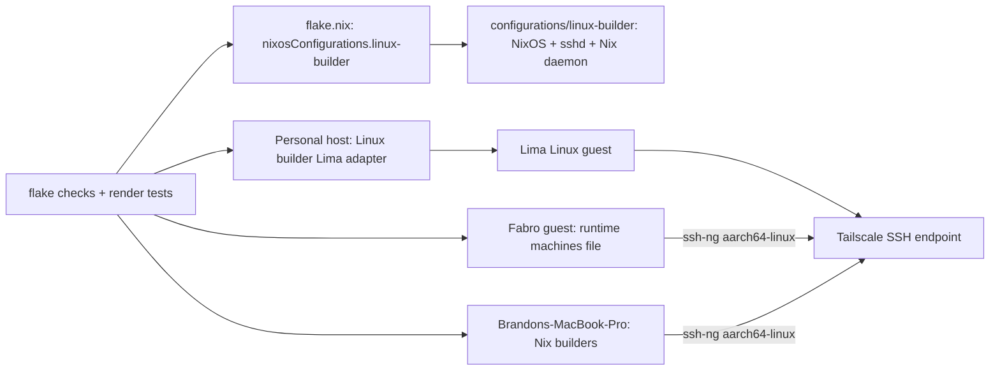
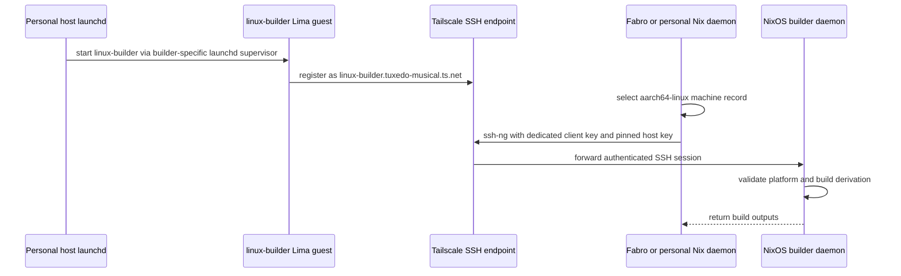

# Design Document

## Overview

This design translates `brief.md` and `requirements.md` into concrete host, VM, client-dispatch, and validation contracts. The Linux builder is a reusable NixOS flake output hosted by a personal-host-owned Lima instance, reached by both clients over Tailscale using dedicated SSH keys and a pinned host key while Fabro retains its Darwin dispatch and forbids local build jobs.

### Goals

- Provide a reusable NixOS `aarch64-linux` builder that is not Lima-dependent.
- Run that configuration as a 4-CPU, 8-GiB-memory, 128-GiB-disk Lima VM managed by the personal host.
- Route Linux derivations from Fabro and `Brandons-MacBook-Pro` to the Linux builder while retaining existing Darwin dispatch.
- Fail repository checks when builder capability, VM resources, or client policies drift.

### Non-Goals

- Alter the existing `mac-builder` Nix-darwin host, its `aarch64-darwin` endpoint, or Darwin dispatch semantics.
- Add `x86_64-linux`, cross-compilation, builder pools, cache publication, or unrelated changes to VM lifecycle modules.
- Configure remote building for other hosts or CI.
- Add an interactive build service or a bespoke build protocol; use Nix's SSH remote-store protocol.

## Boundary Commitments

### This Spec Owns

- A portable NixOS builder configuration and its `nixosConfigurations` flake output.
- The personal host's Linux Lima VM instance and its resource/lifecycle settings in the builder-specific adapter.
- Nix SSH builder entries for Fabro and `Brandons-MacBook-Pro`, including Linux-specific key paths and host-key trust.
- Fabro's `max-jobs = 0` no-local-build policy without removing its existing Darwin builder entry.
- Flake-evaluation and render tests for the host, Lima resources, client dispatch, and policy.

### Out of Boundary

- Replacing or changing `configurations/mac-builder`, `mac-builder` credentials, or the existing `aarch64-darwin` machine entry.
- Changing `home-manager/common/lima-vm.nix` into a generic multi-guest module; the new builder adapter is separate and borrows its established NixOS guest conventions.
- Changing `services.localBinaryCache`, its substituters, or the personal host's distributed-build invariant.
- Provisioning secret values in implementation tasks; see `Operator Provisioning`.

### Allowed Dependencies

- The flake's existing `inputs.nixpkgs`, `inputs.nixos-lima`, and `inputs.sops-nix` NixOS module.
- `home-manager/common/lima-vm.nix` for the existing NixOS guest's Lima YAML, launchd supervisor, and deploy patterns; `home-manager/common/lima-linux-builder.nix` provides a separate builder-specific adapter because `virtualisation.limaVM` currently describes only the Fabro instance.
- `configurations/fabro-vm/darwin-dispatch.nix` and `scripts/fabro-darwin-machines.nix` for Fabro's existing runtime builder-file and Nix daemon ordering contract.
- `configurations/common-darwin/default.nix` for personal-host Nix settings and its current Darwin machine line. Use a `pkgs.writeText` builders file and `@file` setting so the SOPS runtime key path is not emitted as a world-readable literal Nix setting.
- Tailscale already configured on Fabro and on the personal Mac through its host configuration; add Tailscale to the Linux builder and configure a separate `tag:linux-nix-remote-builder` and SSH-only network grants for both client identities. Its dedicated credential and ACL edits are operator-provisioned.

### Revalidation Triggers

- A change to the Linux builder's NixOS host name, SSH user, tailnet DNS name, supported system, SSH protocol, or key/host-key contract.
- A change to the existing `virtualisation.limaVM` image or option schema, or to its launchd supervisor and deploy assumptions; also revalidate the separate builder adapter against any changed shared conventions.
- A change to the Fabro runtime machines-file path, its service ordering, or its use of `nix.settings.builders`.
- A change to `nix.settings.max-jobs`, `nix.distributedBuilds`, or the Darwin builder settings on either client.
- A change to the SOPS recipient or source/ownership of builder client keys or Tailscale credentials.

## Architecture

### Existing Architecture Analysis

- `flake.nix` declares `nixosConfigurations.fabro-vm` as an `aarch64-linux` NixOS host with `inputs.nixos-lima.nixosModules.lima`; its system image is exposed separately as `packages.aarch64-linux.fabro-vm-image`.
- `configurations/personal/home-manager/default.nix` configures `virtualisation.limaVM` for the `fabro` guest and `virtualisation.limaMacGuest` for `mac-builder`. `home-manager/common/lima-vm.nix` is a NixOS-specific singleton module: it renders one Lima YAML, deploys one `nixosConfigurations` guest, and exposes one `lima-vm-deploy` command. The Linux builder therefore needs a separate builder-specific adapter modeled on these lifecycle conventions without overloading the existing singleton or changing its Fabro contract.
- `configurations/mac-builder/tailscale.nix` is specifically a Darwin LaunchDaemon and cannot be reused by NixOS. The Linux host uses NixOS's `services.tailscale` module, with its own SOPS credential and builder-specific tag; SSH keys and host-key pinning remain the Nix build authentication layer.
- `configurations/mac-builder/README.md` documents an established Tailscale ACL model: network reachability is provided by tag grants, while SSH keys authenticate clients and a pinned SSH host key verifies the endpoint. The Linux builder follows that separation with a separate Tailscale tag and OAuth credential.
- `configurations/fabro-vm/darwin-dispatch.nix` enables distributed builds and sets `nix.settings.builders` to `/run/fabro-darwin-builders/machines`. Its systemd service renders the Darwin machine entry before `nix-daemon` starts. Keep this runtime secret-handling pattern and include the Linux machine in the same generated file.
- `configurations/common-darwin/default.nix` sets personal-host `max-jobs = 0` and a forced `builders` setting for the existing `aarch64-darwin` machine. Replace the single entry with a forced `@file` containing both records; preserve the Darwin record's endpoint and fields.
- `flake.nix` hosts checks commonly evaluate `self.nixosConfigurations.*.config`, `self.darwinConfigurations.*.config`, and Home Manager's internal rendered Lima values. Existing tests use Node's `node:test` and `nix eval --json` helpers, including `tests/lima-vm` and `tests/mac-nix-remote-builder`.

### Architecture Pattern & Boundary Map

The pattern is a portable NixOS host plus a personal-host Lima adapter and two standard Nix clients. SSH over Tailscale is the transport boundary; the NixOS configuration does not import or refer to Lima modules.



Decisions:

- Keep the builder guest configuration portable: `configurations/linux-builder/default.nix` owns NixOS, OpenSSH, Nix daemon authorization, and Nix store maintenance; the personal-host module owns Lima's image, resource values, and lifecycle.
- Name the flake host `nixosConfigurations.linux-builder`, the guest hostname `linux-builder`, and its stable tailnet address `linux-builder.tuxedo-musical.ts.net`. The tailnet route is needed because both clients must reach the guest; the Fabro guest is already a Tailscale node, and the personal Mac has the Tailscale client installed.
- Use `ssh-ng://builder@linux-builder.tuxedo-musical.ts.net` with only `aarch64-linux` in the machine record. The machine record includes the dedicated client's private-key runtime path and the builder's pinned host public key; do not place private key values in Nix expressions or the store. Declare builder SSH host keys through NixOS `services.openssh.hostKeys` with a persistent path outside `/nix/store`, so the checked-in public pin can be compared with the guest's stable host identity across VM restarts.
- Extend the existing Fabro machine-file renderer/service to emit both the Linux and existing Darwin records. Keep `nix.settings.builders = @/run/fabro-darwin-builders/machines`, the existing service ordering, and the existing Darwin record's values, so there is one Nix daemon source of truth and no generated-file race.
- On `Brandons-MacBook-Pro`, set `nix.settings.builders` to an `@file` reference for a `pkgs.writeText` machine file containing both the existing Darwin record and the Linux record. The file contains only public host identity and runtime file paths, never private key contents; the SOPS private key remains root-owned at `/run/secrets`.
- Set Fabro `nix.settings.max-jobs = 0`; retain `nix.distributedBuilds = true` and `builders-use-substitutes = true`. The existing personal host already has `max-jobs = 0`; add its Linux machine without changing its local-binary-cache publisher's distributed-build policy.
- Keep the SSH user non-root and dedicated. Authorize the Fabro and personal-host client public keys for that user; only that account is trusted by the builder's Nix daemon for remote build operations.

### Technology Stack

| Layer | Choice / Version | Role in Feature | Notes |
|---|---|---|---|
| Host configuration | NixOS, flake `nixpkgs` | Portable `aarch64-linux` builder | Parallel to existing `nixosConfigurations.fabro-vm` |
| Nix build endpoint | Nix SSH remote store (`ssh-ng`) | Accept remote derivations and return outputs | Standard machine record; system is `aarch64-linux` |
| SSH | OpenSSH on NixOS | Authenticated client and host identity | Dedicated non-root `builder` user; pinned host key |
| VM runtime | Builder-specific Home Manager Lima adapter following `virtualisation.limaVM` conventions | Personal-host VM resources, launchd lifecycle, and guest deployment | `cpus = 4`, `memory = "8GiB"`, `disk = "128GiB"`; current `lima-vm.nix` is a singleton |
| Network | Tailscale | Stable route from both clients to the guest | Builder-specific OAuth credential and hostname |
| Secret delivery | sops-nix | Builder and client credential runtime files | Separate builder, Fabro, and personal-host encrypted stores |
| Validation | Nix flake checks and Node `node:test` | Configuration evaluation and rendered settings | Follow existing flake and Lima test patterns |

## File Structure Plan

### Directory Structure

```text
configurations/linux-builder/
└── default.nix                         # Portable NixOS builder host and SSH/Nix policy
home-manager/common/
└── lima-linux-builder.nix              # New, builder-specific Lima adapter and deploy wrapper
certificates/linux-builder/
└── ssh_host_ed25519_key.pub            # Public SSH host-key pin consumed by clients
secrets/
├── remote-builder.linux-builder.yaml   # Builder authorized client keys and Tailscale credential
└── linux-builder-client.personal.yaml  # Personal Nix daemon's dedicated private client key
```

### Modified Files

- `flake.nix` — add `nixosConfigurations.linux-builder` using the same `inputs.nixpkgs.lib.nixosSystem` pattern as `fabro-vm`, add `linux-builder-sync-from-1password`, and add configuration checks that evaluate the builder and both clients.
- `home-manager/common/lima-linux-builder.nix` — add a separate Lima adapter, instance config, launchd supervisor, and deploy wrapper for the Linux builder without changing the singleton `virtualisation.limaVM` module.
- `home-manager/common/default.nix` — import the new Linux-builder Lima adapter.
- `configurations/personal/home-manager/default.nix` — enable the builder-specific Linux Lima adapter for `linux-builder` with 4 CPUs, 8 GiB memory, and 128 GiB disk; preserve the existing `virtualisation.limaVM` instance for Fabro.
- `configurations/personal/default.nix` — declare the Linux builder private client key in the personal host's SOPS configuration; preserve the Darwin key and `services.localBinaryCache` settings.
- `configurations/common-darwin/default.nix` — preserve the current `aarch64-darwin` route and `max-jobs = 0`; set `nix.settings.builders` to an `@file` reference to a `pkgs.writeText` file containing both machine records.
- `configurations/fabro-vm/default.nix` — declare Fabro's dedicated Linux builder client-key SOPS secret and set the no-local-build policy without dropping existing settings.
- `configurations/fabro-vm/darwin-dispatch.nix` — preserve the existing Darwin machine options/service and extend the generated machines input with the Linux builder record and host-key pin.
- `scripts/fabro-darwin-machines.nix` — extend its validated inputs and atomic machine-file output to include the Linux record while retaining its current Darwin record format and ordering.
- `scripts/fabro-sync-from-1password.nix` — add the Linux client private key to the existing `fabro.onePasswordSecrets` manifest and encrypted guest store so the declared SOPS secret remains consistent.
- `scripts/linux-builder-sync-from-1password.nix` — add a builder-specific sync command that reads the operator-provisioned Tailscale OAuth values and authorized public keys, encrypts `secrets/remote-builder.linux-builder.yaml` for the builder recipient, and encrypts the personal Mac client key to `host_personal`; it must not mint or generate any secret values.
- `.sops.yaml` — add a distinct `host_linux_builder` recipient and matching encrypted-store creation rule; do not reuse another host's age recipient.
- `secrets/README.md` — document the Linux builder store, client key sources, Tailscale credential source, and operator bootstrap/verification steps.
- `tests/linux-nix-remote-builder/` — add flake-eval/render tests for the NixOS host, Lima guest, clients, machine-file output, and negative policy checks.

## System Flows

### Remote build dispatch and VM lifecycle



The system match is the gate: the machine record advertises only `aarch64-linux`, while Fabro's zero local jobs prevents a locally built fallback when no remote machine can accept a derivation. A remote endpoint outage therefore produces an ordinary Nix build failure; it does not start a local derivation build. The personal Home Manager Lima singleton is not extended; the builder adapter owns a separate supervisor and instance identity while following its conventions. The existing `nixos-lima` release image supplies the NixOS/Lima guest agent and OpenSSH access; the deploy wrapper streams the locked repository and runs `nixos-rebuild switch --flake <scratch>#linux-builder` inside the guest, matching `lima-vm-deploy` without requiring a self-built VM image.

## Requirements Traceability

Map each numeric requirement area to its implementing component and contract. Acceptance criteria within each area are covered by the full area row.

| Requirement | Summary | Design sections | Components / interfaces |
|---|---|---|---|
| 1.1-1.3 | Build `aarch64-linux`, reject other platforms, and remain Lima-independent | Architecture Pattern; NixOS Builder Host; Data Contracts | `nixosConfigurations.linux-builder`, NixOS host module, machine system field |
| 2.1-2.4 | Lima resources and lifecycle | Architecture Pattern; Personal Host VM; Testing Strategy | `home-manager/common/lima-linux-builder.nix`, rendered Lima YAML, launchd supervisor |
| 3.1-3.3 | Linux dispatch from Fabro and personal Mac; retain Darwin route | Fabro Client Dispatch; Personal Mac Client Settings; Data Contracts | `nix.settings.builders`, SSH machine lines, client key paths |
| 4.1-4.3 | Remote-only Fabro jobs, explicit no-fallback failure, retain Darwin | Fabro Client Dispatch; Error Handling | `nix.settings.max-jobs = 0`, dual-machine file |
| 5.1-5.5 | Checks cover host, VM, client wiring, local policy, and fail on drift | Testing Strategy; Repository Checks | flake assertions, Nix eval tests, Lima render tests |

## Components and Interfaces

| Component | Domain / Layer | Intent | Requirements | Key Dependencies | Contract |
|---|---|---|---|---|---|
| Linux Builder Host | NixOS | Provide native `aarch64-linux` Nix remote builds | 1.1-1.3 | NixOS, OpenSSH, Tailscale, sops-nix | `nixosConfigurations.linux-builder` |
| Personal Host VM | Home Manager / Lima | Run the Linux host in a persistent, correctly-sized VM | 2.1-2.4 | `home-manager/common/lima-linux-builder.nix` | Lima instance `linux-builder` |
| Fabro Client Dispatch | NixOS client | Route Linux and Darwin machine records and forbid local builds | 3.1, 3.3, 4.1-4.3 | Existing `darwin-dispatch.nix` runtime service | `/run/fabro-darwin-builders/machines` |
| Personal Mac Client | nix-darwin client | Add Linux remote builds without changing Darwin behavior | 3.2-3.3 | `configurations/common-darwin/default.nix`, personal SOPS | Nix `builders` setting |
| Repository Checks | Validation | Assert host, VM, clients, and policies | 5.1-5.5 | `flake.nix`, `node:test` | Evaluation assertions and tests |

### NixOS Builder Host

| Field | Detail |
|---|---|
| Intent | Serve standard SSH remote builds for native `aarch64-linux` derivations. |
| Requirements | 1.1-1.3, 5.1 |
| Scope | `configurations/linux-builder/default.nix`, imported by `nixosConfigurations.linux-builder`. |

**Responsibilities & Constraints**

- Set `nixpkgs.hostPlatform = "aarch64-linux"`; do not import Lima-specific modules or use host provisioning inputs in this module.
- Enable Nix and OpenSSH, declare a dedicated non-root `builder` account, and authorize only the public keys delivered through the builder's SOPS store. Materialize the SOPS authorized-key value at runtime into the builder user's `~/.ssh/authorized_keys` with a root-owned oneshot ordered after sops-nix secret materialization and before `sshd`; do not use `builtins.readFile` or NixOS `authorizedKeys.keys` for secret-backed input.
- Configure Nix daemon trust for the remote SSH account and set `nix.settings.extra-platforms = [ ]` so the builder does not advertise or enable additional execution platforms beyond its native `aarch64-linux` system; the machine record similarly lists only `aarch64-linux`.
- Configure automatic Nix store garbage collection and optimization as NixOS services; resource sizing and VM restart belong to the personal host.
- Enable Tailscale using the builder's SOPS-delivered OAuth secret and register the guest under the stable `linux-builder` identity and dedicated `tag:linux-nix-remote-builder`; grant TCP/22 only to the two client groups through the existing tailnet ACL policy.

**Dependencies**

- Inbound: SSH remote-store connection from the Fabro and personal Nix daemons, authenticated by their distinct client keys.
- Outbound: `nix-daemon`, `sshd`, `tailscaled`, and sops-nix; no dependency on Lima at evaluation or runtime inside the builder host configuration.

**Contracts: Service [x] / State [x]**

- Remote endpoint: `ssh-ng://builder@linux-builder.tuxedo-musical.ts.net`; tailnet ACL permits TCP/22 only from the Fabro guest and personal Mac identities to the `tag:linux-nix-remote-builder` tag.
- Supported machine system: `aarch64-linux` only.
- Nix machine record shape follows the repository's existing renderer in `scripts/fabro-darwin-machines.nix`: `ssh-ng://<user>@<host> <system> <private-key-path> <max-jobs> <speed-factor> - - <base64-host-public-key>`. The Linux guest Nix daemon loads the Nix remote-build support (`nix-command` / `flakes` and the NixOS daemon's build-user configuration) and accepts incoming builder sessions only from the authorized dedicated SSH account.
- The Linux guest supports at least four concurrent remote jobs, matching its 4-CPU allocation; clients use `max-jobs = 4` and `speed-factor = 1` for this entry.
- A request for another platform does not match this machine record and is not advertised as a supported builder capability.

**Implementation Notes**

- Use a separate SOPS store and age recipient for the builder's authorized client public keys and Tailscale OAuth secret. Keep the Tailscale OAuth client ID in the encrypted store separately from its client secret if the NixOS auth unit requires both values.
- Keep the builder host key public value as a public repository pin in `certificates/linux-builder/ssh_host_ed25519_key.pub`; use it to verify the persistent guest host key and include the expected host-key field in both machine records. Never check in the corresponding private host key.

### Personal Host VM

| Field | Detail |
|---|---|
| Intent | Manage the NixOS Linux builder as a second, independent Lima instance. |
| Requirements | 2.1-2.4, 5.2 |
| Scope | `home-manager/common/lima-linux-builder.nix` and its activation in `configurations/personal/home-manager/default.nix`. |

**Responsibilities & Constraints**

- Use Lima instance name and guest hostname `linux-builder`; target the `linux-builder` flake output through the adapter's NixOS deploy wrapper. Keep the builder's host config portable, while Lima deploy semantics remain outside the host configuration.
- Set `cpus = 4`, `memory = "8GiB"`, and `disk = "128GiB"`; do not change the existing Fabro VM resource or lifecycle settings.
- Add a builder-specific Lima adapter and deploy command that follow the existing module's rendered-YAML, launchd supervisor, and tar-over-SSH deployment conventions. Do not add a second `virtualisation.limaVM` declaration directly: its current options and generated `lima-vm-deploy` are a singleton bound to the Fabro guest. Keep that existing module's contract unchanged.
- Reuse the module's pinned NixOS release image defaults and native `aarch64` architecture in the builder-specific adapter. The host NixOS configuration remains independently evaluable without Lima.

**Dependencies**

- Inbound: Existing `home-manager/common/lima-vm.nix` conventions for YAML rendering, launchd supervision, and `lima-vm-deploy` implementation (Critical); no shared singleton option instance.
- Outbound: `nixosConfigurations.linux-builder` and the VM's Tailscale endpoint (Critical).

**State Management**

- State model: a distinct Lima instance named `linux-builder`, separate from `fabro` and `mac-builder`.
- Lifecycle: RunAtLoad launchd agent starts the VM; an unexpected nonzero exit is restarted by the existing supervisor policy; a clean stop exits successfully and remains stopped.
- Persistence: Lima manages its own guest disk; no host directory mount or shared repo checkout is required for remote builds.

### Fabro Client Dispatch and Policy

| Field | Detail |
|---|---|
| Intent | Add Linux dispatch to the existing runtime machine list and ensure Fabro never builds derivations locally. |
| Requirements | 3.1, 3.3, 4.1-4.3, 5.3-5.4 |
| Scope | `configurations/fabro-vm/darwin-dispatch.nix`, `configurations/fabro-vm/default.nix`, and `scripts/fabro-darwin-machines.nix`. |

**Responsibilities & Constraints**

- Keep `nix.distributedBuilds = true`, `nix.settings.builders-use-substitutes = true`, `/run/fabro-darwin-builders/machines`, and the existing systemd ordering. The existing Darwin record stays byte-for-byte equivalent; the Linux record is appended in the same renderer output.
- Extend the renderer to validate Linux-specific host, system, job count, key path, and host-key input, then atomically write the Linux record alongside the existing Darwin record.
- Declare Fabro's Linux client private key as a SOPS secret with root-only mode and use only its runtime path in the machines renderer. Never interpolate its value into Nix configuration or logs.
- Set the NixOS option `nix.settings.max-jobs = 0`; if neither configured remote record accepts the build, Nix reports failure without local compilation.
- The Linux entry advertises only `aarch64-linux`; the Darwin entry remains `aarch64-darwin`.

**Dependencies**

- Inbound: Nix derivation platform and builder selection by the guest Nix daemon.
- Outbound: Linux builder's SSH endpoint, `secrets/fabro.fabro.yaml`, `scripts/fabro-darwin-machines.nix`, and existing Darwin builder credentials (Critical).

**Batch / Job Contract**

- Trigger: Fabro's Nix daemon starts after `fabro-darwin-builders.service` renders the machine file.
- Input: Existing Darwin machine options plus the Linux endpoint record and `/run/secrets/linux-builder-client-key`; host public key from the checked-in public pin.
- Output: One atomic, root-owned machine file consumed as `nix.settings.builders = @/run/fabro-darwin-builders/machines`.
- Idempotency & recovery: Re-render replaces the complete file atomically; missing or unreadable key inputs fail the renderer/service before the Nix daemon uses an incomplete file.

**Implementation Notes**

- Preserve the existing service identity and run ordering to avoid a second writer racing against Nix daemon startup.
- Adjust existing assertions and tests that currently require the machine file to contain only a Darwin record; retain assertions for the Darwin endpoint itself.

### Personal Mac Client Settings

| Field | Detail |
|---|---|
| Intent | Add Linux machine availability to the personal Mac while preserving its existing Darwin machine. |
| Requirements | 3.2-3.3, 5.3-5.4 |
| Scope | `configurations/common-darwin/default.nix`, `configurations/personal/default.nix`, and the Nix-generated machine file. |

**Responsibilities & Constraints**

- Keep the existing Darwin `ssh-ng://nix-builder@mac-builder.tuxedo-musical.ts.net` machine entry unchanged.
- Set `nix.settings.builders` to an `@file` reference for a `pkgs.writeText` machine file containing the existing Darwin record and Linux `ssh-ng://builder@linux-builder.tuxedo-musical.ts.net` record (system `aarch64-linux`, 4 remote jobs, dedicated personal client key path, and pinned Linux host key). The file contains public host identity and runtime file paths only; Nix machine records are whitespace-delimited, so encode both records in the same generated file.
- Put the personal client private key in its own root-owned, mode-0400 SOPS secret and separate encrypted file; do not use or widen `mac-builder-ssh-private-key`. The machine-record file itself is generated in the Nix store, but it contains only public host identity and the runtime path; the private key contents remain outside the store.
- Retain personal host `max-jobs = 0`; do not set `nix.distributedBuilds = true` globally because the local-binary-cache publisher owns that invariant.

**Dependencies**

- Inbound: `configurations/common-darwin/default.nix` Nix settings.
- Outbound: personal SOPS store and the tailnet SSH endpoint (Critical).

## Data Models

### Domain Model

- Builder host: one flake-declared NixOS system; authoritative for NixOS, SSH authorization, Tailscale endpoint identity, and Nix daemon capability.
- Lima guest: one personal-host-owned VM instance; authoritative for resource allocation and VM lifecycle, not for builder host configuration.
- Client machine: one Nix machine record per supported target, containing protocol, endpoint, system, runtime private-key path, job limit, speed factor, and host-key pin.
- SSH trust: two distinct client private keys map to two public keys in the builder's authorized-key secret. The public builder SSH host key is shared as a checked-in trust pin.

### Logical Data Model

| Record | Fields | Owner | Integrity rule |
|---|---|---|---|
| Linux builder host | flake host name, NixOS platform, hostname, SSH user | Repository config | Platform is exactly `aarch64-linux`; SSH user is non-root `builder` |
| Lima instance | name, hostname, CPUs, memory, disk, guestSystem | Personal Home Manager config | `linux-builder`, 4, `8GiB`, `128GiB`, `linux-builder`; rendered by builder-specific adapter |
| Nix machine entry | URI, system, key path, max jobs, speed factor, pinned host public key | Each client Nix config | Linux entry supports only `aarch64-linux`; no private key values; Darwin entry remains `aarch64-darwin` |
| Authorized clients | Fabro and personal Mac public keys | Linux builder SOPS store | Only the two designated public client identities are present |
| Host identity pin | Ed25519 SSH public key | Public certificate file | Both clients use the same pin; private key is absent from repository |

### Data Contracts & Integration

- Machine records use the repository's existing `ssh-ng` line format; the Fabro renderer validates required paths and emits the Linux and Darwin records in a single atomic replacement.
- Secret files use sops-nix runtime paths only. SOPS encrypted YAML stores remain host-specific and use distinct age recipients.
- The builder host key public value may be stored in the repository because it is public trust material; its private counterpart is generated and retained at a persistent NixOS guest path outside the Nix store.

## Operator Provisioning

All provisioning below is operator-owned. Implementation tasks add declarations, runtime path wiring, and structural tests only; they do not create, rotate, or write secret values.

| Secret / material | Source | Exact provisioning command | Verification command | Owner |
|---|---|---|---|---|
| Linux builder SOPS age private key | New 1Password Secure Note `op://Private/sops-age-key-linux-builder/notesPlain` | `T=$(mktemp -d); chmod 0700 "$T"; trap 'rm -rf "$T"' EXIT; nix shell nixpkgs#age -c age-keygen -o "$T/linux-builder-age-key.txt"; op item create --vault=Private --category="Secure Note" --title="sops-age-key-linux-builder" "notesPlain=$(cat "$T/linux-builder-age-key.txt")"`. Before first activation, run `sudo install -d -m 0755 -o root -g root /var/lib/sops-nix; op read 'op://Private/sops-age-key-linux-builder/notesPlain' | sudo install -m 0600 -o root -g root /dev/stdin /var/lib/sops-nix/key.txt`. | `op read 'op://Private/sops-age-key-linux-builder/notesPlain' > "$T/verify-age-key.txt"; nix shell nixpkgs#age -c age-keygen -y "$T/verify-age-key.txt"` must equal the `.sops.yaml` `host_linux_builder` recipient; on guest, `sudo test -s /var/lib/sops-nix/key.txt && sudo stat -c '%a %U' /var/lib/sops-nix/key.txt`. | Repository operator |
| Fabro Linux-builder SSH client private key | 1Password SSH Key item `op://Infrastructure/Fabro Linux nix remote builder key/private key` | Create the operator-owned key with `ssh-keygen -t ed25519 -N '' -C 'fabro-linux-builder' -f "$T/fabro-linux-builder-client"`; store its private half in the 1Password SSH Key item's `private key` field. The Fabro SOPS sync consumes that value and does not generate it. | `ssh-keygen -y -f "$T/fabro-linux-builder-client"` and confirm the public half appears in the decrypted `builder-authorized-keys` entry without printing the private half. | Fabro operator |
| Personal Mac Linux-builder SSH client private key | 1Password SSH Key item `op://Infrastructure/Brandons Mac Linux nix remote builder key/private key` | Create the operator-owned key with `ssh-keygen -t ed25519 -N '' -C 'personal-linux-builder' -f "$T/personal-linux-builder-client"`; store its private half in the 1Password SSH Key item's `private key` field. The builder-specific sync encrypts this value to `host_personal` and does not generate it. | `ssh-keygen -y -f "$T/personal-linux-builder-client"` and confirm its public half appears in the builder's decrypted `builder-authorized-keys` entry. | Personal host operator |
| Linux builder authorized client public keys | 1Password Secure Note `op://Infrastructure/linux-builder authorized keys/notesPlain`, one public key per line | Append the public halves from the two dedicated client keypairs to this item, then run `nix run .#linux-builder-sync-from-1password` to encrypt them into `secrets/remote-builder.linux-builder.yaml`; do not replace other authorized keys during a client-key update. | Decrypt only the `builder-authorized-keys` key with `SOPS_AGE_KEY_FILE="$T/linux-builder-age-key.txt" sops -d --extract '["builder-authorized-keys"]' secrets/remote-builder.linux-builder.yaml` and compare its public-key lines with `ssh-keygen -y` output for each client. | Linux builder operator |
| Linux builder Tailscale OAuth secret | Tailscale OAuth client with `auth_keys` scope and `tag:linux-nix-remote-builder`, stored at `op://Infrastructure/linux-builder Tailscale OAuth/Client Secret` | Create the client in the Tailscale admin console with the named tag and `auth_keys` scope; store the secret at that 1Password field; run `nix run .#linux-builder-sync-from-1password` to encrypt it into the builder-only SOPS store. Ensure the guest receives it at `/run/secrets/builder-tailscale-oauth-secret` before Tailscale starts. | On guest, `sudo test -s /run/secrets/builder-tailscale-oauth-secret && systemctl is-active tailscaled && tailscale status --json | jq -e '.Self.DNSName | startswith("linux-builder.")'`. | Tailnet operator |
| Tailscale ACL and MagicDNS | Tailscale admin console policy and tailnet DNS | Add `tag:linux-nix-remote-builder` to `tagOwners` for `autogroup:admin`; add TCP/22 grants from the Fabro tag and personal Mac identity to the Linux builder tag, preserving existing policy entries. | From Fabro and the Mac, resolve `linux-builder.tuxedo-musical.ts.net` and verify TCP/22 reachability; confirm disallowed identities cannot reach TCP/22. | Tailnet operator |
| Linux builder SSH host private key | NixOS OpenSSH host key at persistent `/var/lib/ssh/ssh_host_ed25519_key` | Configure `services.openssh.hostKeys` to use the persistent path; the operator obtains the keypair out of band from the guest bootstrap, never through a Kiro task. If a fresh guest requires manual key creation, run `sudo install -d -m 0700 -o root -g root /var/lib/ssh && sudo ssh-keygen -t ed25519 -N '' -f /var/lib/ssh/ssh_host_ed25519_key`. Copy only the `.pub` value to `certificates/linux-builder/ssh_host_ed25519_key.pub` as the client trust pin. | On guest, `sudo ssh-keygen -lf /var/lib/ssh/ssh_host_ed25519_key.pub`; compare its public key with `certificates/linux-builder/ssh_host_ed25519_key.pub`. | Linux builder operator |

## Error Handling

### Error Strategy

- NixOS evaluation fails with an assertion naming the invariant when the host platform, builder identity, or required SSH/Tailscale settings are absent or contradictory.
- Fabro and personal-host machine-file renderers exit nonzero with the missing/invalid input name when a required runtime key or host value cannot be read; they write via temporary file plus rename and never install a partial machine file.
- If Tailscale or the Linux guest is unavailable, the SSH remote build fails. Fabro's `max-jobs = 0` prevents local fallback; this is an intentional build error rather than graceful local degradation.
- If an SSH key is unauthorized or host-key verification fails, SSH refuses the connection and Nix reports the remote builder failure. Do not weaken host-key checking as a retry behavior.

### Error Categories and Responses

- Configuration errors: fail flake evaluation or the corresponding regression check with a component-specific message.
- Provisioning errors: sops-nix activation fails and names the missing secret; no placeholder key, credential, or generated substitute is allowed.
- Runtime/network errors: remote builder unavailable, key rejected, or system unsupported; return Nix's nonzero build result and do not invoke local build jobs on Fabro.

### Monitoring

- Use the existing Nix daemon and systemd service logs for dispatch/render failures; Tailscale status and SSH logs diagnose endpoint reachability and authentication.
- Do not add a custom health service or telemetry stream; repository evaluation checks cover declarative drift.

## Testing Strategy

### Unit and Render Tests

- Evaluate `nixosConfigurations.linux-builder` and assert `nixpkgs.hostPlatform`, Nix daemon, OpenSSH, the non-root `builder` user, authorized-key SOPS declaration, Tailscale wiring, and NixOS store-maintenance settings.
- Render the builder adapter's internal Lima YAML output and assert the Linux instance name, NixOS image architecture, 4 CPUs, `8GiB` memory, and `128GiB` disk; separately assert it does not alter the existing Fabro `virtualisation.limaVM` instance configuration.
- Exercise `scripts/fabro-darwin-machines.nix` with fixture paths and keys; assert it emits the Linux `aarch64-linux` and existing Darwin `aarch64-darwin` entries, mode `0600`, and atomic output behavior.
- Evaluate Fabro configuration and assert distributed builds are enabled, the runtime builders path and substitutes are retained, and `nix.settings.max-jobs == 0`.
- Evaluate `Brandons-MacBook-Pro` and assert both Linux and existing Darwin builder entries are present, the Linux key references its SOPS runtime path, and local jobs remain disabled.

### Negative / Integration Checks

- Extend a NixOS module in an eval test to force a non-`aarch64-linux` builder platform or remove required SSH/SOPS options and assert evaluation fails with the named invariant.
- Perturb each Lima resource value and each client machine system/endpoint/key path in test-only module overlays; assert the corresponding flake check fails.
- Remove the Linux machine record or set Fabro `max-jobs` to a nonzero value in an extended module; assert the policy checks fail while the existing Darwin record is still checked independently.
- Run focused `tests/linux-nix-remote-builder/` Node tests for the host, VM adapter, personal machine records, and renderer, plus flake checks for builder, client, and Lima evaluations. A live remote build is an operator acceptance check after secret provisioning and VM deployment; it is not a required pure evaluation test.

### Security Considerations

- Keep all private SSH client keys and the Tailscale OAuth secret in their respective SOPS stores and runtime paths. They must not be read into Nix derivations, logged, or written to tracked files.
- Use a unique builder age recipient and distinct client keypairs; do not reuse the existing Darwin builder private key or broaden its authorized-key set.
- Keep Nix's trusted SSH identity limited to the dedicated non-root builder account and expose SSH only through the authenticated tailnet endpoint.
- Pin the builder SSH host public key on both clients. A host key mismatch is a hard failure requiring operator review and deliberate pin update.
