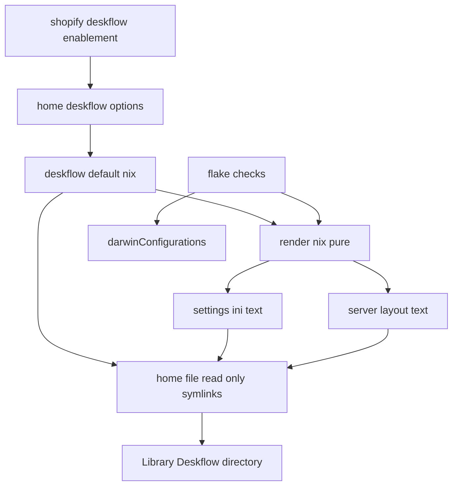

# Design Document

## Overview
A Home Manager module renders Deskflow's macOS settings from a typed `home.deskflow`
options schema and installs them as read-only files at Deskflow's real config
location. It supports a `client` role (connect to a server) and a `server` role
(define the screen layout via Deskflow's external textual config). ShopifyLaptop is
wired as a client. Problem and scope: `.kiro/specs/deskflow-config/brief.md`.

### Goals
- A role-aware `home.deskflow` schema that renders a curated, reviewable settings file.
- Server role renders an external classic-Synergy layout file the engine reads.
- Pin the TLS identity certificate (by path) + key size, and pre-seed trusted-peer
  fingerprints read-only, without putting private key material in the Nix store.
- Read-only delivery that coexists with Deskflow's writable runtime state.
- Eval-time + flake-check validation; both `darwinConfigurations` evaluate.

### Non-Goals
- The Homebrew cask (owned by `common-darwin`); generating/encrypting the cert
  material and the sops/age key lifecycle; runtime interactive trust additions and
  cert auto-generation when a managed cert is supplied; the GUI-managed
  `internalConfig` blob; server tuning keys that live only in `internalConfig` in
  1.26 (lock-to-computer, switch delay, grid, protocol); daemon/service autostart;
  non-macOS; the full settings surface.

## Boundary Commitments

### This Spec Owns
- The `home.deskflow` options schema and its evaluation-time validation.
- Rendering and read-only delivery of `~/Library/Deskflow/Deskflow.conf` (curated
  keys) and, for servers, `~/Library/Deskflow/deskflow-server.conf` (layout).
- Pinning `security/certificate` (by path) and `security/keySize`, and read-only
  rendering of the role-based trusted-peer file (`tls/trusted-servers|trusted-clients`).
- ShopifyLaptop client enablement and the Deskflow flake checks.

### Out of Boundary
- `homebrew.casks` (cask stays in `configurations/common-darwin/default.nix`).
- Generating/encrypting the certificate material and the sops/age key lifecycle;
  runtime interactive trust additions; Deskflow's `.state` and log files at runtime.
- The `internalConfig` GUI layout blob and 1.26 internalConfig-only server tuning.

### Allowed Dependencies
- home-manager `home.file`, `lib.generators`, `lib.types`, `config.home.homeDirectory`.
- The flake `checks.<system>` harness and `self.darwinConfigurations.*`.
- The installed `deskflow` cask (assumed present; not managed here).
- The decrypted certificate path supplied by host-level sops-nix
  (`osConfig.sops.secrets.<name>.path`); the module consumes a path, not the secret.

### Revalidation Triggers
- Deskflow changing its settings path, INI key names, `coreMode` integers, the
  external server-config text grammar, the trust-file line format (`v2:sha256:<hex>`),
  or the cert PEM expectations (a major-version bump).
- Promotion of internalConfig-only server tuning to first-class `[server]` keys
  (would expand the curated schema).
- Any change to the read-only delivery decision (would alter runtime write behavior).
- A change to the sops secret name/path contract (host wiring re-check).

## Architecture

### Existing Architecture Analysis
- HM modules live in `home-manager/common/*`; registered in
  `home-manager/common/default.nix` `imports`. New modules follow `home.<feature>`.
- Read-only self-writing-config precedent: `configurations/shopify/home-manager/tec.nix`
  (`home.file.<rel>.text` symlink to a store file; app writes fail by design).
- INI generation precedent: `dev.nix` (`lib.generators.toINI`). Pure-renderer +
  module split precedent: `home-manager/common/hammerspoon-keybindings/{default.nix,render.nix}`.
- Flake checks eval `darwinConfigurations.<host>.config.home-manager.users.brandonmcnama`,
  force `lib.assertMsg`, and import renderers directly to assert on output strings.

### Architecture Pattern & Boundary Map
Pattern: a pure renderer (lib-only) wrapped by an options module, wired per host,
verified by flake checks. Dependency direction (left imports only leftward):

```
render.nix  ->  default.nix (options + config)  ->  host enablement
     ^                                                   
     |                                                   
flake checks ----------------------------------> darwinConfigurations
```



Key decisions:
- Render logic is a pure function importable by both the module and the checks, so
  verification needs no host switch (mirrors hammerspoon `render.nix`).
- `~/Library/Deskflow/` is created as a real directory by home-manager; only the
  two leaf files are read-only symlinks, leaving the dir writable for TLS/logs.

### Technology Stack
| Layer | Choice / Version | Role in Feature | Notes |
|-------|------------------|-----------------|-------|
| CLI / App | Deskflow 1.26.0 (cask) | Consumer of rendered config | `QSettings` IniFormat + external text config + `tls/` trust files |
| Infrastructure / Runtime | home-manager (`home.file`, `lib.generators.toINI`, `lib.assertMsg`) | Render + read-only delivery + validation | aarch64-darwin |
| Data / Secrets | sops-nix (system `darwinModules`) | Decrypt the cert PEM to a user-owned path; bridged to HM via `osConfig` | HM sops module is broken on darwin; declare at system level |
| Verification | flake `checks.aarch64-darwin` (`runCommand` + `assertMsg`) | Render + host-wiring assertions | Pure eval |

## File Structure Plan

### Directory Structure
```
home-manager/common/deskflow/
├── default.nix     # home.deskflow options schema + config (assertMsg, home.file wiring)
└── render.nix      # pure renderers: cfg -> { settings; serverConfig; trustText }; no home-manager deps
```

### Modified Files
- `home-manager/common/default.nix` — add `./deskflow` to `imports`.
- `configurations/shopify/home-manager/default.nix` — add `./deskflow.nix` to `imports`.
- `configurations/shopify/home-manager/deskflow.nix` — NEW: ShopifyLaptop client
  enablement (`home.deskflow = { enable = true; role = "client"; }`). `remoteHost`,
  `tls.certificateFile`, and `tls.trustedFingerprints` left unset (TODO placeholders).
- `flake.nix` — add `deskflow-host-wiring` and `deskflow-render` checks under `checks.<system>`.

### Modified Files — only when TLS cert management is enabled for a host
- `configurations/<host>/default.nix` (system) — declare `sops.secrets."deskflow-cert"`
  (`owner = <username>`, `mode = "0400"`); the host HM enablement sets
  `home.deskflow.tls.certificateFile = osConfig.sops.secrets."deskflow-cert".path` and
  `home.deskflow.tls.trustedFingerprints = [ ... ]`.
- The encrypted cert PEM (a sops secrets file) and its `.sops.yaml` creation rule are
  operator-managed secret artifacts (not rendered by this module).

Each file has one responsibility. `render.nix` depends only on `lib`; `default.nix`
imports `render.nix`; host files and checks depend on the module/renderer, never the
reverse. The module never reads `sops`/`osConfig` itself — it takes an absolute path.

## Components and Interfaces

| Component | Layer | Intent | Req Coverage | Key Dependencies | Contracts |
|-----------|-------|--------|--------------|------------------|-----------|
| render.nix | Pure render | Options snapshot -> file texts (settings, server layout, trust) | 2,3,4,8 | lib (P0) | State (text outputs) |
| deskflow/default.nix | HM module | Schema + read-only delivery + validation | 1,2,3,4,5,8 | render.nix (P0), home.file (P0) | Service (options), State (files) |
| shopify/deskflow.nix | Host wiring | Enable client on ShopifyLaptop; optional sops cert path | 6,8 | module (P0), osConfig.sops (P1) | State |
| flake checks | Verification | Assert render + wiring | 7 | render.nix (P0), darwinConfigurations (P0) | Batch |

### Pure render

#### render.nix
| Field | Detail |
|-------|--------|
| Intent | Map a validated options snapshot to the rendered file texts |
| Requirements | 2.1, 2.2, 2.3, 3.1, 3.2, 3.3, 4.1, 4.2, 4.3, 8.1, 8.2, 8.3, 8.6 |

**Responsibilities & Constraints**
- Build the curated INI attrset and render it; render the server layout text;
  render the trusted-peer text (`v2:sha256:<hex>` lines) when fingerprints exist.
- Owns the QSettings-safe value stringifier, the omit-empty rule, and fingerprint
  normalization (strip colons, lowercase).
- Pure: input is a plain attrset (the resolved option values), output is
  `{ settings : str; serverConfig : str | null; trustText : str | null; }`.
  No `config`, no `home.file`, no `sops`.

**Contracts**: State [x]

##### Interface
```
render : { lib } -> cfg -> { settings : String; serverConfig : String or null; trustText : String or null; }
```
- Preconditions: `cfg` carries resolved, type-checked option values. render itself
  performs the structural validation (aborts via `assertMsg` on: missing role; empty
  server screens; a link/alias referencing an undefined screen; a trusted fingerprint
  that is not 64/40 hex), so callers do not pre-validate.
- Postconditions: `settings` contains only curated keys; no key has an empty value;
  `serverConfig` is non-null iff role == "server"; `trustText` is non-null iff
  `tls.trustedFingerprints != []`.
- Invariants: string values are double-quoted; ints/bools are bare; section
  headers are `[group]`; key-value separator is `=` (QSettings native); trust lines
  are `v2:sha256:<lowerhex>`.

**Value rendering (QSettings IniFormat compatibility)**
- bool -> `true`/`false`; int -> bare; float -> bare (read back via `toDouble`).
- string -> double-quoted. Mandatory because an unquoted comma is parsed by
  QSettings as a `QStringList`, which would corrupt a comma-separated `remoteHost`
  (verified against Qt 6 `QSettings` docs; see research.md item 1).
- Unset/empty managed values are omitted from the attrset (never rendered empty).

##### Curated key map (settings)
| Option | INI key | Type | Default | Render |
|--------|---------|------|---------|--------|
| (role) | `core/coreMode` | — | — | `1` client / `2` server |
| computerName | `core/computerName` | nullOr str | null | quoted, omit when null (-> hostname) |
| port | `core/port` | port | 24800 | int |
| tls.enable | `security/tlsEnabled` | bool | true | bool |
| tls.checkFingerprints | `security/checkPeerFingerprints` | bool | true | bool |
| tls.certificateFile | `security/certificate` | nullOr str | null | quoted; omit when null (8.1, 8.6) |
| tls.keySize | `security/keySize` | enum 2048/4096 | 2048 | int (8.2) |
| log.level | `log/level` | enum(8) | "INFO" | int index 0..7 |
| log.toFile | `log/toFile` | bool | false | bool |
| log.file | `log/file` | nullOr str | null | quoted, omit when null |
| gui.startCoreWithGui | `gui/startCoreWithGui` | bool | true | bool |
| gui.closeToTray | `gui/closeToTray` | bool | true | bool |
| gui.autoHide | `gui/autoHide` | bool | false | bool |
| client.remoteHost | `client/remoteHost` | str | "" | quoted, omit+TODO when empty |
| client.invertScroll.{x,y} | `client/invert{X,Y}Scroll` | bool | false | bool |
| client.scrollScale.{x,y} | `client/{x,y}ScrollScale` | float | 1.0 | bare |
| client.languageSync | `client/languageSync` | bool | true | bool |
| (server) | `server/externalConfig` | — | — | `true` |
| (server, derived) | `server/externalConfigFile` | path | `~/Library/Deskflow/deskflow-server.conf` | quoted; computed, not an operator option |

`log/level` enum order (index): FATAL, ERROR, WARNING, NOTE, INFO, DEBUG, DEBUG1, DEBUG2.
Client-only keys are emitted only when role == "client"; `server/*` only when role == "server".
All managed non-null keys are written explicitly (reproducible), even when equal to a
Deskflow default; only the null/empty-by-design keys above are omitted (3.3, 2.3, 2.4, 2.6).

##### Server layout text (serverConfig)
Rendered in Deskflow's textual server-config grammar:
```
section: screens
	<screen.name>:
		<screenOption> = <value>      # only when set
end
section: aliases            # only when any alias defined
	<screen>:
		<alias>
end
section: links
	<link.from>:
		<direction>[(a,b)] = <link.to>[(c,d)]
end
section: options            # only when any global option defined
	<key> = <value>
end
```
- Screens render before links/aliases (names must be defined before use).
- `direction` is one of `left|right|up|down`; ranges are optional `(start,end)`.

##### Trusted-peer text (trustText)
One fingerprint per line, delivered to the role's trust file:
```
v2:sha256:<64-lowerhex>
```
- Target: `tls/trusted-servers` (role == client) or `tls/trusted-clients`
  (role == server). Rendered only when `tls.trustedFingerprints != []`; otherwise the
  trust file is left unmanaged (writable; Deskflow's interactive trust intact) (8.5).
- Each entry is normalized (colons stripped, lowercased). `sha1` (40 hex) is also
  accepted and rendered `v2:sha1:<hex>`. Fingerprints are public hashes (no secret).

### HM module

#### deskflow/default.nix
| Field | Detail |
|-------|--------|
| Intent | Declare `home.deskflow`, validate it, deliver rendered files read-only |
| Requirements | 1.1, 1.2, 1.3, 1.4, 2.1, 2.5, 3.4, 4.4, 4.5, 5.1, 5.2, 5.3, 5.4, 8.1–8.6 |

**Responsibilities & Constraints**
- Define the options schema (below). Default `enable = false` (1.1). The `role` and
  `keySize` enums reject invalid values at option evaluation; the structural
  `assertMsg` checks live in `render` and fire when `home.file.*.text` is forced.
- Call `render` with the resolved snapshot.
- Under `mkIf cfg.enable`: set `home.file."Library/Deskflow/Deskflow.conf".text`;
  when role == "server", `home.file."Library/Deskflow/deskflow-server.conf".text`;
  when `trustText != null`, `home.file."Library/Deskflow/tls/${trustFile}".text`
  where `trustFile` is `trusted-servers` (client) or `trusted-clients` (server).
- The external-config path is defined once (a shared let-binding) and used for BOTH
  the rendered `server/externalConfigFile` value and this delivery path (lock-step).
- The certificate is referenced by path only: `security/certificate = cfg.tls.certificateFile`.
  The module NEVER reads or copies the cert/key (5.4, 8.1); no `home.file` for it.
- Leaves `~/Library/Deskflow/` (logs, `.state`, and an unmanaged trust file) writable (5.3).

**Contracts**: Service [x] / State [x]

##### Options schema (types)
```
home.deskflow = {
  enable        : bool = false;
  role          : nullOr (enum [ "client" "server" ]) = null;
  computerName  : nullOr str = null;
  port          : port = 24800;
  tls.enable            : bool = true;
  tls.checkFingerprints : bool = true;
  tls.certificateFile   : nullOr str = null;        # absolute path (e.g. osConfig.sops secret); null -> self-gen
  tls.keySize           : enum [ 2048 4096 ] = 2048;
  tls.trustedFingerprints : listOf str = [];        # sha256/sha1 hex (colons tolerated); [] -> trust file unmanaged
  log.level     : enum [ FATAL ERROR WARNING NOTE INFO DEBUG DEBUG1 DEBUG2 ] = "INFO";
  log.toFile    : bool = false;
  log.file      : nullOr str = null;
  gui.startCoreWithGui : bool = true;
  gui.closeToTray      : bool = true;
  gui.autoHide         : bool = false;
  client.remoteHost        : str = "";
  client.invertScroll.x/.y : bool = false;
  client.scrollScale.x/.y  : float = 1.0;
  client.languageSync      : bool = true;
  server.screens : listOf (submodule { name : str; halfDuplex{CapsLock,NumLock,ScrollLock} : bool;
                                       modifierRemap : attrsOf (enum [shift ctrl alt meta super none]); });
  server.aliases : attrsOf (listOf str) = {};
  server.links   : listOf (submodule { from : str; direction : enum [left right up down];
                                       to : str; fromRange/toRange : nullOr str; }) = [];
  server.options : attrsOf str = {};   # global options-section lines (name = value)
};
```
- `server.externalConfigFile` is computed (`${homeDirectory}/Library/Deskflow/deskflow-server.conf`)
  and kept in lock-step with the `home.file` path; not operator-settable (avoids drift).

**Implementation Notes**
- Integration: `home.file` default delivery is a read-only store symlink, so
  `QSettings::isWritable()` is false and GUI/runtime writes no-op (5.2) — exactly tec.nix.
  The cert path comes from host wiring (`osConfig.sops.secrets.<name>.path`); the
  sops secret must be `owner = <username>` so the user-run Deskflow can read it.
- Validation: see Error Handling (assertMsg-gated render).
- Risks: comma quoting (mitigated in render); home.file leaf-only linking (standard HM);
  a read-only managed trust file disables interactive trust for that role (documented
  tradeoff — only declared peers connect when `checkPeerFingerprints=true`).

### Host wiring

#### configurations/shopify/home-manager/deskflow.nix
- Sets `home.deskflow = { enable = true; role = "client"; }`. `remoteHost`,
  `tls.certificateFile`, and `tls.trustedFingerprints` left unset -> module renders
  the TODO placeholder, omits the cert key, leaves the trust file unmanaged, and
  still evaluates (6.1, 6.2, 3.3, 8.5, 8.6).
- Other hosts omit the module entry, so `enable` stays false (6.3).
- TLS cert management (optional, when adopted): the system config declares
  `sops.secrets."deskflow-cert" = { owner = <username>; mode = "0400"; }` and this file
  sets `home.deskflow.tls.certificateFile = osConfig.sops.secrets."deskflow-cert".path`
  plus `tls.trustedFingerprints` for the peers this host trusts.

### Verification

#### flake.nix checks (aarch64-darwin)
- `deskflow-host-wiring`: eval both hosts. Assert ShopifyLaptop
  `home.deskflow.enable == true` and `role == "client"`; the rendered
  `Deskflow.conf` text contains `[core]`/`coreMode=1` and the expected curated keys
  (e.g. `tlsEnabled=true`, `port=24800`); Brandons-MacBook-Pro has
  `home.deskflow.enable == false` (6.1, 6.3, 7.1). Emit a per-host report.
- `deskflow-render`: import `render.nix`; feed a client fixture and a server fixture.
  Assert client output has `coreMode=1` and a quoted `remoteHost`; assert server
  output contains `section: screens`, each fixture screen name, `section: links`,
  and the rendered link lines (7.2). Assert no line matches an empty-value pattern
  (`key=` with nothing after) (7.3). Feed a trusted-fingerprints fixture and assert
  `trustText` contains the expected `v2:sha256:<hex>` lines; assert that an invalid
  fingerprint fixture makes evaluation fail (7.4, 8.3, 8.4).

## Data Models
The only persistent artifacts are the two rendered text files (contracts above).
No database, no in-repo state. The options snapshot is the single input; rendered
files are deterministic functions of it.

## Error Handling

### Strategy: fail fast in the render evaluation path (`lib.assertMsg`)
Validation is enforced with `lib.assertMsg`/`throw` guarding the rendered output in
`render.nix` (and the module's `home.file.*.text` binding), NOT via home-manager
`assertions`. Rationale: forcing `config.assertions` is fragile and has surfaced
unrelated cross-module conflicts in this repo (see research.md / memory
`2026-05-22-home-manager-assertion-forcing.md`); gating the rendered text fires the
check on any real build AND whenever a flake check forces `.text`.

| Condition | Requirement | Behavior |
|-----------|-------------|----------|
| `enable && role == null` | 1.3 | `assertMsg` fails naming `home.deskflow.role` |
| role == "server" && `server.screens == []` | 4.4 | `assertMsg` fails naming `home.deskflow.server.screens` |
| a link `from`/`to` or alias key/value not in screen names | 4.5 | `assertMsg` fails identifying the unknown screen |
| a `tls.trustedFingerprints` entry is not 64-hex (sha256) or 40-hex (sha1) | 8.4 | `assertMsg` fails identifying the offending entry |

- Unset client `remoteHost` is NOT an error (operator chose a TODO placeholder, 3.3):
  the renderer omits the key and emits a `; TODO: set home.deskflow.client.remoteHost`
  comment (QSettings ignores `;` comment lines on read).
- Empty-value omission (2.3) is structural: the renderer never adds empty values.
- The `deskflow-render`/`deskflow-host-wiring` checks force the rendered `.text`, so
  the assertions above are exercised in CI without a host switch.

### Monitoring
None at runtime (static config). Regressions are caught by the two flake checks.

### Open Risks
- Server-role runtime is not provable by flake checks and no server host is enabled
  yet. The assumption that `deskflow-core` reads a pre-provided read-only external
  config when `server/externalConfig=true` is doc-correct but unverified here. When
  a server host is first enabled, manually confirm the engine loads the external
  layout and starts (one-time check). Tracked under Revalidation Triggers.
- TLS cert availability vs sops-nix boot ordering: sops re-mounts `/run/secrets`
  via a launchd daemon at boot. If Deskflow starts before the remount, the pinned
  `security/certificate` path is briefly absent (the user cannot self-gen into the
  root-owned secrets dir). Not CI-provable and cert management is optional/unenabled
  today; when first adopting a managed cert, verify Deskflow finds it after a reboot
  (one-time check). A user-path copy could be considered if this proves flaky.

## Testing Strategy
- Render unit (via `deskflow-render` fixtures): client snapshot -> `coreMode=1`,
  quoted `remoteHost`, scroll defaults bare (3.1, 3.2, 3.4); server snapshot ->
  ordered `section: screens`/`links`, names present (4.1, 4.2, 4.3).
- Validation: server fixture with a dangling link fails the alias/link assertion
  (4.5); server fixture with no screens fails (4.4); enabled-without-role fails (1.3).
- Empty-value guard: a snapshot omitting `computerName`/`remoteHost` yields no
  empty-valued line (2.3, 2.4, 7.3).
- TLS render: `certificateFile` set -> quoted `security/certificate`; `keySize=4096`
  -> `keySize=4096`; client `trustedFingerprints` -> `trustText` has `v2:sha256:`
  lines (8.1, 8.2, 8.3, 7.4). Invalid fingerprint fails eval (8.4); empty list ->
  `trustText == null` (8.5); null `certificateFile` -> no `security/certificate` (8.6).
- Host wiring (`deskflow-host-wiring`): ShopifyLaptop client mode + curated keys
  present (6.1, 7.1); other host disabled (6.3); both hosts evaluate (6.4).

## Security Considerations
- TLS defaults on with peer-fingerprint checking (2.5). The read-only settings file
  cannot be tampered into disabling TLS via the GUI without a rebuild.
- The certificate PEM (cert + private key) is provided by host-level sops-nix,
  decrypted to a user-owned path (`owner = <username>`, `mode = "0400"`). The module
  references that path only; the private key NEVER enters the world-readable Nix
  store (5.4, 8.1). No `home.file` carries cert material.
- Trusted-peer fingerprints are public SHA-256 hashes, safe to render via
  `home.file`. A managed (read-only) trust file means only declared peers connect;
  when unmanaged, Deskflow keeps its interactive first-connection trust (5.3, 8.5).

## Requirements Traceability
| Requirement | Summary | Components |
|-------------|---------|------------|
| 1.1–1.4 | enable default off; role required; one conf | default.nix |
| 2.1–2.6 | curated keys; omit-empty; computerName->hostname; TLS defaults | render.nix, default.nix |
| 3.1–3.4 | client mode; remoteHost; TODO placeholder; scroll/langsync | render.nix |
| 4.1–4.5 | server mode; external config; layout text; screen/link validation | render.nix, default.nix |
| 5.1–5.4 | read-only delivery under ~/Library/Deskflow; dir writable; no private key in store | default.nix |
| 6.1–6.4 | ShopifyLaptop client; others off; both hosts eval | shopify/deskflow.nix |
| 7.1–7.4 | host-wiring + render + empty-value + trust/cert checks | flake.nix checks |
| 8.1–8.6 | cert path pin; keySize; read-only trust pre-seed; fingerprint validation; omit-when-unset | render.nix, default.nix, shopify/deskflow.nix |
