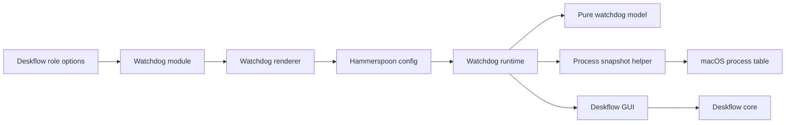
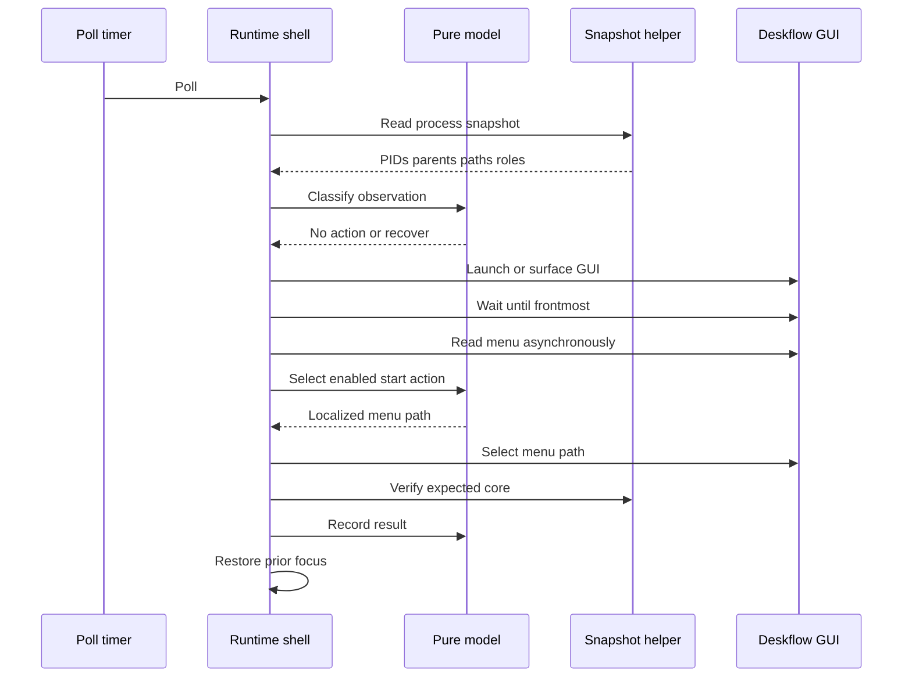
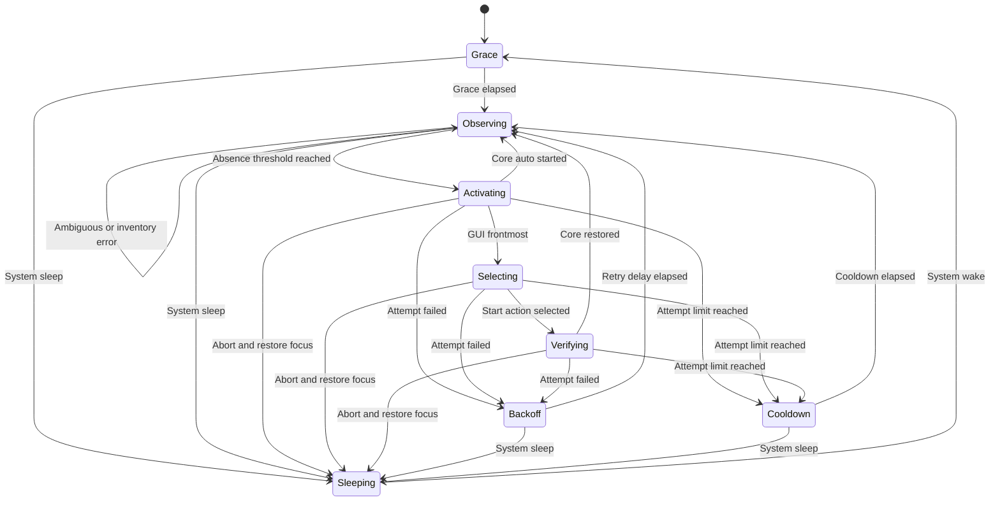

# Design Document

## Overview
This feature adds an optional Hammerspoon consumer that restores a missing
Deskflow core through Deskflow's own GUI. It preserves the completed Deskflow
and Hammerspoon framework boundaries while adding a testable runtime state
machine and personal-server rollout.

### Goals
- Detect a missing GUI-owned core without treating disconnection as failure.
- Recover client or server roles without direct core launch or duplicate work.
- Bound retries, suppress lifecycle false positives, and report terminal faults.
- Verify pure policy, generated Lua, host wiring, and one real server crash drill.

### Non-Goals
- Detecting an unresponsive core that remains present.
- Killing or adopting orphaned, duplicate, or otherwise ambiguous cores.
- A generic process-supervision framework.
- Changes to Deskflow settings, installation, or Hammerspoon framework behavior.
- Enabling the watchdog on ShopifyLaptop in this rollout.

## Boundary Commitments

### This Spec Owns
- `home.hammerspoon.deskflowWatchdog.enable` and its prerequisite assertions.
- Role serialization from `home.deskflow.role` into a self-contained Lua chunk.
- A Darwin process-snapshot helper that reports kernel-derived executable path,
  parent PID, and first role argument for current-user `deskflow-core` processes.
- Process inventory classification, absence debounce, lifecycle state, recovery
  serialization, retry/cooldown policy, and alert deduplication.
- Deskflow GUI activation, localized menu-action discovery, action invocation,
  post-action core verification, and prior-focus restoration.
- Personal-server enablement and feature-specific checks.

### Out of Boundary
- The `home.deskflow` schema, renderer, files, role selection, TLS, and layout.
- Hammerspoon packaging, generic rendering, XDG delivery, semantic annotations,
  launch-at-login, and config reload behavior.
- Direct `deskflow-core` launch, `--new-instance`, launchd core supervision, and
  any automatic process termination.
- Peer reachability, connection state, and hung-core health checks.
- A shared process-watch abstraction for future applications.

### Allowed Dependencies
- Read-only access to `home.deskflow.{enable,role}`.
- Additive use of `home.hammerspoon.extraConfig` and the existing syntax and
  semantic checks.
- Hammerspoon 1.1.1 APIs: `hs.accessibilityState`, `hs.alert`,
  `hs.application`, `hs.caffeinate.watcher`, `hs.task`, and `hs.timer`.
- Deskflow 1.26.0 bundle ID `org.deskflow.deskflow`, GUI single-instance
  activation behavior, cask path `/Applications/Deskflow.app`, core role
  argument, and Start/Connect menu action.
- macOS `libproc` and `sysctl(KERN_PROCARGS2)` through a Nix-built helper invoked
  directly by `hs.task`; no shell is allowed.

### Revalidation Triggers
- `home.deskflow.role` or `home.hammerspoon.extraConfig` contract changes.
- Deskflow bundle ID, cask destination, bundle layout, core arguments, GUI parentage,
  single-instance socket behavior, or Start/Restart shortcut changes.
- Hammerspoon API or generated annotation changes affecting the allowed APIs.
- Deskflow gaining a supported macOS restart IPC or changing crash recovery.
- Enabling the watchdog on a second host or supporting a non-macOS host.

## Architecture

### Existing Architecture Analysis
- `home.deskflow` already supplies validated client/server role state.
- `home.hammerspoon.extraConfig` already merges independent feature Lua into the
  syntax-gated XDG config.
- Optional Hammerspoon features use child options, `mkIf`, retained watcher
  handles, isolated semantic checks, and host-wiring assertions.
- No existing runtime component inventories processes or automates app menus.
- Deskflow 1.26.0 has no macOS restart IPC; the GUI is the core owner.
- macOS `ps command` output is explicitly unreliable and process-modifiable, so
  it cannot satisfy the exact executable-identity boundary.

### Architecture Pattern & Boundary Map
The selected pattern is a feature-local functional core with a Hammerspoon
runtime shell. The pure model owns classification and policy; the runtime owns
macOS effects. This generalizes client/server inputs without creating a generic
supervisor.



Dependency direction is:

`Deskflow options → Watchdog module → Renderer → Pure model → Runtime adapters → Snapshot helper and external processes`

The pure model imports no Hammerspoon APIs. The runtime depends on the model;
the model never depends on runtime objects.

### Technology Stack

| Layer | Choice / Version | Role in Feature | Notes |
|---|---|---|---|
| Configuration | Nix and Home Manager | Option, assertions, role injection | No new dependency |
| Runtime | Hammerspoon 1.1.1, Lua 5.4 | Timers, lifecycle events, app menus, alerts | Existing package |
| External app | Deskflow 1.26.0 | GUI-owned core recovery | Existing cask |
| Process inventory | Darwin C helper, `libproc`, `sysctl` | PID, parent, executable, role snapshot | Nix-built; direct invocation |
| Verification | Lua 5.4, LuaLS, Nix flake checks | Model, syntax, semantics, wiring | Existing toolchain |

## File Structure Plan

### Directory Structure
```text
home-manager/common/hammerspoon-deskflow-watchdog/
├── default.nix       # Option, prerequisite assertions, extraConfig contribution
├── process-snapshot.c # Kernel-backed Deskflow core process inventory
├── process-snapshot.nix # Darwin helper derivation
├── render.nix        # Role serialization and scoped model/runtime assembly
├── model.lua         # Pure parsers, classifiers, menu selector, state machine
└── runtime.lua       # Hammerspoon timers, tasks, application effects, alerts

tests/hammerspoon-deskflow-watchdog/
├── fake-hs.lua       # Deterministic Hammerspoon API fake and effect recorder
├── fixtures.lua      # Process snapshots and localized menu-tree fixtures
├── process-snapshot.test.c # Encoding and argv parsing tests
├── model.test.lua    # Plain-Lua model and policy tests
└── runtime.test.lua  # Adapter orchestration and no-destructive-fallback tests
```

### Modified Files
- `home-manager/common/default.nix` — import the optional watchdog module.
- `configurations/personal/home-manager/deskflow.nix` — enable the watchdog for
  the existing server role.
- `flake.nix` — add model, semantic, render/prerequisite, and host-wiring checks.

The existing Deskflow module, Hammerspoon renderer, and Shopify host file remain
unchanged.

## System Flows

### Observation and Recovery


Launching an absent GUI may start the core through `startCoreWithGui`. The
runtime re-observes before selecting a menu item and skips the menu action if
the expected core already exists.

### State Transitions


Sleep aborts an active recovery, stops cancelable timers, and attempts focus
restoration before incrementing the runtime epoch. If restoration cannot finish
before sleep, it remains pending and runs before wake grace begins. Asynchronous
callbacks captured under an old epoch may only release retained handles.

## Requirements Traceability

| Requirement | Summary | Components | Interfaces | Flows |
|---|---|---|---|---|
| 1.1, 1.2, 1.3, 1.4, 1.5, 1.6 | Optional role-aware contract | Watchdog Module, Renderer | HM option and assertions | Config evaluation |
| 2.1, 2.2, 2.3, 2.4, 2.5, 2.6 | Core observation and classification | Snapshot Helper, Pure Model, Runtime Shell | Process snapshot contract | Observation flow |
| 3.1, 3.2, 3.3, 3.4 | Login and sleep lifecycle | Pure Model, Runtime Shell | Lifecycle event contract | State transitions |
| 4.1, 4.2, 4.3, 4.4, 4.5, 4.6, 4.7 | GUI-owned single-flight recovery | Runtime Shell, Pure Model | Recovery and menu contracts | Recovery sequence |
| 5.1, 5.2, 5.3, 5.4, 5.5, 5.6, 5.7, 5.8 | Fail-closed retries, feedback, permission docs | Watchdog Module, Pure Model, Runtime Shell | Result and alert contracts | State transitions |
| 6.1, 6.2, 6.3, 6.4 | Personal-only initial rollout | Host Integration, Watchdog Module | Host option values | Config evaluation |
| 7.1, 7.2, 7.3, 7.4, 7.5, 7.6, 7.7 | Automated and host verification | Verification | Fixtures and flake checks | All flows |

## Components and Interfaces

| Component | Domain/Layer | Intent | Req Coverage | Key Dependencies | Contracts |
|---|---|---|---|---|---|
| Watchdog Module | Configuration | Define enablement and prerequisites | 1.1–1.6, 5.8, 6.3–6.4 | Deskflow options P0, Hammerspoon options P0 | Service |
| Renderer | Configuration | Build one scoped role-specific Lua chunk | 1.5–1.6, 7.1, 7.4 | Model and runtime sources P0 | Service |
| Snapshot Helper | Platform | Report kernel-backed core identity | 2.1–2.4, 7.3 | Darwin `libproc` and `sysctl` P0 | Batch |
| Pure Model | Domain | Classify snapshots and control recovery policy | 2.1–2.6, 3.1–3.4, 4.4–4.5, 5.2–5.7 | None | Service, State |
| Runtime Shell | Runtime | Execute Hammerspoon and macOS effects | 2.1–2.6, 3.1–3.4, 4.1–4.7, 5.1–5.8 | Hammerspoon P0, Deskflow P0, Snapshot Helper P0 | Service, Event |
| Host Integration | Configuration | Enable only the personal server | 6.1–6.4 | Personal Deskflow config P0 | State |
| Verification | Build | Prove model, rendering, semantics, wiring, runtime drill | 7.1–7.7 | Lua and flake checks P0 | Batch |

### Configuration Layer

#### Watchdog Module
| Field | Detail |
|---|---|
| Intent | Add one disabled-by-default watchdog option and role-safe contribution |
| Requirements | 1.1, 1.2, 1.3, 1.4, 1.5, 1.6, 5.8, 6.3, 6.4 |

**Responsibilities & Constraints**
- Expose only `home.hammerspoon.deskflowWatchdog.enable`.
- When enabled, assert `home.hammerspoon.enable`, `home.deskflow.enable`, and a
  non-null `client` or `server` role.
- Pass the existing role and Nix-built snapshot-helper path to the renderer; no
  role or command override exists.
- Contribute no Lua while disabled.
- Document the separate Hammerspoon and Deskflow Accessibility grants.

**Dependencies**
- Inbound: host Home Manager configuration — enable flag (P0).
- Outbound: `home.hammerspoon.extraConfig` — rendered chunk (P0).
- Outbound: `home.deskflow` — read-only prerequisites and role (P0).

**Contracts**: Service [x] / API [ ] / Event [ ] / Batch [ ] / State [ ]

##### Service Interface
```nix
home.hammerspoon.deskflowWatchdog.enable :: bool
renderWatchdog :: { role :: "client" | "server", snapshotCommand :: path } -> string
```

- Preconditions: Hammerspoon and Deskflow are enabled; Deskflow role is valid.
- Postconditions: enabled contributes one scoped Lua chunk; disabled contributes
  an empty value.
- Invariant: the role has one source of truth: `home.deskflow.role`.

#### Renderer
| Field | Detail |
|---|---|
| Intent | Assemble role, pure model, and runtime without global symbols |
| Requirements | 1.5, 1.6, 7.1, 7.4 |

The renderer emits a `do ... end` scope containing a Lua-quoted role and
store-path snapshot command, the module tables returned by `model.lua` and
`runtime.lua`, and one runtime `start` call. Both Lua files are also valid
standalone chunks for plain-Lua tests. Primitive serialization uses
`builtins.toJSON`; no string interpolation accepts runtime or user input beyond
the validated role enum and Nix store path.

### Platform Layer

#### Snapshot Helper
| Field | Detail |
|---|---|
| Intent | Emit a deterministic current-user inventory of `deskflow-core` processes |
| Requirements | 2.1, 2.2, 2.3, 2.4, 7.3 |

**Responsibilities & Constraints**
- Enumerate current-user processes and retain candidates whose kernel process
  name is exactly `deskflow-core`.
- Obtain PID and parent PID from `proc_pidinfo`, executable path from
  `proc_pidpath`, and argv from `sysctl(KERN_PROCARGS2)`.
- Extract only the first positional argument after argv zero as the role.
- Skip a candidate that disappears during enumeration. Any other inspection or
  encoding failure makes the helper exit non-zero without partial output.
- Sort records by PID and emit no output with exit zero when no candidates exist.
- Perform no signal, mutation, or process launch operation.

**Dependencies**
- Inbound: Runtime Shell invocation (P0).
- External: Darwin `libproc` and `sysctl` (P0).

**Contracts**: Service [ ] / API [ ] / Event [ ] / Batch [x] / State [ ]

##### Batch / Job Contract
- Trigger: one direct helper invocation per observation.
- Input: no arguments and no stdin.
- Output: one tab-separated record per candidate:
  `pid<TAB>ppid<TAB>encodedExecutablePath<TAB>encodedRole<LF>`.
- Encoding: `%`, tab, carriage return, and newline are percent-encoded as
  `%25`, `%09`, `%0D`, and `%0A`; all other UTF-8 bytes pass through.
- Validation: PID is positive, parent PID is non-negative, path is absolute,
  and role may be empty when argv cannot identify a positional role.
- Idempotency: read-only snapshot; records are sorted by PID.

### Domain Layer

#### Pure Model
| Field | Detail |
|---|---|
| Intent | Keep all parsing, classification, selection, and policy deterministic |
| Requirements | 2.1, 2.2, 2.3, 2.4, 2.5, 2.6, 3.1, 3.2, 3.3, 3.4, 4.4, 4.5, 5.2, 5.3, 5.4, 5.5, 5.6, 5.7 |

**Responsibilities & Constraints**
- Parse process rows without assuming paths contain no spaces.
- Require zero or one expected-path GUI; classify multiple or wrong-path GUI
  records as ambiguous.
- Classify only one exact core child with the expected role as healthy.
- Classify no GUI/no core or one GUI/no core as absent.
- Classify wrong path, wrong role, orphan, multiple GUI, or multiple core as
  ambiguous. Inventory parse/command failure is an error.
- Select exactly one enabled menu leaf whose shortcut character is `S`
  case-insensitively and whose modifier set is exactly `{ "cmd" }`; return its
  localized hierarchical path. Zero or multiple matches are errors.
- Own all debounce, grace, single-flight, rolling attempt window, backoff,
  cooldown, and alert-key transitions.

**Contracts**: Service [x] / API [ ] / Event [ ] / Batch [ ] / State [x]

##### Service Interface
```lua
Model.parseSnapshot(text) -> ProcessRecord[] | ParseError
Model.classify(records, guiRecords, expected) -> Observation
Model.findStartAction(menuTree, shortcut) -> MenuPath | MenuError
Model.new(policy, now) -> WatchdogState
Model.observe(state, observation, now) -> WatchdogState, Decision[]
Model.recoveryResult(state, result, now) -> WatchdogState, Decision[]
Model.lifecycle(state, event, now) -> WatchdogState, Decision[]
```

- Preconditions: monotonic non-decreasing timestamps within one wake epoch.
- Postconditions: decisions contain effects but execute none.
- Invariants: at most one recovery is in flight; ambiguous/error observations
  never produce a recovery decision; sleep produces only recovery-abort and
  focus-restoration decisions.

`ProcessRecord` contains `pid: integer`, `ppid: integer`,
`executablePath: string`, and `role: string | nil`. `GuiRecord` contains
`pid: integer` and `bundlePath: string`. Classification receives all running
bundle-ID GUI records plus expected bundle path `/Applications/Deskflow.app` and
the declared role. Health requires exactly one GUI at that path and one core
whose path is its bundle-derived core path, parent equals that GUI PID, and role
equals the declaration. Multiple GUIs or any bundle-ID GUI at another path are
ambiguous. Zero GUIs with zero cores is absent; zero GUIs with any core is
ambiguous.

##### State Management
The fixed production policy is:

| Policy | Value |
|---|---:|
| Poll interval | 5 seconds |
| Consecutive absence threshold | 2 observations |
| Startup grace | 15 seconds |
| Wake grace | 15 seconds |
| GUI activation poll interval | 250 milliseconds |
| GUI activation timeout | 10 seconds |
| Core verification timeout | 15 seconds |
| Verification interval | 1 second |
| Attempt limit | 3 attempts |
| Rolling recovery window | 300 seconds |
| Retry delays | 5 seconds, then 15 seconds |
| Cooldown | 300 seconds |

Healthy observation clears absence count, attempt history, cooldown, and stale
alert keys. A persistent prerequisite or ambiguity retains one alert key until
the condition changes or health returns.

### Runtime Layer

#### Runtime Shell
| Field | Detail |
|---|---|
| Intent | Translate model decisions into non-blocking Hammerspoon effects |
| Requirements | 2.1, 2.2, 2.3, 2.4, 2.5, 2.6, 3.1, 3.2, 3.3, 3.4, 4.1, 4.2, 4.3, 4.4, 4.5, 4.6, 4.7, 5.1, 5.2, 5.3, 5.4, 5.5, 5.6, 5.7, 5.8 |

**Responsibilities & Constraints**
- Retain poll, delayed, lifecycle watcher, and active task handles in chunk-local
  state.
- Invoke the rendered snapshot-helper store path through `hs.task.new` with no
  arguments and an asynchronous callback.
- Validate `/Applications/Deskflow.app` metadata against bundle ID
  `org.deskflow.deskflow`. Expected core path is
  `/Applications/Deskflow.app/Contents/MacOS/deskflow-core`; GUI executable is
  `/Applications/Deskflow.app/Contents/MacOS/Deskflow`.
- Collect every running application for the bundle ID as PID/path records and
  pass the full set to classification. Never select an arbitrary instance.
- Save the frontmost application at recovery start and restore it once on every
  success/failure terminal path if it remains running.
- Launch an absent GUI through LaunchServices, then re-observe before menu use.
- Surface an existing hidden GUI by executing its GUI binary once. Deskflow's
  duplicate-instance path signals `showAndActivate()` and exits; it never starts
  a second core. Core verification starts only after this short-lived task exits.
- Reacquire exactly one bundle-ID application at the expected cask path after
  launch/surface, then poll `isFrontmost()` every 250 milliseconds until success
  or the 10-second activation timeout. Any additional or wrong-path instance is
  ambiguous; menu enumeration cannot begin before success.
- Obtain menus through the asynchronous `getMenuItems(callback)` form. Pass the
  tree to the pure selector and invoke only the returned localized path.
- Verify an exact GUI-owned core after menu selection. Never call a core binary,
  `--new-instance`, app kill APIs, or task termination as recovery.
- Check Hammerspoon's Accessibility state before recovery. Deskflow permission
  failures surface through bounded recovery failure, not guessed TCC state.
- On sleep, abort the active recovery and attempt prior-focus restoration before
  epoch invalidation. Retain a failed restoration for one retry before wake grace.

**Dependencies**
- Inbound: Pure Model decisions (P0).
- External: Hammerspoon APIs listed under Allowed Dependencies (P0).
- External: Deskflow 1.26.0 GUI and bundle contract (P0).
- Outbound: Snapshot Helper — kernel-backed process snapshot (P0).

**Contracts**: Service [x] / API [ ] / Event [x] / Batch [ ] / State [ ]

##### Service Interface
```lua
observeCore(callback) -> nil
recoverCore(expected, callback) -> nil
finishRecovery(result) -> nil
reportOnce(key, message) -> nil
Runtime.start(model, role, snapshotCommand) -> Controller
```

`Observation.kind` is `healthy`, `absent`, `ambiguous`, or `error`.
`RecoveryResult.kind` is `recovered`, `unavailable`, `failed`, or `ambiguous`.
Callbacks carry the current epoch; stale callbacks release handles and return.

##### Event Contract
- Poll timer: requests observation every five seconds when not sleeping.
- Sleep event: stops polling, increments epoch, and enters Sleeping.
- Wake event: completes any pending focus restoration, enters Grace, resets
  absence evidence, and restarts polling.
- GUI/menu callbacks: at-most-once effects within the captured recovery epoch.

### Configuration Integration

#### Host Integration
The personal host sets `home.hammerspoon.deskflowWatchdog.enable = true` beside
its server Deskflow configuration. The Shopify host inherits the default false.
No host duplicates a role under the watchdog option.

### Verification Layer

#### Verification
- `hammerspoon-deskflow-watchdog-tests`: C helper encoding/argv tests, plain Lua
  model tests, and runtime orchestration against `fake-hs.lua` and fixtures.
- `hammerspoon-deskflow-watchdog-render`: client/server render assertions plus
  Home Manager prerequisite/disabled fixtures.
- `hammerspoon-deskflow-watchdog-semantic`: existing `mkSemanticCheck` over an
  isolated server-role rendered chunk.
- `hammerspoon-deskflow-watchdog-wiring`: both-host eval asserting personal
  enabled/server chunk and Shopify disabled/no chunk.
- Personal-host checklist: capture actual process/menu fixtures, validate both
  Accessibility grants, terminate the server core, and observe one restored
  GUI-owned server core with prior focus restored.

**Contracts**: Service [ ] / API [ ] / Event [ ] / Batch [x] / State [ ]

##### Batch / Job Contract
- Trigger: local targeted checks and `nix flake check`.
- Input: source files, deterministic fixtures, and evaluated host configs.
- Output: derivation success markers and host report; runtime checklist evidence
  remains operator-reviewed.
- Idempotency: checks do not mutate Deskflow or Hammerspoon runtime state.

## Error Handling

| Condition | Classification | Response |
|---|---|---|
| Hammerspoon Accessibility denied | Prerequisite | No recovery; one actionable alert |
| Expected bundle missing or ID mismatch | Error | No launch; bounded alert |
| Multiple or wrong-path bundle-ID GUIs | Ambiguous | No GUI/core action; one reasoned alert |
| Snapshot helper command/parse failure | Error | No recovery; deduplicated alert |
| Wrong path, role, parent, orphan, or duplicate | Ambiguous | No process action; one reasoned alert |
| GUI launch or surface timeout | Failed attempt | Restore focus; backoff or cooldown |
| Start action zero or multiple matches | Unavailable | No menu action; restore focus; bounded alert |
| Menu selection returns failure | Failed attempt | Restore focus; backoff or cooldown |
| Core absent after verification timeout | Failed attempt | Restore focus; backoff or cooldown |
| Sleep during async work | Stale epoch | Ignore callback effects; enter wake grace |

`hs.alert.show` carries the operator message; Hammerspoon console logging records
the same stable reason key and details. No error path terminates an application
or process.

## Testing Strategy

### Unit Tests
- Test helper argv extraction and field encoding; parse paths with spaces and
  encoded control characters; reject malformed snapshots without partial state.
- Classify healthy client/server, absent, unrelated path, wrong role, orphan,
  duplicate GUI, wrong GUI path, and duplicate core fixtures.
- Verify two-miss debounce, healthy reset, single-flight recovery, rolling
  attempt window, successful recovery result, retry delays, cooldown, and alert
  deduplication.
- Verify sleep cancels effect eligibility and wake starts a fresh grace period.
- Select one localized enabled start item by shortcut metadata; reject zero,
  disabled-only, and multiple candidates.
- Run the runtime against fake timers, tasks, applications, and menus; prove an
  absent core requests one GUI-owned action, success restores focus, and
  ambiguous/error observations invoke only process inventory and alerts.
- Verify delayed GUI activation gates menu enumeration, activation timeout
  restores focus, and sleep during activation, menu lookup, or verification
  aborts the attempt and restores focus before or immediately after wake.
- Verify duplicate and wrong-path GUI instances produce only one ambiguity alert
  and no launch, surface, menu, or core action.

### Integration and Build Tests
- Render isolated client/server chunks and prove the role appears only as a
  validated Lua string inside one local scope.
- Evaluate enabled fixtures with missing Hammerspoon, Deskflow, and role
  prerequisites; each failure names the missing option.
- Evaluate disabled fixture with no watchdog Lua contribution.
- Run Lua syntax and Hammerspoon semantic checks over the assembled chunk.
- Evaluate both hosts and assert personal-only enablement and role inheritance.

### Host Verification
- Record the packaged server process parent/path/argv and stopped-state menu
  metadata as fixtures before the crash drill.
- With another application focused, terminate only the observed server core and
  verify recovery within the policy window, one resulting core, GUI parentage,
  `server` role, and focus restoration.
- Stop the core through Deskflow's UI and verify the same recovery behavior.
- If the start action is naturally unavailable during the drill, verify one
  alert and no direct/destructive fallback; deterministic unavailable-action
  coverage remains mandatory in `runtime.test.lua`.

## Security and Performance Considerations
- The Nix-built snapshot helper and GUI binary are invoked directly through
  `hs.task`; no shell, user-controlled command, or secret is introduced.
- Kernel-derived executable path and parent PID avoid `ps command` spoofing;
  argv is read through `KERN_PROCARGS2` only to validate the declared role.
- Exact bundle path, parent PID, and role checks prevent name-only process
  confusion. Ambiguity always fails closed.
- The watchdog reads process metadata only and persists no runtime state.
- One asynchronous process snapshot every five seconds bounds overhead and does
  not block Hammerspoon's event loop. Menu enumeration runs only during recovery.

## Rollout and Compatibility
- The module is additive and disabled by default. Rollback is one host option
  removal followed by rebuild/reload.
- The first rollout is the personal server. Shopify remains a disabled client
  fixture until separate operator approval.
- The host drill must confirm the checked-in process and menu fixtures before
  completion. Fixture drift that changes selector or identity constants is a
  bounded adapter update; drift in GUI ownership or restart semantics triggers
  design revalidation.
