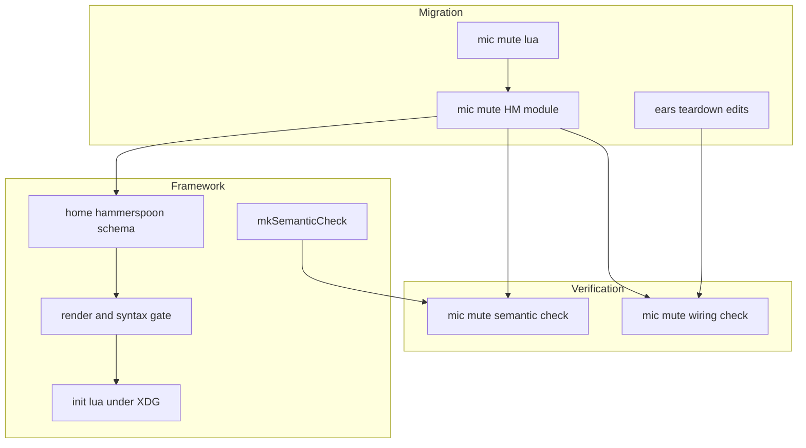
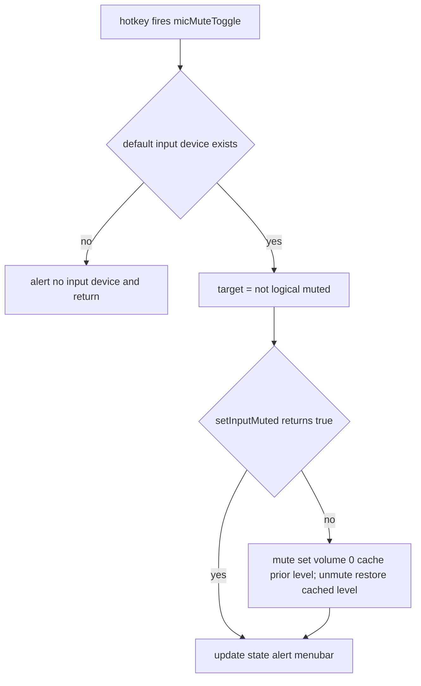
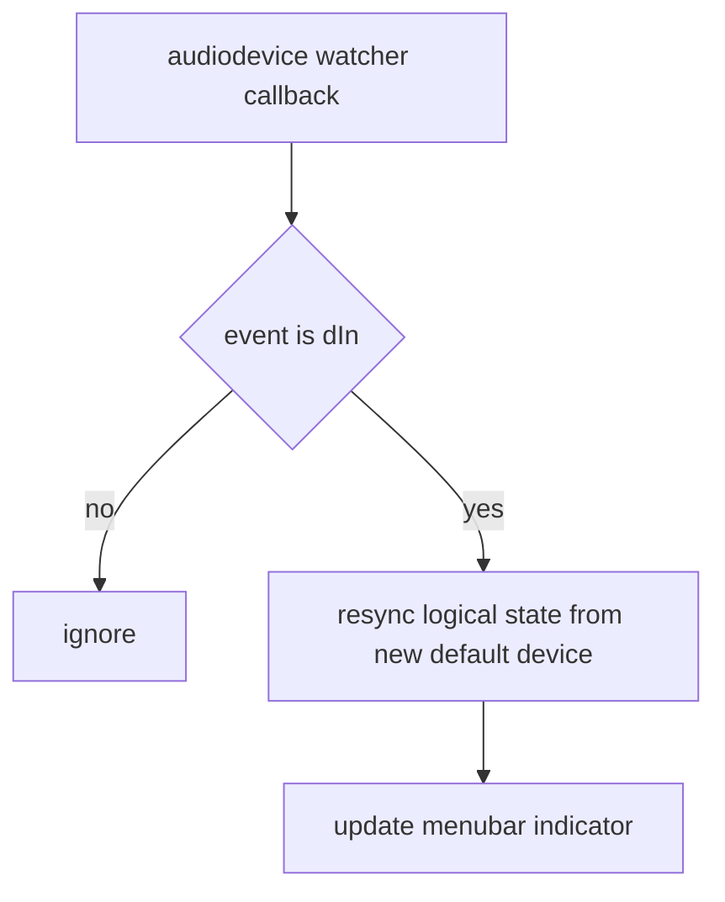

# Design Document

## Overview
**Purpose**: Replace the Ears Insta-Mute app with a declarative microphone
mute-toggle binding built on the implemented `hammerspoon-keybindings` framework,
and remove Ears and its opaque `NSKeyedArchive` shortcut blob.
**Users**: The operator presses ⌃⌘⇧F12 to toggle the default microphone's mute on
both darwin hosts; feedback is a transient alert and a persistent menubar item.
**Impact**: Adds the framework's first real binding (a `lua` action plus
`extraConfig`), retiring a Homebrew-cask menu-bar app and an activation-script blob.

### Goals
- A global ⌃⌘⇧F12 toggle of the system default input device's mute, with an
  input-volume fallback for devices lacking hardware mute, and a transient alert.
- A persistent menubar indicator that follows the default input device.
- Ears (cask + `ears.nix`) removed in the same change as the binding lands.
- Static flake-check coverage of the rendered binding (semantic validity + wiring),
  host-free.

### Non-Goals
- The keybinding framework, Hammerspoon install, XDG config location, auto-reload,
  syntax gate, and generic action types (owned by `hammerspoon-keybindings`).
- Per-application mute, tracking mute changes made by other apps, audio routing.
- Automating the Accessibility grant; binding the `fn` modifier.
- Runtime/behavioral verification on a host (the flake checks are static).

## Boundary Commitments

### This Spec Owns
- The ⌃⌘⇧F12 keybinding declaration (a single `lua` action) and the mic-mute Lua
  delivered through the framework's `extraConfig`.
- The mic-mute runtime logic: default-device resolution, hardware-mute toggle, the
  input-volume fallback and level restore, the transient alert, the persistent
  menubar indicator, and the default-input-device change watcher.
- The Ears teardown: removing the `ears` cask, deleting `ears.nix`, and removing its
  import.
- The verification checks for this binding: the live-config semantic check and the
  per-host wiring/teardown assertions.

### Out of Boundary
- The `home.hammerspoon` options schema, renderer, syntax gate, semantic-check
  derivation, install, launchd agent, and Accessibility documentation (framework).
- Any keybinding other than the mic toggle; any non-mic audio behavior.
- The framework's existing flake checks (`hammerspoon-package`,
  `hammerspoon-config-semantic`, `hammerspoon-config-semantic-rejects-bogus`,
  `hammerspoon-host-wiring`) — this spec adds attrs beside them, never edits them.

### Allowed Dependencies
- The framework action-type contract: `home.hammerspoon.keybindings` (a `lua`
  action) and `home.hammerspoon.extraConfig` (`types.lines`).
- The framework renderer postcondition that `extraConfig` is emitted before the
  bind calls, so a chunk-local function defined in `extraConfig` is in scope for the
  binding's `lua` action.
- The framework's reused `mkSemanticCheck` derivation and `hammerspoonHsAnnotations`.
- Hammerspoon runtime APIs: `hs.audiodevice` (`defaultInputDevice`, `inputMuted`,
  `setInputMuted`, `inputVolume`, `setInputVolume`, `name`),
  `hs.audiodevice.watcher` (`setCallback`, `start`), `hs.alert.show`, `hs.menubar`.
- The darwin layer's `homebrew.casks` list and `configurations/common-darwin`
  imports.

### Revalidation Triggers
- A change to the framework action-type contract (`lua`) or the `extraConfig`
  option → re-check the binding declaration.
- A change to the renderer's section ordering (extraConfig no longer before binds)
  → re-check the chunk-scope assumption for `micMuteToggle`.
- A change to `mkSemanticCheck`'s signature or the host-config eval path
  (`darwinConfigurations.<host>.config.home-manager.users.<user>.home.hammerspoon`)
  → re-check the verification.
- A Hammerspoon version bump that changes the `hs.audiodevice`/`menubar`/`alert`
  API surface → re-check the Lua against regenerated annotations.

## Architecture

### Existing Architecture Analysis
- The framework is implemented and approved: `home.hammerspoon.enable = true` is set
  once in `home-manager/common/default.nix`, binding-free, on both darwin hosts.
- GUI apps are otherwise Homebrew casks; `ears` is one, plus `ears.nix` writes its
  shortcut blob via an activation script. Removing the cask under
  `onActivation.cleanup = "zap"` uninstalls it.
- Both host configs (`shopify`, `personal`) are `aarch64-darwin` and import
  `home-manager/common`; there are no Linux configs, so the shared module is
  darwin-only in practice (no platform guard needed).

### Architecture Pattern and Boundary Map
Pattern: a thin consumer module layered on the framework. Dependency direction
(left imports never point right): `mic-mute lua → mic-mute HM module → framework
schema → render+gate → init.lua`. Verification reads the live host config.



Key decisions: the mic-mute logic lives in a real `.lua` file read into
`extraConfig`, so it is `stylua`-formattable and the binding's `lua` action is a
one-line call to a function defined there. Verification feeds each host's live
`home.hammerspoon` cfg into `mkSemanticCheck` rather than a fixture, so the check
tracks the real Lua with no drift.

### Technology Stack
| Layer | Choice / Version | Role in Feature | Notes |
|-------|------------------|-----------------|-------|
| Runtime | Hammerspoon 1.1.1 `hs.audiodevice`, `hs.audiodevice.watcher`, `hs.alert`, `hs.menubar` | Toggle, fallback, feedback, device watch | Symbols verified against 1.1.1 docs |
| Config generation | Framework `render.nix` + `checked-config.nix` (reused) | Inline `extraConfig` + binding; syntax gate blocks `switch` | Not modified |
| Install / system | nix-darwin `homebrew.casks`, `configurations/common-darwin` | Ears teardown | `cleanup = "zap"` uninstalls |
| Verification | Framework `mkSemanticCheck` + `nix eval` asserts | Semantic validity of live config + wiring/teardown | aarch64-darwin-gated; host-free |

## File Structure Plan

### Created
```
home-manager/common/hammerspoon-mic-mute/
├── default.nix     # HM module: sets home.hammerspoon.keybindings (⌃⌘⇧F12 lua action)
│                   #   and home.hammerspoon.extraConfig = readFile ./mic-mute.lua
└── mic-mute.lua    # Runtime: state table, micMuteToggle, fallback+restore, alert,
                    #   menubar create/update, hs.audiodevice.watcher callback
```

### Modified
- `home-manager/common/default.nix` — add `./hammerspoon-mic-mute` to `imports`.
- `configurations/common-darwin/default.nix` — remove `"ears"` from `homebrew.casks`
  and remove `./ears.nix` from `imports`.
- `flake.nix` — in the existing aarch64-gated `hammerspoonChecks` block, add
  `hammerspoon-mic-mute-semantic` and `hammerspoon-mic-mute-wiring` (beside the
  framework checks; framework checks unchanged).

### Deleted
- `configurations/common-darwin/ears.nix`.

## System Flows

Toggle (R1, R2, R3):


Default-input-device change (R4):


The watcher is the module-level `hs.audiodevice.watcher`; the callback filters on
the `"dIn "` event (default input changed). On resync, the new device's
`inputMuted()` is authoritative when non-nil; otherwise the indicator shows unmuted
and fallback state is cleared.

## Requirements Traceability
| Requirement | Summary | Components | Interfaces | Flows |
|-------------|---------|------------|------------|-------|
| 1.1 | Mute when unmuted | Mic Mute Lua | `setInputMuted(true)` | Toggle |
| 1.2 | Unmute when muted | Mic Mute Lua | `setInputMuted(false)` | Toggle |
| 1.3 | Global firing | Mic Mute HM Module | `hs.hotkey.bind` (framework) | Toggle |
| 2.1 | Hardware-mute path | Mic Mute Lua | `setInputMuted` true return | Toggle |
| 2.2 | Volume fallback mute | Mic Mute Lua | `setInputVolume(0)` | Toggle |
| 2.3 | Restore prior level on unmute | Mic Mute Lua | `setInputVolume(preMuteVolume)` | Toggle |
| 3.1 | Transient alert | Mic Mute Lua | `hs.alert.show` | Toggle |
| 3.2 | Persistent menubar item | Mic Mute Lua | `hs.menubar` | Toggle / Change |
| 3.3 | Muted indicator distinct | Mic Mute Lua | menubar title/icon | Toggle / Change |
| 4.1 | Toggle targets current default | Mic Mute Lua | `defaultInputDevice()` per fire | Toggle |
| 4.2 | Indicator follows device change | Mic Mute Lua | `hs.audiodevice.watcher` `dIn ` | Change |
| 5.1 | No `ears` cask | Ears Teardown | `homebrew.casks` | - |
| 5.2 | No `ears.nix` blob/import | Ears Teardown | imports list | - |
| 5.3 | Ears uninstalled on switch | Ears Teardown | `cleanup = "zap"` | - |
| 5.4 | Binding lands with removal | Mic Mute HM Module, Ears Teardown | same change set | - |
| 6.1 | Live config semantically valid | Verification | `mkSemanticCheck` | - |
| 6.2 | Binding present both hosts | Verification | `nix eval` assert | - |
| 6.3 | Checks host-free | Verification | eval + build only | - |

## Components and Interfaces

| Component | Layer | Intent | Req Coverage | Key Dependencies (P0/P1) | Contracts |
|-----------|-------|--------|--------------|--------------------------|-----------|
| Mic Mute Lua | Runtime | Toggle, fallback, feedback, device watch | 1.1-1.3, 2.1-2.3, 3.1-3.3, 4.1-4.2 | hs.audiodevice/alert/menubar (P0) | State |
| Mic Mute HM Module | Home Manager | Declare binding + deliver Lua via extraConfig | 1.3, 5.4 | framework schema (P0) | Service |
| Ears Teardown | nix-darwin | Remove cask, blob, import | 5.1-5.4 | homebrew.casks (P0) | State |
| Verification | flake checks | Semantic + wiring/teardown asserts | 6.1-6.3, 5.1 | mkSemanticCheck (P0), host eval (P0) | Batch |

### Runtime

#### Mic Mute Lua
| Field | Detail |
|-------|--------|
| Intent | The mic-mute runtime: toggle, fallback, alert, menubar, device watch |
| Requirements | 1.1-1.3, 2.1-2.3, 3.1-3.3, 4.1-4.2 |

**Responsibilities & Constraints**
- Defines, as chunk-local upvalues, the menubar object (`local micMenubar =
  hs.menubar.new()`), the scalar logical state (`muted`, `fallbackActive`,
  `preMuteVolume`), and the `micMuteToggle` function; registers the
  `hs.audiodevice.watcher` callback at load time (top-level in `extraConfig`, re-run
  on each `hs.reload`).
- **Object-handle rule (semantic-check constraint, verified)**: Hammerspoon object
  handles (the menubar; any device handle) MUST be held in plain locals/upvalues,
  never in a `nil`-initialized table field. The generated annotations lack a
  `---@return` type on `hs.menubar.new` (and `hs.audiodevice.defaultInputDevice`), so
  a plain local stays untyped and its method calls (`:setTitle`, `:setInputMuted`)
  pass the semantic check, whereas a `nil`-initialized table field makes LuaLS infer
  a concrete type that then false-positives (`undefined-field`). See research.md.
- Toggle: resolve `hs.audiodevice.defaultInputDevice()` into a fresh local; if nil,
  alert and return. Compute the target state as the negation of `muted`. Apply via
  `setInputMuted(target)`; if that returns false (device has no hardware mute), use
  the volume fallback: on mute cache `inputVolume()` then `setInputVolume(0)`, on
  unmute `setInputVolume(preMuteVolume)`. Update `muted`, show the alert, refresh the
  menubar.
- Retention: the menubar upvalue and the scalar state are captured by the bind
  closure and the watcher callback (both retained by Hammerspoon), so they are not
  garbage-collected for the session.
- Targets the current default device on every fire (4.1); never caches a device
  handle across toggles.

**Contracts**: State
- State model: `muted` is the logical mute state; `fallbackActive` records whether
  the current mute used the volume path; `preMuteVolume` holds the pre-mute level for
  restore. On a `dIn ` watcher event, resync `muted` from the new device's
  `inputMuted()` when non-nil (else unmuted, clear fallback) and refresh the menubar.
- The menubar item shows distinct muted/unmuted titles or icons (3.3).

**Implementation Notes**
- Integration: delivered verbatim into `init.lua` via the framework `extraConfig`;
  syntax-validated by the framework gate at `switch`; semantically validated by the
  Verification check in CI.
- Risks: object GC (mitigated by the retained upvalues); the single system-level
  `hs.audiodevice.watcher` callback is owned solely by this feature; the annotation
  `@return` gap above (mitigated by the object-handle rule — within boundary, no
  framework annotation change).

#### Mic Mute HM Module
| Field | Detail |
|-------|--------|
| Intent | Declare the ⌃⌘⇧F12 binding and deliver the Lua through the framework |
| Requirements | 1.3, 5.4 |

**Responsibilities & Constraints**
- Sets `home.hammerspoon.keybindings` to a single binding:
  `mods = [ "ctrl" "cmd" "shift" ]`, `key = "F12"`, a description, and
  `action.lua = "micMuteToggle()"`.
- Sets `home.hammerspoon.extraConfig = builtins.readFile ./mic-mute.lua`.
- Imported from `home-manager/common/default.nix`, so the binding reaches both hosts
  through the shared config (5.4). No platform guard (darwin-only consumers).

**Contracts**: Service
- Consumes the framework schema; module-merge concatenates `keybindings` and
  `extraConfig`. No `enable` coupling: the framework renders these only when
  `home.hammerspoon.enable` is true (it is).

**Implementation Notes**
- Integration: relies on the renderer emitting `extraConfig` before the bind so
  `micMuteToggle` is in scope (Revalidation Trigger if that ordering changes).

### System

#### Ears Teardown
| Field | Detail |
|-------|--------|
| Intent | Remove Ears entirely, atomically with the binding |
| Requirements | 5.1, 5.2, 5.3, 5.4 |

**Responsibilities & Constraints**
- Remove `"ears"` from `homebrew.casks` (5.1) and `./ears.nix` from the
  `configurations/common-darwin` imports (5.2); delete `ears.nix` (5.2). On the next
  `darwin-rebuild switch`, `cleanup = "zap"` uninstalls the Ears app (5.3).
- Lands in the same change set as the Mic Mute HM Module so mic-mute is never absent
  on a switched host (5.4).

**Contracts**: State
- Post-state: no `ears` cask, no `ears.nix` file or import, no
  `com.clickontyler.Ears` preferences written by this repo.

### Verification

#### Verification
| Field | Detail |
|-------|--------|
| Intent | Prove the rendered binding is semantically valid and wired, host-free |
| Requirements | 6.1, 6.2, 6.3, 5.1 |

**Responsibilities & Constraints**
- `hammerspoon-mic-mute-semantic`: build `mkSemanticCheck` over a host's live
  `home.hammerspoon` cfg (`{ inherit (… .home.hammerspoon) keybindings extraConfig
  reloadOnConfigChange; }`). Building it proves the real mic-mute Lua's `hs.*`
  module/submodule/function references exist — including the 3-level
  `hs.audiodevice.watcher.setCallback` and `hs.menubar.new`/`hs.alert.show` (6.1).
  Object-method calls pass under the object-handle rule; the check's load-bearing
  coverage is `hs.*` path existence (a nonexistent `hs.X.Y` fails). The full mic-mute
  API surface was empirically confirmed to pass this gate (research.md). aarch64-gated,
  host-free (6.3).
- `hammerspoon-mic-mute-wiring`: per-host (`ShopifyLaptop`, `Brandons-MacBook-Pro`)
  `nix eval` assertions, mirroring the framework's host-wiring pattern: exactly one
  keybinding with `mods` set `{ctrl,cmd,shift}` and `key == "F12"` and a non-null
  `action.lua` (6.2); `ears` absent from `sys.homebrew.casks` (5.1). A successful
  host-config eval also proves the `ears.nix` import was removed (a dangling import
  would fail eval) (5.2).

**Contracts**: Batch
- Trigger: `nix flake check` on `aarch64-darwin`. Output: success markers; failure on
  a nonexistent `hs` symbol, a missing/changed binding, or a residual `ears` cask.
- Both attrs are added inside the framework's existing `hammerspoonChecks`
  `optionalAttrs (system == "aarch64-darwin")` block; the framework's attrs are not
  modified.

## Data Models

### Mic-mute state (Lua upvalues)
- Scalars: `muted : bool`, `fallbackActive : bool`, `preMuteVolume : number or nil`.
- Object handle: `micMenubar : hs.menubar` — a plain upvalue (not a table field; see
  the object-handle rule in the Mic Mute Lua component).
- Invariants: `muted` is the single source of truth for the logical toggle;
  `preMuteVolume` is set only while a volume-fallback mute is active; `micMenubar` is
  retained for the session via closure capture. No persistence — recreated on each
  load/reload.

## Error Handling

### Error Strategy
- **No default input device**: `defaultInputDevice()` returns nil → show an alert and
  no-op (graceful; 1.x).
- **No hardware mute**: `setInputMuted` returns false → volume fallback (designed
  behavior, not an error; 2.2/2.3).
- **Invalid Lua (build-time)**: the framework syntax gate (`luac5.4 -p`) fails
  `darwin-rebuild switch` (framework-owned).
- **Nonexistent `hs` symbol (CI)**: `hammerspoon-mic-mute-semantic` fails
  `nix flake check` (6.1), never a rebuild.
- **Inert until granted**: until the framework's one-time Accessibility grant, the
  hotkey is inert (framework R2; not re-owned here).

### Monitoring
- No new logging surface; the Hammerspoon console is the runtime log, and the flake
  checks are the pre-activation gate.

## Testing Strategy

### Build / Static (automated, host-free)
- `hammerspoon-mic-mute-semantic` builds `mkSemanticCheck` over the live mic-mute
  config and succeeds (6.1).
- `hammerspoon-mic-mute-wiring` asserts the ⌃⌘⇧F12 `lua` binding on both hosts (6.2)
  and `ears` cask absence (5.1); evaluating both host configs proves the `ears.nix`
  import was removed (5.2).
- Inherited: the framework syntax gate over the live config blocks `switch` on
  invalid mic-mute Lua.

### Manual Smoke (operator, runtime — out of automated scope)
- ⌃⌘⇧F12 mutes/unmutes the active mic (1.1-1.3); the alert appears (3.1); the menubar
  reflects state (3.2-3.3); switching the input device updates the indicator (4.2); a
  device without hardware mute mutes via volume and restores the prior level on
  unmute (2.1-2.3); after `switch`, the Ears app is gone (5.3).

## Security Considerations
- No new powerful grant: toggling mute via CoreAudio property control captures no
  audio, so only the framework's existing Accessibility grant is needed — no macOS
  Microphone (TCC) permission. The mic-mute Lua is operator-authored, trusted input,
  delivered through the same syntax/semantic gates as any framework config.
