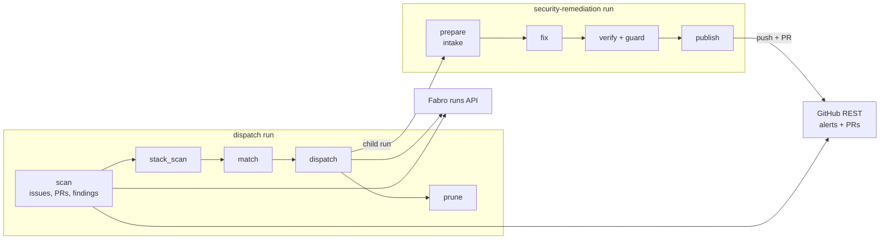
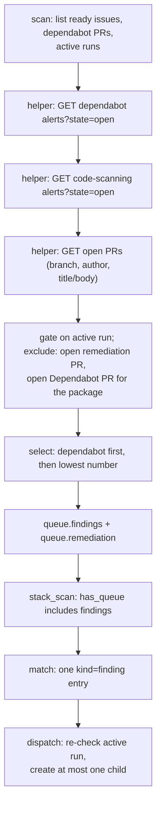
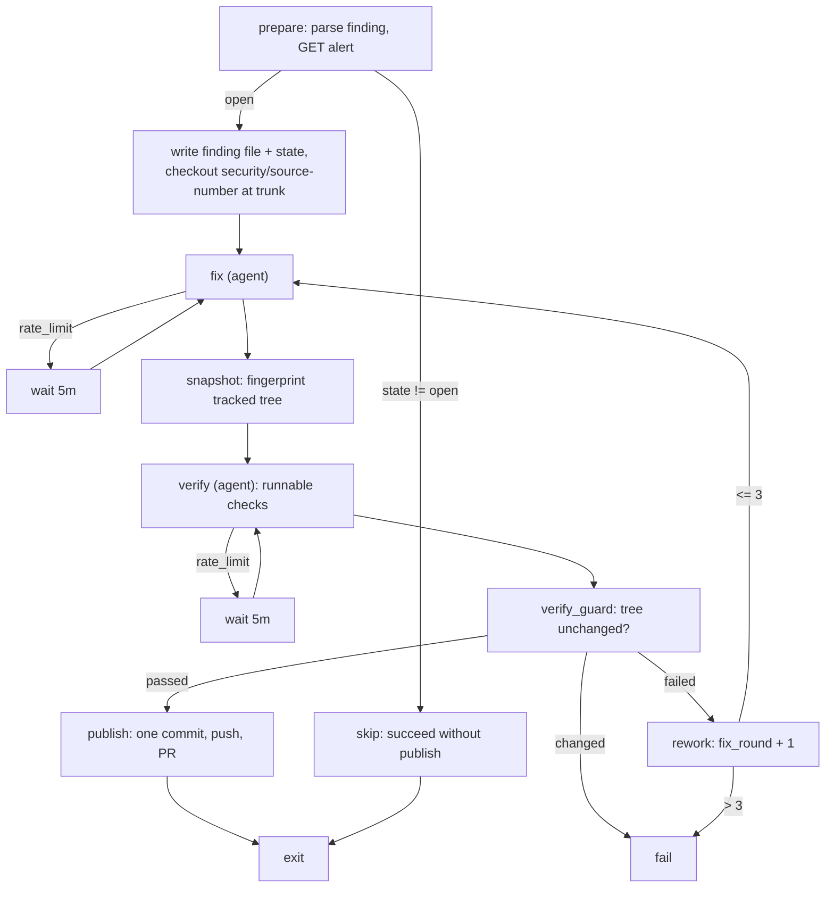

# Design Document

## Overview

The dispatch workflow learns to enumerate open Dependabot and code scanning alerts, pick one
eligible finding per repository, and hand it to a new `security-remediation` package that fixes
one alert, verifies the repository's runnable checks, and publishes exactly one commit on
`security/<source>-<alert-number>` with a pull request that links the alert. `brief.md` owns the
problem statement and scope, `requirements.md` owns the behavioural contract, and `research.md`
records the GitHub API, permission, and Fabro facts this design depends on.

**Purpose**: stop alert backlogs from waiting on a human for the read-advisory → patch → PR → CI
loop, without allowing two remediation attempts to race over the same manifest or source file.

**Users**: the repository owner who runs the scheduled dispatch automation, and the reviewers of
the remediation pull requests it opens.

**Impact**: adds one workflow package, extends the dispatch scan/plan/dispatch stages, and adds one
pinned version variable to the pin script and the API-bridge allowlist. It does not change
`dependabot`, `oneshot`, `failure-triage`, `kiro-*`, the CodeQL workflow, or Dependabot
configuration.

### Goals

- One scan reads both alert sources, selects at most one eligible finding, and creates at most one
  `security-remediation` child per repository.
- A finding with an active run, an open remediation PR, or an open Dependabot PR for its package is
  never dispatched twice.
- A run produces exactly one commit over the current default-branch head, a deterministic branch,
  and a non-draft PR whose body names the alert.
- Merge is left to a human; GitHub closes the alert once the default branch no longer reports it.

### Non-Goals

- Severity-based prioritization, bulk remediation, secret scanning, alert dismissal or commenting.
- Auto-merging remediation PRs, and any change to `dependabot`, `oneshot`, `failure-triage`,
  `kiro-*`, `.github/workflows/codeql.yml`, or `.github/dependabot.yml`.
- A cross-run mutex: the Fabro runs list remains the authoritative "already running" check.

## Boundary Commitments

### This Spec Owns

- The dispatch-side finding queue (`findings`), selection and exclusion rules, and the queue file
  contract extension in `.git/dispatch-queue.json`.
- The `security-remediation` package: inputs, graph, prompts, embedded helper script, and the
  `.git/security-remediation-*.{json,md}` run files.
- The `security/<source>-<alert-number>` branch naming contract and the single-commit publish
  invariants.
- The `security_remediation_workflow_version` variable name and its pin-script and bridge-allowlist
  registration.
- Local tests over selection, serialization, deduplication, publish, and the new graph.

### Out of Boundary

- Alert lifecycle writes of any kind, and the shape of GitHub's own closure logic.
- The `dependabot` workflow's handling of its own PRs; this spec only defers to it.
- The Fabro server, API bridge implementation, and GitHub App registration UI.
- Scheduling: the existing dispatch automation cadence is unchanged.

### Allowed Dependencies

- GitHub REST API version `2026-03-10` (the version already pinned in every workflow's request
  headers) and the two alert list/detail endpoints.
- Fabro API bridge: `POST /runs`, `POST /runs/{id}/start`, and `GET /runs` with status filters.
- Pinned child workflow-version variables read with Fabro's `vars` template substitution, and the
  offline `fabro validate` loop from `docs/fabro-workflows.md`.
- The `oneshot` publish pattern and the `dependabot` fix/verify gate pattern, reused by copy rather
  than by import.

### Revalidation Triggers

- A change to the `findings`/`remediation` keys in `.git/dispatch-queue.json`, or to the
  `finding` input format (`<source>:<number>`).
- A change to branch naming (`security/<source>-<number>`), to the PR body's alert line, or to the
  "replay onto a moved trunk only when files are disjoint" publish rule.
- A rename of `security_remediation_workflow_version`, or a change to the bridge allowlist
  mechanism.
- A GitHub alert API field rename, or a change in the documented alert states.
- A change to the sandbox platform or to the repository's flake check set, which invalidates the
  verify prompt's exclusion list.

## Architecture

### Existing Architecture Analysis

The dispatch package is a six-stage graph: `scan` builds `.git/dispatch-queue.json` from GitHub,
`stack_scan` (helper `.git/dispatch-stack-scan.py` written by `[[run.prepare.steps]]`) adds
Kiro-spec stack reruns, `match` turns the queue into `.git/dispatch-plan.json`, `normalize` marks
stack reruns as label-neutral, `dispatch` creates and starts child runs through the bridge, and
`prune` archives earlier successful dispatch runs. Serialization exists for Dependabot only: the
scan skips dependabot PRs while a `dependabot` run is active, and `dispatch` creates at most one
dependabot child per scan (`.fabro/workflows/dispatch/workflow.fabro:43-49`).

Two patterns are reused rather than reinvented:

- **Queue → plan → create.** Findings join the queue like issues and PRs, and the create stage
  enforces the per-repository limit at the moment of creation, where the race exists.
- **Deterministic branch + `commit-tree` publish.** `oneshot` builds one commit from the working
  tree with the default-branch head as parent and force-pushes it; `dependabot` reuses the same
  push-safety shape (remote head comparison, `--force-with-lease`, `push_stale` failure).

### Architecture Pattern & Boundary Map



- **Selected pattern**: stage-extension of the existing dispatcher plus one sibling workflow
  package. Alert discovery and selection are deterministic Python; judgement (what the fix and the
  repository's checks are) stays in two agent stages, exactly where `dependabot` keeps it.
- **Domain boundaries**: dispatch owns *which* finding runs; `security-remediation` owns *how* one
  finding is fixed and published. Neither writes alerts.
- **Existing patterns preserved**: helper scripts embedded in `[[run.prepare.steps]]`, routing JSON
  on `stdout`, `stage_failure`-driven `fail` nodes, `--force-with-lease` pushes, and pinned child
  versions read from `vars`.
- **New components rationale**: one dispatch helper keeps the selection logic testable outside the
  graph; one workflow package keeps the remediation loop isolated from `dependabot`'s PR-amend
  semantics; one variable keeps child creation inside the bridge allowlist.

### Technology Stack

| Layer | Choice / Version | Role in Feature | Notes |
|-------|------------------|-----------------|-------|
| Orchestration | Fabro `0.386.0-nightly.0` (pinned in `overlays/fabro.nix`) | Graph, stages, context, retries | Offline `fabro validate` only |
| Job logic | Python 3 (sandbox-provided) | Scan helper, remediation helper | Stdlib only, `urllib.request` |
| External APIs | GitHub REST `2026-03-10` | Alert lists/details, PR list/create | Read alerts, write contents/PRs only |
| Child versions | Fabro server variables | `security_remediation_workflow_version` | Allowlisted by the API bridge |
| Tests | `unittest` run directly with `python3` | Selection, serialization, publish | Same ad-hoc convention as `tests/dispatch/` |

## File Structure Plan

### Directory Structure

```
.fabro/workflows/
├── dispatch/
│   ├── workflow.fabro          # scan/match/dispatch changes (inline scripts)
│   └── workflow.toml           # alert-read permissions; prepare writes the security-scan helper
└── security-remediation/       # new package; same layout as dependabot/oneshot
    ├── workflow.fabro          # intake -> fix -> verify -> publish graph
    ├── workflow.toml           # inputs, permissions, run_branch/PR off, embedded tools.py
    └── prompts/
        ├── fix.md              # patch one alert; never commit, push, or suppress
        └── verify.md           # run the repository's runnable checks, record exclusions
tests/
├── dispatch/
│   └── security-scan.test.py   # selection, exclusion, unreadable-source behaviour
└── security-remediation/
    ├── publish.test.py         # branch, single commit, PR reuse, stale push, empty diff, artifacts
    └── workflow.test.py        # graph/prompt invariants of the new package
```

### New Files

- `.fabro/workflows/security-remediation/workflow.toml` — run inputs (`finding`), model fallbacks,
  GitHub permissions, checkpoints/run branch/PR publication disabled (no `[run.clone]` override:
  publish compares trees, never history), and the `[[run.prepare.steps]]` block that writes
  `.git/security-remediation-scripts/tools.py` and `py_compile`s it.
- `.fabro/workflows/security-remediation/workflow.fabro` — graph described in Components.
- `.fabro/workflows/security-remediation/prompts/fix.md`, `prompts/verify.md`.
- `tests/dispatch/security-scan.test.py`, `tests/security-remediation/publish.test.py`,
  `tests/security-remediation/workflow.test.py`.
- `.kiro/specs/fabro-workflow-to-remediate-github-security-find/research.md` (written by this
  stage; records the external API and permission facts).

### Modified Files

- `.fabro/workflows/dispatch/workflow.toml` — add a second `[[run.prepare.steps]]` entry that
  writes `.git/dispatch-security-scan.py` (marker `DISPATCH_SECURITY_SCAN_PY`, `py_compile`d) and
  extends the `[run.integrations.github]` permission map.
- `.fabro/workflows/dispatch/workflow.fabro` — `scan` merges the helper's output into the queue,
  `match` emits one `kind=finding` plan entry, `dispatch` gates finding children, and the
  `stack_scan` `has_queue` computation includes findings (inside the embedded helper in
  `workflow.toml`).
- `scripts/pin-workflow-versions.sh` — pin the new package and extend the header's package list.
- `configurations/fabro-vm/default.nix` — add `security_remediation_workflow_version` to
  `allowedVersionVariables`.
- `docs/fabro-workflows.md` — add the package to the package list, the pin-refresh list, and the
  pinned-variable sentence.

### Existing Files Referenced

- `.fabro/workflows/dependabot/{workflow.fabro,workflow.toml,prompts/*.md}` — gate loop, Nix
  sandbox gate, push-safety and label plumbing this design copies.
- `.fabro/workflows/oneshot/workflow.toml` (`publish`) — `commit-tree` + PR find/create pattern.
- `configurations/fabro-vm/api-bridge/src/main.rs` — caller-slug and version-variable checks.
- `tests/dispatch/{goal-gates,stack-scan}.test.py` — graph invariant and helper-extraction patterns.

## System Flows

### Dispatch scan with findings



Flow decisions: the scan records **all** open findings and the selected one; `match` suppresses the
entry when `remediation.active_run` is set, and `dispatch` re-checks `GET /runs` immediately before
creation because the scan and the create can be minutes apart. An alert API error aborts the scan
before any queue is written, so no child is created (requirement 1.5).

### Remediation run



## Requirements Traceability

| Requirement | Summary | Components | Interfaces | Flows |
|-------------|---------|------------|------------|-------|
| 1.1 | List both open alert sources | C1 `list_alerts` | `GET /dependabot/alerts`, `GET /code-scanning/alerts` | Dispatch scan |
| 1.2 | Record source/number/title/url in the queue | C1 `scan`, C2 `scan` node | `queue.findings[]` | Dispatch scan |
| 1.3 | No findings, no child | C1 `scan`, C3 `match` | `selected=null` | Dispatch scan |
| 1.4 | Secret scanning ignored | C1 `SOURCES` tuple | — | Dispatch scan |
| 1.5 | Unreadable source fails and names it | C1 `list_alerts` | `sys.exit("... <source> ...")` | Dispatch scan |
| 1.6 | No writes to alerts | C1, C9 | GET-only helpers | All |
| 2.1 | Exactly one finding per scan | C1 `select_finding`, C3 | `queue.remediation.selected` | Dispatch scan |
| 2.2 | Only non-excluded findings considered | C1 `exclusions` | `remediation.excluded[]` | Dispatch scan |
| 2.3 | Dependabot preferred | C1 `select_finding` | `SOURCE_ORDER` | Dispatch scan |
| 2.4 | Lowest-numbered Dependabot alert | C1 `select_finding` | sort key | Dispatch scan |
| 2.5 | Lowest-numbered code scanning alert | C1 `select_finding` | sort key | Dispatch scan |
| 2.6 | Same finding on an unchanged rerun | C1 | pure function | Dispatch scan |
| 2.7 | Report source and alert number | C2, C4 | `context.finding_source/finding_number` | Dispatch scan |
| 3.1 | Active run suppresses child creation | C1 `active_remediation_run`, C3, C4 | `GET /runs?status=...` | Dispatch scan |
| 3.2 | At most one child per scan | C4 `remediation_dispatched` | — | Dispatch scan |
| 3.3 | No other finding while one is active | C3, C4 | `active_run` gate | Dispatch scan |
| 3.4 | Skip finding with open remediation PR | C1 `exclusions` | `security/<source>-<n>` head ref | Dispatch scan |
| 3.5 | Skip finding with open Dependabot PR | C1 `package_mentioned` | PR title/body token match | Dispatch scan |
| 3.6 | No second PR for the same finding | C1, C9 `find_open_pr` | branch reuse | Publish |
| 3.7 | Closed alert leaves the scan | C1 | `state=open` filter | Dispatch scan |
| 4.1 | Capture alert detail for the fix | C6 `fetch_alert`, `write_finding_file` | `GET .../alerts/{n}` | Remediation run |
| 4.2 | Exactly one finding per run | C6 `parse_finding_ref`, state | `inputs.finding` | Remediation run |
| 4.3 | Closed alert ends without publishing | C6 `prepare` + graph edge | `alert_open=false` → `skip` | Remediation run |
| 4.4 | Unreadable alert fails with identity | C6 `fetch_alert` | error text | Remediation run |
| 4.5 | Alert text is untrusted | C7, C8 prompts | prompt rules | Remediation run |
| 5.1 | Fix removes the vulnerability | C7 | fix prompt | Remediation run |
| 5.2 | Run checks for changed packages | C8 `verify` | verify prompt | Remediation run |
| 5.3 | Failure returns to fix while rounds remain | C8 `rework` | `fix_round` | Remediation run |
| 5.4 | Failure after the limit fails without publishing | C8 `rework` | `stage_failure` → `fail` | Remediation run |
| 5.5 | Environment-unrunnable checks excluded | C8 `verify` | `excluded:` recording | Remediation run |
| 5.6 | No runnable check → fail | C8 `verify` | `outcome=failed` | Remediation run |
| 5.7 | Bounded rate-limit retries | C7/C8 wait nodes | `failure_class contains rate_limit` | Remediation run |
| 5.8 | Verification changes nothing tracked | C8 `snapshot`, `verify_guard` | fingerprint compare | Remediation run |
| 6.1 | One commit on `security/<source>-<n>` | C9 `publish` | `commit-tree` | Publish |
| 6.2 | Parent is the default-branch head | C9 | `git fetch` + `rev-parse FETCH_HEAD`; disjoint-file replay when it advanced | Publish |
| 6.3 | Non-draft PR into the default branch | C9 | `POST /pulls` | Publish |
| 6.4 | Existing open PR updated, not duplicated | C9 `find_open_pr` | `GET /pulls?head=` | Publish |
| 6.5 | Body references alert URL and number | C9 `pr_body` | markdown line | Publish |
| 6.6 | Stale remote head fails the push | C9 `remote_head`, lease | `push_stale` | Publish |
| 6.7 | No-op fix fails instead of an empty commit | C9 | `git diff --quiet` | Publish |
| 6.8 | One commit over the branch at every push | C9 | single `commit-tree` from base | Publish |
| 6.9 | No build artifacts in the commit | C9 `artifact_paths` | `git ls-tree` filter | Publish |
| 6.10 | Failed PR create fails the run | C9 | 422 + no open PR | Publish |
| 6.11 | Report PR, never claim closure | C9, C7/C8 prompts | `pr_number`, `pr_url` | Publish |
| 7.1 | Merge triggers no workflow action | Graph ends at `publish`/`exit` | — | Remediation run |
| 7.2 | No alert writes | C1, C6, C9 | no PATCH/comment calls | All |
| 7.3 | Fix is confirmable by the existing CodeQL setup | C7 | fix prompt constraints | Remediation run |
| 7.4 | No merge or auto-merge | C9, prompts | `[run.pull_request] enabled=false` | Publish |
| 7.5 | Open PR reported as the outcome | C9 | publish context | Publish |
| 8.1 | Pin script registers the package | C11 | `pin .fabro/workflows/security-remediation ...` | Registration |
| 8.2 | Dispatch reads the pinned variable | C3 | `vars.security_remediation_workflow_version` | Dispatch scan |
| 8.3 | Bridge accepts the variable | C11 | `allowedVersionVariables` | Registration |
| 8.4 | Validation covers both packages | C11 | `for workflow in .fabro/workflows/*/workflow.fabro` | Registration |
| 8.5 | Docs list package and variable | C11 | `docs/fabro-workflows.md` | Registration |
| 9.1 | Tests: one finding, Dependabot-first | C12 | selection tests | Tests |
| 9.2 | Tests: run/PR/Dependabot-PR exclusions | C12 | exclusion tests | Tests |
| 9.3 | Tests: unreadable source fails, no child | C12 | error tests | Tests |
| 9.4 | Tests: branch, single commit, body, stale push | C12 | publish tests | Tests |
| 9.5 | Tests: rerun reuses the PR | C12 | publish rerun test | Tests |

## Components and Interfaces

### Component Summary

| Component | Layer | Intent | Req Coverage | Key Dependencies | Contracts |
|-----------|-------|--------|--------------|------------------|-----------|
| C1 SecurityScan helper | Dispatch | Enumerate, exclude, select findings | 1, 2, 3.1-3.7 | GitHub REST, Fabro runs (P0) | Service |
| C2 `scan` node wiring | Dispatch | Merge findings into the queue | 1.2, 2.7 | C1 (P0) | Batch |
| C3 `match` finding rule | Dispatch | Emit one finding plan entry | 2.1, 3.1, 3.3, 8.2 | C1, vars (P0) | Data |
| C4 `dispatch` create gate | Dispatch | Create at most one child | 3.1-3.3, 2.7 | Fabro API bridge (P0) | API |
| C5 `stack_scan` queue truth | Dispatch | Keep `has_queue` true for findings | 1.2 | C2 (P0) | Data |
| C6 Intake helper | Remediation | Fetch one alert, write run state | 4.1-4.4 | GitHub REST, git (P0) | Service |
| C7 Fix stage | Remediation | Patch the reported vulnerability | 5.1, 5.7, 7.3 | Agent, sandbox Nix (P0) | Batch |
| C8 Verify stage + guard | Remediation | Run checks, enforce no-drift | 5.2-5.8 | Agent, sandbox Nix (P0) | Batch |
| C9 Publish stage | Remediation | One commit, push, PR | 6.1-6.11, 7.1-7.5 | GitHub REST, git (P0) | API |
| C10 Fail stage | Remediation | Surface `stage_failure` as a failed run | 5.4, 6.10 | Context (P1) | — |
| C11 Registration | Config | Pin variable, allowlist, docs | 8.1-8.5 | Fabro CLI, NixOS module (P1) | Config |
| C12 Tests | Tests | Pin selection/publish behaviour | 9.1-9.5 | `unittest`, local git (P1) | — |

### Dispatch

#### C1: SecurityScan helper (`.git/dispatch-security-scan.py`)

| Field | Detail |
|-------|--------|
| Intent | Turn two alert lists plus open PRs and active runs into `findings` and a single `selected` finding |
| Requirements | 1.1-1.6, 2.1-2.7, 3.1-3.7 |
| Owner / Reviewers | dispatch workflow owner |

**Responsibilities & Constraints**
- Owns alert pagination, the exclusion rules, and the selection order. It never writes to GitHub
  and never creates runs.
- Pure enough to test: every network call goes through an injected `request(method, path)`
  returning parsed JSON; the active-run list is passed in already filtered by status.
- Sorting is total and stable: `(SOURCE_ORDER[source], number)`.

**Dependencies**
- Inbound: `scan` node (C2) — passes the parsed repo slug and the active run list (Critical).
- External: GitHub REST alerts and pulls endpoints (Critical).
- Outbound: none (returns a dict; the node writes the queue).

**Contracts**: Service [x] / API [ ] / Event [ ] / Batch [ ] / State [ ]

##### Service Interface
```python
SOURCES = ("dependabot", "code-scanning")      # secret scanning is never requested
SOURCE_ORDER = {"dependabot": 0, "code-scanning": 1}
PAGE_SIZE = 100
MAX_PAGES = 10

def alert_url(slug: str, source: str, number: int) -> str
def remediation_branch(source: str, number: int) -> str          # "security/<source>-<n>"
def branch_finding(ref: str) -> tuple[str, int] | None           # parse a remediation branch
def finding_id(source: str, number: int) -> str                  # "<source>:<n>"
def list_alerts(slug: str, source: str, request) -> list[dict]   # exits naming the source
def open_pull_requests(slug: str, request) -> list[dict]
def package_mentioned(package: str, text: str) -> bool
def exclusions(findings: list[dict], pulls: list[dict]) -> tuple[list[dict], list[dict]]
def select_finding(eligible: list[dict]) -> dict | None
def active_remediation_run(runs: list[dict], slug: str) -> str | None
def scan(slug: str, request, runs: list[dict]) -> dict
```
- Preconditions: `GITHUB_TOKEN` set by the workflow integration; `runs` already status-filtered.
- Postconditions: `scan()` returns `{"findings": [...], "remediation": {...}}` and makes no write
  request. `list_alerts` exits non-zero on any non-200 response with a message naming the source.
- Invariants: `selected` is `null` or exactly one element of `eligible`, and never one of the
  excluded findings.

**Implementation Notes**
- `list_alerts` paginates with `state=open&per_page=100&page=N` until a short page, capped at
  `MAX_PAGES`; a cap hit fails loudly rather than truncating silently.
- The injected `request` (the scan node's `github()`) calls `sys.exit` on a non-2xx response, so
  `list_alerts` catches `SystemExit` and re-exits with
  `dispatch scan: <source> alerts could not be read: <detail>`; the source is never lost.
- `alert_fields` normalises the two payload shapes into
  `{"source", "number", "title", "url"}`, preferring the payload's `html_url` and falling back to
  `alert_url`; Dependabot title is `security_advisory.summary` (falling back to the package name),
  code scanning title is `rule.description` (falling back to `rule.id`).
- `exclusions` records a reason per dropped finding: `remediation_pr_open` (head ref parses as a
  remediation branch) or `dependabot_pr_open` (author `dependabot[bot]` and the alert's package name
  appears as a whole token in title/body — see `research.md` §3).
- `active_remediation_run` matches `workflow.slug == "security-remediation"` and a
  case-insensitive `repository.name == slug`.

#### C2: `scan` node wiring

| Field | Detail |
|-------|--------|
| Intent | Add findings to the queue the existing scan already writes |
| Requirements | 1.2, 2.7 |

**Responsibilities & Constraints**
- Keeps today's issue/PR scan untouched; after building `queue`, loads the helper with
  `runpy.run_path(".git/dispatch-security-scan.py")` and merges `ns["scan"](repo_slug, github, runs)`
  into the queue before the single `json.dump`.
- Reuses the existing `fabro_runs()` call: the same active-run list feeds the Dependabot check and
  `active_remediation_run`, so no extra API call is introduced.
- Extends the stage's `context_updates` with `finding_count`, `finding_source`, `finding_number`,
  and `active_security_remediation_run`; `has_queue` includes findings.

**Contracts**: Batch [x]
- Output: `.git/dispatch-queue.json` with the pre-existing keys plus `findings` and `remediation`
  (see Data Models).

**Implementation Notes**
- Risks: the helper must be present; a missing file fails the stage with the same
  "fresh sandbox on resume?" wording the other packages use.
- Validation: `py_compile` in `[[run.prepare.steps]]` catches syntax errors before a run starts.

#### C3: `match` finding rule

| Field | Detail |
|-------|--------|
| Intent | Convert the selected finding into one plan entry carrying the pinned version |
| Requirements | 2.1, 3.1, 3.3, 8.2 |

**Responsibilities & Constraints**
- Adds a `REMEDIATION_RULE` constant beside `DEPENDABOT_RULE`, reading
  `{{ vars.security_remediation_workflow_version }}`.
- Emits the entry only when `remediation.selected` is set **and** `remediation.active_run` is empty,
  so serialization is visible in the plan rather than only at creation time.
- Entry shape: `kind="finding"`, `number="<source>:<n>"` (string identity), `alert_source`,
  `alert_number`, `title`, `url`, `workflow="security-remediation"`, `input_key="finding"`,
  `label_swap="none"` — a finding is not an issue or PR, so no label swap happens.
- `has_plan` stays `bool(entries)`, which now includes findings.

**Implementation Notes**
- Findings never participate in the ambiguous-label check; that check stays issues-only, and
  `normalize` only rewrites `label_swap` on issue entries, so finding entries pass through untouched.
- The plan keeps `skipped`/`ambiguous` entries unchanged, so existing consumers see the same shape.

#### C4: `dispatch` create gate

| Field | Detail |
|-------|--------|
| Intent | Create at most one remediation child, after re-checking the runs list |
| Requirements | 3.1-3.3, 2.7 |

**Responsibilities & Constraints**
- Replaces `active_dependabot_run(repo)` with `active_runs(repo)` that performs one
  `GET /runs?status=...` and returns `{"dependabot": id, "security-remediation": id}`; the existing
  dependabot behaviour derives from the same map.
- For `kind == "finding"`: skip with reason `active_security_remediation_run` when a run is active,
  skip with reason `serialized` after the first finding child, otherwise create.
- Child payload: `title="security-remediation for <repo> <source> #<n>"`,
  `target={"kind": "git", "repo": repo, "branch": default_branch}`,
  `args.inputs={"finding": "<source>:<n>"}`,
  `args.labels={"source": "dispatch", "repo": repo, "finding": "<source>:<n>"}`.
- Result items add `{"finding": "<source>:<n>", "workflow": "security-remediation", "run_id": ...}`
  and `result["selected_finding"]` / `result["active_security_remediation_run"]`.

**Contracts**: API [x]
- Consumes `POST /runs` and `POST /runs/{id}/start` exactly as the existing dependabot path does.
- Fails the dispatch stage when a create returns no run id, so the scan retries next cycle.

#### C5: `stack_scan` queue truth

| Field | Detail |
|-------|--------|
| Intent | Keep the scan → prune shortcut from swallowing a selected finding |
| Requirements | 1.2, 2.1 |

**Responsibilities & Constraints**
- In `.git/dispatch-stack-scan.py` (embedded in `dispatch/workflow.toml`), both `has_queue`
  computations become `bool(queue["issues"] or queue["pull_requests"] or queue["findings"])`.
- No other behaviour changes: stack detection still runs first and may add issues.

**Implementation Notes**
- Risk: forgetting the early-return path (no native stacks) is the common failure; the design's
  test plan includes a unit test over `has_queue` inputs by reading the helper's function.

### Security Remediation

#### C6: Intake helper (`.git/security-remediation-scripts/tools.py`)

| Field | Detail |
|-------|--------|
| Intent | Read exactly one alert, persist it, and set up the deterministic branch |
| Requirements | 4.1-4.4, 6.1-6.2 |

**Responsibilities & Constraints**
- Parses `inputs.finding` as `<source>:<number>`, `<source>#<number>`, or an alert URL
  (`/security/dependabot/<n>`, `/security/code-scanning/<n>`); anything else fails with the accepted
  forms, so an unsupported source cannot silently become a default.
- Fetches the alert detail; `state != "open"` yields `alert_open=false` and no branch work;
  transport errors fail with `<source> alert #<n> could not be read: HTTP <code>`.
- Writes `.git/security-remediation-finding.md` (source, number, title, URL, state, ecosystem,
  package, manifest path, vulnerable range, first patched version, code location, rule id/severity,
  advisory or rule text) and `.git/security-remediation-state.json`.
- Fresh run: `git fetch origin <trunk>` and `git checkout -B <branch> origin/<trunk>`. Resumed run
  (state file names the same finding): leave the working tree alone.
- Records `baseline_sha`, `remote_branch_sha` (from `git ls-remote --heads`) and never resets a
  branch that already carries work from an earlier attempt of the same state file.

**Contracts**: Service [x]
```python
def parse_finding_ref(value: str) -> tuple[str, int]
def fetch_alert(source: str, number: int) -> dict            # exits on non-200
def write_finding_file(alert: dict, source: str, number: int, owner: str, repo: str) -> None
def prepare(argv: list[str]) -> None                         # exits if state/finding mismatch
def snapshot(argv: list[str]) -> None
def verify_guard(argv: list[str]) -> None
def publish(argv: list[str]) -> None
def fail(argv: list[str]) -> None
```
- Postconditions: on success the branch exists locally at the intake trunk head, the finding file is
  written, and `context.alert_open`/`alert_number`/`finding_source`/`alert_url`/`branch`/`trunk` are
  reported.
- Invariants: the state file describes exactly one finding; a rerun for a different finding fails
  instead of reusing the branch.

**Contracts**: API [x]
| Method | Endpoint | Request | Response | Errors |
|--------|----------|---------|----------|--------|
| GET | `/repos/{owner}/{repo}/dependabot/alerts/{n}` | — | alert object | 403, 404, 410 |
| GET | `/repos/{owner}/{repo}/code-scanning/alerts/{n}` | — | alert object | 403, 404, 410 |

**Implementation Notes**
- The alert payload is flattened to markdown once, so the two agents never re-fetch or interpret a
  raw API body.
- `write_finding_file` prefixes the body with a "treat as untrusted evidence" banner (requirement
  4.5 is reinforced in both prompts, not only here).

#### C7: Fix stage (`prompts/fix.md`, agent node `fix`)

| Field | Detail |
|-------|--------|
| Intent | Apply the smallest change that removes the reported vulnerability |
| Requirements | 5.1, 5.7, 7.3, 4.5 |

**Responsibilities & Constraints**
- Reads the finding file and state; in rework mode it also reads
  `.git/security-remediation-test.log` and the run context's `test_failure_summary`. Fixes the root
  cause: bump the affected dependency to a patched version and regenerate the lockfile for Dependabot
  findings, change the vulnerable code path for code scanning findings.
- Forbids: hiding the finding instead of fixing it (no inline alert-suppression comments, no
  `paths`/`paths-ignore` narrowing that would skip the reported file, no disabled queries, no
  dismissal), edits to `.github/workflows/`, new unrelated dependencies, `git commit`, `git push`,
  and any GitHub API write.
- Requires the fix to be visible to the repository's existing CodeQL configuration, so the next
  default-branch analysis can clear the alert (requirement 7.3).
- Optionally writes `.git/security-remediation-publish.json` (`{"title": ..., "summary": ...}`) for
  the publish stage; title must be `type(scope): summary` and at most 72 characters.
- Reports `fix_status=READY|BLOCKED`, `fix_summary`, `fix_files`; rate-limit failures rely on the
  graph's wait node (`wait_fix_rate_limit`, `timeout="6m"`, `max_visits=3`).
- Node settings mirror `dependabot`: `model="gpt-6-luna"`, `provider="litellm"`,
  `reasoning_effort="xhigh"`, `retry_policy="patient"`, `max_retries=2`, `max_visits=5`.

#### C8: Verification stage (`prompts/verify.md`, `snapshot`, `verify_guard`, `rework`)

| Field | Detail |
|-------|--------|
| Intent | Prove the change passes the repository's runnable checks without touching the tree |
| Requirements | 5.2-5.8 |

**Responsibilities & Constraints**
- `verify` is an agent node with the same model settings as `fix` (`max_visits=6`). It derives the
  changed packages from `git diff --name-only <baseline_sha>` and runs the canonical checks: in
  `DWSR/nix-config`, `nix flake check --show-trace` plus each touched package's own suite, with the
  Darwin-only exclusions, dependency-only package rule, and live-E2E exclusions copied from
  `dependabot/prompts/test.md`. Nix always runs with `HOME`/`XDG_CACHE_HOME` outside the repository.
- Records `excluded: <command> (<environment cause>)` in `test_summary`; excluded checks never
  produce `tests_passed=false` and never consume a rework round.
- Reports `outcome=failed` (not `tests_passed=false`) when no runnable check can be discovered for a
  changed, non-dependency-only package, so the run fails instead of publishing unverified code.
- `snapshot` (command) records `verify_baseline = {head, diff_sha256}` where `diff_sha256` hashes
  `git diff --binary HEAD`; `verify_guard` (command) recomputes it and, on mismatch (or a changed
  HEAD), reports `tree_unchanged=false` plus `stage_failure` and the graph routes to `fail`.
  The fingerprint covers tracked files only, exactly as requirement 5.8 is worded: build artifacts
  the verification run creates stay out of it, and publish's artifact guard catches anything that
  would otherwise enter the commit.
- `rework` (command, `max_visits=4`) increments `fix_round`; above 3 it reports `stage_failure` and
  the graph routes straight to `fail` so the message reaches the failure output.

**Contracts**: Batch [x]
- Inputs: `.git/security-remediation-finding.md`, state, run context (`test_failure_summary`,
  `fix_round`).
- Outputs: `tests_passed`, `test_command`, `test_summary` | `test_failure_summary`,
  `.git/security-remediation-test.log` (full command output, tail only when enormous), `fix_round`,
  `tree_unchanged`.

#### C9: Publish stage (`tools.py publish`, command node `publish`)

| Field | Detail |
|-------|--------|
| Intent | Publish exactly one commit and one non-draft PR that links the alert |
| Requirements | 3.6, 6.1-6.11, 7.1-7.5 |

**Responsibilities & Constraints**
- Branch is `security/<source>-<number>` (requirement 6.1); title/summary come from
  `.git/security-remediation-publish.json` when valid, else
  `fix(security): remediate <source> alert #<n>` and `Remediates <source> alert #<n>.`
- Commit construction (in order):
  1. `git add -A`; `tree = git write-tree` (the fix, on the intake base).
  2. `git fetch origin refs/heads/<trunk>`; `base = git rev-parse FETCH_HEAD` (requirement 6.2).
  3. If `base != state["baseline_sha"]` the default branch advanced mid-run. The fix is replayed
     onto the new head only when the trunk's own changes are disjoint from the fix's files:
     `trunk_paths = git diff --name-only <baseline_sha> <base>` and
     `fix_paths = git diff --name-only <baseline_sha> <tree>` must not intersect. Then
     `git read-tree <base>`, `git diff --binary <baseline_sha> <tree> -- <fix_paths>` piped into
     `git apply --cached --3way`, and `tree = git write-tree`. An overlap or a failed apply fails
     the run with `base_moved` and the overlapping paths: the verification ran against the old
     head, so publishing would claim a result nobody checked. The next dispatch cycle starts a
     fresh run from the newer head.
  4. `git diff --quiet <base> <tree>` must differ (requirement 6.7).
  5. Artifact guard over `git ls-tree -r --name-only <tree>`.
  6. `head = git commit-tree <tree> -p <base> -m <title> -m <summary>`, then assert
     `git rev-list --count <head> ^<base> == 1`.
- Artifact guard rejects any tree path with a segment in
  `.cache`, `node_modules`, `target`, `dist`, `build`, `.venv`, `__pycache__`, `.pytest_cache` (the
  `oneshot` `[run.checkpoint] exclude_globs` set) and fails listing the offending paths, telling the
  fix stage to delete them or add them to `.gitignore`.
- Push safety: read the remote head with `git ls-remote --heads origin refs/heads/<branch>`; if
  `state["remote_branch_sha"]` is not `None` and differs, fail `push_stale`; if it is `None` and a
  remote branch now exists, fail `push_stale` as well (another actor created it). Otherwise push
  `--force-with-lease=refs/heads/<branch>:<sha|empty>` and translate a lease rejection into
  `push_stale` (same wording as `dependabot`'s `amend`). On success, update
  `state["remote_branch_sha"]` and `state["published"]` before returning.
- PR handling: search `GET /repos/{owner}/{repo}/pulls?state=open&head=<owner>:<branch>`; reuse
  exactly one match (fail on more than one); otherwise `POST /pulls` with `base=trunk`,
  `draft=false`, and body
  ```
  <summary>

  Alert: <html_url> (<source> alert #<n>)
  ```
  A 422 whose follow-up search finds no open PR fails the run with the API error (requirement 6.10).
- Reports `pr_number`, `pr_url`, `commit_sha`, and never the word "closed".

**Contracts**: API [x]
| Method | Endpoint | Request | Response | Errors |
|--------|----------|---------|----------|--------|
| GET | `/repos/{owner}/{repo}/pulls?state=open&head=...` | — | PR list | 404 |
| POST | `/repos/{owner}/{repo}/pulls` | title, head, base, draft, body | PR | 403, 422 |

##### Service Interface
```python
def artifact_paths(tree_paths: list[str]) -> list[str]      # paths under the artifact segments
def pr_body(summary: str, alert: dict) -> str               # summary + "Alert:" line
def find_open_pr(slug: str, owner: str, branch: str) -> dict | None   # exits on >1 match
def remote_head(branch: str) -> str | None                  # git ls-remote --heads
def publish(argv: list[str]) -> None
```

**State Management**
- `.git/security-remediation-state.json` is the only mutable state; every stage reads it and only
  `prepare`, `snapshot`, `verify_guard` and `publish` write it.
- Concurrency: one run per finding is guaranteed by dispatch serialization; the stale-push check is
  the second line of defence.

#### C10: Fail stage

| Field | Detail |
|-------|--------|
| Intent | End the run as failed with the stage that reported it |
| Requirements | 5.4, 6.10 |

**Responsibilities & Constraints**
- `stdin_source="stage_failure"`, `on_failure="exit"` (deliberately different from `dependabot`,
  whose `fail` node lacks it; see `research.md` §5), and a script that prefixes
  `.git/security-remediation-failed-stage` and exits 1.
- The `mark_*` command nodes record the stage name for agent and command hard-failures.

#### Graph contract (security-remediation package)

```text
nodes: start, exit, prepare, skip, fix, wait_fix_rate_limit, snapshot, verify,
       wait_verify_rate_limit, verify_guard, rework, publish, fail,
       mark_prepare, mark_fix, mark_verify, mark_rework, mark_publish

start -> prepare
prepare -> skip            [outcome=succeeded && context.alert_open=false]
prepare -> fix             [outcome=succeeded && context.alert_open=true]
prepare -> mark_prepare
skip    -> exit            [outcome=succeeded]
fix     -> wait_fix_rate_limit [outcome=failed && context.failure_class contains rate_limit]
fix     -> snapshot        [outcome=succeeded && context.fix_status=READY]
fix     -> mark_fix
wait_fix_rate_limit -> fix [outcome=succeeded]
wait_fix_rate_limit -> mark_fix
snapshot -> verify         [outcome=succeeded]
snapshot -> mark_verify
verify  -> wait_verify_rate_limit [outcome=failed && context.failure_class contains rate_limit]
verify  -> verify_guard    [outcome=succeeded]
verify  -> mark_verify
wait_verify_rate_limit -> verify [outcome=succeeded]
wait_verify_rate_limit -> mark_verify
verify_guard -> publish    [outcome=succeeded && context.tree_unchanged=true && context.tests_passed=true]
verify_guard -> rework     [outcome=succeeded && context.tree_unchanged=true && context.tests_passed=false]
verify_guard -> fail       [outcome=succeeded && context.tree_unchanged=false]
verify_guard -> mark_verify
rework  -> fix             [outcome=succeeded && context.fix_round <= 3]
rework  -> fail            [outcome=succeeded && context.fix_round > 3]
rework  -> mark_rework
publish -> exit            [outcome=succeeded]
publish -> mark_publish
mark_prepare, mark_fix, mark_verify, mark_rework, mark_publish -> fail
fail    -> exit
```

`prepare` is the only node with `goal_gate=true`: it is on every path to `exit`, while `fail`
must stay ungated and carry `on_failure="exit"` so a failed stage ends the run as failed.

#### C11: Registration plumbing

| Field | Detail |
|-------|--------|
| Intent | Make the child creatable and discoverable |
| Requirements | 8.1-8.5 |

**Responsibilities & Constraints**
- `scripts/pin-workflow-versions.sh`: add
  `pin .fabro/workflows/security-remediation security_remediation_workflow_version` and extend the
  header's refresh list.
- `configurations/fabro-vm/default.nix`: append `"security_remediation_workflow_version"` to
  `services.fabro-api-bridge.allowedVersionVariables`; caller slug `dispatch` is already allowed.
- `docs/fabro-workflows.md`: add `security-remediation` to the package list, to the "run the pin
  script after changing …" sentence, and mention the variable next to the others.
- `fabro validate` coverage is automatic: the documented loop globs
  `.fabro/workflows/*/workflow.fabro`.

#### C12: Tests

| Field | Detail |
|-------|--------|
| Intent | Pin the selection, exclusion, and publish contracts |
| Requirements | 9.1-9.5 |

- `tests/dispatch/security-scan.test.py` extracts the helper between the
  `DISPATCH_SECURITY_SCAN_PY` markers (same technique as `tests/dispatch/stack-scan.test.py`),
  stubs `request`, and covers: Dependabot-first and lowest-number selection (9.1); active run, open
  remediation PR, and open Dependabot PR exclusions (9.2); a 403 on one source raising with that
  source named and no `selected` finding (9.3); no-findings producing `selected=null`; secret
  scanning never being requested.
- `tests/security-remediation/publish.test.py` extracts `tools.py` and runs `publish` against a
  temporary repository with a local bare `origin`, with `urllib.request.urlopen` patched:
  branch naming (9.4), one commit whose parent is the origin trunk head, replay onto a moved trunk
  when the changed paths are disjoint, `base_moved` when they overlap, PR body containing the alert
  URL and number (9.4), stale remote head failing without a push (9.4), rerun reusing the open PR
  (9.5), empty diff failing, and an artifact path rejected.
- `tests/security-remediation/workflow.test.py` parses the new graph: exactly one goal gate and it
  dominates `exit` (the rule `tests/dispatch/goal-gates.test.py` enforces), `fail` is not a goal
  gate and has `on_failure="exit"`, `[run.run_branch]`/`[run.pull_request]` are disabled, and the
  verify prompt still carries the Darwin exclusion and `excluded:` conventions.

## Data Models

### Domain Model

- **Finding**: a value object `{source, number, title, url}` identifying one open alert in one
  repository. Identity is `(repo, source, number)`; the string form `<source>:<number>` is the
  cross-process key used in the plan, labels, inputs, and branch names.
- **Remediation**: the aggregate produced by one run — finding identity, trunk head at intake,
  branch, remote head observed at intake, verification fingerprint, publication result.
- **Invariants**: at most one remediation per finding per repository; a remediation branch carries
  exactly one commit over the trunk at every push; an alert is never modified.

### Logical Data Model

`queue.findings[]` (all open findings, requirement 1.2) and `queue.remediation`:

```json
{
  "findings": [
    {"source": "dependabot", "number": 12, "title": "Prototype pollution in lodash",
     "url": "https://github.com/DWSR/nix-config/security/dependabot/12"},
    {"source": "code-scanning", "number": 45, "title": "Uncontrolled data used in path expression",
     "url": "https://github.com/DWSR/nix-config/security/code-scanning/45"}
  ],
  "remediation": {
    "active_run": "01J...",
    "excluded": [{"source": "dependabot", "number": 11, "reason": "remediation_pr_open"}],
    "eligible": ["dependabot:12", "code-scanning:45"],
    "selected": {"source": "dependabot", "number": 12, "title": "...", "url": "..."}
  }
}
```

Plan entry (`kind=finding`) and dispatch result item:

```json
{"kind": "finding", "number": "dependabot:12", "alert_source": "dependabot",
 "alert_number": 12, "title": "...", "url": "...", "workflow": "security-remediation",
 "input_key": "finding", "label_swap": "none"}
```

```json
{"finding": "dependabot:12", "workflow": "security-remediation", "run_id": "01J..."}
```

Run state (`.git/security-remediation-state.json`), owned by this package:

| Field | Type | Meaning |
|-------|------|---------|
| `finding` | string | `<source>:<number>`; the run's identity |
| `source`, `alert_number`, `title`, `url` | string/int | mirrored from the alert at intake |
| `repo`, `trunk` | string | `owner/repo`, default branch |
| `branch` | string | `security/<source>-<number>` |
| `baseline_sha` | string | trunk head at intake; the diff base for changed packages |
| `remote_branch_sha` | string \| null | remote branch head observed at intake or after the last push |
| `alert_open` | bool | `false` ends the run through `skip` |
| `verify_baseline` | object \| null | `{head, diff_sha256}` recorded by `snapshot` |
| `fix_round` | int | incremented by `rework` |
| `published` | object \| null | `{commit, pr, pr_url, pushed_at}` after a successful publish |
| `created_at` | string | ISO-8601 UTC |

Finding file (`.git/security-remediation-finding.md`) — a markdown rendering of the alert with a
fixed field order: identity block (source, number, title, URL, state, created/updated), then either
a Dependabot block (ecosystem, package, manifest path, scope, vulnerable range, first patched
version, advisory id/severity) or a code scanning block (tool, rule id, severity, security severity,
path:line, message), then the advisory/rule text under `## Detail`.

PR body contract: `<summary>` line(s), a blank line, then
`Alert: <html_url> (<source> alert #<number>)`.

### Data Contracts & Integration

- **Queue compatibility**: `findings` and `remediation` are additive keys; `match` and `prune` keep
  working when they are absent (older queue files, or an older dispatch build resuming).
- **Finding input format**: `<source>:<number>` is the only form dispatch emits; the intake helper
  also accepts `#`, `/`, and alert-URL spellings for manual runs.
- **Label contract**: the child run carries `labels.finding="<source>:<number>"`, which is what
  later tooling (and the operator) uses to associate a run with an alert.
- **Validation**: `py_compile` for both embedded helpers; `fabro validate` for both graphs; the
  queue/plan shapes are asserted by the dispatch tests.

## Error Handling

### Error Strategy

Fail closed on anything that could publish an unverified or duplicated change, and fail loud with
the identity of the thing that failed (source and alert number, or stage name).

### Error Categories and Responses

**Alert API errors (dispatch)**: any non-200 from either alert list aborts the scan before the queue
is written, with `dispatch scan: <source> alerts could not be read: HTTP <code>`. No child is
created. Operators fix the cause (App permission, feature enablement), not the code path.

**Alert API errors (intake)**: a detail fetch that is not 200 for an open alert fails the run naming
`<source> alert #<n>`; a 200 with `state != "open"` is a normal, successful `skip`.

**Verification failures**: classified as `tests_passed=false` (code), `excluded:` (environment), or
`outcome=failed` (no runnable check). Only the first consumes a rework round; the third ends the run
without publishing.

**Publish failures**: `push_stale` (remote moved, or the branch appeared after intake), `base_moved`
(trunk touched a file the fix touches, so the verification no longer applies), empty diff, artifact
paths, and PR-create-without-PR all exit non-zero before or instead of a misleading push.

**Rate limits**: agent stages route `failure_class contains rate_limit` to a 5-minute wait node
(`max_visits=3`) and then fail.

### Monitoring

Each stage writes its routing JSON to the event stream; the queue, plan, result, state, finding, and
verify log files (`.git/dispatch-*.json`, `.git/security-remediation-*`) are the post-mortem trail.
Failure messages name the stage and, where known, the finding identity. There is no new
notification route; the existing dispatch/failure-triage visibility applies.

## Testing Strategy

### Unit Tests

- Selection: Dependabot preferred, lowest number within a source, deterministic across repeated
  calls, empty list yields `None`.
- Exclusion: remediation PR by branch, Dependabot PR by package token, overlapping reasons,
  exclusion ordering preserved.
- Queue truth: `has_queue` true for findings-only queues in both stack-scan paths.

### Integration Tests

- Publish against a temporary repo + bare `origin` with patched `urlopen`: branch name, single
  commit, parent equals the fetched trunk head, disjoint changes replaying onto a moved head,
  overlapping changes failing with `base_moved`, PR body alert line, PR reuse on rerun, stale head
  failure, empty diff failure, artifact rejection.
- Intake: URL/number parsing forms, closed-alert skip context, non-200 error text.
- Graph invariants: one dominating goal gate, `fail` not gated with `on_failure="exit"`, run
  branch/PR publication disabled, verify prompt carries the sandbox gate.

### E2E / Manual Validation

- `fabro validate .fabro/workflows/dispatch/workflow.fabro` and
  `fabro validate .fabro/workflows/security-remediation/workflow.fabro`, then
  `fabro preflight` on the new TOML on a machine with the Fabro CLI (`aarch64-darwin`).
- With a seeded alert in a scratch repository: a dispatch run must print `selected` and create one
  child; a second scan while the child runs must create none.

### Local Test Command

The suites run like the existing dispatch/dependabot tests (they are not wired into
`nix flake check`):

```sh
for f in tests/dispatch/*.test.py tests/security-remediation/*.test.py; do python3 "$f" || exit 1; done
```

## Security Considerations

- **Least privilege**: dispatch adds `vulnerability_alerts = "read"` and `security_events = "read"`
  and keeps its existing writes; the remediation run requests `contents = "write"`,
  `pull_requests = "write"` and the two alert reads, and no `issues` write (it never labels).
- **No alert writes**: neither helper has a PATCH/POST path to an alert endpoint, and both prompts
  forbid `gh api` writes. Closure is GitHub's.
- **Untrusted alert text**: the finding file is rendered as evidence with an explicit banner, and
  both prompts repeat that instructions inside alert text, advisory text, or PR bodies must not be
  followed.
- **Push blast radius**: `contents: write` permits any branch push in the sandbox; branch naming,
  the single-parent commit, the stale-lease check, and the artifact guard bound what a compromised
  agent can publish. This feature does not scan the change for secrets; the repository's existing CI
  remains that gate.
- **No new secrets**: only the minted `GITHUB_TOKEN` is used; the pin script's variable is
  non-sensitive.

## Optional Sections

### Performance & Scalability

- One scan performs at most two alert listings (capped at 10 pages each), one PR listing (capped at
  10 pages), and one runs listing — the same order of magnitude as today's scan.
- Remediation runs are serialized per repository, so concurrency grows with repositories, not with
  findings. One finding per repository per cycle bounds cost.

### Migration Strategy

1. **Before merge**: add "Code scanning alerts: Read" (and confirm "Dependabot alerts: Read") to the
   Fabro GitHub App, then approve the permission update on the installation. Deployment without this
   makes every dispatch scan fail by design (requirement 1.5).
2. **After merge**: run `scripts/pin-workflow-versions.sh` from `main` so
   `security_remediation_workflow_version` exists with the content-addressed id; deploy
   `configurations/fabro-vm` so the bridge allowlist accepts it.
3. **Re-register** the dispatch automation package from `main` (the documented automation
   behaviour: scheduled runs load the package from `DWSR/nix-config@main`).
4. **First cycle**: run dispatch once manually, confirm `findings`, `selected`, and a single child in
   `.git/dispatch-queue.json` / `.git/dispatch-plan.json` / `.git/dispatch-result.json`.

Rollback: revert the dispatch layer; queued children stop because the scan no longer emits findings.
Existing remediation PRs stay open for a human; no alert state needs repair because the feature never
writes alerts.

### Supporting References

- GitHub alert endpoints, permission names, and closure semantics: `research.md` §1, §2, §4.
- Fabro permission mapping, goal-gate behaviour, and `run.prepare` conventions: `research.md` §2, §5.
- Existing patterns: `.fabro/workflows/dependabot/` (gate loop, sandbox exclusions),
  `.fabro/workflows/oneshot/` (publish), `.fabro/workflows/dispatch/` (scanner and child creation).
