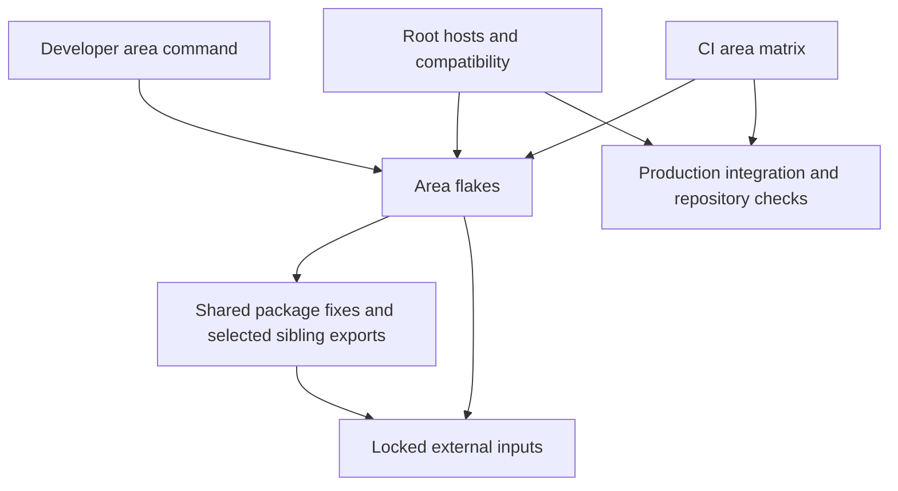
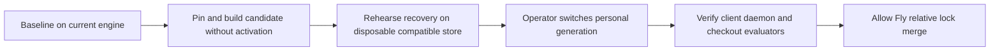

# Design: flake-repository-layout

## Overview

Root composes production hosts and preserves their public outputs. Sixteen area flakes expose narrower build and test entrypoints from the same tracked checkout.

## Boundary Commitments

### This Spec Owns

- The personal-host engine prerequisite, area graph, published output compatibility, and verification dispatch described in [requirements.md](requirements.md).
- Migration of reusable code, package pins, assets, and area-local tests to one domain owner. Root owns machine identities, deployment choices, repo policy, and multi-area integration.

### Out of Boundary

- The exclusions in [brief.md](brief.md#out-of-boundary). Do not change service semantics, upgrade unrelated dependencies, move production encrypted stores, or migrate other machines' engines as part of the split.

### Allowed Dependencies

- Root consumes area exports. Areas only consume external pins and the sibling exports listed below; they do not consume root, machine configs, or each other's private paths.
- A fixture can supply neutral dependency values. A production wiring assertion must use the real evaluated configuration; those checks remain above the area graph.

### Revalidation Triggers

- Shared pin or input-edge changes: verify effective locks and affected standalone and composed consumers.
- Module, overlay, or package provenance changes: verify aliases and affected host wiring on the native systems.
- A new runner, evaluator, or daemon package: recheck the corresponding lock, build, and recovery contracts before it becomes a rollout prerequisite.

## Architecture

Use native stock Nix relative flake inputs, ordinary module exports, and thin compatibility aliases. Do not add a flake framework, `getFlake`-based loader, or generated root `flake.nix`.



Arrows mean “consumes”. Root uses `area-<id>` input names so that `opencode`, `agentmemory`, and `pi` continue to name existing upstream inputs. A standalone flake uses `path:../<dependency>` for sibling inputs. Root uses `path:./flakes/<id>` and follows its registered siblings and shared external pins. The DAG is defined by the dependency column, not by the names of files being moved.

### Area ownership and checks

`packages` is a substrate, not the new owner of `overlays/**`. For example, move `nono`, RTK, and OpenCode diagnosis dependencies with OpenCode; move `kiro-spec` source with SDD. Extract the mixed overlays only as their consumers cut over. `—` in the last column means no local flake dependency; each area still declares the external inputs it uses.

| Area under `flakes/` | Moves / public surface | Standalone verification | Allowed sibling dependencies |
| --- | --- | --- | --- |
| `packages` | Stable/unstable package constructors, shared fixed-package overrides, Tailscale pin from `overlays/` | Shared overlay metadata and import smoke; no host build | — |
| `home-base` | Generic shell, SSH, Git/GH/hooks, Zellij/plug-ins, personal Tailscale Serve primitives. Move `git-clone-isolation` CLI, module, and fixtures together. | `git-cache-clone`/`git-clone-isolation` behavior and CLI; fixture portion of `personal-tailscale-service` | `packages` |
| `nixvim` | `home-manager/nixvim/`, `shadowenv-vim`, editor overlay use and Lua fixtures | Nixvim startup, config, LSP/format/diagnostic tiers against a minimal HM fixture with the correct Stylix and plugin set | `packages` |
| `macos-desktop` | Hammerspoon packaging and annotations, HM renderers/consumers, Deskflow, watchdog helper and cert tool | Renderer/negative semantics/fixture module checks and runtime test suites; Darwin bundle jobs stay Darwin-gated | `packages` |
| `sqlite-backup` | Litestream overlay, HM backup module, CLI, Darwin verifier | `sqlite-backup-tests` on the existing Darwin systems | `packages` |
| `omlx` | `overlays/omlx/`, Python build inputs, reusable launchd module | `omlx-service` fixture render and artifact contract; personal provider wiring remains at root | `packages` |
| `mcp` | Proxy and actual MCP server packaging, `home-manager/mcp/`, reusable signing and SOPS bridge logic, Git MCP/GH stack and operator scripts | Git/MCP offline fixtures, package, grep/ast-grep render checks; real host and platform-specific subsets retain their gates | `packages` |
| `sdd` | cc-sdd packages, bootstrap and HM modules, `scripts/kiro-spec/`, Kiro prompt and SDD instructions exports | CLI package tests and a small local corpus | `packages` |
| `agentmemory` | Patched runtime and its `iii-engine` (not guest `iii`), HM, status/reaper/importer/cache validators, Obsidian deps | Package contract and isolated importer/module tests; no dependency on OpenCode for the matrix | `packages`, `mcp` |
| `opencode` | Pinned binary and patches, HM OpenCode/nono/RTK/diagnostics/compaction/budget code, OpenCode prompts, reusable guest web module and shared asset paths | Patch, launcher, audit, RTK, diagnostics, compaction/budget fixture tests; app help/version gates | `packages`, `mcp`, `sdd`, `agentmemory` |
| `pi` | Active `programs.pi.coding-agent` wrapper, instructions, Pi extensions and RPIV packages | A fixture for the active upstream HM API; reuse applicable extension tests, do not revive tests for the superseded `programs.pi-agent` module | `packages`, `mcp`, `sdd`, `agentmemory` |
| `fly` | `modules/fly-app.nix`, Fly `lib`, image publisher, reconciler/deploy runtime and Linux fixture | Module, image and two-app consumer tests; local-stub deployment runtime coverage | — |
| `builders` | Lima host modules, macOS/Linux builder role modules, dispatch machine renderer/smoke and builder operator tools | Standalone Lima and service/machine render tests; no build or provisioning on a real remote builder | `packages` |
| `litellm` | Catalog, HM and NixOS gateway, affinity bridge, Prisma overlay, LiteLLM schema/init/views | Catalog, affinity-bridge, HM and package fixtures; real client routing and database ordering stay integration | `packages`, `mcp` |
| `fabro` | Pinned CLI, HM service, sync/reconcile tools and Fabro workflow skill | HM fixture and tailnet reconciliation stub suite; root validates its own `.fabro` workflows | `packages`, `mcp` |
| `fabro-vm` | Guest image, shared Postgres module, Podman and sandbox/prewarm, Fabro API bridge, guest `iii`/workers/supervisor/projects, service composition helpers | Sandbox rules/loader and pin fixtures, package catalog; no evaluation of the actual personal Mac | `packages`, `builders`, `fabro`, `litellm`, `opencode` |

Root composes the guest with those exports and selects sandbox packages from SDD/MCP and the other area package exports through its production package set. LiteLLM's workload module contributes `fabro.postgres` declarations; root imports the VM's Postgres module alongside it. LiteLLM's standalone scope does not import the VM. Before moving OpenCode consumers, pass the needed LiteLLM catalog projection (`attrs` of logical model IDs) to the guest OpenCode and Fabro modules, and pass Fabro's workflow-skill source (`path` or derivation) to both OpenCode clients. Fixtures pass neutral interface values; root tests assert real wiring. Wire the Fly skill into both clients at root without adding a Fly→Pi/OpenCode edge.

## File Structure Plan

```text
flake.nix                          # static input graph and outputs entry
flake.lock                         # canonical composed pins
flake/{outputs,compat,dev}.nix       # composition, old public selectors, repo devshell/hooks
checks/repo.nix                    # root formatting/cooldown/workflows/corpus checks
checks/integration/                # real host and cross-area checks
  fabro-vm/                        # small guest assertion families, one legacy aggregate
configurations/                    # root role composition and host-specific values
flakes/<area>/
  flake.nix, flake.lock             # independently addressable entrypoint and locked edges
  area.json                        # id and supported check systems
  modules/, pkgs/, assets/, scripts/ # create only the directories the area needs
  checks/default.nix, tests/        # local derivations and fixture source
scripts/flake-scope.py             # lock/ownership validation and CI shard selection
tests/flake-layout/                # baseline output inventory and negative contract fixtures
docs/flake-layout.md               # commands, owner map, engine rollout and update runbooks
```

- `configurations/personal/` and its profile imports keep the SSH, Homebrew, and runtime binding values. `configurations/{fabro-vm,mac-builder,linux-builder}/default.nix` remain root role bindings; reusable implementations move as listed. Root supplies secret/certificate paths and Lima mount tags. No `.sops.yaml`, encrypted file, or private key move.
- `.github/workflows/ci.yml`, `.github/dependabot.yml`, and `tests/dependency-cooldown/` cover the runner matrix and manifest inventory. `.fabro/workflows/{kiro-task,oneshot}/` and their `tests/*workflow.test.py` fixtures consume the same scope rules; instructions in `home-manager/common/agents-cc-sdd.md` follow the new ownership path at SDD cutover.
- `fly-apps/` and `home-manager/common/fly-skill.nix` remain root consumers. `.fabro/`, `.kiro/`, and repo-wide tests remain repo artifacts. Move active path references and Dependabot directories in the same slice as the files they identify.

## Components and Interfaces

### Entrypoints and composition

| Interface | Contract |
| --- | --- |
| `nix flake check ./flakes/<area>` | CI and contributors use the same area lock and local fixture checks; at least one substantive check on each area's declared system. To build one, use `nix build './flakes/<area>#checks.<system>.<name>' --no-link`. |
| `area.json` | `id`: directory/registered input suffix; `systems`: nonempty set of supported check systems drawn from the root's three-system set. Validate against the actual `checks` keys. Keep per-check restrictions where checks are defined. |
| Area outputs | `checks.<system>` plus only the applicable `packages`, `apps`, `overlays`, named `homeManagerModules`/`nixosModules`/`darwinModules`, and `lib` interfaces. Close over area inputs rather than expecting the root's `inputs`, `outputs`, or `self` in every module. Root imports modules with the consumer's `pkgs`. |
| Production checks | Root imports ordinary functions taking the named subject (`personalHm`, `guest`, `builder`, or an explicit repo path). Use `lib.mkHostChecks` only when an area owns shared assertion code; do not expose a generic host registry to areas. Root-only suites may stay under `tests/`. |
| Root aliases | Compose check sets lazily by system, without forcing derivations during name discovery. Reject duplicate keys with origin names. Re-export incumbent apps/packages/overlays/Fly `lib` selectors, not every new area output. `.#checks.<system>.<name>` either aliases the composed area's result or is an explicitly retained integration/legacy check, never both. |

`flake/compat.nix` preserves the existing `fixed-packages`, `unstable-packages`, and `custom-packages` overlays and the `omlx`, `fabro`, `tailscale` exports. When a domain leaves the old composite, combine its attrs with the same `final`/`prev` and precedence; do not silently change to sequential overlays. Compare actual host, builder, guest, apps, checks, and shell package contexts instead of applying a global overlay list. The root's `fabro-vm-image`, `fabro-sandbox-*`, and `packages.aarch64-linux.kiro-spec` remain derived from `nixosConfigurations.fabro-vm`. Preserve the archive/digest/loader/smoke identity contract.

In `configurations/common-darwin/default.nix`, retain the pre-split registry names and `/etc/nix/path` targets. Exclude `area-*` inputs from automatic registration before the first relative input lands; a registry entry for just an area's store subdirectory loses its enclosing source tree. Keep incumbent external input names or explicit aliases to the same pins.

### Lock handling

- Seed new locks from current pin identities, not moving branch heads. Reuse matching lock nodes with Nix's reference-lock support; verify the resulting graph rather than assuming seeding succeeded. Use the same input names for shared sources, `follows` for root/area shared edges, and separate leaves for `nixpkgs-image`, `rsync34`, the engine pin, the root Fly consumer fixture's existing nixpkgs, and upstream internal nixpkgs that do not already follow root. Do not normalize these exceptions.
- Resolve lock edges via each graph's `root`, input names, `follows` chain, and local `parent` edges. Compare external identity (`type`, repository or URL, `rev` when present, `narHash`), not generated node labels. Validate `nix-snapshotter` in both the root-composed sandbox and Fly's standalone context. Reject missing pins, ambiguous local edges, and dependencies on root.
- Test the committed graph with `nix flake metadata --json --no-update-lock-file --no-write-lock-file` and compare returned `locks` to the stored graph. Repeat on root and direct area contexts. From a detached copy, address the full capture as `path:<source>?dir=flakes/<area>`; do not fetch only the subdirectory when it has siblings. A tracked source-only edit changes evaluation without a lock rewrite.
- Shared pin updates are one coordinated change owned by the root integrator. Refresh affected edges, including both Fly consumer locks where applicable, with targeted Nix commands. Validate equality and keep unrelated inputs stable. Register new lock pairs and moved manifests in Dependabot and cooldown validation in the same slice; a partial bot update must satisfy the parity gate before merge.
- Retain the guest's recursive prewarm walk over composed inputs. Traverse local-area nodes without adding the checkout itself to the prewarm payload, and deduplicate only collected external source paths. An offline smoke on the guest/sandbox resolves root and affected area metadata/check selectors from the prewarmed closure. If a direct area requires an external leaf absent from the composed closure, explicitly include that locked source in prewarm; do not add ambient fetches to sandbox checks.

### Test and CI contract

- Keep the legacy output inventory per system, including presently excluded checks. Extract fixture work from mixed suites; use a writable copy of only required files or evaluated observations rather than copying and re-evaluating `self` in a leaf. Retain any unavoidable recursive tests in their existing integration lane until their inputs can be staged. Preserve negative cases and assertions over actual rendered files. Existing fixed failures are distinct from new regressions; no exclusions are added without naming their reason.
- Root keeps real OpenCode launcher/host checks (both nono states), AgentMemory and compaction integration, Nixvim host/three-tier checks, desktop host bindings, builders and Lima, Fabro guest assertions, and Linux database smoke checks. Use `-fixture` names for new standalone proofs when the legacy name must still cover the real host. Keep `kiro-spec-corpus`, `kiro-spec-wiring`, workflow validation, and devshell checks at root. Move the two nono checks out of the Nixvim group without changing their gates.
- Keep `tests/fly-app/fixture/` as the root public consumer. Give `flakes/fly/tests/consumer/` its own small locked fixture that depends on Fly only. Exercise both fixtures with the stock CLI from the full captured checkout on ARM Linux; also keep `fly-app-generator`'s root contract assertions. Reuse the assertion function, not the consumer lock graph. Update the root fixture's lock only for affected edges and include it in the relevant pin checks. Darwin can prove graph evaluation, not Fly builds.
- Retain `fly-app-deploy` at root and its local-stub runtime suite in a separate ARM Linux shell lane. Pass pinned nixpkgs/test artifact paths explicitly to that harness instead of evaluating `path:` of the isolated root fixture directory. Keep recursive builds and loopback stubs out of the default area derivations. Do not disable sandboxing globally or perform a live deployment.
- `scripts/flake-scope.py` validates registered `area.json` data and produces CI area/system rows from it. Use parallel PR jobs for supported native targets (`macos-latest` after an ARM verification and `ubuntu-24.04-arm` for ARM Linux after a runner probe). Document x86_64-Darwin coverage or a named builder exception; do not claim an ARM job proves it. Start with all eligible shards; no changed-path inference or path filter that can omit integration coverage.
- Retain existing event/trust gates, root integration result and main full evaluation, non-root Lima lane, and explicit cold/IFD/redundant-hook exclusions. Replace broad name-prefix filters with a reviewed selector-to-lane mapping when a suite moves. Root `nix flake check .` remains the aggregate; CI builds each covered check once per system per run, while the existing required root status accounts for shard outcomes. Preserve `nix develop -c prek run --all-files` and the working guest devshell. Key caches by platform and the effective lock(s), not just the root lock after delegation.

## Integration and Migration Notes

1. **Baseline first.** Capture selectors by system and current CI coverage, representative package sources and rendered wiring, and pin identities before changing the Nix package or moving files. Record intentional exclusions and known environment blockers. Compare semantic outputs, not all before/after `.drvPath` strings across a source move. Compare `.drvPath` for aliases in the same graph and guest artifact/package identity in that graph.
2. **Engine-only slice.** Replace only the personal host's Lix override. Recheck the highest non-prerelease official stock release when the slice starts and pin that exact package. Use the existing nixpkgs if it contains the exact supported package; otherwise add an immutable package-only nixpkgs source for `nixVersions.nix_<major>_<minor>`. Do not repin the platform set or run an upstream installer on the host. The release observed during design is in [research.md](research.md#engine-release-and-operational-constraints).
3. **Operator hold, then Fly pilot.** Before merging the first relative input, complete the engine gate, decouple the Fly stub harness from the old fixture's captured path, and verify prewarm traverses local nodes without rooting the checkout. Use a verified stock ARM Linux runner or the configured Linux builder and its native shell for pilot evidence before the permanent matrix exists. Verify both Fly consumer paths and native builds; retain `deploy-moodist` at root. Count both consumer lock changes in the diff budget.
4. **Contracts before consumers.** Establish the check merger, scope rule, and minimal shared overlays. Independent leaf work can proceed on separate branches. Integrate `mcp` and `sdd` before AgentMemory/OpenCode/Pi; stabilize builders, LiteLLM, and Fabro interfaces before guest cutover. The root integrator serializes `flake.nix`, `flake.lock`, compatibility map, and shared registry/manifest merges; area owners do not regenerate the root lock concurrently.
5. **Extract large assertions in place.** Split desktop wiring, Deskflow, and watchdog wiring separately. Split the guest aggregate by assertion family. Stage the reusable Fabro service/API bridge and shared Postgres files under the future VM area with ordinary root imports; do not add a half-working area lock. Export them when the VM's separate `iii` package/fixture slice registers the area. Cut over boot/image and sandbox/loader in separate slices. Keep selectors and behavior unchanged. Count additions plus deletions, including generated locks: prefer ≤500 and stop at >1,000 for reduction or the repo's explicit human exception.
6. **Cut over and clean up.** Update the root's consumers and CI lanes in each cutover; leave real-host and repo coverage in their existing lane until reassigned. Switch CI to the matrix after the pilot, then grow it as areas land. In particular, move the LiteLLM catalog with the workflow-fallback and guest-assertion consumers updated, and keep the guest OpenCode identity and credential-path bindings in root at its own cutover. Revalidate root and area paths on a clean checkout per slice. Revert a whole slice together with its lock/consumer changes, never only its `flake.lock`.

### Operator engine gate



- Before activation, preserve the old generation, pre-split source/lock, and a consistent recoverable store/profile and daemon configuration checkpoint. Rehearse reopening or restoring that checkpoint on a disposable environment; primary schema number equality is not evidence. Keep substituters, trust, sandbox, `/nix`, and build user settings unchanged. An operator performs the normal nix-darwin switch, not a CI job or Kiro implementation task.
- Verify `nix --version`, `nix store info --store daemon --json` version, store read, and small trusted builds on the local and each configured remote target. If local jobs are disabled, use a disposable build context for local proof; do not change host policy. Run a tracked relative-input fixture with effective-lock equality on the personal Mac, installed builder/guest CLIs, Fabro sandbox CLI, and CI image. Capture versions and named results. Remote daemons that only build resolved derivations need not match the client version; missing evaluator support blocks the split pending a scoped decision.
- If a gate fails, keep the previous layout and stop dependent merges. If recovering later, restore the last compatible source/lock first. Use generation rollback only after proving the old engine can reopen the store; otherwise the operator restores the matching checkpoint. No deleting or recreating the live store as a migration step.

## Requirements Traceability and Testing Strategy

| Criteria | Evidence and expected result |
| --- | --- |
| 1.1, 1.2, 1.3, 1.4, 1.5 | Engine-only diff; pinned official version; evaluate/build candidate on old layout; compare settings and daemon version, store read, rollback rehearsal and actual evaluator matrix before lock merge. |
| 2.1, 2.2, 2.3, 2.4, 2.5 | Each area lists and builds nonempty local checks on supported systems. Test a new area check without a root wire edit and evaluate a captured tree containing only its declared source closure; unsupported systems have no false green lane. |
| 3.1, 3.2, 3.3, 3.4, 3.5 | Compare selectors and installed registry/search aliases; force representative outputs on the proper runners; identical alias derivations in one graph; duplicate-origin fixture; structural SOPS/credential-path assertions using no plaintext. |
| 4.1, 4.2, 4.3, 4.4, 4.5 | Compare check inventory and behavior per slice, including negative fixtures; unchanged root subjects and platform gates; isolated local suites; record runner blockers; recursive-source fixture and offline guest/sandbox probe. |
| 5.1, 5.2, 5.3, 5.4 | Effective-lock equality and pin checks from clean capture; mismatch and distinct-pin fixtures; tracked sibling edit with no lock diff; all manifest moves in Dependabot/cooldown tests. |
| 6.1, 6.2, 6.3, 6.4, 6.5 | Dispatch fixtures for matrix/aggregate outcome; boundary tests for local edits and root registration claims; run documented commands; line count and no inline suites; per-slice coverage/pin comparison and diff measurement. |
