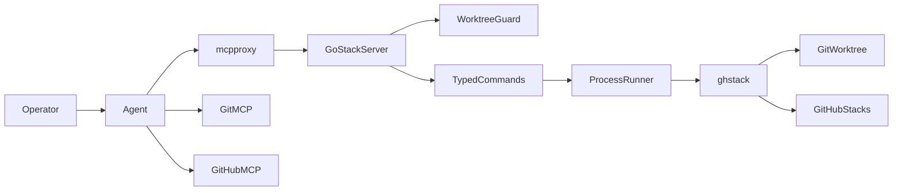
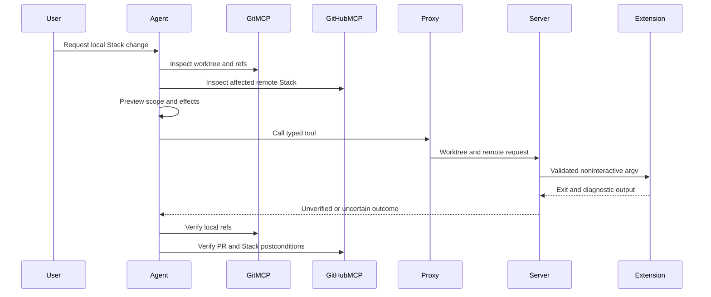

# Design: gh-stack-mcp

## Overview

A Go stdio MCP server exposes ten typed local Stack operations through the existing mcpproxy endpoint. It validates one worktree and remote per call, invokes a pinned `gh-stack` binary, and leaves Stack semantics and remote postcondition checks with their existing owners.

## Boundary Commitments

### This Spec Owns

- For `requirements.md` sections “Typed tool and repository boundary” through “Bounded execution and truthful outcomes”: tool schemas, worktree/repository binding, subprocess supervision, and truthful results.
- For “Declarative deployment” and “Offline verification and operator guidance”: one shared `gh-stack` v0.1.1 pin, Go package, both-host registration, shared call deadlines, checks, and runbook.
- For “Agent preflight and workflow”: native-Stacks skill, Shopify `stack-captain`/`/restack` guidance, and permission assertions.

### Out of Boundary

- The extension owns branch topology, Git history, `.git/gh-stack` state, conflict recovery semantics, PR creation, and Stack API mutations. The wrapper never edits those directly.
- GitHub MCP owns remote-only Stack/PR reads and PR-only link/create/add; Git-MCP owns agent-side local status, diff, and explicit conflict staging. No new remote Stack client or Git engine is introduced.
- `merge`, rebase `--abort`, numeric/PR-URL checkout or link, local-only unstack of an unnumbered Stack, interactive `modify`/`switch`, fork-to-upstream flows, new secrets, global signing, direct OpenCode MCP registration, and mcpproxy authentication are excluded. Unsupported operations remain user-owned CLI handoffs.
- Read-only helpers never acquire Stack mutation tools. Captain remains prohibited from initiating merge or unstack through either MCP route.

### Allowed Dependencies

- The official `modelcontextprotocol/go-sdk` v1.8.0 for MCP stdio/typed tools; pinned `github/gh-stack` v0.1.1 as a **separate executable**, not a Go import; existing packaged `gh`, Git, and activated `gh` auth state.
- Existing `home.mcp.extraServers`, retrieve-tools routing, and shared proxy/OpenCode call-deadline configuration; existing GitHub MCP and Git-MCP for agent preflight/postflight. The server must not invoke those MCP servers internally.
- Existing Home Manager overlay/check conventions and Shopify permission-budget renderer. No change to the proxy's loopback auth settings.

### Revalidation Triggers

- A `gh-stack` version change, JSON schema/flag change, repository/remote selection change, or new command with different prompt/partial-success semantics.
- A mcpproxy annotation/`call_with` or OpenCode permission change, especially code-execution dispatch or destructive-tool routing.
- A change to `home.mcp.extraServers` rendering, shared call deadlines, launchd auth environment, global Git signing, or the remote Stack tool contract.

## Architecture

### Existing Architecture Analysis

- The common `programs.gh.extensions` uses `pkgs.unstable.gh-stack` v0.1.0; the overlay must pin v0.1.1 without upgrading the whole unstable input.
- Both hosts already register stdio upstreams through `home.mcp.extraServers`. mcpproxy has no caller worktree and its launchd PATH omits Nix `gh`.
- The proxy's 2-minute global upstream-call limit and OpenCode's 60-second default would preempt the wrapper's longer mutations; the pinned proxy has no per-upstream call deadline.
- GitHub MCP covers remote Stacks; existing agent guidance forbids local CLI calls. The new server is an upstream, not a replacement for the remote tools or the proxy.

### Architecture Pattern & Boundary Map

The dependency direction is `tool schemas → guard → typed argument mapping → runner → extension`; result formatting consumes the runner output. Policy files consume tool names and results, not server internals. All requests carry their own context; no global working directory or shared mutable repository selection exists.

### Technology Stack

| Layer | Choice | Role |
| --- | --- | --- |
| MCP | Official Go SDK v1.8.0, stdio | Typed tools and structured results |
| Stack operations | `github/gh-stack` v0.1.1 | Local Git and native Stack behavior |
| Runtime | Nix-packaged Go server, `gh`, Git on nix-darwin | Fixed executables and existing user auth |
| Routing | mcpproxy-go v0.67.0 and OpenCode v1.18.32 | Shared `retrieve_tools` MCP entrypoint and call deadlines |

The shared mcpproxy `call_tool_timeout` becomes `15m15s`; the **existing** OpenCode mcpproxy entry on both hosts sets `timeout = 930000` milliseconds. Wrapper work plus cleanup ends by 15m5s, before proxy 15m15s and OpenCode 15m30s. This lengthens maximum waiting for every upstream on that shared connection; it does not change preflight connect/listing deadlines or create a second MCP entry.

## File Structure Plan

### New Files

| Path | Responsibility |
| --- | --- |
| `scripts/gh-stack-mcp/go.mod`, `scripts/gh-stack-mcp/go.sum` | Lock the SDK and Go dependencies. |
| `scripts/gh-stack-mcp/main.go` | Start the stdio server. |
| `scripts/gh-stack-mcp/internal/stackmcp/tools.go` | Register ten schemas, annotations, and handlers. |
| `scripts/gh-stack-mcp/internal/stackmcp/target.go` | Validate worktree, Git directory, remote, and same-repository identity. |
| `scripts/gh-stack-mcp/internal/stackmcp/commands.go` | Map validated typed requests to a fixed command/argument set. |
| `scripts/gh-stack-mcp/internal/stackmcp/runner.go` | Supervise a child process group, environment, deadlines, and captured output. |
| `scripts/gh-stack-mcp/internal/stackmcp/result.go` | Parse `view --json` and return the common unverified-write/error envelope. |
| `scripts/gh-stack-mcp/internal/stackmcp/tools_test.go`, `scripts/gh-stack-mcp/internal/stackmcp/target_test.go` | Verify schemas/annotations and worktree/remote identity. |
| `scripts/gh-stack-mcp/internal/stackmcp/commands_test.go`, `scripts/gh-stack-mcp/internal/stackmcp/runner_test.go`, `scripts/gh-stack-mcp/internal/stackmcp/result_test.go` | Verify fixed argv, marker/pending-modify guards, child lifecycle, and outcomes. |
| `tests/gh-stack-mcp/hm-render.test.js` | Both-host package, version, and rendered-config assertions. |
| `tests/gh-stack-mcp/proxy-contract.test.js` | Fixture proxy discovery/routing and missing-upstream failure isolation. |
| `docs/gh-stack-mcp.md` | Auth prerequisites, trust boundary, manual acceptance, and recovery runbook. |

### Modified Files

| Path | Responsibility |
| --- | --- |
| `overlays/default.nix` | Pin `pkgs.unstable.gh-stack` to v0.1.1 inside the existing unstable overlay. |
| `overlays/mcp-servers.nix` | Export the local Go package with a wrapper fixing the extension/`gh`/Git paths. |
| `configurations/personal/home-manager/default.nix`, `configurations/shopify/home-manager/default.nix` | Register one identical stdio upstream per host through `home.mcp.extraServers`. |
| `home-manager/mcp/default.nix` | Set the shared proxy upstream-call timeout above the longest wrapper deadline. |
| `configurations/personal/home-manager/opencode.nix`, `configurations/shopify/home-manager/opencode.nix` | Set the existing proxy MCP-entry call timeout above the proxy deadline. |
| `flake.nix` | Add a Darwin check for the Go fixtures and both-host rendering. |
| `home-manager/common/skills/github-native-stacks/SKILL.md` | Preserve remote GitHub MCP rules; replace eligible local handoffs with typed-tool preflight and postflight. |
| `configurations/shopify/home-manager/agents/stack-captain.md` | Update restack waves, destructive `allow`, code-execution deny, no-merge/no-unstack rule, and direct-CLI deny. |
| `configurations/shopify/home-manager/commands/restack.md` | Run eligible checkout/rebase/recovery/push in the invoking agent; keep unsupported cases as handoffs. |
| `home-manager/common/subagent-context-budget/budgets.nix`, `scripts/subagent-context-budget.js` | Mirror the captain policy and support a code-execution deny in budget validation. |
| `home-manager/common/subagent-context-budget/instructions/github-native-stacks-minimal.md`, `home-manager/common/subagent-context-budget/plugin.ts` | Keep both compact Stack guidance copies consistent. |
| `home-manager/common/opencode.nix` | Correct the stale skill-registration comment; do not add an MCP server here. |
| `configurations/shopify/home-manager/agents/stack-preflight-auditor.md`, `configurations/shopify/home-manager/agents/stack-status-sweeper.md`, `configurations/shopify/home-manager/agents/ci-log-sleuth.md` | Deny proxy code execution while retaining read-only grants; correct stale handoff wording where present. |
| `configurations/shopify/home-manager/agents/bot-thread-triager.md`, `configurations/shopify/home-manager/agents/stack-fix-reviewer.md` | Preserve their read-only boundary under proxy code execution. |
| `tests/subagent-context-budget/integration/hm-render.test.js`, `tests/subagent-context-budget/unit/instruction-profile.test.js`, `tests/subagent-context-budget/unit/stack-captain-standalone.test.js` | Assert effective `allow`/deny behavior, direct-CLI denial, and compact guidance consistency. |

`home-manager/common/gh-cli.nix` continues to use `pkgs.unstable.gh-stack`; the nested overlay changes its package version without changing that module. Existing GitHub MCP packages are unchanged.

## Components and Interfaces

| Component | Responsibility | Requirement IDs | Dependencies |
| --- | --- | --- | --- |
| Tool catalog | Typed MCP surface and annotations | 1.1, 1.5, 1.6, 7.5, 8.6 | SDK P0 |
| Worktree guard | Per-call identity and state preconditions | 1.2–1.4, 1.7–1.8, 2.5, 4.3–4.4, 6.6 | Git P0 |
| Command mapper | Operation-specific argv; no passthrough | 2–7 | Extension v0.1.1 P0 |
| Process runner and result adapter | Finite execution and honest observations | 2.1–2.2, 4.2, 5.5, 6.5, 7.3, 8 | Git and `gh` P0 |
| Nix integration | Shared pin, executables, timeouts, two hosts | 9, 11.2 | Overlay, Home Manager, OpenCode P0 |
| Agent guidance | Preflight, approval-free local calls, reinspection, helper policy | 7.3, 10, 11.5 | GitHub MCP and Git-MCP P1 |

### Tool catalog and command mapper

Every input includes `path` (absolute worktree) and `remote` (Git remote name). `remote` binds API identity even for CLI commands without a `--remote` flag; the command mapper passes the flag only where upstream supports it. Operation inputs are closed schemas; branch fields must be valid, nonnumeric Git branch names and cannot be URLs or flags.

| Tool | Additional typed inputs | CLI operation | Proxy route |
| --- | --- | --- | --- |
| `stack_view` | none | `view --json` | write |
| `stack_init` | `trunk`, ordered `branches` (at least one) | `init --base` | destructive |
| `stack_add` | `branch`, `stage` enum `none/index/tracked/all`, `message` for commit modes | `add [-u/-A] [-m]` | destructive |
| `stack_checkout` | `branch` | `checkout <branch>` | destructive |
| `stack_rebase` | `action` enum `start/continue`; start `scope` enum `full/upstack/downstack/noTrunk` | `rebase` with selected flags | destructive |
| `stack_sync` | `prune` default false | `sync --remote` | destructive |
| `stack_push` | none | `push --remote` | destructive |
| `stack_submit` | `open` default false | `submit --auto --remote` | destructive |
| `stack_link` | ordered nonnumeric `branches` (at least two), optional `base`, `open` default false | `link --remote` | destructive |
| `stack_unstack` | `stackNumber` > 0, `mode` enum `remoteAndLocal/localOnly` | `unstack <number> [--local]` | destructive |

The catalog sets `readOnlyHint=false` and `openWorldHint=true` for every tool; `stack_view` sets `destructiveHint=false`, while every other tool sets `destructiveHint=true`. `stack_view` refreshes local metadata and must not appear in read-only discovery. Every tool has `idempotentHint=false` and a description of its side effects. The installed proxy should report `call_with=call_tool_write` for view and `call_with=call_tool_destructive` for all mutations; tests assert this against the pinned proxy behavior.

### Worktree guard

`ValidateTarget(path, remote) → Target | Rejected` resolves the real worktree and per-worktree Git directory without changing process cwd. The selected remote's effective fetch and push URLs must both resolve to one host/owner/repo, with no embedded credentials; unknown schemes, multiple push destinations, forks, and cross-repo mismatches fail before launch. Child-only `GH_REPO=HOST/OWNER/REPO` pins the API target, independent of inherited `GH_REPO` or `GH_HOST`.

- For checkout, require exactly one Git remote and reject any configured branch or default-remote preference that could select a different name. A unique remote Stack branch may then be imported; other calls pass the named remote as `--remote` only where supported.
- For init, if `trunk` is absent locally, require exactly one Git remote **and** resolve the pinned CLI's branch/default remote-selection precedence for that trunk; the effective name must equal the validated `remote`. A local trunk needs no fetch-remote guard.
- For `rebase --continue`, require parseable `gh-stack-rebase-state` with the required branch/index/original-ref fields and an active Git rebase whose recorded target branch matches the marker's conflict branch in the locally tracked Stack. A missing, malformed, stale, or marker-only state is rejected for user-owned recovery; the CLI's marker loader alone does not validate this. The wrapper never invokes `--abort`.
- For `submit`, reject a pending `gh-stack-modify-state` with `phase=pending_submit` before its hidden remote unstack path. Other modify/rebase-in-progress conflicts remain extension errors, not guessed recovery.
- For unstack, a positive explicit Stack number is mandatory even for local-only mode; there is no implicit active-Stack fallback.

### Process runner and result adapter

`BuildCommand(typedInput, Target) → CommandSpec | Rejected` constructs an argv vector without a shell. `Run(CommandSpec, deadline) → ProcessResult` starts the store-pinned extension in `Target.path`, with stdin closed, stdout/stderr captured separately, and no controlling TTY. The child gets an allowlisted environment with HOME/XDG auth state, necessary SSH agent context, fixed `GH_PATH` and Git/`gh` PATH, and normalized `GH_REPO`; inherited token variables, mcpproxy secrets, `GH_HOST`, and Git directory/config overrides are excluded. Host Git signing stays unchanged.

- One in-process lock keyed by the resolved Git common directory serializes this server's calls across linked worktrees. It does not serialize external Git/CLI clients or provide a distributed transaction.
- Deadlines: 45 seconds for view; 5 minutes for init/add/checkout; 15 minutes for rebase/sync/push/submit/link/unstack. Each call also reserves cleanup and proxy-delivery margin within its incoming request deadline; if insufficient time remains, reject before launch. On cancellation, stop the child process group and wait up to 5 seconds to reap the direct child; uncertain cleanup is reported rather than retried. The deadline cannot roll back a Git/GitHub action already accepted.
- Limit captured stdout and stderr to 64 KiB each while draining the pipes; report truncation explicitly. Never write CLI output to the server's MCP stdout. Do not echo credentials or pass a credential-bearing remote URL to the child.
- Parse only successful, untruncated `view --json` into `LocalView {trunk, currentBranch, branches[]}` with each branch's name, head/base, current/merged/queued/rebase flags, and optional PR number/URL/state. These are local observations, not remote postconditions.

The common result is `Outcome {operation, repository, spawned, exitCode?, status, stdout, stderr, truncated}`. Status is `rejected` before launch, `local_observation` for parsed view, `exited_unverified` for any completed mutation, `conflict_pending` only for a rebase conflict plus valid marker and active Git rebase, `timed_out_unknown`, or `cleanup_unknown`. A nonzero exit is an MCP error **with** the result envelope; no write is automatically retried. Neither exit 0 nor a success-looking CLI line means the Stack is synchronized, published, or dissolved.

### Agent policy and verification

The native-Stacks skill discovers exact live tool names and `call_with` values; remote-only reads/writes remain GitHub MCP calls. Before a local mutation, the agent takes a Git-MCP worktree/branch snapshot and affected GitHub MCP Stack/PR snapshot and previews effects (including untracked files for `add --all` and local branches for prune). It calls all typed local Stack tools without human authorization, including unstack and verified retries. For `submit` and `link` only, it pages through **all** open PRs in the target repository via GitHub MCP, compares each affected branch's exact head name and head/base repository, and stops on fork, unknown, or multiple matches; incomplete pagination also stops. After `exited_unverified` or uncertainty, it re-reads local refs and affected PR/Stack membership before any success claim or retry; ambiguous outcomes stop, not loop.

Captain's destructive proxy permission is `allow` in both frontmatter and budget-rendered variants; proxy code execution is denied there and in read-only helpers. The permission covers the destructive router; operation-specific rules still govern other tools. Its direct `gh stack` bash deny, bottom-up waves, standalone-PR path, and no-merge/no-unstack rule remain. `/restack` stays in its invoking agent rather than routing into captain's full Binks/CI workflow; it uses the same skill/preflight for eligible checkout, scoped rebase, guarded continue, and push. Missing local/remote prerequisites, abort, merge, TUI restructuring, and uncertain recovery remain targeted user handoffs. The publication-only PR-head check is also agent policy: other commands can adopt a fork PR into local tracking, `sync` may use that association for remote Stack writes, direct clients bypass the check, and a new PR can appear between check and CLI lookup. These residual risks were accepted by the operator.

## System Flows

The same reinspection gate applies after rebase conflict or a user-owned abort, headless sync exit 0, sequential submit/link, and partial remote unstack. A `view` result does not replace remote inspection.

## Requirements Traceability

| IDs from `requirements.md` | Contract / owner |
| --- | --- |
| 1.1, 1.2, 1.3, 1.4, 1.5, 1.6, 1.7, 1.8 | Tool catalog, worktree guard, closed command schemas |
| 2.1, 2.2, 2.3, 2.4, 2.5, 2.6 | View parser, checkout remote guard and command mapper |
| 3.1, 3.2, 3.3, 3.4, 3.5, 3.6, 3.7, 3.8 | Init/add typed inputs, trunk remote guard, Git signing-preserving runner |
| 4.1, 4.2, 4.3, 4.4, 4.5, 4.6 | Rebase action/scope, marker guard, conflict envelope, abort exclusion |
| 5.1, 5.2, 5.3, 5.4, 5.5 | Sync/push flags, unverified outcome, agent postflight |
| 6.1, 6.2, 6.3, 6.4, 6.5, 6.6 | Submit/link flags, pending-modify guard, postflight |
| 7.1, 7.2, 7.3, 7.4, 7.5, 7.6 | Explicit numbered unstack, remote/local postflight, no merge tool |
| 8.1, 8.2, 8.3, 8.4, 8.5, 8.6 | Runner deadlines, output envelope, annotation contract |
| 9.1, 9.2, 9.3, 9.4, 9.5, 9.6, 9.7, 9.8, 9.9 | Shared Nix pin/package, both-host stdio and call-deadline configuration |
| 10.1, 10.2, 10.3, 10.4, 10.5, 10.6, 10.7, 10.8, 10.9, 10.10, 10.11, 10.12, 10.13, 10.14, 10.15, 10.16 | Shared skill, Shopify captain/command, budgets, PR preflight, helper boundaries |
| 11.1, 11.2, 11.3, 11.4, 11.5 | Fixture tests, flake render check, runbook and mirrored guidance |

## Error Handling

| Condition | Result and owner |
| --- | --- |
| Invalid path, remote mismatch, init/checkout effective remote mismatch, unsupported target/flag, missing marker, pending modify submit | Guard rejects before launch; error names the failed precondition. |
| Unavailable extension, Git, or `gh` auth | Runner reports the missing dependency/auth path; other upstreams continue. |
| Rebase conflict | Return exit and conflicted-file diagnostics; permit typed continue only with a valid marker and active matching Git rebase. Abort is user-owned. |
| Sync divergence, warning-only push/PR failure, partial unstack | Return raw bounded output with `exited_unverified`; agent rechecks refs and GitHub state. |
| Timeout, interruption, cleanup uncertainty, truncated view | Mark unknown; do not claim no side effects or automatically retry. |

## Testing Strategy

- Go unit/stdio contract tests use a fake extension and temporary Git worktrees. Verify all ten tool schemas and annotations, argument mapping, branch/remote validation, `GH_REPO` isolation, marker checks, deadlines, bounded output, and child stdout isolation (1–8, 11.1).
- Fixture scenarios cover nonzero conflict without marker, stale/marker-only recovery rejection, valid continue, pending-modify submit refusal, `add` missing message, missing-trunk init and checkout with conflicting Git remote preferences, sync exit 0 with no completed postcondition, partial unstack, cancellation, and result truncation (2–8).
- Nix/Node checks build the package, assert one v0.1.1 derivation for both `programs.gh.extensions` and the wrapper, render both host `mcp_config.json` entries plus shared timeout ordering, and leave OpenCode pointed only at mcpproxy. An isolated proxy fixture verifies `call_with` routing, finite end-to-end cancellation with shortened test budgets, and that a missing Stack upstream leaves unrelated upstreams callable (9, 11.2–11.3).
- Policy tests validate full and budget-rendered captain permissions, code-execution denial on read-only helpers, unchanged direct-CLI denial, approval-free local calls, `/restack` invoking-agent scope, and agreement of both compact guidance copies (10, 11.5). No CI check calls the real extension against an operator checkout or the live Stacks API.
- Runbook smoke is operator-owned after activation: confirm existing `gh` auth, discover tool routing, exercise view or a disposable same-repository Stack, and verify remote/local results separately. Restart OpenCode and mcpproxy after applying config changes; record host/API/auth incompatibility before broader use.

## Security and Rollout

- The local endpoint remains unauthenticated loopback TCP. Any local account able to reach it can invoke tools with the wrapper process's `gh` credentials; agent preflight and OpenCode permissions are not a backend authorization boundary. The extension's branch-name PR lookup can also select a same-named fork PR. Agent-side exhaustive checks cover `submit`/`link` but not other operations or direct MCP calls; even a checked publication has a race before CLI lookup. These risks were accepted in `brief.md`.
- Do not inject a GitHub token into the server's environment or Nix store. Existing `gh` auth, host Git signing, and hooks remain in force; an `add` that cannot sign fails rather than disabling signing.
- Land the version pin, server, and offline checks before updating agent guidance. Activate package/registration and policy together per host; fall back to existing remote GitHub MCP and user-owned local commands if the new upstream is unavailable. Rollback removes the extra upstream and restores the previous extension pin without touching `.git/gh-stack` or PRs.
