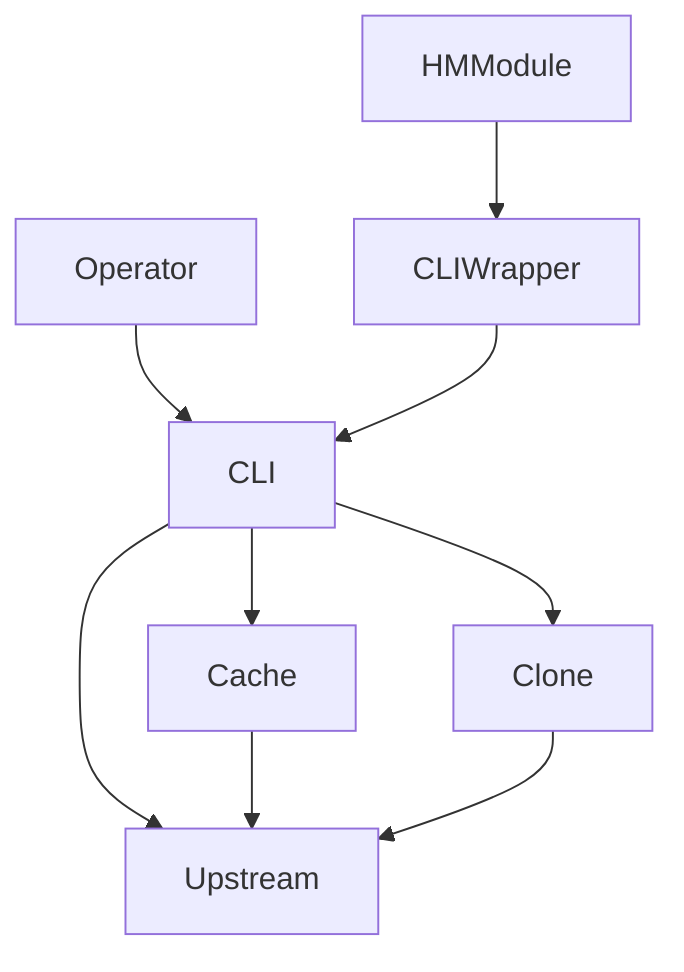
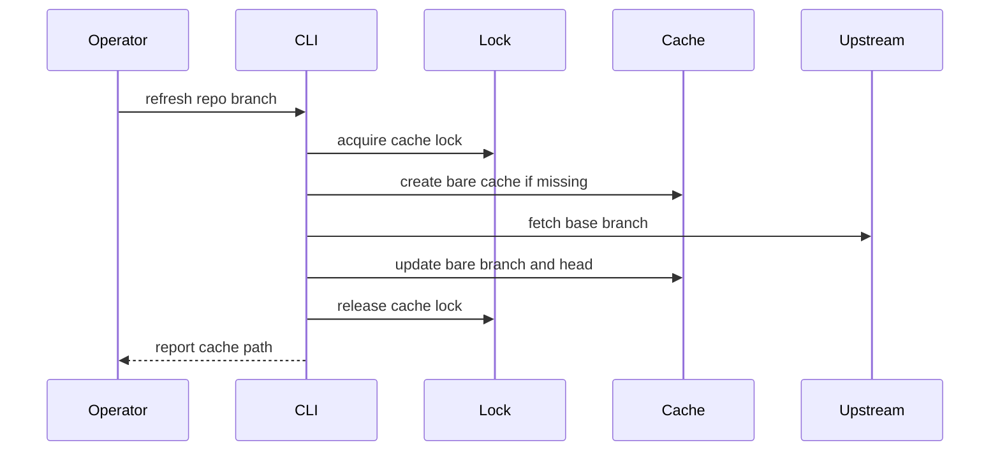
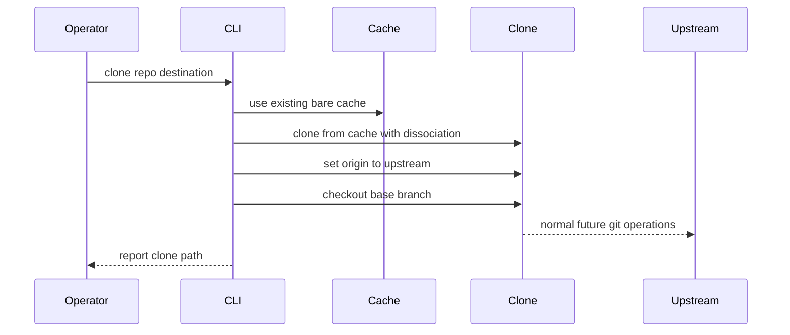

# Design Document

## Overview

`git-clone-isolation` adds a local Git workspace isolation tool to nix-config. Operators use it to keep a reconstructable bare cache of an upstream base branch and create isolated working clones that do not share `.git` metadata with Graphite worktrees.

The design adds one CLI, one common Home Manager module, and fixture tests. It preserves existing Git, hooks, zellij, and Graphite behavior.

### Goals

- Create/update a bare, main-only repository cache under XDG state.
- Create working clones under `~/scratch` by default with independent `.git` metadata.
- Keep generated clone `origin` remotes pointed at the upstream repository.
- Install and configure the tool declaratively on both hosts.
- Validate behavior with local fixture remotes.

### Non-Goals

- Replace Graphite or wrap `gt`.
- Repair or edit `.git/.graphite_*` files.
- Manage Git worktrees or modify `zellij-worktree`.
- Mirror all branches and tags.
- Run background cache refresh daemons.
- Synchronize uncommitted work between isolated clones.

## Boundary Commitments

### This Spec Owns

- `git-clone-isolation` CLI command surface and behavior.
- Bare base-branch cache lifecycle.
- Working clone creation from the cache.
- Remote rewrite and base-branch checkout behavior for generated clones.
- Common Home Manager module defaults and package installation.
- Network-free fixture tests and flake check wiring.

### Out of Boundary

- Graphite command execution or metadata recovery.
- Existing Git configuration changes outside package installation.
- Existing `zellij-worktree` behavior.
- Full mirrors, tag synchronization, submodule recursion, and LFS materialization beyond normal Git behavior.
- Automatic scheduling or daemonized refresh.

### Allowed Dependencies

- Git CLI from Nixpkgs.
- POSIX shell plus `coreutils` in the packaged CLI.
- Home Manager module system.
- Existing `~/scratch` convention.
- Local fixture repositories in tests.

### Revalidation Triggers

- Any change to CLI subcommands or failure labels.
- Any change to cache path identity.
- Any change from bare cache to full working-copy cache.
- Any removal of `--dissociate` from clone creation.
- Any integration with Graphite, worktrees, or zellij.
- Any change to Home Manager defaults or wrapper environment names.

## Architecture

### Existing Architecture Analysis

nix-config already centralizes Git defaults, creates `~/scratch`, packages local scripts with `writeShellApplication`, and exposes tools through Home Manager modules. The new feature follows those patterns instead of extending generic Git configuration.

### Architecture Pattern & Boundary Map



Architecture integration:

- Selected pattern: dedicated CLI plus Home Manager wrapper.
- Domain boundary: CLI owns cache and clone operations; module owns defaults and installation.
- Existing patterns preserved: Git config, hooks, `~/scratch`, zellij worktree, and Graphite playbooks.
- New components rationale: the workflow has distinct state, command behavior, and validation needs.

### Technology Stack

| Layer | Choice / Version | Role in Feature | Notes |
|-------|------------------|-----------------|-------|
| CLI | Bash via `writeShellApplication` | Operator command | Matches local tool packaging pattern |
| Git | Nixpkgs `git` | Cache and clone operations | Uses stable porcelain commands |
| Configuration | Home Manager | Declarative defaults and install | Common module on both hosts |
| Tests | Node `node:test` + local Git fixtures | Behavior validation | No network dependency |
| Runtime state | `$XDG_STATE_HOME/git-clone-isolation` | Reconstructable cache root | Not authoritative data |

## File Structure Plan

### Directory Structure

```
scripts/
└── git-clone-isolation.nix            # CLI, ConfigResolver, CacheManager, CloneManager, ErrorReporter

home-manager/common/
├── default.nix                        # Imports/enables common module
└── git-clone-isolation.nix            # HMModule options and wrapper install

tests/git-clone-isolation/
├── package.json                       # Node test package metadata
├── run.js                             # Optional recursive test runner
├── git-behavior.test.js               # TestHarness for cache/clone/remote/isolation fixtures
└── hm-render.test.js                  # TestHarness for Home Manager render/default checks

flake.nix                             # App and check wiring
```

### Modified Files

- `home-manager/common/default.nix` — import and enable the common module.
- `flake.nix` — add app, behavior test check, and help/version check.

## System Flows

### Cache refresh



### Isolated clone



## Requirements Traceability

| Requirement | Summary | Components | Interfaces | Flows |
|-------------|---------|------------|------------|-------|
| 1.1 | Initialize cache | CLI, CacheManager | CLI refresh/cache | Cache refresh |
| 1.2 | Refresh cache | CLI, CacheManager | CLI refresh/cache | Cache refresh |
| 1.3 | Bare cache | CacheManager | Cache invariant | Cache refresh |
| 1.4 | XDG state root | HMModule, ConfigResolver | Env/defaults | Cache refresh |
| 1.5 | Avoid extra refs | CacheManager | Fetch refspec | Cache refresh |
| 1.6 | Preserve usable cache on failure | CacheManager, ErrorReporter | Error labels | Cache refresh |
| 2.1 | Create clone | CLI, CloneManager | CLI clone | Isolated clone |
| 2.2 | Default clone root | HMModule, ConfigResolver | Env/defaults | Isolated clone |
| 2.3 | Independent `.git` | CloneManager | Clone invariant | Isolated clone |
| 2.4 | No cache dependency | CloneManager | Dissociation invariant | Isolated clone |
| 2.5 | Refuse unsafe destination | CloneManager, ErrorReporter | Error labels | Isolated clone |
| 3.1 | Origin is upstream | CloneManager | Remote rewrite | Isolated clone |
| 3.2 | Origin not cache | CloneManager | Remote rewrite | Isolated clone |
| 3.3 | Checkout branch | CloneManager | Branch checkout | Isolated clone |
| 3.4 | Works without cache | CloneManager, Tests | Fixture test | Isolated clone |
| 3.5 | Report remote/checkout failures | CloneManager, ErrorReporter | Error labels | Isolated clone |
| 4.1 | Install on PATH | HMModule | Home Manager options | N/A |
| 4.2 | Configurable defaults | HMModule, ConfigResolver | Options/env/flags | N/A |
| 4.3 | No hardcoded user paths | HMModule, ConfigResolver | Defaults | N/A |
| 4.4 | Disabled module omits package | HMModule | Enable gate | N/A |
| 4.5 | Help/version without state | CLI | `--help`, `--version` | N/A |
| 5.1 | No Graphite commands | CLI | Boundary invariant | All flows |
| 5.2 | No Graphite metadata edits | CLI | Boundary invariant | All flows |
| 5.3 | No worktrees | CLI | Boundary invariant | All flows |
| 5.4 | No zellij changes | HMModule | Boundary invariant | N/A |
| 5.5 | No work sync | CLI | Boundary invariant | All flows |
| 6.1 | Local fixtures | Tests | Test harness | N/A |
| 6.2 | Cache verification | Tests | Fixture assertions | Cache refresh |
| 6.3 | Remote verification | Tests | Fixture assertions | Isolated clone |
| 6.4 | `.git` isolation verification | Tests | Fixture assertions | Isolated clone |
| 6.5 | Cache removal verification | Tests | Fixture assertions | Isolated clone |

## Components and Interfaces

| Component | Domain | Intent | Req Coverage | Key Dependencies | Contracts |
|-----------|--------|--------|--------------|------------------|-----------|
| CLI | Runtime | Parse commands and route operations | 1.1-6.5 | Git, ConfigResolver, CacheManager, CloneManager | Service |
| ConfigResolver | Runtime | Resolve flags, env, and defaults | 1.4, 2.2, 4.2, 4.3 | HM wrapper | Service |
| CacheManager | Runtime | Maintain bare base-branch cache | 1.1-1.6 | Git | Service, State |
| CloneManager | Runtime | Create isolated clones and rewrite remotes | 2.1-3.5 | Git, CacheManager | Service |
| ErrorReporter | Runtime | Emit stable failure labels | 1.6, 2.5, 3.5, 4.5 | CLI | Service |
| HMModule | Configuration | Install wrapper and defaults | 4.1-4.4, 5.4 | Home Manager | State |
| TestHarness | Validation | Verify behavior with local repos | 6.1-6.5 | Node, Git, Nix | Batch |

### Runtime

#### CLI

| Field | Detail |
|-------|--------|
| Intent | Route `refresh` and `clone` commands plus help/version |
| Requirements | 1.1-6.5 |

Responsibilities and constraints:

- Support `refresh --repo <url> [--branch <name>]`.
- Support `clone --repo <url> [--dest <path>] [--branch <name>]`.
- Parse `--help` and `--version` before state or network discovery.
- Never call `gt`, `git worktree`, or zellij commands.

Service contract:

```text
git cache-clone refresh --repo <url> [--branch <name>] [--cache-root <path>]
git cache-clone clone --repo <url> [--dest <path>] [--branch <name>] [--cache-root <path>] [--clone-root <path>]
git cache-clone --help
git cache-clone --version
```

#### ConfigResolver

| Field | Detail |
|-------|--------|
| Intent | Resolve operator inputs into validated paths and branch values |
| Requirements | 1.4, 2.2, 4.2, 4.3 |

Precedence:

1. CLI flags.
2. Wrapper environment variables.
3. Built-in XDG and `~/scratch` fallbacks.

Default values:

- Cache root: `${XDG_STATE_HOME:-$HOME/.local/state}/git-clone-isolation`.
- Clone root: `$HOME/scratch`.
- Base branch: `main`.

#### CacheManager

| Field | Detail |
|-------|--------|
| Intent | Maintain one bare cache per upstream URL and branch |
| Requirements | 1.1-1.6 |

Responsibilities and constraints:

- Cache identity is a stable ghq-style path derived from upstream URL: `<forge>/<org>/<repo>`.
- Cache repositories are bare and have no working tree.
- Fetch uses explicit base-branch refspec and does not fetch tags by default.
- Cache mutation runs under a cache-local lock directory.
- Failed refresh leaves the previous usable cache in place.

State contract:

- Cache path: `<cacheRoot>/<forge>/<org>/<repo>`.
- Branch ref: `refs/heads/<branch>`.
- Remote: `origin=<upstreamUrl>`.

#### CloneManager

| Field | Detail |
|-------|--------|
| Intent | Create a normal working clone from the local bare cache |
| Requirements | 2.1-3.5, 5.1-5.5 |

Responsibilities and constraints:

- Refuse non-empty destination directories.
- Do not refresh cache state during clone creation.
- Clone from the bare cache using non-local transport, reference acceleration, and dissociation.
- Stage clone creation in a temporary directory and move it into place only after success.
- Skip Git LFS smudge during clone and checkout; LFS object hydration remains an explicit operator action.
- Rewrite `origin` to the upstream URL after clone creation.
- Checkout the requested base branch.
- Validate no persistent cache dependency remains.

Implementation contract:

```text
clone source: <cachePath>
clone destination: <dest>
post-clone origin: <upstreamUrl>
post-clone branch: <branch>
```

#### ErrorReporter

| Field | Detail |
|-------|--------|
| Intent | Provide predictable user-facing failures |
| Requirements | 1.6, 2.5, 3.5, 4.5 |

Failure labels:

- `invalid_arguments`
- `cache_fetch_failed`
- `cache_lock_failed`
- `unsafe_destination`
- `clone_failed`
- `remote_rewrite_failed`
- `checkout_failed`
- `isolation_check_failed`

### Configuration

#### HMModule

| Field | Detail |
|-------|--------|
| Intent | Declaratively install the CLI and default configuration |
| Requirements | 4.1-4.4, 5.4 |

Options:

```nix
programs.git-clone-isolation = {
  enable = true;
  package = <derivation>;
  cacheRoot = "${config.xdg.stateHome}/git-clone-isolation";
  cloneRoot = "${config.home.homeDirectory}/scratch";
  defaultBranch = "main";
};
```

The module installs a wrapper named `git-cache-clone` that exports defaults and delegates to the base CLI package.

### Validation

#### TestHarness

| Field | Detail |
|-------|--------|
| Intent | Prove Git behavior without network access |
| Requirements | 6.1-6.5 |

Batch contract:

- Build the CLI derivation through Nix.
- Create local fixture upstream repositories in temporary directories.
- Run CLI operations with temporary `HOME`, `XDG_STATE_HOME`, and clone roots.
- Assert cache, clone, remote, and independence behavior.

## Data Models

No persistent application database is introduced.

Logical records used by the CLI:

- `RepositoryInput`: upstream URL, branch, optional destination.
- `ResolvedConfig`: cache root, clone root, default branch.
- `CacheIdentity`: forge, owner path, repository name, cache path.
- `CloneResult`: destination path, upstream URL, branch, cache path.
- `Failure`: label and detail message.

## Error Handling

Errors use the stable label format:

```text
[git-cache-clone: <label>] <detail>
```

User-input errors stop before cache or clone mutation. Cache refresh errors preserve an existing usable cache. Clone errors report the destination and failing step; partial destinations are left for inspection unless the clone command failed before the directory was created.

## Testing Strategy

### Unit tests

- Cache identity is stable and collision-resistant for same basename/different URL cases.
- Default resolution respects flags over environment over fallback values.
- Unsafe destinations are rejected before clone commands run.
- Error labels match the documented contract.

### Integration tests

- Local fixture upstream creates and refreshes a bare cache for the configured branch. Covers 1.1-1.6 and 6.1-6.2.
- Generated clone has `origin` set to fixture upstream, not cache. Covers 3.1-3.3 and 6.3.
- Generated clone has independent `.git` metadata and no persistent alternates dependency. Covers 2.3-2.4 and 6.4.
- Generated clone remains usable after cache removal. Covers 3.4 and 6.5.
- Module render tests verify package installation and default values on both hosts. Covers 4.1-4.4.

### Package checks

- CLI `--help` returns usage without cache or network access. Covers 4.5.
- CLI `--version` returns version without cache or network access. Covers 4.5.

## Security Considerations

- The CLI treats upstream URLs and destination paths as untrusted input and passes them as quoted command arguments.
- The tool does not execute Graphite commands or hooks beyond normal Git clone/fetch/checkout behavior.
- Cache paths must be derived under the configured cache root; user-provided destinations must not overwrite non-empty directories.

## Performance & Scalability

- Cache refresh fetches only the configured base branch and no tags by default.
- Clone creation uses the local bare cache to reduce network transfer and then dissociates to keep clones independent.
- Full mirrors and background refresh are excluded to keep the tool simple and predictable.
