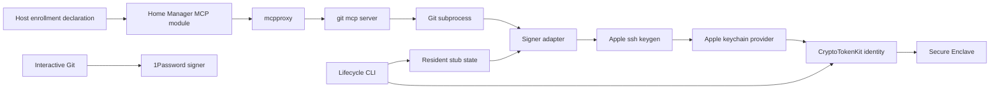
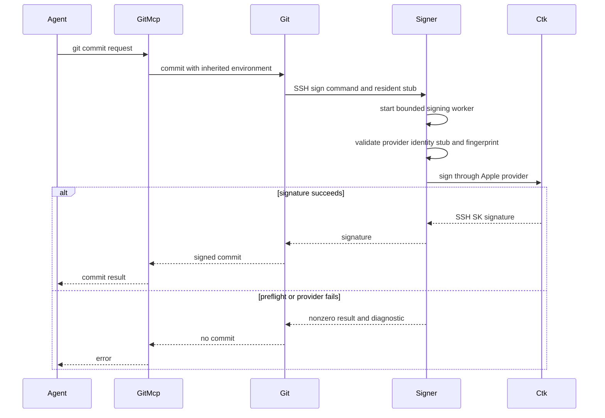
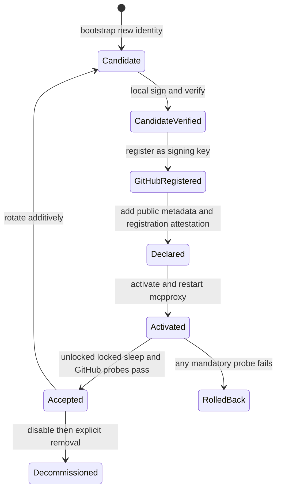

# Design Document

## Overview

This feature gives the `git-mcp` upstream a dedicated CTK-backed SSH signer while leaving global Git and SSH behavior unchanged. It adds a thin signer adapter, an operator lifecycle CLI, typed Home Manager configuration, and staged physical-host acceptance.

### Goals

- Sign every `git-mcp` commit with one non-exportable per-host identity.
- Continue signing after first unlock across screen lock and sleep.
- Fail closed on missing, ambiguous, or mismatched signing state.
- Prove environment isolation, native-provider behavior, and GitHub verification.

### Non-Goals

- Restricting platform signing access to the `git-mcp` process.
- Replacing global 1Password Git signing or SSH authentication.
- Managing private material through Nix, SOPS, Keychain generic-password items, or an agent.
- Changing mcpproxy routing, persistence, or unrelated upstream registrations.

## Boundary Commitments

### This Spec Owns

- The git-mcp-only Git configuration overlay and its typed per-host metadata.
- The Git SSH signer process contract and native-provider preflight.
- CTK identity bootstrap, resident-stub recovery, rotation staging, decommissioning, and acceptance evidence.
- Render, contract, isolation, and physical-host verification.

The per-host Nix declaration is authoritative for the active identity. Home Manager renders a non-secret active-enrollment marker from that declaration. CTK owns the private key. XDG state owns reconstructable resident stubs and acceptance evidence.

### Out of Boundary

- `home-manager/common/git.nix`, `home-manager/common/ssh.nix`, and the current public signing keys in both host `git.nix` files.
- Adding the dedicated key to GitHub authentication keys, SSH `IdentityFile`/`IdentityAgent` configuration, an `ssh-agent`, or `authorized_keys`.
- `mcp-secrets-sops-nix`, secret activation, and generic-password Keychain records.
- The mcpproxy launch wrapper, runtime config ownership, tool routing, and other upstreams.
- GitHub repository selection for the acceptance commit.

### Allowed Dependencies

- macOS `/usr/sbin/sc_auth`, `/usr/lib/ssh-keychain.dylib`, `/usr/bin/ssh-keygen`, CryptoTokenKit, and Secure Enclave.
- Git's SSH signing and process-runtime configuration interfaces.
- The existing `home.mcp` module, `git-mcp-server`, Nix packaging including `pkgs.coreutils`, XDG state, Node test harness, and flake check.
- GitHub's signing-key registration and commit-verification surfaces for operator acceptance.

No third-party signer, persistent `ssh-agent`, new daemon, or secret pipeline is allowed.

### Revalidation Triggers

- A macOS update changes `sc_auth`, the provider ABI/path, CTK accessibility, or selector behavior.
- Git changes `gpg.ssh.program`, `user.signingKey`, or environment-config precedence.
- `git-mcp-server` changes environment inheritance, commit arguments, unsigned retry behavior, or its 60-second timeout.
- mcpproxy changes explicit upstream-environment propagation.
- GitHub changes SSH-SK verification or signing-key registration policy.
- A host identity rotates, a new host is enrolled, or the state layout changes.

## Architecture

### Existing Architecture Analysis

`home-manager/mcp/default.nix` owns the common `git-mcp` server and passes its explicit environment through the mcpproxy renderer. The upstream copies that environment to shell-free Git subprocesses. Global Git selects 1Password, and common SSH selects the 1Password agent. The new path changes only the existing `git-mcp.env` attrset; no second server entry or launch path is introduced.

### Architecture Pattern and Boundary Map



**Architecture integration**:

- Pattern: hybrid extension. Existing server ownership is extended; native signing and lifecycle behavior live in new tools.
- Dependency direction: host declaration → mcpproxy rendering → Git environment → signer adapter → Apple tools. The lifecycle CLI writes state but never mutates the declarative host declaration.
- Existing patterns preserved: `writeShellApplication`, typed Home Manager options, XDG state, Node contract tests, and the current flake check.

### Technology Stack

| Layer | Choice | Role |
|---|---|---|
| Configuration | Nix and Home Manager | Validate enrollment and render git-mcp-only environment |
| Runtime adapter | Nix-packaged shell application and GNU `timeout` | Enclose the complete signing worker in a 20-second bound and preserve Git's SSH signer CLI |
| Platform | macOS 26 CTK, Secure Enclave, Apple OpenSSH | Store the non-exportable key and produce SSH signatures |
| State | XDG state files | Store resident handles, public keys, and acceptance evidence |
| Verification | Node 22, Git, OpenSSH, Nix flake checks | Exercise render, contract, Git, and failure behavior |

## File Structure Plan

### New Files

```text
scripts/
├── git-mcp-secure-enclave-signer.nix   # Git-compatible signer adapter package
└── git-mcp-secure-enclave-admin.nix    # Identity lifecycle and acceptance CLI package
tests/git-mcp/
├── signer-contract.test.js              # Signer, Git config, failure, and timeout contracts
├── admin-contract.test.js               # Lifecycle state-machine and export-selection contracts
├── upstream-isolation.test.js            # Failed-signing isolation across mcpproxy upstreams
├── policy.test.js                        # Private/auth material and boundary regression scan
└── fixtures/signing-tools.nix           # Fake native tools and injectable package builds
docs/
└── git-mcp-secure-enclave-signing.md    # Operator runbook and accepted security boundary
```

### Modified Files

- `home-manager/mcp/default.nix` — Define signing options, derive paths/environment, render the active marker, assert metadata, install tools, and merge only into `git-mcp`.
- `configurations/personal/home-manager/default.nix` — Declare the personal host's new dedicated public metadata after enrollment.
- `configurations/shopify/home-manager/default.nix` — Declare the Shopify host's new dedicated public metadata after enrollment.
- `tests/git-mcp/hm-render.test.js` — Verify host-specific rendering, global compatibility, and upstream isolation.
- `tests/git-mcp/index.js` — Load all git-mcp test files.
- `flake.nix` — Add Git/OpenSSH test dependencies to the existing `git-mcp` check.

The host `git.nix` files, common Git/SSH modules, secret files, and roadmap are not modified.

## System Flows

### Runtime Signing



`commit.gpgSign=true` remains effective when upstream retries without `--gpg-sign`; the retry therefore cannot create an unsigned commit. For each signing attempt, the 20-second deadline starts before CTK identity listing or any preflight native call and ends only after provider signing exits and the worker tree is reaped.

### Enrollment and Rollout



Candidate creation never overwrites the active identity directory. Rollback disables the host declaration and restores inherited global signing without deleting CTK state.

## Components and Interfaces

| Component | Intent | Requirement Coverage | Dependencies |
|---|---|---|---|
| Signing configuration | Render one validated git-mcp-only enrollment | 1, 2, 3, 5, 6, 9 | Home Manager P0; mcpproxy P0 |
| Signer adapter | Enforce identity/stub match and delegate Git's signer contract | 2, 4, 5, 6 | Apple OpenSSH P0; CTK P0 |
| Lifecycle CLI | Manage non-exportable identity lifecycle and evidence | 1, 4, 6, 7, 8, 10 | `sc_auth` P0; provider P0 |
| Test harness | Prove fail-closed behavior and boundary isolation | 2, 3, 5, 6, 9 | Nix P0; Node/Git/OpenSSH P0 |
| Runbook | Define operator and security procedures | 5, 7, 8, 10, 11 | GitHub P1 |

### Signing Configuration

The `home.mcp.gitMcpSigning` submodule has this contract:

| Option | Type and default | Constraint |
|---|---|---|
| `enable` | Boolean, `false` | Adds no signing environment when false |
| `stateDir` | Absolute string, `$XDG_STATE_HOME/git-mcp-secure-enclave-signing` | Host-local non-secret state |
| `identityLabel` | Nullable string | Required and non-empty when enabled |
| `ctkPublicKeyHash` | Nullable string | Required 40-character lowercase hex when enabled |
| `sshPublicKey` | Nullable string | Required `sk-ecdsa-sha2-nistp256@openssh.com` public key when enabled |
| `sshFingerprint` | Nullable string | Required `SHA256:` fingerprint when enabled |
| `githubSigningKeyRegistered` | Boolean, `false` | Must be explicitly true for the declared key when enabled |
| `signerPackage` | Package | Defaults to the production signer adapter |
| `adminPackage` | Package | Defaults to the production lifecycle CLI |

The resident stub path is derived as `<stateDir>/identities/<ctkPublicKeyHash>/id_ecdsa_sk_rk`. The signer and admin packages are installed whenever `home.mcp.enable` is true, so the admin CLI can bootstrap an unenrolled host while `gitMcpSigning.enable` remains false. A partial enabled declaration or missing GitHub-registration attestation fails Nix evaluation. When signing is enabled, Home Manager renders `$XDG_CONFIG_HOME/git-mcp-secure-enclave-signing/active.json` from the same declaration; the lifecycle CLI treats its presence as the active-enrollment signal.

The module merges these non-secret values only into the existing `git-mcp.env`:

| Variable | Value or role |
|---|---|
| `GIT_SIGN_COMMITS` | `true`, pinning upstream signing intent |
| `GIT_CONFIG_COUNT` | `4` |
| Pair `0` | `commit.gpgSign=true` |
| Pair `1` | `gpg.format=ssh` |
| Pair `2` | `gpg.ssh.program=<signer adapter>` |
| Pair `3` | `user.signingKey=<resident stub>` |
| `SSH_SK_PROVIDER` | `/usr/lib/ssh-keychain.dylib` |
| `KEYCHAIN_CERTIFICATES` | The configured CTK public-key hash only |
| `GIT_MCP_SIGNING_CTK_HASH` | Expected CTK hash |
| `GIT_MCP_SIGNING_PUBLIC_KEY` | Expected SSH public key |
| `GIT_MCP_SIGNING_FINGERPRINT` | Expected SSH fingerprint |
| `GIT_MCP_SIGNING_STUB` | Derived resident-stub path |

Existing `MCP_SESSION_MODE` and `STORAGE_PROVIDER_TYPE` values are merged unchanged. The module does not set or clear `SSH_AUTH_SOCK`; SSH transport may continue using the global 1Password agent while signing uses the resident stub directly.

### Signer Adapter

**Process contract**:

```text
git-mcp-secure-enclave-signer <ssh-keygen-compatible arguments>
exit 0: delegated Apple ssh-keygen operation succeeded
exit nonzero: preflight or delegated operation failed; stderr is actionable
```

- For `-Y sign`, start one isolated worker process group under a fixed 20-second supervisor before invoking any preflight or native command.
- Inside that worker, require the exact production provider, expected selector, expected `-f` stub, a regular readable stub and `.pub`, matching public key/fingerprint, and a matching identity from `sc_auth list-ctk-identities`, then invoke `/usr/bin/ssh-keygen` with the original argument vector.
- Delegate non-signing operations unchanged so Git verification subcommands remain compatible.
- Never invoke, start, or depend on `ssh-agent`; never fall back to another signer.
- Preserve native stdout and stderr. On every worker exit, reap its descendants; on timeout, terminate and reap the complete worker process group, return nonzero, and emit a specific timeout diagnostic.
- Add one concise recovery line for first-unlock, missing state, mismatch, or provider failure.
- Production native paths are fixed package parameters. Tests substitute fake tools at Nix build time, not through production runtime overrides.

### Lifecycle CLI

**Command contract**:

| Command | Effect | Idempotency and failure rule |
|---|---|---|
| `bootstrap --label <label>` | Create one `p-256-ne` identity with protection `none`, export its resident stub, and print public metadata | Require no active marker and an empty managed `identities` directory; direct existing state to doctor, recovery, or explicit decommission |
| `doctor --hash <hash>` | Validate platform paths, identity, selector, stub, public key, fingerprint, and local sign/verify | Read-only |
| `probe --hash <hash>` | Produce and locally verify a disposable signature | Writes only temporary probe data |
| `recover-stub --hash <hash>` | Re-export and atomically restore matching non-secret stub files | Require the active marker to match; leave prior valid state unchanged on ambiguity or failure |
| `rotate --label <label>` | Require an active marker, create a separate candidate, and print a replacement Nix declaration with registration attestation disabled | Never changes or deletes the active identity |
| `record-acceptance --hash <hash> --unlocked-commit <sha> --locked-commit <sha> --sleep-commit <sha> --reboot-commit <sha> --github-commit <sha> --github-verified` | Verify the local probe commits and atomically record host, OS, probe states, and the operator-confirmed GitHub result | Require the active marker to match; reject incomplete, unsigned, or mismatched evidence |
| `decommission --hash <hash> --fingerprint <fingerprint>` | Delete the exact CTK identity and its local state after explicit confirmation | Never use delete-all; refuse hash/fingerprint mismatch or an active marker that selects the target; allow the marker to be absent or to select a replacement |

Bootstrap checks the Home Manager-derived active marker and managed identities directory before creating anything. It then compares CTK identity sets before and after creation, requires exactly one new hash, sets `KEYCHAIN_CERTIFICATES` to that hash, exports into an empty temporary directory, and selects output by SSH fingerprint. It atomically installs only the selected stub and `.pub` after local signature verification. The CLI never edits repository configuration or calls GitHub APIs.

### Test Harness and Runbook

The fixture builds signer/admin packages against deterministic fake `sc_auth`, provider, and `ssh-keygen` commands. Node tests own temporary directories and Git repositories. The runbook owns manual registration, per-host activation, actual locked/sleep probes, GitHub `Verified` confirmation, rollback, and lifecycle recovery.

## Data Models

### Declarative Enrollment

```text
HostEnrollment = {
  identityLabel: non-empty string
  ctkPublicKeyHash: 40 lowercase hexadecimal characters
  sshPublicKey: sk-ecdsa-sha2-nistp256 OpenSSH public key
  sshFingerprint: SHA256 OpenSSH fingerprint
  githubSigningKeyRegistered: true
}
```

Invariants: the four identity fields identify one key; the CTK hash selects one provider identity; the SSH values match the resident stub; registration attestation is explicit; no field is secret.

### Host-Local State

```text
$XDG_STATE_HOME/git-mcp-secure-enclave-signing/
├── identities/<ctk-hash>/id_ecdsa_sk_rk
├── identities/<ctk-hash>/id_ecdsa_sk_rk.pub
└── acceptance/<ctk-hash>.json

$XDG_CONFIG_HOME/git-mcp-secure-enclave-signing/
└── active.json
```

The stub contains a provider credential handle, not private key material. Directory and file permissions protect integrity, not secrecy. `active.json` is a Home Manager-generated projection of the active Nix declaration, including `stateDir`; it is not independently writable lifecycle state. The acceptance record contains schema version, host, macOS version, CTK hash, SSH fingerprint, tested states, commit identifier, GitHub verification result, timestamps, and no private material.

## Error Handling

| Condition | Responsible component | Response |
|---|---|---|
| Enabled declaration incomplete or malformed | Signing configuration | Abort evaluation with the option and expected form |
| Provider path absent | Signer or CLI | Exit nonzero and name `/usr/lib/ssh-keychain.dylib` |
| Identity absent | Signer or CLI | Exit nonzero with configured hash and bootstrap/recovery command |
| Stub absent or malformed | Signer | Exit before Git signing and name the path |
| Public key or fingerprint mismatch | Signer or CLI | Exit before signing; print expected and observed public identifiers |
| Export returns zero or multiple candidates | Lifecycle CLI | Install nothing; report candidates and recovery steps |
| Provider rejects signing | Signer | Preserve stderr and mention first unlock after reboot |
| Signing worker exceeds 20 seconds during preflight or provider signing | Signer adapter | Terminate and reap the complete worker process group, return a timeout diagnostic, and leave Git to fail closed |
| Any physical probe fails | Rollout workflow | Disable or retain disabled config; keep identity for diagnosis |

Signer failure affects only the current Git command. It does not stop mcpproxy or modify another upstream.

## Testing Strategy

### Render Tests

- Evaluate both hosts and assert one `git-mcp` entry, preserved hardening variables, exact four Git config pairs, native provider, distinct metadata, and signer/stub paths.
- Assert every other upstream lacks signing variables.
- Evaluate global Git and SSH settings to prove 1Password signer, existing public keys, and `IdentityAgent` remain unchanged.
- Scan rendered values and repository paths for private-key blocks, `op://` signing material, authentication registration, and `authorized_keys` changes.

### Signer and Git Contract Tests

- Inject fake native tools to cover success, non-sign passthrough, missing provider, missing identity, missing stub, malformed stub, hash/public-key/fingerprint mismatch, ambiguous identity, provider failure, and first-unlock guidance.
- Verify the adapter preserves Git's `-Y sign` arguments and never invokes an agent or fallback signer.
- Use temporary Git repositories to prove environment config overrides conflicting global signing settings, successful commits contain a signature, and both upstream attempts fail without moving `HEAD` when signing fails.
- Hang CTK identity listing, each preflight native call, and provider signing across both upstream attempts; assert each complete worker stays within 20 seconds, `HEAD` is unchanged, and no worker descendant survives.
- Start mcpproxy with a failing signing fixture and an independent fake upstream; prove the failed Git call does not stop mcpproxy or the sibling upstream.

### Lifecycle CLI Tests

- Model identity-set before/after behavior, one-new-identity selection, temporary export enumeration, atomic install, and local verification.
- Prove bootstrap refuses an active marker and non-empty managed identity state, recovery preserves valid state on failure, rotation is additive, and decommission requires exact hash/fingerprint without deleting the active identity or using delete-all.
- Validate acceptance record schema and rejection of incomplete or mismatched evidence.

### Repository Policy Tests

- Scan implementation and host-configuration paths for serialized private-key blocks, signing material in SOPS/generic-password declarations, GitHub authentication-key registration, SSH `IdentityFile`/`IdentityAgent` additions, `ssh-agent` loading, and `authorized_keys` installation.
- Exclude specs, runbook prose, and negative test fixtures from literal-string findings while still validating their executable outputs.
- Assert the host `git.nix` files and common Git/SSH modules retain their expected 1Password paths/public keys and contain no feature-specific declarations.

### Physical-Host Acceptance

- On each host: bootstrap, run the local unlocked probe, and register the public key with GitHub as a signing key only.
- Add the host declaration with registration attestation, activate it, then perform actual `git-mcp` signed commits unlocked, while screen-locked, and after sleep; inspect every signature.
- Reboot each host, complete the first unlock, and prove the same enrolled identity signs without rotation or GitHub re-registration.
- Push a probe commit to an operator-selected repository and confirm `Verified`.
- Record evidence with the lifecycle CLI. No host is complete until locked-screen, post-sleep, post-reboot, and GitHub checks pass.

## Security Considerations

- Private keys remain in Secure Enclave-backed CTK identities and are never serialized by repository tooling.
- `-t none` removes user-presence protection to satisfy locked-session signing. This is an explicit availability/security trade-off.
- Environment and Nix state contain public identifiers and paths only.
- A same-user attacker can invoke `/usr/bin/ssh-keygen` with the provider and readable resident stub. Environment scoping is not an authorization boundary.
- Local fingerprint checks detect accidental or opportunistic stub substitution but do not defend against a process that can also alter the user's declarative configuration or running environment.
- Repository-managed configuration registers the dedicated key only through GitHub's signing-key surface and adds it to no SSH client, agent, server, or GitHub authentication-key surface.

## Migration and Rollout

- Land the disabled option surface, packages, and fake-provider tests first.
- Build or activate the admin package while signing remains disabled; identity bootstrap has no active-signing prerequisite.
- Bootstrap a candidate identity on each host, register its public key through GitHub's signing-key surface only, and capture its declaration with explicit registration attestation. No identity is copied between hosts.
- Enable one host declaration at a time, activate, restart mcpproxy, and run all physical probes.
- On failure, disable that host's option and restart mcpproxy. Global Git remains the 1Password rollback path; CTK state remains for diagnosis.
- Mark a host complete only after its acceptance JSON records unlocked, locked-screen, post-sleep, post-reboot, and GitHub verification success.
- Rotation creates a candidate in a new hash-keyed directory, validates it, registers it with GitHub, updates the host declaration only after registration, reruns acceptance, then explicitly decommissions the old identity.

The versioned runbook is a required operator interface artifact. Physical-host probes are implementation integration tests against external platform contracts; activation and reboot are test preconditions with defined rollback, not an independent deployment workstream.

## Requirements Traceability

| Requirement IDs | Design coverage | Primary validation |
|---|---|---|
| 1.1, 1.2, 1.3, 1.4, 1.5 | Per-host declaration, CTK lifecycle, boundary commitments | CLI and host enrollment tests |
| 2.1, 2.2, 2.3, 2.4, 2.5 | Git config overlay and signer adapter | Temporary Git and physical commit probes |
| 3.1, 3.2, 3.3, 3.4, 3.5, 3.6, 3.7 | Environment merge and unchanged global files | Dual-host render and upstream-isolation tests |
| 4.1, 4.2, 4.3, 4.4, 4.5 | `-t none`, first-unlock diagnostics, host rollout | Unlocked, locked, sleep, and reboot checks |
| 5.1, 5.2, 5.3, 5.4, 5.5, 5.6 | State model and security boundary | Repository scan, state inspection, runbook review |
| 6.1, 6.2, 6.3, 6.4, 6.5, 6.6, 6.7, 6.8 | Selector, full-worker deadline, error isolation | Negative contract tests and upstream health check |
| 7.1, 7.2, 7.3, 7.4, 7.5, 7.6, 7.7 | Bootstrap and registration workflow | CLI tests and per-host enrollment |
| 8.1, 8.2, 8.3, 8.4, 8.5, 8.6, 8.7 | Hash-keyed candidate lifecycle | Rotation, recovery, and decommission tests |
| 9.1, 9.2, 9.3, 9.4, 9.5, 9.6, 9.7 | Git-mcp test harness and flake integration | Existing `git-mcp` flake check |
| 10.1, 10.2, 10.3, 10.4, 10.5, 10.6 | Per-host acceptance workflow and evidence | Physical probes and GitHub `Verified` result |
| 11.1, 11.2, 11.3, 11.4 | Operator runbook | Documentation review against checklist |
