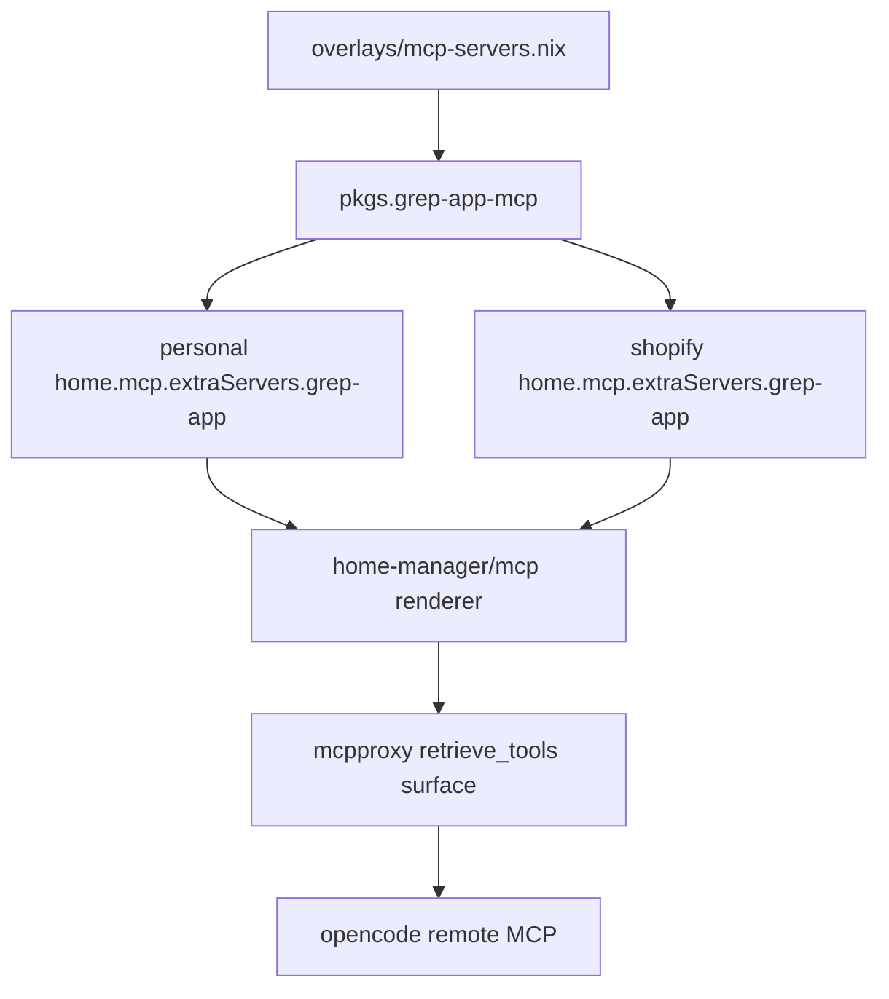

# Design Document

## Overview

The grep-app MCP feature packages `ai-tools-all/grep_app_mcp` and registers it as a stdio upstream through the existing mcpproxy Home Manager module on both nix-darwin hosts.

### Goals

- Add reproducible Nix packaging for the upstream TypeScript MCP server.
- Make grep.app tools discoverable through mcpproxy on personal and Shopify hosts.
- Verify package and rendered config without live network calls.

### Non-Goals

- Direct opencode MCP wiring.
- New mcpproxy daemon behaviour, ranking defaults, or routing modes.
- HTTP/SSE service launchd, port 8603 ownership, or background services.
- New secrets or required API keys.
- Live grep.app/GitHub API validation in flake checks.

## Boundary Commitments

### This Spec Owns

- `pkgs.grep-app-mcp` package and executable launcher.
- Both-host `home.mcp.extraServers.grep-app` declarations.
- A flake check that validates the package and rendered mcpproxy entries.

### Out of Boundary

- `home-manager/mcp/default.nix` renderer semantics except consuming the existing option shape.
- Opencode's MCP remote config and wrapper preflight.
- Secret bridge, Keychain layout, file-sourced env, and startup gate policy.
- Upstream grep.app service availability and public GitHub API quotas.

### Allowed Dependencies

- Existing `overlays/mcp-servers.nix` package patterns.
- Existing `home.mcp.extraServers` option and mcpproxy renderer.
- Existing per-host Home Manager configs.
- Existing flake check pattern for Node/Nix render checks.

### Revalidation Triggers

- Upstream changes its build output path or stdio entrypoint.
- Upstream requires an API key or authenticated GitHub token.
- mcpproxy changes stdio server config shape.
- The operator wants grep.app to become a startup-gate dependency.

## Architecture

### Existing Architecture Analysis

MCP orchestration is already centralized. New upstreams should be added as host config data under `home.mcp.extraServers`, not by changing opencode config or the mcpproxy renderer. Package definitions live in the overlay and are consumed by host configs through `pkgs`.

### Architecture Pattern & Boundary Map



- Selected pattern: packaged stdio upstream registered through host config.
- Dependency direction: overlay package → host extra server → existing renderer → mcpproxy.
- No new daemon or port is introduced.

### Technology Stack

| Layer | Choice | Role | Notes |
|-------|--------|------|-------|
| Package | `buildNpmPackage` or equivalent npm derivation | Build upstream TypeScript server | Prefer locked npm deps / fixed hash. |
| Runtime | Node.js stdio MCP process | Upstream process spawned by mcpproxy | Wrapper points at `dist/server-stdio.js`. |
| Configuration | Home Manager `home.mcp.extraServers` | Host registration | Existing mcpproxy renderer translates to array shape. |
| Verification | Node `node:test` plus Nix eval/build | Deterministic checks | No live external API calls. |

## File Structure Plan

### New Files

- `tests/grep-app-mcp/hm-render.test.js` — Builds/evaluates package metadata and both host rendered mcpproxy entries.

### Modified Files

- `overlays/mcp-servers.nix` — Adds `grep-app-mcp` package.
- `configurations/personal/home-manager/default.nix` — Adds `extraServers.grep-app` stdio entry.
- `configurations/shopify/home-manager/default.nix` — Adds `extraServers.grep-app` stdio entry.
- `flake.nix` — Adds a `grep-app-mcp` check that runs the render/package suite.
- `tests/grep-app-mcp/README.md` — Optional operator smoke notes and any upstream limitation discovered during packaging.

### Conditional Files

- `overlays/grep-app-mcp/package-lock.json` or similar vendored lockfile — Only if `buildNpmPackage` cannot import the upstream lock directly from the fetched source.

## Requirements Traceability

| Requirement | Summary | Components | Interfaces | Flows |
|-------------|---------|------------|------------|-------|
| 1.1-1.5 | Reproducible package | Package | Package executable | Build |
| 2.1-2.5 | Both-host registration | Host registration | `home.mcp.extraServers` | Render |
| 3.1-3.4 | mcpproxy discovery contract | Host registration, Validation | retrieve_tools/call_tool_read expectation | Runtime route |
| 4.1-4.5 | Deterministic verification | Validation | Flake check | Test |
| 5.1-5.5 | Operator boundaries | Package, Host registration, Validation | Existing MCP contracts | Render/test |

## Components and Interfaces

| Component | Domain/Layer | Intent | Req Coverage | Key Dependencies | Contracts |
|-----------|--------------|--------|--------------|------------------|-----------|
| Package | Overlay | Build and expose grep_app_mcp | 1, 4, 5 | Upstream GitHub source P0, Node P0 | Service |
| Host Registration | Home Manager | Add upstream on both hosts | 2, 3, 5 | Package P0, mcpproxy renderer P0 | State |
| Validation | Tests/flake | Prove package and render state | 4, 5 | Nix eval P0, Node test P1 | Test |

### Package

| Field | Detail |
|-------|--------|
| Intent | Provide a Nix-built executable for the upstream stdio MCP server. |
| Requirements | 1.1, 1.2, 1.3, 1.4, 1.5, 4.1, 4.2, 5.3 |

**Responsibilities & Constraints**
- Pins upstream source and dependency hash.
- Runs the upstream build path that emits `dist/server-stdio.js`.
- Installs a wrapper executable named `grep-app-mcp`.
- Keeps logs and runtime writes out of the Nix store if upstream startup writes logs.

**Service Interface**
```nix
pkgs.grep-app-mcp = buildNpmPackage {
  pname = "grep-app-mcp";
  version = "<pinned>";
  src = fetchFromGitHub { owner = "ai-tools-all"; repo = "grep_app_mcp"; ... };
  npmDepsHash = "...";
};
```
- Preconditions: upstream source has `package-lock.json` and `npm run build` emits stdio entrypoint.
- Postconditions: `${pkgs.grep-app-mcp}/bin/grep-app-mcp` starts the stdio server.
- Invariants: no local checkout or mutable npm install is needed.

### Host Registration

| Field | Detail |
|-------|--------|
| Intent | Register grep.app as a mcpproxy-spawned stdio upstream on both hosts. |
| Requirements | 2.1, 2.2, 2.3, 2.4, 2.5, 3.1, 3.3, 3.4, 5.1, 5.2, 5.4 |

**State Contract**
```nix
home.mcp.extraServers.grep-app = {
  command = "${pkgs.grep-app-mcp}/bin/grep-app-mcp";
};
```
- Preconditions: `home-manager/mcp` is imported and mcpproxy is enabled.
- Postconditions: rendered `mcp_config.json` includes a stdio server named `grep-app`.
- Invariants: opencode still has only the mcpproxy remote MCP entry.

### Validation

| Field | Detail |
|-------|--------|
| Intent | Catch packaging and registration regressions without live network calls. |
| Requirements | 4.1, 4.2, 4.3, 4.4, 4.5, 5.3, 5.5 |

**Test Contract**
- Build/evaluate `pkgs.grep-app-mcp`.
- Assert the package exposes `bin/grep-app-mcp`.
- Render personal and Shopify Home Manager config and inspect the mcpproxy server list.
- Assert no direct opencode MCP entry for grep.app exists.
- Avoid invoking `searchCode`, `github_file`, or any live external request.

## Testing Strategy

- Add `node --test tests/grep-app-mcp/` as the local suite.
- Add `checks.aarch64-darwin.grep-app-mcp` in `flake.nix` with Nix flakes enabled.
- Run the package build and render assertions inside a copied writable source.
- Include at least one negative assertion proving no direct opencode MCP entry is added.
- Provide an operator runtime smoke command for post-switch validation through mcpproxy `retrieve_tools` without making grep.app part of the startup gate.

## Risks and Mitigations

| Risk | Mitigation |
|------|------------|
| Upstream startup writes logs to CWD | Wrap with runtime env or working-dir hygiene if package smoke exposes writes. |
| Upstream has no `--help`/`--version` | Verify binary existence and render state; avoid hanging stdio server in tests. |
| Upstream lock import fails | Vendor a minimal lock/patch path under `overlays/grep-app-mcp/`. |
| Network-dependent tools are flaky | Keep live calls out of flake checks. |
