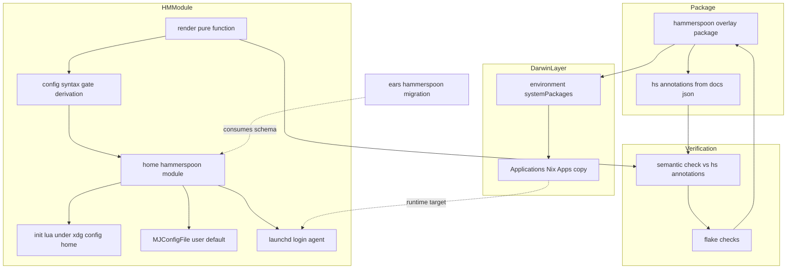
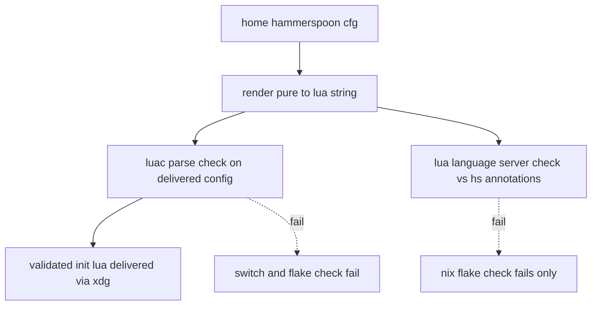
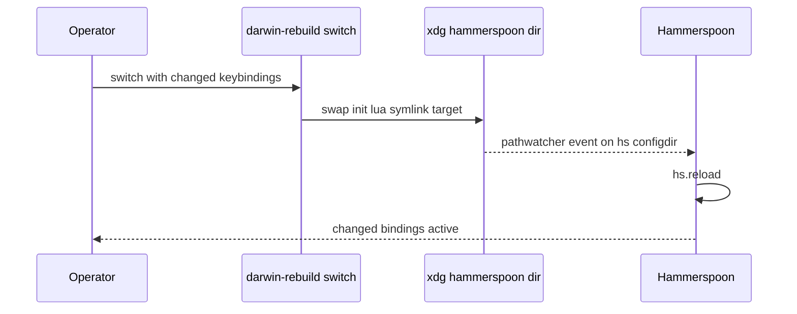

# Design Document

## Overview
**Purpose**: Install Hammerspoon declaratively (no Homebrew) on both nix-darwin
hosts and provide an app-agnostic Home Manager options schema that renders global
keybindings into `$XDG_CONFIG_HOME/hammerspoon/init.lua`, gated by derivation-time
validity checks.
**Users**: The operator declares `home.hammerspoon.keybindings` in Nix; the
downstream `ears-hammerspoon-migration` spec is the first consumer.
**Impact**: Adds the repo's first Nix-packaged macOS `.app`, its first
`environment.systemPackages` GUI install, and a new Home Manager module whose
delivered config is syntax-validated at build time and semantically validated in CI.

### Goals
- A reproducible `pkgs.hammerspoon` `.app` derivation installed at a stable,
  TCC-friendly path on both hosts.
- A declarative, diff-reviewable keybinding schema with three action types
  (AppleScript, command-line, inline Lua) plus a general `extraConfig` escape hatch.
- Configuration stored under `$XDG_CONFIG_HOME` with nothing left in `~/.hammerspoon`.
- Eval-time rejection of duplicate, incomplete, or invalid bindings.
- A derivation-time **syntax** gate on the delivered config (blocks `switch`) and a
  hermetic derivation-time **semantic** check against the Hammerspoon API (blocks
  `nix flake check`).
- Verification (package build + render + failure cases + validity cases) with no
  host switch or Accessibility grant required.

### Non-Goals
- The microphone mute binding, its feedback (alert, menubar), and Ears removal
  (owned by `ears-hammerspoon-migration`).
- Any audio behavior, window management, app launchers, or Spoons.
- Automating the macOS Accessibility grant or Spotlight/Dock polish (`mac-app-util`).
- Runtime/behavioral verification of the config on a host (the validity checks are
  static, at build time).

## Boundary Commitments

### This Spec Owns
- The `hammerspoon` overlay derivation (fetch, unpack, install the signed bundle).
- The `hs` LuaCATS annotation derivation generated from the pinned bundle's
  `docs.json`.
- The nix-darwin install via `environment.systemPackages` on both hosts.
- The `home.hammerspoon` Home Manager module: the options schema, the pure Lua
  renderer, eval-time binding validation, the derivation-time **syntax** gate on the
  delivered config, the config delivered under `$XDG_CONFIG_HOME/hammerspoon/init.lua`,
  the `MJConfigFile` default, the login launchd agent, and the Accessibility docs.
- The hermetic **semantic** validation flake check (`hs` API usage).
- The action-type contract (`applescript` / `command` / `lua`) and the
  `extraConfig` escape hatch that downstream consumers bind against.
- The verification flake checks for the package, renderer, syntax gate, and semantic check.

### Out of Boundary
- Concrete bindings of any kind (the framework ships zero real bindings; hosts
  declare an empty `keybindings` list until a consumer adds one).
- Audio/mic logic, alerts, menubar items, device watchers (expressed by consumers
  via `extraConfig`/`lua`, not owned here).
- Ears removal and Homebrew cask changes.
- Runtime/behavioral verification on a host (the checks are static).

### Allowed Dependencies
- nix-darwin `environment.systemPackages` and its `/Applications/Nix Apps` copy
  (`system.activationScripts.applications`, default behavior, not overridden).
- home-manager `xdg.configFile`, `targets.darwin.defaults`, `launchd.agents`,
  `assertions`.
- nixpkgs `lib`, `stdenvNoCC`, `pkgs.fetchurl`, `pkgs.unzip`, `pkgs.lua5_4`
  (`luac5.4`), `pkgs.lua-language-server`.
- The pinned bundle's `Contents/Resources/docs.json` and the `EmmyLua.spoon`
  generator logic (MIT), ported to plain `lua5.4`.
- The `overlays/` custom-package composition (`custom-packages`).
- Hammerspoon runtime APIs (`hs.hotkey`, `hs.osascript`, `hs.execute`,
  `hs.pathwatcher`, `hs.configdir`, `hs.accessibilityState`,
  `hs.automaticallyCheckForUpdates`) and the `MJConfigFile` user default.

### Revalidation Triggers
- Any change to the action-type contract shape (`applescript`/`command`/`lua`) or
  the `extraConfig` option → `ears-hammerspoon-migration` must re-check.
- A change to the config location (`$XDG_CONFIG_HOME/hammerspoon`), the
  `MJConfigFile` default, or the auto-reload mechanism → consumers relying on the
  config path or reload behavior must re-check.
- A change to the install path convention (`/Applications/Nix Apps/Hammerspoon.app`)
  used by the launchd agent → revalidate launch-at-login and TCC.
- A Hammerspoon version bump: re-pin the package hash, regenerate annotations, and
  confirm the `docs.json` schema and `MJConfigFile` behavior are unchanged.

## Architecture

### Existing Architecture Analysis
- GUI apps today are Homebrew casks (`configurations/common-darwin/default.nix:209`).
  This feature introduces the first `.app`-via-Nix package and the first
  `environment.systemPackages` use; nix-darwin's Nix Apps copy is untouched.
- The Home Manager module mirrors the options→rendered-config→launchd pattern of
  `home-manager/mcp/default.nix`, which already renders config via `xdg.configFile`.
- `lua-language-server` is already a repo build input (`flake.nix:492`, nixvim
  integration check); `home-manager/nixvim/plugins/lsp/lua.nix` shows the settings
  shape. `stylua` exists but conflates format drift with syntax, so it is not the
  syntax gate. `luac`/`lua5_4` and `luacheck` are not in the repo; `luacheck` is too
  shallow to verify `hs` member existence.

### Architecture Pattern and Boundary Map
Pattern: layered Nix composition with a pure renderer. The **syntax** gate is on the
delivery (switch) path; the **semantic** check is a CI-only flake check. Dependency
direction (left imports never point right):

`render (pure) → syntax-gate → module → host config`;
`package → annotations → semantic-check (Verification)`; `package → systemPackages`.



Key decisions: the renderer is pure; the delivered config is the output of a
syntax-gate `runCommand` (`luac5.4 -p`), so invalid **Lua** fails `darwin-rebuild
switch`. The heavier **semantic** check (`lua-language-server` against generated
`hs` annotations) is a hermetic flake check, so an annotation-coverage gap can only
fail `nix flake check`, never brick a rebuild. The config lives under
`$XDG_CONFIG_HOME/hammerspoon` via the `MJConfigFile` default; nothing is written to
`~/.hammerspoon`. Annotations are derived from the pinned bundle, so the semantic
check tracks the installed version.

### Technology Stack
| Layer | Choice / Version | Role in Feature | Notes |
|-------|------------------|-----------------|-------|
| App / Runtime | Hammerspoon 1.1.1 (bundled Lua 5.4.7) | Executes bindings; loads `init.lua` | Self-packaged signed bundle, MIT, min macOS 13 |
| Packaging | `stdenvNoCC` + `pkgs.fetchurl` + `pkgs.unzip` | Fetch + unpack `.app` | Known zip sha256; `dontFixup`/`dontStrip` to keep signature |
| Install | nix-darwin `environment.systemPackages` + Nix Apps copy | Stable `/Applications/Nix Apps/Hammerspoon.app` | TCC path stability |
| Config generation | Nix `render.nix` (pure) | Options → `init.lua` string | Imported by gates + tests |
| Syntax gate (delivery) | `pkgs.lua5_4` `luac5.4 -p` | Reject invalid Lua; blocks `switch` + CI | Matches bundled Lua 5.4; exits non-zero on parse error |
| Semantic check (CI) | `pkgs.lua-language-server --check` + `hs` annotations | Reject nonexistent `hs` symbols; blocks `nix flake check` only | Hermetic/offline |
| Annotation generation | `lua5.4` port of `EmmyLua.spoon` over bundle `docs.json` | Produce `hs` LuaCATS defs | Version-tracking; MIT |
| Config delivery | home-manager `xdg.configFile."hammerspoon/init.lua".source` | Syntax-validated store file under `$XDG_CONFIG_HOME` | Source is the syntax gate's output |
| Config location | `MJConfigFile` default → `$XDG_CONFIG_HOME/hammerspoon/init.lua` | Relocate config off `~/.hammerspoon` | Read by Hammerspoon at launch |
| Launch | home-manager `launchd.agents` | Login auto-start | `RunAtLoad`; targets the Nix Apps binary |
| Verification | `nix eval` + the gates + nodejs runner | Build/render/failure/validity checks | No host or Accessibility needed |

## File Structure Plan

### Created
```
overlays/
├── misc.nix                    # MODIFIED: add `hammerspoon` package + `hammerspoonHsAnnotations` derivation
└── hammerspoon/
    └── gen-emmylua.lua         # Ported EmmyLua.spoon generator (plain lua5.4): docs.json -> hs LuaCATS files
home-manager/common/hammerspoon-keybindings/
├── default.nix                 # HM module: options.home.hammerspoon, xdg.configFile.source = syntax-gated config,
│                               #   MJConfigFile default (-> XDG), launchd agent, accessibility doc
├── render.nix                  # Pure renderer: { lib }: cfg -> initLuaString + escapeLua + binding validation
├── checked-config.nix          # { pkgs, lib }: cfg -> derivation: render + luac5.4 syntax gate -> init.lua (delivery)
└── semantic-check.nix          # { pkgs, lib, hammerspoon }: cfg -> derivation: render + LuaLS vs hs annotations (CI, hermetic)
tests/hammerspoon-keybindings/
├── render.test.mjs             # nodejs --test: nix eval render asserts + expected throws (3.x, 4.2, 4.3)
├── validation.test.mjs         # syntax-gate negative (5.3) via checked-config; semantic positive/negative (5.2/5.4)
│                               #   via semantic-check: valid builds, `hs.bogus` fixture fails
└── fixtures.nix                # Valid + invalid binding/config sets
```

### Modified
- `overlays/misc.nix` — add `hammerspoon` (package) and `hammerspoonHsAnnotations`
  (LuaCATS dir from `docs.json`), both via the `custom-packages` overlay.
- `configurations/common-darwin/default.nix` — add
  `environment.systemPackages = [ pkgs.hammerspoon ];` (both hosts).
- `home-manager/common/default.nix` — add `./hammerspoon-keybindings` to `imports`
  and set `home.hammerspoon.enable = true;` (empty `keybindings`).
- `flake.nix` — add `hammerspoon-package`, `hammerspoon-keybindings` (renderer +
  syntax-gate tests), and `hammerspoon-config-semantic` (hermetic LuaLS check) checks.

## System Flows

Build-time validity (R5) — syntax blocks `switch`; semantics blocks CI only:


Config change auto-reload (R3.5), config under XDG:


## Requirements Traceability
| Requirement | Summary | Components | Interfaces | Flows |
|-------------|---------|------------|------------|-------|
| 1.1 | Install from pinned signed artifact, no Homebrew | Package | `fetchurl` pinned sha256 | - |
| 1.2 | Both hosts | Darwin Install, HM Module | `environment.systemPackages`, common imports | - |
| 1.3 | Stable path across rebuilds | Darwin Install | Nix Apps copy | - |
| 1.4 | Launcher-visible | Darwin Install | Nix Apps copy | - |
| 1.5 | TCC persists across rebuild | Package, Darwin Install | Signed bundle, stable path | - |
| 1.6 | In-place version update | Darwin Install | Nix Apps rsync replace | - |
| 1.7 | Launch at login | HM Module | `launchd.agents.hammerspoon` | - |
| 1.8 | Fetch/integrity failure is loud | Package | `fetchurl` hash mismatch | - |
| 2.1 | Inert until Accessibility granted | HM Module (runtime) | `hs.hotkey` (macOS TCC) | - |
| 2.2 | Document the manual grant | HM Module | init.lua header, `hs.accessibilityState(true)`, option docs | - |
| 2.3 | Active once granted | HM Module (runtime) | macOS TCC | - |
| 3.1 | Schema hotkey + one action | Renderer, HM Module | `home.hammerspoon.keybindings` submodule | - |
| 3.2 | Three action types | Renderer | action union → Lua mapping | - |
| 3.3 | Global firing | Renderer | `hs.hotkey.bind` | - |
| 3.4 | Readable rendered config | HM Module, Config Syntax Gate | `xdg.configFile.source` = syntax-validated file | Validity flow |
| 3.5 | Auto-reload after switch | Renderer | `hs.pathwatcher` on `hs.configdir` | Reload flow |
| 3.6 | Empty set renders valid config | Renderer | renderer handles `[]` | - |
| 3.7 | Duplicate hotkey fails build | Renderer | validation `throw` | - |
| 3.8 | Incomplete binding fails build | Renderer | validation `throw` | - |
| 3.9 | Invalid modifier/key fails build | Renderer | `types.enum` + key allowlist | - |
| 4.1 | Build package check | Verification | `hammerspoon-package` check | - |
| 4.2 | Render content check | Verification | `nix eval` structural asserts | - |
| 4.3 | Binding failure-case checks | Verification | `nix eval` expect throw | - |
| 4.4 | No host/Accessibility needed | Verification | eval + build + node only | - |
| 5.1 | Generated config is valid Lua | Config Syntax Gate | `luac5.4 -p` (delivery) | Validity flow |
| 5.2 | Semantically valid hs config | Semantic Validation Check, Annotations | `lua-language-server --check` + `hs` annotations (CI) | Validity flow |
| 5.3 | Build fails on syntax error | Config Syntax Gate | `luac5.4 -p` non-zero (blocks switch + CI) | Validity flow |
| 5.4 | Build fails on nonexistent hs symbol | Semantic Validation Check, Annotations | LuaLS `undefined-field`/`undefined-global` = Error (blocks `nix flake check`) | Validity flow |
| 5.5 | Validity checks at derivation time, no host | Config Syntax Gate, Semantic Validation Check | `runCommand`; no GUI/Accessibility; hermetic | Validity flow |
| 6.1 | Config under `$XDG_CONFIG_HOME` | HM Module | `xdg.configFile."hammerspoon/init.lua"` | - |
| 6.2 | Hammerspoon loads from XDG | HM Module | `MJConfigFile` user default | - |
| 6.3 | Nothing left in `~/.hammerspoon` | HM Module | no `home.file` under `~/.hammerspoon` | - |

## Components and Interfaces

| Component | Layer | Intent | Req Coverage | Key Dependencies (P0/P1) | Contracts |
|-----------|-------|--------|--------------|--------------------------|-----------|
| Hammerspoon Package | Packaging | Fetch + install signed `.app` | 1.1, 1.5, 1.8, 4.1 | fetchurl, unzip (P0) | Batch |
| Hammerspoon Annotations | Packaging | Generate `hs` LuaCATS defs from bundle | 5.2, 5.4 | Package (P0), lua5_4 (P0) | Batch |
| Darwin Install | nix-darwin | Place app at stable path on both hosts | 1.2, 1.3, 1.4, 1.6 | Package (P0), Nix Apps copy (P0) | State |
| Lua Renderer | HM (pure) | Options → init.lua string; validate bindings | 3.1-3.9, 2.2 | lib (P0) | Service |
| Config Syntax Gate | HM (build) | Render + Lua syntax check → delivered file | 3.4, 5.1, 5.3, 5.5 | Renderer (P0), lua5_4 (P0) | Batch |
| Semantic Validation Check | Verification (build) | Render + hermetic LuaLS vs `hs` annotations | 5.2, 5.4, 5.5 | Renderer (P0), Annotations (P0), lua-language-server (P0) | Batch |
| Hammerspoon HM Module | HM | Deliver gated config under XDG + MJConfigFile + launchd + docs | 1.2, 1.7, 2.1-2.3, 3.4, 6.1-6.3 | Config Syntax Gate (P0), Darwin Install path (P1) | Service, State |
| Verification | flake checks | Build + render + binding-failure + validity + wiring | 4.1-4.4, 5.1-5.5, 6.1-6.3 | Renderer, Package, Gates (P0) | Batch |

### Packaging / Install

#### Hammerspoon Package
| Field | Detail |
|-------|--------|
| Intent | Reproducibly fetch and install the signed Hammerspoon `.app` |
| Requirements | 1.1, 1.5, 1.8, 4.1 |

**Responsibilities & Constraints**
- `stdenvNoCC.mkDerivation` with `pkgs.fetchurl` of the pinned release zip
  (`Hammerspoon-1.1.1.zip`, known sha256
  `11bb1c90faf5427f37c7bd4fe7eab9774ae43e1d5cb020c5b3088dac32849efa`).
- `unzip` then `cp -R Hammerspoon.app $out/Applications/`. Set `dontConfigure`,
  `dontBuild`, `dontFixup`, `dontStrip` so the Developer-ID signature and
  notarization are never altered.
- `meta.license = lib.licenses.mit`, `meta.platforms = lib.platforms.darwin`.

**Contracts**: Batch
- Trigger: referenced by `environment.systemPackages`, the annotations derivation,
  and the package check.
- Input/validation: pinned URL + sha256; mismatch fails the build (1.8).
- Output: `$out/Applications/Hammerspoon.app` (intact signature; contains
  `Contents/Resources/docs.json`).

**Implementation Notes**
- Integration: `overlays/misc.nix`, composed into `custom-packages`.
- Risks: `fetchurl`+`unzip` over `fetchzip` to keep the known zip hash and faithful
  bytes; do not resign or strip.

#### Hammerspoon Annotations
| Field | Detail |
|-------|--------|
| Intent | Produce `hs` LuaCATS type definitions for the semantic check |
| Requirements | 5.2, 5.4 |

**Responsibilities & Constraints**
- Read `${hammerspoon}/Applications/Hammerspoon.app/Contents/Resources/docs.json`
  and emit one `---@class hs.<module>` LuaCATS file per module into `$out`.
- Generator is a plain-`lua5.4` port of `EmmyLua.spoon` (MIT): swap the
  Hammerspoon-only calls (`hs.json`, `hs.fs`, `hs.fnutils`) for a standalone JSON
  read and string ops; drop filesystem/timestamp logic.

**Contracts**: Batch
- Trigger: consumed by the Semantic Validation Check.
- Input: the pinned bundle's `docs.json`. Output: a directory of LuaCATS stubs.
- Idempotency: deterministic from the pinned bundle; version-tracking by
  construction.

**Implementation Notes**
- Integration: `overlays/misc.nix` as `hammerspoonHsAnnotations`, generator at
  `overlays/hammerspoon/gen-emmylua.lua`.
- Risks: `docs.json` schema drift on a Hammerspoon bump (Revalidation Trigger).
  Because the semantic check is CI-only, coverage gaps fail `nix flake check`, not a
  rebuild — so the gate may safely include `undefined-field`/`undefined-global`
  (top-level `hs.mod.fn` existence is reliable) while avoiding full type-mismatch
  diagnostics that would be noisier.

#### Darwin Install
| Field | Detail |
|-------|--------|
| Intent | Install Hammerspoon on both hosts at a stable, launcher-visible path |
| Requirements | 1.2, 1.3, 1.4, 1.6 |

**Responsibilities & Constraints**
- Add `environment.systemPackages = [ pkgs.hammerspoon ]` in the shared
  `configurations/common-darwin/default.nix` config block (both hosts import it).
- Rely on nix-darwin copying the bundle to `/Applications/Nix Apps/Hammerspoon.app`
  (read-only, signature-preserving rsync). Do not override
  `system.activationScripts.applications`.

**Contracts**: State
- State model: app present at the fixed path; rsync replaces contents in place on
  version bumps (1.6) while path + signing identity stay constant (1.3, 1.5).
- Consistency: install is unconditional on both hosts; independent of the HM
  module `enable`.

**Implementation Notes**
- Risks: activation requires App Management (and Full Disk Access over SSH); open
  nix-darwin regression #1757 can intermittently hang the Nix Apps step
  (operational, not design-resolvable).

### Home Manager

#### Lua Renderer
| Field | Detail |
|-------|--------|
| Intent | Pure function turning the keybinding config into `init.lua` text |
| Requirements | 3.1-3.9, 2.2 |

**Responsibilities & Constraints**
- Signature: `render = { lib }: cfg: string` where
  `cfg = { keybindings, extraConfig, reloadOnConfigChange }`.
- Validate before emitting (fail-fast `throw`): duplicate hotkey identity (3.7),
  action arity = exactly one of `applescript`/`command`/`lua` (3.8), non-empty and
  supported `key`/`mods` (3.8, 3.9). Validation lives here so `nix eval` of the
  renderer surfaces failures without a host. Its output feeds both gates.

**Contracts**: Service

##### Service Interface (Nix types — the consumer-facing contract)
```nix
# home.hammerspoon.keybindings : listOf binding
binding = submodule {
  options = {
    mods = mkOption {                       # 3.1, 3.9
      type = types.listOf (types.enum [ "cmd" "ctrl" "alt" "shift" ]);
      default = [ ];
    };
    key = mkOption { type = types.str; };   # required; validated against allowlist (3.9)
    description = mkOption { type = types.str; default = ""; };
    action = mkOption { type = actionType; };  # exactly one variant (3.2, 3.8)
  };
};

# exactly one of the three is non-null (enforced by renderer validation)
actionType = submodule {
  options = {
    applescript = mkOption { type = types.nullOr types.lines; default = null; };
    command     = mkOption { type = types.nullOr types.str;   default = null; };
    lua         = mkOption { type = types.nullOr types.lines; default = null; };
  };
};

# escape hatch for non-hotkey setup (watchers, menubar, functions) — 3.2 generality
extraConfig          = mkOption { type = types.lines; default = ""; };
reloadOnConfigChange = mkOption { type = types.bool;  default = true; };
```

Action → Lua mapping (renderer output per binding):
| Action variant | Rendered Lua (inside `hs.hotkey.bind(mods, key, function() ... end)`) |
|----------------|----------------------------------------------------------------------|
| `command = c` | `hs.execute(<escapeLua c>, true)` (login shell for PATH) |
| `applescript = a` | `hs.osascript.applescript(<escapeLua a>)` |
| `lua = body` | `body` inlined verbatim |

- `escapeLua`: `builtins.replaceStrings` escaping `\` `"` newline CR tab into a
  safe double-quoted Lua string literal.
- Hotkey identity for duplicate detection: `concat (sort mods) ++ [toLower key]`.
- Supported `key` allowlist: `F1`–`F20`, single printable characters, and named
  keys (`space`, `return`, `tab`, `escape`, `delete`, arrows). Must accept `F12`.
- Reload watcher: `hs.pathwatcher.new(hs.configdir, hs.reload):start()` — watches
  the actual config dir (the XDG location) with no hardcoded path (3.5, 6).
- Postconditions: output begins with `hs.automaticallyCheckForUpdates(false)` and
  `hs.accessibilityState(true)`, then `extraConfig`, then bind calls, then the
  reload watcher when enabled. Empty `keybindings` yields a valid config with no
  bind calls (3.6).

**Implementation Notes**
- Integration: imported by `checked-config.nix`, `semantic-check.nix`, and
  `tests/.../render.test.mjs`.
- Risks: Lua escaping correctness for quotes/newlines; covered by unit tests.

#### Config Syntax Gate
| Field | Detail |
|-------|--------|
| Intent | Build-time proof the delivered config is syntactically valid Lua |
| Requirements | 3.4, 5.1, 5.3, 5.5 |

**Responsibilities & Constraints**
- Signature: `mkCheckedConfig = { pkgs, lib }: cfg: derivation` whose `$out` is the
  syntax-validated `init.lua` file delivered to the operator.
- Steps in a `pkgs.runCommand` (nativeBuildInputs `lua5_4`): write
  `render { inherit lib; } cfg` to `init.lua`; run `luac5.4 -p init.lua` (non-zero
  on parse error → 5.1, 5.3); `install -m444 init.lua $out`.
- Cheap and reliable, so it is on the delivery path and gates `darwin-rebuild
  switch`. No `lua-language-server` here.

**Contracts**: Batch
- Trigger: built whenever the rendered config changes; consumed as the module's
  `xdg.configFile` source.
- Output: a syntax-validated `init.lua` store file. Failure aborts the build (and
  thus `switch`).
- Idempotency: deterministic from `cfg`; fully offline.

#### Semantic Validation Check
| Field | Detail |
|-------|--------|
| Intent | Hermetic CI proof the config uses only real `hs` API symbols |
| Requirements | 5.2, 5.4, 5.5 |

**Responsibilities & Constraints**
- Signature: `mkSemanticCheck = { pkgs, lib, hammerspoon }: cfg: derivation`
  producing a success marker.
- Steps in a `pkgs.runCommand` (nativeBuildInputs `lua-language-server`): write the
  rendered `init.lua` + a `.luarc.json`; run
  `lua-language-server --check ws --configpath ws/.luarc.json --logpath log
  --metapath meta --checklevel=Error`; fail unless exit 0 AND `log/check.json` is
  absent or `{}`.
- `.luarc.json`: `runtime.version = "Lua 5.4"`, `workspace.library =
  [ <hammerspoonHsAnnotations> ]`, `workspace.checkThirdParty = false`,
  `diagnostics.severity = { undefined-field = "Error"; undefined-global = "Error" }`.
  Do not list `hs` in `diagnostics.globals` (that disables member checking).
- **Surfaced only as a flake check** (`hammerspoon-config-semantic`), NOT wired into
  `xdg.configFile.source`, so a coverage gap fails `nix flake check` only — never a
  rebuild.

**Contracts**: Batch
- Trigger: the `hammerspoon-config-semantic` flake check, built on representative
  fixtures and a negative `hs.bogusModule.foo` fixture.
- Output: success marker; build failure on any `undefined-field`/`undefined-global`
  diagnostic (5.4).

**Implementation Notes**
- **Hermeticity (per operator decision)**: fully offline — `checkThirdParty = false`
  (no addon fetch), `HOME`/`XDG_CACHE_HOME`/`--logpath`/`--metapath` redirected to
  build-temp (the store install dir is read-only), annotations read from the pinned
  store bundle. No network, deterministic. Gate the check to `aarch64-darwin` (like
  the nixvim checks), since it builds the darwin-only bundle/annotations.
- LuaLS exits non-zero on diagnostics in the current version; the `check.json` test
  is a belt-and-braces guard for older behavior.

#### Hammerspoon HM Module
| Field | Detail |
|-------|--------|
| Intent | Deliver the syntax-gated config under XDG, point Hammerspoon at it, launch, document |
| Requirements | 1.2, 1.7, 2.1-2.3, 3.4, 6.1-6.3 |

**Responsibilities & Constraints**
- Declare `options.home.hammerspoon` (`enable`, `keybindings`, `extraConfig`,
  `reloadOnConfigChange`) using the contract above.
- When enabled, deliver the syntax-validated config under XDG:
  `xdg.configFile."hammerspoon/init.lua".source = mkCheckedConfig { inherit pkgs
  lib; } cfg` (3.4, 5.1, 5.3, 6.1). No `home.file` entry under `~/.hammerspoon` (6.3).
- Set the `MJConfigFile` user default to
  `"${config.xdg.configHome}/hammerspoon/init.lua"` so Hammerspoon loads the
  relocated config (6.2), via
  `targets.darwin.defaults."org.hammerspoon.Hammerspoon".MJConfigFile`
  (alternative: nix-darwin `system.defaults.CustomUserPreferences`). The value is an
  absolute path derived from `config.xdg.configHome` (no literal `/Users/`).
- `launchd.agents.hammerspoon` with `RunAtLoad = true`, `ProgramArguments =
  [ "/Applications/Nix Apps/Hammerspoon.app/Contents/MacOS/Hammerspoon" ]` (1.7),
  `KeepAlive = false`.
- Document the one-time Accessibility grant in the option description and the
  generated init.lua header; `hs.accessibilityState(true)` prompts on launch (2.2).

**Contracts**: Service, State
- State model: enabling builds + delivers the syntax-validated config under XDG,
  sets the `MJConfigFile` default, and installs the login agent; disabling removes
  all three (Hammerspoon stays installed by the darwin layer).

**Implementation Notes**
- Integration: imported via `home-manager/common/default.nix`, enabled with an
  empty `keybindings` list. The `MJConfigFile` default must be in place before
  Hammerspoon next launches (HM activation writes it and the config before the login
  agent runs).
- Risks: cross-layer path coupling to `/Applications/Nix Apps/...` (Revalidation
  Trigger); the reload watcher relies on `hs.configdir` resolving to the XDG dir;
  `targets.darwin.defaults` is the chosen default-writer (swap to
  `CustomUserPreferences` if it proves unreliable under nix-darwin HM).

#### Verification
| Field | Detail |
|-------|--------|
| Intent | Prove package build + render + binding failures + validity + wiring |
| Requirements | 4.1-4.4, 5.1-5.5, 6.1-6.3 |

**Contracts**: Batch
- `hammerspoon-package`: builds `pkgs.hammerspoon`; asserts the bundle binary
  exists (4.1).
- `hammerspoon-keybindings`: nodejs test driving `nix eval` on `render.nix` with
  `fixtures.nix` — structural render asserts for each action type, the reload block,
  and the header/accessibility lines (4.2); expects non-zero `nix eval` for the
  duplicate, incomplete, and invalid-key/modifier fixtures (4.3); builds
  `mkCheckedConfig` on a fixture with an `extraConfig` Lua syntax error and expects
  build failure (5.1, 5.3).
- `hammerspoon-config-semantic`: builds `mkSemanticCheck` on a valid representative
  fixture (succeeds → 5.2) and a `hs.bogusModule.foo` fixture (expects build failure
  → 5.4). Hermetic and `aarch64-darwin`-gated (5.5).
- Host-wiring eval assertions (both hosts): `xdg.configFile."hammerspoon/init.lua"`
  source is the syntax-gated derivation (6.1); the `MJConfigFile` default resolves to
  `${config.xdg.configHome}/hammerspoon/init.lua` (6.2); no `home.file` entry under
  `~/.hammerspoon` (6.3); the launchd agent exists with `RunAtLoad` (1.7);
  `environment.systemPackages` contains `hammerspoon` (1.2).

## Data Models

### Keybinding (value object)
- `binding = { mods : list<enum>, key : string, description : string, action }`.
- `action` is a tagged union with exactly one of `applescript | command | lua`.
- Invariants: hotkey identity (`sort(mods) + lower(key)`) is unique; `key` in the
  allowlist; `mods ⊆ {cmd,ctrl,alt,shift}`. Empty set is valid.
- No persistence; the model exists only at Nix eval and is rendered to Lua text,
  then validated to a store file delivered under `$XDG_CONFIG_HOME`.

## Error Handling

### Error Strategy
- **Eval-time, fail fast (bindings)**: the renderer `throw`s on duplicate /
  incomplete / invalid bindings (3.7-3.9) with messages naming the offending hotkey
  or field; `fetchurl` fails on hash mismatch (1.8).
- **Build-time syntax (blocks `switch` + CI)**: the Config Syntax Gate fails the
  build on a Lua syntax error (`luac5.4`, 5.1/5.3), aborting `darwin-rebuild switch`
  and the flake checks.
- **CI-only semantic (blocks `nix flake check`)**: the Semantic Validation Check
  fails `nix flake check` on a nonexistent `hs` symbol (LuaLS, 5.4) with the
  diagnostic's location; it does NOT block `darwin-rebuild switch`.
- **Activation-time**: nix-darwin Nix Apps copy requires App Management / Full Disk
  Access; failure surfaces in activation output (operational).
- **Runtime**: without the Accessibility grant, hotkeys are inert (2.1) and
  `hs.accessibilityState(true)` prompts (2.2); once granted they activate (2.3).

### Monitoring
- No new logging surface. Hammerspoon's console is the runtime log; the syntax gate
  + flake checks are the pre-activation gate.

## Testing Strategy

### Unit Tests (renderer, pure via `nix eval`)
- Renders `hs.hotkey.bind` with the correct mods table and key (3.1, 3.3).
- Renders each action type: `command`→`hs.execute`,
  `applescript`→`hs.osascript.applescript`, `lua`→inline (3.2).
- Escapes quotes/newlines in `command`/`applescript` payloads (3.2).
- Empty `keybindings` renders a valid header-only config (3.6).
- Includes the `hs.pathwatcher` reload block on `hs.configdir` when enabled (3.5)
  and the accessibility prompt + grant comment (2.2).

### Validation Tests
- Binding eval failures (expect `nix eval` throw): duplicate hotkey (3.7); action
  with zero or more than one variant (3.8); missing/unsupported `key` or modifier
  (3.8, 3.9).
- Syntax gate (build `mkCheckedConfig`): a valid config builds to a non-empty file
  (5.1); a config with an `extraConfig` Lua syntax error fails the build (5.3).
- Semantic check (build `mkSemanticCheck`, hermetic, `aarch64-darwin`): a valid
  representative config builds (5.2); a config referencing `hs.bogusModule.foo`
  fails the build (5.4); runs host-free and offline (5.5).
- Annotation generator: emits `hs.*` LuaCATS classes from a `docs.json` fixture.

### Build / Integration Tests
- `pkgs.hammerspoon` builds and produces the signed bundle binary (4.1).
- Host-wiring eval assertions (both hosts): `environment.systemPackages` contains
  `hammerspoon` (1.2); `xdg.configFile."hammerspoon/init.lua"` source is the
  syntax-gated derivation (3.4, 6.1); the `MJConfigFile` default equals
  `${config.xdg.configHome}/hammerspoon/init.lua` (6.2); no `home.file` under
  `~/.hammerspoon` (6.3); the launchd agent exists with `RunAtLoad` (1.7).
- All checks run without a host switch or Accessibility (4.4, 5.5).

### Manual Smoke (operator, out of automated scope)
- First switch: App Management prompt; Hammerspoon launches at login, reads
  `MJConfigFile`, and loads from `$XDG_CONFIG_HOME/hammerspoon`; granting
  Accessibility activates a test binding; editing keybindings + switch auto-reloads;
  `~/.hammerspoon` is absent.

## Security Considerations
- The bundle is installed unmodified to preserve its Developer-ID signature and
  notarization; the build never resigns or strips (1.5).
- Accessibility (TCC) is a powerful grant; it is requested explicitly and
  documented, never auto-granted. `command` actions run with the user's shell, so
  declared command strings are trusted operator input by construction.
- The semantic check is fully offline/hermetic (`checkThirdParty = false`); it reads
  only the pinned bundle's `docs.json`-derived annotations and the rendered config.
