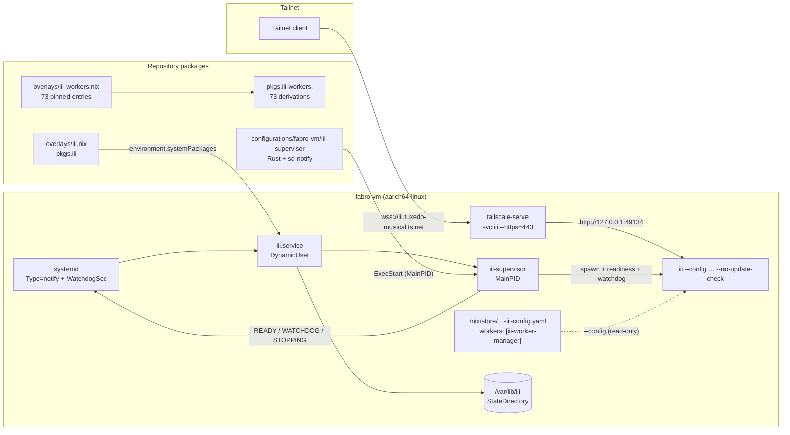
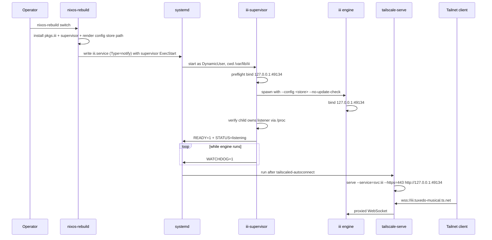
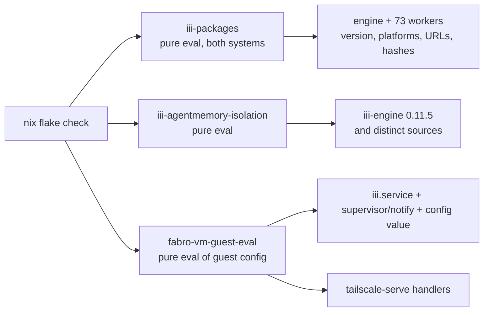
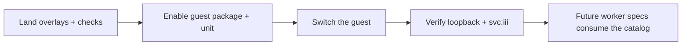

# Design Document: iii-engine-on-the-fabro-host

## Overview

This design delivers a repo-owned iii 0.26.0 engine package, a 73-package catalog of the official binary workers, and one `DynamicUser` systemd service on the Fabro guest that listens only on `127.0.0.1:49134` and is published to the tailnet as `svc:iii`. `brief.md` owns the problem and scope, `requirements.md` owns the behavioral contract, and `research.md` records the upstream release, registry, and configuration facts used below.

**Purpose**: make the iii experiment reproducible from the Nix configuration and reachable from the tailnet without a hand-downloaded binary or hand-written unit.

**Users**: the Fabro guest operator rebuilding the VM, and tailnet clients that call the engine through `wss://iii.tuxedo-musical.ts.net`.

**Impact**: adds two overlay files, one guest module, one Rust supervisor crate, one package entry, one Serve handler, and three evaluated checks. Existing fabro, LiteLLM, OpenCode, Tailscale, and AgentMemory behavior is unchanged.

### Goals

- Pin the engine and every cataloged worker to immutable URLs and SHA-256 digests.
- Supervise the engine as a loopback-only `DynamicUser` service with durable state outside the Lima share.
- Fail `iii.service` when the engine never owns its loopback listener, and restart it when the supervisor stops heartbeating.
- Expose exactly one tailnet path, `svc:iii`, while leaving the existing `svc:fabro`, `svc:litellm`, and `svc:opencode` handlers untouched.
- Fail `nix flake check` on any package, config, unit, or exposure regression.

### Non-Goals

- Starting, composing, or configuring any worker.
- Packaging the JavaScript bundles, `registry-cli`, or engine-kind registry entries.
- Creating the `svc:iii` Tailscale Service, ACLs, DNS, or certificates.
- Adding iii authentication, RBAC, or TLS beyond what Tailscale Serve terminates.
- Replacing Fabro, porting workflows, or running iii as a Darwin service.
- Patching or replacing the iii engine binary; the supervisor wraps it.
- Changing AgentMemory's `iii-engine` pin, derivation, or consumers.

## Boundary Commitments

### This Spec Owns

- `overlays/iii.nix`: the `iii` engine package and the generic worker builder.
- `overlays/iii-workers.nix`: the pinned 73-worker manifest, including each per-target URL, SHA-256 digest, and archive binary name.
- `overlays/default.nix`: registration of both attributes in `custom-packages`.
- `configurations/fabro-vm/iii.nix`: `fabro.iii` options, the rendered engine configuration, the local `iii-supervisor` package, and the `Type=notify` `iii.service`.
- `configurations/fabro-vm/iii-supervisor/`: the Rust supervisor crate (`Cargo.toml`, `Cargo.lock`, source, and tests).
- `configurations/fabro-vm/default.nix`: the module import and the `iii` entry in `environment.systemPackages`.
- `configurations/fabro-vm/tailscale.nix`: the `svc:iii` Serve handler and updated comments/description.
- `flake.nix`: the `iii-packages` and `iii-agentmemory-isolation` checks and the extended `fabro-vm-guest-eval` assertions, including the notify/watchdog and supervisor fields.
- The package metadata contracts (`version`, `passthru.sourceRevision`, `passthru.iiiEngineVersion`, `passthru.workerName`, `meta.mainProgram`, `meta.platforms`) that the checks and future worker specs consume.

### Out of Boundary

- Worker lifecycle orchestration: `worker-compose.yaml`, the Compose daemon, `iii compose`, and per-worker supervision.
- Worker configuration, secrets, databases, queues, cron schedules, and runtime state.
- The 8 official JavaScript bundles, `registry-cli`, the 4 engine-kind registry entries, and the 4 third-party bundles.
- Tailscale Service creation, tag grants, ACL policy, DNS, certificates, and device approval.
- iii authentication, RBAC, authorization, and exposure beyond the tailnet.
- Replacing Fabro, migrating workflows, or porting the Darwin workstations to launchd.
- Patching iii's bind-failure behavior upstream; the supervisor supplies the readiness gate instead.
- AgentMemory's `iii-engine` 0.11.5 pin, its overlay, its consumers, and its host-matrix check.
- Automatic version bumps and `x86_64` targets.

### Allowed Dependencies

- The iii 0.26.0 GitHub release assets recorded in `research.md` (engine tarballs).
- The worker registry metadata and CDN/GitHub release assets recorded in `research.md` (worker tarballs).
- The repository's locked nixpkgs for `stdenvNoCC`, `fetchurl`, `lib`, `pkgs.formats.yaml`, and `rustPlatform.buildRustPackage`.
- The locked `sd-notify` 0.5.0 and `libc` 0.2 crates recorded in the supervisor's `Cargo.lock`; no native `libsystemd` or `pkg-config`.
- The guest's systemd notify/watchdog protocol and its `/proc` filesystem for listener-ownership readiness.
- The existing guest `tailscaled`, `tailscaled-autoconnect.service`, and `tailscale-serve` oneshot.
- The operator-created `svc:iii` Tailscale Service granted to `tag:fabro`; it is not a secret and is not created by any Kiro task.
- AgentMemory's unchanged `pkgs.iii-engine` attribute, which the new packages neither read nor re-export; only the isolation check reads its metadata.

### Revalidation Triggers

- An iii release bump that changes asset names, allowed config workers, default listeners, CLI flags, or the `UNSUPPORTED_CONFIG_WORKERS` behavior.
- A registry change that adds or removes binary workers, moves a worker's default URL, drops a required target, or changes an archive's root executable.
- A change to the `svc:iii` name, the `iii.…ts.net` DNS name, the tailnet, or the Service's tag grant.
- A nixpkgs/systemd change to `DynamicUser`, `StateDirectory`, `pkgs.formats.yaml`, `Type=notify`, `WatchdogSec`, `switch-to-configuration` restart behavior, or `/proc/net/tcp` layout.
- A supervisor change that sets `ProtectProc`/`ProcSubset` to hide `/proc`, or a custom abstract `NotifySocket=`.
- A `sd-notify` or `libc` version change in the supervisor's `Cargo.lock`.
- Any change to AgentMemory's `iii-engine` version, platform set, derivation, consumers, or host-matrix check.
- A change to the worker manager's default host or port in iii source.

## Architecture

### Existing Architecture Analysis

- The Fabro guest is an `aarch64-linux` NixOS system composed by `configurations/fabro-vm/default.nix` and deployed by `lima-vm-deploy` plus `nixos-rebuild switch`.
- Guest services follow a common pattern: repo-owned systemd units, loopback listeners, `DynamicUser` where no static identity is required, `StateDirectory` under `/var/lib`, and `ProtectSystem=strict` hardening.
- `configurations/fabro-vm/tailscale.nix` owns one `tailscale-serve` oneshot that re-applies three `serve --service=… --https=443 http://127.0.0.1:<port>` handlers after `tailscaled-autoconnect.service` completes.
- `overlays/agentmemory.nix` owns the only existing iii derivation, `pkgs.iii-engine` 0.11.5; it supports only `aarch64-darwin` and `x86_64-darwin` and is consumed lazily by Home Manager and the Darwin AgentMemory matrix check.
- `fabro-vm-guest-eval` is a pure-evaluation check over the guest configuration; it currently asserts exactly three Serve entries.
- The deployed `iii.service` is `Type=simple` and assumes a non-zero engine exit on bind failure; task 5.2 observed that iii 0.26.0 instead logs `address 127.0.0.1:49134 is already in use` and stays alive, so the unit never fails.
- No `pkgs.iii`/`pkgs.iii-workers` attribute, `iii.service`, engine config, or `svc:iii` exists today; AgentMemory's `pkgs.iii-engine` is the only iii runtime.

### Architecture Pattern & Boundary Map

The design uses pinned-artifact packaging around upstream binaries, one supervised engine, and one exposure seam. The package overlay owns provenance; the guest module owns process identity, configuration, and state; the Tailscale module owns reachability; the flake checks own regression detection.



**Architecture Integration**:

- Selected pattern: repo-owned pinned packaging plus a single supervised service; no Compose daemon, installer, or worker process runs.
- Domain boundaries: package provenance (`overlays/`), guest control plane (`configurations/fabro-vm/iii.nix`), tailnet exposure (`tailscale.nix`), verification (`flake.nix`).
- Existing patterns preserved: `stdenvNoCC` binary derivations, `pkgs.formats.yaml`, DynamicUser/StateDirectory units, the `tailscale serve` ExecStart list, and pure-evaluation guest checks; Linux prebuilts take the standard `autoPatchelfHook` fixup.
- New components rationale: the two overlays keep artifact data out of the guest module; the guest module is the only place that starts the engine; the Rust supervisor is the only process that speaks `sd_notify`, owns readiness and watchdog, and exists because iii 0.26 does not exit on bind failure; the Serve line is the only tailnet entry.
- Steering compliance: no steering document constrains iii; the design follows the repository's existing pinned-artifact, loopback-listener, DynamicUser, local-Rust-crate (`api-bridge`), and pure-eval-check conventions.

### Technology Stack

| Layer | Choice / Version | Role in Feature | Notes |
|-------|------------------|-----------------|-------|
| Packaging | Nix flakes, `stdenvNoCC.mkDerivation`, `fetchurl`, `autoPatchelfHook` | Engine and worker derivations | SRI-pinned; Linux ELF interpreter/RPATH patched, Darwin untouched |
| Engine | iii `0.26.0` | Worker manager | `aarch64-linux` and `aarch64-darwin` prebuilt binaries |
| Worker catalog | Registry snapshot 2026-11-16 | 73 binary workers | Versions, URLs, and digests in `overlays/iii-workers.nix` |
| Configuration | `pkgs.formats.yaml` | Engine `config.yaml` | Rendered to a read-only store path |
| Supervisor | `iii-supervisor` (Rust, `sd-notify` 0.5 + `libc` 0.2) | Readiness, watchdog, signal forwarding | `Type=notify`; `/proc` socket-ownership gate; no libsystemd |
| Service manager | systemd unit `iii.service` | Process lifecycle | `DynamicUser`, `StateDirectory=iii`, `Restart=always`, `WatchdogSec` |
| Exposure | Tailscale Serve `svc:iii` | Tailnet HTTPS | Proxies to `http://127.0.0.1:49134` |
| Verification | Pure-evaluation flake checks | Package, unit, config, exposure | No Linux builder required |

## File Structure Plan

### Directory Structure

```
overlays/
├── iii.nix                  # engine sources + generic worker builder
├── iii-workers.nix          # 73-entry pinned artifact manifest
└── default.nix              # + iii overlay in custom-packages
configurations/fabro-vm/
├── iii.nix                  # fabro.iii options, YAML render, supervisor package, iii.service
├── iii-supervisor/
│   ├── Cargo.toml
│   ├── Cargo.lock
│   ├── src/main.rs
│   └── tests/supervisor.rs
├── default.nix              # + module import and system package
└── tailscale.nix            # + svc:iii handler
flake.nix                    # + iii-packages / iii-agentmemory-isolation; extended guest-eval
.kiro/specs/iii-engine-on-the-fabro-host/
├── brief.md                 # unchanged
├── requirements.md          # unchanged
├── research.md              # upstream facts and worker snapshot
└── design.md                # this document
```

### New Files

- `overlays/iii.nix` — engine derivation and the generic per-worker derivation; exports `iii` and `iii-workers` from the overlay function.
- `overlays/iii-workers.nix` — pure data: `engineVersion`, target-triple map, and one entry per cataloged worker with `version`, per-system URL and SRI hash, and archive binary name.
- `configurations/fabro-vm/iii.nix` — `fabro.iii` options, rendered config file, the local `iii-supervisor` package, and `iii.service`.
- `configurations/fabro-vm/iii-supervisor/` — the Rust supervisor crate: `sd-notify`/`libc` dependencies, preflight bind, `/proc` readiness gate, watchdog loop, signal forwarding, exit propagation, and tests.

### Modified Files

- `overlays/default.nix` — import `overlays/iii.nix` and merge it into `custom-packages`; no change to the AgentMemory import.
- `configurations/fabro-vm/default.nix` — import `./iii.nix`; add `iii` to `environment.systemPackages`; update the guest header comment.
- `configurations/fabro-vm/tailscale.nix` — add the fourth `ExecStart` entry, update the unit description and comments from three services to four.
- `flake.nix` — add the two package checks and extend the guest-eval assertions and report string with the supervisor, notify, and watchdog fields; leave the existing `agentMemoryHostMatrix` and `agentMemoryChecks` bindings untouched.

## System Flows

### Boot, switch, and tailnet exposure



- The supervisor fails the start when the preflight bind fails or the engine does not own the loopback listener within the readiness timeout; systemd records the failure, retries per `Restart=always`, then marks the unit failed at the start limit (requirements 4.14–4.19, 5.9).
- A changed rendered config produces a new store path, so `ExecStart` changes and `switch-to-configuration` restarts `iii.service` (requirement 4.13).
- `iii.service` has no dependency on the tailnet; before registration it serves loopback only, and `tailscale-serve` is already gated on `tailscaled-autoconnect.service` (requirement 6.7).
- The Serve entry is appended last so a `svc:iii` failure cannot undo the three existing handlers (requirements 6.4–6.5).

### Verification flow



- No check builds the engine, a worker, the guest image, or the rendered config derivation; every assertion is evaluation over Nix values (requirement 7.14).
- Each failing assertion names the package, worker, unit field, config entry, or Serve handler at fault (requirement 7.15).

## Requirements Traceability

| Requirement | Criteria | Design elements | Interfaces / flows |
|-------------|----------|-----------------|--------------------|
| 1 Fresh pinned iii engine package | 1.1–1.8 | C1 Engine package; engine source table | `pkgs.iii` contract; package check; verification flow |
| 2 Official binary worker catalog | 2.1–2.10 | C2 Worker catalog; manifest schema; exclusions | `pkgs.iii-workers` contract; manifest model; package check |
| 3 AgentMemory runtime isolation | 3.1–3.8 | C1/C2 distinct attributes; C5 isolation check | Attribute contracts; data models; isolation check |
| 4 Declarative guest installation and supervision | 4.1–4.19 | C3 Guest service and supervisor; system package; state model | `iii.service` contract; supervisor contract; boot/switch flow |
| 5 Empty worker configuration and loopback listener | 5.1–5.9 | C3 config contract; readiness gate; engine error behavior | Rendered config; error table |
| 6 Tailnet service exposure | 6.1–6.8 | C4 Serve exposure | Handler table; boot/exposure flow |
| 7 Evaluated verification | 7.1–7.18 | C5 Verification | Check matrix; verification flow |

## Components and Interfaces

| Component | Domain/Layer | Intent | Req Coverage | Key Dependencies | Contracts |
|-----------|--------------|--------|--------------|------------------|-----------|
| C1 Engine package | Packaging | Pin and install the iii 0.26.0 engine | 1.1–1.8, 3.6–3.8 | GitHub release assets, nixpkgs | Package |
| C2 Worker catalog | Packaging | Pin and build 73 official binary workers | 2.1–2.10, 3.6–3.8 | Registry API/CDN, nixpkgs | Package |
| C3 Guest service | Runtime | Render config and supervise the engine through the readiness-gated supervisor | 4.1–4.19, 5.1–5.9 | C1, systemd, `pkgs.formats.yaml`, `iii-supervisor` | Service, State |
| C4 Serve exposure | Network | Publish `svc:iii` on the tailnet | 6.1–6.8 | tailscaled, `tailscale-serve` | API |
| C5 Verification | Test | Fail evaluation on regressions | 7.1–7.18 | C1–C4 | Batch |

### C1: Engine package

| Field | Detail |
|-------|--------|
| Intent | Make `pkgs.iii` the pinned 0.26.0 engine for both required systems |
| Requirements | 1.1–1.8, 3.6–3.8 |

**Responsibilities & Constraints**

- Owns the two engine artifact URLs and their SHA-256 digests; no other source may provide the engine binary.
- Exposes the executable at `$out/bin/iii`, the package name `iii`, `version = "0.26.0"`, and `passthru.sourceRevision = "iii/v0.26.0"`.
- Declares `meta.platforms = [ "aarch64-linux" "aarch64-darwin" ]`; every other system gets a named `throw` when the attribute is forced.
- On `aarch64-linux`, rewrites the ELF interpreter and RPATH to nixpkgs glibc/libgcc with `autoPatchelfHook`; the prebuilt glibc binary cannot start from the Nix store otherwise. On `aarch64-darwin`, leaves the Mach-O binary untouched.
- Does not import, override, or re-export AgentMemory's `iii-engine`; it does not carry `iiiVersion` or `iiiRevision` passthru keys.

**Dependencies**

- Inbound: `overlays/default.nix` registers the overlay; `configurations/fabro-vm/iii.nix` consumes `pkgs.iii`.
- Outbound: `final.fetchurl` and `final.stdenvNoCC`; on Linux only, `final.autoPatchelfHook`, `final.glibc`, and `final.stdenv.cc.cc.lib`.
- External: the GitHub release assets listed in `research.md` § Engine release facts.

**Contracts**: Package [x]

```nix
# Attribute and metadata contract; the full derivation body belongs to implementation.
pkgs.iii = derivation {
  pname = "iii";
  version = "0.26.0";
  src = fetchurl { url = engineSources.${system}.url; hash = engineSources.${system}.hash; };
  nativeBuildInputs = lib.optionals stdenv.hostPlatform.isLinux [ autoPatchelfHook ];
  buildInputs = lib.optionals stdenv.hostPlatform.isLinux [ glibc stdenv.cc.cc.lib ];
  dontStrip = true;
  dontFixup = stdenv.hostPlatform.isDarwin;
  passthru.sourceRevision = "iii/v0.26.0";
  meta = {
    mainProgram = "iii";
    platforms = [ "aarch64-linux" "aarch64-darwin" ];
  };
};
```

| Nix system | Artifact target | Recorded hash |
|------------|-----------------|---------------|
| `aarch64-linux` | `aarch64-unknown-linux-gnu` | `sha256-4u5E0es48OM30+d7O4YB2ib/G9k0zIpMhJubz0FKtAs=` |
| `aarch64-darwin` | `aarch64-apple-darwin` | `sha256-JzApagiuWEN1ey55E61ltigpAcmLlR28IwGODrQl4oU=` |

- URLs: `https://github.com/iii-hq/iii/releases/download/iii/v0.26.0/iii-aarch64-unknown-linux-gnu.tar.gz` and `https://github.com/iii-hq/iii/releases/download/iii/v0.26.0/iii-aarch64-apple-darwin.tar.gz`.

- Preconditions: the system is one of the two declared platforms; the release URL is tag-pinned.
- Postconditions: forcing `pkgs.iii.src` performs one fixed-output fetch; the package produces one executable named `iii`, and the Linux fixup points its ELF interpreter/RPATH at nixpkgs glibc.
- Invariants: the archive has one root executable; the fetched bytes are hash-verified before any fixup; the Linux fixup changes only interpreter/RPATH; Darwin keeps the original Mach-O bytes.

**Implementation Notes**

- Unpack with `tar -xzf "$src" -C "$out/bin"` and `chmod 0555 "$out/bin/iii"`, matching the single-file archive layout verified in `research.md`.
- On Linux, the `autoPatchelfHook` fixup is required: `glibc` supplies `libc.so.6`, `libm.so.6`, and `ld-linux-aarch64.so.1`; `stdenv.cc.cc.lib` supplies `libgcc_s.so.1` (and `libstdc++.so.6` where needed). Set `dontStrip = true` so the pinned executable is not rewritten further.
- Do not use an FHS wrapper, `buildFHSEnv`, or `programs.nix-ld`; the package must be runnable from the store by `ExecStart` without host-wide loader configuration.
- Set `meta.mainProgram = "iii"` so the unit can use `lib.getExe`.
- Keep the engine source table next to the derivation; the check compares `src.urls` and `src.outputHash` against it.

### C2: Worker catalog

| Field | Detail |
|-------|--------|
| Intent | Provide exactly the 73 official binary workers as per-system packages |
| Requirements | 2.1–2.10, 3.6–3.8 |

**Responsibilities & Constraints**

- Owns the manifest: one entry per cataloged worker with `version`, full per-system artifact URL, SRI hash, and archive binary name.
- Builds each package with one generic derivation; no per-worker build logic, installer, or Compose invocation.
- On Linux, passes every dynamic archive through `autoPatchelfHook` so it runs from the Nix store; static archives (`mesh`, `whatsapp`) are skipped by the hook. On Darwin, leaves each Mach-O binary untouched.
- Exposes `pkgs.iii-workers.<name>` for the 73 names only; each derivation declares `passthru.workerName`, `passthru.iiiEngineVersion = "0.26.0"`, `meta.mainProgram`, and the same two `meta.platforms`.
- Excludes `harness-e2e`, `voice`, and `ios-simulator` (missing `aarch64-unknown-linux-gnu`), the 8 official bundles, `registry-cli`, and the 4 engine-kind names; the 4 third-party bundles are also non-binary and outside the official binary catalog.
- The manifest is data, not a network resolver: it never queries the registry or resolves `latest` during evaluation or build.

**Dependencies**

- Inbound: `overlays/iii.nix` imports the manifest and builds the attrset.
- Outbound: `final.fetchurl` and `final.stdenvNoCC`; on Linux only, `final.autoPatchelfHook`, `final.glibc`, and `final.stdenv.cc.cc.lib`.
- External: the registry CDN and `iii-hq/workers` release assets recorded in `research.md` § Worker catalog snapshot.

**Contracts**: Package [x]

```nix
# One manifest entry; the remaining 72 entries have the same shape.
{
  database = {
    version = "0.6.3";
    binary = "database";
    targets = {
      aarch64-linux = {
        url = "https://cdn.iii.cloud/workers/database/0.6.3/database-aarch64-unknown-linux-gnu.tar.gz";
        hash = "sha256-JF9OYfXvgPSwwg7j4ViSte5ckmXD3Mu6npyaX9uicaQ=";
      };
      aarch64-darwin = {
        url = "https://cdn.iii.cloud/workers/database/0.6.3/database-aarch64-apple-darwin.tar.gz";
        hash = "sha256-m+YbAICrRYoIKRnI652WbAq/c5BmfqlcBDjRmq9YXyU=";
      };
    };
  };
}
```

```nix
# Package contract produced by the generic builder.
pkgs.iii-workers.database = derivation {
  pname = "iii-worker-database";
  version = "0.6.3";
  src = fetchurl { inherit (manifest.database.targets.${system}) url hash; };
  nativeBuildInputs = lib.optionals stdenv.hostPlatform.isLinux [ autoPatchelfHook ];
  buildInputs = lib.optionals stdenv.hostPlatform.isLinux [ glibc stdenv.cc.cc.lib ];
  dontStrip = true;
  dontFixup = stdenv.hostPlatform.isDarwin;
  passthru = {
    workerName = "database";
    iiiEngineVersion = "0.26.0";
  };
  meta = {
    mainProgram = "database";
    platforms = [ "aarch64-linux" "aarch64-darwin" ];
  };
};
```

- Preconditions: the manifest entry has both target systems and a non-empty `binary`.
- Postconditions: `$out/bin/<binary>` exists and is executable; dynamic Linux binaries carry the nixpkgs interpreter/RPATH.
- Invariants: exactly 73 attributes; every `src` is a fixed-output fetch of the recorded URL; no package references `pkgs.iii-engine` or its sources; a missing Linux ELF dependency fails the build instead of shipping a broken binary.
- URL exceptions: full URLs are stored because `acp`, `compose-ui`, and `mcp` do not follow the CDN template; `acp`'s archive binary is `iii-acp` (see `research.md`).

**Implementation Notes**

- Install the archive's single root executable as `$out/bin/${binary}`, then `test -x` it so a layout change fails the build naming the worker.
- The same Linux patchelf inputs as C1 cover all 73 workers; the 5 workers needing `libstdc++.so.6` and the 2 static workers are handled by the hook without per-worker branches.
- Use `passthru.iiiEngineVersion` (not `iiiVersion`/`iiiRevision`) to keep the AgentMemory metadata namespace distinct.
- Keep the manifest sorted by worker name so the diff for a version bump is one contiguous block.

### C3: Guest service

| Field | Detail |
|-------|--------|
| Intent | Install the engine declaratively and supervise a loopback-only `DynamicUser` service through a readiness-gated Rust supervisor |
| Requirements | 4.1–4.19, 5.1–5.9 |

**Responsibilities & Constraints**

- Adds `pkgs.iii` to `environment.systemPackages` and starts `iii.service` from the store supervisor; the supervisor spawns the store engine; no manual download or hand-placed binary.
- Renders one YAML configuration with a single `iii-worker-manager` entry bound to `127.0.0.1:49134`; no project worker, `configuration`, `iii-stream`, `http-functions`, or `sandbox` entry.
- Runs with `DynamicUser = true`, no static `User`/`Group`, `StateDirectory = [ "iii" ]`, `WorkingDirectory = "/var/lib/iii"`, and `HOME = "/var/lib/iii"`.
- Reads the configuration from a read-only store path; runtime state lives in `/var/lib/iii`, not on the `/var/lib/fabro` Lima share.
- Restarts on any unexpected exit and disables the engine's update check; the unit has no secret material and no `EnvironmentFile`.
- Uses `Type=notify` with `NotifyAccess=main`; the supervisor is the unit's main process, reports readiness only after the engine owns the listener, and sends watchdog keep-alives while the engine runs.

**Dependencies**

- Inbound: `configurations/fabro-vm/default.nix` imports the module and adds the package.
- Outbound: `pkgs.iii`, the local `iii-supervisor` Rust derivation, `pkgs.formats.yaml`, systemd.
- External: the guest's `/proc` filesystem and systemd notify/watchdog protocol; none on the tailnet.

**Contracts**: Service [x], State [x]

**Module options**

```nix
fabro.iii = {
  package;              # default pkgs.iii; lib.types.package
  supervisorPackage;    # read-only; rustPlatform.buildRustPackage from ./iii-supervisor
  host;                 # default "127.0.0.1"; lib.types.str
  port;                 # default 49134; lib.types.port
  watchdogSec;          # default 30; lib.types.ints.positive
  readinessTimeoutSec;  # default 15; lib.types.ints.positive
  stopTimeoutSec;       # default 10; lib.types.ints.positive
  config;               # read-only attrs; default worker list below
  configFile;           # read-only store path from (pkgs.formats.yaml { }).generate
};
```

**Rendered configuration**

```yaml
workers:
  - name: iii-worker-manager
    config:
      host: 127.0.0.1
      port: 49134
```

- The config value is the only source of the rendered file; `configFile` is `(pkgs.formats.yaml { }).generate "iii-config.yaml" config.fabro.iii.config`.
- `config.workers` has exactly one entry, named `iii-worker-manager`, and no `modules` entry; a second entry or any project-worker name violates requirements 5.1–5.7.

**Unit field contract**

| Field | Value | Constraint |
|-------|-------|------------|
| `wantedBy` | `[ "multi-user.target" ]` | Enabled across reboots (4.5) |
| `serviceConfig.DynamicUser` | `true` | No static account (4.7–4.8) |
| `serviceConfig.User` / `Group` | absent | Dynamic identity only |
| `serviceConfig.StateDirectory` | `[ "iii" ]` | `/var/lib/iii`, durable (4.10–4.11) |
| `serviceConfig.WorkingDirectory` | `/var/lib/iii` | State-dir cwd |
| `serviceConfig.Environment` | `HOME=/var/lib/iii`, `III_TELEMETRY_ENABLED=false` | No systemd-provided home; no product telemetry |
| `serviceConfig.Type` | `notify` | Readiness is explicit (4.15–4.17) |
| `serviceConfig.NotifyAccess` | `main` | Only the supervisor notifies (4.15) |
| `serviceConfig.WatchdogSec` | `30` | Finite watchdog interval (4.16, 4.18) |
| `serviceConfig.TimeoutStartSec` | `30` | Bounds a hung start (4.14) |
| `serviceConfig.TimeoutStopSec` | `20` | Bounds the supervisor stop timeout (4.19) |
| `serviceConfig.ExecStart` | `lib.escapeShellArgs [ (lib.getExe supervisorPackage) "--listen" "${host}:${port}" "--ready-timeout" (toString readinessTimeoutSec) "--stop-timeout" (toString stopTimeoutSec) "--" (lib.getExe package) "--config" (toString configFile) "--no-update-check" ]` | Supervisor main process, engine child, store binary, read-only config (4.4, 4.9, 4.12, 4.15–4.19) |
| `serviceConfig.NotifySocket` | absent | `sd-notify` uses systemd's default filesystem socket (7.18) |
| `serviceConfig.Restart` | `always` | Restart on unexpected exit (4.6) |
| `serviceConfig.RestartSec` | `2` | Bounded retry cadence |
| `unitConfig.StartLimitIntervalSec` | `120` | Bounded window; the default 10 s window sits exactly at the `RestartSec=2` rate and never trips (4.14) |
| `unitConfig.StartLimitBurst` | `5` | A permanently broken start reaches `failed` (4.14) |
| `serviceConfig.NoNewPrivileges` | `true` | Hardening |
| `serviceConfig.PrivateTmp` | `true` | Hardening |
| `serviceConfig.ProtectSystem` | `strict` | Only the state dir is writable |
| `serviceConfig.ProtectHome` | `true` | No host home access |
| `serviceConfig.RestrictAddressFamilies` | `AF_UNIX`, `AF_INET`, `AF_INET6` | Guest hardening style |
| `serviceConfig.ReadWritePaths` | `[ "/var/lib/iii" ]` | Explicit state path |

- Preconditions: `pkgs.iii` and the supervisor evaluate for the guest system; `/var/lib/iii` is creatable by systemd.
- Postconditions: the unit is active only after `READY=1`, with one listener on `127.0.0.1:49134` owned by the engine child; a failed start leaves the unit failed after the explicit 120 s / 5-start limit and the journal records the supervisor and/or engine error.
- Invariants: no non-loopback bind; no project worker; no state under `/var/lib/fabro`; the supervisor remains the unit's main process; no abstract `NotifySocket`.

**Implementation Notes**

- Build the config value in the module `let` and expose it read-only so the guest check can assert the exact value without reading the rendered derivation.
- Build `supervisorPackage` in the same module with `pkgs.rustPlatform.buildRustPackage`, `src = lib.cleanSource ./iii-supervisor`, and `cargoLock.lockFile = ./iii-supervisor/Cargo.lock`, mirroring `api-bridge.nix`; set `meta.mainProgram = "iii-supervisor"`.
- Use `lib.getExe` with `meta.mainProgram = "iii"` for the engine and `meta.mainProgram = "iii-supervisor"` for the supervisor; do not hard-code either store path.
- Use `lib.escapeShellArgs` for `ExecStart` so the supervisor receives the listen address, timeouts, and the engine command as one systemd command line.
- Because the config path is part of the engine command, a content change changes the unit and triggers a restart on switch; no `reload` command exists for the engine.
- `Restart=always` with `RestartSec=2` keeps retrying transient exits. The default 5-starts-per-10s window sits exactly at that restart rate, so the unit sets `unitConfig.StartLimitIntervalSec=120` and `StartLimitBurst=5`: a permanently broken start reaches `failed` with `Result=start-limit-hit` (about 10 s for the preflight bind path, about 100 s for a 15 s readiness-timeout loop). Manual starts and switch-driven starts count toward this window, so repeated rapid switches of a healthy unit can leave it `failed` until `systemctl reset-failed iii`.
- Keep `ProtectProc` and `ProcSubset` at their defaults: the readiness gate reads `/proc/<child>/fd` and `/proc/net/tcp{,6}`. The guest check rejects `ProtectProc=invisible` and `ProcSubset=pid`.

**Supervisor contract**

- `iii-supervisor` is a single-threaded Rust supervisor built from `configurations/fabro-vm/iii-supervisor/`; it depends on `sd-notify` 0.5 and `libc` 0.2, with no `libsystemd` or `pkg-config`.
- CLI: `--listen <ip:port> --ready-timeout <secs> --stop-timeout <secs> -- <engine> <engine args...>`.
- Preflight: bind and release `<ip:port>` before spawning; `EADDRINUSE` logs `cannot bind <ip:port>: Address already in use` and exits 1 without spawning.
- Spawn: inherit stdout/stderr so the engine's lines reach the journal; keep the supervisor as the systemd main process and the engine as its direct child.
- Readiness: collect `socket:[inode]` entries from `/proc/<child>/fd` and match them against a `LISTEN` (`0A`) entry for the exact local address and port in `/proc/net/tcp` or `/proc/net/tcp6`; only then send `READY=1` and `STATUS=listening on <ip:port>`. A foreign listener or a `0.0.0.0` bind never matches.
- Watchdog: `sd_notify::watchdog_enabled()` gives the systemd interval; send `NotifyState::Watchdog` at half the interval while the child runs. `sd-notify` honours `WATCHDOG_USEC` and `WATCHDOG_PID`.
- Lifecycle: send `NotifyState::Stopping` and a final `Status` on termination; a SIGTERM/SIGINT handler only sets an atomic, and the main loop forwards SIGTERM, waits `stop-timeout`, sends SIGKILL, reaps the child, and exits with the child's status.
- Failure: a child exit before readiness is reported with its status; a readiness timeout kills the child and exits 1; `sd_notify::notify` returning an error is logged but does not change the supervision loop.
- Platform: the crate compiles on Darwin, but the readiness gate is Linux-only and returns an unsupported error off Linux; the unit exists only on the guest.
- Testability: listener ownership is a predicate injected by tests; `sd_notify::notify` is exercised against a temporary `NOTIFY_SOCKET` path.
- Notify socket: `sd-notify` connects to the filesystem form of `NOTIFY_SOCKET` (systemd's default `/run/systemd/notify`); the unit must not set an abstract `NotifySocket=@...`. If abstract support is ever required, replace `sd-notify` with the `libsystemd` crate.

### C4: Tailscale Serve exposure

| Field | Detail |
|-------|--------|
| Intent | Publish the engine as `svc:iii` over HTTPS 443 to the loopback listener |
| Requirements | 6.1–6.8 |

**Responsibilities & Constraints**

- Adds exactly one `serve` entry for `svc:iii` to the existing `tailscale-serve` ExecStart list, after the three existing entries.
- Proxies `https=443` to `http://127.0.0.1:49134`; Tailscale terminates TLS, so tailnet clients use `wss://iii.tuxedo-musical.ts.net`.
- Leaves the `svc:fabro`, `svc:litellm`, and `svc:opencode` entries byte-for-byte unchanged.
- Keeps `after`/`requires` on `tailscaled.service` and `tailscaled-autoconnect.service`; it does not require `iii.service` (Serve can be configured before the target is listening).
- Does not open a firewall port, bind a non-loopback address, or add a second engine endpoint.

**Dependencies**

- Inbound: `tailscaled-autoconnect.service` completion; operator-created `svc:iii` Service.
- Outbound: the local engine listener from C3.
- External: Tailscale control plane and the tailnet certificate for `iii.tuxedo-musical.ts.net`.

**Contracts**: API [x]

| Direction | Endpoint | Target | Protocol | Notes |
|-----------|----------|--------|----------|-------|
| Tailnet → guest | `https://iii.tuxedo-musical.ts.net:443` (`svc:iii`) | `http://127.0.0.1:49134` | HTTPS/WSS, TLS by tailscaled | New handler |
| Tailnet → guest | `svc:fabro`, `svc:litellm`, `svc:opencode` | existing loopback ports | HTTPS | Unchanged |
| Guest local | `127.0.0.1:49134` | engine | WebSocket | Loopback only |

- Preconditions: the `svc:iii` Service exists and is granted to `tag:fabro`; the guest is registered.
- Postconditions: `tailscale serve status` lists the new handler and the three existing handlers; a repeat run converges to the same state.
- Invariants: the engine is reachable over the tailnet only through this handler; if the handler fails, the engine remains loopback-only.

**Implementation Notes**

- Append the new `ExecStart` entry last; systemd runs the list sequentially, so the existing handlers are already applied when a `svc:iii` failure marks the unit failed.
- Update the unit `description` and module comment to name four services; the existing comments claim three.
- The guest check asserts four entries, all three legacy substrings, the new substring, and exactly one reference to port 49134.

### C5: Verification

| Field | Detail |
|-------|--------|
| Intent | Fail `nix flake check` on a package, isolation, unit, supervisor, config, or exposure regression |
| Requirements | 7.1–7.18 |

**Responsibilities & Constraints**

- `iii-packages` instantiates nixpkgs for `aarch64-linux` and `aarch64-darwin` with the repository overlay chain and asserts engine and worker metadata, URLs, hashes, counts, exclusions, platforms, and engine-compatibility declarations.
- `iii-agentmemory-isolation` instantiates a Darwin package set (and checks the existing Darwin host-matrix check exists) and asserts `iii-engine` 0.11.5 metadata, distinct attribute names, and disjoint sources.
- `fabro-vm-guest-eval` gains assertions over the guest package set, `iii.service` (including `Type=notify`, `NotifyAccess=main`, watchdog/timeout fields, the supervisor `ExecStart`, and the absence of `NotifySocket`), the `fabro.iii.config` value, and the four Serve handlers.
- Every assertion uses `lib.assertMsg` with a message naming the failing element; all checks are pure evaluation and never build a package or the guest image.
- The package and isolation reports discard store-path context with `builtins.unsafeDiscardStringContext` before interpolation, so the `runCommand` checks depend only on their report strings and do not turn the 146 evaluated derivations into build inputs.
- The isolation check is registered in the base checks; `agentMemoryChecks`, `agentMemoryHostMatrix`, and `tests/agentmemory-opencode/host-matrix.nix` are not edited.

**Contracts**: Batch [x]

| Check | System | Assertions | Requirements |
|-------|--------|------------|--------------|
| `iii-packages` | every | Engine `version`, `sourceRevision`, `meta.platforms`, `src.urls`, `src.outputHash`; worker attr count 73; excluded names absent; per-worker version, URL, hash, binary, platforms, `iiiEngineVersion` for both targets | 1.1–1.8, 2.1–2.10, 7.1–7.4 |
| `iii-agentmemory-isolation` | every | `iii-engine` pname/version/platform set; `agentmemory` `iiiVersion`/`iiiRevision`; `iii`/`iii-workers` names and sources disjoint from `iii-engine`; no `iiiVersion`/`iiiRevision` on new packages; Darwin host-matrix check present | 3.1–3.8, 7.5 |
| `fabro-vm-guest-eval` | every | system package includes `iii`; unit exists, DynamicUser, state dir, cwd, config store path, flags, restart, no static user; `Type=notify`, `NotifyAccess=main`, watchdog/timeout fields, supervisor `ExecStart`, no `NotifySocket`; config has one allowed worker and loopback bind; Serve has four handlers and no other 49134 target | 4.1–4.19, 5.1–5.9, 6.1–6.8, 7.6–7.18 |

## Data Models

### Domain Model

The feature's data is a pinned artifact catalog plus one rendered service configuration and its exposure target. There is no runtime database, queue, or worker state.

- **Catalog entry**: a worker name identifies a version, two target artifacts, and one archive binary.
- **Engine source entry**: a Nix system identifies one release URL and one SHA-256 digest.
- **Service configuration**: one `workers` list containing one allowed engine worker and its loopback listener.
- **Supervisor process**: the unit main PID that owns one engine child, its readiness gate, and its watchdog heartbeats.
- **Exposure target**: one Service name identifies one HTTPS port and one loopback host/port.

### Logical Data Model

| Object | Key | Fields | Invariants |
|--------|-----|--------|------------|
| Worker manifest entry | worker name | `version`, `binary`, `targets.<system>.url`, `targets.<system>.hash` | Both systems present; full URL is pinned; hash is SRI SHA-256 |
| Engine source table | Nix system | `url`, `hash` | Only `aarch64-linux` and `aarch64-darwin`; fixed SHA-256 |
| `fabro.iii.config` | — | `workers[]` | Exactly one entry, `iii-worker-manager`, `host = 127.0.0.1`, `port = 49134` |
| `iii.service` state | unit name | `StateDirectory`, `WorkingDirectory` | `/var/lib/iii`; never the Lima share |
| Supervisor | unit name | `supervisorPackage`, `watchdogSec`, `readinessTimeoutSec`, `stopTimeoutSec` | Main PID; `/proc` ownership readiness; no abstract `NotifySocket` |
| Serve handler | Service name | `--service`, `--https`, target | `svc:iii`, `443`, `http://127.0.0.1:49134` |

### Physical Data Model

- Worker artifacts: one gzip tarball per worker/target; one regular executable at the archive root; unpacked to `$out/bin/<binary>`.
- Engine artifacts: one gzip tarball per target; one regular executable `iii` at the archive root.
- Linux artifacts are dynamically linked glibc binaries; their interpreter/RPATH is rewritten in the fixup phase to the nixpkgs glibc and libgcc/libstdc++ (two workers are static and skipped). Darwin artifacts are Mach-O and remain untouched.
- Runtime state: `/var/lib/iii`, created by systemd with the dynamic UID/GID; the config file itself is immutable in `/nix/store`.
- No database, object store, or queue schema is introduced by this spec.

### Data Contracts & Integration

- **Package metadata**: `version` is the upstream artifact version; `passthru.sourceRevision` is `iii/v0.26.0`; `passthru.iiiEngineVersion` is `0.26.0`; `passthru.workerName` is the registry name; `meta.mainProgram` is the installed executable.
- **Linux ELF**: the interpreter becomes `glibc/lib/ld-linux-aarch64.so.1` and RPATH covers glibc, `libgcc_s`, and `libstdc++`; the fetched artifact hash still identifies the exact upstream bytes.
- **Manifest**: the only input to worker derivations; it records full URLs because `acp`, `compose-ui`, and `mcp` do not follow the CDN template.
- **Configuration**: YAML produced by `pkgs.formats.yaml`; it contains no secret reference and no project worker.
- **Exposure**: the Serve handler is the only record that maps `svc:iii` to the loopback port.

## Error Handling

### Error Strategy

| Failure | Detection | Response |
|---------|-----------|----------|
| Unsupported build system | The overlay's platform guard throws while forcing `pkgs.iii` or a worker | Evaluation fails naming the system; no derivation is created |
| Engine artifact hash mismatch | `fetchurl` fixed-output check | Build fails naming the engine URL and expected hash |
| Worker artifact hash mismatch | `fetchurl` fixed-output check | Build fails naming the worker and target |
| Worker archive layout change | Install-phase `test -x "$out/bin/<binary>"` | Build fails naming the worker and expected binary |
| Missing Linux ELF dependency | `autoPatchelfHook` fixup | Build fails naming the binary and unsatisfied library; no unusable package is installed |
| Unpatched Linux binary reaches the store | Manual `--version`/`--help` smoke run | The binary exits with `required file not found`; the fixup inputs or the worker's library set must be corrected before the unit is switched |
| Manifest entry missing a target | Derivation evaluation | Evaluation fails naming the worker and missing system |
| Config names a project worker | Engine `validate_declared_workers` | Engine exits with `[UNSUPPORTED_CONFIG_WORKERS]` and the migration-guide link; systemd records it and restarts until the start limit marks the unit failed |
| Config file missing or unreadable | Engine startup read | Engine exits with a config-path error; the store path is part of the closure, so this indicates a broken deployment |
| Cannot bind `127.0.0.1:49134` | Supervisor preflight bind or child-ownership readiness | Supervisor logs `cannot bind ...: Address already in use` or a readiness-timeout error, kills the child if spawned, exits non-zero; systemd records the failure, retries, then marks the unit failed at the start limit |
| Engine stays alive without owning the listener | Supervisor `/proc` readiness gate | No `READY=1`; readiness timeout kills the engine and exits non-zero; systemd never treats the unit as active |
| Engine exits before readiness | Supervisor child wait | Supervisor exits with the child's status after journaling the failure; systemd retries and then marks the unit failed |
| Supervisor stops heartbeating | systemd `WatchdogSec` | systemd terminates the unit and restarts it per `Restart=always`; the journal records the watchdog timeout |
| Abstract `NotifySocket` configured | Guest-eval assertion | Evaluation fails naming the unit; the filesystem notify socket is the supported path for `sd-notify` |
| Unexpected engine exit | systemd `Restart=always` | Restart after `RestartSec=2`; journal keeps the prior failure |
| State directory unavailable | systemd `StateDirectory` setup | Unit fails before `ExecStart`; journal names the state path |
| `svc:iii` missing or not granted | `tailscale serve` non-zero | Unit fails and journals the Serve error; earlier handlers remain applied; engine stays loopback-only |
| Tailnet not registered yet | `tailscaled-autoconnect` dependency | `tailscale-serve` waits; engine remains loopback-only until registration and then the handler is applied |
| AgentMemory regression | `iii-agentmemory-isolation` assertion | Evaluation fails naming the changed package or source |
| Config/exposure regression | Guest-eval assertion | Evaluation fails naming the unit field, config entry, or Serve handler |

### Monitoring

- `journalctl -u iii` records startup, readiness, listener, config, watchdog, and exit errors; systemd names the failing unit.
- `systemctl status iii` shows the `Status: listening on 127.0.0.1:49134` line from the supervisor, plus the failed/auto-restart state.
- `ss -ltnp` on the guest is the runtime check that the only engine listener is `127.0.0.1:49134`.
- `tailscale serve status` lists the four handlers and the `svc:iii` target.
- The flake checks are the pre-deployment signal; no metrics or log shipping is added by this spec.

## Testing Strategy

### Pure-evaluation package checks (`iii-packages`)

- Assert `pkgs.iii.version == "0.26.0"`, `passthru.sourceRevision == "iii/v0.26.0"`, and the exact two-element `meta.platforms` set (1.1, 1.4, 1.6).
- Assert the engine `src.urls` and `src.outputHash` equal the recorded release URL and SRI for each of the two systems (1.2–1.5, 1.7).
- Assert `builtins.length (builtins.attrNames pkgs.iii-workers) == 73` and that the attribute names equal the manifest keys (2.1–2.2).
- Assert `harness-e2e`, `voice`, `ios-simulator`, the 8 official bundle names, `registry-cli`, and the 4 engine-kind names are absent (2.3, 2.10).
- For each of the 73 workers and both systems, assert `version`, `src.urls`, `src.outputHash`, `meta.mainProgram == binary`, the two-element `meta.platforms`, and `passthru.iiiEngineVersion == "0.26.0"` (2.4–2.8, 7.3–7.4).
- Assert every worker source URL is one of the manifest URLs, so no derivation can fall back to an unpinned download (2.9).
- Every message names the worker and target; no check builds any of the 146 derivations (7.14–7.15). Embed only plain metadata (versions, URLs, hashes, booleans) in the report; call `builtins.unsafeDiscardStringContext` on any store-path string.

### AgentMemory isolation check (`iii-agentmemory-isolation`)

- Instantiate `aarch64-darwin` (and `x86_64-darwin`) package sets and assert `pkgs.iii-engine.pname == "iii-engine"`, `version == "0.11.5"`, and the existing two-platform set (3.1–3.3).
- In the `aarch64-darwin` set, assert `pkgs.iii` and `pkgs.iii-workers` use distinct attributes and that `pkgs.iii-engine` still resolves to its own derivation; do not force the new packages in the `x86_64-darwin` set, where the platform guard intentionally throws (3.4, 3.6–3.7).
- Assert the engine and every worker source/output hash differ from `iii-engine`'s, and that none carries `passthru.iiiVersion` or `passthru.iiiRevision` (3.8).
- Assert `self.checks.aarch64-darwin.agentmemory-opencode-matrix` exists, so the unchanged host-matrix check still exercises each AgentMemory consumer's resolution (3.5, 3.7).
- The check reads metadata only; it does not rebuild AgentMemory or evaluate the Darwin guest (3.7).

### Supervisor crate tests (`iii-supervisor`)

- `cargo test` on the Linux builder runs the full suite; on Darwin the crate compiles and the Linux-only `/proc` cases are skipped.
- Parser tests cover `/proc/net/tcp` and `/proc/net/tcp6` fixtures for `127.0.0.1:49134`, `0.0.0.0:49134`, and `[::1]:49134`, including the `LISTEN` state and inode fields.
- Ownership tests bind a listener in the test process and assert the positive `owns(pid)` result; spawn a child that does not hold the listener and assert the negative result even though a TCP connect succeeds.
- Failure tests assert the preflight `EADDRINUSE` exit, the readiness timeout kill/exit, child-exit status propagation, and SIGTERM forwarding with the stop timeout.
- Notify tests set a temporary `NOTIFY_SOCKET` path and an injected `|_| true` ownership predicate, then assert the `READY=1`, `STATUS=`, `WATCHDOG=1` (with `WATCHDOG_USEC`/`WATCHDOG_PID`), and `STOPPING=1` datagrams; `watchdog_enabled()` is tested for the half-interval helper.
- No test links `libsystemd`; the crate's dependency closure is `sd-notify` and `libc` only.

### Guest assertions (`fabro-vm-guest-eval`)

- Package: `environment.systemPackages` contains a derivation whose `pname` is `iii` (4.1, 7.6).
- Unit: `systemd.services.iii` exists, is `wantedBy multi-user.target`, has `DynamicUser = true`, no `User`/`Group`, `StateDirectory` containing `iii`, `WorkingDirectory` and `HOME` pointing at `/var/lib/iii`, `Restart = "always"`, the explicit `StartLimitIntervalSec`/`StartLimitBurst` values, and the hardening fields from C3 (4.2–4.14, 7.7).
- Supervisor unit: `Type == "notify"`, `NotifyAccess == "main"`, the watchdog and timeout fields equal the configured options (normalize with `toString`), `NotifySocket` is absent, and `supervisorPackage.pname == "iii-supervisor"` (4.15–4.19, 7.16–7.18).
- Command line: `ExecStart` equals the escaped supervisor command with `--listen 127.0.0.1:49134`, the readiness and stop timeouts, `--`, the `pkgs.iii` executable, `--config <store>`, and `--no-update-check`; the config path starts with `/nix/store/` (4.4, 4.9, 4.12, 7.8, 7.17).
- Config value: `builtins.length config.fabro.iii.config.workers == 1`, the entry is `iii-worker-manager`, `host == "127.0.0.1"`, `port == 49134`, and the serialized value contains no project-worker name, `0.0.0.0`, `3112`, or `.ts.net` (5.1–5.7, 7.9–7.11).
- Serve: the `tailscale-serve` `ExecStart` list has four entries, contains the three existing handlers verbatim and the new `--service=svc:iii --https=443 http://127.0.0.1:49134`, and contains exactly one reference to `49134` (6.1–6.4, 7.12–7.13).
- Assertions remain pure evaluation; they never read `configFile` with `builtins.readFile` or build `fabro-vm-image` (7.14).
- Every message names the missing unit, field, worker, or handler (7.15).

### Manual build and runtime verification

1. On `aarch64-darwin`: `nix build .#iii` and one representative worker, then `./result/bin/iii --version`. On `aarch64-linux` (Linux builder or guest): `nix build .#iii`, `nix build .#iii-workers.database`, and one static worker such as `mesh`, then run `iii --version`, `database --help`, and `mesh --help`; these smoke runs catch a missing ELF patch or library. Run `cargo test` for `iii-supervisor` on both hosts.
2. On the guest after `nixos-rebuild switch`: `systemctl status iii` shows `Status: listening on 127.0.0.1:49134`, the supervisor as MainPID, and the engine as its child; `journalctl -u iii` shows the readiness line; `ss -ltnp` shows only `127.0.0.1:49134`.
3. `tailscale serve status` shows `svc:iii` and the three existing services; `curl -sS -D- https://iii.tuxedo-musical.ts.net` reaches the engine through TLS.
4. Stop iii, occupy `127.0.0.1:49134` with a foreign listener, and start iii: the supervisor's preflight fails, the unit retries and reaches `failed`, and the journal records the bind error. Free the port, `systemctl reset-failed iii`, and start it again: the unit returns active only after readiness.
5. With the service active, send SIGSTOP to the supervisor's main PID (`systemctl kill -s STOP --kill-who=main iii`), wait beyond `WatchdogSec`, and confirm the journal records the watchdog timeout, `NRestarts` increments, and the unit returns active. `systemctl stop iii` then stops cleanly: systemd does not journal notify datagrams, so the `STOPPING=1` datagram is asserted by the crate's `notify_watchdog_and_sigterm_sequence` test, while the guest journal shows the supervisor forwarding SIGTERM, the engine logging `Engine shutdown complete` and exiting status 0, and the unit ending `inactive` with no watchdog restart.
6. Temporarily adding a project worker to a local copy of the config and starting the engine produces `[UNSUPPORTED_CONFIG_WORKERS]` in the journal; the deployed config does not do this.
7. `nix flake check` passes without a Linux builder; the package checks report both target systems.

## Security Considerations

- **Loopback only**: the worker manager is explicitly bound to `127.0.0.1:49134`; `iii-stream` is absent, no sandbox binding is declared, and no project worker can add a listener.
- **Single exposure path**: Tailscale Serve is the only tailnet entry; it terminates TLS and proxies to loopback. The tailnet ACL and the `svc:iii` grant are the access boundary, not iii authentication.
- **Service isolation**: `DynamicUser`, `NoNewPrivileges`, `ProtectSystem=strict`, `ProtectHome`, `PrivateTmp`, and restricted address families; the only writable path is `/var/lib/iii`.
- **Supervisor boundary**: `iii-supervisor` runs as the same `DynamicUser`, reads `/proc` only, holds no credential, forwards signals, and never patches or re-execs the engine. `NotifyAccess=main` prevents the engine child from sending readiness; the `/proc` ownership gate prevents a foreign listener from being mistaken for the engine.
- **Binary provenance**: Linux executables are the hash-verified upstream artifacts with only interpreter/RPATH rewritten to nixpkgs glibc/libgcc/libstdc++; no FHS wrapper, `nix-ld`, or host-wide loader configuration is introduced.
- **No secrets**: the unit has no `EnvironmentFile`, no sops template, and no credential; the engine config contains no secret reference. No operator provisioning is required.
- **Network hygiene**: `--no-update-check` disables update/advisory checks; `III_TELEMETRY_ENABLED=false` disables product telemetry. Neither changes the listener set.
- **AgentMemory isolation**: the new packages have distinct attributes, sources, and metadata; no AgentMemory file or runtime is modified.

## Migration Strategy



- Phase 1 adds the overlays and package checks; nothing runs on the guest yet.
- Phase 2 imports the guest module, installs the package and supervisor, sets the notify unit, and adds the Serve handler; the next switch starts the supervisor, waits for engine readiness, and exposes the engine.
- Phase 3 is runtime verification, including the bind-conflict failure and watchdog restart; workers remain unevaluated and unstarted.
- Rollback: remove `iii` from `environment.systemPackages`, remove the `svc:iii` entry and the module import, then switch. The supervisor and engine stop, the Serve handler disappears, and `/var/lib/iii` remains for inspection; AgentMemory and the three existing services are untouched.
- No data migration, schema migration, or versioned state transition exists.

## Supporting References

- `research.md` § Engine release facts — exact asset URLs, digests, and tarball layout.
- `research.md` § Linux ELF linkage facts — interpreter, needed libraries, static workers, and the verified `autoPatchelfHook` fixup.
- `research.md` § Engine configuration and CLI facts — allowed workers, defaults, and flags.
- `research.md` § Engine bind-failure behavior and supervisor decision — the observed non-exiting bind failure, `/proc` ownership readiness, and the `sd-notify` crate choice.
- `research.md` § Worker registry facts and § Worker catalog snapshot — the 73-worker inventory and pinned versions/hashes.
- [`sd_notify(3)`](https://www.freedesktop.org/software/systemd/man/latest/sd_notify.html), [`sd_watchdog_enabled(3)`](https://www.freedesktop.org/software/systemd/man/latest/sd_watchdog_enabled.html) — notification and watchdog protocol.
- [`sd-notify` crate](https://docs.rs/sd-notify/latest/sd_notify/) — pure-Rust notify states and `watchdog_enabled()`.
- [`proc(5)`](https://man7.org/linux/man-pages/man5/proc.5.html) — `/proc/<pid>/fd` and `/proc/net/tcp` semantics.
- `brief.md` — problem, approach, scope, and rejected alternatives.
- `requirements.md` — the acceptance criteria traced above.
- GitHub issue #629 — the originating request.
