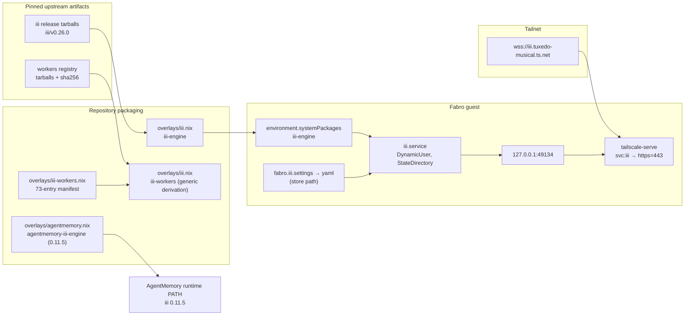
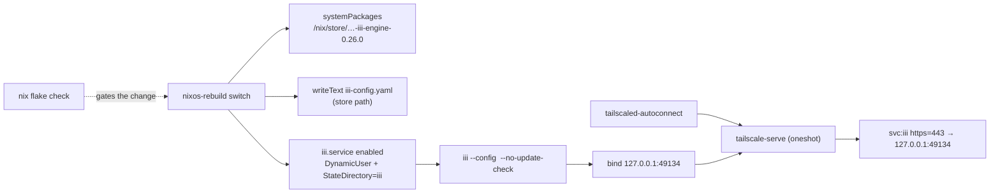
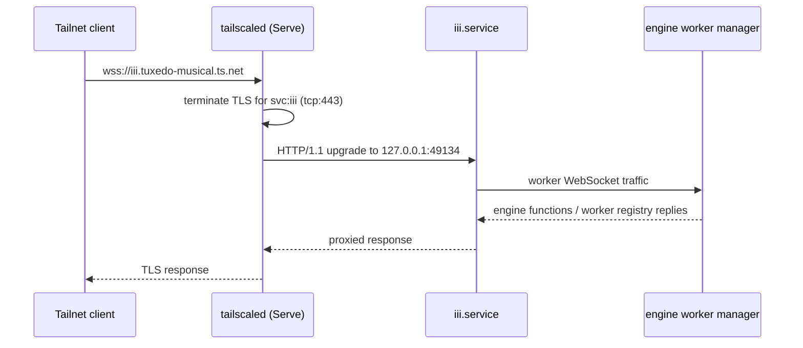
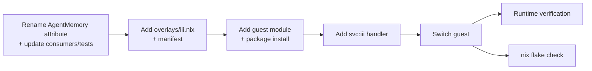

# Design Document

## Overview

This design packages iii 0.26.0 and the 73-worker official catalog as repo-owned
overlays and runs the engine on the Fabro guest as a single loopback-only
`DynamicUser` service exposed to the tailnet as `svc:iii`. `brief.md` owns the
problem statement and scope; `requirements.md` owns the behavioral contract;
`research.md` records the upstream and packaging facts this design relies on.

**Purpose**: make the iii experiment reproducible from the Nix configuration
instead of from hand-downloaded Linux binaries and a hand-written unit.

**Users**: the operator evaluating iii as a Fabro replacement, and tailnet
clients that reach the engine through Tailscale Serve.

### Goals

- Provide `pkgs.iii-engine` at 0.26.0 for `aarch64-linux` and `aarch64-darwin`
  from digest-pinned release tarballs.
- Provide `pkgs.iii-workers.<name>` for the 73 official binary workers with both
  required targets, from one pinned manifest and one generic derivation.
- Keep the AgentMemory runtime on iii 0.11.5 under a distinct attribute.
- Run the engine as an enabled systemd `DynamicUser` service whose only listener
  is `127.0.0.1:49134`, with a read-only store config and a `StateDirectory`.
- Advertise `svc:iii` from the guest's existing Serve oneshot and verify every
  package, catalog, unit, listener, and Serve claim in `nix flake check`.

### Non-Goals

- Starting, composing, or configuring any worker; `worker-compose.yaml` and the
  Compose daemon remain unused.
- The 8 official JavaScript bundles, `registry-cli`, the 4 engine-kind entries,
  and the 3 single-target binary workers.
- iii authentication, RBAC, TLS termination, or exposure beyond the tailnet.
- Darwin services, `x86_64` targets, version-bump automation, and the
  `install-total-recall-on-fabro-vm` iii 0.24 stack.

## Boundary Commitments

### This Spec Owns

- `overlays/iii.nix`: the `iii-engine` derivation, the generic worker
  derivation, and the `iii-workers` attribute set.
- `overlays/iii-workers.nix`: the 73-entry worker manifest (version,
  executable, and per-target URL + SHA-256).
- The AgentMemory pin rename in `overlays/agentmemory.nix`, its two consumers,
  the Home Manager runtime-input seam, and the affected Node assertions.
- `configurations/fabro-vm/iii.nix`: the `fabro.iii` read-only settings seam,
  the rendered config, and the `iii.service` unit.
- The guest package install, the `svc:iii` Serve argument, and the
  `fabro-vm-guest-eval` assertions.
- The package, catalog, platform-guard, worker-build, and AgentMemory-pin
  checks in `flake.nix`.

### Out of Boundary

- Creating the `svc:iii` Tailscale Service, tailnet ACLs, DNS names,
  certificates, or device approval.
- Any worker lifecycle: no worker package is started on the guest and no
  `worker-compose.yaml` is rendered.
- iii secrets, credentials, database backends, queues, and cron schedules.
- Porting Fabro workflows or replacing Fabro on the guest.
- Upstream `iii-hq/iii`, `iii-hq/workers`, or registry changes.

### Allowed Dependencies

- `pkgs.fetchurl` against `github.com/iii-hq/iii` release assets and
  `cdn.iii.cloud` worker tarballs, pinned by SHA-256.
- The locked nixpkgs inputs: `autoPatchelfHook`, `stdenv.cc.cc.lib`,
  `stdenvNoCC`, `fetchurl`, and `lib.generators.toYAML`.
- The guest's systemd, `DynamicUser`/`StateDirectory` support, and the existing
  `tailscale-serve` oneshot with its `tailscaled-autoconnect` dependency.
- The admin-console `svc:iii` Service (tcp:443) already granted to `tag:fabro`;
  the guest must not create it.
- The AgentMemory flake input and its 0.11.5 iii pin, unchanged.

### Revalidation Triggers

- A registry version bump, a new official worker, a yanked CDN artifact, or a
  changed tarball inner file name.
- An iii release that changes `config.yaml` worker names, mandatory workers,
  the worker-manager `host`/`port` keys, the `--config`/`--no-update-check`
  flags, or the `UNSUPPORTED_CONFIG_WORKERS` behavior.
- A change to the `svc:iii` Service definition, its tailnet DNS name, or the
  guest's Tailscale registration.
- A change to `tailscale serve` syntax, its loopback-only proxy constraint, or
  its TLS termination model.
- A change to the AgentMemory runtime's iii pin or its `iiiVersion`/`iiiRevision`
  metadata.

## Architecture

### Existing Architecture Analysis

The repository packages release binaries in overlays and wires guest services in
`configurations/fabro-vm/`. `overlays/agentmemory.nix` already provides a
`stdenvNoCC` + `fetchurl` + `dontUnpack` derivation for a pinned iii binary, and
`configurations/fabro-vm/opencode.nix` is the template for a loopback-only
`DynamicUser` service with a `StateDirectory` and `ProtectSystem = "strict"`.
`configurations/fabro-vm/tailscale.nix` advertises each Service with one
`tailscale serve --service=... --https=443 http://127.0.0.1:<port>` line, and
`flake.nix`'s `fabro-vm-guest-eval` asserts guest unit, package, and Serve shape
through pure evaluation.

Two constraints drive the design. First, `iii-engine` is currently the
AgentMemory-only 0.11.5 attribute restricted to Darwin, so the current engine
needs a new attribute name rather than an in-place bump. Second, iii 0.26 rejects
project workers in `config.yaml` and defaults the worker manager to
`0.0.0.0:49134`, so the loopback bind is expressible only by declaring the
engine-lifecycle worker manager with an explicit `host`/`port`.

### Architecture Pattern & Boundary Map



**Architecture Integration**:

- Selected pattern: repo-owned packaging around upstream release artifacts, with
  deployment wiring confined to one guest module and verification through pure
  evaluation.
- Domain boundaries: packaging (`overlays/iii.nix`, `overlays/iii-workers.nix`),
  identity (`overlays/agentmemory.nix`), runtime
  (`configurations/fabro-vm/iii.nix`), exposure
  (`configurations/fabro-vm/tailscale.nix`), verification (`flake.nix`).
- Existing patterns preserved: `stdenvNoCC` + `fetchurl` + `dontUnpack` binary
  packaging, `DynamicUser` + `StateDirectory` guest services, one
  `tailscale serve` line per Service, `pname`-based package assertions, and
  host-gated checks.
- New components rationale: the manifest and generic derivation exist because
  the registry exposes 146 per-target artifacts and no upstream Nix packaging;
  the read-only settings seam exists so the config render is assertable without
  a build; `agentmemory-iii-engine` exists because two different iii versions
  must coexist.
- Steering compliance: no `.kiro/steering/*.md` document constrains Nix
  packaging or guest services; the repository's existing overlay and
  guest-service conventions govern.

### Technology Stack

| Layer | Choice / Version | Role in Feature | Notes |
|-------|------------------|-----------------|-------|
| Package | iii `0.26.0` | Engine binary | `aarch64-linux` glibc, `aarch64-darwin` |
| Package | 73 official binary workers (registry snapshot 2026-11-16) | Worker catalog | Same two targets, one version per worker |
| Runtime | systemd `DynamicUser` unit | Engine supervision | `StateDirectory = [ "iii" ]`, store config |
| Listener | `127.0.0.1:49134` | Worker WebSocket + engine functions | Only listener |
| Exposure | Tailscale Serve `svc:iii` | Tailnet TLS endpoint | `--https=443 http://127.0.0.1:49134` |
| Verification | `nix flake check` (pure eval + package builds) | Regression gate | No Linux builder required for guest checks |

## File Structure Plan

### Directory Structure

```
overlays/
├── iii.nix                    # iii-engine derivation, worker builder, iii-workers
├── iii-workers.nix            # 73-entry pinned manifest (data only)
└── agentmemory.nix            # renamed export: agentmemory-iii-engine (0.11.5)

configurations/fabro-vm/
├── iii.nix                    # fabro.iii settings, config render, iii.service
├── default.nix                # + import, + iii-engine in systemPackages
└── tailscale.nix              # + svc:iii Serve line and soft ordering
```

### New Files

- `overlays/iii.nix` — exports `iii-engine`, `iii-workers`, and the system guard;
  contains the only executable packaging code for both.
- `overlays/iii-workers.nix` — pure data: `{ engine, workers = { <name> = {
  version, engine, executable, targets.<system>.{url, sha256} }; }; }`.
- `configurations/fabro-vm/iii.nix` — the `fabro.iii` read-only options, the YAML
  render, and the `iii` unit; the only place the engine is configured.

### Modified Files

- `overlays/agentmemory.nix` — rename the exported attribute to
  `agentmemory-iii-engine`; the derivation body stays byte-identical.
- `overlays/default.nix` — bind `agentmemory.nix` as `agentmemoryIiiEngine` and
  add `iii.nix`, merging both into `custom-packages`.
- `home-manager/common/agentmemory.nix` — select
  `pkgs.agentmemory-iii-engine`, and expose the resolved list as the read-only
  `programs.agentmemory.runtimeInputs` option.
- `configurations/fabro-vm/default.nix` — import `./iii.nix` and add
  `iii-engine` to `environment.systemPackages`.
- `configurations/fabro-vm/tailscale.nix` — add the fourth `ExecStart` line,
  `wants`/`after` on `iii.service`, and update the unit description.
- `flake.nix` — switch the AgentMemory matrix input, add the five iii checks,
  and extend `fabro-vm-guest-eval` with the engine, unit, config, and Serve
  assertions.
- `tests/agentmemory-opencode/package-contract.test.js` — assert the renamed
  attribute and both engine versions.
- `tests/agentmemory-opencode/validation-suite.test.js` — assert the matrix
  check binds `pkgs.agentmemory-iii-engine`.
- `docs/dead-nix-cleanup-ledger.md` — update the sentence that records the
  AgentMemory iii export.

## System Flows

### Switch and boot



- The config derivation and the unit are rebuilt together, so a settings change
  changes the unit's `ExecStart` and restarts `iii.service`.
- `iii.service` does not depend on the tailnet; registration only gates the
  Serve oneshot, which runs after `tailscaled-autoconnect.service`.
- The oneshot applies the three existing handlers first and `svc:iii` last; a
  later failure leaves the earlier handlers applied.

### Tailnet request path



- Serve accepts only `http://127.0.0.1` proxy targets, matching the engine bind.
- The engine has no other listener, so a client that cannot reach
  `svc:iii` cannot reach the engine at all.

## Requirements Traceability

| Requirement | Criteria | Summary | Components | Interfaces | Flows |
|-------------|----------|---------|------------|------------|-------|
| 1 | 1.1–1.9 | Pinned engine package for both targets | Engine Artifact Package | `pkgs.iii-engine`, `passthru.sourceRevision`, system guard | Switch and boot |
| 2 | 2.1–2.11 | 73-worker official catalog | Worker Catalog, Verification Surface | `pkgs.iii-workers.<name>`, manifest schema | — (package evaluation) |
| 3 | 3.1–3.7 | AgentMemory 0.11.5 pin separation | AgentMemory Engine Pin | `pkgs.agentmemory-iii-engine`, `programs.agentmemory.runtimeInputs` | Switch and boot |
| 4 | 4.1–4.4 | Declarative guest install | Guest Engine Module | `environment.systemPackages` | Switch and boot |
| 5 | 5.1–5.9 | DynamicUser service identity and lifecycle | Guest Engine Module | `iii.service` unit contract | Switch and boot |
| 6 | 6.1–6.7 | Single loopback listener, zero project workers | Guest Engine Module | `fabro.iii.settings`, `fabro.iii.yaml` | Tailnet request path |
| 7 | 7.1–7.10 | `svc:iii` tailnet exposure | Serve Handler | `tailscale-serve` `ExecStart` list | Tailnet request path |
| 8 | 8.1–8.10 | Evaluated verification | Verification Surface | flake checks, guest-eval assertions | Both |

Cross-cutting notes: requirement 1.8 is enforced by the overlay's system guard;
2.10 by the worker derivation's missing-target guard; 5.7 by the upstream
config-file error plus systemd's `StateDirectory` failure; 6.3 by the runtime
worker list (`runtime == "engine"`); 8.9 by keeping every guest assertion in
`fabro-vm-guest-eval` pure.

## Components and Interfaces

| Component | Domain/Layer | Intent | Req Coverage | Key Dependencies | Contracts |
|-----------|--------------|--------|--------------|------------------|-----------|
| Engine Artifact Package | Packaging | Pin and install iii 0.26.0 per target | 1 | nixpkgs `fetchurl`, `autoPatchelfHook` (P0) | Service |
| Worker Catalog | Packaging | Manifest + generic derivation for 73 workers | 2 | registry CDN (P0), manifest (P0) | Service, State |
| AgentMemory Engine Pin | Packaging | Keep iii 0.11.5 under a distinct attribute | 3 | AgentMemory flake input (P0) | State |
| Guest Engine Module | Guest runtime | Render config, supervise engine | 4, 5, 6 | `iii-engine` (P0), systemd (P0) | Service, State |
| Serve Handler | Exposure | Advertise `svc:iii` to the loopback listener | 7 | `tailscale-serve` (P0), `tailscaled-autoconnect` (P0) | Service |
| Verification Surface | Checks | Prove packages, catalog, unit, config, Serve | 8 | all above (P0) | Batch |

### Packaging Layer

#### Engine Artifact Package

| Field | Detail |
|-------|--------|
| Intent | Provide the iii 0.26.0 binary for the two required targets from pinned tarballs. |
| Requirements | 1.1–1.9, 4.2 |

**Responsibilities & Constraints**

- Owns the engine version, per-target URL, digest, and `passthru.sourceRevision`.
- Rejects every system outside `[ "aarch64-linux" "aarch64-darwin" ]` at
  attribute evaluation with `Unsupported iii-engine system: <system>`.
- Installs exactly `bin/iii`; no worker executable, no installer, no network at
  build time beyond the pinned `fetchurl`.
- Linux needs ELF interpreter patching (the upstream interpreter
  `/lib/ld-linux-aarch64.so.1` does not exist on NixOS); Darwin must skip fixup.

**Dependencies**

- Outbound: nixpkgs `fetchurl` — pinned artifact (Critical).
- External: GitHub release assets `iii/v0.26.0` (Critical).

**Contracts**: Service [x] / API [ ] / Event [ ] / Batch [ ] / State [ ]

##### Service Interface

```nix
pkgs.iii-engine = stdenvNoCC.mkDerivation {
  pname = "iii-engine";
  version = "0.26.0";
  src = fetchurl { url = <release tarball>; sha256 = <release digest>; };
  dontUnpack = true;
  nativeBuildInputs = optional isLinux autoPatchelfHook;
  buildInputs = optional isLinux stdenv.cc.cc.lib;
  dontStrip = isLinux;      # keep fixup for autoPatchelf, skip strip
  dontFixup = isDarwin;     # no ELF patching, no strip
  installPhase = "… install bin/iii …";
  passthru.sourceRevision = "iii/v0.26.0";
  meta = { mainProgram = "iii"; platforms = [ "aarch64-linux" "aarch64-darwin" ]; };
};
```

- Preconditions: `system` is one of the two supported systems.
- Postconditions: `bin/iii --version` prints `0.26.0`.
- Invariants: one executable, digest-pinned source, no update/install step.

**Implementation Notes**

- The Linux build recipe and the Darwin `dontFixup` split were verified in the
  Nix sandbox (`research.md`, R6).
- The digest is stored as the release's lowercase hex SHA-256 verbatim.

#### Worker Catalog

| Field | Detail |
|-------|--------|
| Intent | Expose every official dual-target binary worker as a pinned package keyed by worker name. |
| Requirements | 2.1–2.11 |

**Responsibilities & Constraints**

- Owns the 73-entry manifest and the single generic derivation that turns one
  manifest entry into one package for the current system.
- Membership is the registry snapshot: every official `binary` worker with both
  `aarch64-unknown-linux-gnu` and `aarch64-apple-darwin` artifacts.
- Each entry records `version`, `engine = "0.26.0"`, the inner `executable`
  name, and per-target `{ url, sha256 }`.
- A missing target key, or a target without `url`/`sha256`, throws at
  evaluation with the worker name and platform.
- Installs exactly the one executable named by `executable`; `acp` is the one
  entry whose executable (`iii-acp`) differs from its worker name.

**Dependencies**

- Inbound: `overlays/iii-workers.nix` — manifest data (Critical).
- External: `cdn.iii.cloud` per-version tarballs (Critical).

**Contracts**: Service [x] / API [ ] / Event [ ] / Batch [ ] / State [x]

##### Service Interface

```nix
pkgs.iii-workers :: attrsOf package   # keyed by official worker name

mkWorker name entry =
  let
    target = entry.targets.${system} or
      (throw "iii worker '${name}' has no ${system} artifact (required: aarch64-linux, aarch64-darwin)");
  in
  if !(target ? url && target ? sha256)
  then throw "iii worker '${name}' is missing the ${system} url or sha256"
  else stdenvNoCC.mkDerivation {
    pname = "iii-worker-${name}";
    inherit (entry) version;
    inherit (target) url sha256;
    src = fetchurl { inherit url sha256; };
    installPhase = "… install bin/${entry.executable} …";
    passthru.iiiWorker = { inherit name; inherit (entry) version engine executable; };
    meta = { mainProgram = entry.executable; platforms = builtins.attrNames entry.targets; };
  };
```

- Preconditions: a manifest entry has both targets; the tarball holds one file.
- Postconditions: `<pkg>/bin/<executable>` exists and is the only file in `bin`.
- Invariants: one `version` per worker shared by both targets; immutable URL and
  digest.

**Implementation Notes**

- The manifest is 73 reviewed entries; the design does not list them here.
  `research.md` records the full snapshot with the digests that were verified
  against the downloaded bytes. Membership completeness is a review property:
  no offline check can enumerate the live registry, so the snapshot date and
  the exclusion arithmetic live in `research.md`, and a registry change is a
  revalidation trigger.
- The registry API exposes no engine-compatibility field. `engine = "0.26.0"` is
  therefore the catalog's own declaration in every entry, which is what
  requirement 2.9 asks the manifest to record; a future engine bump is an
  explicit manifest edit, not a silent inheritance.
- Target keys contain hyphens and must be quoted in the data file and indexed
  by string, e.g. `"aarch64-linux" = { url = …; sha256 = …; };` and
  `entry.targets.${system}`.
- The worker derivation uses the same Linux `autoPatchelfHook` +
  `stdenv.cc.cc.lib` / `dontStrip` and Darwin `dontFixup` split as the engine
  package; the sampled Linux worker binaries are glibc-target Rust builds with
  the same `/lib/ld-linux-aarch64.so.1` interpreter (`research.md`).
- The catalog check is evaluation-bound (see Testing Strategy); two
  representative builds prove the generic derivation on each platform.

#### AgentMemory Engine Pin

| Field | Detail |
|-------|--------|
| Intent | Keep the AgentMemory runtime on iii 0.11.5 after the current engine takes the `iii-engine` attribute. |
| Requirements | 3.1–3.7 |

**Responsibilities & Constraints**

- Exports `pkgs.agentmemory-iii-engine`; the derivation body, URLs, digests,
  platforms, `version = "0.11.5"`, and `passthru.sourceRevision = "iii/v0.11.5"`
  stay unchanged.
- `pkgs.iii-engine` is now the 0.26.0 engine; no AgentMemory consumer refers to
  it for the runtime binary.
- The Home Manager module resolves the runtime input through
  `pkgs.agentmemory-iii-engine` under the existing `hasAttr` guard, and exposes
  the resolved list as a read-only option for checks.

**Dependencies**

- Inbound: `inputs.agentmemory` flake packages (Critical), `overlays/default.nix`
  merge order (Critical).

**Contracts**: Service [ ] / API [ ] / Event [ ] / Batch [ ] / State [x]

##### State Management

- State model: one Home Manager option, `programs.agentmemory.runtimeInputs`
  (`listOf package`, read-only), mirroring the launcher's `PATH` inputs.
- Persistence: none; the package is a store path.
- Concurrency: n/a.

**Implementation Notes**

- The AgentMemory matrix check asserts `iii --version` reports `0.11.5` before
  it runs the suite, so the check's own `PATH` proves requirement 3.5.
- `home-manager/common/agentmemory.nix` continues to derive `iiiVersion` and
  `iiiRevision` from `cfg.package` passthru metadata, so the runtime settings and
  status command are unchanged.

### Guest Runtime Layer

#### Guest Engine Module

| Field | Detail |
|-------|--------|
| Intent | Render the engine config and run it as the guest's loopback-only dynamic service. |
| Requirements | 4.1–4.4, 5.1–5.9, 6.1–6.7 |

**Responsibilities & Constraints**

- Owns `configurations/fabro-vm/iii.nix`: the read-only `fabro.iii.settings` and
  `fabro.iii.yaml` options, the `writeText` config derivation, and
  `systemd.services.iii`.
- The settings declare exactly one worker entry, `iii-worker-manager`, bound to
  `127.0.0.1:49134`; no `modules` list, no `sandbox` binding, no `iii-stream`,
  and no project worker.
- The unit runs the store binary with the store config and `--no-update-check`,
  as a `DynamicUser`, with `StateDirectory = [ "iii" ]`,
  `WorkingDirectory = "/var/lib/iii"`, and `HOME` set so the configuration
  adapter and telemetry state stay inside the state directory.
- The unit declares no `EnvironmentFile`, `Environment` secret, `LoadCredential`,
  or static `User`/`Group`, and no download/installation step.
- `environment.systemPackages` in `configurations/fabro-vm/default.nix` adds
  `iii-engine`.

**Dependencies**

- Inbound: `pkgs.iii-engine` (Critical); systemd unit schema (Critical).
- Outbound: `/var/lib/iii` state directory (Critical); loopback port 49134.
- External: none at runtime; the engine needs no secret and no other service.

**Contracts**: Service [x] / API [ ] / Event [ ] / Batch [ ] / State [x]

##### Service Interface

```nix
options.fabro.iii = {
  settings = mkOption {                    # read-only, check seam
    type = types.attrs; readOnly = true;
    default = {
      workers = [{
        name = "iii-worker-manager";
        config = { host = "127.0.0.1"; port = 49134; };
      }];
    };
  };
  yaml = mkOption {                        # exactly the file contents
    type = types.str; readOnly = true;
    default = lib.generators.toYAML { } config.fabro.iii.settings;
  };
};

# module let-binding
configFile = pkgs.writeText "iii-config.yaml" config.fabro.iii.yaml;

systemd.services.iii = {
  wantedBy = [ "multi-user.target" ];
  environment.HOME = "/var/lib/iii";
  serviceConfig = {
    DynamicUser = true;
    StateDirectory = [ "iii" ];
    WorkingDirectory = "/var/lib/iii";
    ExecStart = "${pkgs.iii-engine}/bin/iii --config ${configFile} --no-update-check";
    Restart = "on-failure"; RestartSec = 5;
    ProtectSystem = "strict"; ProtectHome = true; PrivateTmp = true;
    NoNewPrivileges = true;
    RestrictAddressFamilies = [ "AF_UNIX" "AF_INET" "AF_INET6" ];
    ReadWritePaths = [ "/var/lib/iii" ];
  };
};
```

- Preconditions: `/var/lib` is on the guest's root disk (not the virtiofs
  share); the store config exists.
- Postconditions: one listener on `127.0.0.1:49134`; state under
  `/var/lib/iii`; engine survives restarts and switches.
- Invariants: no secret input; no wildcard bind; no project worker.

**Implementation Notes**

- The config is a `writeText` store path, so the engine's config watcher observes
  `/nix/store` non-recursively and reloads only if that exact path changes. A
  settings change arrives through a rebuild, which changes `ExecStart` and
  restarts the unit.
- `--no-update-check` disables both the update and advisory checks; the engine
  never downloads a replacement binary.
- The configuration worker's fs adapter writes `./config` relative to
  `WorkingDirectory`, so `/var/lib/iii/config` holds persisted configuration
  entries.
- A missing store config makes `iii` exit with `Config file not found: '<path>'`;
  an unusable state directory makes systemd fail the unit. Both name the cause
  in the journal; no wrapper or `ExecStartPre` is added for requirement 5.7.

#### Serve Handler

| Field | Detail |
|-------|--------|
| Intent | Publish the engine as `svc:iii` through the existing Serve oneshot. |
| Requirements | 7.1–7.10 |

**Responsibilities & Constraints**

- Appends exactly one `ExecStart` line:
  `serve --service=svc:iii --https=443 http://127.0.0.1:49134`.
- Leaves the `svc:fabro`, `svc:litellm`, and `svc:opencode` lines
  byte-identical; updates the unit description to name four services.
- Adds `wants`/`after` for `iii.service` while keeping
  `requires`/`after` on `tailscaled-autoconnect.service`.
- The unit creates no Service and changes no ACL, DNS, certificate, or device
  approval; a failed fourth line fails the unit after the first three applied.

**Dependencies**

- Inbound: `config.services.tailscale.package` (Critical), `iii.service` (P1).
- External: admin-console `svc:iii` Service granted to `tag:fabro` (Critical).

**Contracts**: Service [x] / API [ ] / Event [ ] / Batch [ ] / State [ ]

##### Service Interface

```nix
systemd.services.tailscale-serve.serviceConfig.ExecStart = [
  "… serve --service=svc:fabro    --https=443 http://127.0.0.1:32276"
  "… serve --service=svc:litellm  --https=443 http://127.0.0.1:4000"
  "… serve --service=svc:opencode --https=443 http://127.0.0.1:4096"
  "… serve --service=svc:iii      --https=443 http://127.0.0.1:49134"
];
```

- Preconditions: `tailscaled` is registered; the Service exists and is granted.
- Postconditions: the handler converges on every boot; earlier handlers remain
  applied if the new one fails.
- Invariants: no engine endpoint other than `svc:iii`; no firewall port.

**Implementation Notes**

- Serve proxies only `http://127.0.0.1` targets and terminates TLS in
  `tailscaled`, so the engine stays plaintext on loopback.
- The handler is idempotent for an unchanged target, matching the existing
  convergence model.

### Verification Layer

#### Verification Surface

| Field | Detail |
|-------|--------|
| Intent | Turn every package, catalog, unit, listener, and Serve claim into a check. |
| Requirements | 8.1–8.10 |

**Responsibilities & Constraints**

- Adds `iii-engine-package`, `iii-engine-platform-guard`,
  `iii-worker-catalog`, `iii-worker-build`, and `iii-agentmemory-pin` to
  `flake.nix`, gated to the systems where they can evaluate.
- Extends `fabro-vm-guest-eval` with the guest install, unit, config, and Serve
  assertions.
- Keeps every guest assertion pure: no `fabro-vm-image` build, no Linux builder,
  no store-path file reads.
- Every failure message names the element that is missing or misconfigured.

Detailed assertions live in Testing Strategy.

## Data Models

### Worker Manifest Model

`overlays/iii-workers.nix` is the catalog's source of truth.

| Field | Type | Meaning |
|-------|------|---------|
| `engine` | string | Catalog-wide engine release the manifest was recorded against (`"0.26.0"`). |
| `workers` | attrset name → entry | Exactly the 73 official dual-target binary workers. |
| `workers.<name>.version` | string | Registry version whose artifacts are pinned; shared by both targets. |
| `workers.<name>.engine` | string | Engine compatibility declared by the entry (`"0.26.0"`). |
| `workers.<name>.executable` | string | File name installed into `bin/` (differs for `acp`). |
| `workers.<name>.targets` | attrset system → target | Keys are `aarch64-linux` and `aarch64-darwin`. |
| `targets.<system>.url` | string | Full immutable `https://cdn.iii.cloud/...` URL. |
| `targets.<system>.sha256` | string | Registry SHA-256, lowercase hex, verbatim. |

Invariants: exactly 73 names; every entry has both target keys; no excluded
name; one version and one executable per worker; URLs are HTTPS and contain the
worker name and version.

### Rendered Engine Configuration

`fabro.iii.settings` projects to a store file through
`lib.generators.toYAML`, which emits JSON-compatible text; the engine's YAML
parser accepts it.

```json
{
  "workers": [
    {
      "name": "iii-worker-manager",
      "config": { "host": "127.0.0.1", "port": 49134 }
    }
  ]
}
```

| Field | Value | Constraint |
|-------|-------|------------|
| `workers` length | 1 | No project worker; requirement 6.4 |
| `workers[0].name` | `iii-worker-manager` | The only engine-lifecycle entry; requirement 6.5 |
| `workers[0].config.host` | `127.0.0.1` | Never `0.0.0.0`, `::`, or a tailnet address; requirement 6.6 |
| `workers[0].config.port` | `49134` | Worker WebSocket port; requirement 6.1 |
| `modules` | absent | `iii-stream` stays disabled; requirement 6.7 |
| `sandbox` | absent | The sandbox router stays unbound and opens no listener |

### Runtime State and Unit Contract

| Element | Value | Requirement |
|---------|-------|-------------|
| `DynamicUser` | `true` | 5.2 |
| Static account | none (`users.users.iii` absent) | 5.2 |
| `StateDirectory` | `[ "iii" ]` → `/var/lib/iii` | 5.3 |
| `WorkingDirectory` | `/var/lib/iii` | 5.3 |
| `HOME` | `/var/lib/iii` | Keeps `.iii` telemetry/config state in the state directory |
| Config path | `/nix/store/…-iii-config.yaml` | 5.5 |
| `ExecStart` | `<iii-engine>/bin/iii --config <config> --no-update-check` | 5.8, 5.9 |
| `Restart` | `on-failure`, `RestartSec = 5` | 5.4 |
| Secret inputs | none | 5.6, 8.8 |
| Listener | `127.0.0.1:49134` only | 6.1, 6.2 |
| Runtime worker list | every entry `runtime == "engine"` | 6.3 |

## Error Handling

### Error Strategy

- Evaluation errors fail the build with the offending name: unsupported engine
  system, worker name plus missing platform, or a check assertion naming the
  unit/key/handler.
- Runtime errors stay with systemd: the unit fails, the journal carries the
  cause, and `Restart=on-failure` retries after 5 seconds.
- No error path downloads, installs, or mutates the config or the state
  directory outside `/var/lib/iii`.

### Error Categories and Responses

| Failure | Detection | Response |
|---------|-----------|----------|
| Engine evaluated on another system | `iii.nix` system guard | Evaluation throws `Unsupported iii-engine system: <system>`; 1.8 |
| Worker entry lacks a required target | `mkWorker` target guard | Evaluation throws `iii worker '<name>' has no <system> artifact`; 2.10 |
| Manifest/registry drift | pinned `fetchurl` digest | Build fails on the digest; refresh the manifest after revalidation; 2.8 |
| Missing config at start | `iii` startup | Unit fails, journal shows `Config file not found: '<path>'`; 5.7 |
| Unusable state directory | systemd `StateDirectory` | Unit fails before `ExecStart`, journal names the directory; 5.7 |
| Port already bound | `TcpListener::bind` | Startup error names `127.0.0.1:49134`; unit fails and restarts; 6.1 |
| Unexpected engine exit | systemd | `Restart=on-failure` after 5 seconds; 5.4 |
| `svc:iii` advertisement fails | `tailscale serve` exit code | Oneshot fails; the first three handlers stay applied; journal names the Service; 7.7 |
| `svc:iii` absent or not granted | `tailscale serve` error | Nothing is exposed elsewhere; engine stays loopback-only; 7.9 |
| Guest not yet registered | oneshot ordering | Engine keeps running; Serve runs after `tailscaled-autoconnect`; 7.8 |

### Monitoring

- `systemctl status iii.service` and `journalctl -u iii.service` carry the
  startup and listener messages; the engine logs `Engine listening on address:
  127.0.0.1:49134`.
- `tailscale serve status` shows the four handlers; the unit journal records a
  failing Service.
- Runtime worker scope is read with
  `III_URL=ws://127.0.0.1:49134 iii call engine::workers::list`, whose entries
  all carry `"runtime": "engine"` when no project worker is connected.

## Testing Strategy

### Package and catalog checks (`nix flake check`)

- `iii-engine-package` (`aarch64-linux`, `aarch64-darwin`): asserts
  `version == "0.26.0"`, `meta.mainProgram == "iii"`,
  `passthru.sourceRevision == "iii/v0.26.0"`, the expected `src.urls` entry, a
  non-empty `src.outputHash`, builds the derivation, asserts `bin` contains only
  `iii`, and asserts `bin/iii --version` prints `0.26.0` (1.1–1.5, 1.7).
- `iii-engine-platform-guard` (`aarch64-linux`, `aarch64-darwin`): evaluates
  `pkgs.iii-engine` for `x86_64-darwin` in a child `nix eval` and asserts a
  non-zero exit whose message contains
  `Unsupported iii-engine system: x86_64-darwin` (1.8).
- `iii-worker-catalog` (`aarch64-linux`, `aarch64-darwin`): reads
  `overlays/iii-workers.nix` and asserts exactly 73 entries; the 8 official
  bundles (`claude-code`, `cursor`, `onboarding`, `opencode`, `opengantry`,
  `openwiki`, `pi`, `vscode`), `harness-e2e`, `voice`, `ios-simulator`,
  `registry-cli`, `configuration`, `iii-observability`, `iii-sandbox`, and
  `iii-worker-manager` are absent; every entry has both targets; every `url`
  starts with `https://cdn.iii.cloud/workers/<name>/<version>/`; every `sha256`
  is 64 lowercase hex characters; every `engine` is `"0.26.0"`; every
  `executable` is non-empty (2.1–2.4, 2.7–2.9). It then instantiates every entry
  for both systems through `import nixpkgs { system = …; overlays = [
  (import ./overlays/iii.nix { }) ]; }` and asserts a derivable
  `drvPath` and matching `meta.mainProgram` (2.5, 2.6, 2.10).
- `iii-worker-build` (`aarch64-linux`, `aarch64-darwin`): builds
  `pkgs.iii-workers.state` and `pkgs.iii-workers.acp`, asserting `bin/state` and
  `bin/iii-acp` are the only files in their `bin` directories (2.5, 2.6). Two
  builds are sufficient because the generic derivation is the only code path
  and the manifest's 146 artifacts were digest-verified when recorded
  (`research.md`).
- `iii-agentmemory-pin` (`aarch64-darwin`): asserts `pkgs.iii-engine.version ==
  "0.26.0"`, `pkgs.agentmemory-iii-engine.version == "0.11.5"`,
  `.sourceRevision == "iii/v0.11.5"`, both Darwin platforms present, and the
  personal host's `programs.agentmemory.runtimeInputs` contains the 0.11.5 store
  path and not the 0.26.0 path (3.1–3.4, 3.6, 3.7). The
  `agentmemory-opencode-matrix` check replaces `pkgs.iii-engine` with
  `pkgs.agentmemory-iii-engine` in its `nativeBuildInputs` and gains an
  `iii --version` reports-`0.11.5` assertion before the Node suite, proving its
  `PATH` resolves the pin (3.5).

### Guest pure-evaluation checks (`fabro-vm-guest-eval`)

- Install: `environment.systemPackages` contains a package with
  `pname == "iii-engine"` and `version == "0.26.0"`, and the unit's `ExecStart`
  starts with that package's `bin/iii` (4.1–4.3).
- No workers: no `environment.systemPackages` entry has a `iii-worker-` `pname`,
  and no systemd unit other than `iii.service` runs the engine or a cataloged
  worker; no `worker-compose.yaml` is rendered (2.11).
- No imperative install: `ExecStart` is the only `Exec*` entry, no activation
  script starts or installs iii, and the module source contains no
  `install.iii.dev`, `iii compose`, or `iii update` reference (4.4).
- Unit: `iii` exists, is `wantedBy multi-user.target`, declares
  `DynamicUser = true`, no static `users.users.iii`, `StateDirectory` contains
  `"iii"`, `WorkingDirectory == "/var/lib/iii"`, `Restart == "on-failure"`,
  `ExecStart` matches `--config /nix/store/… --no-update-check`, and has no
  `serviceConfig.Environment`, `EnvironmentFile`, `LoadCredential`, or
  `SetCredential`, no `User`/`Group`, and an `environment` holding only `HOME`
  (5.1–5.6, 5.8, 5.9).
- Config: `fabro.iii.settings.workers` has length 1, the entry is
  `iii-worker-manager`, `host == "127.0.0.1"`, `port == 49134`, no `modules`
  key, no `sandbox` key, and `fabro.iii.yaml` contains neither `0.0.0.0` nor a
  project worker name (6.1, 6.2, 6.4–6.7).
- Serve: the unit has four `ExecStart` entries; the first three equal the
  current `svc:fabro`, `svc:litellm`, and `svc:opencode` strings; the fourth is
  `--service=svc:iii --https=443 http://127.0.0.1:49134`; `wants`/`after`
  contain `iii.service` and the autoconnect requirements remain (7.1, 7.5, 7.6).
- Secret freedom: the unit's `serviceConfig` has no secret-bearing keys and no
  `sops` template is referenced (8.8).
- Every message names the unit, key, or handler it asserts (8.10).

### Runtime verification (guest, manual)

1. `systemctl is-active iii.service` and `journalctl -u iii.service` show the
   `Engine listening on address: 127.0.0.1:49134` line.
2. `ss -ltnp | grep 49134` (or `/proc/net/tcp`) shows only `127.0.0.1:49134`, no
   `0.0.0.0`, no tailnet address (6.1, 6.2).
3. `III_URL=ws://127.0.0.1:49134 iii call engine::workers::list` returns only
   entries with `"runtime": "engine"` (6.3).
4. `tailscale serve status` shows `svc:iii` at `https:443` targeting
   `http://127.0.0.1:49134` alongside the three existing services (7.1, 7.5).
5. From a tailnet device, a WebSocket client connects to
   `wss://iii.tuxedo-musical.ts.net` and lists engine functions (7.2, 7.3).
6. Reboot the guest and repeat 1–4; the service and handler converge (5.1, 7.4,
   7.8).

## Security Considerations

- The engine has no authentication; the only boundaries are the loopback bind
  and the tailnet grant on `svc:iii`. Any device granted the Service can invoke
  engine functions. Implementing iii auth or per-function RBAC is out of scope.
- TLS is terminated by `tailscaled`; the loopback hop is plaintext and never
  leaves the guest.
- The unit runs as a `DynamicUser` with `ProtectSystem = "strict"`,
  `ProtectHome`, `PrivateTmp`, `NoNewPrivileges`, and a state directory owned by
  the dynamic user; it holds no capability beyond binding an unprivileged port.
- No secret, token, or credential enters the unit, the rendered config, or the
  Nix store; no `sops` template is consumed and no `LoadCredential` is used.
- The guest opens no firewall port for 49134; the engine is unreachable from
  the LAN or the tailnet IP even when the Service is missing.
- Anonymous engine telemetry remains at the upstream default; disabling it is
  not part of this spec and must be decided separately if required.

## Migration Strategy



- Phase 1 (attribute rename) is behavior-preserving for AgentMemory; the
  AgentMemory matrix check proves the 0.11.5 runtime still resolves.
- Phase 2 adds the engine and catalog without starting anything.
- Phase 3 installs and starts `iii.service`; the old generation never ran iii,
  so there is no state to migrate. `/var/lib/iii` is created on first start.
- Rollback: `nixos-rebuild switch --rollback` returns to the prior generation
  (no `iii.service`); the `svc:iii` handler can remain applied on the node until
  a later Serve run, but its loopback target is gone. Reverting the overlay
  commit restores the pre-rename package set.
- Revalidation is required on any registry or engine bump; there is no
  automatic version tracking.

## Supporting References

- `research.md` — engine release digests, registry API shape, the 73-worker
  snapshot, verified engine runtime behavior, packaging recipe, and Serve facts.
- `brief.md` — problem statement, approach, rejected alternatives, and scope.
- `requirements.md` — the behavioral contract and acceptance criteria.
