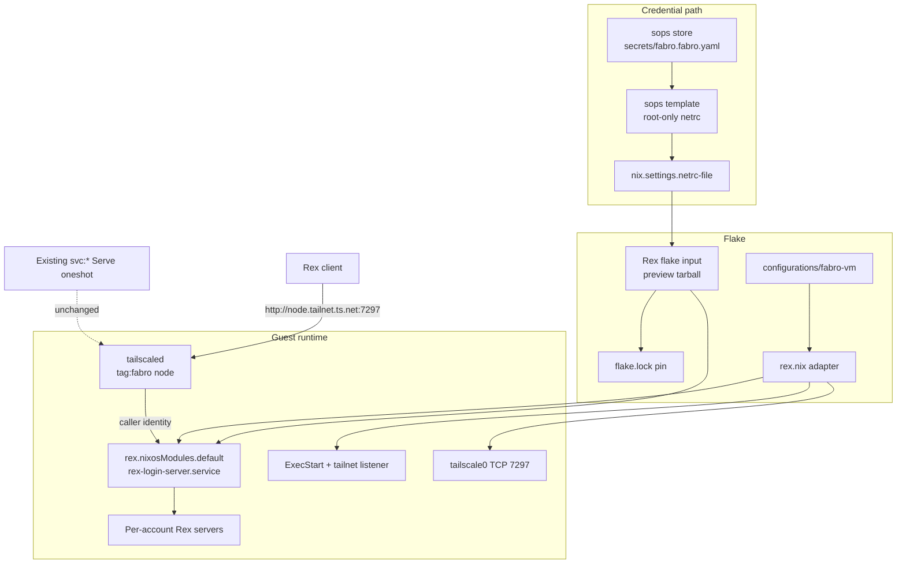
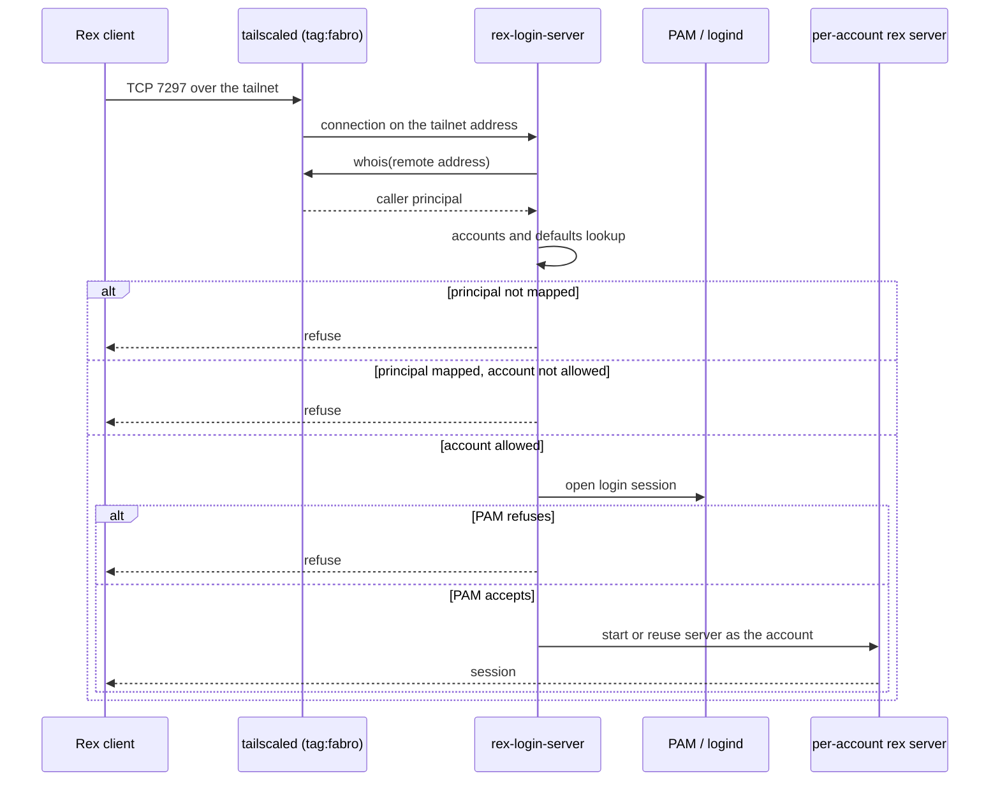
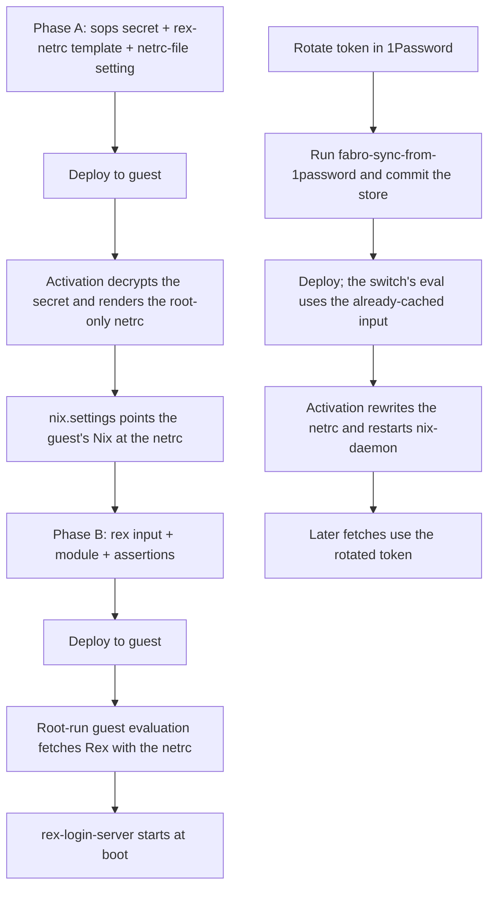

# Design Document

## Overview

The fabro Lima guest gains a Rex login server installed from a `flake.lock`-pinned
Rex flake input and reachable only through the guest's open-source `tailscaled`
tailnet-address listener on TCP 7297. The gated flake credential is delivered to
the guest through its sops-nix store and exposed to Nix as a root-only netrc file;
`brief.md` owns the problem statement and scope, `requirements.md` owns the
behavioral contract, and `research.md` records the external findings and sources.

**Purpose**: let the operator run persistent Rex sessions on the guest as the
existing Lima cidata account instead of hosting a web terminal or using SSH.

**Users**: the operator's Rex for Mac and `rex` CLI clients, and any future local
account the operator deliberately maps in the accounts map.

**Impact**: adds one flake input, one guest module, one credential path through
sops-nix, one firewall opening, one one-line change to the guest deploy
invocation, and one group of pure-eval assertions. It does not change the
existing fabro, LiteLLM, OpenCode, or Tailscale Service configuration.

### Goals

- Obtain Rex from the pinned Rex flake input; never hand-package the binary.
- Deliver the package credential from the guest's sops-nix store to a root-only
  netrc file, with no plaintext in the repository, the Nix store, or rendered
  configuration.
- Run the login server at boot, restart it on failure, and serve only the node's
  tailnet address on port 7297.
- Map the cidata account to one Tailscale principal with a default, and grant no
  root, system-account, or wildcard access.
- Prove the configuration through pure evaluation on a host without a Linux
  builder.

### Non-Goals

- Rex shared-server mode, personal servers, built-in Tailscale (`--tailscale`,
  tsnet), Tailscale Serve for Rex, and anonymous or plain listeners.
- Creating, modifying, or deleting Linux accounts; PAM policy changes; tailnet
  ACL, Service, OAuth, tag, or admin-console changes.
- Managing the Mac's Nix credential configuration; removing or reconfiguring
  OpenCode; Rex client setup on macOS; Lua customization; image rebuilds;
  automatic channel upgrades; resource tuning.

## Boundary Commitments

### This Spec Owns

- The `rex` flake input, its `preview` channel URL, and its `flake.lock` pin.
- The credential path: the `rex-package-token` sops secret, the `rex-netrc` sops
  template, the `fabro.onePasswordSecrets` manifest entry that lets the existing
  sync helper rotate it, the guest's `nix.settings.netrc-file` value, and the
  `lima-vm-deploy` invocation that runs the guest's `nixos-rebuild` as root so
  the root-only netrc is readable during flake evaluation.
- `configurations/fabro-vm/rex.nix`: the upstream module import, login-server
  options, accounts/defaults, the `tailnet://:7297` listener override, unit
  ordering and restart policy, and the `tailscale0` firewall opening.
- Import and `specialArgs` wiring into `nixosConfigurations.fabro-vm`.
- The `fabro-vm-guest-eval` assertions covering requirements 1-8.

### Out of Boundary

- The upstream Rex package, NixOS module internals, login-server binary behavior,
  PAM policy content, and Rex client software.
- The Mac's local Nix credential configuration: requirement 2.7 consumes it; this
  spec does not deploy, encrypt, or manage it.
- The rest of the `lima-vm-deploy` script beyond the `nixos-rebuild` invocation,
  and the Mac's flake evaluation path.
- Tailnet ACLs, Service definitions, OAuth client, node tags, and MagicDNS names.
- Linux account lifecycle and the imperative Lima cidata user.
- OpenCode removal, other tailnet services, and the existing `svc:*` Serve units.
- Rex Lua configuration, session recording, image rebuilds, and resource-limit
  tuning beyond the upstream module defaults.

### Allowed Dependencies

- Upstream Rex flake (`inputs.rex`), its `nixosModules.default`, and the
  `aarch64-linux` release package it exports.
- sops-nix `sops.secrets`, `sops.templates`, `sops.placeholder`, the guest's age
  key and encrypted store, and the `fabro-sync-from-1password` helper.
- Nix's `netrc-file` setting on the nixos.org Nix shipped by NixOS.
- nixpkgs 26.05 `services.tailscale` (`interfaceName`), `networking.firewall`,
  systemd, logind, and PAM.
- The existing `fabro-lima-user-manager` linger and `user@501.service` wiring.
- The existing `fabro-vm-guest-eval` pure-eval check pattern.

### Revalidation Triggers

- The upstream module renames `rex-login-server.service`, changes an option name,
  or changes the login-server command line.
- The Rex listener syntax, port, or `tailnet://` semantics change.
- The Rex channel, tarball host, credential host, or netrc login changes.
- The sops template/secret option shape or default path changes.
- The Tailscale interface name, node tag, or registration path changes.
- The cidata account name, UID, or logind wiring changes.
- The accounts-file schema or principal semantics change.

## Architecture

### Existing Architecture Analysis

- `nixosConfigurations.fabro-vm` is a NixOS module tree under
  `configurations/fabro-vm/`; external flakes reach it through `specialArgs`
  (`rsync34`, `nixSnapshotter`, `imageNixpkgs`, `limaVirtiofsTags`). Rex follows
  the same pattern.
- `tailscale.nix` owns node registration and the `svc:*` Serve oneshot. Rex must
  not add or alter Serve state; it uses the node's own tailnet address.
- The cidata user is created imperatively by `lima-init`; `users.mutableUsers`
  stays true and no module declares that user. The login server references the
  account by name only.
- `fabro-lima-user-manager` already enables linger, starts `user@501.service`,
  and upholds it. That is the logind session the login server's PAM step uses.
- `lima-vm-deploy` streams the tree and runs `nixos-rebuild switch --sudo` over
  SSH as the cidata user. `--sudo` escalates only activation; the build,
  evaluation, and flake fetch remain non-root (`research.md`, R9). A root-only
  netrc is therefore unreadable by that fetch, so the deploy must run the whole
  `nixos-rebuild` through sudo.
- The guest's sops store is declared in `configurations/fabro-vm/default.nix` and
  decrypted by sops-nix during activation, before normal units start.
- Guest verification is the `fabro-vm-guest-eval` pure-eval assertion chain; it
  needs no Linux builder and runs under `nix flake check` on the Mac.

### Architecture Pattern & Boundary Map

Selected pattern: **upstream module plus a thin local adapter, with an
activation-rendered credential file**. The local module configures documented
upstream options and overrides exactly one unit property (`ExecStart`) where
upstream exposes no option. No service code, wrapper binary, or package override
is introduced.



- **Dependency direction**: flake input → local module → upstream module → unit
  and accounts file. Credential dependency: sops store → rendered netrc → Nix
  config → flake fetch. Runtime traffic: client → `tailscaled` → login server →
  per-account server.
- **Boundaries**: the local module owns option values, the listener flag, unit
  ordering/restart, and the firewall rule. The upstream module owns the accounts
  file, PAM wiring, sockets, and server lifecycle. `tailscale.nix` keeps owning
  Serve. The sops block owns the credential and its rendered netrc.
- **Existing patterns preserved**: `specialArgs` threading, per-service guest
  module files, the centralized sops block in `default.nix`, and the assertion
  chain in `flake.nix`.
- **New components rationale**: `rex.nix` isolates the upstream module, accounts,
  listener override, and firewall from the existing service modules; the sops
  secret/template pair is the smallest artifact set that satisfies the
  credential contract without a hand-placed file.
- **Steering compliance**: the `.kiro/steering` documents are roadmaps for
  unrelated features; this design follows the repository's Nix module, sops, and
  eval-check conventions.

### Technology Stack

| Layer | Choice / Version | Role in Feature | Notes |
|-------|------------------|-----------------|-------|
| Configuration | Nix flakes, NixOS modules (26.05) | Input pin, guest module, unit override | Same flake and nixpkgs as the guest |
| Upstream server | Rex `nixosModules.default` (`preview` channel) | Login server, accounts file, PAM, per-account servers | ARM64 release binary; tester-gated flake |
| Credential | sops-nix `sops.secrets` + `sops.templates`; Nix `netrc-file` | Decrypt and render the package token for guest fetches | Root-only file outside the store |
| Runtime | systemd, systemd-logind, PAM | Boot unit, restart, per-account sessions | Existing cidata logind wiring reused |
| Networking | open-source `tailscaled`, NixOS firewall | Tailnet identity and listener 7297 | No Serve, no tsnet |
| Verification | `nix flake check`, `fabro-vm-guest-eval` | Pure-eval assertions | Runs on Darwin without a Linux builder |

## File Structure Plan

### Directory Structure

```
configurations/fabro-vm/
├── rex.nix                  # New: Rex login server, accounts, listener, firewall
├── default.nix              # Modified: import, sops secret/template, netrc-file setting
├── tailscale.nix            # Unchanged: node registration and svc:* Serve
└── ...                      # Other guest services unchanged
flake.nix                    # Modified: rex input, specialArgs, eval assertions
flake.lock                   # Modified: pinned rex tarball node
home-manager/common/
└── lima-vm.nix              # Modified: run the guest's nixos-rebuild as root
secrets/
├── fabro.fabro.yaml         # Modified: encrypted rex-package-token (via sync helper)
└── README.md                # Modified: Rex credential row and rotation note
```

### New Files

- `configurations/fabro-vm/rex.nix` — Owns the upstream module import, login
  server options, accounts/defaults, the `ExecStart` override with
  `--extra-listen tailnet://:7297`, unit ordering/restart defaults, and the
  tailscale-interface firewall rule. Header comment documents the endpoint,
  account selection, the credential source, and the module-drift assumption.

### Modified Files

- `flake.nix` — Adds the `rex` input; adds `inherit (inputs) rex;` to the
  fabro-vm `specialArgs`; extends the `fabro-vm-guest-eval` assertion chain and
  its report string.
- `configurations/fabro-vm/default.nix` — Imports `./rex.nix`; adds the
  `rex-package-token` secret, the `rex-netrc` template, the
  `fabro.onePasswordSecrets` manifest entry, and `nix.settings.netrc-file`.
- `home-manager/common/lima-vm.nix` — Changes the guest deploy command from
  `nixos-rebuild switch --sudo --flake …` to a whole-process sudo invocation
  (`sudo /run/current-system/sw/bin/nixos-rebuild switch --flake …`), so the
  evaluation and flake fetch run as root and can read the `0400` root netrc.
- `flake.lock` — Records the Rex `preview` tarball URL and NAR hash.
- `secrets/fabro.fabro.yaml` — Re-encrypted with the new secret by
  `nix run '.#fabro-sync-from-1password'`; never hand-edited.
- `secrets/README.md` — Adds the Rex package token row, the sync/rotation steps,
  and the failure symptom (HTTP 401).

### Existing Files Referenced

- `configurations/fabro-vm/tailscale.nix` — Node registration and the `svc:*`
  Serve advertisement; unchanged.
- `home-manager/common/zsh.nix` — The `REX_SESSION` guard already exists and
  needs no change.
- `scripts/fabro-sync-from-1password.nix` — Reads the manifest and rewrites the
  encrypted store; unchanged.

## System Flows

### Client connection



The login server binds the node's tailnet address itself; `tailscaled` identifies
the caller and the accounts map authorizes the account. Account selection without
a default uses `http://<account>@<node>.<tailnet>.ts.net:7297`. A refusal never
stops an existing account server or its sessions.

### Credential bootstrap and rotation



Phase A is required because the guest evaluates a flake before activation: the
switch that first references the Rex input cannot yet read the netrc that the
same switch would create. Phase A adds no Rex input, so it performs no Rex fetch.
Phase B then evaluates against the already-rendered netrc. Rotation is ordered so
the switch itself does not need a fetch: the locked input is already in the guest
store, activation rewrites the netrc, and later fetches use the new value.

## Requirements Traceability

| Requirement | Summary | Components | Interfaces | Flows |
|-------------|---------|------------|------------|-------|
| 1.1-1.4 | Pinned Rex flake input; module imported; CLI for every account; no other Rex source | C1, C3, C6 | Input URL and lock, module import, package assertion | Bootstrap |
| 2.1-2.7 | Sops-delivered credential; root-only rendered path; guest fetch uses it; fail closed; no plaintext; rotation; Mac uses its local config | C2, C6 | Secret, template, `netrc-file`, manifest, root deploy | Bootstrap and rotation |
| 3.1-3.4 | Login service at boot; restart on failure; privileged service; no shared mode | C3, C4, C6 | Module options, unit properties | Connection |
| 4.1-4.8 | Cidata account mapping, default, no root/system access, per-caller server, account selection, refusals, no account creation | C3, C6 | Accounts/defaults options, no `users.users` | Connection |
| 5.1-5.7 | Tailnet endpoint; identity via `tailscaled`; TCP 7297; `http://account@host`; no Serve/tsnet/anonymous/other listener; `svc:*` unchanged; bind failure visible | C3, C4, C5, C6 | Unit `ExecStart`, firewall rule | Connection |
| 6.1-6.5 | Reuse running server; sessions survive restarts; reload on map change; removed access closes; multiple accounts get separate servers | C3, C4, C6 | Module reload wiring, accounts map | Connection |
| 7.1-7.5 | PAM login sessions; cidata user manager; linger retained; manager available; PAM refusal refuses | C3, C4, C6 | `--pam-service`, existing logind wiring | Connection |
| 8.1-8.8 | Eval verifies boot, listener, accounts, no root, exclusions, package and Serve, credential wiring, pure eval | C6 | Assertion chain | `nix flake check` |

## Components and Interfaces

| ID | Component | Domain/Layer | Intent | Req Coverage | Key Dependencies | Contracts |
|----|-----------|--------------|--------|--------------|------------------|-----------|
| C1 | Rex flake input | Dependency | Pin upstream Rex release | 1.1, 1.4, 8.6 | Rex channel tarball, `flake.lock` | Flake input |
| C2 | Sops credential path | Guest configuration | Decrypt and render the package token for Nix fetches | 2.1-2.7, 8.7 | sops-nix, 1Password sync helper, Nix `netrc-file` | sops secret, template, Nix setting |
| C3 | Rex guest module | Guest configuration | Enable login server, accounts, module import | 1.2, 1.3, 3.1-3.4, 4.1-4.8, 5.2, 5.4-5.6, 6.1-6.5, 7.1-7.5 | C1, upstream module, existing logind | NixOS options |
| C4 | Login-server unit override | Guest configuration | Add tailnet listener, ordering, restart | 3.2, 3.3, 5.1, 5.5, 5.7, 6.2-6.4, 7.1 | C3, systemd, tailscaled | systemd unit |
| C5 | Tailnet firewall opening | Guest configuration | Allow TCP 7297 on `tailscale0` | 5.3 | nixpkgs firewall | NixOS option |
| C6 | Guest eval checks | Verification | Pure-eval proof of the contract | 8.1-8.8 | `fabro-vm-guest-eval` | Assertions |

### Dependency and Credential Layer

#### C1: Rex flake input

| Field | Detail |
|-------|--------|
| Intent | Obtain Rex from one pinned upstream release source |
| Requirements | 1.1, 1.4, 8.6 |

**Responsibilities & Constraints**

- Declare one `rex` input at
  `https://pkgs.superlogical.com/rex/nix/preview.tar.gz`.
- The `preview` channel is chosen because `stable` has no tagged release yet and
  `snapshot` is explicitly unstable (`research.md`). `flake.lock` pins the exact
  release; `nix flake update rex` is the only upgrade path.
- No alternative URL, vendored binary, overlay, or fallback input exists. A
  missing or invalid credential therefore fails evaluation instead of silently
  resolving Rex elsewhere.

**Dependencies**

- Outbound: `pkgs.superlogical.com` — release tarball (Critical).
- Outbound: `flake.lock` — NAR hash and URL pin (Critical); Nix fetches the locked
  release, not the channel head.
- External: Rex flake exports `nixosModules.default` and an `aarch64-linux`
  package (Critical).

**Contracts**: Flake input

- Preconditions: the evaluating host has a valid Rex package credential in its
  local Nix credential configuration (Mac) or its rendered netrc (guest).
- Postconditions: `flake.lock` contains a `tarball` node for `rex` with the
  channel URL and a non-empty `narHash`; `specialArgs.rex` reaches the guest
  modules.
- Invariants: the input is the sole Rex source in the repository.

**Implementation Notes**

- Add the input beside the other pinned inputs in `flake.nix` with a comment
  naming the channel, the bump command, and the credential requirement.
- Add `rex = inputs.rex;` to the fabro-vm `specialArgs` rather than to the
  top-level module list, so `rex.nix` owns the module import.
- Do not set a `follows` override for inputs the Rex flake does not document; the
  Rex lock records its own transitive inputs.
- The lock node is asserted by C6; the fetch itself is not editable from the
  repository.

#### C2: Sops credential path

| Field | Detail |
|-------|--------|
| Intent | Supply the gated flake credential from the guest's sops store to a root-only netrc |
| Requirements | 2.1-2.7, 8.7 |

**Responsibilities & Constraints**

- Declare the secret in the guest's existing sops block:

```nix
sops.secrets."rex-package-token" = { };

sops.templates."rex-netrc" = {
  mode = "0400";
  restartUnits = [ "nix-daemon.service" ];
  content = ''
    machine pkgs.superlogical.com login rex password ${config.sops.placeholder."rex-package-token"}
  '';
};

nix.settings."netrc-file" = config.sops.templates."rex-netrc".path;
```

- The template path is outside the Nix store (`/run/secrets/rendered/rex-netrc`),
  owner root, mode `0400`. The plaintext exists only in that runtime file and in
  sops-nix's decrypted secret file; neither is a store object or a repository
  file.
- Add `"rex-package-token" = "op://Private/Rex/Package Token";` to
  `fabro.onePasswordSecrets`, so `fabro-sync-from-1password` seeds and rotates
  the key through the existing path. The 1Password item is an operator
  prerequisite.
- The Mac is not given this secret or this setting. `nix flake check` on the Mac
  uses the operator's local Nix credential configuration, as requirement 2.7
  requires.
- The guest switch runs as root. `lima-vm-deploy` changes its deploy command to
  `sudo /run/current-system/sw/bin/nixos-rebuild switch --flake '$scratch#$system'`.
  The existing `--sudo` flag only escalates activation, so without this change
  the non-root evaluation could not read the `0400` root netrc.

**Dependencies**

- Inbound: 1Password Rex package token — source value (Critical).
- Inbound: `lima-vm-deploy` — runs the guest evaluation as root (Critical).
- Outbound: `secrets/fabro.fabro.yaml` — encrypted store (Critical).
- Outbound: sops-nix activation — decrypts and renders before units start
  (Critical).
- Outbound: Nix `netrc-file` — authenticates the guest fetch (Critical).
- Outbound: `nix-daemon.service` — restarted on rotation (P1).

**Contracts**: sops secret, sops template, Nix setting

- Preconditions: the encrypted store contains `rex-package-token`; the guest's
  age key is present; the 1Password URI resolves.
- Postconditions: `/run/secrets/rendered/rex-netrc` is a `0400` root-owned file
  whose `password` field is the decrypted token; `/etc/nix/nix.conf` sets
  `netrc-file` to that path; the guest's `nixos-rebuild` runs as root.
- Invariants: no repository file, Nix store path, or configuration file built by
  Nix contains the token; only the runtime secret and netrc do. The netrc is the
  only authentication source for the guest's Rex fetch.

**Implementation Notes**

- Keep the declaration in `default.nix`'s sops block, matching how the Tailscale
  and OpenCode secrets are declared; `rex.nix` consumes the runtime listener, not
  the secret.
- Do not write the token into `nix.settings.access-tokens`: that value is
  world-readable in `/etc/nix/nix.conf` and would enter the store.
- Sync and commit the encrypted store before the switch that declares the
  secret; `secrets/README.md` already documents this ordering.
- Change the deploy invocation in `home-manager/common/lima-vm.nix` to run the
  whole `nixos-rebuild` under sudo; do not rely on `nixos-rebuild --sudo`, which
  escalates activation only.
- A missing store key fails sops activation; an empty value renders an empty
  password and the fetch returns HTTP 401. Neither path has a fallback source.

### Guest Configuration Layer

#### C3: Rex guest module

| Field | Detail |
|-------|--------|
| Intent | Enable the upstream login server with the cidata account and principal |
| Requirements | 1.2, 1.3, 3.1-3.4, 4.1-4.8, 5.2, 5.4-5.6, 6.1-6.5, 7.1-7.5 |

**Responsibilities & Constraints**

- Import `rex.nixosModules.default` and enable the login server with exactly one
  existing account:

```nix
services.rex.loginServer = {
  enable = true;
  accounts.brandonmcnama.principals = [ operatorPrincipal ];
  defaults.${operatorPrincipal} = "brandonmcnama";
};
```

- `operatorPrincipal` is `"tailscale:brandonmcnama@outlook.com"`; it is the repo's
  git/OpenCode identity and matches the operator's user-owned client devices. It
  is not a tagged-device wildcard.
- Keep the shared server, built-in Tailscale, and Serve for Rex explicitly off:

```nix
services.rex.enable = false;
services.rex.tailscale.enable = false;
services.rex.loginServer.tailscaleServe.enable = false;
```

- Leave `allowAnonymous` and `loginServer.allowAnonymous` unset/false; C4 and C6
  prove no anonymous listener is rendered.
- Do not declare `users.users.brandonmcnama`; the account stays owned by
  `lima-init`. Additional accounts are added only as `accounts.<name>.principals`
  entries, never created here.
- Do not touch `configurations/fabro-vm/tailscale.nix` or the `svc:*` oneshot.

**Dependencies**

- Inbound: C1 — module and package source (Critical).
- Outbound: upstream login server — accounts file, PAM, per-account servers
  (Critical).
- Outbound: existing logind wiring — `user@501.service`, linger (Critical).

**Contracts**: NixOS options

- Preconditions: the cidata account exists at runtime; Rex does not create it.
- Postconditions: the upstream module renders `/etc/rex/accounts.jsonc` with the
  single account and default; the Rex package is in
  `environment.systemPackages`.
- Invariants: no `root`, `"*"`, system account, or tagged-device wildcard appears
  in the accounts map; no account is declared or modified.

**Implementation Notes**

- Keep the account name and principal in `let` bindings so a future account
  addition is one edit; add the new principal to both `accounts` and `defaults`.
- The header comment must state the client endpoint shape
  (`http://<node>.<tailnet>.ts.net:7297`), the `http://account@host` selection
  form, and that the endpoint hostname is the node's MagicDNS name from
  `tailscale status`, not a hardcoded `fabro` name.
- Additional accounts need their own linger/user-manager wiring if they must
  survive with no interactive login; that is account-lifecycle work outside this
  spec.

#### C4: Login-server unit override

| Field | Detail |
|-------|--------|
| Intent | Add the tailnet-address listener to the module-owned unit without losing its arguments |
| Requirements | 3.2, 3.3, 5.1, 5.5, 5.7, 6.2-6.4, 7.1 |

**Responsibilities & Constraints**

- The upstream module documents no tailnet-address listener option for the login
  server, so `systemd.services.rex-login-server.serviceConfig.ExecStart` is
  replaced with one command that reproduces the documented login-server line and
  appends the listener:

```text
<rex package>/bin/rex login-server \
  --listen unix:///run/rex/login-server.sock \
  --accounts /etc/rex/accounts.jsonc \
  --runtime-root /run/rex \
  --log-format text \
  --pam-service rex-login-server \
  --extra-listen tailnet://:7297
```

- `ExecStart` is `lib.mkForce`-d because a non-oneshot unit accepts exactly one
  start command; the substitution must not append a second process.
- `after` includes `tailscaled.service` and
  `tailscaled-autoconnect.service`; `wants` includes
  `tailscaled-autoconnect.service`. `Restart = lib.mkDefault "on-failure"` and
  `RestartSec = lib.mkDefault 5`.
- The module's unit name, root identity, sockets, PAM argument, and reload
  behavior are otherwise untouched.

**Dependencies**

- Inbound: C3 — enables the unit and supplies accounts (Critical).
- Outbound: `tailscaled-autoconnect.service` — tailnet address availability
  (Critical).
- Outbound: systemd — restart, journal, unit lifecycle (Critical).

**Contracts**: systemd unit

- Preconditions: the Rex package and accounts file exist in the built system.
- Postconditions: the unit has one `ExecStart` containing all five documented
  module arguments plus `--extra-listen tailnet://:7297`.
- Invariants: exactly one `--extra-listen`; no `tailnet-serve://`, no
  `--tailscale`, no `--allow-anonymous`, no `--pam=false`, and no non-loopback
  `--listen`.

**Implementation Notes**

- Derive the executable from the module's package option
  (`lib.getExe config.services.rex.package`), not a literal store path or
  `/run/current-system` reference. Confirm the option name against the pinned
  input's `nixos-module.nix` while implementing.
- Build the argument list once in a `let` and pass it through
  `lib.escapeShellArgs`; do not hand-join strings with spaces.
- The eval check asserts every argument, so an upstream command-line change
  fails evaluation instead of silently dropping PAM, accounts, or the runtime
  root.
- Binding happens at start; if the tailnet address is absent or the port is
  taken, the process exits nonzero, the journal records the bind error, and
  systemd retries after five seconds.

#### C5: Tailnet firewall opening

| Field | Detail |
|-------|--------|
| Intent | Permit inbound TCP 7297 on the tailnet interface only |
| Requirements | 5.3 |

**Responsibilities & Constraints**

- Add
  `networking.firewall.interfaces.${config.services.tailscale.interfaceName}.allowedTCPPorts = [ 7297 ];`.
- Do not add a global `allowedTCPPorts` entry, a trusted interface, or a
  `services.tailscale.openFirewall` change: that option only opens UDP 41641
  (`research.md`).
- The rule exposes the port only on `tailscale0`; the listener itself binds the
  tailnet address, so LAN and public interfaces stay closed.

**Dependencies**

- Outbound: nixpkgs firewall module — per-interface rule (Critical).
- Outbound: `services.tailscale.interfaceName` — interface name (P1).

**Contracts**: NixOS option

- Preconditions: `services.tailscale.enable` is already true on the guest.
- Postconditions: the firewall accepts TCP 7297 on the tailscale interface and
  on no other interface.
- Invariants: no global port opening and no trusted-interface widening.

**Implementation Notes**

- Reference `config.services.tailscale.interfaceName` rather than the literal
  `"tailscale0"`, so a future interface override keeps the rule correct.
- The existing `services.tailscale.openFirewall = true` stays as it is; it owns
  UDP 41641 and is unrelated to this rule.

### Verification Layer

#### C6: Guest eval checks

| Field | Detail |
|-------|--------|
| Intent | Prove the configuration contract through pure evaluation on the Mac |
| Requirements | 8.1-8.8 |

**Responsibilities & Constraints**

- Extend the `fabro-vm-guest-eval` assertion chain in `flake.nix` with named
  assertions for:
  - the lock node: `rex` is a `pkgs.superlogical.com/rex/nix/preview.tar.gz`
    tarball with a `narHash`;
  - the login server: enabled, wanted by `multi-user.target`, restart policy in
    `{ on-failure, always }`, runs as root, and is not a DynamicUser;
  - the shared server, built-in Tailscale, Serve, and anonymous options are
    false/absent;
  - the accounts map has exactly `brandonmcnama`, its principal, and the matching
    default; no `root`, `"*"`, or `users.users.brandonmcnama`;
  - the normalized `ExecStart` contains the five module arguments plus
    `--extra-listen tailnet://:7297`, exactly one `--extra-listen`, and none of
    the excluded flags;
  - the firewall rule allows TCP 7297 on the tailscale interface;
  - the Rex package is in `environment.systemPackages`;
  - the existing `tailscale-serve` three-service assertion still passes;
  - the credential path: `rex-package-token` is declared, the `rex-netrc`
    template uses the placeholder, its mode is `0400`, its path is outside the
    store, its `restartUnits` include `nix-daemon.service`, `nix.settings`
    `netrc-file` equals that path, and the manifest entry exists;
  - the deploy source contains `sudo /run/current-system/sw/bin/nixos-rebuild`,
    so the guest evaluation that reads the netrc runs as root.
- Normalize `ExecStart` with a small helper that joins a list or uses a string, so
  the check works whether the upstream module renders a string or a list.
- The check remains pure evaluation plus a trivial `runCommand`; it builds no
  guest package and needs no Linux builder. The only network use is the flake
  fetch that `nix flake check` already performs for every input.
- Update the `guestReport` string so the check's output names the Rex service,
  listener, account, credential, and firewall.

**Dependencies**

- Inbound: `flake.lock`, the guest configuration, `sops` options (P0).
- Outbound: none at runtime (P0).

**Contracts**: Assertions

- Preconditions: the evaluating host has the Rex credential for its own fetch.
- Postconditions: any drift in the listed values fails evaluation with a
  `fabro-vm:` message naming the missing or misconfigured element.
- Invariants: the check never reads secret contents, never contacts the guest,
  and never builds an `aarch64-linux` derivation.

**Implementation Notes**

- Put the assertions after the existing tailscale/opencode assertions so the
  chain fails on the earliest unrelated regression first.
- Read `flake.lock` with `builtins.fromJSON (builtins.readFile ./flake.lock)` for
  the pin assertion; do not re-declare the URL as a second source of truth.
- Use `lib.hasInfix`/`lib.splitString` for the command-line assertions and
  `lib.elem` for the restart policy.
- Reuse the existing fabro/litellm package predicate shape
  (`(p.pname or p.name or "") == "rex"`) for the package assertion, so the check
  matches the module's installed package even if it exposes only `name`.

## Data Models

### Accounts model

The upstream module renders `/etc/rex/accounts.jsonc` from the two option sets.
The logical model for this spec is:

```jsonc
{
  "version": 1,
  "accounts": {
    "brandonmcnama": { "principals": ["tailscale:brandonmcnama@outlook.com"] }
  },
  "defaults": { "tailscale:brandonmcnama@outlook.com": "brandonmcnama" }
}
```

- **Entity**: an account entry is keyed by the existing Linux account name and
  holds a non-empty principal list.
- **Principal forms**: this design uses one person principal. `tailscale:tag:*`,
  `tailscale:*`, `identified`, and `anonymous` are deliberately absent because
  they would admit devices or callers the spec does not intend.
- **Default**: the principal maps to the same account, so a client that names no
  account connects as `brandonmcnama`.
- **Invariants**: no `root` key, no `"*"` key, no system account key; every
  default target is also an account the principal may use; adding an account
  means adding both the account entry and, if wanted, a default.
- **Persistence**: the file is rendered by Nix at build time and reloaded by the
  module when the options change; it is not runtime state.

### Netrc model

The rendered file is one machine stanza:

```text
machine pkgs.superlogical.com login rex password <decrypted token>
```

- **Identity**: the machine is the flake tarball host; the login is the basic-auth
  user documented by the install script; the password is the sops secret value.
- **Location**: `sops.templates."rex-netrc".path`, default
  `/run/secrets/rendered/rex-netrc`, outside the Nix store.
- **Access**: uid/gid 0, mode `0400`. Only the root-run guest evaluation and
  `nix-daemon` read it.
- **Lifecycle**: sops activation writes it at boot and on every switch; token
  rotation rewrites it and restarts `nix-daemon`. It is never a repository file
  or a store object.

### Flake input and credential artifacts

| Artifact | Key | Source | Consumer |
|----------|-----|--------|----------|
| Rex flake input | `inputs.rex` | `https://pkgs.superlogical.com/rex/nix/preview.tar.gz` | `rex.nix` module import and package |
| Encrypted store key | `rex-package-token` | `secrets/fabro.fabro.yaml` | sops-nix |
| Sync manifest entry | `fabro.onePasswordSecrets."rex-package-token"` | 1Password item field | `fabro-sync-from-1password` |
| Rendered netrc | `sops.templates."rex-netrc"` | the decrypted secret | `nix.settings.netrc-file` |
| Nix setting | `nix.settings."netrc-file"` | the rendered path | guest Nix fetches |

## Error Handling

### Error Strategy

Fail closed and stay diagnosable. Missing or invalid credentials stop the flake
fetch; there is no mirror, fallback input, or anonymous download. Unauthorized
callers and refused PAM accounts are rejected without disturbing a running
account server. A listener bind failure exits nonzero so systemd records it and
retries, rather than serving on another interface or port.

### Error Categories and Responses

| Condition | Detection | Response | Requirement |
|-----------|-----------|----------|-------------|
| Token missing or invalid on the Mac | Nix fetch returns HTTP 401 | `nix flake check` fails; fix the Mac's local credential configuration | 2.7 |
| Guest switch runs as the cidata user | Root-only netrc is unreadable during the flake fetch | Deploy must run `nixos-rebuild` through sudo; otherwise the switch fails before activation | 2.2, 2.3 |
| Store key missing on the guest | sops activation cannot decrypt | Switch fails before the netrc is updated; no fallback source | 2.4 |
| Store key empty | Empty netrc password | Guest fetch returns HTTP 401; no fallback source | 2.4 |
| First switch references the input before Phase A | Guest fetch has no netrc | Switch fails; deploy the credential phase first | 2.1-2.3 |
| Tailnet address not yet present | Listener bind fails | Unit exits failed, journal records the error, systemd retries every 5 s | 5.7 |
| Port 7297 already bound | Listener bind fails | Same failure and retry path; no second listener or fallback port | 5.7 |
| Caller principal not mapped | Login server accounts check | Connection refused | 4.6 |
| Caller requests an account it may not use | Accounts/defaults check | Connection refused | 4.7 |
| PAM refuses the account | PAM login step | Connection refused; no server started for that attempt | 7.5 |
| Login server exits unexpectedly | systemd process supervision | Restarted; account servers and sessions stay up | 3.2, 6.2 |
| Accounts map changed on switch | Module re-renders and reloads | Allowed connections survive; removed callers are closed; account servers stay up | 6.3, 6.4 |
| Firewall or listener drift | `nix flake check` assertions | Evaluation fails with a `fabro-vm:` message | 8.1-8.8 |
| Node MagicDNS name differs from hostname | Client-side connection failure | Use the name from `tailscale status`; configuration is unchanged | 5.1 |

### Monitoring

Monitoring is the systemd journal: `journalctl -u rex-login-server` for identity,
bind, accounts, and PAM failures; `journalctl --user -u rex` as the account for
the per-account server. No new metrics or alerting are introduced.

## Testing Strategy

### Pure-eval checks (automated)

`fabro-vm-guest-eval` extends the existing assertion chain; `nix flake check` runs
it on the Mac without a Linux builder.

| Assertion group | Proves | Requirements |
|-----------------|--------|--------------|
| Lock node is the `preview` tarball with `narHash` | Pinned input, no floating source | 1.1 |
| Module import renders the login server; package is in `systemPackages` | Module imported; CLI exposed from the input | 1.2, 1.3, 8.6 |
| Login server enabled, wanted at boot, shared mode off | Boot service and mode exclusivity | 3.1, 3.4, 8.1 |
| Effective `Restart` is `on-failure` or `always` | Restart behavior | 3.2, 8.1 |
| Unit is not a DynamicUser and runs as root | Privileged login service | 3.3 |
| Accounts map equals the single cidata mapping; defaults matches; no `root`/`"*"` | Account and least-privilege contract | 4.1-4.3, 8.3, 8.4 |
| No `users.users.brandonmcnama`; existing user-manager assertions pass | No account lifecycle change; logind wiring retained | 4.8, 7.3, 7.4 |
| One `ExecStart` with the five module arguments and `--extra-listen tailnet://:7297` | Listener and preserved module wiring | 5.1, 5.2, 5.4, 8.2 |
| `ExecStart` lacks Serve, tsnet, anonymous, `--pam=false`, and other listeners | Serve/tsnet/anonymous exclusions | 5.5, 8.5 |
| Firewall allows 7297 on the tailscale interface only | Tailnet reachability | 5.3 |
| Existing `tailscale-serve` three-service assertion still passes | Serve state untouched | 5.6, 8.6 |
| `rex-package-token` declared; template uses the placeholder; mode `0400`; path outside the store; `restartUnits` covers `nix-daemon`; `netrc-file` equals the template path; manifest entry exists | Credential wiring and rotation path | 2.1-2.3, 2.5-2.7, 8.7 |
| Deploy source invokes `sudo /run/current-system/sw/bin/nixos-rebuild` | Guest evaluation and fetch run as root, so the root-only netrc is readable | 2.2, 2.3 |
| No Linux builder, VM, or network use beyond the flake fetch | Pure evaluation | 8.8 |

Negative cases are the absence checks above: a future edit that adds Serve,
tsnet, anonymous access, root, a wildcard account, a second listener, a literal
token, or a floating Rex source fails evaluation with a named message.

### Runtime verification (manual, guest)

Not reproducible in pure eval; performed once after the first switch and repeated
after account or channel changes:

1. `systemctl status rex-login-server` shows active (running) and enabled.
2. `journalctl -u rex-login-server` shows no bind error and the tailnet listener.
3. `ss -ltnp | grep 7297` shows the listener on the tailnet address only.
4. From the Mac, `rex -S http://<node>.<tailnet>.ts.net:7297 ls` connects as
   `brandonmcnama`; `rex -S http://brandonmcnama@<node>...:7297 ls` selects the
   account explicitly.
5. Starting a session, restarting `rex-login-server`, and reconnecting reuses the
   same account server and session.
6. Removing the principal from the accounts map (temporary local test) reloads the
   unit, closes the connection, and leaves the account server running; restoring
   it re-allows the connection.
7. A tagged device or an unmapped principal is refused.
8. `stat -c '%a %U' /run/secrets/rendered/rex-netrc` reports `400 root`, and
   `nix config show netrc-file` reports that path on the guest.

Runtime steps 3-7 exercise the upstream login-server, logind, and PAM behavior
behind requirements 4.4-4.7, 5.1-5.5, 6.1-6.4, and 7.5; 6.5 is conditional on a
second mapped account and follows from the upstream per-account server model.
This spec verifies the configuration that selects those behaviors, not the
upstream implementation.

### Performance and load

No load target is introduced. The listener serves one operator; session count and
resource limits remain upstream defaults (out of boundary).

## Security Considerations

- **Exposure**: the only network listener is the tailnet-address listener on TCP
  7297. Serve, tsnet, anonymous, and plain listeners are absent and asserted
  absent. The firewall allows the port only on the tailscale interface.
- **Identity**: callers are identified by the guest's own open-source
  `tailscaled`, not by Rex's built-in Tailscale. Tagged devices cannot match a
  person's login; the operator's clients are user-owned devices.
- **Authorization**: the accounts map is the only gate. This spec maps one
  account, sets one default, and grants no `root`, `"*"`, system account, or
  tagged-device wildcard. Additional accounts must be added deliberately with
  their own principals.
- **ACL responsibility**: the tailnet ACL remains the outer control; this spec
  does not change it. A tailnet member who satisfies the accounts map gets that
  Linux account, so the ACL must be at least as tight as the accounts map.
- **Credential handling**: the Rex package token is decrypted by sops-nix into a
  root-only secret and rendered into a root-only netrc outside the store. It is
  never in the repository, the Nix store, `nix.settings.access-tokens`, a unit
  environment, or a world-readable file. It is a package credential, not a
  runtime session secret.
- **Privilege**: the login server runs as root to open PAM sessions; the account
  server and every session run as the mapped user. No setuid binary, sudo rule,
  or shell change is introduced.
- **PAM**: the upstream login-server policy decides whether an account may log
  in. This spec does not relax it, disable PAM, or add password authentication.

## Migration Strategy

### Credential-first bootstrap

1. Create the Rex package token in 1Password, add the manifest URI, and run
   `nix run '.#fabro-sync-from-1password'`; commit the re-encrypted store.
2. Switch the Mac's home-manager so `lima-vm-deploy` carries the root
   `nixos-rebuild` invocation.
3. Deploy Phase A (the sops secret, the `rex-netrc` template, and
   `nix.settings.netrc-file`, with no Rex input). `lima-vm-deploy` now runs the
   guest `nixos-rebuild` as root; the guest evaluates without a Rex fetch,
   activation renders the netrc, and `nix-daemon` restarts.
4. Verify on the guest that the netrc exists with mode `0400` and that
   `nix config show netrc-file` names it.
5. Add the `rex` input, lock it (`nix flake lock` on the Mac, which uses the
   Mac's local credential configuration), and deploy Phase B. The root-run guest
   evaluation fetches Rex through the rendered netrc; `rex-login-server` starts
   at boot.

### Rotation

Rotate the value in 1Password, run `fabro-sync-from-1password`, commit the store,
and switch. The switch's evaluation uses the already-cached locked input; after
activation the netrc is rewritten and `nix-daemon` restarts, so subsequent
fetches use the rotated token. Do not revoke the old token before the locked
input is present in the guest store when a channel bump is also being deployed.
The Mac's own sync/eval uses its local credential configuration, so refresh that
credential (or rely on the cached input) before revoking the old token there too.

### Rollback and channel changes

Switching to the previous generation stops the login server; account servers are
user services and keep running until their sessions end. Stop them explicitly
with `rex server stop` as the account if a rollback must end sessions
immediately. Channel changes use `nix flake update rex` and a new switch; the old
release stays in `flake.lock` history for rollback. The credential phase is
harmless to keep when Rex is rolled back: it only renders an unused netrc.

## Supporting References

- `research.md` — Rex channel, login-server, remote-access, sops-nix, Nix/netrc,
  and nixpkgs findings with source URLs.
- `requirements.md` — behavioral contract and boundary context.
- `brief.md` — problem, approach, scope, and constraints.
