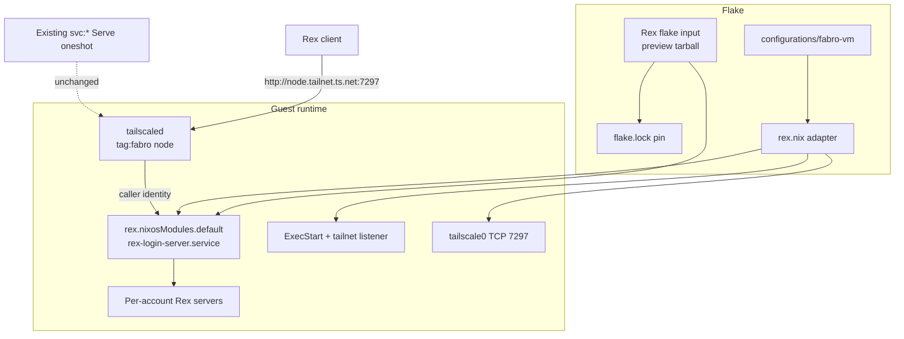
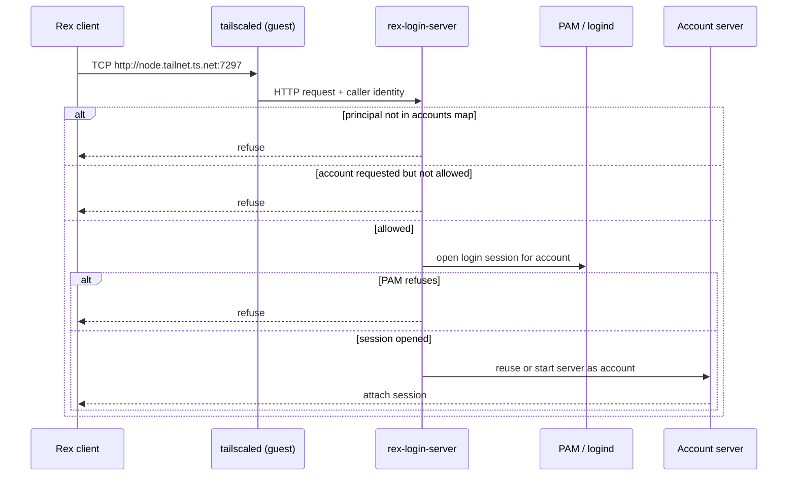
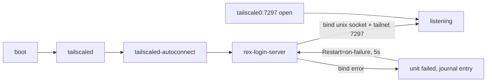

# Design Document

## Overview

The fabro Lima guest gains a Rex login server installed from a pinned upstream Rex
flake input and reachable only through the guest's own open-source `tailscaled`
tailnet-address listener on TCP 7297. `brief.md` owns the problem statement and
scope, `requirements.md` owns the behavioral contract, and `research.md` records
the external findings and sources behind every decision here.

**Purpose**: let the operator run persistent Rex sessions on the guest as the
existing Lima cidata account instead of hosting a web terminal or using SSH.

**Users**: the operator's Rex for Mac and `rex` CLI clients, plus any future local
account an operator deliberately maps in the accounts file.

**Impact**: adds one flake input, one guest module, one firewall opening, and one
group of pure-eval assertions. It does not change the existing fabro, LiteLLM,
OpenCode, or Tailscale Service configuration.

### Goals

- Obtain Rex from the pinned Rex flake input; never hand-package the binary.
- Run the login server at boot and survive unexpected exits.
- Serve only the node's tailnet address on port 7297, with no Serve, tsnet,
  shared-server, or anonymous exposure.
- Map the cidata account to one Tailscale principal with a default, and grant no
  root or system-account access.
- Prove all of the above through pure evaluation on a host without a Linux
  builder.

### Non-Goals

- Rex shared-server mode, personal servers, built-in Tailscale (`--tailscale`,
  tsnet), Tailscale Serve for Rex, and anonymous or plain listeners.
- Creating, modifying, or deleting Linux accounts; PAM policy changes; tailnet
  ACL, Service, OAuth, tag, or admin-console changes.
- Removing or reconfiguring OpenCode; Rex client setup on macOS; Lua
  customization; image rebuilds; automatic channel upgrades; resource tuning.

## Boundary Commitments

### This Spec Owns

- The `rex` flake input, its `preview` channel URL, and its `flake.lock` pin.
- The operator runbook for `/etc/nix/netrc`, the only credential path the gated
  flake accepts.
- `configurations/fabro-vm/rex.nix`: login-server options, the accounts map and
  default, the `tailnet://:7297` listener on the module-owned unit, unit
  ordering and restart policy, and the tailscale-interface firewall opening.
- Import and `specialArgs` wiring into `nixosConfigurations.fabro-vm`.
- The `fabro-vm-guest-eval` assertions covering requirements 1-7.

### Out of Boundary

- The upstream Rex package, NixOS module internals, login-server binary behavior,
  PAM policy content, and Rex client software.
- Tailnet ACLs, Service definitions, OAuth client, node tags, and MagicDNS names.
- Linux account lifecycle and the imperative Lima cidata user.
- OpenCode removal, other tailnet services, and the existing `svc:*` Serve units.
- Nix installation, `netrc-file` semantics, and Nix version selection.

### Allowed Dependencies

- Upstream Rex flake (`inputs.rex`), its `nixosModules.default`, and the release
  binary it packages for `aarch64-linux`.
- nixpkgs 26.05 modules: `services.tailscale`, `networking.firewall`, `systemd`,
  `users`, and `environment.systemPackages`.
- The existing guest `tailscaled` node registered as `tag:fabro`, and the
  existing `fabro-lima-user-manager` logind wiring.
- `flake.lock` and the pure-eval `fabro-vm-guest-eval` check pattern.
- Nix's `netrc-file` default (`/etc/nix/netrc`) on nixos.org Nix.

### Revalidation Triggers

- The upstream module gains a tailnet-address option, renames the unit, or changes
  the login-server command line.
- The Rex listener syntax, port, or `tailnet://` semantics change.
- The Tailscale interface name, tag, or node-registration path changes.
- The cidata account name, UID, or logind wiring changes.
- The chosen channel, principal, or accounts-file schema changes.
- Any change to the existing `svc:*` Serve advertisement.

## Architecture

### Existing Architecture Analysis

- `nixosConfigurations.fabro-vm` is a plain NixOS module tree under
  `configurations/fabro-vm/`; external flakes reach it through `specialArgs`
  (`rsync34`, `nixSnapshotter`, `imageNixpkgs`, `limaVirtiofsTags`). Rex follows
  the same pattern.
- `tailscale.nix` owns node registration and the `svc:*` Serve oneshot. Rex must
  not add or alter Serve state; it uses the node's own tailnet address.
- The cidata user is created imperatively by `lima-init`; `users.mutableUsers`
  stays true and no module declares that user. The per-account server therefore
  references the account by name only.
- `fabro-lima-user-manager` already enables linger, starts `user@501.service`,
  and upholds it. That is the logind session the login server's PAM step uses.
- Guest verification is the `fabro-vm-guest-eval` pure-eval assertion chain; it
  needs no Linux builder and runs under `nix flake check` on the Mac.

### Architecture Pattern & Boundary Map

Selected pattern: **upstream module plus a thin local adapter**. The local module
configures documented upstream options and overrides exactly one unit property
(`ExecStart`) where upstream exposes no option. No service code, wrapper binary,
or package override is introduced.



- **Dependency direction**: flake input → local module → upstream module → unit
  and accounts file. Runtime traffic flows client → `tailscaled` → login server →
  per-account server.
- **Boundaries**: the local module owns only option values, the listener flag,
  unit ordering/restart, and the firewall rule. The upstream module owns the
  accounts file, PAM wiring, sockets, and server lifecycle. `tailscale.nix` keeps
  owning Serve.
- **Existing patterns preserved**: specialArgs threading, per-service guest file,
  assertion-chain verification, out-of-band 1Password token runbook.

### Technology Stack

| Layer | Choice / Version | Role in Feature | Notes |
|-------|------------------|-----------------|-------|
| Configuration | Nix flakes, NixOS modules (26.05) | Input pin, guest module, unit override | Same flake and nixpkgs as the guest |
| Upstream server | Rex `nixosModules.default` (`preview` channel) | Login server, accounts file, PAM, per-account servers | ARM64 release binary; tester-gated flake |
| Runtime | systemd, systemd-logind, PAM | Boot unit, restart, per-account sessions | Existing cidata logind wiring reused |
| Networking | open-source `tailscaled`, NixOS firewall | Tailnet identity and listener 7297 | No Serve, no tsnet |
| Credentials | Nix `netrc-file` (`/etc/nix/netrc`) | Authenticates the gated flake fetch | Out-of-band; never in the Nix store |
| Verification | `nix flake check`, `fabro-vm-guest-eval` | Pure-eval assertions | Runs on Darwin without a Linux builder |

## File Structure Plan

### Directory Structure

```
configurations/fabro-vm/
├── default.nix              # Modified: import ./rex.nix; header names the service
├── rex.nix                  # New: Rex login server, accounts, listener, firewall
├── tailscale.nix            # Unchanged: node registration and svc:* Serve
└── ...                      # Other guest services unchanged
flake.nix                    # Modified: rex input, fabro-vm specialArgs, eval assertions
flake.lock                   # Modified: pinned rex tarball node
secrets/README.md            # Modified: /etc/nix/netrc runbook for the Rex token
```

### New Files

- `configurations/fabro-vm/rex.nix` — Owns the upstream module import, login
  server options, accounts/defaults, the `ExecStart` override with
  `--extra-listen tailnet://:7297`, unit ordering/restart defaults, and the
  tailscale-interface firewall rule. Header comment documents the endpoint,
  account selection, and the module-drift assumption.

### Modified Files

- `flake.nix` — Adds the `rex` input; adds `inherit (inputs) rex;` to the
  fabro-vm `specialArgs`; extends the `fabro-vm-guest-eval` assertion chain and
  its report string.
- `configurations/fabro-vm/default.nix` — Imports `./rex.nix` and updates the
  header service list.
- `flake.lock` — Records the Rex `preview` tarball URL and NAR hash.
- `secrets/README.md` — Documents the Rex package token stanza in
  `/etc/nix/netrc`, bootstrap on each evaluating host, verification, and
  rotation.

No new test directory: guest wiring is asserted in the existing eval check, which
is the repo's established mechanism for pure guest evaluation.

## System Flows

### Connection flow



The login server admits every caller `tailscaled` can identify; the accounts map
is the only authorization input. Account selection uses the `http://account@host`
form, otherwise the `defaults` entry, otherwise the single allowed account.

### Boot and failure flow



The unit is ordered after, and wants, `tailscaled-autoconnect.service`. A hard
`Requires` is deliberately not used: registration can finish after boot, and a
failed one-shot dependency would leave Rex dead until a manual restart. `Wants`
plus `Restart=on-failure` converges when the tailnet address appears.

### Account and session lifecycle

- Each account's server is a systemd-logind user service owned by that account;
  it keeps running when `rex-login-server` stops, restarts, or is upgraded.
- An accounts change re-renders `/etc/rex/accounts.jsonc` and reloads the login
  server. Still-allowed connections survive; removed callers are disconnected;
  account servers keep running.
- Sessions are per account and per server; there is no shared state between
  accounts.

## Requirements Traceability

| Requirement | Summary | Components | Interfaces | Flows |
|-------------|---------|------------|------------|-------|
| 1.1 | Rex from a lock-pinned flake input | C1 Rex input | Input URL, `flake.lock` | Flake evaluation |
| 1.2 | Upstream module imported into the guest | C3 Guest module | `imports` | Flake evaluation |
| 1.3 | Rex CLI exposed to every account | C3 Guest module | `environment.systemPackages` | Boot |
| 1.4 | No other Rex derivation or binary | C1 Rex input, C3 Guest module | Single input, no overlay | Review |
| 1.5 | Fetch authenticates with host credential | C2 Netrc path | `/etc/nix/netrc` | Flake fetch |
| 1.6 | Missing credential fails evaluation | C1 Rex input, C2 Netrc path | No fallback URL | Flake fetch error |
| 2.1 | Login server starts at boot, enabled | C3 Guest module | `wantedBy multi-user.target` | Boot |
| 2.2 | Restarted after unexpected exit | C4 Unit override | `Restart=on-failure` | Boot/failure |
| 2.3 | Runs as privileged login service | C3 Guest module, C4 Unit override | Unit runs as root | Connection |
| 2.4 | Shared-server mode not enabled | C3 Guest module | `services.rex.enable = false` | Boot |
| 3.1 | cidata account mapped to principal | C3 Guest module | `accounts.brandonmcnama.principals` | Connection |
| 3.2 | Default account for the principal | C3 Guest module | `defaults` | Connection |
| 3.3 | No root or system-account access | C3 Guest module | Accounts map contents | Connection |
| 3.4 | Allowed principal gets a server as the account | Upstream login server | Accounts map | Connection |
| 3.5 | Account-before-host selection honored | Upstream login server, C4 listener | `http://account@host` | Connection |
| 3.6 | Unmapped principal refused | Upstream login server | Accounts map | Connection |
| 3.7 | Disallowed account refused | Upstream login server | Accounts map | Connection |
| 3.8 | No Linux account created or modified | C3 Guest module | `users.users` untouched | Eval |
| 4.1 | Reachable at node tailnet address:7297 | C4 Unit override, C5 Firewall | `--extra-listen tailnet://:7297` | Connection |
| 4.2 | Caller identified by guest `tailscaled` | C4 Unit override | `tailnet://` listener | Connection |
| 4.3 | TCP 7297 open on tailnet interface | C5 Firewall | Firewall option | Connection |
| 4.4 | Account selection over `http://` address | C4 Unit override | Network listener | Connection |
| 4.5 | No Serve, tsnet, anonymous, or other network listener | C3 Guest module, C4 Unit override | Option + `ExecStart` absence | Eval |
| 4.6 | Existing `svc:*` Serve unchanged | C3 Guest module | `tailscale-serve` untouched | Eval |
| 4.7 | Bind failure reported and logged | C4 Unit override | systemd failure + journal | Boot/failure |
| 5.1 | Running account server reused | Upstream login server | Per-account server | Connection |
| 5.2 | Account servers survive login-server restart | Upstream login server, existing logind wiring | User services | Restart |
| 5.3 | Accounts change applies without dropping allowed sessions | Upstream module reload | Accounts file | Reload |
| 5.4 | Removed access closes connections, server survives | Upstream module reload | Accounts file | Reload |
| 5.5 | Multiple accounts have separate servers | C3 Guest module | Accounts map | Connection |
| 6.1 | Login session opened through PAM | C4 Unit override | `--pam-service rex-login-server` | Connection |
| 6.2 | Account server runs under user manager/logind | Existing `fabro-lima-user-manager` | `user@501.service` | Connection |
| 6.3 | Linger and user-manager behavior retained | Existing logind wiring, C6 Checks | Existing unit | Eval |
| 6.4 | User manager available without interactive login | Existing logind wiring | Linger + Uphold | Boot |
| 6.5 | PAM refusal refuses the connection | Upstream login server | PAM policy | Connection |
| 7.1 | Eval verifies enabled boot service | C6 Checks | Assertions | `nix flake check` |
| 7.2 | Eval verifies listener flag and port | C6 Checks | Assertions | `nix flake check` |
| 7.3 | Eval verifies account mapping and default | C6 Checks | Assertions | `nix flake check` |
| 7.4 | Eval verifies no root in rendered accounts | C6 Checks | Assertions | `nix flake check` |
| 7.5 | Eval verifies exclusions | C6 Checks | Assertions | `nix flake check` |
| 7.6 | Eval verifies package source and Serve unchanged | C6 Checks | Assertions | `nix flake check` |
| 7.7 | Checks complete through pure evaluation | C6 Checks | `runCommand` + eval | `nix flake check` |

## Components and Interfaces

| ID | Component | Domain/Layer | Intent | Req Coverage | Key Dependencies | Contracts |
|----|-----------|--------------|--------|--------------|------------------|-----------|
| C1 | Rex flake input | Dependency | Pin upstream Rex release | 1.1, 1.4, 1.5, 1.6 | Rex channel tarball, `flake.lock` | Flake input |
| C2 | Netrc access path | Operator runbook | Supply the tester token to Nix | 1.5, 1.6 | 1Password, `/etc/nix/netrc` | Host prerequisite |
| C3 | Rex guest module | Guest configuration | Enable login server, accounts, module import | 1.2, 1.3, 1.4, 2.1, 2.3, 2.4, 3.1-3.4, 3.6-3.8, 4.5, 4.6, 5.5 | `inputs.rex`, upstream module | NixOS options |
| C4 | Login-server unit override | Guest configuration | Add tailnet listener, ordering, restart | 2.2, 2.3, 3.5, 4.1, 4.2, 4.4, 4.5, 4.7, 6.1 | C3, systemd, tailscaled | systemd unit |
| C5 | Tailnet firewall opening | Guest configuration | Allow TCP 7297 on `tailscale0` | 4.3 | nixpkgs firewall | NixOS option |
| C6 | Guest eval checks | Verification | Pure-eval proof of the contract | 1.1, 2.1, 2.2, 2.4, 3.1-3.3, 3.8, 4.3, 4.5, 4.6, 6.3, 7.1-7.7 | `fabro-vm-guest-eval` | Assertions |

### Dependency Layer

#### C1: Rex flake input

| Field | Detail |
|-------|--------|
| Intent | Obtain Rex from one pinned upstream release source |
| Requirements | 1.1, 1.4, 1.5, 1.6 |

**Responsibilities & Constraints**

- Declare one `rex` input at
  `https://pkgs.superlogical.com/rex/nix/preview.tar.gz` with
  `inputs.nixpkgs.follows = "nixpkgs"`.
- The `preview` channel is chosen because `stable` has no tagged release yet and
  `snapshot` is explicitly unstable (`research.md`). `flake.lock` pins the exact
  release; `nix flake update rex` is the only upgrade path.
- No alternative URL, vendored binary, overlay, or fallback input exists. A
  missing token therefore fails evaluation instead of silently resolving Rex
  elsewhere.

**Dependencies**

- Outbound: `pkgs.superlogical.com` — release tarball (Critical).
- Outbound: `flake.lock` — NAR hash and URL pin (Critical).
- External: Rex flake exports `nixosModules.default` and an `aarch64-linux`
  package (Critical).

**Contracts**: Flake input

- Preconditions: the host evaluating the flake has the tester token in its netrc
  file (C2).
- Postconditions: `flake.lock` contains a `tarball` node for `rex` with a URL
  under `https://pkgs.superlogical.com/rex/nix/` and a non-empty `narHash`.
- Invariants: the input is the sole Rex source in the repository.

**Implementation Notes**

- Add the input beside the other pinned inputs in `flake.nix` with a comment
  naming the channel, the bump command, and the token requirement.
- The lock-file pin is asserted by C6; the fetch itself is not editable from the
  repo.

#### C2: Netrc access path

| Field | Detail |
|-------|--------|
| Intent | Document and verify the only credential Nix accepts for the gated flake |
| Requirements | 1.5, 1.6 |

**Responsibilities & Constraints**

- The token lives in the evaluating host's netrc file at Nix's default
  `$NIX_CONF_DIR/netrc` (`/etc/nix/netrc`), with the stanza
  `machine pkgs.superlogical.com`, `login rex`, `password <token>`.
- The file is mode `0600`. On the Mac it is owned by the login user that runs
  `nix flake check`; on the guest it is root-readable because `nixos-rebuild`
  evaluates as root.
- The token is never placed in `nix.settings`, sops, the Nix store, the repo, or
  a systemd unit. It cannot be sops-managed end to end because the flake (and
  therefore sops activation) cannot evaluate without it.
- Provisioning is manual on both hosts, following the existing
  `bootstrap-nix-github-token.sh` precedent; `secrets/README.md` gains the Rex
  stanza, verification command, rotation note, and failure symptom (HTTP 401).

**Dependencies**

- Outbound: 1Password item field holding the Rex package token (Critical).
- External: Nix `netrc-file` default (Critical).

**Contracts**: Host prerequisite

- Preconditions: the token is valid for the `preview` channel.
- Postconditions: `nix flake metadata .` resolves the `rex` input without a 401.
- Invariants: no repository file contains the token value.

**Implementation Notes**

- Document that Determinate Nix ignores `/etc/nix/netrc`; both repo hosts run
  nixos.org Nix, so the default applies.
- Do not add a flake check that reads the netrc; pure evaluation cannot and must
  not depend on credential contents.

### Guest Configuration Layer

#### C3: Rex guest module

| Field | Detail |
|-------|--------|
| Intent | Enable the upstream login server with the cidata account and principal |
| Requirements | 1.2, 1.3, 1.4, 2.1, 2.3, 2.4, 3.1-3.4, 3.6-3.8, 4.5, 4.6, 5.5 |

**Responsibilities & Constraints**

- Import `rex.nixosModules.default` inside `rex.nix`, using the `rex`
  `specialArgs` value threaded from `flake.nix`.
- Enable the login server and map exactly one existing account:

```nix
services.rex.loginServer = {
  enable = true;
  accounts.brandonmcnama.principals = [ "tailscale:brandonmcnama@outlook.com" ];
  defaults."tailscale:brandonmcnama@outlook.com" = "brandonmcnama";
};
```

- Keep the shared server, built-in Tailscale, and Serve for Rex explicitly off:

```nix
services.rex.enable = false;
services.rex.tailscale.enable = false;
services.rex.loginServer.tailscaleServe.enable = false;
```

- Leave `loginServer.allowAnonymous` unset; C4 and C6 prove no anonymous listener
  is rendered.
- Do not declare `users.users.brandonmcnama`; the account stays owned by
  `lima-init`. Additional accounts are added only as `accounts.<name>.principals`
  entries, never created here.
- Do not touch `configurations/fabro-vm/tailscale.nix` or the `svc:*` oneshot.

**Dependencies**

- Inbound: C1 — module and package source (Critical).
- Outbound: upstream login server — accounts file, PAM, per-account servers
  (Critical).
- Outbound: existing logind wiring — `user@501.service`, linger (Critical).

**Contracts**: NixOS options

- Preconditions: the cidata account exists at runtime; Rex does not create it.
- Postconditions: upstream module renders `/etc/rex/accounts.jsonc` with the
  single account and default; the package is in `environment.systemPackages`.
- Invariants: no `root`, `"*"`, system account, or tagged-device wildcard appears
  in the accounts map; no account is declared or modified.

**Implementation Notes**

- The account and principal are repeated in `defaults`; keep them as local `let`
  bindings in `rex.nix` so a future account addition is one edit.
- The header comment must state the client endpoint shape
  (`http://<node>.<tailnet>.ts.net:7297`), the `http://account@host` selection
  form, and that the endpoint hostname is the node's MagicDNS name from
  `tailscale status`, not a hardcoded `fabro` name.
- The Rex CLI reaches every account through the upstream module's system package
  installation; no extra package list entry is added.

#### C4: Login-server unit override

| Field | Detail |
|-------|--------|
| Intent | Add the tailnet-address listener to the module-owned unit without losing its arguments |
| Requirements | 2.2, 2.3, 3.5, 4.1, 4.2, 4.4, 4.5, 4.7, 6.1 |

**Responsibilities & Constraints**

- The upstream module exposes no tailnet-address listener option for the login
  server, so `systemd.services.rex-login-server.serviceConfig.ExecStart` is
  replaced with one command that reproduces the documented login-server line and
  appends the listener:

```text
<rex package>/bin/rex login-server \
  --listen unix:///run/rex/login-server.sock \
  --accounts /etc/rex/accounts.jsonc \
  --runtime-root /run/rex \
  --log-format text \
  --pam-service rex-login-server \
  --extra-listen tailnet://:7297
```

- `ExecStart` is `lib.mkForce`-d because a non-oneshot unit accepts exactly one
  start command; the substitution must not append a second process.
- `after` and `wants` include `tailscaled-autoconnect.service`; `Restart =
  lib.mkDefault "on-failure"` and `RestartSec = lib.mkDefault 5`.
- The module's unit name, `User` (root, the default when unset), sockets, PAM
  argument, and reload behavior are otherwise untouched.

**Dependencies**

- Inbound: C3 — enables the unit and supplies accounts (Critical).
- Outbound: `tailscaled-autoconnect.service` — tailnet address availability
  (Critical).
- Outbound: systemd — restart, journal, unit lifecycle (Critical).

**Contracts**: systemd unit

- Preconditions: the Rex package and accounts file exist in the built system.
- Postconditions: the unit has one `ExecStart` containing all five module
  arguments plus `--extra-listen tailnet://:7297`.
- Invariants: exactly one `--extra-listen`; no `tailnet-serve://`, no
  `--tailscale`, no `--allow-anonymous`, and no non-loopback `--listen`.

**Implementation Notes**

- Derive the executable from the module's package option
  (`lib.getExe config.services.rex.package`), not a literal store path or
  `/run/current-system` reference.
- Build the argument list once in a `let` and pass it through
  `lib.escapeShellArgs`; do not hand-join strings with spaces.
- The eval check asserts every argument, so an upstream command-line change
  fails the build instead of silently dropping PAM, accounts, or the runtime
  root.
- Binding happens at start; if the tailnet address is absent, the unit fails and
  the journal records the bind error, then systemd retries after five seconds.

#### C5: Tailnet firewall opening

| Field | Detail |
|-------|--------|
| Intent | Permit inbound TCP 7297 on the tailnet interface only |
| Requirements | 4.3 |

**Responsibilities & Constraints**

- Add `networking.firewall.interfaces.${config.services.tailscale.interfaceName}.allowedTCPPorts = [ 7297 ];`.
- Do not add a global `allowedTCPPorts` entry, a trusted interface, or a
  `services.tailscale.openFirewall` change: that option only opens UDP 41641
  (`research.md`).
- The rule exposes the port only on `tailscale0`; the listener itself binds the
  tailnet address, so LAN and public interfaces stay closed.

**Dependencies**

- Outbound: nixpkgs firewall module — per-interface rule (Critical).
- Outbound: `services.tailscale.interfaceName` — interface name (P1).

**Contracts**: NixOS option

- Preconditions: the guest firewall is enabled (NixOS default).
- Postconditions: TCP 7297 is allowed on the tailnet interface.
- Invariants: no other port or interface is opened by this spec.

**Implementation Notes**

- Using the interface-name option keeps the rule correct if the guest ever
  renames `tailscale0`; the guest currently uses the default.

#### C6: Guest eval checks

| Field | Detail |
|-------|--------|
| Intent | Bind the design to `nix flake check` through pure evaluation |
| Requirements | 1.1, 2.1, 2.2, 2.4, 3.1-3.3, 3.8, 4.3, 4.5, 4.6, 6.3, 7.1-7.7 |

**Responsibilities & Constraints**

- Extend `fabro-vm-guest-eval` in `flake.nix`; do not add a Linux build or a new
  check derivation.
- Add assertions for:
  - `services.rex.loginServer.enable` is true, `services.rex.enable` is false,
    and the unit is wanted by `multi-user.target`;
  - the effective `Restart` is `on-failure` or `always`;
  - the single `ExecStart` contains the five documented arguments plus
    `--extra-listen tailnet://:7297`, exactly one `--extra-listen`, and none of
    `tailnet-serve://`, `--tailscale`, or `--allow-anonymous`;
  - the unit is after and wants `tailscaled-autoconnect.service`, and has no
    non-root `User`;
  - the accounts map (the sole input to the rendered accounts file) is exactly
    `{ brandonmcnama = [ tailscale:brandonmcnama@outlook.com ]; }` with the
    matching `defaults` entry, and has no `root` or `"*"` account;
  - `users.users` still does not declare `brandonmcnama`, and the existing
    `fabro-lima-user-manager` assertions still pass;
  - the Rex package is in `environment.systemPackages`;
  - TCP 7297 is allowed on the tailscale interface;
  - the existing `tailscale-serve` three-service advertisement is unchanged;
  - `flake.lock` has a `tarball` `rex` node under
    `https://pkgs.superlogical.com/rex/nix/` with a non-empty `narHash`.
- Update the final `guestReport` string so the check output names Rex, the
  listener, the account, and the exclusions.

**Dependencies**

- Inbound: C1-C5 — the evaluated guest configuration (Critical).
- External: `nix flake check` on a Darwin host (Critical).

**Contracts**: Assertions

- Preconditions: the Rex input is locked and fetchable with the host token.
- Postconditions: every assertion passes and the check produces its output file.
- Invariants: no Linux builder, VM, network call, or credential read is required
  beyond the flake fetch.

**Implementation Notes**

- Read configuration values (`vm.services.rex.*`, `vm.systemd.services.*`,
  `vm.networking.firewall.*`, `vm.environment.systemPackages`) rather than
  source text, except where a source-text guard is the only way to prove the
  absence of an override.
- Use `pkgs.lib.assertMsg` with messages prefixed `fabro-vm:` to match the
  existing chain.

## Data Models

### Domain Model

- The only aggregate is the **accounts map**: existing Linux account names, the
  Tailscale principals allowed to use each, and the per-principal default.
- Callers are value objects identified by a principal string; accounts are
  references to accounts the guest already has, never entities created here.
- Invariants: one declared account (`brandonmcnama`); no `root`, `"*"`, or system
  account; every default value names a declared account; every default key is a
  declared principal.
- No transactions, events, or temporal versioning exist; a config switch replaces
  the whole rendered file atomically.

### Logical Data Model

The upstream module renders `/etc/rex/accounts.jsonc` from the option values in
C3. This spec owns only the values, not the renderer.

| Field | Type | Value in this spec | Invariant |
|-------|------|--------------------|-----------|
| `version` | integer | `1` | Written by the module |
| `accounts` | object of account name → `{ principals: [string] }` | `brandonmcnama` → `["tailscale:brandonmcnama@outlook.com"]` | Exactly one declared account; no `root`, no `"*"`, no system account |
| `defaults` | object of principal → account | `"tailscale:brandonmcnama@outlook.com"` → `"brandonmcnama"` | Every default value is a declared account; the key is a declared principal |

Rendered shape:

```json
{
  "version": 1,
  "accounts": {
    "brandonmcnama": {
      "principals": ["tailscale:brandonmcnama@outlook.com"]
    }
  },
  "defaults": {
    "tailscale:brandonmcnama@outlook.com": "brandonmcnama"
  }
}
```

Rules inherited from upstream (`research.md`):

- A caller matches an account when any principal matches. Tagged callers match
  `tailscale:tag:*`, never a person's login.
- `defaults` only chooses an account; the caller must still be allowed to use it.
- Root and system accounts must be listed by name; this spec lists neither.
- `"*"` would grant every regular account and is not used.

### Runtime state

| State | Location | Owner | Persistence |
|-------|----------|-------|-------------|
| Login-server socket | `/run/rex/login-server.sock` | root | Runtime only |
| Per-account runtime/sockets | `/run/rex/accounts/<account>/` (module/Rex-owned) | account | Runtime only |
| Account server sessions | systemd-logind user services | account | Until sessions end |
| Accounts file | `/etc/rex/accounts.jsonc` | Nix store generation | Replaced on switch |
| Logs | systemd journal (`rex-login-server`, user units) | systemd | Journal policy |

There is no database, migration, backup, or durable data owned by this spec.
Upstream data formats are out of boundary.

## Error Handling

### Error Strategy

- **Fail evaluation, never fall back**: a missing Rex token or a drifted guest
  configuration stops `nix flake check`; no alternate source, listener, or mode is
  tried.
- **Fail the unit, then converge**: a listener that cannot bind enters systemd's
  failed/auto-restart path; the journal keeps the bind error, and the unit retries
  until the tailnet address exists.
- **Refuse the connection, keep the servers**: identity, account, and PAM failures
  refuse the caller without touching any account server or existing session.

### Error Categories and Responses

| Condition | Detection | Response | Requirement |
|-----------|-----------|----------|-------------|
| Token missing or invalid | Nix fetch returns HTTP 401 | Evaluation fails; no fallback source is tried | 1.6 |
| Tailnet address not yet present | Listener bind fails | Unit enters failed state, journal records the error, systemd retries every 5 s | 4.7 |
| Port 7297 already bound | Listener bind fails | Same failure and retry path; no second listener or fallback port | 4.7 |
| Caller principal not mapped | Login server accounts check | Connection refused | 3.6 |
| Caller requests an account it may not use | Accounts/defaults check | Connection refused | 3.7 |
| PAM refuses the account (locked, expired, nologin, `/etc/nologin`) | PAM login step | Connection refused; account server not started for that attempt | 6.5 |
| Login server exits unexpectedly | systemd process supervision | Restarted; account servers and sessions stay up | 2.2, 5.2 |
| Accounts map changed on switch | Module re-renders and reloads | Allowed connections survive; removed callers are closed; account servers stay up | 5.3, 5.4 |
| Firewall or listener drift | `nix flake check` assertions | Evaluation fails with a `fabro-vm:` message | 7.1-7.6 |
| Node MagicDNS name differs from hostname | Client-side connection failure | Use the name from `tailscale status`; configuration is unchanged | 4.1 |

### Monitoring

Monitoring is the systemd journal: `journalctl -u rex-login-server` for identity,
bind, accounts, and PAM failures; `journalctl --user -u rex` (as the account) for
the per-account server. No new metrics or alerting are introduced.

## Testing Strategy

### Pure-eval checks (automated)

`fabro-vm-guest-eval` extends the existing assertion chain; `nix flake check`
runs it on the Mac without a Linux builder.

| Assertion group | Proves | Requirements |
|-----------------|--------|--------------|
| Lock node is a `pkgs.superlogical.com/rex/nix/` tarball with `narHash` | Pinned input, no floating source | 1.1 |
| Login server enabled, shared server off, wanted at boot | Boot service and mode exclusivity | 2.1, 2.4 |
| Effective `Restart` is `on-failure` or `always` | Restart behavior | 2.2 |
| Unit runs as root | Privileged login service | 2.3 |
| Accounts map equals the single cidata mapping; defaults matches; no `root`/`"*"` | Account and least-privilege contract | 3.1-3.3 |
| `users.users` has no cidata declaration; existing user-manager assertions pass | No account lifecycle change; logind wiring retained | 3.8, 6.3 |
| One `ExecStart` with the five module arguments and `--extra-listen tailnet://:7297` | Listener and preserved module wiring | 4.1, 4.2, 4.4, 6.1 |
| `ExecStart` lacks `tailnet-serve://`, `--tailscale`, `--allow-anonymous`, and other listeners | Serve/tsnet/anonymous exclusions | 4.5 |
| Firewall allows 7297 on the tailscale interface | Tailnet reachability | 4.3 |
| Rex package in `environment.systemPackages` | CLI exposure from the input | 1.3, 7.6 |
| Existing `tailscale-serve` three-service assertion still passes | Serve state untouched | 4.6 |
| No Linux builder, VM, or network use beyond the flake fetch | Pure evaluation | 7.7 |

Negative cases are the absence checks above: a future edit that adds Serve,
tsnet, anonymous access, root, a wildcard account, a second listener, or a
floating Rex source fails evaluation with a named message.

### Runtime verification (manual, guest)

Not reproducible in pure eval; performed once after the first switch and repeated
after account or channel changes:

1. `systemctl status rex-login-server` shows active (running) and enabled.
2. `journalctl -u rex-login-server` shows no bind error and the tailnet listener.
3. `ss -ltnp | grep 7297` shows the listener on the tailnet address only.
4. From the Mac, `rex -S http://<node>.<tailnet>.ts.net:7297 ls` connects as
   `brandonmcnama`; `rex -S http://brandonmcnama@<node>...:7297 ls` selects the
   account explicitly.
5. Starting a session, restarting `rex-login-server`, and reconnecting reuses the
   same account server and session.
6. Removing the principal from the accounts map (temporary local test) reloads
   the unit, closes the connection, and leaves the account server running;
   restoring it re-allows the connection.
7. A tagged device or an unmapped principal is refused.

Requirements 3.4-3.7, 4.1, 4.2, 4.4, 5.1-5.5, and 6.1, 6.2, 6.4, 6.5 are
upstream login-server or PAM behavior exercised by steps 4-7; this spec verifies
the configuration that selects them, not the upstream implementation.

### Performance and load

No load target is introduced. The listener serves one operator; session count and
resource limits remain upstream defaults (out of boundary).

## Security Considerations

- **Exposure**: the only network listener is the tailnet-address listener on TCP
  7297. Serve, tsnet, anonymous, and plain listeners are absent and asserted
  absent. The firewall allows the port only on the tailscale interface.
- **Identity**: callers are identified by the guest's own open-source
  `tailscaled`, not by Rex's built-in Tailscale. Tagged devices cannot match a
  person's login; the operator's Mac is a user-owned device.
- **Authorization**: the accounts map is the only gate. This spec maps one
  account, sets one default, and grants no `root`, `"*"`, system account, or
  tagged-device wildcard. Additional accounts must be added deliberately with
  their own principals.
- **ACL responsibility**: the tailnet ACL remains the outer control; this spec
  does not change it. A tailnet member who satisfies the accounts map gets that
  Linux account, so the ACL must be at least as tight as the accounts map.
- **Token handling**: the Rex package token lives only in `/etc/nix/netrc` (mode
  `0600`), never in the repo, Nix store, sops store, or a unit. It is a package
  credential, not a runtime secret.
- **Privilege**: the login server runs as root to open PAM sessions; the account
  server and every session run as the mapped user. No setuid binary, sudo rule,
  or shell change is introduced.
- **PAM**: the upstream login-server policy decides whether an account may log
  in. This spec does not relax it, disable PAM, or add password authentication.

## Deployment & Migration

1. Place the Rex package token in `/etc/nix/netrc` on the Mac and on the guest
   (C2). This must happen before locking or evaluating the new input.
2. Add the input, lock it (`nix flake lock`), and run `nix flake check` on the
   Mac; the Rex assertions run during pure evaluation.
3. Deploy with the existing `lima-vm-deploy` flow; the guest evaluates the flake
   (needs the guest netrc) and `nixos-rebuild switch` starts
   `rex-login-server.service`.
4. First client connection creates the account server for `brandonmcnama`; no
   pre-provisioning step exists.

Rollback: switching to the previous generation stops the login server; account
servers are user services and keep running until their sessions end, as
documented upstream. Stop them explicitly with `rex server stop` as the account
if a rollback must end sessions immediately. Channel changes use
`nix flake update rex` and a new switch; the old release stays in `flake.lock`
history for rollback.

## Supporting References

- `research.md` — Rex channel, login-server, remote-access, and Nix/netrc
  findings with source URLs.
- `requirements.md` — behavioral contract and boundary context.
- `brief.md` — problem, approach, scope, and constraints.
