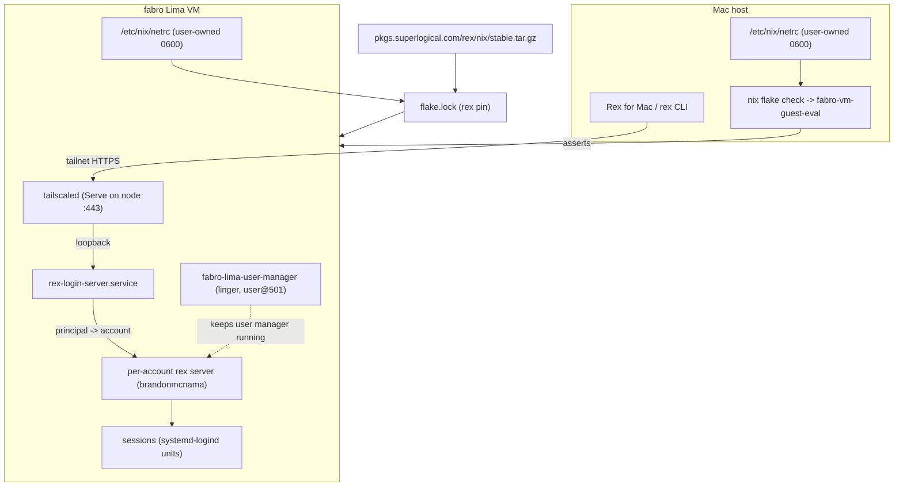
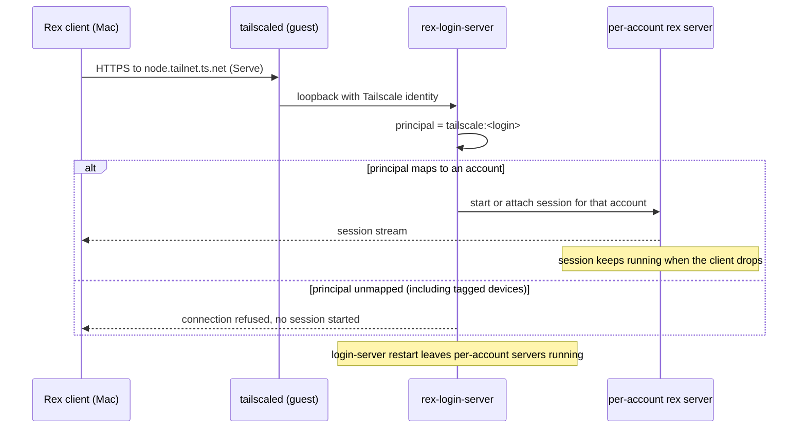

# Design Document

## Overview

This design installs Rex on the fabro Lima VM guest by adopting the upstream Rex
flake and its NixOS login-server module, mapping the cidata account to a
Tailscale principal, and exposing the result through the guest's own
`tailscaled` with Tailscale Serve. The problem statement, approach, and scope are
in `brief.md`; the behavioral contract is `requirements.md`. Neither is restated
here.

### Goals

- One `flake.lock`-pinned Rex release installed by the guest's own
  `nixos-rebuild`, with no bootstrap command on the guest beyond seeding the
  gated-release credential.
- A Rex login server at boot that starts per-account sessions for the mapped
  cidata account and keeps them alive across client disconnects and login-server
  restarts.
- Tailnet-only exposure on the guest node's own HTTPS name through the existing
  open-source `tailscaled`, with no tsnet and no change to `svc:*` services.
- Evaluation-time checks in the existing `fabro-vm-guest-eval` chain plus a
  script test, so account mapping, mode, and exposure cannot regress silently.

### Non-Goals

- Rex shared-server mode, Rex built-in Tailscale, plain or anonymous listeners.
- OpenCode removal, tailnet ACL/Service/OAuth changes, or admin-console work.
- Creating or modifying local accounts; only the existing cidata account is
  mapped.
- Rex client/app setup on macOS, Lua customization, resource-limit tuning,
  session recording, image rebuilds, and automatic channel upgrades.

## Boundary Commitments

### This Spec Owns

- The `rex` flake input (stable channel tarball), its `flake.lock` pin, and the
  `fabro-vm` `specialArgs` wiring.
- `configurations/fabro-vm/rex.nix`: login-server enablement, the account map and
  defaults, Tailscale Serve enablement, post-registration unit ordering, and the
  header that documents the connect endpoint and account selection.
- The gated-release credential path on every host that evaluates the guest:
  `scripts/bootstrap-nix-rex-token.sh`, its invocation contract, and its
  documentation in `secrets/README.md`.
- The Rex assertions inside `fabro-vm-guest-eval` (`flake.nix:1985`) and the
  `rex-nix-netrc` script test.

### Out of Boundary

- Any Rex mode other than the login server; any Tailscale transport other than
  the guest's Serve.
- Account lifecycle, PAM policy beyond the module default, tailnet policy, and
  the console-defined `svc:*` resources.
- The guest image, the Lima host config, and `lima-vm-deploy`'s implementation.
- Rex client configuration and any upgrade automation.

### Allowed Dependencies

- Upstream Rex flake (stable channel) and its `nixosModules.default`; the module
  owns the login-server unit, PAM wiring, accounts-file rendering, and the Serve
  commands. This spec binds options; it does not reimplement them.
- `services.tailscale` on the guest (`configurations/fabro-vm/tailscale.nix`) —
  registered node, tailnet HTTPS certificates, `tailscaled-autoconnect.service`.
- The cidata account (`brandonmcnama`, UID 501) created by lima-init, and
  `fabro-lima-user-manager`'s linger plus `user@501`
  (`configurations/fabro-vm/default.nix:344`).
- nixos.org Nix on both evaluating hosts (it reads `netrc-file`, default
  `/etc/nix/netrc`); determinate Nix is not a target.

### Revalidation Triggers

- The upstream module renames `services.rex.*` options, the per-account entry
  attributes, the `rex-login-server.service` unit, or changes the Serve port.
- The Rex channel changes (channel switch edits the input URL, not the module).
- The cidata account name/UID changes, or the guest stops running its user
  manager.
- The guest stops being tag-owned, or the tailnet name of the node changes.
- Nix stops honouring `netrc-file` for tarball flake inputs on either host.

## Architecture

### Existing Architecture Analysis

`nixosConfigurations.fabro-vm` (`flake.nix:3082`) composes the guest modules in
`configurations/fabro-vm/` with `specialArgs` at `flake.nix:3109`. Deployment
streams the tree into the running instance and runs the guest's own
`nixos-rebuild switch` (`home-manager/common/lima-vm.nix:209`), so every input in
`flake.lock` is fetched by the guest. `configurations/fabro-vm/tailscale.nix`
registers the node as `tag:fabro` and advertises three `svc:*` listeners with a
`tailscale serve --service=...` oneshot; the node's own HTTPS name is unused
today.

The repository has no Rex package, module, input, or unit. This feature adds one
module file, one input, and one host-side credential script, and otherwise rides
the existing composition, deployment, and check patterns.

### Architecture Pattern & Boundary Map

Selected pattern: **upstream module adoption with a thin repo-side declaration
module**. The repo declares intent (accounts, mode, exposure, ordering); upstream
owns the units, PAM, accounts file, and Serve invocation. Checks read the
evaluated configuration, not the module source.



Domain boundaries:

- **Dependency** (`flake.nix`): input, lock, `specialArgs`. No module logic.
- **Guest declaration** (`configurations/fabro-vm/rex.nix`): what Rex should be.
- **Credential** (`scripts/bootstrap-nix-rex-token.sh`, `secrets/README.md`):
  host-local netrc; never part of the flake graph.
- **Verification** (`fabro-vm-guest-eval`, `tests/rex-nix-netrc/`): assertions and
  script contract.

### Technology Stack

| Layer | Choice | Role in Feature | Notes |
|-------|--------|-----------------|-------|
| Configuration | Nix flake input `rex` (stable tarball) | Pins the Rex release | `nix flake update rex` moves the pin. |
| Configuration | NixOS module `services.rex.loginServer` | Login server, accounts, Serve | Upstream module; repo binds options only. |
| Runtime | `rex-login-server.service` + per-account servers | Persistent sessions | Per-account units are module-owned. |
| Exposure | `tailscaled` Tailscale Serve | Node's own tailnet HTTPS name | No tsnet, no new `svc:*`. |
| Credential | `netrc-file` (`/etc/nix/netrc`) | Gated tarball fetch | Seeded per host by script. |
| Verification | `fabro-vm-guest-eval` assertions + bash test | Regression guard | Pure eval on the Mac; no builder. |

## File Structure Plan

### Directory Structure

```
configurations/fabro-vm/
├── rex.nix                # NEW: login server, accounts, Serve, ordering, endpoint notes
├── default.nix            # MODIFIED: import ./rex.nix
└── tailscale.nix          # UNCHANGED: svc:* oneshot stays authoritative for services

scripts/
└── bootstrap-nix-rex-token.sh   # NEW: seed/verify /etc/nix/netrc for pkgs.superlogical.com

tests/
└── rex-nix-netrc/
    └── bootstrap.test.sh  # NEW: script contract with stubbed nix/op, no network

flake.nix                  # MODIFIED: input, specialArgs, guest assertions, check
flake.lock                 # MODIFIED: regenerated by `nix flake lock`
secrets/README.md          # MODIFIED: "Rex package token (netrc)" section
```

### Modified Files

- `flake.nix` — adds `inputs.rex.url = "https://pkgs.superlogical.com/rex/nix/stable.tar.gz";`;
  adds `rex = inputs.rex;` to the fabro-vm `specialArgs` (`:3109`); extends
  `fabro-vm-guest-eval` (`:1985`) with the Rex assertions plus a `flake.lock`
  pin assertion; adds the `rex-nix-netrc` check next to the other `runCommand`
  checks in `checks` (`:342`).
- `configurations/fabro-vm/default.nix` — imports `./rex.nix` after
  `./tailscale.nix` and extends the header comment to mention the login server.
- `secrets/README.md` — documents the netrc file, its owner/mode, the seeding
  command per host, rotation, and the 401 failure mode.

### Existing Files Referenced

- `configurations/fabro-vm/tailscale.nix` — prerequisite: node registration and
  the `svc:*` Serve oneshot this spec must not disturb.
- `configurations/fabro-vm/default.nix` (`:344`) — `fabro-lima-user-manager`
  keeps linger and the cidata user manager alive for per-account session units.
- `home-manager/common/lima-vm.nix` (`:209`) — the deployment path that makes the
  guest fetch the new input; no change required.
- `scripts/bootstrap-nix-github-token.sh` — the structural precedent for the new
  credential script (temp file, `install -m 0600`, named failure modes).

## System Flows

### Connect, resume, and isolation



Decisions in this flow: identity is the connecting device's Tailscale principal,
never a password or key; isolation is per-account server identity, not a
multiplexer setting; tagged devices carry no login and are therefore refused
(`4.7`, `3.3`).

### Guest boot order

1. lima-init creates the cidata user and mounts the state share.
2. `fabro-lima-user-manager` enables linger and starts `user@501`.
3. `tailscaled-autoconnect.service` registers the node (`tag:fabro`).
4. `rex-login-server.service` starts — ordered after registration by this
   spec, so its Serve call never runs against a logged-out backend.
5. Existing `tailscale-serve` advertises `svc:fabro`, `svc:litellm`, and
   `svc:opencode` exactly as before.

## Requirements Traceability

| Requirement | Summary | Components | Interfaces | Flows |
|-------------|---------|------------|------------|-------|
| 1.1–1.6 | Rex comes from the upstream flake, pinned, reproducible, fails closed | Rex Flake Pin; Guest Rex Module; Guest Eval Checks | `inputs.rex`, `flake.lock`, package binding | Guest rebuild |
| 2.1–2.6 | Login server at boot, persistent/resumable sessions, documented endpoint | Guest Rex Module; upstream module | `services.rex.loginServer.*`, `rex-login-server.service` | Boot order; connect/resume |
| 3.1–3.10 | Cidata mapped by principal, undeclared user, isolation, defaults | Guest Rex Module; Guest Eval Checks | `rexLoginAccounts` map, account entry | Connect/resume |
| 4.1–4.8 | Serve on the node's own name, no tsnet, tailnet-only, `svc:*` untouched | Guest Rex Module; Serve Ordering Guard; Guest Eval Checks | `tailscaleServe.enable`, unit ordering | Boot order; connect |
| 5.1–5.6 | Evaluation checks over server, accounts, Serve, mode, pin | Guest Eval Checks; `rex-nix-netrc` check | assertion chain, flake check | `nix flake check` |
| 6.1–6.6 | Gated credential on each evaluating host, no store, no sops dependency | Token Bootstrap Script; docs | script CLI, `netrc-file` | Host bootstrap; rebuild |

## Components and Interfaces

| Component | Domain/Layer | Intent | Req Coverage | Key Dependencies | Contracts |
|-----------|--------------|--------|--------------|------------------|-----------|
| Rex Flake Pin | flake.nix | Pin one upstream Rex release and expose it to the guest | 1.1–1.6, 5.5 | Upstream tarball (P0), netrc (P0) | State |
| Guest Rex Module | guest config | Declare login server, account map, defaults, Serve | 2.1–2.6, 3.1–3.10, 4.1–4.8 | Upstream module (P0), tailscaled (P0) | Service, State |
| Serve Ordering Guard | guest config | Order Rex units after node registration | 4.1, 2.1 | tailscaled-autoconnect (P0) | State |
| Guest Eval Checks | checks | Fail evaluation on mode/mapping/exposure drift | 5.1–5.6, 1.2, 4.8 | `fabro-vm-guest-eval` (P0) | Test contract |
| Token Bootstrap Script | host tooling | Seed and verify the gated-release netrc | 6.1–6.6 | Nix client (P0), `op` (P1) | CLI |
| Script Test | tests | Prove the script's failure diagnosis | 6.4, 6.5 | POSIX shell (P0) | Test contract |

### Dependency Layer

#### Rex Flake Pin

| Field | Detail |
|-------|--------|
| Intent | Make the installed Rex release a locked, reproducible flake input. |
| Requirements | 1.1, 1.2, 1.3, 1.4, 1.5, 1.6, 5.5 |

**Responsibilities & Constraints**
- Owns the input declaration and the `specialArgs` hand-off; nothing else.
- The input is the stable channel tarball; the release identity lives only in
  `flake.lock` (`locked.type = "tarball"`, `locked.narHash`).
- The input keeps its own `nixpkgs`; the repo does not force `follows` on a
  module it cannot test against another nixpkgs.

**State Contract**
```nix
inputs.rex.url = "https://pkgs.superlogical.com/rex/nix/stable.tar.gz";
# fabro-vm specialArgs (flake.nix:3109)
specialArgs.rex = inputs.rex;
```
- Preconditions: a credential for `pkgs.superlogical.com` on the evaluating host.
- Postconditions: `inputs.rex` is a flake exposing `nixosModules.default` and an
  `aarch64-linux` package; the lock records the tarball's integrity.
- Invariants: no URL token, no vendored binary, no channel other than the one in
  the URL; rewrites happen only through `nix flake update rex`.

**Implementation Notes**
- An unreachable or rejected tarball fails evaluation; Nix never falls back to a
  different source (1.6).
- Evaluation cost: the input carries its own nixpkgs, so `nix flake check` gains
  one locked nixpkgs eval. Accepted to avoid an untested `follows` override.
- The one-time credential seed is a fetch prerequisite (6.1–6.6), not an install
  step: after it exists, `nixos-rebuild` installs and enables Rex with no further
  command (1.4).

### Guest Configuration Layer

#### Guest Rex Module

| Field | Detail |
|-------|--------|
| Intent | Declare the login server, the cidata account mapping, defaults, and Serve exposure. |
| Requirements | 2.1–2.6, 3.1–3.10, 4.1–4.8 |

**Responsibilities & Constraints**
- Owns one account map entry (`brandonmcnama`) and the module-level defaults;
  creates no user, no shell, and no password.
- Enables exactly one Rex mode: the login server. Shared-server mode and
  `services.rex.tailscale.*` stay unset.
- Authentication is the connecting device's Tailscale principal through the
  module's default PAM wiring: no password, key, or interactive guest login is
  involved (`3.7`).
- Does not run `tailscale serve` itself; the module's Serve integration targets
  the node's own listener. The existing `svc:*` oneshot keeps owning services.
- Documents the connect endpoint and the account-selection rule in its header,
  because both are runtime facts (assigned DNS name, principal-to-account map).

**Service Interface**
```nix
# configurations/fabro-vm/rex.nix — repo-owned declaration surface
let
  # Local account -> accepted Tailscale principals. The guest's login server
  # identifies connections only by "tailscale:<login>".
  rexLoginAccounts = {
    brandonmcnama = [ "tailscale:<operator-tailnet-login>" ];
  };
in
{
  services.rex.loginServer = {
    enable = true;
    accounts = <map from rexLoginAccounts>;   # key: account name; value: principals (+ settings)
    defaults = { };                           # module defaults; no per-account override
    tailscaleServe.enable = true;
  };
}
```
- Preconditions: the module is imported from `default.nix`; `rex` reaches it via
  `specialArgs`; the account exists at runtime (lima-init).
- Postconditions: `rex-login-server.service` exists and is wanted at boot; Serve
  is enabled; the rendered accounts file contains `brandonmcnama` with a
  `tailscale:` principal; no account entry names `root` or a system account.
- Invariants: the principal list is non-empty and every element starts with
  `tailscale:`; the map is the only source of admitted identities; per-account
  settings are not declared in this spec.

**State Management**
- Rendered state: the account map plus defaults, rendered into the module's
  accounts file at build time. There is no runtime mutation and no persistent
  Rex-specific mutable state owned by this spec.
- Sessions are module-owned systemd-logind units; this spec asserts only that
  the cidata user manager stays up.

**Implementation Notes**
- Integration: import order matters only in that `./rex.nix` follows
  `./tailscale.nix` for readability; Nix module merging does not depend on it.
- The upstream per-account entry attribute name appears once, in the mapping
  helper (`research.md` "Open items"); changing it is a one-line edit.
- The header records: endpoint `https://<node>.<tailnet>.ts.net` (read from
  `tailscale status` on the guest), account selection by Tailscale principal,
  multiple accounts per principal render as a client-side choice, and tagged
  devices are refused.

#### Serve Ordering Guard

| Field | Detail |
|-------|--------|
| Intent | Guarantee the login server (and its Serve call) starts only after the node is registered. |
| Requirements | 4.1, 2.1 |

**State Contract**
```nix
systemd.services.rex-login-server = {
  wants = [ "tailscaled-autoconnect.service" ];
  after = [ "tailscaled-autoconnect.service" ];
};
```
- `tailscaled-autoconnect.service` is `Type=notify` and returns only when the
  backend is Running (`configurations/fabro-vm/tailscale.nix`), so ordering on it
  is sufficient and idempotent with any ordering the module already sets.
- No restart policy is added; the module owns the unit's lifecycle keys.

### Verification Layer

#### Guest Eval Checks

| Field | Detail |
|-------|--------|
| Intent | Fail evaluation with an actionable message when Rex drifts. |
| Requirements | 5.1–5.6, 1.2, 4.8 |

**Test Contract** — assertions appended to `guestReport` in
`fabro-vm-guest-eval`, each a `pkgs.lib.assertMsg` with a message naming the
missing or misconfigured element:

| Assertion | Reads | Requirement |
|-----------|-------|-------------|
| Login server enabled | `vm.services.rex.loginServer.enable` | 5.1 |
| Cidata account mapped | `builtins.hasAttr "brandonmcnama" vm.services.rex.loginServer.accounts` | 5.2, 3.1 |
| Principal rendered | `builtins.toJSON` of that entry contains `tailscale:` | 5.2, 3.1 |
| Serve enabled | `vm.services.rex.loginServer.tailscaleServe.enable` | 5.3, 4.1 |
| No built-in Tailscale | `!(vm.services.rex.tailscale.enable or false)`, and no `rex*` unit's `ExecStart` contains `--tailscale` | 5.4, 4.3 |
| No shared-server mode | the module's shared-server enable flag evaluates false (read with `or false` so an absent option cannot produce a false failure); the message names shared-server mode | 5.6 |
| Pin recorded | `flake.lock` node `rex` has `locked.type == "tarball"` and a `narHash` | 1.2, 5.5 |
| Package from the pin | the configured Rex package's `outPath` equals `inputs.rex.packages.aarch64-linux.default` | 5.5 |
| No declared user | `!(vm.users.users ? brandonmcnama)` and `vm.users.mutableUsers` | 3.2 |
| No root mapping | `!builtins.hasAttr "root" vm.services.rex.loginServer.accounts` | 3.4 |
| Ordering | `tailscaled-autoconnect.service` in `vm.systemd.services.rex-login-server.after` | 4.1 |
| `svc:*` untouched | the three existing `--service=` ExecStart entries of `tailscale-serve` are unchanged | 4.8 |

- No assertion reads upstream module source or file paths: every one reads the
  evaluated option tree, so the check survives renames that keep the rendered
  semantics. The two option names not fixed by `brief.md` (the per-account
  principal attribute and the optional package/shared-server fields) are
  confirmed against the pinned module when the input is first locked.

#### Script Test

| Field | Detail |
|-------|--------|
| Intent | Prove the credential script's contract without network, root, or Nix. |
| Requirements | 6.4, 6.5 |

**Test Contract** — `tests/rex-nix-netrc/bootstrap.test.sh`, run by the
`rex-nix-netrc` flake check with `pkgs.bash` on `PATH` plus stubs:
- token from `REX_PACKAGE_TOKEN` writes a `machine pkgs.superlogical.com` line
  into a `--file` target and exits 0;
- a missing token exits non-zero, names `REX_PACKAGE_TOKEN`, and writes nothing;
- a verification failure exits non-zero, names the credential and the host, and
  does not leave the token in the target file;
- `--check` never writes;
- unrelated `machine` lines in an existing file are preserved.

### Host Tooling Layer

#### Token Bootstrap Script

| Field | Detail |
|-------|--------|
| Intent | Put the gated-release credential where each evaluating host's Nix can read it. |
| Requirements | 6.1, 6.2, 6.3, 6.4, 6.5, 6.6 |

**CLI Contract**
```
bootstrap-nix-rex-token.sh [--check] [--file PATH] [--channel stable|preview|snapshot]
```
- Token source: `REX_PACKAGE_TOKEN`, else `op read --no-newline "${REX_PACKAGE_TOKEN_URI:-op://Private/Rex/Package Token}"`.
- Target: `/etc/nix/netrc` by default; one line
  `machine pkgs.superlogical.com login rex password <token>`; mode `0600`, owner
  the invoking login user (Nix reads `netrc-file` in the client process, and the
  root daemon can still read a user-owned file).
- Verification: `nix store prefetch-file` on the channel URL after writing;
  failure removes the written entry and exits naming `REX_PACKAGE_TOKEN`, the
  URL host, and the netrc path.
- `--file PATH` writes without `sudo` (the test path and escape hatch); the
  default path is installed with `sudo install`.
- Exit codes: `0` ok, `1` misuse/refused root, `2` no `op` and no token,
  `3` empty or rejected token, `4` write/verification failure.

**Implementation Notes**
- Runs on both hosts: the Mac has `op`; the guest receives
  `REX_PACKAGE_TOKEN` over the existing Lima SSH session and has no `op`.
- The token reaches disk only through a `umask 077` temp file removed by a trap,
  the same shape as `scripts/bootstrap-nix-github-token.sh`; existing unrelated
  `machine` lines are filtered and re-emitted, not rewritten.
- Verification calls `nix store prefetch-file` with `nix-command` explicitly
  enabled, so it works on a host whose `nix.conf` has not enabled the new CLI.
- Never signs the URL, never logs the token, never writes it under the repo, and
  never places it in the Nix store (6.5). `netrc` content is not part of any
  derivation input.
- Does not depend on sops, so it works on the Mac, which does not mount the
  guest's store (6.6).

## Data Models

### Domain Model

- **Account mapping**: local Linux account name → admitted Tailscale principals
  (`tailscale:<login>`) plus optional per-account settings. The cidata account is
  the only instance.
- **Principal**: the identity of the connecting device as reported by the
  guest's `tailscaled`; tagged devices have none.
- **Defaults**: one settings set applied to every per-account server.
- **Session**: a per-account server plus its terminal sessions, owned by
  systemd-logind for that account.

### Logical Data Model

| Account | Linux user source | Principals | Settings |
|---------|-------------------|------------|----------|
| `brandonmcnama` | lima-init cidata (UID 501), undeclared | one `tailscale:<login>` (constant in `rex.nix`) | none; module defaults apply |

**Consistency & Integrity**
- Map keys must name accounts that exist at runtime; the spec declares none and
  removes none.
- Principals are globally unique across accounts; a principal mapped to several
  accounts is offered a choice rather than merged.
- `root` and system accounts are absent by construction; the map is positive
  (allow-list) only.
- The rendered accounts file is derived at build time and never edited at
  runtime.
- 3.5 and 3.10 are structural: the map accepts more accounts and per-account
  settings, but this spec declares one account and no overrides, so both
  criteria hold with a single entry.

### Data Contracts & Integration

- **Accounts file**: rendered by the module from the declaration above; the repo
  owns its content, not its format.
- **Credential file**: one `machine` line per host entry, one line per machine,
  `0600`, user-owned; the Rex line is the only one this spec writes and it is
  replaced in place on rotation.

## Error Handling

| Condition | Detection | Response | Req |
|-----------|-----------|----------|-----|
| Token missing or rejected on a host | Nix fetch of the tarball returns 401; script verification fails | Evaluation/rebuild fails; script names `REX_PACKAGE_TOKEN`, host, and netrc path; no substitute source | 1.6, 6.4 |
| Unmapped principal connects | Login server lookup | Connection refused, no session started; journal entry names the principal | 3.3 |
| Tagged device connects | No login identity | Refused; never attributed to a mapped account | 4.7 |
| Mapped account absent at runtime | Session start | Refused; no fallback account | 3.8 |
| Serve call before registration | Unit ordering | `rex-login-server` starts only after `tailscaled-autoconnect` | 4.1, 2.1 |
| Shared-server mode or `services.rex.tailscale` configured | Eval assertion | Evaluation fails, message names the unsupported mode | 5.6, 4.3 |
| Cidata principal list empty or malformed | Eval assertion | Evaluation fails, message names the principal constant | 3.1, 5.2 |
| `rex` input unpinned | `flake.lock` assertion | Evaluation fails, message names the missing lock fields | 1.2 |

**Rollout / rollback**
1. Seed the token on the Mac (`--check` passes), add the input, `nix flake lock`,
   run `nix flake check`.
2. Seed the token on the guest, run `lima-vm-deploy`.
3. Verify: `systemctl status rex-login-server`, `tailscale serve status`, connect
   from the Rex client, resume after disconnect, restart the login server and
   confirm the session survives.
4. Rollback: `nixos-rebuild --rollback` on the guest (the previous generation
   has no Rex unit) and remove the input on the Mac. The netrc file may stay; it
   is inert without the input.

**Monitoring**: `journalctl -u rex-login-server`, `tailscale serve status` on the
guest, `loginctl list-sessions` for per-account session units. No new metrics or
alerting.

## Testing Strategy

- **Evaluation (5.1–5.6, 1.2, 4.8)**: the assertion table above runs inside the
  existing `fabro-vm-guest-eval` check; `nix flake check` on the Mac is the gate.
- **Script contract (6.4, 6.5)**: `tests/rex-nix-netrc/bootstrap.test.sh` via the
  `rex-nix-netrc` check — seeding, missing token, rejected token, `--check`
  no-write, unrelated-line preservation.
- **Regression (3.2, 3.4, 4.8)**: existing assertions for `users.mutableUsers`,
  the user manager, and the three `svc:*` ExecStart entries must still pass
  unchanged.
- **Manual acceptance (2.2–2.5, 3.6, 4.2, 4.5, 4.6)**: connect from the Mac over
  the tailnet, disconnect and reconnect to resume, confirm another account's
  session is not reachable, restart `rex-login-server` and confirm the session
  survives, and confirm the endpoint is unreachable from outside the tailnet.
- **Failure-path acceptance (6.4)**: on a host without the netrc entry, confirm
  the fetch fails with 401 and the script names the credential.

## Security Considerations

- Exposure is Serve-only on the tailnet; no Funnel, no plain listener, no tsnet,
  and no new `svc:*` resource (4.2–4.6).
- Authorization is the tailnet ACL plus the explicit principal allow-list; the
  login server holds no passwords or keys, so account isolation depends on the
  ACL admitting only the operator's devices.
- Tagged devices cannot be attributed to an account and are refused (4.7).
- The token lives only in a user-owned `0600` netrc on each evaluating host; it
  is never committed, never passed in the input URL, and never in the Nix store.
- No `root` or system account is mapped; adding one is a visible one-line change
  that the checks do not silently allow.

## Risks and Open Items

- **Client/server version skew**: the pin is the stable channel and matches the
  operator's decision; if the Mac client tracks another channel, switch the input
  URL and re-lock. Rex on Linux is beta, so channel churn is expected.
- **First-rebuild chicken-and-egg**: the guest's netrc must be seeded before the
  first deploy that includes the input; documented as step 2 of the rollout and
  in `secrets/README.md`.
- **Unverified upstream option names**: the per-account principal attribute, the
  package option, and the shared-server flag are not readable here
  (`research.md`); each is isolated to one helper or one `or false` assertion.
- **Endpoint name**: the guest node's own tailnet name is assigned at
  registration; the header documents how to read it rather than hardcoding it.
- **Same-port coexistence**: the node's own Serve listener and the `svc:*`
  listeners are separate scopes; the checks pin the `svc:*` commands so a future
  change cannot silently move them onto the node's name.
