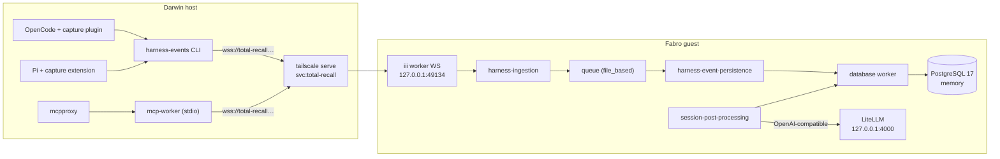
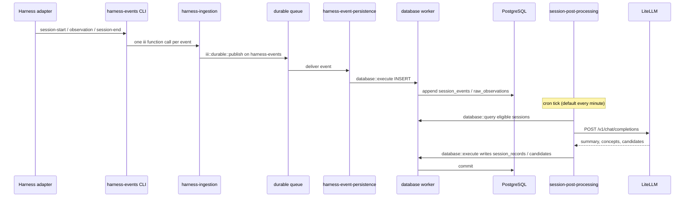
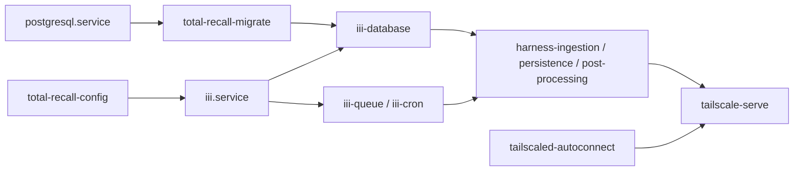
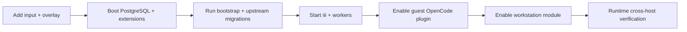

# Design Document

## Overview

This design installs a pinned total-recall stack on the Fabro guest and wires OpenCode, Pi, and mcpproxy on the Darwin hosts to that single store over the tailnet. `brief.md` owns the problem statement and scope; `requirements.md` owns the behavioral contract; `research.md` records the upstream and dependency facts used below.

**Purpose**: make one PostgreSQL-backed memory service the shared capture and retrieval point for agent sessions on the guest and the workstations.

**Users**: the operator using OpenCode or Pi on a Darwin host, and the guest's headless OpenCode console.

**Impact**: adds one flake input, one package overlay, one guest module with a supervised iii runtime and database data plane, one `svc:total-recall` Serve entry, one Home Manager client module, and pure-evaluation checks. Existing fabro, LiteLLM, OpenCode, AgentMemory, and `svc:fabro`/`svc:litellm`/`svc:opencode` behavior is preserved.

### Goals

- Obtain total-recall workers, adapters, and migrations from one locked flake revision and package the missing CLI in the repository.
- Own the guest lifecycle: PostgreSQL 17 and migrations, a loopback-only iii runtime, durable queue, worker supervision, and Tailscale Serve.
- Reuse the guest's LiteLLM gateway for post-processing without placing its credential in the Nix store.
- Give workstations capture and MCP retrieval through one shared Home Manager module, with no local memory runtime.

### Non-Goals

- Vector embeddings, `memory-embedding`, `llm-router`, and semantic search.
- Retiring AgentMemory/cavemem or importing existing history.
- Tailscale administration, ACLs, Service creation, or certificate provisioning.
- Backups, retention, high availability, and model cost tuning.
- Upstream total-recall changes or an HTTP MCP transport.

## Boundary Commitments

### This Spec Owns

- The `total-recall` flake input and lock pin.
- `overlays/total-recall.nix`: repo-owned derivations for iii 0.24, the `database`/`queue`/`cron` workers, and `harness-events`; aliases for the upstream workers and adapters.
- `configurations/fabro-vm/total-recall.nix` and its `total-recall/` SQL and runner files: PostgreSQL, roles, migrations, iii engine, worker units, LiteLLM post-processing settings, and the `svc:total-recall` Serve argument.
- The guest OpenCode plugin copy in `configurations/fabro-vm/opencode.nix`.
- `home-manager/common/total-recall.nix`: client packages, adapter environment, OpenCode plugin file, Pi extension, and the mcpproxy stdio upstream.
- The guest and host pure-evaluation checks in `flake.nix`.

### Out of Boundary

- The upstream total-recall source, its schemas, and its worker behavior.
- PostgreSQL backup/restore, replication, tuning, and data migration.
- Tailnet policy, the `svc:total-recall` Service definition, DNS, and OAuth.
- Workstation-local memory runtimes, AgentMemory changes, and mcpproxy internals.
- Any harness other than OpenCode, Pi, and the Fabro guest's OpenCode console.

### Allowed Dependencies

- `inputs.total-recall` packages for the workers, OpenCode adapter, Pi adapter, and `mcp-worker`.
- The repository's locked `nixpkgs-unstable` input for PostgreSQL 17 and its three extensions.
- The existing guest sops store (`secrets/fabro.fabro.yaml`), `tailscaled`, LiteLLM on `127.0.0.1:4000`, and the existing `tailscale-serve` unit.
- `home.mcp.extraServers`, `programs.pi.coding-agent`, and `home.opencode.wrapperCommands` as they exist today.

### Revalidation Triggers

- A total-recall flake bump that changes worker names, migration files, environment variables, or queue payloads.
- An iii minor bump that changes `config.yaml` worker names, listener defaults, or the configuration-worker file shape.
- A PostgreSQL major bump or an extension version change that affects the memory schema.
- A change to the `svc:total-recall` Service name or tailnet DNS name.
- A change to mcpproxy's `extraServers` renderer or OpenCode's plugin discovery path.

## Architecture

### Existing Architecture Analysis

The fabro guest is a `aarch64-linux` NixOS system composed by `configurations/fabro-vm/default.nix` and deployed by `lima-vm-deploy` + `nixos-rebuild switch`. Its services are repo-owned systemd units with sops-provided environment files; it advertises loopback targets through `tailscale serve --service=…` in `configurations/fabro-vm/tailscale.nix`. It deliberately has no mcpproxy (`flake.nix:2327`) and no PostgreSQL.

The Darwin host runs Home Manager from `home-manager/common` plus `home-manager/mcp`; mcpproxy is the single MCP entrypoint and already renders stdio upstreams from `home.mcp.extraServers`. OpenCode currently uses AgentMemory and must keep it. The new client module is additive and disabled by default.

### Architecture Pattern & Boundary Map

The design is a service-ownership boundary: the guest owns every stateful component; workstations own only thin clients.



**Architecture Integration**:
- Selected pattern: repo-owned provisioning around upstream binaries, with all state under the guest's `/var/lib` and all network reach through one Serve handler.
- Domain boundaries: package provenance (overlay), guest data plane (PostgreSQL + SQL runner), guest control plane (iii + units), exposure (Serve), clients (Home Manager module), verification (flake checks).
- Existing patterns preserved: sops templates and placeholders, loopback listeners, oneshot Serve re-application, `home.mcp.extraServers`, `home.opencode.wrapperCommands`, and host-gated pure checks.
- New components rationale: the overlay exists because upstream exports no NixOS module or CLI; the migration runner exists because upstream migrations are not idempotent; the client module exists so both adapters and mcpproxy share one endpoint declaration.

### Technology Stack

| Layer | Choice / Version | Role in Feature | Notes |
|-------|------------------|-----------------|-------|
| Flake input | `github:DWSR/total-recall` at the locked rev | Workers, adapters, migrations | No `nixpkgs.follows`; upstream requires Rust 1.98.1 |
| Runtime | iii `0.24.0` | Worker registry, queue, cron, configuration | Repo-owned `fetchurl` derivation |
| Runtime workers | `database` 0.5.26, `queue` 0.21.26, `cron` 0.21.28 | DB access, durable topic queue, cron triggers | Repo-owned `fetchurl` derivations, `aarch64-linux` |
| total-recall workers | `harness-ingestion`, `harness-event-persistence`, `session-post-processing` | Validate/publish, persist, interpret | Upstream packages |
| Clients | `harness-events`, `opencode-harness-events`, `pi-harness-events`, `mcp-worker` | Capture and MCP retrieval | CLI is repo-built; others from upstream |
| Data | PostgreSQL 17 + `pg_textsearch` + `pgvector` 0.8.7 + `pg_uuidv7` 1.7.0 | Append-only evidence and versioned memories | From `pkgs.unstable`, because 26.05 ships pgvector 0.8.2 |
| Model gateway | LiteLLM `127.0.0.1:4000/v1` | Post-processing provider | Existing service; master key from sops |
| Exposure | Tailscale Serve `svc:total-recall` | Publish worker WebSocket over TLS | Same pattern as existing `svc:*` entries |

## File Structure Plan

### Directory Structure

```
configurations/fabro-vm/
├── total-recall.nix              # options, PostgreSQL, units, Serve argument
├── total-recall/
│   ├── migrate.nix               # migration runner derivation
│   ├── migrate.sh                # ledger check + ordered psql apply
│   ├── bootstrap.sql             # database ownership, extensions, schema grants
│   └── runtime-grants.sql        # app-role privileges across all worker tables
├── default.nix                   # + import, enable, sops template
├── opencode.nix                  # + plugin copy and capture environment
└── tailscale.nix                 # + svc:total-recall Serve line and ordering

overlays/
├── total-recall.nix              # pinned iii/workers/CLI/adapters
└── default.nix                   # + total-recall in custom-packages

home-manager/
├── common/total-recall.nix       # shared workstation client module
└── common/default.nix            # + import

configurations/personal/home-manager/default.nix  # + enable the client module
flake.nix                                         # + input, specialArgs, checks
```

### New Files

- `overlays/total-recall.nix` — pinned package attributes and recorded versions.
- `configurations/fabro-vm/total-recall.nix` — the guest stack; the only module that starts stateful memory services.
- `configurations/fabro-vm/total-recall/{migrate.nix,migrate.sh,bootstrap.sql,runtime-grants.sql}` — schema bootstrap and idempotent migration application.
- `home-manager/common/total-recall.nix` — `home.totalRecall` options and client wiring.

### Modified Files

- `flake.nix` — add the `total-recall` input; thread it through `specialArgs`; add guest assertions and host-wiring checks; extend the guest report.
- `overlays/default.nix` — add the total-recall overlay to `custom-packages`.
- `configurations/fabro-vm/default.nix` — import the module, enable it, add the `total-recall-env` sops template and its `restartUnits`.
- `configurations/fabro-vm/opencode.nix` — install the capture plugin into the config tree, add `III_URL`/`HARNESS_EVENTS_BIN`, add the CLI to `path`, and order after the ingestion unit softly.
- `configurations/fabro-vm/tailscale.nix` — add the fourth `ExecStart` line, memory-unit ordering, and keep the existing three lines unchanged.
- `home-manager/common/default.nix` — import the client module.
- `configurations/personal/home-manager/default.nix` — set `home.totalRecall.enable = true`.

## System Flows

### Capture, persistence, and interpretation



- Capture is fail-open: an unreachable endpoint is a diagnostic in the adapter, never a session failure.
- The queue topic is one constant (`harness-events`); ingestion and persistence must agree on it.
- Post-processing only reads the ledger; it never updates or deletes `session_events` or `raw_observations`.

### Guest boot and switch ordering



- `total-recall-migrate` is a `oneshot` that creates the ledger table, applies unseen migrations, then applies grants and ownership.
- `total-recall-config` writes the configuration worker's per-worker YAML into `/var/lib/total-recall/config` before the engine reads it, so every switch converges the worker settings.
- `tailscale-serve` wants (not requires) the memory units: a memory outage must not remove the existing `svc:fabro`, `svc:litellm`, or `svc:opencode` advertisements.
- Before tailnet registration the memory units remain usable on loopback; the Serve unit is already ordered after `tailscaled-autoconnect`.

## Requirements Traceability

| Requirement | Criteria | Design elements | Interfaces / flows |
|-------------|----------|-----------------|--------------------|
| 1 Pinned installation | 1.1–1.6 | Overlay, flake input, `harness-events` derivation | `overlays/total-recall.nix`; package attributes |
| 2 Guest memory database | 2.1–2.8 | PostgreSQL module, migration runner, roles/grants | `configurations/fabro-vm/total-recall.nix`; boot flow |
| 3 Guest memory runtime | 3.1–3.8 | iii engine, database/queue/cron, three workers, `/var/lib` state | Unit matrix, worker env contract, capture flow |
| 4 Guest session capture | 4.1–4.6 | OpenCode plugin copy, loopback env, fail-open adapter | `opencode.nix`; capture flow |
| 5 Session post-processing | 5.1–5.7 | Post-processing unit, sops template, LiteLLM base URL, no embedding | Capture/persistence flow; secret provisioning |
| 6 Tailnet exposure | 6.1–6.9 | Serve line, loopback bindings, ordering, existing lines preserved | Boot flow; exposure table |
| 7 Workstation capture wiring | 7.1–7.7 | `home.totalRecall` module, one endpoint/CLI declaration | Client component; host checks |
| 8 Workstation MCP retrieval | 8.1–8.7 | mcpproxy stdio entry, `mcp-worker` env | Client component; MCP flow |
| 9 Evaluated verification | 9.1–9.11 | Guest assertion block, host check block, migration test | Testing strategy |

## Components and Interfaces

| Component | Domain/Layer | Intent | Req Coverage | Key Dependencies | Contracts |
|-----------|--------------|--------|--------------|------------------|-----------|
| C1 Package overlay | Packaging | Pin iii, workers, CLI, adapters | 1.1–1.6 | total-recall input, nixpkgs-unstable | Package |
| C2 Guest data plane | Data | PostgreSQL, roles, migrations | 2.1–2.8 | pkgs.unstable, sops | State, Service |
| C3 Guest control plane | Runtime | iii engine, queue, cron, workers | 3.1–3.8, 6.9 | C1, C2 | Service, State |
| C4 Serve exposure | Network | Publish the worker WS | 6.1–6.9 | tailscaled, C3 | API |
| C5 Guest capture | Client | OpenCode plugin on loopback | 4.1–4.6 | C3, C1 | Service |
| C6 Workstation client | Client | Capture + MCP wiring | 7.1–7.7, 8.1–8.7 | mcpproxy, OpenCode, Pi | Service, API |
| C7 Verification | Test | Pure-eval and migration checks | 9.1–9.11 | All | Batch |

### C1: Package overlay

| Field | Detail |
|-------|--------|
| Intent | Make every non-nixpkgs artifact a pinned repository package |
| Requirements | 1.1–1.6 |

**Responsibilities & Constraints**
- Owns the `fetchurl` URLs, hashes, and recorded versions for iii and the registry workers.
- Re-exports upstream package attributes under stable repository names; does not patch upstream source.
- The `harness-events` derivation builds workspace package `harness-events-cli` from the flake input at `Cargo.toml`/`Cargo.lock`, with `nativeBuildInputs = [ protobuf ]` and `doCheck = false`; upstream's own test suite is not part of this deployment.

**Dependencies**
- Inbound: `flake.nix` input and `overlays/default.nix`.
- Outbound: `inputs.total-recall.packages.${system}`; `inputs.total-recall.inputs.nixpkgs` for the Rust toolchain.
- External: GitHub release archives and the iii worker registry CDN.

**Contracts**: Package [x]

```nix
# overlays/total-recall.nix (attribute names, not the full bodies)
total-recall-iii            # 0.24.0, mainProgram "iii"
total-recall-database       # 0.5.26, aarch64-linux only
total-recall-queue          # 0.21.26, aarch64-linux only
total-recall-cron           # 0.21.28, aarch64-linux only
total-recall-harness-events # repo-built from harness-events-cli
total-recall-harness-ingestion = tr.harness-ingestion;
total-recall-harness-event-persistence = tr.harness-event-persistence;
total-recall-session-post-processing = tr.session-post-processing;
total-recall-opencode-plugin = tr.opencode-harness-events;
total-recall-pi-extension    = tr.pi-harness-events;
total-recall-mcp-worker      = tr.mcp-worker;
```

- Preconditions: the total-recall input is locked; the system is supported by the selected archive.
- Postconditions: `meta.mainProgram` names the executable used by unit `ExecStart` lines.
- Invariants: every archive has a fixed `hash`; no worker or adapter is fetched at build time from an unhashed URL.

### C2: Guest data plane

| Field | Detail |
|-------|--------|
| Intent | Run PostgreSQL 17 with the three extensions, roles, and an idempotent migration step |
| Requirements | 2.1–2.8 |

**Responsibilities & Constraints**
- PostgreSQL data lives at the module default `/var/lib/postgresql/17`.
- `memory` database owned by `memory_migration`; the ledger and memory tables are migration-owned; the post-processing tables remain owned by `session_post_processing_migrator` as upstream requires.
- One application role, `memory_application`, is used by every worker because the contract requires one iii connection name. `session_post_processing_application` is created so the upstream migration can apply its grants, and `runtime-grants.sql` adds the privileges `memory_application` needs on the same tables.
- Loopback-only TCP with `trust` authentication. No database password is introduced; the guest is a single-operator VM and the tailnet ACL remains the access boundary.

**Dependencies**
- Inbound: `total-recall-migrate.service`, worker units.
- Outbound: `pkgs.unstable.postgresql_17`, extension packages, upstream migration files.
- External: none.

**Contracts**: State [x], Service [x]

```nix
services.postgresql = {
  enable = true;
  package = pkgs.unstable.postgresql_17;
  extensions = ps: [ ps.pg_textsearch ps.pgvector ps.pg_uuidv7 ];
  ensureDatabases = [ "memory" ];
  ensureUsers = map (name: { inherit name; }) [
    "memory_migration"
    "memory_application"
    "session_post_processing_migrator"
    "session_post_processing_application"
  ];
  settings = {
    listen_addresses = lib.mkForce "127.0.0.1";
    shared_preload_libraries = "pg_textsearch";
  };
  authentication = lib.mkForce ''
    local all postgres         peer map=postgres
    local all all              peer
    host  all memory_application 127.0.0.1/32 trust
    host  all all                127.0.0.1/32 reject
  '';
};
```

- Migration set, applied in this order:
  1. `crates/memory-store/migrations/0001_memory_schema_search.sql`
  2. `workers/harness-event-persistence/migrations/0001_harness_event_ledger.sql`
  3. `workers/harness-event-persistence/migrations/0002_session_embeddings.sql`
  4. `workers/session-post-processing/migrations/0001_session_post_processing.sql`
- Migration contract: `migrate.sh` connects as the `postgres` superuser over the local socket to the `memory` database, applies `bootstrap.sql`, each upstream file not present in `public.total_recall_schema_migrations`, then `runtime-grants.sql`. It records `(name, sha256, applied_at)`; a hash mismatch for an applied name is a hard failure naming the file. `total-recall-migrate` is `wantedBy multi-user.target`, `after` and `requires` `postgresql.service`.
- Postconditions: a re-run leaves existing rows intact and applies only new files. `bootstrap.sql` and `runtime-grants.sql` are catalog-conditional (owner checked before `ALTER`, `IF NOT EXISTS` for extensions), so a steady-state switch issues no ownership change.
- Invariants: no `DROP`, `TRUNCATE`, or destructive `ALTER` is added by repository SQL.

### C3: Guest control plane

| Field | Detail |
|-------|--------|
| Intent | Supervise iii, its stateful workers, and the three total-recall workers |
| Requirements | 3.1–3.8, 6.9 |

**Responsibilities & Constraints**
- `iii.service` is `after` and `requires` `total-recall-config`, which copies the generated engine config and writes the configuration-worker entries before the engine starts.
- The engine runs with `--config /var/lib/total-recall/iii/config.yaml` and `WorkingDirectory=/var/lib/total-recall/iii`. The config is a copy, not an `/etc` symlink into the store, because iii may rewrite its own config file when it consumes a worker seed block.
- The engine declares only engine-lifecycle workers: `iii-worker-manager` (`127.0.0.1:49134`), `iii-stream` (`127.0.0.1:3112`, file-backed kv), and `configuration` (fs adapter at `/var/lib/total-recall/config`).
- `iii-database`, `iii-queue`, and `iii-cron` are separate units because 0.24 requires project workers to run under another supervisor.
- The three total-recall workers are separate units. All runtime units share `User=total-recall`, `Group=total-recall`, `StateDirectory=total-recall`, `Restart=always`, and `RestartSec=2`; `total-recall-migrate` is the exception, runs as `postgres`, and declares no `StateDirectory`. The module declares `users.users.total-recall` as a system user and `users.groups.total-recall`; it does not touch the Lima cidata account.
- Every worker unit is `after` and `requires` `iii.service`. Every database consumer (`iii-database` and the three total-recall workers) additionally `after` and `require` `total-recall-migrate.service`. The three total-recall workers are `after` `iii-database`, `iii-queue`, and `iii-cron`, so their observers and cron trigger register against live workers. Every unit in this group is `wantedBy multi-user.target`.

**Module options**

```nix
fabro.totalRecall = {
  enable;                      # default false; enabled in configurations/fabro-vm/default.nix
  iiiHost;                     # default "127.0.0.1"
  iiiPort;                     # default 49134
  streamHost;                  # default "127.0.0.1"
  streamPort;                  # default 3112
  databaseName;                # default "memory"
  databaseConnection;          # default "memory"
  queueTopic;                  # default "harness-events"
  postProcessingModel;         # default "deepseek-v4.1-flash"
  postProcessingBaseUrl;       # default "http://127.0.0.1:4000/v1/"
};
```

**Worker environment contract**

| Variable | Ingestion | Persistence | Post-processing | Unit source |
|----------|-----------|-------------|-----------------|-------------|
| `III_URL` | `ws://127.0.0.1:49134` | same | same | unit `environment` |
| `TOTAL_RECALL_QUEUE_TOPIC` | `harness-events` | `harness-events` | — | module option |
| `TOTAL_RECALL_DATABASE` | — | `memory` | — | module option |
| `TOTAL_RECALL_POST_PROCESSING_DATABASE` | — | — | `memory` | module option |
| `TOTAL_RECALL_POST_PROCESSING_MEMORY_DATABASE` | — | — | `memory` | module option |
| `TOTAL_RECALL_POST_PROCESSING_PROVIDER` | — | — | `openai` | fixed decision |
| `TOTAL_RECALL_POST_PROCESSING_OPENAI_BASE_URL` | — | — | `http://127.0.0.1:4000/v1/` | module option |
| `TOTAL_RECALL_POST_PROCESSING_OPENAI_MODEL` | — | — | guest default model | module option |
| `TOTAL_RECALL_POST_PROCESSING_OPENAI_OUTPUT_MODE` | — | — | `prompt` | gateway compatibility |
| `TOTAL_RECALL_POST_PROCESSING_OPENAI_API_TOKEN` | — | — | sops placeholder | `total-recall-env` |

- `prompt` output mode is chosen because the loopback gateway fronts subscription-backed model groups that do not uniformly honor JSON-schema response formats; the worker still validates its own closed schema locally.
- The model defaults to the guest's catalog default (`deepseek-v4.1-flash`), exposed as an option so model choice is operator-tunable without changing unit code. If the worker does not send the stable `x-opencode-session` header that the OpenCode Go/Zen upstreams require, switch the option to a ChatGPT-only logical model such as `gpt-6-astra`; the worker contract is unchanged.
- No embedding variables are set, and no `memory-embedding` unit exists.
- Ingestion validates every event against the pinned protobuf contracts. A rejected event returns a bounded error to the caller and leaves the worker registered for subsequent events.

**Contracts**: Service [x], State [x]

```yaml
# /var/lib/total-recall/iii/config.yaml (copied from the Nix store)
workers:
  - name: iii-worker-manager
    config: { host: 127.0.0.1, port: 49134 }
  - name: iii-stream
    config:
      host: 127.0.0.1
      port: 3112
      adapter:
        name: kv
        config: { store_method: file_based, file_path: /var/lib/total-recall/stream }
  - name: configuration
    config:
      adapter:
        name: fs
        config: { directory: /var/lib/total-recall/config }
```

```nix
total-recall-harness-ingestion.service       # ExecStart = ingestion binary
total-recall-harness-event-persistence.service
total-recall-session-post-processing.service  # EnvironmentFile = total-recall-env
iii.service                                   # health gate on 127.0.0.1:49134
```

- Preconditions: migration succeeded; `/var/lib/total-recall` is writable by the service user.
- Postconditions: each unit is `wantedBy = [ "multi-user.target" ]` and restarts on any exit.
- Invariants: every worker uses the same `III_URL` and the same database connection name.

**Implementation Notes**
- The engine config is rendered with `pkgs.formats.yaml`; secrets never enter it.
- Units declare the state subdirectories they own in `StateDirectory` (`total-recall`, `total-recall/iii`, `total-recall/config`, `total-recall/queue`, `total-recall/stream`) so systemd creates and owns them under `/var/lib`.
- `total-recall-config` is a `oneshot` with `RemainAfterExit = true`; it copies the engine config to `/var/lib/total-recall/iii/config.yaml` and writes configuration-worker files (`database.yaml`, `queue.yaml`, `cron.yaml`) under `/var/lib/total-recall/config` before `iii.service`; the database entry uses the structured form with `tls.mode: disable` and no password.
- Queue value: builtin adapter, `store_method: file_based`, `file_path: /var/lib/total-recall/queue`.
- Workers connect lazily; a failed database call is retried by `Restart=always` and by the queue's retained messages.

### C4: Tailscale Serve exposure

| Field | Detail |
|-------|--------|
| Intent | Publish only the iii worker WebSocket over the tailnet |
| Requirements | 6.1–6.9 |

**Responsibilities & Constraints**
- `tailscale-serve` gains one `ExecStart` entry when `fabro.totalRecall.enable` is true:
  `${lib.getExe config.services.tailscale.package} serve --service=svc:total-recall --https=443 http://127.0.0.1:49134`.
- The existing three `serve` entries remain byte-for-byte unchanged and run before it, so a failure of the new entry leaves them applied and marks the unit failed.
- `tailscale-serve` is `after` and `wants` the memory units (not `requires`), so worker outages cannot remove the existing advertisements; the unit still waits for the workers before publishing the new endpoint.
- No firewall opening, PostgreSQL URL, or iii stream/REST target is added.

**Dependencies**
- Inbound: `tailscaled-autoconnect`, C3 units.
- Outbound: `svc:total-recall` Service (operator-created, outside this spec).

**Contracts**: API [x]

| Direction | Endpoint | Protocol | Notes |
|-----------|----------|----------|-------|
| Workstations → guest | `wss://total-recall.<tailnet>.ts.net` | TLS-terminated WebSocket | Tailscale Serve proxies to `127.0.0.1:49134` |
| Guest local | `ws://127.0.0.1:49134` | WebSocket | Workers and guest OpenCode |
| Guest local | `127.0.0.1:5432` | PostgreSQL | Workers only |

- Idempotence: re-running the same `serve` command converges to the same handler; the oneshot runs on every boot.

### C5: Guest OpenCode capture

| Field | Detail |
|-------|--------|
| Intent | Capture guest console sessions without changing provider or workspace behavior |
| Requirements | 4.1–4.6 |

**Responsibilities & Constraints**
- Copy `total-recall-opencode-plugin/dist/index.js` into the declarative tree at `opencode/plugins/total-recall-harness-events.js` when `fabro.totalRecall.enable` is true.
- Set `III_URL=ws://127.0.0.1:49134` and `HARNESS_EVENTS_BIN=${total-recall-harness-events}/bin/harness-events` in the OpenCode unit environment; add the CLI to the unit `path`.
- Order `opencode.service` softly after `total-recall-harness-ingestion.service` (`after` + `wants`), never `requires`.
- The plugin is the upstream adapter; no repository fork is introduced.

**Contracts**: Service [x]

- Preconditions: the config tree is reinstalled on every start.
- Postconditions: a plugin failure is contained inside the adapter and does not abort a session.
- Invariants: OpenCode's model provider, authentication, workspace, and service credentials are unchanged.

### C6: Workstation client module

| Field | Detail |
|-------|--------|
| Intent | One Home Manager module wires capture and MCP retrieval to the guest |
| Requirements | 7.1–7.7, 8.1–8.7 |

**Responsibilities & Constraints**
- Declares `home.totalRecall` with `enable`, `endpoint`, `databaseConnection`, and the four package options.
- One `endpoint` value feeds the OpenCode adapter, the Pi extension, and the mcpproxy upstream; one `harnessEvents` value feeds both adapters, satisfying the shared-declaration requirement.
- Adds the OpenCode plugin file under `xdg.configFile."opencode/plugins/"`, the Pi package root to `programs.pi.coding-agent.extensions`, and the CLI to `home.packages`.
- Exports `III_URL` and `HARNESS_EVENTS_BIN` through `home.sessionVariables`, `home.opencode.wrapperCommands`, and `programs.pi.coding-agent.environment` from the same two option values.
- Adds `home.mcp.extraServers.total-recall` as a stdio upstream with `command = "${mcpWorker}/bin/mcp-worker"` and the two environment variables.
- The upstream exposes the worker's memory save, search, get, and version-list tools unchanged; mcpproxy namespaces them like every other upstream.
- Does not install iii, PostgreSQL, or any service; does not modify AgentMemory.

**Contracts**: Service [x], API [x]

```nix
home.totalRecall = {
  enable = true;
  endpoint = "wss://total-recall.tuxedo-musical.ts.net"; # single declaration
  databaseConnection = "memory";
};
```

```nix
home.mcp.extraServers.total-recall = {
  command = "${cfg.mcpWorker}/bin/mcp-worker";
  env = {
    III_URL = cfg.endpoint;
    TOTAL_RECALL_MEMORY_DATABASE = cfg.databaseConnection;
  };
};
```

- Preconditions: `home.mcp` is imported (personal host); `programs.pi.coding-agent` is enabled.
- Postconditions: `harness-events`, the plugin, the extension, and the MCP upstream all resolve to one endpoint and one DB connection name.
- Invariants: mcpproxy remains the only MCP listener; `mcp-worker` is stdio-only.

### C7: Verification

| Field | Detail |
|-------|--------|
| Intent | Fail evaluation on missing units, exposure, schema prerequisites, or client wiring |
| Requirements | 9.1–9.11 |

**Contracts**: Batch [x]

- Guest assertions extend `fabro-vm-guest-eval`; host assertions are a new `total-recall-host-wiring` check gated to `aarch64-darwin`.
- `total-recall-migrate-verify` is an `aarch64-linux`-only check that runs the SQL runner against a throwaway PostgreSQL 17 cluster and asserts tables, extensions, roles, and idempotence.
- Each `lib.assertMsg` names the missing unit, port, role, or wiring element.

## Data Models

### Domain Model

- **Event evidence**: append-only `session_events` and `raw_observations`; each row has a UUIDv7 receipt and the originating session.
- **Session interpretation**: one current `session_records` row per session, plus `session_processing_attempts` with a lease and retry state.
- **Memory**: immutable `(id, version)` rows in `memories`, optional vectors in `memory_embeddings`, and the BM25 projection head in `memory_search_heads`.
- **Candidate**: `session_memory_candidates` staged per attempt and published into `memories`; candidates are not raw evidence.

### Logical Data Model

| Object | Key | Ownership | Consumer |
|--------|-----|-----------|----------|
| `session_events` | `receipt_id` UUIDv7 | `memory_migration` | persistence, post-processing (read) |
| `raw_observations` | `receipt_id` UUIDv7 | `memory_migration` | persistence, post-processing (read) |
| `session_embeddings` | `receipt_id` UUIDv7 | `memory_migration` | optional path only; not written by this deployment |
| `memories`, `memory_embeddings`, `memory_search_heads` | `(id, version)` / `id` | `memory_migration` | post-processing, `mcp-worker` |
| `session_records`, `session_processing_attempts`, `session_memory_candidates` | session / attempt | `session_post_processing_migrator` | post-processing |

- Roles: `memory_migration` (database owner and migrator), `memory_application` (single runtime role), `session_post_processing_migrator` (upstream-required owner), `session_post_processing_application` (upstream-required grantee).
- Exact column definitions, constraints, indexes, and triggers live in the pinned migration files listed under C2; this spec does not restate or modify them.
- Grants: `memory_application` gets `SELECT, INSERT` on memories/embeddings, `SELECT` on ledger tables, and `SELECT, INSERT, UPDATE` on the three post-processing tables via `runtime-grants.sql`; no `DELETE` on any table.

### Data Contracts & Integration

**Event contract**
- Transport: iii function calls from `harness-events`, then `iii::durable::publish`.
- Topic: `harness-events` (module option, same on both sides).
- Payload: upstream protobuf contracts under `proto/total_recall/harness/v1`; `session_start`, `session_end`, and `observation` variants.
- Delivery: at-most-once at the adapter boundary, durable after publish, no exactly-once claim.

**Worker configuration contract**
- The configuration worker stores one YAML entry per worker with `id`, `name`, `description`, and `value`.
- `database.value.databases.memory` is the structured connection:
  `driver: postgres`, `host: 127.0.0.1`, `port: 5432`, `user: memory_application`, `database: memory`, `tls: { mode: disable }`, `pool: { max: 10 }`.
- `database.value.history_max_entries` is `0`, so the worker does not need the `state` worker; no `secrets` worker is deployed because no connection uses a `secret://` reference.
- `queue.value.adapter` is `name: builtin`, `config: { store_method: file_based, file_path: /var/lib/total-recall/queue }`.
- `cron.value.adapter.name` is `local`.

**Database target**
- `TOTAL_RECALL_*_DATABASE` and `TOTAL_RECALL_MEMORY_DATABASE` are the single connection name `memory`, never a URL.

## Operator Provisioning

| Secret | Source | Provisioning command | Verification | Owner |
|--------|--------|----------------------|--------------|-------|
| `litellm-master-key` | Existing 1Password item `op://Private/LiteLLM/Master Key`, mirrored into `secrets/fabro.fabro.yaml` by `fabro.onePasswordSecrets` | `nix run .#fabro-sync-from-1password` on the workstation, then `lima-vm-deploy` / guest `nixos-rebuild switch` | `sudo test -s /run/secrets/litellm-master-key` and `curl -fsS http://127.0.0.1:4000/health/liveliness` on the guest; then confirm one post-processing tick in the journal | Operator |

- This spec only carries the existing secret through a new `sops.templates."total-recall-env"`; it does not create, rotate, or write a value.
- The `svc:total-recall` Tailscale Service is an external precondition created in the admin console; it is not a secret and is not created by a Kiro task.

## Error Handling

### Error Strategy

| Failure | Detection | Response |
|---------|-----------|----------|
| PostgreSQL does not start | `postgresql.service` fails | Migrations and workers stay stopped; journal names the unit |
| Missing extension | `CREATE EXTENSION` fails in `bootstrap.sql` | `total-recall-migrate` fails naming the extension; no worker starts |
| Applied migration changed | Ledger hash mismatch | Runner exits non-zero naming the file; existing data untouched |
| Migration failure | `psql` non-zero | Runner stops at the first failure; prior files remain recorded |
| Database connection unavailable | Worker call or startup connection failure | Worker exits non-zero; systemd restarts it with `RestartSec=2` |
| Invalid harness event | Ingestion validation | Event rejected; worker keeps serving; diagnostic is payload-free |
| Queue store unwritable | Queue startup or publish | Unit fails and journals the path; no silent in-memory fallback |
| iii engine down | Worker reconnect loop / health gate | Worker units restart once the engine returns; post-processing retries on the next tick |
| LiteLLM unavailable or erroring | Provider call | Attempt is retryable; `next_attempt_at` moves forward; raw evidence unchanged |
| Serve command fails | `tailscale-serve` non-zero | Unit fails; earlier `svc:*` lines remain applied; journal names the failing service |
| Missing `svc:total-recall` Service | `tailscale serve` error | Nothing is exposed elsewhere; loopback units continue |
| Workstation endpoint unreachable | Adapter/CLI/tool error | Adapters fail open; MCP tool call returns an error while other upstreams stay available |

### Monitoring

- Unit journals carry the failing element name; the migration runner prints one bounded line per file.
- The guest health gate for iii checks `127.0.0.1:49134` before the unit reports started.
- Runtime verification uses `systemctl status`, `journalctl -u 'total-recall-*' -u 'iii*'`, `psql` catalog queries, and a LiteLLM liveness probe.

## Testing Strategy

### Pure-evaluation checks (`nix flake check`, no Linux builder)

- `fabro-vm-guest-eval` asserts:
  - every required unit exists, is `wantedBy multi-user.target`, and has `Restart=always` (9.1);
  - PostgreSQL `listen_addresses` is `127.0.0.1`, the iii worker-manager and stream workers bind loopback, and the only Serve target on the memory port is `svc:total-recall` (9.2);
  - `pkgs.unstable.postgresql_17.pkgs` provides `pg_textsearch`, `pgvector`, and `pg_uuidv7`, the four roles and `memory` database are declared, and the migration unit references every upstream migration path (9.3);
  - each worker has the same `III_URL` and `memory` connection name, and post-processing has the loopback LiteLLM URL plus the `total-recall-env` `EnvironmentFile` (9.4);
  - the Serve unit contains the new line and all three existing lines (9.5);
  - the guest OpenCode unit has the loopback `III_URL`, `HARNESS_EVENTS_BIN`, and the plugin file name in its config-tree derivation (9.6);
  - no `mcpproxy` unit or package exists on the guest; post-processing has no embedding variables (9.8);
  - the template content carries placeholders only and the unit environment contains no gateway token (9.9).
- `total-recall-host-wiring` (aarch64-darwin) asserts:
  - `home.totalRecall.enable` is true on `Brandons-MacBook-Pro`;
  - `home.packages` contains the CLI, the OpenCode plugin file exists, and the Pi extension list contains the package root (9.7);
  - `home.mcp.extraServers.total-recall` is stdio with `mcp-worker`, the shared endpoint, and `memory`, and the rendered `xdg.configFile."mcpproxy/mcp_config.json"` contains that upstream (9.7, 9.8);
  - no workstation package or service starts iii or PostgreSQL (9.8);
  - the rendered config has no plaintext token (9.9).
- All guest assertions are pure evaluation; they do not build `fabro-vm-image` (9.10). Each message names the failing element (9.11).

### Migration check (`aarch64-linux` only)

- Initialize a temporary PostgreSQL 17 cluster with the same extension set; run `migrate.sh`; assert the four migrations are recorded, the nine tables exist, the roles hold the expected privileges, and a second run changes nothing (2.2–2.5).
- Assert `SHOW shared_preload_libraries` contains `pg_textsearch`, and `uuid_generate_v7()` resolves (2.2).
- Roll back by deleting the temporary cluster; no guest data is touched.

### Runtime verification (manual, guest)

1. `systemctl is-active` for PostgreSQL, migration, iii, the three iii workers, and the three total-recall workers.
2. `psql -c "select count(*) from session_events"` after a guest OpenCode session.
3. `journalctl -u total-recall-session-post-processing` after one cron tick: a session record and ten concepts appear.
4. `tailscale serve status` shows `svc:total-recall` targeting `http://127.0.0.1:49134`.
5. From each workstation, save a memory through mcpproxy and search for it from the other host.

## Security Considerations

- Every guest listener is loopback-only; Tailscale Serve is the sole tailnet entry and terminates TLS.
- PostgreSQL uses `trust` only for `memory_application` on `127.0.0.1/32`; every other TCP role is rejected and the superuser is reachable only through the local socket's peer map. The guest has one operator account and the data directory is postgres-owned, so this avoids introducing a database password secret. If the guest ever acquires untrusted local users, this decision must be revisited with a sops-provided scram password.
- `memory_application` has no `DELETE` and no ownership of migration tables; the ledger is append-only to the workers.
- The LiteLLM master key enters only as a sops placeholder in `total-recall-env`; it is not in the Nix store, the rendered engine config, or any unit `Environment=`.
- The adapters send session content to the configured iii endpoint; the design trusts the tailnet destination, matching the upstream adapter contract.
- `svc:total-recall` is the only memory exposure; PostgreSQL and iii stream/WS bind loopback even when the Service is absent.

## Migration Strategy



- Phase 1 installs packages and the guest data plane; no client points at it yet.
- Phase 2 starts the runtime and applies Serve; the endpoint is reachable but no workstation uses it.
- Phase 3 enables the guest plugin, then the workstation module; AgentMemory remains enabled throughout.
- Rollback: disable `home.totalRecall`, then set `fabro.totalRecall.enable = false`; the units stop, PostgreSQL data remains in `/var/lib/postgresql`, and the Serve line is removed on the next switch. No SQL rollback is run.
- Pin bumps: a new upstream migration file is applied once by name; a changed file fails the hash check instead of silently rewriting schema.

## Supporting References

- `research.md` — upstream layout, exact environment variables, iii 0.24 listener defaults, worker versions and hashes, PostgreSQL extension versions, adapter loading paths.
- `brief.md` — problem statement and scope.
- `requirements.md` — acceptance criteria traced above.
