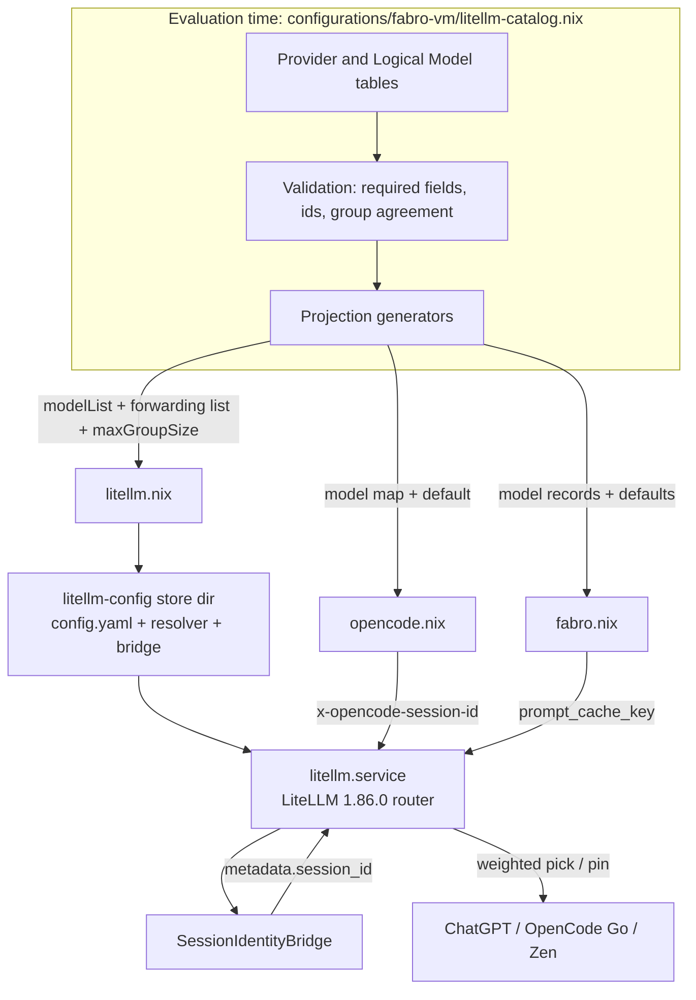
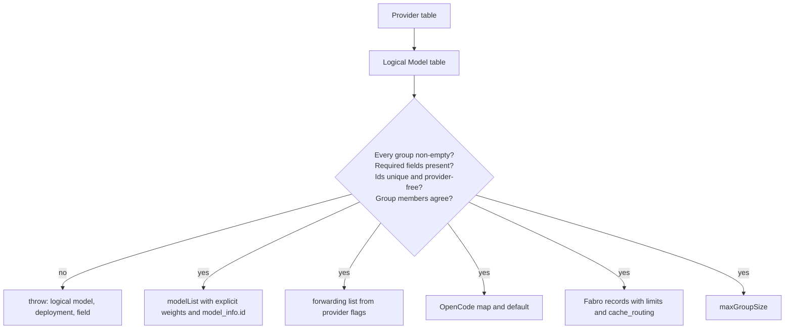
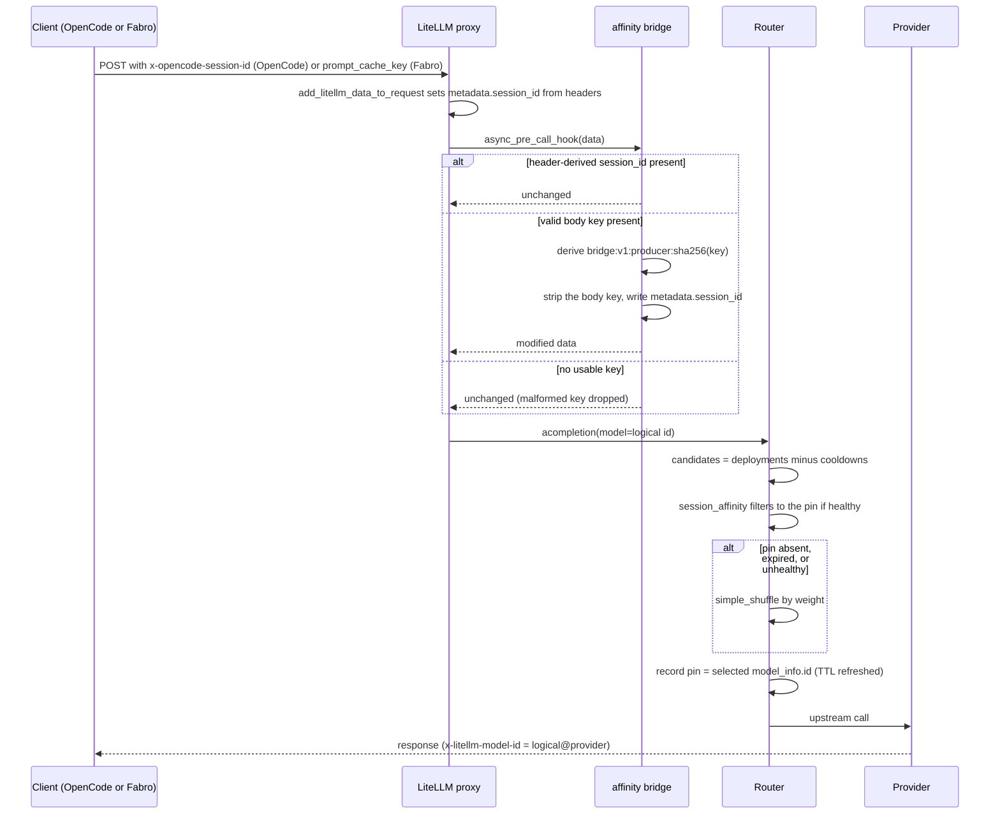
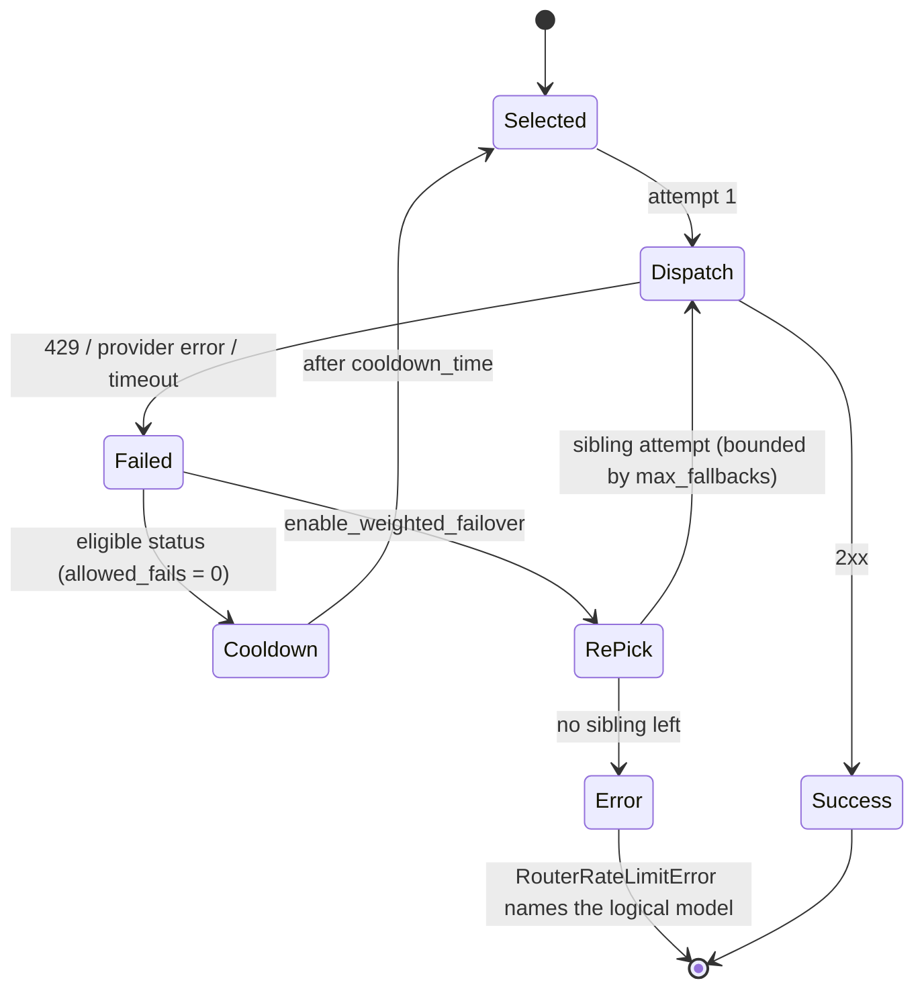
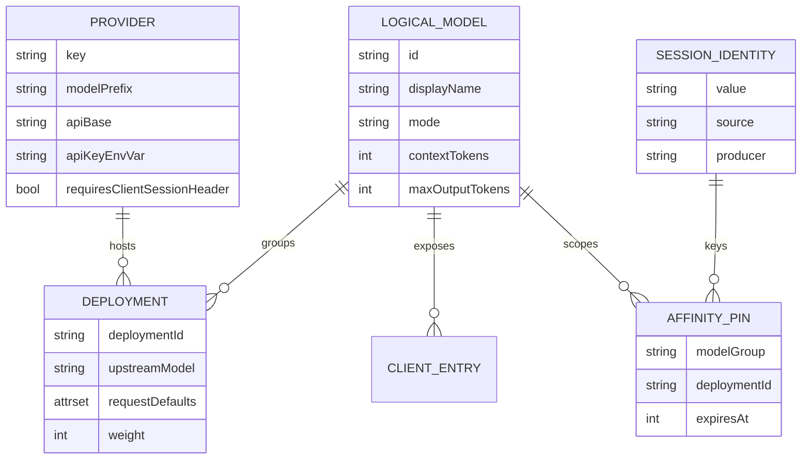
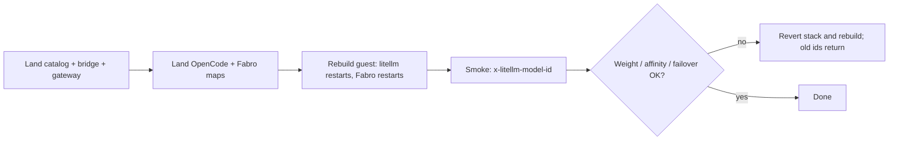

# Design Document

## Overview

This design turns the fabro-vm LiteLLM gateway into one declarative,
provider-agnostic model catalog whose entries fan out across the ChatGPT and
OpenCode subscriptions, while the pinned 1.86.0 router supplies weighted
placement, session pins, in-group failover, and cooldown. The problem and scope
are in `brief.md`, the behavioral contract is in `requirements.md`, and the
pinned-library evidence is in `research.md`.

### Goals

- One client-callable id per Logical Model, with no provider name in any id.
- One Deployment Table that generates the gateway `model_list`, the OpenCode
  model map, and the Fabro model records.
- Weighted placement across a group's Deployments.
- Conversation-stable routing from OpenCode's session header and Fabro's body
  cache key, with header precedence and producer-scoped namespacing.
- Within-group retries, weighted failover, and cooldown with no cross-model
  fallback.
- Deterministic eval checks, bridge tests, and an operator smoke for the
  behavior the router randomizes.

### Non-Goals

- Cross-model fallbacks.
- A bare `x-session-id` contract, or any OpenCode/Fabro software change.
- Redis, multi-instance affinity, or affinity surviving a gateway restart.
- Per-Deployment header forwarding.
- New subscriptions, providers, credentials, or catalog discovery.
- The unused macOS `programs.litellm` launchd module.
- Virtual keys, budgets, or spend reporting.

## Boundary Commitments

### This Spec Owns

- `configurations/fabro-vm/litellm-catalog.nix`: the Provider and Logical Model
  tables, validation, and the gateway/client projections.
- The gateway's `model_list`, `router_settings`, header-forwarding list,
  callback registration, and the generated config directory that carries the
  Python modules.
- The pure session-identity rules and the in-process pre-call bridge.
- The OpenCode model map and the Fabro model records that expose catalog ids.
- The routing checks, the affinity-bridge tests, the guest-eval assertion that
  describes the new shape, the operator runbook, and the handoff updates.
- Retirement of the superseded
  `.kiro/specs/configure-litellm-load-balancing-across-existing/` directory so
  no current spec document keeps instructing provider-scoped model calls.

### Out of Boundary

- The nixpkgs `services.litellm` module, its `DynamicUser` unit, health gate,
  state dir, and sops template.
- LiteLLM, OpenCode, or Fabro upgrades; the pinned versions are the contract.
- The ChatGPT device-flow login and credential provisioning.
- The macOS Home Manager `programs.litellm` module and its render tests, which
  must keep evaluating unchanged.
- Client-side balancing, provider-pinning switches, or prompt/agent behavior.
- Cost accounting, cache-hit reporting, and capacity planning.

### Allowed Dependencies

- LiteLLM 1.86.0 from the pinned nixpkgs: `services.litellm`,
  `litellm_settings`, `router_settings`, and the router pre-call checks.
- `configurations/fabro-vm/{litellm,opencode,fabro}.nix`, the fabro-vm sops
  templates `litellm-env`, `fabro-env`, and `opencode-env`.
- OpenCode 1.19.0 (`pkgs.opencode-pinned`) and its `x-opencode-session-id`
  header.
- Fabro 0.386.0-nightly.0 (`pkgs.fabro`) and its `caching` / `cache_routing`
  capability keys.
- `pkgs.python3` from the LiteLLM package environment for the bridge, and
  `pkgs.nodejs` plus `pkgs.python3` for the checks.

### Revalidation Triggers

- A LiteLLM bump changes `session_affinity`, `enable_weighted_failover`,
  `deployment_affinity_ttl_seconds`, `max_fallbacks`, `get_instance_fn`, the
  callback signature, the affinity cache-key shape, or the
  `x-litellm-model-id` header.
- A nixpkgs `services.litellm` change alters `ExecStart`, the config path, or
  environment handling.
- OpenCode changes session-header emission or the provider-id prefix rule.
- Fabro changes `cache_routing`, `prompt_cache_key`, or the capability schema.
- A provider's request defaults, wire mode, or context/output limits change.
- A change alters how `max_fallbacks` is derived from the catalog.

## Architecture

### Existing Architecture Analysis

- `configurations/fabro-vm/litellm.nix` is the live gateway: nixpkgs
  `services.litellm` on `127.0.0.1:4000`, `LITELLM_MASTER_KEY` and
  `OPENCODE_API_KEY` from the sops `litellm-env` file, `CHATGPT_TOKEN_DIR`
  under the state dir, and a `litellm-health-gate` `ExecStartPost`.
- Its `model_list` (lines 153-252) is hand-written and provider-scoped:
  `chatgpt/*`, `opencode-go/*`, and `opencode-zen/*`. There is no
  `router_settings`; the only `litellm_settings` entry forwards client headers
  for the `opencode-go/*` and `opencode-zen/*` prefixes.
- `configurations/fabro-vm/opencode.nix` (lines 100-164) builds `opencode.json`
  with provider id `opencode-litellm` and a model map keyed by the same
  provider-scoped ids. The provider id must keep starting with `opencode` for
  the extra OpenCode headers; it is not a model id.
- `configurations/fabro-vm/fabro.nix` (lines 46-244) generates `settings.toml`
  with `llm.providers.litellm` records, a static
  `default_headers."x-opencode-session"`, and per-model limits and
  capabilities. Fabro hard-requires `litellm.service`; a gateway restart also
  restarts Fabro and clears in-process router state.
- `home-manager/common/litellm.nix` is the unused macOS launchd module. Its
  only live consumers are `tests/litellm-service/hm-render.test.js` and the
  `litellm-service` flake check; this design leaves both alone.
- Existing verification is `fabro-vm-guest-eval` in `flake.nix` (including the
  litellm assertion at lines 2198-2239), the Node suites under `tests/`, and
  the `litellm-service` check. New checks follow the `tests/litellm-service`
  `runCommand` + `node --test` pattern.

### Architecture Pattern & Boundary Map

Pattern: one pure catalog, three generated projections, and one in-process
request hook. The catalog is evaluation data, not runtime state; every
consumer is derived from it. The only runtime logic this feature adds is the
session-identity bridge.



**Architecture Integration**:

- Selected pattern: declarative registry plus generated projections. One
  authoritative table removes the chance that the gateway and a client
  disagree about an id.
- Domain boundaries: the catalog owns composition and client metadata;
  `litellm.nix` owns routing policy; the Python modules own session identity
  only; the clients own transport and credentials.
- Existing patterns preserved: NixOS modules under `configurations/fabro-vm/`,
  pure helper modules beside their consumers, Node test suites copying the repo
  into a `runCommand`, and the sops env template for every credential.
- New components rationale: the catalog satisfies the single-source
  requirement; the pure identity module makes namespacing testable without
  LiteLLM; the bridge covers Fabro's body key where no client header exists.
- Steering compliance: declarative Nix only, no secrets in the store, no
  imperative installers, no upstream fork.

### Technology Stack

| Layer | Choice / Version | Role in Feature | Notes |
|-------|------------------|-----------------|-------|
| Gateway | LiteLLM 1.86.0 (`pkgs.litellm`) | Router, proxy, affinity, cooldown, failover | Feature ceiling; options verified against the pinned package |
| Service module | nixpkgs `services.litellm` (pinned) | Unit, state dir, env file, YAML rendering | `ExecStart` overridden to the generated config directory |
| Catalog | Nix (`lib`) | Model registry and validation | Pure evaluation, no IFD |
| Bridge | Python 3.13 from the LiteLLM package env | `CustomLogger.async_pre_call_hook` | In-process; no extra service or socket |
| Client A | OpenCode 1.19.0 (`pkgs.opencode-pinned`) | Sends `x-opencode-session-id` | Provider id stays `opencode-litellm` |
| Client B | Fabro 0.386.0-nightly.0 (`pkgs.fabro`) | Sends `prompt_cache_key` when `cache_routing` is set | No Fabro code change |
| Checks | Node 22 (`pkgs.nodejs`) + `nix eval` | Catalog, gateway, and client assertions | Mirrors `tests/litellm-service` |
| Bridge tests | Python 3 stdlib `unittest` | Pure identity rules | No LiteLLM import required |

## File Structure Plan

### Directory Structure

```
configurations/fabro-vm/
├── litellm-catalog.nix           # NEW: provider + logical-model tables,
│                                 #      validation, gateway/client projections
├── litellm_session_identity.py   # NEW: pure precedence/validation/namespace rules
├── litellm_affinity_bridge.py    # NEW: CustomLogger pre-call adapter
├── litellm.nix                   # MODIFIED: consume catalog, router, bridge dir
├── opencode.nix                  # MODIFIED: consume catalog model map
└── fabro.nix                     # MODIFIED: consume catalog model records

tests/litellm-routing/
├── helpers.js                    # NEW: nix eval helpers (tests/litellm-service shape)
├── package.json                  # NEW: node --test directory entry point
├── catalog.test.js               # NEW: fixture tables and failure messages
├── gateway.test.js               # NEW: model_list, router, forwarding, config dir
└── clients.test.js               # NEW: OpenCode/Fabro parity and legacy-id scan

tests/litellm-affinity-bridge/
└── test_session_identity.py      # NEW: precedence, namespacing, malformed input

docs/
├── litellm-routing-runbook.md    # NEW: catalog edits, routing knobs, smoke
└── opencode-fabro-vm-handoff.md  # MODIFIED: ids, forwarding, affinity notes

flake.nix                         # MODIFIED: two checks; rewrite the litellm assertion
```

### Modified Files

- `configurations/fabro-vm/litellm.nix` — replace the hand-written `model_list`
  and provider-prefix forwarding list with catalog projections; add
  `router_settings`; register the bridge callback; build and point the service
  at the generated config directory; add `PYTHONPATH` and
  `PYTHONDONTWRITEBYTECODE`; rewrite the module header that documents
  provider-scoped ids and prefix forwarding.
- `configurations/fabro-vm/opencode.nix` — replace the eleven provider-scoped
  model entries with `catalog.openCode.models`; set the default to
  `opencode-litellm/<catalog.openCode.defaultModel>`; leave the provider block
  and the absence of static headers intact; rewrite the header comment that
  attributes forwarding to the provider prefix.
- `configurations/fabro-vm/fabro.nix` — replace the eleven records with
  `catalog.fabro.models`; delete `go-gpt-6-luna`; set every `api_model` to a
  catalog id; keep `default_headers."x-opencode-session"` with a comment that
  it is not the affinity identity; derive the default model from the catalog.
- `flake.nix` — add `checks.<system>.litellm-routing` and
  `checks.<system>.litellm-affinity-bridge`; rewrite the `fabro-vm-guest-eval`
  litellm assertion so it no longer asserts the provider-scoped shape.
- `docs/opencode-fabro-vm-handoff.md` — update the model map, the forwarding
  section, the Fabro model table, the default model examples, and the
  "add a model" steps so no current step names a provider-scoped id.
- `.kiro/specs/configure-litellm-load-balancing-across-existing/` — delete the
  superseded directory when this spec lands; its tasks still name the old ids.

## System Flows

### Catalog evaluation



Validation is a total function over the table and runs before any projection is
returned, so building the gateway or either client fails Nix evaluation rather
than silently emitting a malformed catalog. Projections sort logical ids and
preserve each group's ordered deployment list, so repeated evaluation is
identical.

### Request placement and affinity



Header identity wins because `add_litellm_data_to_request` writes it before the
pre-call hook. A request with no identity skips the metadata write, so the
router has no `session_id` and places by weight without touching another
conversation's pin.

### Failover and cooldown



`num_retries = 0` means a failed attempt is not repeated on the same
Deployment; the async fallback path re-picks inside the group. The
cooldown-eligible failure removes the Deployment from placement and from
affinity selection, so a pinned conversation lands on a healthy sibling and the
next successful request re-pins it there. No `fallbacks` or
`context_window_fallbacks` key is declared, so the chain never crosses a
Logical Model.

## Requirements Traceability

| Requirement | Summary | Components | Interfaces / Contracts | Flows |
|-------------|---------|------------|------------------------|-------|
| 1.1-1.3, 1.5, 1.8 | One id per Logical Model; no provider name; same upstream merges; single-Deployment ids share the form; no empty id | Deployment Catalog | `logicalModels`, id validation, non-empty group validation | Catalog evaluation |
| 1.4 | Disagreeing Deployments split into separate Logical Models | Deployment Catalog | Group agreement validation | Catalog evaluation |
| 1.6-1.7 | Every current model reachable; removed ids rejected as unknown | Deployment Catalog, Gateway Configuration | Initial catalog; `model_list` only from catalog; no aliases | Catalog evaluation |
| 2.1, 2.8 | Table declares every required field; table is the only source | Deployment Catalog, all projections | `mkCatalog`, `modelList`, client projections | Catalog evaluation |
| 2.2-2.3 | Add provider/model/weight without client code; group id stable | Deployment Catalog | Generated projections; ids independent of membership | Catalog evaluation |
| 2.4 | Repeated evaluation is identical | Deployment Catalog | Pure function; sorted ids; ordered deployments | Catalog evaluation |
| 2.5-2.6 | Conflicts and missing fields fail eval naming the offender | Deployment Catalog | Error message contract | Catalog evaluation |
| 2.7 | Credentials from the runtime environment only | Deployment Catalog, Gateway Configuration | Provider `apiKeyEnvVar` → `os.environ/<VAR>`; sops env file | - |
| 3.1-3.3, 3.5, 3.7 | Weighted placement by weights and availability alone | Gateway Configuration, Deployment Catalog | `routing_strategy`, deployment `weight` (default 1) | Request placement |
| 3.4, 3.6 | Selected Deployment recorded as the pin; observed share tracks weights | Gateway Configuration, Operator Runbook | Session-affinity pin; smoke step 1 | Request placement |
| 4.1, 4.8-4.9 | Pin holds within the TTL; expiry is a new placement | Gateway Configuration | `session_affinity`, `deployment_affinity_ttl_seconds` | Request placement |
| 4.2-4.7 | Header identity; body-key fallback; header precedence; producer namespace; no collision; model-scoped key | Session Identity Resolver, Session Identity Bridge, Gateway Configuration | `resolve_session_identity`, `bridge:v1:<producer>:<sha256>`; cache key | Request placement |
| 4.10-4.12 | No identity or malformed key places by weight; restart clears pins | Session Identity Bridge, Router | Resolver returns `None`; in-process `DualCache` | Request placement |
| 5.1-5.3 | 429/provider error retried on a sibling; one success returned | Gateway Configuration, Router | `enable_weighted_failover`, `num_retries = 0` | Failover |
| 5.4-5.6 | Failure enters cooldown; pinned conversation uses a sibling; expiry returns it | Gateway Configuration, Router | `allowed_fails = 0`, `cooldown_time = 60` | Failover |
| 5.7-5.9 | Exhausted group names the model; no cross-model failover; bounded attempts | Gateway Configuration, Router | No `fallbacks`; `max_fallbacks = maxGroupSize - 1` | Failover |
| 6.1-6.3, 6.5 | One entry per Logical Model in both clients; defaults served | OpenCode Model Surface, Fabro Model Surface | `catalog.openCode`, `catalog.fabro` | Catalog evaluation |
| 6.4, 6.6, 6.8 | OpenCode header reaches the gateway; Fabro sends the cache key; static header is not an identity | OpenCode Model Surface, Fabro Model Surface, Session Identity Resolver | Provider id `opencode-litellm`; `cache_routing`; header regex | Request placement |
| 6.7, 6.9-6.10 | Fabro request carries the key; surfaces change together; no stale references | Fabro Model Surface, Session Identity Bridge, Routing Checks | `capabilities.cache_routing`; generated projections; legacy-id scan | Migration |
| 7.1-7.3, 7.6 | Forward session headers where a Deployment needs them; uniformly; nowhere else | Deployment Catalog, Gateway Configuration | Provider `requiresClientSessionHeader`; `forwardClientHeaders` | Request placement |
| 7.4-7.5 | No credentials or content-type; only the documented allowlist | Gateway Configuration, Operator Runbook | LiteLLM `clean_headers` and `x-*` rule | - |
| 8.1-8.6 | Checks verify ids, routing knobs, group agreement, legacy ids, credentials; errors name the offender | Routing Checks | `catalog.test.js`, `gateway.test.js`, `clients.test.js` | - |
| 8.7 | Bridge tests cover precedence, namespace, absent and malformed keys | Affinity Bridge Tests | `test_session_identity.py` | - |
| 8.8-8.10 | Operator smoke, runbook, handoff, comments and superseded-spec retirement | Operator Runbook, Routing Checks | `docs/litellm-routing-runbook.md`; handoff update | Migration |

## Components and Interfaces

| Component | Domain / Layer | Intent | Req Coverage | Key Dependencies | Contracts |
|-----------|----------------|--------|--------------|------------------|-----------|
| Deployment Catalog | Evaluation | Own the tables, validation, and projections | 1, 2, 3.2, 6.1-6.2, 7.1 | nixpkgs `lib` (P0) | Data |
| Gateway Configuration | Evaluation / Runtime | Project the catalog into LiteLLM and wire the router and bridge | 1.7, 2.7, 3, 4, 5, 7 | Catalog, LiteLLM 1.86.0 (P0) | Config |
| Session Identity Resolver | Runtime | Own precedence, validation, and namespacing as pure functions | 4.2-4.7, 4.10, 6.9, 8.7 | Python stdlib (P0) | Service |
| Session Identity Bridge | Runtime | Promote a body cache key into the router's session identity | 4.3-4.5, 4.9, 6.6 | Resolver, LiteLLM `CustomLogger` (P0) | Service |
| OpenCode Model Surface | Client | Expose each Logical Model once with no static header | 6.1-6.4, 6.10 | Catalog, OpenCode 1.19.0 (P1) | Config |
| Fabro Model Surface | Client | Expose each Logical Model once and emit the cache key | 6.2, 6.5, 6.7-6.9 | Catalog, Fabro 0.386 (P1) | Config |
| Routing Checks | Verification | Fail checks on catalog, gateway, client, or credential drift | 8.1-8.6 | nix, nodejs (P0) | Batch |
| Affinity Bridge Tests | Verification | Prove the identity rules without a gateway | 8.7 | python3 (P0) | Batch |
| Operator Runbook | Documentation | Document edits, knobs, observation, and smoke | 3.6, 7.5, 8.8-8.10 | - | Doc |

### Evaluation Layer

#### Deployment Catalog

| Field | Detail |
|-------|--------|
| Intent | One pure Nix table that validates model composition and generates every consumer projection |
| Requirements | 1.1-1.8, 2.1-2.8, 3.2, 6.1-6.2, 7.1-7.3 |

**Responsibilities & Constraints**

- Owns the Provider table, the Logical Model table, and the default model.
- Owns validation: required fields, known providers, non-empty groups, unique
  ids and deployment ids, provider-free ids, and group agreement.
- Emits four projections: gateway `modelList`, gateway
  `forwardClientHeaders`, OpenCode `models`/`defaultModel`, and Fabro
  `models`/`defaultModel`, plus `maxGroupSize` and `logicalIds`.
- Contains no host paths, derivations, or secret values; credentials appear
  only as environment-variable names.
- Deterministic: logical ids are sorted, deployment order is preserved, and
  weights are emitted explicitly.

**Dependencies**

- Inbound: `litellm.nix`, `opencode.nix`, `fabro.nix` — consumers (P0).
- Outbound: nixpkgs `lib` — `attrNames`, `hasInfix`, `concatStringsSep`,
  `throw` (P0).
- External: none.

**Contracts**: Data [x]

##### Data Contract

```nix
# configurations/fabro-vm/litellm-catalog.nix
{ lib }:
let
  mkCatalog = { providers, logicalModels, defaultModel }: {
    modelList = [ /* one entry per Deployment */ ];
    forwardClientHeaders = [ /* logical ids needing client session headers */ ];
    logicalIds = [ /* sorted logical ids */ ];
    maxGroupSize = 2;
    openCode = { defaultModel = "deepseek-v4.1-flash"; models = { /* ... */ }; };
    fabro = { defaultModel = "deepseek-v4.1-flash"; models = { /* ... */ }; };
  };
in
{
  inherit mkCatalog;
  catalog = mkCatalog {
    providers = { /* chatgpt, opencode-go, opencode-zen */ };
    logicalModels = { /* the table below */ };
    defaultModel = "deepseek-v4.1-flash";
  };
}
```

Consumers use `(import ./litellm-catalog.nix { inherit lib; }).catalog`; the
routing check imports `mkCatalog` for fixture tables.

- Preconditions: each provider key is unique; each Logical Model has an
  ordered, non-empty `deployments` list.
- Required Deployment fields are `provider`, `upstreamModel`, `mode`,
  `limits.contextTokens`, and `limits.maxOutputTokens`; `requestDefaults`
  defaults to `{ }` and `weight` to `1`. `displayName` is a Logical Model
  field and defaults to the id, so an omitted optional field never fails
  evaluation.
- Postconditions: every projection is derived from the same validated table;
  `modelList` has one entry per Deployment.
- Invariants: no client-callable id contains `/` or a provider key token; a
  group's deployments agree on `mode`, `requestDefaults`,
  `limits.contextTokens`, and `limits.maxOutputTokens`.

**Provider table**

| Field | `chatgpt` | `opencode-go` | `opencode-zen` |
|-------|-----------|---------------|----------------|
| `modelPrefix` | `chatgpt/` | `openai/` | `openai/` |
| `apiBase` | none (OAuth token dir) | `https://opencode.ai/zen/go/v1` | `https://opencode.ai/zen/v1` |
| `apiKeyEnvVar` | none | `OPENCODE_API_KEY` | `OPENCODE_API_KEY` |
| `allowedOpenAIParams` | `[ "reasoning_effort" ]` | `[ "reasoning_effort" ]` | `[ "reasoning_effort" ]` |
| `requiresClientSessionHeader` | `false` | `true` | `true` |

**Initial Logical Model table**

| Logical id | Mode | Context / output | Deployments (provider → upstream, request defaults, weight) | Fabro extras |
|------------|------|------------------|-------------------------------------------------------------|--------------|
| `gpt-6-luna` | responses | 1,050,000 / 128,000 | `chatgpt` → `gpt-6-luna`, `reasoning_effort = "xhigh"`, 1; `opencode-go` → `gpt-6-luna`, `reasoning_effort = "xhigh"`, 1 | effort levels `[ "xhigh" ]` |
| `gpt-6-luna-none` | responses | 1,050,000 / 128,000 | `chatgpt` → `gpt-6-luna`, `reasoning_effort = "none"`, 1 | no effort levels |
| `gpt-6-astra` | responses | 1,050,000 / 128,000 | `chatgpt` → `gpt-6-astra`, `reasoning_effort = "xhigh"`, 1 | effort levels `[ "xhigh" ]` |
| `gpt-6.1-sol` | responses | 1,050,000 / 128,000 | `chatgpt` → `gpt-6.1-sol`, `reasoning_effort = "xhigh"`, 1 | effort levels `[ "xhigh" ]` |
| `deepseek-v4.1-flash` | chat | 1,000,000 / 384,000 | `opencode-go` → `deepseek-v4.1-flash`, none, 1 | `smallDefault = true` |
| `glm-5.3-flash` | chat | 1,000,000 / 131,072 | `opencode-go` → `glm-5.3-flash`, none, 1 | effort levels `[ "low" "high" "max" ]` |
| `beam-free` | chat | 1,048,576 / 131,072 | `opencode-go` → `beam-free`, none, 1 | - |
| `omen-alpha` | chat | 500,000 / 128,000 | `opencode-go` → `omen-alpha`, none, 1 | - |
| `longcat-2.0` | chat | 1,000,000 / 131,072 | `opencode-go` → `longcat-2.0`, none, 1 | - |
| `big-pickle` | chat | 200,000 / 32,000 | `opencode-zen` → `big-pickle`, none, 1 | - |

Mode, context/output limits, and request defaults are declared on each
Deployment; the table shows the agreed value that group validation enforces.
The Logical Model row carries the id, display name, Fabro extras, and the
ordered Deployment list.

The only Unified Model Group is `gpt-6-luna`. `gpt-6-luna-none` stays a
single-Deployment Logical Model because its pinned `reasoning_effort` differs.
The OpenCode Go `gpt-6-luna` Deployment gains the `xhigh` default from the
ChatGPT sibling so the group agrees; that is the one request-default change to
an existing Deployment. The merged Fabro record advertises only `xhigh` — the
level both Deployments pin — rather than the Go-only levels, so a Fabro request
cannot choose an effort the ChatGPT Deployment does not offer.

Display names drop the provider parenthetical while keeping the effort hint:
`GPT-6 Luna (xhigh)`, `GPT-6 Luna (no thinking)`, `GPT-6 Astra (xhigh)`,
`GPT-6.1 Sol (xhigh)`, `DeepSeek V4.1 Flash`, `GLM-5.3 Flash`, `Beam Free`,
`Omen Alpha`, `LongCat 2.0`, and `Big Pickle`. Both client surfaces render the
same name, so the pickers no longer imply which subscription answers.

**Validation error contract**

```
litellm-catalog: logical model 'gpt-6-luna' deployments 'gpt-6-luna@chatgpt' and 'gpt-6-luna@opencode-go' disagree on 'requestDefaults'
litellm-catalog: logical model 'foo' deployment 'foo@chatgpt' is missing field 'limits.contextTokens'
litellm-catalog: logical model 'chatgpt/foo' must not contain provider or path token '/'
litellm-catalog: logical model 'foo' has no deployments
litellm-catalog: default model 'bar' is not a logical model
```

- Preconditions: fixture tables may be incomplete or contradictory.
- Postconditions: evaluation fails with the logical model, both deployment ids
  where applicable, and the field.
- Invariants: validation runs before any projection is constructed.

### Gateway Configuration

| Field | Detail |
|-------|--------|
| Intent | Project the catalog into LiteLLM settings and wire the router, forwarding, and bridge |
| Requirements | 1.6-1.7, 2.7-2.8, 3.1-3.5, 4.1, 4.7-4.8, 5.1-5.9, 7.1-7.6 |

**Responsibilities & Constraints**

- `model_list` is exactly `catalog.modelList`; the forwarding list is exactly
  `catalog.forwardClientHeaders`; no aliases or wildcard model ids exist.
- Forwarding is decided per Logical Model: the model is listed when any of its
  Deployments' provider sets `requiresClientSessionHeader`, which includes a
  single-Deployment Logical Model such as `deepseek-v4.1-flash`.
- `router_settings` carries the values in the table below; no cross-model
  fallback keys are present.
- `litellm_settings.callbacks` names the bridge instance.
- The service runs against a generated directory that holds the rendered
  `config.yaml` and both Python modules.
- Credentials stay `os.environ/OPENCODE_API_KEY` and the sops env file;
  `environmentFile`, `CHATGPT_TOKEN_DIR`, the health gate, and the login
  wrapper are untouched.

**Dependencies**

- Inbound: Deployment Catalog (P0).
- Outbound: LiteLLM 1.86.0 router, proxy callback loader, and YAML rendering
  (P0).
- External: nixpkgs `services.litellm` module (P0).

**Contracts**: Config [x]

##### Configuration Contract

| Key | Value | Constraint |
|-----|-------|------------|
| `routing_strategy` | `"simple-shuffle"` | required for `enable_weighted_failover` |
| `optional_pre_call_checks` | `[ "session_affinity" ]` | enables session-id affinity only |
| `deployment_affinity_ttl_seconds` | `21600` | explicit six-hour idle TTL |
| `num_retries` | `0` | first failure enters the failover path |
| `enable_weighted_failover` | `true` | re-pick inside the group |
| `allowed_fails` | `0` | first eligible failure cools the Deployment |
| `cooldown_time` | `60` | seconds out of placement |
| `max_fallbacks` | `catalog.maxGroupSize - 1` | currently `1` |
| `deployment_affinity`, `fallbacks`, `context_window_fallbacks`, `model_group_alias`, `rpm`, `tpm` | absent | no extra affinity mode, no cross-model fallback, no rate-based weights |

**Generated gateway record** (contract shape, one Deployment):

```nix
{
  model_name = "gpt-6-luna";
  model_info = {
    id = "gpt-6-luna@opencode-go";
    mode = "responses";
    max_input_tokens = 1050000;
    max_output_tokens = 128000;
  };
  litellm_params = {
    model = "openai/gpt-6-luna";
    api_base = "https://opencode.ai/zen/go/v1";
    api_key = "os.environ/OPENCODE_API_KEY";
    reasoning_effort = "xhigh";
    allowed_openai_params = [ "reasoning_effort" ];
    weight = 1;
  };
}
```

Provider fields with no value are omitted from `litellm_params` rather than
emitted as null, so a ChatGPT entry carries no `api_key` and no `api_base`.

**Generated config directory** (`litellm-config`):

```
config.yaml                    # rendered from services.litellm.settings
litellm_affinity_bridge.py     # callback module named by litellm_settings.callbacks
litellm_session_identity.py    # sibling import resolved through PYTHONPATH
```

- `systemd.services.litellm.serviceConfig.ExecStart` is overridden with
  `lib.mkForce` to
  `<litellm> --host <host> --port <port> --config <dir>/config.yaml`.
- `services.litellm.environment.PYTHONPATH` is the directory;
  `PYTHONDONTWRITEBYTECODE = "1"` prevents writes into the read-only store.

**Implementation Notes**

- Integration: the YAML is rendered from `config.services.litellm.settings`
  with `pkgs.formats.yaml`; no second settings source exists.
- Validation: the routing check asserts the callback, `ExecStart`, and
  `PYTHONPATH` wiring so a LiteLLM loader change fails the check.
- Risks: a LiteLLM bump could change `get_instance_fn`; the check and the
  pure-module tests localize the failure.

### Session Identity Layer

#### Session Identity Resolver

| Field | Detail |
|-------|--------|
| Intent | Own precedence, validation, and namespacing as pure, testable functions |
| Requirements | 4.2-4.7, 4.10, 6.9, 8.7 |

**Responsibilities & Constraints**

- `existing_session_id(metadata_dicts)` returns the first non-empty
  `session_id` value, stringified as the router does, else `None`.
- `producer_tag(user_agent)` takes the product token before `/`, lowercases it,
  keeps `[a-z0-9._-]` up to 32 characters, and falls back to `unknown`.
- `derive_session_identity(prompt_cache_key, user_agent)` returns `None` unless
  the key is a string that is non-empty after stripping, at most 512
  characters, and free of CR, LF, and NUL. Otherwise it returns
  `bridge:v1:<producer>:<sha256 hex of the stripped key>`.
- `resolve_session_identity(metadata_dicts, prompt_cache_key, user_agent)`
  returns a `Resolution(session_id, source)` where `source` is `"header"` for
  any pre-existing metadata id (normally written from a client header) or
  `"body"` for a derived id, else `None`. It checks existing metadata first, so
  a header always wins over a body key.
- The `bridge:v1:` prefix contains `:`, which the proxy's header value regex
  (`^[a-zA-Z0-9_\-]{8,}$`) can never produce, so a body-derived identity cannot
  equal a header-derived one.
- Imports only the Python standard library and never raises on malformed
  input.

**Dependencies**

- Outbound: Python stdlib `hashlib`, `re`, `typing` (P0).
- External: none; the module does not import LiteLLM.

**Contracts**: Service [x]

##### Service Interface

```python
class Resolution(NamedTuple):
    session_id: str
    source: Literal["header", "body"]

def existing_session_id(metadata_dicts: Sequence[Mapping]) -> str | None: ...
def producer_tag(user_agent: str | None) -> str: ...
def derive_session_identity(
    prompt_cache_key: object, user_agent: str | None
) -> str | None: ...
def resolve_session_identity(
    metadata_dicts: Sequence[Mapping],
    prompt_cache_key: object,
    user_agent: str | None,
) -> Resolution | None: ...
```

- Preconditions: every argument may be missing or of the wrong type.
- Postconditions: `None` means "no identity to add"; a non-`None` value is safe
  to use as a router session id.
- Invariants: the functions never raise; the header-derived value is returned
  unchanged.

#### Session Identity Bridge

| Field | Detail |
|-------|--------|
| Intent | Thin in-process adapter that promotes Fabro's body key into router metadata |
| Requirements | 4.3-4.5, 4.9, 6.6, 8.7 |

**Responsibilities & Constraints**

- `SessionIdentityBridge(CustomLogger).async_pre_call_hook` reads
  `data["litellm_metadata"]` and `data["metadata"]`, the body
  `prompt_cache_key`, and the request `user-agent` from
  `data["proxy_server_request"]["headers"]` (case-insensitive).
- If the resolver reports a header source, the hook returns `data` unchanged;
  the body key stays for any upstream that can use it.
- If the resolver reports a body source, the hook removes
  `prompt_cache_key` from the outbound body and from
  `proxy_server_request.body`, then writes the derived id to
  `data["metadata"]["session_id"]` (creating `metadata` when absent) and to
  `data["litellm_metadata"]` when that dict is present.
- If the resolver returns `None` while a `prompt_cache_key` is present, the
  hook removes the key and adds no identity, so a malformed key cannot fail
  the request.
- Any unexpected shape or exception leaves `data` unchanged; the hook never
  turns a request into a 500.

**Dependencies**

- Inbound: LiteLLM proxy pre-call hook (P0).
- Outbound: Session Identity Resolver (P0), LiteLLM `CustomLogger` (P0).
- External: none.

**Contracts**: Service [x]

##### Service Interface

```python
class SessionIdentityBridge(CustomLogger):
    async def async_pre_call_hook(
        self, user_api_key_dict, cache, data: dict, call_type
    ) -> dict: ...

proxy_handler_instance = SessionIdentityBridge()
```

- Preconditions: `data` is the proxy request dict; any sub-dict may be absent.
- Postconditions: either `data` is unchanged, or the body key is removed and a
  derived `session_id` is present in the metadata.
- Invariants: an existing header-derived `session_id` is never overwritten; a
  body-derived id always starts with `bridge:v1:`.

### Client Layer

#### OpenCode Model Surface

| Field | Detail |
|-------|--------|
| Intent | Expose every Logical Model once under its client-callable id |
| Requirements | 6.1-6.4, 6.10 |

**Responsibilities & Constraints**

- Keeps `provider.opencode-litellm` (the `opencode` prefix is required for the
  extra OpenCode headers) and the existing base URL and env key.
- `model = "opencode-litellm/${catalog.openCode.defaultModel}"`.
- `provider.opencode-litellm.models = catalog.openCode.models`, keyed by
  logical id with the catalog display name.
- Declares no static provider headers; OpenCode emits its own session headers.
- Makes no provider-scoped model reference.

**Dependencies**

- Inbound: Deployment Catalog (P0).
- External: OpenCode 1.19.0 (P1).

**Contracts**: Config [x]

##### Configuration Contract

| Key | Source | Invariant |
|-----|--------|-----------|
| `model` | `opencode-litellm/<defaultModel>` | the suffix is a served logical id |
| `provider.opencode-litellm.options.baseURL` | host constant | gateway loopback |
| `provider.opencode-litellm.models` | `catalog.openCode.models` | keys equal catalog ids; no `/` |
| `provider.opencode-litellm.options.headers` | absent | no static session header |

#### Fabro Model Surface

| Field | Detail |
|-------|--------|
| Intent | Expose the same logical ids and make Fabro emit its conversational cache key |
| Requirements | 6.2, 6.5, 6.7-6.10 |

**Responsibilities & Constraints**

- `llm.providers.litellm.models = catalog.fabro.models`; each record carries
  `display_name`, `api_model` (the logical id), `limits` from the group, and
  `capabilities`.
- Every record sets `capabilities.caching = true` and
  `capabilities.cache_routing = true`; `reasoning_effort` is the catalog's
  effort-level map; `text`, `tools`, and `reasoning` are baseline true.
  `small_default = true` is carried only by `deepseek-v4.1-flash`.
- `default_model`, `cli.exec.model.name`, and `run.model.name` use
  `catalog.fabro.defaultModel`.
- `default_headers."x-opencode-session" = "fabro-litellm"` remains for the
  OpenCode Go upstream requirement, with a comment that it is not the affinity
  identity.
- `go-gpt-6-luna` and every provider-keyed record are deleted.

**Dependencies**

- Inbound: Deployment Catalog (P0).
- External: Fabro 0.386.0-nightly.0 (P1).

**Contracts**: Config [x]

##### Configuration Contract

| Key | Source | Invariant |
|-----|--------|-----------|
| `llm.providers.litellm.models.<key>.api_model` | logical id | equal to the key; no `/` |
| `.limits.context_tokens` | deployment `limits.contextTokens` | equal to the group's value |
| `.limits.max_output_tokens` | deployment `limits.maxOutputTokens` | equal to the group's value |
| `.capabilities.caching` | generator | `true` |
| `.capabilities.cache_routing` | generator | `true` |
| `.capabilities.reasoning_effort` | logical model's effort levels | omitted when empty |
| `.capabilities.text` / `.tools` / `.reasoning` | generator baseline | `true` |
| `default_headers."x-opencode-session"` | host constant | not a session identity |

### Verification Layer

#### Routing Checks

| Field | Detail |
|-------|--------|
| Intent | Fail repository checks on catalog, gateway, client, or credential drift |
| Requirements | 8.1-8.6 |

**Responsibilities & Constraints**

- `catalog.test.js` imports `mkCatalog` with fixture tables and asserts the
  documented failure messages for disagreeing mode/defaults/limits, a missing
  field, an empty group, an unknown provider, a duplicate id, and an id
  containing `/` or a provider key token.
- `gateway.test.js` evaluates the fabro-vm config and asserts:
  `model_list` equals the catalog projection (11 Deployments, 10 logical ids,
  every entry with a unique `model_info.id` and an explicit `weight`); the
  `router_settings` values match the contract table; the forwarding list equals
  `catalog.forwardClientHeaders` (7 ids now); `callbacks` names the bridge;
  `ExecStart` points at the generated directory and `PYTHONPATH` names it; the
  rendered YAML contains no credential value (every present `api_key` is
  `os.environ/...`, and no `sk-` value or sops placeholder appears).
- `clients.test.js` asserts that both catalog projections expose exactly the
  catalog ids; every Fabro record keeps `caching` and `cache_routing` and its
  limits; both defaults resolve to a catalog id; and `opencode.nix` and
  `fabro.nix` contain no provider-scoped model literal (`chatgpt/`,
  `opencode-go/`, `opencode-zen/`) and no old Fabro record key
  (`go-gpt-6-luna`, `go-beam-free`, `go-omen-alpha`).
- The YAML render uses current-system `pkgs.formats.yaml` on the guest's
  `services.litellm.settings` value, so the check does not build an
  `aarch64-linux` derivation on a Darwin host.
- Every assertion message names the offending Logical Model, Deployment, or
  client entry.

**Dependencies**

- Inbound: catalog, gateway, clients (P0).
- Outbound: `nix eval`, Node's `node:test` (P0).
- External: none.

**Contracts**: Batch [x]

**Implementation Notes**

- Integration: `checks.<system>.litellm-routing` mirrors `litellm-service` — a
  `runCommand` with `nix` and `nodejs`, copying the source and running
  `node --test tests/litellm-routing/`.
- Validation: `nix eval --impure` with `builtins.getFlake`; no guest build.
- Risks: option renames fail evaluation loudly rather than silently.

#### Affinity Bridge Tests

| Field | Detail |
|-------|--------|
| Intent | Prove the identity rules without a running gateway |
| Requirements | 8.7 |

**Responsibilities & Constraints**

- `tests/litellm-affinity-bridge/test_session_identity.py` imports the pure
  module from `configurations/fabro-vm` and covers:
  1. a header-derived identity wins over a body key;
  2. the same raw key with different producers yields different identities;
  3. no key yields `None`;
  4. malformed keys (non-string, empty/whitespace, over 512 characters,
     CR/LF/NUL) yield `None`;
  5. a body-derived id never equals a plausible header value.
- `checks.<system>.litellm-affinity-bridge` runs the suite with `pkgs.python3`
  and `PYTHONPATH=configurations/fabro-vm`; a failing test fails the check.

**Contracts**: Batch [x]

#### Operator Runbook

| Field | Detail |
|-------|--------|
| Intent | Document catalog edits, routing knobs, observation, and the manual smoke |
| Requirements | 3.6, 7.5, 8.8-8.10 |

**Responsibilities & Constraints**

- `docs/litellm-routing-runbook.md` states how to add a provider, a model, or a
  weight; where weights and the TTL are configured; the `x-litellm-model-id`
  observation point; the forwarding allowlist; the session-identity rules
  (including the stable-`User-Agent` requirement for a body-key producer); and
  the three smoke steps with expected observations.
- `docs/opencode-fabro-vm-handoff.md` is updated so its model map, Fabro table,
  forwarding section, and examples use only catalog ids.
- The module header comments that describe provider-scoped ids and prefix
  forwarding are rewritten.
- The superseded `configure-litellm-load-balancing-across-existing` spec
  directory is deleted so no current spec task instructs the old ids.

**Contracts**: Doc [x]

## Data Models

### Domain Model



Business invariants: a Logical Model has at least one Deployment; all its
Deployments share mode, request defaults, and limits; ids are unique and
provider-free; a pin is scoped to one Logical Model and one Session Identity.

### Logical Data Model

| Entity | Identifier | Attributes | Referential rules |
|--------|------------|------------|-------------------|
| Provider | provider key (`chatgpt`, `opencode-go`, `opencode-zen`) | prefix, base URL, credential env var, allowed params, header requirement | referenced by Deployments |
| Logical Model | client-callable id | display name, mode, limits, Fabro extras | owns a non-empty ordered Deployment list |
| Deployment | `<logical>@<provider>` | upstream id, request defaults, weight | provider must exist; id unique |
| Session Identity | string | source (`header`/`body`), producer | header values unchanged; body values namespaced |
| Affinity Pin | `(<logical>, <session>)` | deployment id, expiry | deployment must belong to the group |

**Consistency and integrity**: validation is a total function over the table
and runs on every evaluation. Group disagreement is an error, not a warning.
Generated projections are derived values; there is no second source of truth.

**Generated client shapes**:

- OpenCode: `{ "<logical>" = { name = "<displayName>"; }; }`.
- Fabro: `{ "<logical>" = { display_name; api_model = "<logical>"; limits;
  capabilities; small_default; }; }`.
- Session identity: `bridge:v1:<producer>:<sha256 hex>`.

### Physical Data Model

- **Gateway config directory** (store path, built by `pkgs.runCommand`):
  `config.yaml`, `litellm_affinity_bridge.py`, `litellm_session_identity.py`.
  Read-only; `PYTHONDONTWRITEBYTECODE=1` avoids cache writes.
- **Affinity cache**: in-process `DualCache`; key
  `deployment_affinity:v1:session:<model_group>:<session_id>`; value
  `{"model_id": "<logical>@<provider>"}`; TTL 21,600 seconds, refreshed on
  every routed request (idle expiry). No Redis, no disk, no restart
  persistence.
- **Cooldown state**: in-process failed-call counters and cooldown list;
  `allowed_fails = 0`; TTL 60 seconds. No persistence.
- **No new runtime files**: the generated config directory is the only added
  store artifact.

## Error Handling

### Error Strategy

Fail closed at evaluation and degrade safely at runtime. The catalog throws
with a named entry during Nix evaluation; the router fails a request only after
the group is exhausted; the bridge never converts a request into a 500 because
a cache key was malformed or a metadata dict was missing.

### Error Categories and Responses

| Category | Trigger | Response | Requirement |
|----------|---------|----------|-------------|
| Catalog schema error | Missing field, unknown provider, empty group, duplicate/bad id | Nix evaluation fails naming the Logical Model, Deployment, and field | 2.5-2.6, 8.6 |
| Catalog consistency error | Group disagrees on mode, defaults, or limits | Nix evaluation fails naming both Deployments and the field | 2.5, 8.6 |
| Unknown model | Caller keeps a removed provider-scoped id | LiteLLM unknown-model error; no alias or wildcard | 1.7 |
| No available Deployment | Every Deployment failed or is cooling down | `RouterRateLimitError` whose message includes `Passed model=<id>` | 5.7 |
| In-group attempts exhausted | Every Deployment tried and failed | Last provider error with `Received Model Group=<id>` appended | 5.7 |
| Rate limit / provider error | 429, 401, 404, 408, 5xx | Weighted failover to a sibling; eligible failures enter cooldown | 5.1-5.4 |
| Transport error | `APIConnectionError` | Weighted failover to a sibling; 1.86.0 does not cool this class down | 5.2 |
| Bridge input error | Missing, empty, non-string, oversized, or control-character cache key | Drop the key; place by weight | 4.10-4.11, 8.7 |
| Callback import error | Bridge module missing or unreadable | Proxy fails start; `litellm-health-gate` fails the unit | 4.11 |
| Credential missing | `OPENCODE_API_KEY` unset | Per-request provider auth error; proxy still starts | 2.7 |

The transport-error row is a documented 1.86.0 boundary: cooldown covers
provider-status failures, while a refused connection is retried inside the
group but not pinned into cooldown.

### Monitoring

- `x-litellm-model-id` on every response names `<logical>@<provider>`.
- `x-litellm-call-id` correlates a request with journald output.
- `journalctl -u litellm` shows proxy and router errors; the response
  `x-litellm-model-id` header is the primary observation point.
- `/health/liveliness` remains the unit's readiness gate; a bridge import
  failure prevents startup and therefore fails the gate.

## Testing Strategy

### Unit Tests

1. Catalog conflict: two Deployments with different `mode` fail with both
   deployment ids and the field name.
2. Catalog conflict: different `requestDefaults` or limits fail with the field
   name.
3. Catalog missing field: a Deployment without `limits.contextTokens` fails
   with the entry and field name.
4. Catalog empty group, unknown provider, duplicate id, and provider-token id
   each fail with the offender named.
5. Catalog weight default: a Deployment without `weight` emits `weight = 1`.
6. Identity precedence: an existing metadata `session_id` wins and the body key
   is not used.
7. Identity namespacing: the same key under `fabro` and `other` produces
   different ids.
8. Identity absence: no key yields `None`; a malformed key yields `None`.
9. Identity distinctness: a derived id never matches a `ses_...` header value.

### Integration / Eval Checks

1. `nix flake check` evaluates the guest and both clients without building an
   `aarch64-linux` system on a Darwin host.
2. The gateway `model_list` contains exactly the catalog Deployments (11), each
   with a unique `model_info.id` and an explicit weight.
3. `router_settings` matches the contract, including the explicit TTL, zero
   same-Deployment retries, bounded failovers, and weighted failover.
4. The forwarding list equals the 7 Logical Models whose Deployment set
   includes an OpenCode provider.
5. The rendered YAML contains no credential value and only `os.environ/...`
   `api_key` references.
6. OpenCode and Fabro expose exactly the same 10 logical ids; the legacy
   `go-gpt-6-luna`, `go-beam-free`, and `go-omen-alpha` keys and every
   provider-prefixed `api_model` are absent.
7. Every Fabro gateway record sets `caching` and `cache_routing`, and its
   limits equal the catalog limits.
8. The overridden `ExecStart` points at the generated directory containing the
   bridge modules; `PYTHONPATH` includes that directory.
9. The existing `litellm-service` check and the macOS render tests still pass
   unchanged.

### Operator Smoke

Documented in `docs/litellm-routing-runbook.md`; the expected observation is
the `x-litellm-model-id` response header.

| Step | Action | Expected observation |
|------|--------|----------------------|
| Weight distribution | Send 20 new conversations (unique session headers) to `gpt-6-luna` | Both `gpt-6-luna@chatgpt` and `gpt-6-luna@opencode-go` appear, in roughly the configured 1:1 share |
| Affinity | Send several requests with the same OpenCode session header; then send several Fabro requests whose body carries the same `prompt_cache_key` | The same `x-litellm-model-id` on every response within each conversation; a different session may choose either Deployment |
| Forced failure | Temporarily point the `opencode-go` provider's `apiBase` at `http://127.0.0.1:9/v1`, rebuild, send six requests with fresh session headers to `gpt-6-luna`, then revert and rebuild | Every request still succeeds; no response names `gpt-6-luna@opencode-go`. A request that would have placed there returns `gpt-6-luna@chatgpt`, proving the failure was absorbed in-group; after the revert, fresh placements reach both Deployments again |

### Performance/Load

No new performance target. The affinity check is a single in-memory cache
lookup, and the catalog is evaluation-time only. The runbook's weight smoke
uses 20 requests, enough to detect concentrated placement without becoming a
load test.

## Security Considerations

- Credentials remain in `os.environ/OPENCODE_API_KEY` and the sops-rendered
  environment file. The generated YAML contains only environment references;
  the routing check scans the rendered text for `sk-` and the sops
  placeholders.
- ChatGPT credentials stay under `CHATGPT_TOKEN_DIR` in the state dir; this
  design does not move or embed them.
- The body-derived session id is a SHA-256 digest with a fixed namespace, so
  raw Fabro conversation keys do not appear in affinity cache keys or in the
  proxy request snapshot; header values are client session ids already visible
  to the gateway.
- Forwarding is limited to Logical Models whose table entry sets
  `requiresClientSessionHeader`; the forwarded allowlist is `x-*` except
  `x-stainless-*`, plus `anthropic-beta`, after LiteLLM removes `Authorization`
  and its special authentication headers.
- No new network listener, credential, or privilege is added; the bridge runs
  inside the existing `DynamicUser` proxy.

## Performance & Scalability

- Placement and affinity are O(1) in-memory operations on the router's
  `DualCache`; no per-request file, network, or evaluation work is added.
- The catalog is evaluated once per build and produces plain attribute sets;
  the projections add no IFD or build-time fetch.
- A single proxy process holds all pins and cooldowns. Scaling out would
  require Redis and is explicitly out of scope; the operator runbook states the
  single-instance assumption.

## Migration Strategy

The gateway and both clients must change in one stack; a partially updated
client would call a removed id. The PR stack delivers the catalog, gateway,
clients, and docs in one review unit, and the guest is rebuilt once after the
stack lands.



- Rollback is a stack revert; there is no persistent state to migrate because
  pins and cooldowns are process memory.
- Clients pick up their generated configs on their normal service restarts; the
  gateway restart that precedes them clears all pins.
- Old provider-scoped ids are not aliased, so a stale client fails loudly
  instead of silently bypassing the group.
- The superseded spec directory is removed in the same change, so the
  repository keeps exactly one current design for this gateway.

## Supporting References

- `research.md` — pinned-library findings, source files, and version evidence.
- `configurations/fabro-vm/litellm.nix` — current gateway, forwarding, and
  model list.
- `configurations/fabro-vm/opencode.nix`, `configurations/fabro-vm/fabro.nix` —
  current client surfaces.
- `tests/litellm-service/`, `flake.nix` — check harness patterns this design
  extends.
- `docs/opencode-fabro-vm-handoff.md` — current operator handoff.
