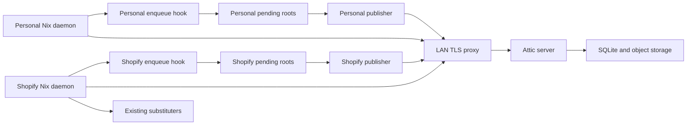
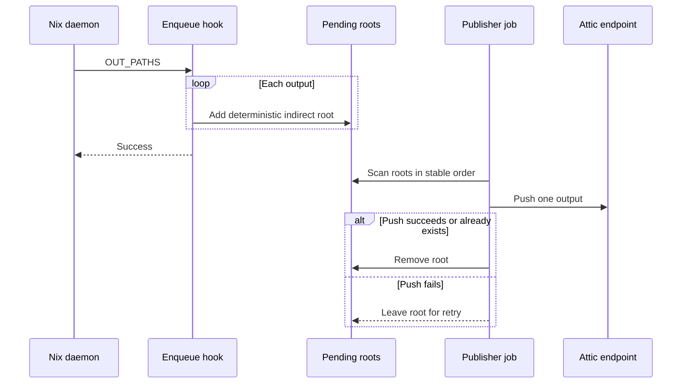
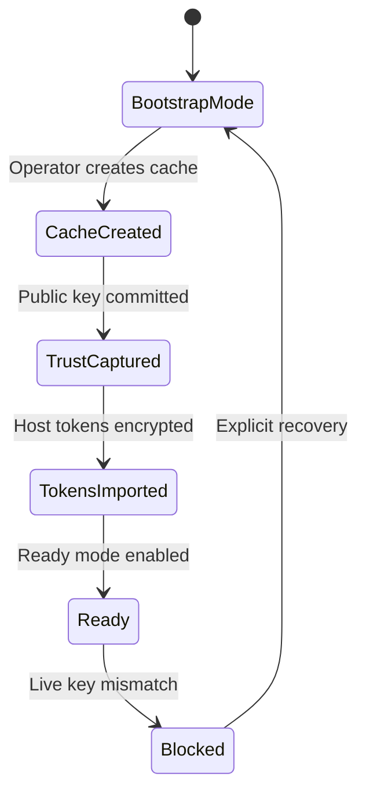
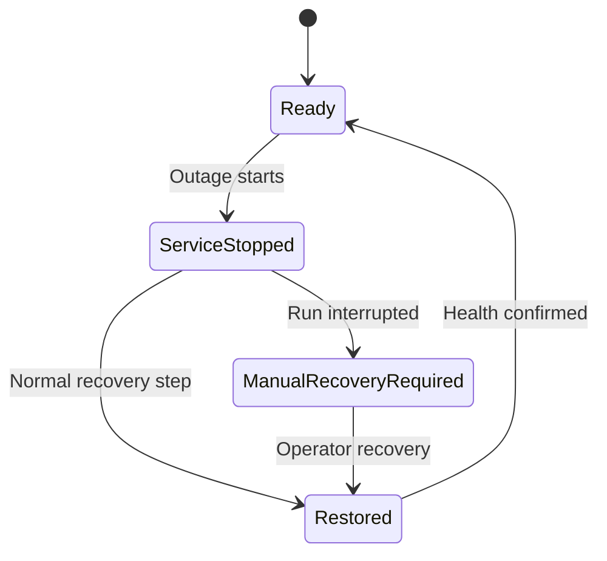

# Design Document

## Overview

The feature adds a signed LAN binary cache on `Brandons-MacBook-Pro`, asynchronous publication and trusted consumption on both nix-darwin hosts, and coordinated cache/store retention. Problem and scope: `brief.md`; external findings: `research.md`.

### Goals

- Reuse locally built Darwin outputs regardless of which host builds first.
- Keep builds independent from cache and LAN availability.
- Bound duplicate storage without reducing the seven-day rollback window.
- Keep TLS and publication secrets outside the Nix store.

### Non-Goals

- Remote execution or distributed builders.
- Public or tailnet exposure, high availability, PostgreSQL, or cross-architecture caches.
- Durable backup of disposable cache contents or automatic cache identity recreation.
- Retaining outputs already available from configured public upstream substituters.

## Boundary Commitments

### This Spec Owns

- A typed nix-darwin module for the server, publisher, and consumer capabilities.
- The Attic server state, LAN TLS endpoint, public trust artifacts, cache bootstrap contract, and runtime readiness check.
- A Nix post-build enqueue contract, pending-output GC roots, serialized publication, and retry state.
- Both-host local-cache preference/fallback and Shopify effective-hook conflict detection.
- Attic retention plus host-specific GC/optimization schedules and optional personal disk-pressure thresholds.
- Render, script-behavior, host-wiring, and manual smoke verification.
- Explicit recovery and retry gating when a controlled outage run exits before its normal recovery step.

### Out of Boundary

- Shopify-managed Nix include contents; the feature detects conflicts but does not edit that file.
- Other post-build-hook behavior beyond explicitly declared chaining.
- CA issuance/rotation automation, cache backup, quota enforcement, or cache-content recovery.
- Changes to Tailscale, SSH, build machines, or upstream cache ownership.
- Automatic launchd service restoration after an interrupted controlled-outage run.

### Allowed Dependencies

- Existing `pkgs.unstable`, nix-darwin Nix/PKI/launchd modules, SOPS system secrets, and Node/Nix test harnesses.
- Attic client/server and Caddy packages pinned through the existing `nixpkgs-unstable` lock.
- Vanilla upstream Nix 2.34 on Shopify under nix-darwin ownership and Lix 2.95 on personal, including `post-build-hook` and indirect GC roots.
- mDNS resolution for `Brandons-MacBook-Pro.local` and existing public/community/Shopify substituters.

### Revalidation Triggers

- Attic package, config schema, token claims, cache-info response, GC behavior, or CLI changes.
- Nix/Lix post-build-hook, GC-root, fallback, priority, or narinfo TTL semantics changing.
- Endpoint hostname/port, CA, leaf certificate, or cache signing identity rotation.
- A distributed builder or another post-build hook being introduced.
- Shopify's external include defining cache, trust, TLS, or post-build-hook values.
- Controlled-outage recovery commands, fixed launchd labels/plists, or preflight health gates changing.

## Architecture

### Existing Architecture Analysis

- Both hosts share `configurations/common-darwin/default.nix` and host-specific system modules.
- Additive `extra-substituters`/`extra-trusted-public-keys` preserve nix-darwin defaults.
- System SOPS secrets already decrypt to path-only runtime files.
- Existing long-running jobs are user agents; this feature introduces root/system launchd jobs.
- Current GC/optimize calendar intervals omit time fields and therefore run every matching minute.
- The personal host uses Lix; Shopify uses vanilla upstream Nix under nix-darwin ownership and includes an externally managed config fragment.

### Architecture Pattern & Boundary Map

Pattern: hybrid declarative module plus durable local queue and external cache service.



Dependency direction: public trust data → module options → rendered configs/scripts → launchd/Nix integration → runtime state. Runtime state never flows back into Nix evaluation except through an explicit operator update of the cache public key.

Key decisions:

- `atticd` listens only on `127.0.0.1:18080`; Caddy serves `https://Brandons-MacBook-Pro.local:8443` using explicit certificates.
- Caddy and Attic run as the existing login user through system daemons; publishers run as root to manage GC roots.
- The login user owns Attic state and Attic/Caddy logs. Root owns pending roots, publisher logs, host tokens, and the operator-only JWT private key; the login user owns the TLS leaf key with mode `0400`.
- The server verifies RS256 publication tokens with a committed public key. The private token-signing key is operator-only.
- Bootstrap mode exposes Attic/TLS but disables publisher and consumer capabilities until trust artifacts and SOPS tokens exist.
- Controlled-outage scripts restore services explicitly on uninterrupted paths. An interrupted path requires an operator-invoked, idempotent recovery mode before preflight permits another run.
- The bounded publisher runner retains automatic process-group cleanup; manual recovery applies only to the stopped launchd service.
- nix-darwin owns Shopify's upstream Nix daemon and top-level configuration with `nix.enable = true`; the Shopify-managed include remains external and read-only to this feature.

### Technology Stack

| Layer | Choice / Version | Role | Notes |
|---|---|---|---|
| Cache service | `pkgs.unstable.attic-server`, upstream revision pinned by nixpkgs | Signed NAR storage, SQLite metadata, retention GC | Exact package pin is a revalidation trigger. |
| Cache client | `pkgs.unstable.attic-client` | Serialized publication and bootstrap API | `watch-store` excluded. |
| TLS proxy | `pkgs.unstable.caddy` 2.11.x | LAN TLS termination and loopback proxy | Explicit certs; no internal CA or HTTP/3. |
| Storage | SQLite + local chunk storage | Cache identity, mappings, compressed artifacts | `/var/db/local-binary-cache/attic`. |
| Queue | Nix indirect-root symlinks | Pending publication and GC protection | One deterministic root per output. |
| Runtime | nix-darwin launchd daemons | Server, proxy, interval publisher, GC jobs | No login required. |
| Secrets | system sops-nix | TLS leaf key, JWT private key, per-host push tokens | Paths only in rendered config. |

## File Structure Plan

### Directory Structure

```text
configurations/common-darwin/
└── local-binary-cache.nix          # Typed module, public trust, and rendered service contracts
scripts/
├── local-binary-cache-enqueue.nix  # OUT_PATHS to deterministic indirect roots
├── local-binary-cache-publish.nix  # Serialized root scan, push, retry, cleanup
├── local-binary-cache-bootstrap.nix# Operator-only create/token/key workflow
└── local-binary-cache-status.nix   # Readiness status and full diagnostics commands
certificates/local-binary-cache/
├── ca.pem                          # Public LAN CA certificate
├── server.pem                      # Public server leaf/chain certificate
├── jwt-public.pem                  # Public RS256 token verification key
└── cache-public-key.txt            # Attic Nix signing public key captured at bootstrap
tests/local-binary-cache/
├── helpers.js                      # Isolated nix-darwin fixture helpers
├── system-render.test.js           # Module, host, trust, schedule, and secret checks
├── publisher.test.js               # Queue, duplicate, success, and retry behavior
├── 05-shopify-outage-preflight.sh  # Full-run health and unrecovered-service retry gate
├── 06-personal-endpoint-outage.sh  # Caddy outage flow and idempotent recovery mode
├── 07-shopify-outage-producer.sh   # Publisher outage flow and idempotent recovery mode
├── 08-shopify-outage-recovery.sh   # Normal recovery and retained-root proof
├── outage-log-io.pl                # Bounded publisher process-group and evidence runner
├── outage-publisher-control.sh     # Fixed publisher contract, stop, restore, and recovery helpers
├── outage-evidence.test.js         # Recovery guidance, retry gate, and evidence tests
├── outage-restore.test.js          # Caddy normal/manual recovery contract tests
└── outage-smoke.test.js            # Cross-script boundary and safety checks
```

### Modified Files

- `configurations/common-darwin/default.nix` — import the module; give common GC/optimize complete weekly calendar intervals.
- `configurations/personal/default.nix` — enable server, consumer, and publisher; declare SOPS paths; set daily GC with optional pressure thresholds unset.
- `configurations/shopify/default.nix` — enable publisher and consumer after bootstrap; declare token secret; preserve the external include.
- `flake.nix` — add cache render and publisher checks; no new package input.
- `.sops.yaml` — add per-host creation rules for cache secrets.
- `secrets/README.md` — document generation, bootstrap, token rotation, and recovery order.
- `secrets/local-binary-cache.personal.yaml` — operator-generated TLS key, JWT private key, and personal push token.
- `secrets/local-binary-cache.shopify.yaml` — operator-generated Shopify push token.

Each script is dependency-injected with executable/state paths so tests use stubs without mutating the real Nix store.

## System Flows

### Build publication



The hook performs no DNS, TLS, or cache call. Queue creation failure is fatal; remote publication failure is asynchronous.

### Bootstrap and readiness



Ready mode requires the configured cache public key to match live `attic-cache-info`. Database loss never auto-creates a replacement cache.

### Controlled outage recovery



Recovery guidance is emitted before service mutation. The normal path restores explicitly; an interrupted path makes no automatic-restoration claim and cannot be retried until the fixed recovery mode confirms the service is loaded and healthy.

## Requirements Traceability

| Requirements | Summary | Components | Contracts / Flows |
|---|---|---|---|
| 1.1, 1.2, 1.3, 1.4, 1.5 | Personal signed TLS cache and independent retention | Cache Module, Attic Service, TLS Proxy | Service state, bootstrap flow |
| 2.1, 2.2, 2.3, 2.4, 2.5, 2.6, 2.7 | Durable non-blocking publication | Enqueue Hook, Pending Roots, Publisher Job | Publication sequence |
| 3.1, 3.2, 3.3, 3.4, 3.5, 3.6 | Both-host preference, trust, fallback, freshness | Consumer Config, TLS Trust, Diagnostics Tool | Nix daemon contract |
| 4.1, 4.2, 4.3, 4.4, 4.5, 4.6 | Anonymous pull and scoped secret publication | Attic Service, SOPS Wiring, Bootstrap Tool | Token and secret contracts |
| 5.1, 5.2, 5.3, 5.4, 5.5, 5.6, 5.7, 5.8, 5.9 | Cache retention and host GC/optimize policy | Retention Policy, Pending Roots | GC state contract |
| 6.1, 6.2, 6.3, 6.4, 6.5 | Restart, logs, health, identity recovery | Launchd Services, Readiness Status, Diagnostics Tool | Readiness flow |
| 6.6, 6.7, 6.8, 6.9 | Controlled-outage normal recovery, manual interruption recovery, retry gating, bounded process cleanup | Outage Verification, Publisher Job | Controlled outage recovery |
| 7.1, 7.2, 7.3, 7.4, 7.5, 7.6 | Declarative and behavior checks | Render Tests, Publisher Tests, Outage Verification | Fixture contracts |

## Components and Interfaces

| Component | Layer | Intent | Requirements | Dependencies | Contracts |
|---|---|---|---|---|---|
| Cache Module | Declarative | Validate options and render all host integrations | 1–7 | nix-darwin, packages | Service, State |
| Attic Service | Runtime | Own cache identity, metadata, objects, and retention | 1, 4, 5, 6 | Attic, SQLite | Service, API, State |
| TLS Proxy | Runtime | Expose the loopback cache through LAN TLS | 1, 3, 4, 6 | Caddy, SOPS key | Service, API |
| Enqueue Hook | Integration | Convert build outputs into pending roots | 2, 5 | Nix/Lix daemon | Event, State |
| Publisher Job | Batch | Push pending outputs serially and retry safely | 2, 4, 6 | Attic client, token file | Batch, State |
| Consumer Config | Integration | Configure both-host trust, preference, freshness, fallback | 3, 4 | Nix daemon, PKI | State |
| Bootstrap Tool | Operations | Create/verify cache identity and host tokens explicitly | 1, 4, 6 | atticadm, SOPS workflow | Batch, State |
| Readiness Status | Operations | Report endpoint and signing-identity readiness for outage phases | 3, 6 | curl | Batch |
| Diagnostics Tool | Operations | Report endpoint, identity, effective Nix config, and queue state | 3, 6 | curl, Nix config | Batch |
| Outage Verification | Operations | Prove fallback/recovery while separating bounded process cleanup from manual service recovery | 6.6, 6.7, 6.8, 6.9, 7.6 | launchd, Readiness Status, Publisher Job | Batch, State |
| Retention Policy | Operations | Coordinate Attic GC, host GC, pressure, optimization | 5 | nix-darwin, Attic | State |

### Declarative configuration

#### Cache Module

| Field | Detail |
|---|---|
| Intent | Provide one validated contract for the required server/publisher/consumer compositions. |
| Requirements | 1.1–1.5, 2.1–2.7, 3.1–3.6, 4.1–4.6, 5.1–5.9, 6.1–6.5, 7.1–7.5 |

**Option contract**

```text
services.localBinaryCache = {
  enable: bool;
  bootstrapMode: bool;
  endpoint: https URL;
  cacheName: string;
  cachePublicKey: null or Nix public key;
  caCertificate: path;
  publisher: { enable, tokenFile, tokenValidity, intervalSeconds, chainedHooks };
  consumer: { enable, priority, negativeTtlSeconds };
  server: { enable, listenAddress, stateDirectory, retentionDays,
            gcInterval, jwtPublicKey, tlsCertificate, tlsKeyFile };
  gcPolicy: { minFree: null or bytes, maxFree: null or bytes };
};
```

Invariants:

- `server.enable` is personal-only; consumer and publisher are enabled on both hosts in ready mode.
- Consumer/publisher enablement requires `bootstrapMode = false`, a non-null cache key, and all public trust paths.
- Publisher enablement requires distributed builds disabled and one explicit final hook wrapper.
- `priority = 30`, `negativeTtlSeconds = 60`, `retentionDays = 30`, and the endpoint port is `8443`.
- Publisher token validity is Attic's one-year duration of 31,557,600 seconds. Disk-pressure values default to null; setting either requires both, with nonzero `minFree` and `maxFree > minFree`.
- A pre-reload activation check evaluates Shopify's included file as an isolated `nix.conf` under a temporary `NIX_CONF_DIR`. Empty hook state is accepted; a value in `chainedHooks` is chained once; every other value aborts before daemon reload.

**Implementation Notes**

- Render the final hook setting after external includes; chain only declared hook paths.
- Evaluate secret absence using poisoned fixture values, not only production path inspection.
- Bootstrap mode renders no substituter or publisher.

### Publication

#### Enqueue Hook

| Field | Detail |
|---|---|
| Intent | Durably record every hook output without network work. |
| Requirements | 2.1, 2.2, 2.5, 2.6, 2.7, 5.7 |

**Event Contract**

- Trigger: Nix/Lix `post-build-hook` with `OUT_PATHS`.
- Input: one or more absolute store paths; glob expansion disabled.
- Output: `<pending>/<store-hash>` indirect root for each path.
- Idempotency: duplicate outputs replace the same root atomically.
- Failure: any invalid path or root-creation failure returns nonzero; cache availability is never checked.

#### Publisher Job

| Field | Detail |
|---|---|
| Intent | Drain pending roots through authenticated, serialized pushes. |
| Requirements | 2.3, 2.4, 4.2, 4.3, 4.6, 6.2 |

**Batch Contract**

- Trigger: `RunAtLoad` and every 60 seconds; one launchd job instance per host.
- Input: lexically sorted valid symlinks under the pending directory.
- Processing: acquire a nonblocking singleton lock; push one target at a time with one upload job.
- Success: unlink the queue root only after successful upload or confirmed cache presence.
- Failure: log the path/error, leave the root, stop the batch, and retry on the next interval.
- Secret: client config contains a runtime `token-file` path only.

### Cache service and trust

#### Attic Service and TLS Proxy

| Field | Detail |
|---|---|
| Intent | Serve a public-read, authenticated-write cache over LAN TLS. |
| Requirements | 1.1–1.5, 3.4, 3.5, 4.1–4.6, 5.1, 5.2, 6.1, 6.3–6.5 |

**Service Contract**

- Attic: loopback `127.0.0.1:18080`, SQLite `?mode=rwc`, local zstd/chunk storage, 12-hour GC, 30-day global retention, RS256 public verification.
- Attic endpoint contract: `allowed-hosts = ["brandons-macbook-pro.local:8443"]`, `api-endpoint = "https://Brandons-MacBook-Pro.local:8443/"`, and `substituter-endpoint = "https://Brandons-MacBook-Pro.local:8443/"`.
- Cache: name `darwin`, public pull, push permission required, priority 30, official/community upstream filters.
- Shopify-private substitutions do not invoke the post-build hook. Outputs locally rebuilt while that external cache is unavailable may be retained because its cache identity remains out of boundary.
- Caddy: HTTPS `:8443`, exact hostname/SAN, explicit leaf/key, HTTP/1.1 and HTTP/2, no admin API, automatic HTTPS, or HTTP/3.
- Launchd: system daemons with `RunAtLoad`, `KeepAlive`, `ThrottleInterval = 10`, absolute arguments, working/state directories, and separate logs. Caddy's wrapper checks the SOPS key before `exec`; a missing key produces an actionable log and throttled retry.
- Readiness: live CA/TLS verification and cache public-key equality; bootstrap mode is never ready.

#### Consumer Config

- On both hosts, append `https://Brandons-MacBook-Pro.local:8443/darwin` and the Attic public key.
- On both hosts, append the private CA through `security.pki.certificateFiles` and set `nix.settings.ssl-cert-file = "/etc/ssl/certs/ca-certificates.crt"` to preserve normal public CA trust.
- Set fallback true and negative narinfo TTL to 60 seconds. Do not change global connect timeouts initially.
- Preserve each host's existing substituters. On Shopify, inspect the external include before daemon reload through a temporary `NIX_CONF_DIR`: no hook is accepted, a value listed in `chainedHooks` is chained once, and any other hook aborts activation. The diagnostics tool also verifies effective post-reload hook/substituter configuration.
- Keep Shopify's vanilla upstream Nix under nix-darwin ownership; do not add installer-specific configuration sentinels.

### Controlled outage verification

#### Outage Verification

| Field | Detail |
|---|---|
| Intent | Prove fallback and recovery without claiming automatic launchd restoration after interruption. |
| Requirements | 6.6, 6.7, 6.8, 6.9, 7.6 |

**Recovery Contract**

- Preflight requires the fixed Caddy and publisher jobs to be loaded and the cache state required by the selected phase to be healthy.
- Before each `bootout`, the phase prints the exact host-local recovery-mode invocation for the fixed service target: `06-personal-endpoint-outage.sh --recover` for Caddy and `07-shopify-outage-producer.sh --recover` for the Shopify publisher.
- Uninterrupted phases call their existing restore helper at the defined recovery step and require `launchctl print` plus the applicable status probe before success.
- Bash EXIT/HUP/INT/TERM traps do not own service restoration. A signal or early exit before the recovery step leaves the service for manual recovery.
- The personal endpoint and Shopify publisher phase scripts accept only the literal `--recover` mode without run identifiers or caller-selected service data. Each mode succeeds when the job is already loaded, otherwise bootstraps only its declared plist with non-interactive privilege, confirms the job, and verifies applicable health.
- A new outage attempt fails preflight while a required job remains unloaded or unhealthy.
- `outage-log-io.pl` independently terminates and reaps the bounded publisher process group on signal, timeout, overflow, and command failure. It does not own Caddy or publisher launchd restoration.

### Retention policy

| Policy | Personal | Shopify |
|---|---|---|
| Scheduled Nix GC | Daily 03:15 | Sunday 03:15 |
| Generation retention | 7 days | 7 days |
| Store pressure | Configurable; unset initially | Existing defaults |
| Store optimization | Sunday 04:15 | Sunday 04:15 |
| Attic retention/GC | 30 days / every 12 hours | Not applicable |

Pending roots are authoritative protection for both scheduled and pressure GC. Nix optimization and GC use distinct schedules; the design does not claim strict internal race freedom.

## Data Models

### Pending Root

```text
PendingRoot {
  id: 32-character store hash
  linkPath: absolute path under pending directory
  storePath: absolute target under Nix store
}
```

Invariants: one root per store hash; target must exist; the link remains unchanged during retry; removal is the sole success transition.

### Public Trust Bundle

- LAN CA certificate and TLS leaf certificate: committed public PEM files.
- JWT verifier: committed RS256 public key.
- Nix cache key: committed value captured from live cache bootstrap.
- Private counterparts and push tokens: SOPS runtime files only.

## Error Handling

| Error | Response | Build impact |
|---|---|---|
| Invalid output or root creation failure | Log path and fail hook | Current realization fails; output remains registered. |
| LAN, TLS, auth, or push failure | Leave root and retry | None after enqueue. |
| Missing publisher token | Publisher fails with secret path; root remains | None after enqueue. |
| Missing TLS key | Caddy exits; launchd retries | Consumers fall back. |
| Cache public-key mismatch | Readiness blocked; publisher/consumer disabled by operator rollback | Upstream/local paths remain. |
| Undeclared external post-build hook | Activation fails with conflicting source | Existing daemon remains unchanged. |
| Cache database loss | Stop ready rollout; discard orphan storage; explicit rebootstrap | Upstream/local paths remain. |
| Outage harness signal or early exit before recovery | Reject the evidence and require the printed manual recovery mode before retry | None; the pending root remains. |
| Publisher invocation interruption, timeout, or overflow | Kill and reap the isolated publisher group and reject the evidence | None; launchd service recovery follows the enclosing phase contract. |

### Monitoring

`local-binary-cache-status` provides the readiness-only contract consumed by outage phases. `local-binary-cache-diagnostics` reports TLS/cache health, live/configured key match, effective hook/substituters, queue count, oldest pending age, and broken roots. Recovery modes report the target job and confirmed state without reading secret contents. Logs live under `/var/log/local-binary-cache/`; no secret or token is logged.

## Testing Strategy

### Render and evaluation

- Evaluate server, publisher, consumer, bootstrap, and disabled fixtures.
- Assert personal/Shopify live-host roles, endpoint, priority, trust, GC schedules, pressure values, and optimization times.
- Assert bootstrap mode emits no publisher/substituter and ready mode rejects missing public key or secret paths.
- Assert generated configs contain poisoned secret paths but never poisoned secret values.
- Assert all external-hook cases: no hook succeeds, an explicitly declared hook is chained once, and an undeclared hook fails before reload.

### Script behavior

- Stub root creation to verify multi-output parsing, deterministic IDs, duplicate coalescing, and local failure exit.
- Stub Attic to verify one-at-a-time order, root removal on success/already-present, retention on failure, and batch stop/retry.
- Verify invalid/broken roots are logged and retained or quarantined according to the component contract.
- Verify diagnostics output detects key mismatch, endpoint failure, effective-hook drift, and pending age.
- Verify the outage harness invokes the exact deployed publisher from its declared working directory with a sanitized launchd-equivalent environment.
- Verify non-interactive privilege preflight and publisher process-group cleanup on success, failure, HUP, INT, TERM, timeout, and output overflow.
- Bound each synchronous publisher invocation to 180 seconds and 64 KiB of exclusive root-owned evidence.
- Verify each service stop emits its fixed recovery-mode command before mutation.
- Verify recovery modes are idempotent, reject invalid host/service state, confirm loaded health, and use only fixed labels/plists with non-interactive privilege.
- Verify preflight rejects a retry while Caddy or the publisher remains unrecovered.
- Verify service-restoration signal traps are absent from the outage phases.

### Integration and manual smoke

- Build a unique fixture on personal, verify publication, GC the local store path, and substitute it on Shopify.
- Repeat with Shopify as producer and personal cache as receiver; verify no synchronous build delay during a simulated outage.
- Stop only Caddy, verify Shopify completes a local fallback build, retains its pending root, then use the approved outage harness to prove failure and post-restore drain.
- Verify the printed personal and Shopify recovery modes restore an intentionally stopped job and permit preflight only after health confirmation.
- Verify the certificate SAN, mDNS hostname, cache key, launchd restart, and effective Shopify Nix config on both hosts.

## Security Considerations

- Nix signatures authenticate artifacts; TLS authenticates the LAN endpoint; push tokens authorize mutation. No control substitutes for another.
- Public pull exposes store names and artifacts to LAN peers but no publication capability.
- Per-host one-year push tokens are scoped to `darwin`; immediate revocation requires JWT key rotation, so rotation steps update both SOPS files.
- The JWT private key is used only by the operator bootstrap tool. Attic receives its public verifier.
- The CA private key remains offline. Only the TLS leaf key is decrypted on the server.
- SOPS ownership is explicit: TLS leaf key to the login user at `0400`; JWT private key and both push tokens to root at `0400`.
- SQLite contains the cache signing private key. Cache loss requires trust rotation; automatic recreation is forbidden.
- Recovery modes accept no caller-selected label, plist, executable, or working directory; each target is fixed by the host-specific outage phase.

## Performance and Capacity

- Enqueue cost is bounded to local root operations and performs no cache lookup.
- Publication is deliberately serialized for SQLite stability; throughput is secondary to build isolation for two hosts.
- Configured public-upstream filtering prevents duplicate retention of those cache artifacts.
- Attic has no byte quota. The diagnostics command surfaces queue pressure; 30-day retention and daily personal GC are the initial controls. Pressure thresholds can be enabled later without changing the module contract.

## Migration Strategy

- **Stage 0 — prerequisite identity**: generate the offline LAN CA/leaf and RS256 JWT keypairs; commit public artifacts; SOPS-encrypt the TLS leaf key and operator-only JWT private key before enabling services.
- **Stage 1 — bootstrap runtime**: deploy Attic/Caddy plus bootstrap, readiness, and diagnostics tools with `bootstrapMode = true`; launch wrappers tolerate SOPS boot ordering through secret preflight and throttled retry.
- **Stage 2 — cache identity**: create `darwin`, capture its Nix public key, issue per-host push tokens, and import those tokens into root-owned SOPS secrets.
- **Stage 3 — personal ready**: enable personal consumer/publisher, verify queue/push/substitution/GC and live key.
- **Stage 4 — Shopify ready**: enable consumer/publisher, verify effective external include, fallback, and cross-host substitution.
- **Rollback**: disable consumer/publisher first; upstream caches and local builds continue. Server state can then be stopped without changing Nix trust immediately.
