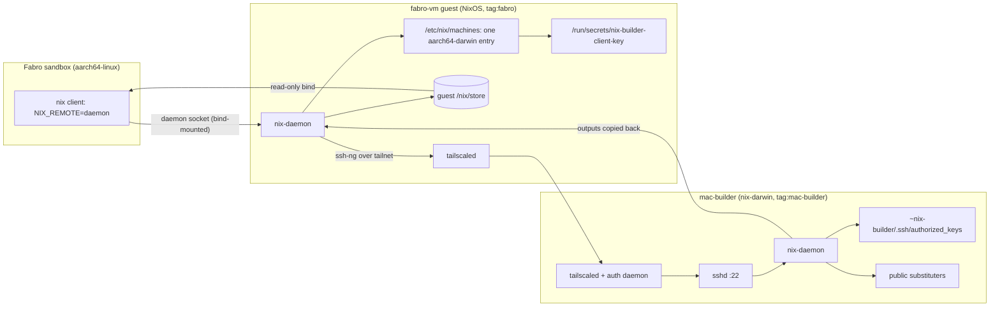
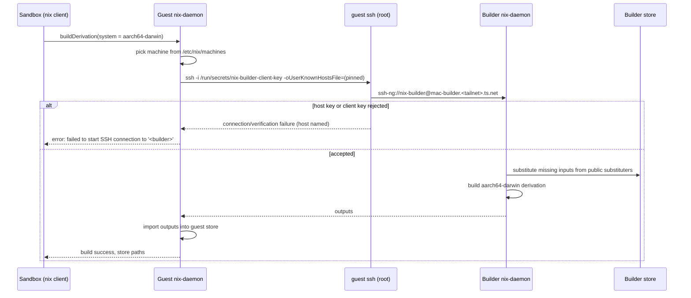
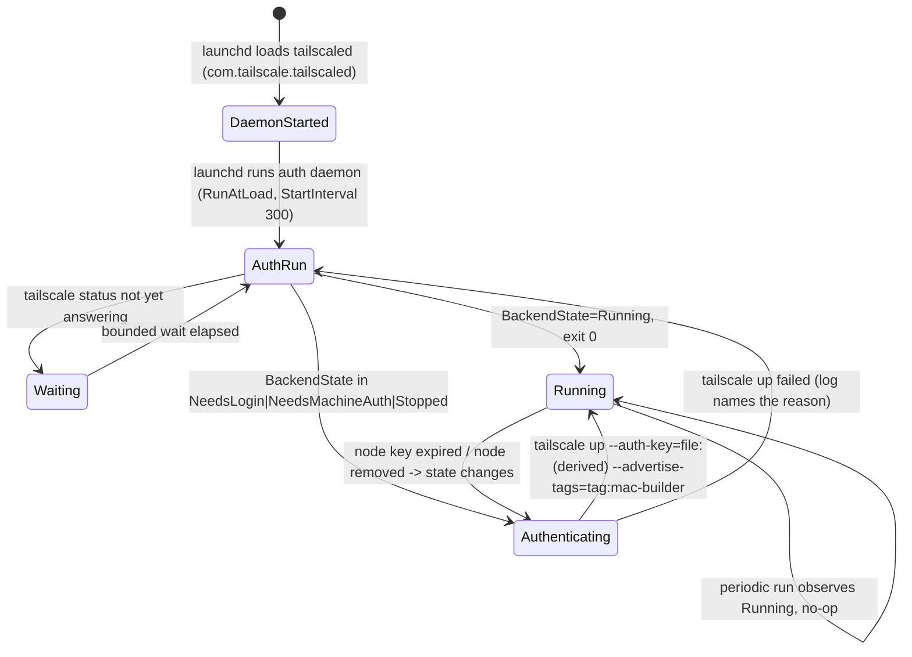
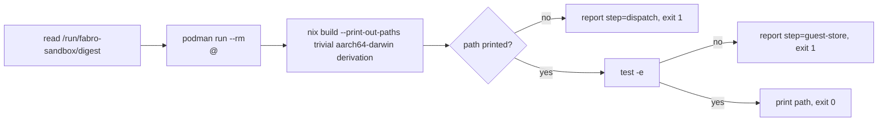

# Design Document

## Overview

This design puts Darwin build dispatch inside the fabro-vm guest's Nix daemon and makes
the existing `mac-builder` Lima guest a tagged tailnet node that serves the stock Nix
`ssh-ng` remote-builder endpoint. It defines the guest-side build-machine contract, the
builder's tailnet membership and public-cache policy, the trust material on both sides,
and the declarative plus runtime verification; problem, approach, and scope live in
`brief.md`, the behavioral contract in `requirements.md`, and the external findings with
sources in `research.md`.

### Goals

- An `aarch64-darwin` build or check issued from any Fabro sandbox runs on the builder and
  lands its output in the guest store the sandbox already mounts.
- The dispatch is a plain `nix.buildMachines` entry: no sandbox, image, or workflow change.
- The builder is reachable only over the tailnet, joins with the open-source client and an
  OAuth credential, and substitutes from public caches only.
- Drift in the dispatch entry, trust material, membership, or cache policy fails a
  repository check before anyone attempts a Darwin build.

### Non-Goals

- Publishing Darwin outputs to any cache, and any cachix account or token.
- Builder pools, per-run or per-workflow builder selection, load balancing, or scheduling
  policy.
- `x86_64`, Linux, or additional Darwin builders; CI runner capacity.
- Replacing the LAN SSH forward that `mac-builder-deploy` and `mac-builder-readiness` use.
- Tailnet policy administration (console-owned) beyond documenting the required grant.

## Boundary Commitments

### This Spec Owns

- The guest's dispatch contract: `nix.buildMachines`, `nix.distributedBuilds`,
  `nix.settings."builders-use-substitutes"`, the pinned builder host key, and the
  reference to the client-key path.
- The client key's runtime materialization on the guest (new sops secret in
  `secrets/fabro.fabro.yaml`) and its root-only mode.
- The builder's tailnet membership: `services.tailscale` enablement, the OAuth secret in
  the builder store, the dedicated tag, and the login-free authentication daemon.
- The builder's public substituter and trusted-key policy.
- The tailnet grant documentation the guest depends on.
- The repository checks and the sandbox-side Darwin Build Smoke.

### Out of Boundary

- The builder host's user, OpenSSH, Nix-daemon trust, GC, and authorized-key mechanism
  (`mac-nix-remote-builder` owns them; this spec only adds a key to the existing secret).
- Sandbox image contents, `NIX_REMOTE=daemon`, and the engine-level store/daemon mounts
  (`nix-built-container-for-default-fabro-environmen` owns them; this spec asserts they
  stay unchanged).
- The fabro-vm tailnet node registration and its OAuth client.
- Any client outside `fabro-vm` (personal host, CI).
- Publishing, retention, or private-cache behavior (`local-binary-cache` owns those).

### Allowed Dependencies

- `configurations/mac-builder/default.nix`: `darwinConfigurations.mac-builder`,
  `nix-builder` (uid 502, `staff`), `nix.settings.trusted-users = [ "nix-builder" ]`,
  OpenSSH, and the `builder-authorized-keys` activation fragment.
- `configurations/fabro-vm/tailscale.nix`: the guest is already a tag-owned tailnet node
  with an OAuth secret; the design adds no new tailnet identity for the guest.
- `configurations/fabro-vm/sandbox.nix` engine-level mounts and
  `configurations/fabro-vm/sandbox-image.nix` `NIX_REMOTE=daemon` /
  `NIX_CONFIG` image environment.
- nix-darwin 26.05 (`services.tailscale`, `launchd.daemons`) and NixOS 26.05
  (`nix.buildMachines`, sops-nix per-host stores).

### Revalidation Triggers

- A change to the builder's tailnet name, tag, or SSH port; a change to the builder's
  `nix-builder` account, its `trusted-users` membership, or the host keys.
- A change to the guest's tailnet node, its MagicDNS resolution path, or its daemon
  settings (`nix.settings`).
- A change to the sandbox image environment or the engine-level mount list.
- A change to the builder's public substituter set or their signing keys.
- An OAuth-client or tag-authorization change in the Tailscale console.

## Architecture

### Existing Architecture Analysis

- `configurations/fabro-vm/default.nix:367` declares only experimental features and
  `trusted-users = [ "@wheel" ]`; `nix.distributedBuilds` is unset (false), so the daemon
  never reads `/etc/nix/machines` even though the option exists.
- `configurations/fabro-vm/sandbox.nix:199` binds the guest `/nix/store` read-only and
  the daemon socket into every container, and
  `configurations/fabro-vm/sandbox-image.nix:110` sets `NIX_REMOTE=daemon`,
  `HOME=/tmp`, and `NIX_CONFIG=experimental-features = nix-command flakes`. Every run-side
  Nix operation therefore already terminates at the guest daemon.
- `configurations/fabro-vm/tailscale.nix` registers the guest as a persistent, tag-owned
  (`tag:fabro`) node with an OAuth secret; the guest's tailnet name resolution runs
  through its own tailscaled, which the dispatch relies on.
- `configurations/mac-builder/default.nix` is an `aarch64-darwin` builder: `nix-builder`
  is a trusted user, OpenSSH is key-only, and `builder-authorized-keys` is installed by a
  `postActivation` fragment that fails closed. It declares no tailnet membership and no
  substituters beyond Nix defaults.
- The builder runs as a Lima macOS guest (`home-manager/common/lima-mac-guest.nix`,
  `configurations/personal/home-manager/default.nix:221`) with a LAN SSH forward on
  `:2222` used by `scripts/mac-builder-deploy.nix` and
  `scripts/mac-builder-readiness.nix`; both stay as they are.

### Architecture Pattern & Boundary Map

Pattern: daemon-level remote dispatch. The sandbox stays a thin client; the guest daemon
is the only node holding a builder identity; the builder is an ordinary `ssh-ng` store.
The two host configurations share no file and no module — only the tailnet, the pinned
public host key, and the client key's public half in the builder's authorized-keys secret.



**Architecture Integration**

- Selected pattern: one distributed-build client (the guest daemon) plus one stock
  `ssh-ng` builder — the smallest arrangement that satisfies "host daemon and store" and
  "existing Nix distributed build functionality".
- Domain boundaries: the guest owns dispatch and the client identity; the builder owns
  membership, the endpoint, and the cache policy; the sandbox owns nothing network- or
  builder-related.
- Existing patterns preserved: sops-nix runtime secrets with no values in the store;
  per-host secret stores and the `&host_<name>` recipient convention; declarative render
  checks in Node under `tests/`; smoke checks as `writeShellApplication` scripts.
- New components rationale: a guest module is needed because no client wiring exists; a
  builder tailnet module is needed because nix-darwin has no auth-key option; a smoke
  script is needed because render checks cannot prove a build crosses the tailnet.

### Technology Stack

| Layer | Choice / Version | Role in Feature | Notes |
|---|---|---|---|
| Guest OS | NixOS 26.05 (`nixosConfigurations.fabro-vm`) | Dispatch client, store holder | `nix.buildMachines` in the daemon |
| Builder OS | nix-darwin 26.05 (`darwinConfigurations.mac-builder`) | `aarch64-darwin` remote builder | Lima macOS 27 guest |
| Build protocol | Nix `ssh-ng` worker protocol | Stock remote build | `protocol = "ssh-ng"` |
| Overlay network | `pkgs.tailscale` open-source client | Tailnet membership on both nodes | nix-darwin `services.tailscale` |
| Secrets | sops-nix (per-host stores) | Client key, OAuth secret | `/run/secrets/*`, root-only |
| Caches | `cache.nixos.org`, `nix-community.cachix.org` | Input substitution on the builder | Public keys only |
| Verification | Node `node:test` + flake check + `podman run` smoke | Declarative and runtime checks | Mirrors `tests/mac-nix-remote-builder` |

## File Structure Plan

### Directory Structure

```text
configurations/fabro-vm/
└── darwin-builder.nix             # fabro.darwinBuilder: build machines, client key, pinned host key
configurations/mac-builder/
└── tailscale.nix                  # services.tailscale + login-free OAuth auth daemon
scripts/
└── fabro-darwin-build-smoke.nix   # sandbox-side aarch64-darwin build smoke
docs/
└── mac-builder-tailnet.md         # tag, OAuth client, ACL grant, DNS, rotation runbook
tests/fabro-darwin-builder/
├── helpers.js                     # nix-eval helpers (same shape as tests/mac-nix-remote-builder)
├── guest-dispatch.test.js         # build-machine entry, key path, pin, substitution policy
├── builder-membership.test.js     # tailscale service, auth daemon, tag, cache policy
├── sandbox-invariants.test.js     # one-Nix-per-sandbox regression guard
└── secret-absence.test.js         # poisoned-value render checks
```

### Modified Files

- `configurations/fabro-vm/default.nix` — import `./darwin-builder.nix`; add the
  `nix-builder-client-key` entry to `fabro.onePasswordSecrets`.
- `configurations/mac-builder/default.nix` — import `./tailscale.nix`; declare
  `sops.secrets."tailscale-oauth-secret"`; declare the public substituter set and its
  trusted keys.
- `flake.nix` — add the `fabro-darwin-builder` check (Node suite) and the
  `packages.aarch64-linux.fabro-darwin-build-smoke` package bound to the guest's script.
- `secrets/fabro.fabro.yaml` — add the encrypted `nix-builder-client-key`.
- `secrets/remote-builder.mac-builder.yaml` — add the encrypted `tailscale-oauth-secret`
  and the guest's client public key inside `builder-authorized-keys`.
- `secrets/README.md` — document both new secrets, their 1Password sources, and rotation.

`.sops.yaml` needs no change: `&host_fabro` and `&host_mac_builder` and their
`creation_rules` already exist.

## System Flows

### Darwin build dispatch



The daemon is the only dispatcher: an untrusted sandbox user cannot add machines or
substituters (it is not in `trusted-users`). There is no local fallback, retry loop, or
second builder — a Darwin derivation that cannot reach the builder fails, because the
guest cannot build it locally at all.

### Builder tailnet membership lifecycle



The derived auth-key file is written with `umask 077` under a root-only runtime
directory and deleted after `tailscale up`; the secret value never appears in argv, the
plist, or the Nix store.

### Darwin Build Smoke



## Requirements Traceability

| Requirement | Summary | Design sections | Interfaces / Flows |
|---|---|---|---|
| 1.1–1.5 | Darwin build runs on the builder, output lands in the guest store, sandbox resolves it, no workflow change | Guest Darwin Dispatch; Architecture | `buildMachines` contract; dispatch flow |
| 1.6–1.7 | Unreachable/rejected builder fails the request with an identifying error | Guest Darwin Dispatch (no fallback); Error Handling | Nix-native errors |
| 2.1–2.7 | One Nix per sandbox: daemon, read-only store, no local daemon/store/key/tailnet | Sandbox Invariants; Repository Checks | Mount/image regression assertions |
| 3.1–3.3 | Traffic leaves as the guest tailnet node, addressed by tailnet name, never the LAN forward | Guest Darwin Dispatch (host name option) | `hostName` contract |
| 3.4 | Tailnet grant documented | Tailnet Access Documentation | Runbook |
| 3.5–3.6 | Denied access refuses the connection and the guest names the builder | Tailnet Access Documentation; Error Handling | Nix-native errors |
| 4.1–4.9 | Open-source client, OAuth credential, dedicated tag, no interactive login, declarative, not via the personal node, still nix-darwin-only | Builder Tailnet Membership | Option contract; auth daemon |
| 5.1–5.7 | Stock `ssh-ng` endpoint, builder user only, `aarch64-darwin` only, outputs returned, no login, no bespoke service | Builder Remote-Build Endpoint; Builder Access & Trust | Existing builder config plus assertions |
| 6.1–6.3 | Client key presented; only authorized keys accepted; others refused | Builder Access & Trust; Trust Material | Authorized-keys contract |
| 6.4–6.5 | Builder host key verified against a pinned value before dispatch | Guest Darwin Dispatch | `publicHostKey` contract |
| 6.6–6.9 | Client key root-only, outside the store and image, referenced by path | Guest Darwin Dispatch; Data Models | sops secret contract |
| 6.10 | OAuth credential from the builder store, not the Nix store | Builder Tailnet Membership | sops secret contract |
| 6.11 | Missing key material fails dispatch with an identifying error | Guest Darwin Dispatch (assertions); Error Handling | Evaluation + ssh errors |
| 6.12 | Missing/empty authorized keys fail builder activation | Builder Access & Trust (existing fragment) | Activation contract |
| 7.1–7.4 | Public substituters and keys only; no private cache or credential | Builder Cache Policy | Rendered `nix.conf` assertions |
| 7.5–7.6 | Builder fetches inputs itself; the guest does not upload them | Guest Darwin Dispatch (`builders-use-substitutes`) | Dispatch flow |
| 7.7 | No output publication | Builder Cache Policy | Repository checks |
| 8.1–8.2 | Repository checks verify guest and builder configuration | Repository Checks | Node suites + flake check |
| 8.3–8.4 | Secret values and per-container Nix/keys/tailnet are rejected | Repository Checks | Poisoned-value + invariants tests |
| 8.5–8.7 | Smoke requests a trivial Darwin derivation, reports the path, confirms it in the guest store, fails loudly | Darwin Build Smoke | Smoke contract |

## Components and Interfaces

| Component | Domain | Intent | Requirements | Key Dependencies | Contracts |
|---|---|---|---|---|---|
| Guest Darwin Dispatch | Guest (NixOS) | Declare the one `aarch64-darwin` build machine and its trust material | 1.1–1.7, 3.1–3.3, 6.4–6.9, 6.11, 7.5–7.6 | guest nix-daemon, sops-nix, tailscaled (P0) | State |
| Builder Tailnet Membership | Builder (nix-darwin) | Join the tailnet with the open-source client and an OAuth credential | 3.5, 4.1–4.9, 6.10 | `services.tailscale`, launchd (P0) | Service, State |
| Builder Access & Trust | Builder (nix-darwin) | Serve the stock endpoint to the client key only | 5.1–5.7, 6.1–6.3, 6.12 | existing builder config, sshd (P0) | State |
| Builder Cache Policy | Builder (nix-darwin) | Public substituters only | 7.1–7.4, 7.7 | Nix settings (P0) | State |
| Tailnet Access Documentation | Repository docs | Record the tag, OAuth client, ACL grant, and DNS requirement | 3.4, 3.5 | Tailscale console (P1) | Batch |
| Darwin Build Smoke | Guest runtime | Prove a sandbox build reaches the builder and lands in the guest store | 8.5–8.7, 1.3–1.4 | podman, sandbox image digest (P0) | Batch |
| Repository Checks | Verification | Catch dispatch, membership, trust, and cache drift | 8.1–8.4, 2.4–2.6 | `nix eval`, Node (P0) | Batch |

### Guest (fabro-vm)

#### Guest Darwin Dispatch

| Field | Detail |
|---|---|
| Intent | Make the guest daemon the only Darwin build client, with secret-backed trust. |
| Requirements | 1.1–1.7, 3.1–3.3, 6.4–6.9, 6.11, 7.5–7.6 |

**Option contract** (`configurations/fabro-vm/darwin-builder.nix`):

```nix
fabro.darwinBuilder = {
  enable            = true;                                  # mkEnableOption
  hostName          = "mac-builder.tuxedo-musical.ts.net";   # builder tailnet FQDN
  sshUser           = "nix-builder";
  clientKeySecret   = "nix-builder-client-key";              # sops.secrets.<name>
  hostPublicKey     = "AAAA…=";  # base64 -b 0 -i /etc/ssh/ssh_host_ed25519_key.pub
  maxJobs           = 2;
  speedFactor       = 1;
  supportedFeatures = [ "benchmark" "big-parallel" ];
};
```

**Derived configuration contract** (`mkIf cfg.enable`):

- `nix.distributedBuilds = true` — without it nixpkgs sets `nix.settings.builders = null`
  and the daemon ignores `/etc/nix/machines`.
- `nix.settings."builders-use-substitutes" = true` — the builder substitutes inputs
  from its own caches instead of receiving them from the guest (7.5, 7.6).
- `nix.buildMachines = [ { inherit (cfg) hostName sshUser maxJobs speedFactor
  supportedFeatures; protocol = "ssh-ng"; system = "aarch64-darwin";
  sshKey = config.sops.secrets.${cfg.clientKeySecret}.path;
  publicHostKey = cfg.hostPublicKey; } ]` — one entry, one system, so an
  `aarch64-linux` derivation still builds locally (1.2).
- `sops.secrets.${cfg.clientKeySecret} = { mode = "0400"; owner = "root"; group = "root"; }`
  — `path` is `/run/secrets/nix-builder-client-key`, which is the string written into
  `/etc/nix/machines` (no key material in the store or the file body).
- Assertions (evaluation fails, naming the option) when `hostPublicKey` is empty or
  whitespace, when `hostName` is empty, an IPv4 literal, or carries a `:port`, and when
  `config.sops.secrets` has no `clientKeySecret` entry (6.11).

Invariants:

- `hostName` is the builder's MagicDNS name and resolves to its tailnet address, so the
  ssh connection leaves the guest through its tailnet interface as the existing
  `tag:fabro` node and the ACL decides reachability (3.1–3.3).
- `trusted-users` stays `[ "@wheel" ]`: a sandbox user can neither add machines nor
  override substituters (2.5, 2.7).
- No sandbox, image, or `containers.conf` key is touched by this module (2.1–2.6).
- The machine's `system` is the only system advertised by the entry; no `systems` list
  covers Linux.

**Implementation Notes**

- `nix-daemon.service` already has `ssh` and a CA bundle on its path/environment
  (nixpkgs `nix-daemon.nix`), so no extra packaging is needed for `ssh-ng`.
- The pinned host key is a public constant; refresh it with
  `base64 -b 0 -i /etc/ssh/ssh_host_ed25519_key.pub` on the builder, then rebuild the
  guest (the value is embedded in `/etc/nix/machines` at build time).
- Keep `maxJobs` at 2 for the 4-vCPU / 8 GiB Lima guest; `speedFactor` is 1 because a
  single builder makes relative speed meaningless.

### Builder (nix-darwin)

#### Builder Tailnet Membership

| Field | Detail |
|---|---|
| Intent | Put the builder on the tailnet under its own tag with no interactive login. |
| Requirements | 3.5, 4.1–4.9, 6.10 |

**Option/state contract** (`configurations/mac-builder/tailscale.nix`):

- `services.tailscale.enable = true` — nix-darwin's `launchd.daemons.tailscaled`
  (`RunAtLoad`), package, and `/etc/resolver/ts.net` MagicDNS resolver (4.1, 4.2).
- `services.tailscale.overrideLocalDns` stays `false`, so public DNS on the builder is
  untouched (it must still reach the public caches).
- `sops.secrets."tailscale-oauth-secret" = { mode = "0400"; owner = "root"; group = "wheel"; }`
  — decrypted from `secrets/remote-builder.mac-builder.yaml` to
  `/run/secrets/tailscale-oauth-secret`; never in the Nix store (6.10).
- `launchd.daemons.mac-builder-tailscale-auth`:
  - `path = [ pkgs.tailscale pkgs.jq pkgs.coreutils pkgs.bash ]`,
  - `environment = { TS_AUTH_KEY_FILE = "/run/secrets/tailscale-oauth-secret"; TS_TAG = "tag:mac-builder"; TS_HOSTNAME = "mac-builder"; }`,
  - `serviceConfig = { RunAtLoad = true; StartInterval = 300; StandardOutPath = "/var/log/mac-builder-tailscale-auth.log"; StandardErrorPath = "…"; }`,
  - `script` steps: fail with a message naming `TS_AUTH_KEY_FILE` when it is missing or
    empty; wait (bounded) for `tailscale status --json` to answer; exit 0 when
    `.BackendState == "Running"`; otherwise materialize a `0600` derived key under a
    `0700` root-only runtime directory containing the secret plus
    `?ephemeral=false&preauthorized=true`, run
    `tailscale up --auth-key=file:<derived> --advertise-tags=$TS_TAG --hostname=$TS_HOSTNAME --timeout=60s`,
    delete the derived file, and propagate the exit status.

Invariants:

- The node is tagged `tag:mac-builder` — a tag distinct from the guest's `tag:fabro`, so
  the ACL sits on the builder node (4.4, 4.8).
- The builder registers as its own node: no subnet router, no proxy, and no path through
  the personal host's tailnet node (4.8).
- No `nix.buildMachines`, no Home Manager module, no import of
  `configurations/common-darwin` (4.9).
- The OAuth secret is read only by the auth daemon, as root, from the runtime path.

**Implementation Notes**

- The derived key exists because `file:` applies to the path only, while the
  `?ephemeral=false&preauthorized=true` parameters must be part of the key string; this
  is the same string shape nixpkgs' NixOS module builds with `$(cat key)${params}`.
- A rejected tag, an expired/revoked OAuth client, or a missing secret all surface in
  `/var/log/mac-builder-tailscale-auth.log`, and launchd retries every 300 s (4.6).

#### Builder Access & Trust

| Field | Detail |
|---|---|
| Intent | Keep serving the stock `ssh-ng` endpoint, now also reachable from the guest's key. |
| Requirements | 5.1–5.7, 6.1–6.3, 6.12 |

**State contract** (existing `configurations/mac-builder/default.nix`, unchanged in
shape):

- `nix.enable = true`, `trusted-users = [ "nix-builder" ]`, no `extra-platforms` and no
  `systems` beyond the host's own `aarch64-darwin` (5.1, 5.3, 5.4, 5.7).
- `services.openssh` key-only; the `postActivation` fragment installs
  `builder-authorized-keys` to `~nix-builder/.ssh/authorized_keys` and exits nonzero when
  the secret is missing or empty (6.1–6.3, 6.12).
- The daemon runs under launchd and needs no login (5.6).

Changes owned here: the secret's content gains the guest's client **public** key (one
line appended by the operator, re-encrypted with the builder's recipient). No new
mechanism, option, or service is introduced.

#### Builder Cache Policy

| Field | Detail |
|---|---|
| Intent | Substitute from public caches only; never touch the private cache. |
| Requirements | 7.1–7.4, 7.7 |

**State contract** (`configurations/mac-builder/default.nix`):

```nix
nix.settings.substituters = lib.mkForce [
  "https://cache.nixos.org/"
  "https://nix-community.cachix.org"
];
nix.settings.trusted-public-keys = lib.mkForce [
  "cache.nixos.org-1:6NCHdD59X431o0gWypbMrAURkbJ16ZPMQFGspcDShjY="
  "nix-community.cachix.org-1:mB9FSh9qf2dCimDSUo8Zy7bkq5CX+/rkCWyvRCYg3Fs="
];
```

`mkForce` is required because nix-darwin merges its default `cache.nixos.org` entry with
`mkAfter`; forcing keeps the rendered list exactly the declared public set (7.1, 7.2).

Invariants: neither store contains a `local-binary-cache` URL, an Attic URL, or a cache
credential; no publisher, push hook, or `cachix` token exists on the builder (7.3, 7.4,
7.7).

### Verification

#### Repository Checks

| Field | Detail |
|---|---|
| Intent | Catch dispatch, membership, trust, cache, and sandbox drift without a live build. |
| Requirements | 8.1–8.4, 2.4–2.6 |

**Check contract** (`tests/fabro-darwin-builder/`, flake check `fabro-darwin-builder`,
run as `node --test tests/fabro-darwin-builder/` inside a `runCommand` with `nix` and
`nodejs`):

- `guest-dispatch.test.js` evaluates `nixosConfigurations.fabro-vm.config` and asserts
  `nix.distributedBuilds`, `builders-use-substitutes`, exactly one build machine with
  `protocol = "ssh-ng"`, `system = "aarch64-darwin"`, `sshUser = "nix-builder"`,
  `sshKey` equal to the sops secret path, a non-empty `publicHostKey`, the rendered
  `/etc/nix/machines` line (host name, systems, key path, feature list, pinned key), the
  secret's `0400`/root mode, and that the text contains no private-key material.
- `builder-membership.test.js` evaluates `darwinConfigurations.mac-builder.config` and
  asserts `services.tailscale.enable` plus the `tailscaled` daemon, the auth daemon's
  `RunAtLoad`/`StartInterval`, the tag and hostname in its script, the
  `tailscale-oauth-secret` mode, `trusted-users` membership, absence of
  `extra-platforms`, and the exact `substituters`/`trusted-public-keys` lists with no
  private-cache or Attic reference anywhere in the rendered configuration text.
- `sandbox-invariants.test.js` evaluates the guest and asserts the engine-level mount
  list is exactly the declared three entries, the image environment still carries
  `NIX_REMOTE=daemon` and `NIX_CONFIG`, the image has no client key, no tailscale
  package, and no build-machine setting, and the sandbox image package is unchanged.
- `secret-absence.test.js` renders the machines file, the auth daemon plist/script, and
  the guest module text with poisoned secret values and asserts only paths appear.

#### Darwin Build Smoke

| Field | Detail |
|---|---|
| Intent | Prove, from a sandbox, that a Darwin build reaches the builder and lands in the guest store. |
| Requirements | 8.5–8.7, 1.3–1.4 |

**Batch contract** (`scripts/fabro-darwin-build-smoke.nix`):

- Trigger: `fabro-darwin-build-smoke [IMAGE_REF]` on the guest PATH
  (`environment.systemPackages`) and as `packages.aarch64-linux.fabro-darwin-build-smoke`;
  `IMAGE_REF` defaults to `<name>@$(cat /run/fabro-sandbox/digest)`.
- Steps, each bannered and named on failure: `reference` (digest readable),
  `dispatch` (`podman run --rm "$ref" /bin/bash -c` running
  `nix build --no-link --print-out-paths --impure --expr` over a trivial derivation with
  `system = "aarch64-darwin"`), `guest-store` (each printed path
  `test -e` under `/nix/store`).
- Output: the produced store path(s); exit nonzero naming the failed step.
- It is read-only (`podman run --rm`) and does not download a flake.

### Documentation

#### Tailnet Access Documentation

| Field | Detail |
|---|---|
| Intent | Present the console-owned grant the guest depends on as repository documentation. |
| Requirements | 3.4, 3.5 |

**Runbook contract** (`docs/mac-builder-tailnet.md`):

- The builder's OAuth client is authorized for `tag:mac-builder`; `tagOwners` places that
  tag under an admin owner.
- Grant/ACL snippet allowing `tag:fabro` to `tag:mac-builder` on `tcp:22`, with a note
  that the builder's sshd is the only remote-builder port and that the LAN forward is not
  part of this path.
- MagicDNS must be enabled for the tailnet so
  `mac-builder.tuxedo-musical.ts.net` resolves from the guest; the verification command
  is `getent hosts mac-builder.tuxedo-musical.ts.net` on the guest.
- Rotation notes: re-encrypt the OAuth secret after replacing the 1Password item;
  restart `mac-builder-tailscale-auth` and confirm `tailscale status` reports `Running`
  and the tag.

## Data Models

### Build machine entry

```text
nix.buildMachines[0]
  hostName          = "mac-builder.tuxedo-musical.ts.net"     # tailnet FQDN, no port
  protocol          = "ssh-ng"
  system            = "aarch64-darwin"
  sshUser           = "nix-builder"
  sshKey            = "/run/secrets/nix-builder-client-key"   # string path, not store
  publicHostKey     = <base64 of the builder's ssh_host_ed25519_key.pub>
  maxJobs           = 2
  speedFactor       = 1
  supportedFeatures = [ "benchmark" "big-parallel" ]

rendered /etc/nix/machines line (field order from nixpkgs):
  ssh-ng://nix-builder@mac-builder.tuxedo-musical.ts.net aarch64-darwin \
    /run/secrets/nix-builder-client-key 2 1 benchmark,big-parallel - <base64 host key>
```

Invariants: exactly one entry; the system list never contains a Linux system; the
`sshKey` field is a runtime path string and the `publicHostKey` field is a public value;
no other build machine may be added by a sandbox user.

### Secret material and runtime paths

| Material | Store | Recipient | Runtime path (guest/builder) | Mode | Consumer |
|---|---|---|---|---|---|
| Build Client Key (private) | `secrets/fabro.fabro.yaml` | `&host_fabro` | `/run/secrets/nix-builder-client-key` | `0400 root:root` | guest nix-daemon via `ssh -i` |
| Build Client Key (public half) | `secrets/remote-builder.mac-builder.yaml` (`builder-authorized-keys`) | `&host_mac_builder` | `~nix-builder/.ssh/authorized_keys` | `0600 nix-builder:staff` | builder sshd |
| OAuth Credential | `secrets/remote-builder.mac-builder.yaml` (`tailscale-oauth-secret`) | `&host_mac_builder` | `/run/secrets/tailscale-oauth-secret` | `0400 root:wheel` | tailscale auth daemon |
| Pinned Builder Host Key (public) | repository constant in `darwin-builder.nix` | n/a | evaluated into `/etc/nix/machines` | n/a | guest nix-daemon |

Invariants: no secret value enters `/nix/store`, the sandbox image, the machines-file
body, argv, or a log; each store has exactly one recipient; the private key has no
passphrase and is used only by root.

### Darwin Build Smoke result

```text
smoke_run {
  ref: <image>@<digest>            # from /run/fabro-sandbox/digest or argv
  steps: [reference, dispatch, guest-store]
  store_paths: [ "/nix/store/<hash>-fabro-darwin-smoke" ]
  result: 0 | 1
  failed_step?: "dispatch" | "guest-store" | "reference"
}
```

## Error Handling

| Condition | Observable behavior | Requirement |
|---|---|---|
| Builder unreachable (tailnet down, ACL denied, node offline) | Nix fails the build with `failed to start SSH connection to '<builder FQDN>'`; the guest does not fall back to a local build | 1.6, 3.6 |
| Builder rejects the request (build error, unsupported system) | The builder's error text is returned to the requesting daemon and shown to the run | 1.7, 5.4 |
| Wrong/rotated builder host key | ssh host-key verification fails against the pinned known-hosts entry; the dispatch fails naming the host | 6.5 |
| Unknown client key | sshd refuses `nix-builder`; the dispatch fails at connection time | 6.3 |
| Empty/missing `fabro.darwinBuilder.hostPublicKey` or `hostName` | Evaluation assertion fails naming the option | 6.11 |
| Client key file absent at run time | ssh fails naming `-i` path `/run/secrets/nix-builder-client-key` | 6.11 |
| `builder-authorized-keys` missing/empty | Builder activation exits nonzero naming `/run/secrets/builder-authorized-keys` (existing fragment) | 6.12 |
| OAuth secret missing/empty | Auth daemon exits nonzero naming `TS_AUTH_KEY_FILE`; launchd retries every 300 s | 4.6, 6.10 |
| Tag not authorized / OAuth client revoked | `tailscale up` fails, log names the reason, node stays off the tailnet, builds fail with 1.6 | 4.4, 4.6 |
| Secret value found in a rendered artifact | `secret-absence.test.js` fails the flake check | 8.3 |
| Sandbox gains a daemon, store, key, or tailnet membership | `sandbox-invariants.test.js` fails the flake check | 8.4 |
| Smoke dispatch or store check fails | Smoke prints the failing step and exits nonzero | 8.7 |

### Monitoring

- Builder membership: `/var/log/mac-builder-tailscale-auth.log` and
  `tailscale status` on the builder.
- Dispatch: the guest's journal for `nix-daemon` (`journalctl -u nix-daemon`) and the
  builder's Nix daemon log; Nix's own messages carry the builder's tailnet name.
- Smoke: banner per step, final store path on success.
- No secret value is logged by any component.

## Testing Strategy

### Render and evaluation

- Guest dispatch: one machine, `aarch64-darwin`, `ssh-ng`, `nix-builder`, key path,
  non-empty pinned key, rendered machines line, `builders-use-substitutes`, sops mode.
- Builder membership: `services.tailscale.enable`, `tailscaled` launchd daemon, auth
  daemon `RunAtLoad`/`StartInterval`, tag and hostname in the script, OAuth secret mode,
  `trusted-users`, absence of `extra-platforms`.
- Cache policy: exact `substituters` and `trusted-public-keys`, no private cache URL,
  key, or Attic reference in the rendered configuration.
- Sandbox invariants: unchanged mount list, `NIX_REMOTE=daemon` / `NIX_CONFIG`, no client
  key, tailscale package, or build-machine setting inside the image.
- Poisoned-secret render: paths present, values absent.

### Behavior

- `secret-absence.test.js` drives the poisoned-value assertions for the machines file
  and the auth daemon script.
- A node test asserts the guest module's assertions fire (empty `hostPublicKey`, IPv4
  `hostName`, `hostName` with a port) using `lib.evalModules` over the module with
  overridden options.

### Integration and manual smoke

- Deploy the builder, confirm `tailscale status` reports `Running` with
  `tag:mac-builder` after a reboot and after `tailscale down` followed by the next
  interval.
- From the guest, `getent hosts mac-builder.tuxedo-musical.ts.net` and
  `ssh -i /run/secrets/nix-builder-client-key -o BatchMode=yes nix-builder@<name> true`.
- Run `fabro-darwin-build-smoke` on the guest; confirm the printed path exists in
  `/nix/store` and that the sandbox can read it.
- Negative: poison `hostPublicKey`, confirm the dispatch fails on host-key verification;
  stop the builder's tailscaled, confirm the dispatch fails naming the host; remove the
  client key, confirm the ssh error names the path.
- Confirm an `aarch64-linux` build still completes locally and that the builder's
  `nix.conf` contains no private substituter.

## Security Considerations

- The client key is an Ed25519 keypair with no passphrase, generated for this purpose;
  the private half exists only in the fabro sops store and at a `0400` root path, and the
  sandbox never sees it (no mount, no image layer, no environment variable).
- The builder authorizes exactly the client public key through the existing
  `builder-authorized-keys` mechanism, which fails closed when the secret is empty.
- The host key is pinned, so an impostor on the tailnet cannot receive build requests
  even if it answers on the builder's name.
- The builder carries a dedicated tag; the guest's `tag:fabro` needs an explicit grant,
  so tailnet policy is the outer boundary and the key is the inner one.
- The OAuth client for the builder is a separate credential with only the
  `tag:mac-builder` tag; the guest's OAuth client is untouched.
- Remote builds run with nix-darwin's default `sandbox = false`, unchanged by this
  spec: anyone holding the client key can run builds as `nix-builder`. Key rotation and
  the tailnet grant are the controls, and the key is never distributed to sandboxes.
- The builder substitutes only from public caches; it holds no private cache credential
  and pushes nothing, so Darwin outputs stay local to the guest store.

## Migration Strategy

1. **Console and secrets** — create the builder's OAuth client, authorize
   `tag:mac-builder`, add the tag to `tagOwners`, and write the ACL grant. Store the
   OAuth client secret in 1Password (`Mac Builder Tailscale Credentials`), generate the
   client keypair, and add both values to their host stores (re-encrypt with the matching
   recipient). Add the client public key to `builder-authorized-keys`.
2. **Builder membership** — land `configurations/mac-builder/tailscale.nix` and the
   `sops.secrets` entry, run `mac-builder-deploy`, and confirm the node registers with
   `tag:mac-builder` and survives a reboot and a forced disconnect.
3. **Guest dispatch** — capture the builder host key
   (`base64 -b 0 -i /etc/ssh/ssh_host_ed25519_key.pub`), land
   `configurations/fabro-vm/darwin-builder.nix` with that pin, add the sops secret and
   the 1Password mapping, and rebuild the guest.
4. **Verification** — land the Node suites, the flake check, the smoke script, and
   `docs/mac-builder-tailnet.md`; run `fabro-darwin-build-smoke` from the guest.

**Rollback**: set `fabro.darwinBuilder.enable = false` and rebuild the guest — the daemon
stops dispatching and Darwin builds fail fast with "no build machine"; the builder's
membership and cache policy are harmless on their own and can be removed independently
by dropping the `./tailscale.nix` import.
