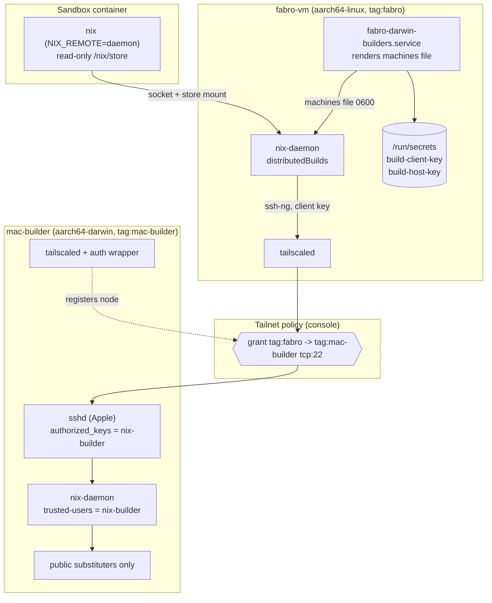
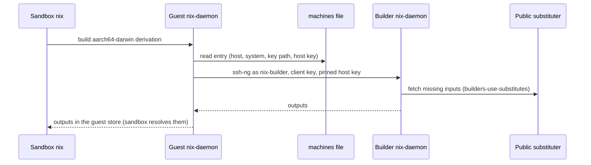
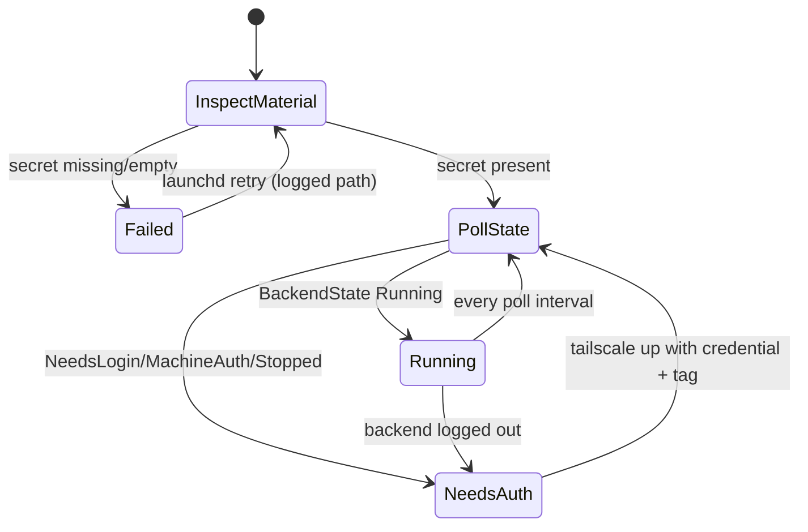

# Design Document

## Overview

**Purpose**: This feature lets a Fabro run build and check `aarch64-darwin`
output from its existing sandbox by dispatching through the Fabro Guest's Nix
daemon to the Builder Host over the tailnet, while the Builder Host joins that
tailnet with the open-source client and substitutes from public caches only.
**Users**: Fabro operators (runs and Darwin verification) and builder operators
(host, tailnet, cache, and key material). **Impact**: changes the current state
where the guest daemon knows only `aarch64-linux` and the builder is reachable
only through the personal host's LAN forward.

Problem, selected approach, scope, and rejected alternatives live in `brief.md`;
the behavioral contract lives in `requirements.md`. External facts this design
relies on (option shapes, machines-file syntax, Tailscale OAuth behaviour) are
recorded with sources in `research.md`.

### Goals

- One `aarch64-darwin` build machine, owned by the guest daemon, with no
  workflow, sandbox-image, or environment change.
- Builder tailnet membership with a credential distinct from the guest's, and a
  dedicated builder tag so the ACL sits on the builder node.
- Build-session authentication that survives a permissive ACL: a pinned client
  key on the guest, an authorized key on the builder, a pinned host key.
- Public-cache-only substitution on the builder, with no private-cache reference
  or credential.

### Non-Goals

- Publishing Darwin outputs to any cache, per-run builder selection, pools, or
  scheduling policy beyond one entry's `maxJobs`/`speedFactor`.
- Tailnet policy administration: the repository documents the grant, the console
  owns it.
- Changing sandbox image contents, the host-store mount contract, or
  `NIX_REMOTE=daemon`.
- Client wiring on the personal host or in CI; retiring the deploy/readiness LAN
  forward.

## Boundary Commitments

### This Spec Owns

- The `fabro.darwinBuilder` NixOS option surface on the Fabro Guest: the
  `aarch64-darwin` machine entry contract, the machines-file runtime path, and
  the dispatch-time substitution policy.
- The runtime machines-file renderer contract and its systemd ordering relative
  to `sops-install-secrets.service` and `nix-daemon.service`.
- The Fabro Guest's build-trust secrets (`build-client-key`, `build-host-key`):
  store name, runtime path, mode, and the path-only reference in the machines
  file.
- The Builder Host's tailnet membership declaration: `services.tailscale`, the
  `builder-tailscale-oauth-secret` declaration, and the launchd authentication
  wrapper contract.
- The Builder Host's public-substituter policy and its `aarch64-darwin`-only
  assertion set.
- The tailnet grant documentation, the Darwin Build Smoke, and the repository
  checks for both hosts.

### Out of Boundary

- The Builder Host Configuration, Builder User, `builder-authorized-keys`
  mechanism, Builder Secret Store layout, and LAN forward (owned by
  `mac-nix-remote-builder`).
- The Sandbox Host-Store Sharing and Sandbox Image environment (owned by
  `nix-built-container-for-default-fabro-environmen`).
- The `fabro-vm` tailnet node registration, its OAuth client, and the existing
  Tailscale Services (`configurations/fabro-vm/tailscale.nix`).
- Private cache operation and the personal host's `nix.distributedBuilds = false`
  publisher assertion (`local-binary-cache`).
- Console-side ACL, tag, and DNS changes; Apple licensing; dedicated hardware.

### Allowed Dependencies

- nixpkgs `nix.buildMachines`/`nix.distributedBuilds`/`nix.settings` rendering
  and the `@<file>` form of the `builders` setting.
- nix-darwin `services.tailscale`, `services.openssh`, `launchd.daemons`, and
  `sops-nix` darwin activation ordering.
- sops-nix `sops.secrets` (`path`, `mode`, `owner`, `group`, `restartUnits`) and
  `sops-install-secrets.service` on the guest.
- The existing `fabro-sandbox-image-load.service` digest file
  (`/run/fabro-sandbox/digest`) and the loaded image reference.
- The `builder-authorized-keys` secret already consumed by the builder.

### Revalidation Triggers

- A change to the machines-file field order, the `builders` setting syntax, or
  `publicHostKey` semantics in a Nix/nixpkgs upgrade.
- A change to nix-darwin's `services.tailscale` option set (for example, an
  auth-key option) or to the `com.tailscale.tailscaled` LaunchDaemon label.
- A change to the builder's SSH host key, `nix-builder` UID/shell, or the
  `builder-authorized-keys` mechanism.
- A change to the tailnet DNS name, the builder machine name, the `tag:mac-builder`
  tag, or the ACL grant.
- A change to the sandbox image reference or the loader's digest file.
- A change to `secrets/fabro.fabro.yaml` recipient keys or sops-nix's activation
  ordering.

## Architecture

### Existing Architecture Analysis

- `configurations/fabro-vm/default.nix` is the guest configuration; it imports
  `fabro.nix`, `sandbox.nix`, `sandbox-image.nix`, and `tailscale.nix`. Its
  `nix.settings` block (currently experimental features and `trusted-users`)
  carries no builders, and `nix.distributedBuilds` is unset, so `/etc/nix/machines`
  is not consulted (nixpkgs nulls `builders` when the option is false).
- `configurations/fabro-vm/sandbox.nix` already gives every container the guest
  store read-only, the daemon socket, and a `/tmp` tmpfs through the global
  `[containers]` mounts; the image sets `NIX_REMOTE=daemon`. All run-side Nix
  traffic therefore ends at the guest daemon.
- `configurations/fabro-vm/tailscale.nix` registers the guest as `tag:fabro`
  with a NixOS-managed OAuth auth key and advertises three services. Dispatch
  traffic from the daemon leaves as this node, so the ACL subject already exists.
- `configurations/mac-builder/default.nix` is the `aarch64-darwin` host: Nix
  enabled with `trusted-users = [ "nix-builder" ]`, OpenSSH without password or
  root login, a hidden `nix-builder` user (uid 502), a sops store
  (`secrets/remote-builder.mac-builder.yaml`), and an activation step that
  installs `builder-authorized-keys` into `~nix-builder/.ssh/authorized_keys`.
  It has no Tailscale service, no cache policy, and no `extra-platforms`.
- `home-manager/common/lima-mac-guest.nix` runs the builder as a Lima guest and
  forwards host port 2222 to the guest sshd; `scripts/mac-builder-deploy.nix`
  and `scripts/mac-builder-readiness.nix` use that forward. Neither changes.
- Repo checks live in `flake.nix` (`mac-nix-remote-builder`, `fabro-vm-guest-eval`,
  `personal-tailscale-service`) and run Node test suites that evaluate the flake.

### Architecture Pattern & Boundary Map

Pattern: the guest daemon stays the single build client and substitutes the
machines file at boot; the builder is an ordinary nix-darwin host that joins the
tailnet itself and serves stock `ssh-ng`. The two hosts share no files — only the
machines-file contract and the key pair — and the tailnet carries the traffic.



**Architecture Integration**

- Selected pattern: daemon-owned distributed build plus a self-registering
  builder host; reachability and authentication are separate layers.
- Domain boundaries: the guest owns scheduling and trust material; the builder
  owns membership, the remote-builder endpoint, and cache policy; the console
  owns policy.
- Existing patterns preserved: per-host sops stores, `writeShellApplication`
  scripts under `scripts/`, launchd/`systemd` service declarations in the host
  module, Node eval tests registered as flake checks.
- New components rationale: the runtime machines renderer is required because
  the host key only exists after the builder boots; the launchd auth wrapper is
  required because nix-darwin exposes no auth-key option.

### Technology Stack

| Layer | Choice / Version | Role in Feature | Notes |
|-------|------------------|-----------------|-------|
| Client dispatch | Nix 2.34.9 `distributedBuilds`, `builders = @<file>` | Schedules `aarch64-darwin` builds | Machines file rendered at boot, not eval |
| Guest runtime | NixOS systemd, sops-nix | Secret materialisation, unit ordering | `sops-install-secrets.service` precedes the renderer |
| Builder runtime | nix-darwin, launchd, `pkgs.tailscale` | tailscaled + authenticated node + sshd + nix-daemon | Open-source client only, no macOS app |
| Transport | Tailscale tailnet, `ssh-ng` | Reachability by ACL, session auth by SSH keys | ACL grant documented, not verified offline |
| Caches | `cache.nixos.org`, `nix-community.cachix.org` | Substitution on the builder | Public trusted keys only |
| Checks | `pkgs.runCommand` + `node --test` | Evaluate both hosts declaratively | Mirrors `mac-nix-remote-builder` |

## File Structure Plan

### Directory Structure

```
configurations/
├── fabro-vm/
│   ├── default.nix                 # imports the dispatch module; declares the two build secrets
│   └── darwin-dispatch.nix         # NEW: fabro.darwinBuilder options, renderer unit, smoke package
└── mac-builder/
    ├── default.nix                 # imports the two new modules
    ├── tailscale.nix               # NEW: tailnet membership + launchd auth daemon + OAuth secret
    ├── substituters.nix            # NEW: public substituters, trusted keys, aarch64-darwin-only assertions
    └── README.md                   # NEW: tailnet grant, tag/OAuth setup, key provisioning, smoke
scripts/
├── fabro-darwin-machines.nix       # NEW: render the machines file from the two secrets
├── mac-builder-tailscale-auth.nix  # NEW: launchd wrapper: join, then re-auth when logged out
└── fabro-darwin-build-smoke.nix    # NEW: request a trivial Darwin build from a sandbox
tests/
└── fabro-darwin-builds/            # NEW: eval/behaviour tests for both hosts
    ├── helpers.js
    ├── guest-dispatch.test.js
    ├── builder-tailnet.test.js
    └── secret-material.test.js
```

### Modified Files

- `configurations/fabro-vm/default.nix` — add `./darwin-dispatch.nix` to
  `imports`, `fabro.darwinBuilder.enable = true;`, two `sops.secrets` entries,
  and two `fabro.onePasswordSecrets` URIs.
- `configurations/mac-builder/default.nix` — add `./tailscale.nix` and
  `./substituters.nix` to `imports`; no change to the user, sshd, GC, or
  authorized-key mechanism.
- `flake.nix` — add the `fabro-darwin-builds` check beside
  `mac-nix-remote-builder`.
- `secrets/fabro.fabro.yaml` — operator adds encrypted `build-client-key` and
  `build-host-key` values.
- `secrets/remote-builder.mac-builder.yaml` — operator adds the encrypted
  `builder-tailscale-oauth-secret` value.

## System Flows

### Darwin build dispatch



Decisions: the sandbox never sees the key; the daemon performs the SSH session
as root with the client key at `/run/secrets/build-client-key`. `aarch64-linux`
requests never match the machine entry and build locally. With
`builders-use-substitutes = true` the daemon tells the builder to substitute its
own inputs, so inputs are not uploaded.

### Builder tailnet authentication



The LaunchDaemon runs the wrapper forever; every poll re-reads the credential
path, so a rotation (or a re-registration after logout) happens without an
operator. Requirement 4.8 is met by failing the iteration and logging the path
without ever calling `tailscale up`.

## Requirements Traceability

| Requirements | Summary | Components | Contracts / Flows |
|---|---|---|---|
| 1.1, 1.3, 1.5 | A sandbox request builds Darwin on the builder and lands output in the guest store | Guest Dispatch, Machines Renderer | `fabro.darwinBuilder`, machines-file contract, Darwin dispatch flow |
| 1.2 | `aarch64-linux` stays local | Guest Dispatch | Single `system = "aarch64-darwin"` entry |
| 1.4 | Sandboxes resolve imported output | Sandbox Host-Store Sharing (unchanged) | Read-only `/nix/store` mount |
| 1.6, 1.7 | Connection/rejection errors name the builder | Machines Renderer, Error Handling | Nix ssh-ng errors |
| 2.1, 2.2, 2.7 | Sandbox reaches the guest daemon/store on every environment | Existing `sandbox.nix` (unchanged), Repository Checks | `[containers]` mounts, `NIX_REMOTE=daemon` |
| 2.3, 2.4, 2.5, 2.6 | No per-container daemon/store/key/tailnet | Repository Checks | Sandbox invariants tests |
| 3.1, 3.2, 3.3 | Traffic leaves as `fabro-vm` and addresses the tailnet name | Guest Dispatch, Guest Tailscale (unchanged) | `machine.hostName` is the tailnet FQDN; no LAN port or DHCP address |
| 3.4 | Documented tailnet grant | Builder README | Grant + tagOwners snippet |
| 3.5, 3.6, 3.7, 3.8 | ACL is reachability only; sessions authenticate independently | Builder Tailnet Membership, Build Trust Material | `sshd` + Nix daemon auth; no Tailscale SSH |
| 4.1, 4.2, 4.9, 4.13, 4.14 | Open-source client, own node, builder tag, no app, no Home Manager | Builder Tailnet Membership | `services.tailscale`, `--advertise-tags` |
| 4.3, 4.4, 4.5 | Dedicated OAuth credential for the builder tag, separate from the guest's | Builder Tailnet Membership, Secret Stores | `builder-tailscale-oauth-secret` |
| 4.6, 4.7, 4.8 | Root-only runtime path, never in the store, loud failure naming the path | Tailnet Auth Wrapper, Builder Tailnet Membership | Wrapper iteration contract |
| 4.10, 4.11, 4.12 | Non-interactive join and re-auth; declarative membership | Tailnet Auth Wrapper | Auth state flow |
| 5.1, 5.5, 5.6, 5.7 | Stock protocol, outputs returned, always available, no bespoke service | Builder Host Configuration (unchanged) | sshd + `nix-builder` trusted user |
| 5.2, 5.3, 5.4 | Only the builder user; `aarch64-darwin` only; foreign systems rejected | Builder Host Configuration (unchanged), Builder Cache Policy, Repository Checks | `trusted-users`, sshd `PermitRootLogin no`, no `extra-platforms` |
| 6.1, 6.2, 6.3, 6.4, 6.5 | Client key presented and authorized; node identity is not authentication | Guest Dispatch, Builder authorized keys | Machines-file `sshKey` field, `authorized_keys` |
| 6.6, 6.7 | Host key verified against a pinned value | Machines Renderer | `publicHostKey` field |
| 6.8, 6.9, 6.10, 6.11 | Root-only, never in the store or image, referenced by path | Secret Stores, Repository Checks | `sops.secrets`, machines line |
| 6.12 | Missing material fails with the path identified | Machines Renderer, Darwin Build Smoke | Renderer errors, smoke preflight |
| 6.13 | Builder fails activation on missing authorized keys | Builder Host Configuration (unchanged) | Existing `postActivation` check |
| 7.1, 7.2, 7.3, 7.4 | Declared public substituters and keys only; no private cache or credential | Builder Cache Policy | `nix.settings` |
| 7.5, 7.6 | Builder substitutes inputs itself; guest does not upload them | Guest Dispatch | `builders-use-substitutes = true` |
| 7.7 | Builder publishes to no cache | Builder Cache Policy | No `post-build-hook` |
| 8.1, 8.2 | Checks over both configurations | Repository Checks | `fabro-darwin-builds` |
| 8.3, 8.4 | Checks fail on leaked values and per-container Nix wiring | Repository Checks | `secret-material`, `guest-dispatch` tests |
| 8.5, 8.6, 8.7 | Smoke requests a trivial build, confirms the store path, names failed steps | Darwin Build Smoke | Smoke CLI contract |

## Components and Interfaces

| Component | Domain/Layer | Intent | Req Coverage | Key Dependencies (P0/P1) | Contracts |
|---|---|---|---|---|---|
| `fabro.darwinBuilder` module (`configurations/fabro-vm/darwin-dispatch.nix`) | Guest dispatch | Own the machine entry, machines file, secret wiring, smoke install | 1.1-1.7, 2.7, 3.2, 6.11, 7.5-7.6 | sops-nix (P0), `nix-daemon` (P0), sandbox image (P1) | Options, State |
| `fabro-darwin-machines` (`scripts/fabro-darwin-machines.nix`) | Guest dispatch | Render and validate the machines file | 3.2, 6.6-6.12 | coreutils, the two secrets (P0) | CLI, Batch/Job |
| Builder Tailnet Membership (`configurations/mac-builder/tailscale.nix`) | Builder host | Declare tailscaled, the credential, the auth daemon | 4.1-4.14, 3.5-3.8 | `services.tailscale` (P0), sops (P0) | State, Service |
| `mac-builder-tailscale-auth` (`scripts/mac-builder-tailscale-auth.nix`) | Builder host | Join and re-authenticate without an operator | 4.1, 4.3, 4.8-4.11 | `tailscale` CLI (P0) | CLI, Batch/Job |
| Builder Cache Policy (`configurations/mac-builder/substituters.nix`) | Builder host | Public caches only; `aarch64-darwin` only | 5.3-5.4, 7.1-7.4, 7.7 | nix-darwin `nix.settings` (P0) | State |
| `fabro-darwin-build-smoke` (`scripts/fabro-darwin-build-smoke.nix`) | Verification | Request a trivial Darwin build from a sandbox and locate the output | 6.12, 8.5-8.7 | podman (P0), loader digest (P1) | CLI |
| `fabro-darwin-builds` check (`tests/fabro-darwin-builds/`, `flake.nix`) | Verification | Eval and behaviour checks over both hosts | 8.1-8.4 | `nix`, `nodejs` (P0) | Batch |

### Guest Dispatch

#### `fabro.darwinBuilder` module

| Field | Detail |
|-------|--------|
| Intent | Make the guest daemon the only dispatch client for `aarch64-darwin` |
| Requirements | 1.1-1.7, 2.7, 3.2, 6.11, 7.5, 7.6 |

**Responsibilities & Constraints**

- Owns the option surface, the machines-file path, the renderer unit, and the
  smoke package installation.
- Sets `nix.distributedBuilds = true` and `nix.settings.builders =
  "@${cfg.machinesFile}"`; leaves `nix.buildMachines` empty so no
  `/etc/nix/machines` is generated from eval.
- Sets `nix.settings.builders-use-substitutes = true`.
- Declares the two fabro-store secrets at mode `0400`, owner/group `root`, and
  restarts the renderer and `nix-daemon.service` when they change.
- Does not touch the sandbox mounts, image environment, or the guest's own
  tailscale module.

**Dependencies**

- Inbound: `configurations/fabro-vm/default.nix` enables it (Criticality: P0).
- Outbound: `fabro-darwin-machines` (P0); `nix-daemon.service` ordering (P0);
  `config.fabro.sandboxImage.name` for the smoke (P1).
- External: sops-nix secret materialisation (P0).

**Contracts**: State [x] / Batch [x]

##### Option Contract

| Option | Type | Default | Meaning |
|---|---|---|---|
| `enable` | bool | `false` | Installs dispatch wiring and the smoke |
| `machine.hostName` | str | `"mac-builder.tuxedo-musical.ts.net"` | Tailnet name the daemon dials |
| `machine.sshUser` | str | `"nix-builder"` | Builder user |
| `machine.system` | str | `"aarch64-darwin"` | Only system scheduled there |
| `machine.maxJobs` | int | `4` | Concurrent remote jobs |
| `machine.speedFactor` | int | `2` | Relative builder speed |
| `clientKeyPath` | str | `config.sops.secrets.build-client-key.path` | Private key path in the machines line |
| `hostKeyPath` | str | `config.sops.secrets.build-host-key.path` | Public key the renderer pins |
| `machinesFile` | str | `"/run/fabro-darwin-builders/machines"` | File selected by `builders` |

##### Unit Contract

- `systemd.services.fabro-darwin-builders`: oneshot, `RuntimeDirectory =
  "fabro-darwin-builders"`, `after`/`wants` `sops-install-secrets.service`,
  `before` `nix-daemon.service`; `ExecStart` is the renderer with the option
  values as arguments.
- `systemd.services.nix-daemon`: `wants`/`after`
  `fabro-darwin-builders.service` (a failed renderer must not block local
  builds).
- `systemd.tmpfiles.rules`: create `machinesFile` (mode `0600`, root) so the
  daemon always has a readable file, even before the renderer succeeds.

**Implementation Notes**

- Validation: the renderer, not the module, validates material presence; the
  module only guarantees the path contract.
- Risks: a missing host key leaves an empty machines file, so Darwin dispatch
  fails until the renderer succeeds (documented in Error Handling).

#### `fabro-darwin-machines`

| Field | Detail |
|-------|--------|
| Intent | Render one validated machines line from the two runtime secrets |
| Requirements | 3.2, 6.6-6.12 |

**Responsibilities & Constraints**

- Reads the client key path (never its value) and the builder host public key;
  base64-encodes the host key into the `publicHostKey` field.
- Writes atomically (temp file + `mv`, mode `0600`, root) so a crash cannot
  expose a partial line.
- Exits non-zero with the offending path when either secret is missing or empty;
  writes nothing in that case.

**Contracts**: Batch [x]

##### CLI Contract

```
fabro-darwin-machines --output PATH --host-name HOST --ssh-user USER \
  --system SYSTEM --max-jobs N --speed-factor N \
  --client-key PATH --host-key PATH
```

- Preconditions: `--client-key` and `--host-key` name readable files.
- Postconditions: on success `PATH` contains exactly one line:
  `ssh-ng://<ssh-user>@<host> <system> <client-key> <max-jobs> <speed-factor> - - <base64 host key>`.
- Errors: missing/empty input (`exit 1`, message includes the path); unwritable
  output (`exit 1`).

**Implementation Notes**

- Validation: a dangling or empty key file is a hard failure; there is no
  unpinned fallback (`publicHostKey` is never emitted as `-`).
- Risks: the base64 value must come from `ssh_host_ed25519_key.pub`; a different
  key type is fine as long as the same file is pinned on both sides.

### Builder Host

#### Builder Tailnet Membership

| Field | Detail |
|-------|--------|
| Intent | Put the builder on the tailnet as its own tagged node with a dedicated credential |
| Requirements | 3.5-3.8, 4.1-4.14 |

**Responsibilities & Constraints**

- `services.tailscale.enable = true` with the default open-source
  `pkgs.tailscale`; no macOS app, no `tailscale serve`, no `--ssh`.
- `sops.secrets."builder-tailscale-oauth-secret"`: mode `0400`, owner `root`,
  group `wheel`, default path `/run/secrets/builder-tailscale-oauth-secret`.
- `launchd.daemons.mac-builder-tailscale-auth`: `command` runs the wrapper with
  the credential path, `--hostname mac-builder`, and
  `--tag tag:mac-builder`; `KeepAlive = true`, `RunAtLoad = true`,
  `ThrottleInterval = 30`, `ProcessType = "Background"`, stdout/stderr under
  `/var/log/`.
- Declares no other tailnet credential and never reads the fabro store.

**Dependencies**

- Inbound: `configurations/mac-builder/default.nix` imports it (P0).
- Outbound: nix-darwin `services.tailscale` (P0); sops-nix darwin activation (P0).
- External: Tailscale control plane (reachability only) (P0).

**Contracts**: State [x]

**Implementation Notes**

- Validation: repository checks assert the option values and the launchd plist
  arguments; a live `tailscale status` remains an operator step.
- Risks: a credential rotation only affects the next `tailscale up`; an
  already-registered node keeps its bond until logout (same behaviour as the
  guest's documented autoconnect).

#### `mac-builder-tailscale-auth`

| Field | Detail |
|-------|--------|
| Intent | Non-interactive join and re-authentication under launchd |
| Requirements | 4.1, 4.3, 4.8-4.11 |

**Responsibilities & Constraints**

- Every iteration: verify the credential file is non-empty, query
  `tailscale status --json`, and branch on `BackendState`.
- `NeedsLogin`/`NeedsMachineAuth`/`Stopped` → run `tailscale up` with the
  credential plus `?ephemeral=false&preauthorized=true`, `--advertise-tags`,
  `--hostname`, and `--accept-dns=false`.
- Missing credential → log the runtime path and fail the iteration without
  running `tailscale up`.
- `Running` → no action.

**Contracts**: Batch [x]

##### CLI Contract

```
mac-builder-tailscale-auth --auth-key-file PATH --hostname NAME --tag TAG \
  --tailscale PATH [--interval SECONDS] [--once]
```

- `--once`: perform exactly one iteration and exit `0` when Running or when
  re-authentication succeeded, non-zero otherwise.
- Default mode: repeat iterations forever (launchd `KeepAlive`); a failed
  iteration logs and retries rather than exiting.
- Preconditions: `tailscale` executable available; credential path readable.
- Postconditions: a tagged, pre-authorized, non-ephemeral node when the
  credential is valid.
- Invariants: never calls `tailscale up` without a non-empty credential.

**Implementation Notes**

- Integration: mirrors nixpkgs' `tailscaled-autoconnect` state machine, extended
  with continuous polling for requirement 4.11 and a testable `--once` mode.
- Validation: behaviour tests stub `--tailscale` and assert the exact `up`
  arguments.
- Risks: the credential appears in the wrapped command's `argv` for the duration
  of `tailscale up`; this is the documented OAuth flow (Tailscale offers no
  file-with-parameters form). The file remains root-only, and the wrapper runs
  as root.

#### Builder Cache Policy

| Field | Detail |
|-------|--------|
| Intent | Substitute from public caches only and serve `aarch64-darwin` only |
| Requirements | 5.3, 5.4, 7.1-7.4, 7.7 |

**Responsibilities & Constraints**

- `nix.settings.substituters = [ "https://cache.nixos.org/" "https://nix-community.cachix.org" ]`
  and matching `trusted-public-keys` for exactly those two caches.
- No `extra-substituters`, no Attic URL, no cache credential file, no
  `post-build-hook`.
- Assertions: `extra-platforms` stays unset; `hostPlatform.system ==
  "aarch64-darwin"`; no private cache host appears in `substituters` or
  `extra-substituters`.

**Contracts**: State [x]

**Implementation Notes**

- Validation: the check suite reads the evaluated `nix.settings` and asserts the
  exact substituter and key sets.
- Risks: a future nixpkgs default change to `substituters` is caught by the
  exact-set assertion, which forces a deliberate update.

### Verification

#### Darwin Build Smoke

| Field | Detail |
|-------|--------|
| Intent | Prove the sandbox → daemon → builder path end to end |
| Requirements | 6.12, 8.5-8.7 |

**Responsibilities & Constraints**

- Runs on the guest as root; installed via `environment.systemPackages` as
  `fabro-darwin-build-smoke`.
- Step 1 (preflight): both secret paths readable and non-empty and the machines
  file contains an `aarch64-darwin` entry; failures name the path.
- Step 2: `podman run --rm <name>@$(cat /run/fabro-sandbox/digest) /bin/bash -c
  '<nix build …>'`, requesting a trivial derivation:

  ```nix
  derivation {
    name = "fabro-darwin-build-smoke";
    system = "aarch64-darwin";
    builder = "/bin/sh";          # present on macOS; the builder runs unsandboxed
    args = [ "-c" "echo ok > $out" ];
  }
  ```
- Step 3: confirm the printed store path exists in the guest store and report it.

**Contracts**: CLI [x]

##### CLI Contract

- `fabro-darwin-build-smoke [IMAGE_REF]`; defaults to
  `<name>@$(cat /run/fabro-sandbox/digest)`.
- Prints each step banner, names a failed step, and returns non-zero on failure.
- Postcondition: the reported path resolves in the guest store.

#### Repository Checks

| Field | Detail |
|-------|--------|
| Intent | Catch drift before a Darwin build is attempted |
| Requirements | 2.1-2.6, 5.3, 5.4, 8.1-8.4 |

**Responsibilities & Constraints**

- New flake check `fabro-darwin-builds` follows the `mac-nix-remote-builder`
  pattern (copy the source, run `node --test tests/fabro-darwin-builds/`).
- `guest-dispatch.test.js`: option values, `distributedBuilds`,
  `builders = "@<path>"`, `builders-use-substitutes`, the renderer unit and its
  ordering, the tmpfiles entry, and the sandbox invariants (exact
  `[containers]` mounts, image `NIX_REMOTE=daemon`, no key path or tailscale in
  the image environment).
- `builder-tailnet.test.js`: `services.tailscale` enabled with the open-source
  package, the `com.tailscale.tailscaled` LaunchDaemon, the auth LaunchDaemon
  arguments, the secret name/path/mode, the sops store file, `tag:mac-builder`,
  `--accept-dns=false`, and unchanged `trusted-users`/authorized-key mechanism.
- `secret-material.test.js`: the machines file is not rendered into the store or
  `/etc`, the client key is referenced only by path, and the evaluated
  `mac-builder` substituter/key sets exclude the private cache.

## Data Models

### Machines File

One line, rendered at runtime, read by the daemon at start:

| Field | Source | Example |
|---|---|---|
| Endpoint | `protocol` + `sshUser` + `hostName` | `ssh-ng://nix-builder@mac-builder.tuxedo-musical.ts.net` |
| Systems | `machine.system` | `aarch64-darwin` |
| SSH key path | `clientKeyPath` (never the value) | `/run/secrets/build-client-key` |
| Max jobs / speed | `machine.maxJobs`, `machine.speedFactor` | `4 2` |
| Features | always none | `- -` |
| Public host key | base64 of `hostKeyPath` contents | `<base64 ed25519 host key>` |

Invariants: exactly one line while the material is valid; the host key field is
never `-`; no secret value appears in the line; file mode `0600`, owner root.

### Fabro Secret Store Additions (`secrets/fabro.fabro.yaml`)

| Secret | 1Password source | Runtime path | Mode / owner | Consumer |
|---|---|---|---|---|
| `build-client-key` | `op://Infrastructure/Fabro mac-builder Build Credentials/Client Private Key` | `/run/secrets/build-client-key` | `0400` root:root | `nix-daemon` ssh-ng |
| `build-host-key` | `op://Infrastructure/Fabro mac-builder Build Credentials/Host Public Key` | `/run/secrets/build-host-key` | `0400` root:root | `fabro-darwin-machines` |

Both are also listed in `fabro.onePasswordSecrets` so
`nix run '.#fabro-sync-from-1password'` refreshes the store. Restart units:
`fabro-darwin-builders.service`, `nix-daemon.service`.

### Builder Secret Store Addition (`secrets/remote-builder.mac-builder.yaml`)

| Secret | 1Password source | Runtime path | Mode / owner | Consumer |
|---|---|---|---|---|
| `builder-tailscale-oauth-secret` | `op://Infrastructure/Mac Builder Tailscale Credentials/Client Secret` | `/run/secrets/builder-tailscale-oauth-secret` | `0400` root:wheel | `mac-builder-tailscale-auth` |

This is a different OAuth client from the guest's `tailscale-oauth-secret`
(`op://Infrastructure/Fabro Host Tailscale Credentials/Client Secret`), stored
in a different per-host sops file, and the builder holds no other tailnet
credential.

### Tailnet Names and Tags

| Name | Value | Owner |
|---|---|---|
| Tailnet DNS name | `tuxedo-musical.ts.net` | Console |
| Builder machine name | `mac-builder` (`--hostname`) | This spec |
| Builder DNS name | `mac-builder.tuxedo-musical.ts.net` | MagicDNS |
| Guest node tag | `tag:fabro` | `fabro-vm` tailscale module |
| Builder node tag | `tag:mac-builder` | This spec |
| Grant | `tag:fabro` → `tag:mac-builder`, `tcp:22` | Console, documented in `README.md` |

## Error Handling

### Error Strategy

Every failure is attributed to the layer that owns it: reachability (tailnet),
session authentication (SSH keys), authorisation (builder daemon), or material
(secret paths). No layer silently falls back to an unauthenticated or unpinned
path; the renderer refuses to emit a machines line without a pinned host key.

### Error Categories and Responses

| Condition | Detected by | Guest-visible result | Recovery |
|---|---|---|---|
| ACL denies the guest | Builder never answers | ssh-ng connection failure naming the builder hostname | Apply the documented grant |
| Builder node logged out/absent | MagicDNS name does not resolve | connection failure naming the hostname | Builder wrapper re-authenticates |
| Client key not authorized | builder sshd | `Permission denied (publickey)` | Add the public key to `builder-authorized-keys` |
| Client key missing at runtime | Nix ssh-ng setup | error naming `/run/secrets/build-client-key` | Provision/rotate the fabro secret |
| Host key mismatch | Nix ssh-ng host-key check | host-key verification failure naming the builder | Re-pin `build-host-key` from the builder |
| Host key missing/empty | renderer | unit failure naming `/run/secrets/build-host-key`; no builder entry (empty machines file); Darwin builds are unschedulable while Linux builds still run | Provision the fabro secret |
| Foreign-system request | guest daemon / builder daemon | Nix reports no builder for the system; `aarch64-linux` builds locally | None (by design) |
| OAuth credential missing/empty | auth wrapper | iteration failure naming `/run/secrets/builder-tailscale-oauth-secret`; node never joins | Provision the builder secret |
| Builder authorized keys missing | builder activation | activation aborts naming `/run/secrets/builder-authorized-keys` (existing behaviour) | Restore the builder secret |
| Machines-file renderer fails | `fabro-darwin-builders.service` | `nix-daemon` still starts (wants, not requires) | Inspect the unit; local builds unaffected |

### Monitoring

- `systemctl status fabro-darwin-builders` / `journalctl -u` for material and
  render failures; the smoke's step banners localise runtime faults.
- launchd logs for `mac-builder-tailscale-auth` under `/var/log/` name the
  credential path or the failing `tailscale up`.
- `mac-builder-readiness` remains the endpoint check over the LAN forward; the
  new path is exercised by the smoke, not by readiness.

## Testing Strategy

### Render and evaluation

- Evaluate `nixosConfigurations.fabro-vm.config.fabro.darwinBuilder`,
  `nix.distributedBuilds`, `nix.settings.builders`,
  `nix.settings.builders-use-substitutes`, the renderer unit, the tmpfiles rule,
  and the two `sops.secrets` entries.
- Evaluate `darwinConfigurations.mac-builder.config`: `services.tailscale`,
  `launchd.daemons`, `sops.secrets."builder-tailscale-oauth-secret"`,
  `nix.settings.substituters`/`trusted-public-keys`, and the unchanged
  `trusted-users`/user/sshd settings.
- Assert sandbox invariants: `containersConf.settings.containers.mounts` is
  exactly the store, daemon-socket, and tmpfs entries; the image `Env` contains
  `NIX_REMOTE=daemon` and no key path.
- Secret-material assertions: `builders` is an `@` path outside the store, no
  `environment.etc."nix/machines"` exists, and the evaluated substituter sets
  exclude the private cache host.

### Behavior

- `fabro-darwin-machines` in a temp directory: success writes the expected line
  with mode `0600`; a missing/empty client key or host key fails with the path in
  the message and writes nothing.
- `mac-builder-tailscale-auth --once` with a stub `--tailscale`: `Running`
  performs no `up`; `NeedsLogin` runs `up` with the credential parameters,
  `--advertise-tags=tag:mac-builder`, `--hostname=mac-builder`,
  `--accept-dns=false`; a missing credential fails without any `up` call and
  names the path; an unresponsive daemon fails the iteration.
- `fabro-darwin-build-smoke` step localisation is unit-tested by running it with
  a missing material path (fails the preflight step and returns non-zero).

### Integration and manual verification

- Deploy the builder, confirm the node appears with `tag:mac-builder`, then
  apply the guest switch and confirm the machines file exists with mode `0600`
  and one line.
- From a sandbox, run `fabro-darwin-build-smoke`; confirm the reported store path
  exists in the guest store and that the output is resolvable inside the
  sandbox.
- Remove the guest's `build-client-key` secret and confirm a Darwin build fails
  naming that path; restore it and confirm recovery.
- Remove the builder's OAuth credential and let the auth daemon iterate; confirm
  the iteration fails naming the path and no `tailscale up` is attempted.
- Remove the guest's access in the ACL and confirm both the refused connection
  and the error naming the builder's tailnet name.

## Security Considerations

- Two independent authenticators: the tailnet ACL grants reachability, while the
  SSH client key (guest side) and the pinned host key (both sides) establish the
  session. A tailnet-admitted node without an authorized key is refused.
- The client key exists only at `/run/secrets/build-client-key` (mode `0400`,
  root) on the guest; it never enters the Nix store, the machines file body, or
  the sandbox image.
- The builder's credential is root-only, used only by the wrapper, and never
  rendered into a store path. The wrapper does not enable Tailscale SSH, so node
  identity cannot substitute for the SSH key.
- `nix-builder` remains non-admin with no password login and is the only
  non-root entry in `trusted-users`; root SSH login is disabled, so build
  requests as any other user are refused.
- Public caches only: no private URL, key, or credential; no publication hook,
  so the builder never writes to a cache.
- Residual risk: the OAuth secret is visible in the wrapper's `argv` while
  `tailscale up` runs (documented Tailscale OAuth flow).

## Migration Strategy

1. **Console and secrets** — create the builder OAuth client (`auth_keys` scope,
   `tag:mac-builder`), record the grant and `tagOwners`; generate the build key
   pair; add `build-client-key`/`build-host-key` to the fabro store and the
   builder's public key to `builder-authorized-keys`; add
   `builder-tailscale-oauth-secret` to the builder store.
2. **Builder** — deploy and switch the builder; confirm the node joins with the
   tag and that `nix-builder` still accepts the operator's key.
3. **Guest** — switch the guest; confirm the renderer unit, the machines file,
   and that `aarch64-linux` builds are unaffected.
4. **Smoke and rollback** — run the smoke; rollback is disabling
   `fabro.darwinBuilder.enable` on the guest (Darwin builds return to failing as
   unavailable) and optionally stopping the builder auth daemon.

## Supporting References

- `research.md` in this directory: machines-file and `publicHostKey` semantics,
  nix-darwin option shapes, sops-nix ordering, Tailscale OAuth/MagicDNS
  behaviour, and the public cache keys.
- `configurations/mac-builder/README.md` (added by this spec): the grant
  snippet, tag/OAuth setup, key provisioning, and smoke invocation.
