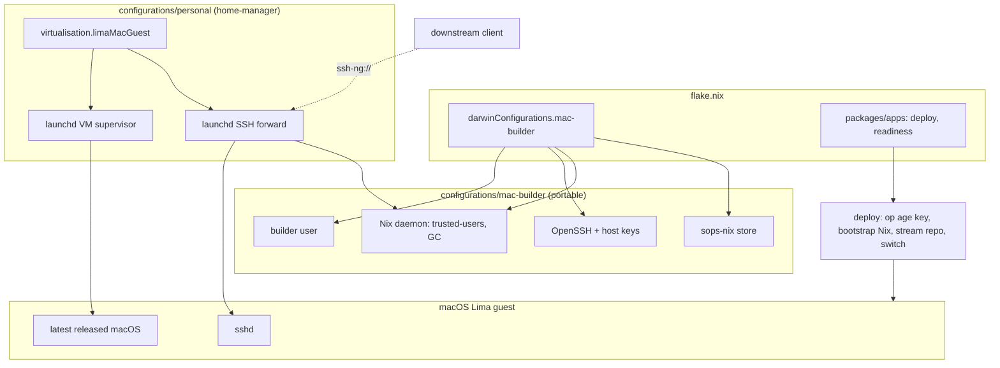
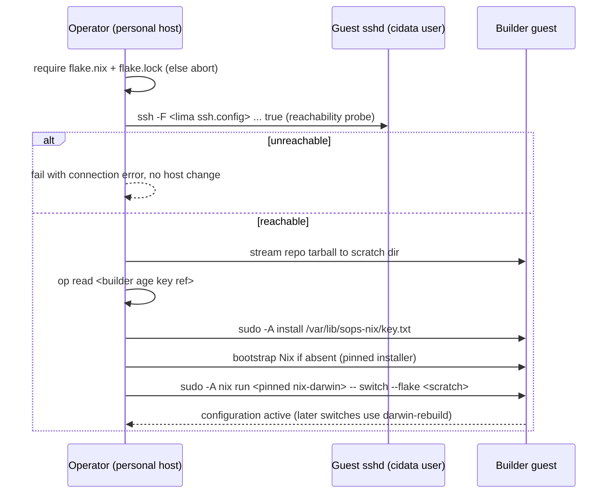
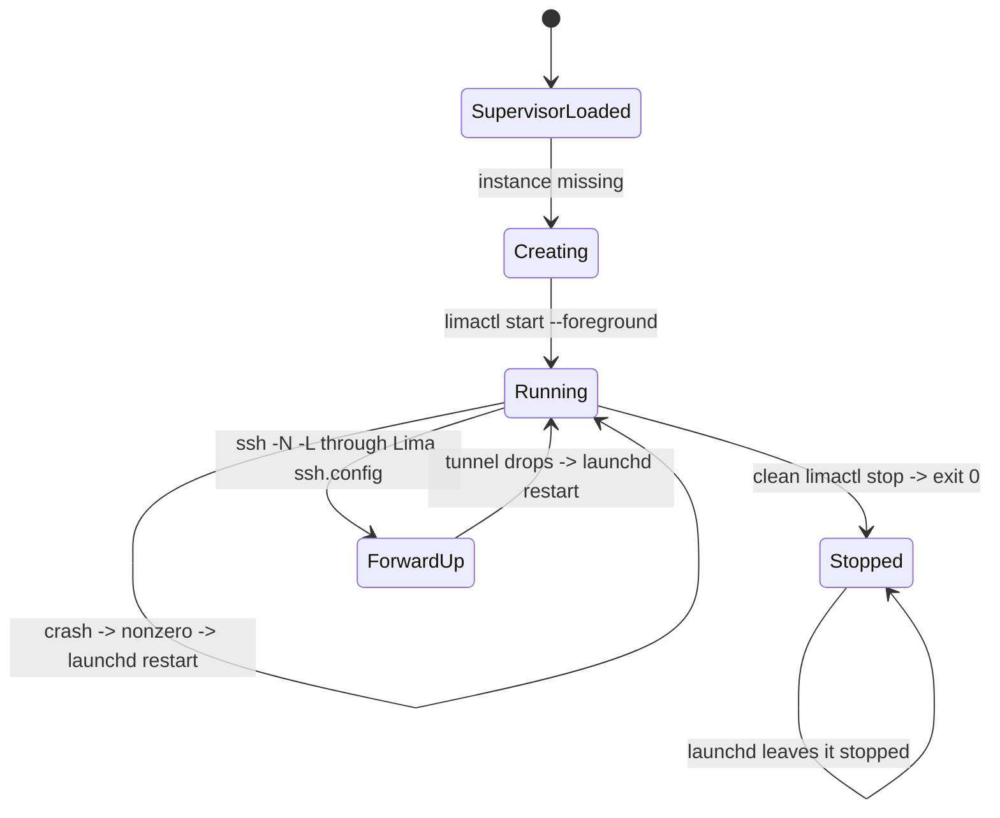
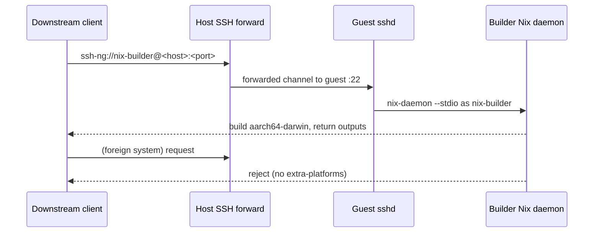

# Design Document

## Overview

This design defines a self-contained macOS `aarch64-darwin` Nix remote-builder host,
the personal-host Lima macOS guest that runs it, and the one-touch deploy that
bootstraps both. Problem, approach, and scope live in `brief.md`; the behavioral
contract lives in `requirements.md`; external findings and sources live in
`research.md`.

The builder is an ordinary nix-darwin host configuration that any `aarch64-darwin`
machine can adopt; the Lima macOS guest is one way to host it and never leaks into the
host configuration. A dedicated non-privileged user is the SSH identity the builder
daemon accepts builds from, and the guest is exposed through a launchd-managed
host-side SSH forward so clients reach a standard `ssh-ng://` endpoint.

### Goals

- Make a fresh `aarch64-darwin` machine a working remote builder from a single
  nix-darwin configuration plus one deploy invocation.
- Keep the builder host configuration independent of Lima and of the personal host.
- Serve `aarch64-darwin` builds over the standard Nix remote-builder protocol with no
  client-side custom code.
- Deliver builder secrets from a builder-only sops-nix store; never place secret
  values in the Nix store.
- Run the builder as a launchd-managed Lima macOS guest (latest released macOS) on the
  personal host, with the FRE skip owned by the personal host.
- Verify the builder declaratively (repository checks) and at runtime (readiness).

### Non-Goals

- Client-side dispatch (`nix.buildMachines`) on the fabro-vm, its sandbox, or CI.
- Binary-cache serving, substitution, retention, or publication (`local-binary-cache`
  owns those; its `nix.distributedBuilds = false` publisher assertion is untouched).
- Dedicated Apple-hardware imaging, `x86_64` or other foreign-architecture builders,
  and Apple ID or licensing automation beyond guest boot.
- Changing the existing NixOS `fabro` Lima instance, `virtualisation.limaVM`, or its
  flake checks.
- Public or tailnet-wide exposure beyond the builder's LAN/VM endpoint.

## Boundary Commitments

### This Spec Owns

- The `darwinConfigurations.mac-builder` host configuration: builder user, packages,
  OpenSSH, Nix daemon trust, GC schedule, and sops-nix wiring.
- The builder-host sops-nix store, its age recipient rule, and the runtime paths its
  secrets materialize to.
- The builder's remote-builder endpoint contract: SSH user, host identity, trusted
  user, and the `aarch64-darwin`-only build scope.
- The `virtualisation.limaMacGuest` Home Manager module: the macOS Lima YAML, the
  launchd VM supervisor, and the host-side SSH forward.
- The one-touch deploy/bootstrap command and the runtime readiness check.
- The repository checks that validate the host configuration, the guest definition,
  the secret wiring, and secret-value absence.

### Out of Boundary

- `nix.buildMachines` and any other client-side dispatch configuration.
- Cache, substituter, retention, or publication behavior.
- The `virtualisation.limaVM` module, the `fabro` NixOS instance, and their flake
  references or tests.
- Replacing nix-darwin, sops-nix, or the per-host secret conventions.
- Apple licensing/Apple ID automation and any non-Lima virtualization stack.

### Allowed Dependencies

- nix-darwin 26.05 (`inputs.darwin`) and its `nix`, `users`, and `services.openssh`
  modules; `inputs.sops-nix.darwinModules.default`.
- The existing `home-manager/common/lima-vm.nix` launchd supervisor pattern and the
  `lima-vm-deploy` tar-over-SSH pattern (patterns only, not imports).
- The flake's `pkgs.unstable` set, plus a pinned Lima >= 2.3 for the guest.
- 1Password CLI (`op`) on the operator host for age-key bootstrap, per
  `secrets/README.md`.
- The pinned macOS image from Apple's CDN (location + digest).

### Revalidation Triggers

- A stable Lima 2.3 release, or any change to macOS-guest YAML keys (`osOpts`,
  `networks`, `video`, image schema).
- A change to the pinned macOS release, its `.ipsw` location, or digest.
- A change to the builder user name/UID, SSH port, or host-forward bind address.
- A change to nix-darwin's `users`/`services.openssh` option shapes or activation
  ordering.
- A change to sops-nix's darwin key path, decryption ordering, or secret schema.
- The introduction of a client that consumes the endpoint (downstream wiring).

## Architecture

### Existing Architecture Analysis

- The flake exposes `darwinConfigurations."Brandons-MacBook-Pro"` (nix-darwin) and
  `nixosConfigurations.fabro-vm` (the NixOS Lima guest). No darwin builder host exists.
- `home-manager/common/lima-vm.nix` (`virtualisation.limaVM`) is a single-instance,
  NixOS-specific Home Manager module: it renders `nixos-lima` release-image YAML,
  injects Linux-only provisioning, ships `lima-vmctl`/`lima-vm-deploy`, and runs a
  `limactl start --foreground` launchd supervisor.
- `configurations/common-darwin/mcp-sops-bridge.nix` owns the sops-nix darwin import
  and demonstrates the `postActivation.text` ordering rule (`lib.mkOrder 9999` runs
  after sops-nix's `mkAfter`/1500) that secret-dependent activation must follow.
- `configurations/common-darwin/local-binary-cache.nix` asserts
  `!publisher.enable || !nix.distributedBuilds`; the builder host is a separate
  nix-darwin configuration, so the assertion is unaffected.
- `secrets/README.md` documents per-host age-key bootstrap from 1Password and the
  `<feature>.<host-role>.yaml` store convention; `scripts/bootstrap-nix-github-token.sh`
  shows the `op read` bootstrap idiom.

### Architecture Pattern & Boundary Map

Pattern: a portable nix-darwin builder host plus a personal-host-owned Lima adapter and
a bootstrap/deploy driver. The host configuration and the adapter share no files; the
only coupling is the standard SSH remote-store protocol.



Key decisions:

- The builder host configuration never references Lima; the macOS image, FRE skip, and
  networking live only in `virtualisation.limaMacGuest` on the personal host.
- The builder user is a normal non-admin account (primary group `staff`); it is the only
  account the builder's Nix daemon trusts for remote builds.
- The endpoint is the guest sshd exposed by a host-side `ssh -N -L` forward through the
  Lima SSH config; no guest IP discovery or root network helper is required.
- Secrets reach the builder only through sops-nix runtime paths; authorized keys are
  installed by a `postActivation` fragment ordered after decryption.
- The deploy uses the Lima SSH config (admin/cidata user) for root steps and the host
  forward (builder user) is only for remote-build clients.

### Technology Stack

| Layer | Choice / Version | Role in Feature | Notes |
|---|---|---|---|
| Host OS config | nix-darwin 26.05 | Builder host users, Nix daemon, OpenSSH, GC | `inputs.darwin.lib.darwinSystem` |
| Nix daemon | nix-darwin `nix.enable` | Serves `ssh-ng://` builds, trusts builder user | `nix.settings.trusted-users` |
| SSH server | Apple OpenSSH via `services.openssh` | Builder endpoint, host identity | Key-only, non-privileged user |
| Secrets | sops-nix darwin module | Builder age key, authorized keys | `/var/lib/sops-nix/key.txt`, `/run/secrets/*` |
| Virtualization | Lima >= 2.3 (pinned) | Runs the macOS guest, supervisor | `pkgs.unstable.lima` is 2.2.0 |
| Guest OS | latest released macOS (27.0.1) | `aarch64-darwin` build host | Pinned Apple `.ipsw` + digest |
| Guest adapter | Home Manager module | Renders YAML, launchd supervisor, SSH forward | New `virtualisation.limaMacGuest` |
| Deploy | `writeShellApplication` | Bootstrap Nix, install age key, stream repo, switch | `op` + tar-over-SSH |
| Checks | Node `node:test` + flake checks | Render/eval and behavior verification | Mirrors `tests/lima-vm` |

## File Structure Plan

### Directory Structure

```text
configurations/mac-builder/
└── default.nix                       # Portable nix-darwin builder host configuration
home-manager/common/
└── lima-mac-guest.nix                # virtualisation.limaMacGuest (macOS guest adapter)
scripts/
├── mac-builder-deploy.nix            # One-touch bootstrap/apply over SSH
└── mac-builder-readiness.nix         # Runtime aarch64-darwin acceptance check
secrets/
└── remote-builder.mac-builder.yaml   # Builder-host sops store (authorized keys)
tests/mac-nix-remote-builder/
├── helpers.js                        # Shared nix-eval helpers (mirrors tests/lima-vm)
├── builder-host-render.test.js       # Host config + secret wiring render assertions
├── personal-guest-render.test.js     # Guest YAML, supervisor, and forward assertions
└── deploy.test.js                    # Deploy guard/stream/switch behavior with stubs
```

### Modified Files

- `flake.nix` — add `darwinConfigurations.mac-builder`; add the deploy/readiness
  packages/apps and the `mac-nix-remote-builder` checks.
- `home-manager/common/default.nix` — import `./lima-mac-guest.nix` (alongside
  `./lima-vm.nix`).
- `configurations/personal/home-manager/default.nix` — enable
  `virtualisation.limaMacGuest` with the pinned image, forward, and deploy wiring.
- `.sops.yaml` — add the `&host_mac_builder` recipient and the
  `secrets/remote-builder\.mac-builder\.yaml$` creation rule.
- `secrets/README.md` — document the builder age-key item, first-bootstrap order, and
  authorized-key rotation.

### Referenced Existing Files

- `configurations/common-darwin/mcp-sops-bridge.nix` — reference for the
  `postActivation.text` ordering rule; not imported by the builder.
- `home-manager/common/lima-vm.nix` — reference for the supervisor/launchd and
  tar-over-SSH deploy patterns; not modified.
- `scripts/bootstrap-nix-github-token.sh` — reference for the `op read` bootstrap idiom.

## System Flows

### Deploy and bootstrap



The deploy streams the tree and never mounts or copies from the personal host
(requirement 6.5). Root steps use `sudo -A` with an askpass helper reading the
guest-generated `~/password` (macOS guests disable password-less sudo). Inputs must be
locked before any host change (6.6).

### Guest lifecycle and endpoint



The supervisor mirrors `virtualisation.limaVM`: create from the rendered config on
first run, then `limactl start --foreground` under
`KeepAlive.SuccessfulExit = false`, so crashes restart and clean stops stay stopped
(5.3–5.5). The forward agent is independent and retries until the instance exists.

### Remote build



## Requirements Traceability

| Requirements | Summary | Components | Contracts / Flows |
|---|---|---|---|
| 1.1, 1.2, 1.5 | Self-contained builder host: users, packages, services, `aarch64-darwin` | Builder Host Configuration | Host settings contract |
| 1.3, 1.4 | No host-shared files; no Lima image/boot/FRE in the host config | Builder Host Configuration, Personal-Host Guest Module | Render checks |
| 1.6 | Store GC on a declared schedule | Builder Host Configuration | GC settings contract |
| 2.1, 2.2 | Dedicated non-privileged builder user | Builder Host Configuration, Builder Access & Trust | User contract |
| 2.3, 2.4, 2.5 | Only the builder user; declared/authorized identities; refusals | Builder Access & Trust | Authorized-keys contract |
| 2.6 | Verifiable host identity | Builder Access & Trust | sshd host keys |
| 2.7 | Missing authorization material blocks connections and reports | Builder Access & Trust, Builder Secret Store | Activation contract |
| 3.1, 3.2, 3.6 | Standard, always-available `ssh-ng://` endpoint | Remote Builder Endpoint | Endpoint contract |
| 3.3, 3.4, 3.5 | Build `aarch64-darwin`; return outputs; reject foreign systems | Remote Builder Endpoint | Remote build flow |
| 4.1, 4.2, 4.4, 4.6 | Builder-only store; runtime materialization; separate store | Builder Secret Store | Secret store schema |
| 4.3, 4.5 | No secret values in the store; activation fails loudly | Builder Secret Store | Render + activation checks |
| 5.1, 5.6 | Latest released macOS; macOS provisioning owned by the personal host | Personal-Host Guest Module | Rendered YAML contract |
| 5.2, 5.3, 5.4, 5.5 | launchd lifecycle: start on boot, restart on crash, stay stopped | Personal-Host Guest Module | Guest lifecycle flow |
| 5.7 | Independent of the `fabro` Lima instance | Personal-Host Guest Module | Render checks |
| 6.1, 6.2, 6.3, 6.8 | Single invocation: bootstrap Nix, apply over SSH, run config | Deploy Command | Deploy flow |
| 6.4, 6.5 | Stream the repository; no host-shared files | Deploy Command | Deploy flow |
| 6.6, 6.7 | Fail before change on unlocked inputs; fail on unreachability | Deploy Command | Deploy flow |
| 7.1, 7.2, 7.3, 7.6 | Repository checks for host, guest, secret store, secret-value absence | Repository Checks | Render/eval checks |
| 7.4, 7.5 | Runtime readiness reports and exits nonzero on failure | Readiness Check | Readiness contract |

## Components and Interfaces

| Component | Layer | Intent | Requirements | Key Dependencies | Contracts |
|---|---|---|---|---|---|
| Builder Host Configuration | nix-darwin | Declare the portable `aarch64-darwin` builder | 1.1–1.6, 2.1, 2.2, 3.1–3.6, 4.1–4.6 | nix-darwin, sops-nix | State |
| Builder Access & Trust | nix-darwin | Builder user, authorized keys, sshd identity | 2.1–2.7 | `users.users`, `services.openssh` | State |
| Remote Builder Endpoint | Runtime | Serve `ssh-ng://` for `aarch64-darwin` only | 3.1–3.6 | Nix daemon, sshd | Service |
| Builder Secret Store | Secrets | Builder-only sops store + runtime paths | 4.1–4.6 | sops-nix, `.sops.yaml` | State |
| Personal-Host Guest Module | Home Manager | macOS guest YAML, launchd lifecycle, SSH forward | 5.1–5.7 | Lima >= 2.3 | Service, State |
| Deploy Command | Operations | Bootstrap Nix and apply the host over SSH | 6.1–6.8 | `op`, tar, ssh, Lima ssh config | Batch |
| Readiness Check | Operations | Report `aarch64-darwin` build acceptance | 7.4, 7.5 | ssh, Nix client | Batch |
| Repository Checks | Verification | Render/eval assertions and secret-value absence | 7.1–7.3, 7.6 | Node, nix eval | Batch |

### Builder host

#### Builder Host Configuration

| Field | Detail |
|---|---|
| Intent | One portable nix-darwin configuration that fully sets up an `aarch64-darwin` remote builder. |
| Requirements | 1.1–1.6, 2.1, 2.2, 3.1–3.6, 4.1–4.6 |

**Host settings contract** (`configurations/mac-builder/default.nix`):

- `nixpkgs.hostPlatform = "aarch64-darwin"`; `nixpkgs.config.allowUnfree = true`.
- `nix.enable = true`; `nix.settings.trusted-users = [ "nix-builder" ]`;
  `nix.settings.experimental-features = [ "nix-command" "flakes" ]`.
- `nix.gc.automatic = true` with a declared calendar interval and
  `options = "--delete-older-than 7d"`; `nix.optimise.automatic = true`.
- `services.openssh.enable = true` with key-only `extraConfig`.
- `environment.systemPackages` supplies the fetchers/build prerequisites the host needs
  (`git`, `curl`, `cacert`, `coreutils`, `bash`, `gzip`, `xz`, `zstd`).
- `sops` block (Builder Secret Store).
- `system.stateVersion` set explicitly; no Home Manager, Homebrew, Stylix, or
  `configurations/common-darwin` import.

Invariants:

- The configuration contains no Lima image, provisioning, boot, or FRE reference
  (1.4); the render checks assert this.
- It depends on no path under the personal host (1.3).

**Implementation Notes**

- Reference `configurations/common-darwin/mcp-sops-bridge.nix` only for the
  `postActivation.text` ordering rule; import `inputs.sops-nix.darwinModules.default`
  directly.
- Keep the package set minimal; build prerequisites belong to the derivations being
  built, not the host.

#### Builder Access & Trust

| Field | Detail |
|---|---|
| Intent | Give the builder a dedicated non-privileged identity with declared, secret-backed trust. |
| Requirements | 2.1–2.7 |

**User contract**

```text
users.users.nix-builder = {
  uid = <fixed non-system UID>;
  gid = 20;                # staff (non-admin)
  isHidden = true;
  home = "/Users/nix-builder";
  createHome = true;
  shell = "/bin/bash";
};
```

**Authorized-keys contract**

- `sops.secrets."builder-authorized-keys"` decrypts the client public keys to
  `/run/secrets/builder-authorized-keys`.
- A `system.activationScripts.postActivation.text = lib.mkOrder 9999 ''…''` fragment
  (running after sops-nix's decryption) installs the file to
  `~nix-builder/.ssh/authorized_keys` (`0600`, owned by `nix-builder`, dir `0700`).
- The fragment fails loudly (nonzero, naming the secret) when the secret file is
  missing or empty, so the builder never accepts connections without authorization
  material (2.7).
- `services.openssh.extraConfig` sets `PasswordAuthentication no`,
  `KbdInteractiveAuthentication no`, and `PermitRootLogin no`; the builder user is the
  only account with installed keys, and unauthorized identities are refused by sshd
  (2.3–2.5).
- Host identity is the nix-darwin-managed sshd host keys (`services.openssh.hostKeys`
  default); clients verify them out of band (2.6).

**Implementation Notes**

- nix-darwin's `users.users` has no `openssh.authorizedKeys`, so the activation
  fragment is required (see `research.md`).
- The builder user's `staff` primary group and non-membership in `admin` keep it
  non-privileged (2.2).

#### Remote Builder Endpoint

| Field | Detail |
|---|---|
| Intent | Expose a standard Nix remote-builder endpoint scoped to `aarch64-darwin`. |
| Requirements | 3.1–3.6 |

**Endpoint contract**

- Address form: `ssh-ng://nix-builder@<personal-host>:<forward-port>` (the host-side
  forward terminates at the guest sshd).
- The remote command is `nix-daemon --stdio` under the `nix-builder` account; the
  account is a `trusted-users` member so client build options are honored.
- The daemon declares only its own system (`aarch64-darwin`) and no `extra-platforms`,
  so a foreign-system request fails at the daemon (3.5).
- The daemon runs as a launchd service and needs no interactive login (3.6).
- Successful builds return outputs over the same store connection (3.4).

**Implementation Notes**

- No client-side `nix.buildMachines` or builder registration is added here; the
  endpoint is consumed downstream (brief Out of Boundary).

### Personal host

#### Personal-Host Guest Module

| Field | Detail |
|---|---|
| Intent | Own the macOS Lima guest: its YAML, launchd lifecycle, and host-side SSH forward. |
| Requirements | 5.1–5.7 |

**Option contract** (`home-manager/common/lima-mac-guest.nix`):

```text
virtualisation.limaMacGuest = {
  enable: bool;
  name: string;                       # default "mac-builder"
  package: package;                   # pinned Lima >= 2.3
  limaHome: string;                   # shared LIMA_HOME (default xdg state lima)
  image: { location: string; digest: string; arch: "aarch64"; };
  cpus: int; memory: string; disk: string;
  suppressFirstLoginSetup: bool;      # default true
  extraLimaConfig: yaml attrs;
  forward: { enable: bool; bindAddress: string; port: port; };
  deploy: { enable: bool; hostName: string; ageKeySecretRef: string; };
  # internal: _configYaml, _supervisor, _forward, _deploy
};
```

**Rendered Lima YAML contract**

- `minimumLimaVersion` >= `2.3.0`; `os: Darwin`; `vmType: vz`; `arch: aarch64`.
- `images` = the pinned Apple `.ipsw` `location` + `digest`; `video.display: default`.
- `osOpts.Darwin.suppressFirstLoginSetup = true` (the FRE skip; owned here, never in
  the host config).
- `mounts: []` (no host files shared); no `containerd`; no `portForwards`.
- `cpus`, `memory`, `disk` from options.
- Assertions: native-architecture guest under VZ; valid Lima instance name.

**launchd contracts**

- VM supervisor (`dev.dwsr.lima-mac-builder`): `RunAtLoad`, `KeepAlive.SuccessfulExit =
  false`, `ProcessType = Background`, `LIMA_HOME` in the environment, logs under
  `~/Library/Logs/lima-vm/`. It creates the instance from the rendered config when
  missing, then `exec limactl --tty=false start --foreground <name>`.
- SSH forward (`dev.dwsr.lima-mac-builder-forward`): `ssh -F <LIMA_HOME>/<name>/ssh.config
  -o ExitOnForwardFailure=yes -N -L <bindAddress>:<port>:127.0.0.1:22 lima-<name>` with
  `KeepAlive` and a server-alive interval; the `-L` destination resolves inside the
  guest, so no guest IP discovery is needed.

Invariants:

- The module defines its own options, instance name, supervisor, and launchd agents and
  never reads or writes `virtualisation.limaVM` (5.7).
- The FRE skip and image provisioning appear only here (5.6).

**Implementation Notes**

- `package` must be Lima >= 2.3; the personal host pins it (see Migration Strategy).
- The forward's `bindAddress` defaults to `127.0.0.1`; the personal host sets a LAN
  address so downstream clients can reach the endpoint.

#### Deploy Command

| Field | Detail |
|---|---|
| Intent | Turn a fresh macOS guest into the builder in one invocation. |
| Requirements | 6.1–6.8 |

**Batch contract**

- Trigger: `mac-builder-deploy [REPO]` (REPO defaults to the cwd), installed via the
  module's internal `_deploy` and the personal host's `home.packages`.
- Preconditions: `REPO` contains `flake.nix` and `flake.lock`; the guest is reachable
  through the instance's Lima SSH config.
- Steps: (1) fail before any host change when inputs are not locked (6.6); (2) probe
  reachability and fail with the connection error otherwise (6.7); (3) stream the tree
  (`.git`, `.direnv`, `result*` excluded) to a scratch dir over SSH (6.4); (4) read the
  builder age key from 1Password and install `/var/lib/sops-nix/key.txt` (`0600`, root);
  (5) bootstrap Nix when absent; (6) apply with the pinned nix-darwin
  (`sudo -A nix run <pinned nix-darwin flake> -- switch --flake '<scratch>#mac-builder'`;
  later switches use the installed `darwin-rebuild`) (6.2, 6.3).
- Root steps use `SUDO_ASKPASS` pointing at a helper that reads the guest's
  `~/password`; the deploy writes that helper into the guest (6.5, no host file).
- Postcondition: the applied configuration runs on the builder (6.8).

**Implementation Notes**

- No file is mounted or copied from the personal host; only the repo tree is streamed
  (6.5).
- The age-key reference is an option so rotation needs no code change.

#### Readiness Check

| Field | Detail |
|---|---|
| Intent | Report whether a running builder accepts `aarch64-darwin` remote builds. |
| Requirements | 7.4, 7.5 |

**Batch contract**

- Trigger: `mac-builder-readiness` (flake app / package).
- Inputs: the builder endpoint (user, address, port) and an operator SSH identity.
- Checks: SSH as `nix-builder` succeeds; the remote reports
  `builtins.currentSystem == "aarch64-darwin"`; `nix store ping` over the `ssh-ng://`
  endpoint succeeds.
- Output: a human-readable report; exit nonzero when any check fails (7.5).

### Verification

#### Repository Checks

| Field | Detail |
|---|---|
| Intent | Catch builder drift declaratively without a live build. |
| Requirements | 7.1–7.3, 7.6 |

**Check contract** (`tests/mac-nix-remote-builder/`, flake `checks`):

- `builder-host-render.test.js` evaluates `darwinConfigurations.mac-builder` and asserts
  the builder user (non-admin, `staff` group), `services.openssh.enable`, the
  `trusted-users` membership, the GC schedule, the `aarch64-darwin` platform, the sops
  secret declaration, and the absence of any Lima/FRE reference (1.4, 7.1, 7.3).
- `personal-guest-render.test.js` evaluates the personal host's
  `virtualisation.limaMacGuest` and asserts the rendered YAML (`os: Darwin`, `vz`,
  pinned image + digest, `suppressFirstLoginSetup`, `mounts: []`, no containerd), the VM
  supervisor and forward launchd agents, and that `virtualisation.limaVM` still renders
  unchanged (5.7, 7.2).
- A secret-value check renders the guest YAML, activation fragments, and deploy text
  with poisoned secret values and asserts only the poisoned *paths* appear (7.6).
- `deploy.test.js` drives the deploy against stubbed `ssh`/`op` to assert the locked-flake
  guard (6.6), the unreachable-host error (6.7), the streamed tree (6.4), the age-key
  install, and the switch invocation.

## Data Models

### Endpoint

```text
BuilderEndpoint {
  scheme: "ssh-ng"
  user: "nix-builder"
  address: <personal-host address>
  port: <forward port>
  hostIdentity: sshd host key (pinned by the client)
  system: "aarch64-darwin"
}
```

### Builder Secret Store

```text
secrets/remote-builder.mac-builder.yaml   # encrypted to &host_mac_builder
  builder-authorized-keys: <newline-separated client public keys>

Runtime paths (never the Nix store):
  /var/lib/sops-nix/key.txt                    # age private key (0600, root)
  /run/secrets/builder-authorized-keys         # decrypted keys (0644, root)
  ~nix-builder/.ssh/authorized_keys            # installed (0600, nix-builder)
```

Invariants: one recipient (the builder's own key); the store is separate from
`mcp.personal.yaml`, `local-binary-cache.personal.yaml`, `deskflow-cert.personal.yaml`,
and `fabro.fabro.yaml` (4.6); no secret value is ever written to a rendered artifact.

### macOS Guest

```text
virtualisation.limaMacGuest (personal host)
  name: "mac-builder"
  image.location: https://updates.cdn-apple.com/2026FallFCS/59241290-5d51-4ca8-9df4-31624b9a4eac/UniversalMac_27.0.1_26A434_Restore.ipsw
  image.digest: sha256:2f016638293c3e641b8b25391a76fbc16563b3711915a5551cf8aa0f5598a5c1
  os: Darwin; vmType: vz; arch: aarch64; mounts: []
  osOpts.Darwin.suppressFirstLoginSetup: true
  forward: { bindAddress: <LAN address>, port: 2222 }
```

## Error Handling

| Error | Response | Requirement |
|---|---|---|
| Unlocked repo inputs | Deploy exits before any host change, naming `flake.lock` | 6.6 |
| Guest unreachable | Deploy exits with the SSH connection error | 6.7 |
| Missing/empty authorized-keys secret | Activation fails, naming the secret; no keys installed | 2.7, 4.5 |
| Missing age key | sops-nix activation fails before secret materialization | 4.5 |
| Unauthorized SSH identity | sshd refuses the connection | 2.5 |
| Foreign-system build request | Builder daemon rejects (no `extra-platforms`) | 3.5 |
| Lima instance missing at forward start | Forward agent retries under launchd until the instance exists | 5.3 |
| Guest crash | Supervisor exits nonzero; launchd restarts the VM | 5.4 |
| Clean guest stop | Supervisor exits 0; launchd leaves it stopped | 5.5 |
| Readiness failure | Readiness check exits nonzero with the failing check | 7.5 |
| Rendered artifact leaks a secret value | Repository check fails | 7.6 |

### Monitoring

- Guest and supervisor logs: `~/Library/Logs/lima-vm/lima-mac-builder*.log`.
- Deploy output names each phase; the readiness check prints per-check results.
- No secret value is logged or written to a store path.

## Testing Strategy

### Render and evaluation

- Evaluate `darwinConfigurations.mac-builder` on `aarch64-darwin`: builder user
  (non-admin, `staff`), OpenSSH enabled, `trusted-users`, GC schedule, sops secret, and
  no Lima/FRE reference.
- Evaluate `virtualisation.limaMacGuest` in a standalone Home Manager fixture and on
  the personal host: YAML keys (`os`, `vmType`, `images` + digest, `osOpts`,
  `mounts: []`, no containerd), supervisor and forward launchd agents.
- Assert independence: the existing `virtualisation.limaVM` render (and its flake
  checks) is unchanged.
- Poisoned-secret render assertions: paths present, values absent.

### Behavior

- `deploy.test.js` with stubbed `ssh`/`op`: locked-flake guard, unreachable-host error,
  tar-over-SSH streaming (no mounts), age-key install, and the switch command.
- Readiness check with a stubbed endpoint: success and each failure mode returning
  nonzero.

### Integration and manual smoke

- Create the guest, run the deploy, and confirm the first switch activates.
- From the operator host, run the readiness check against the endpoint.
- Submit an `aarch64-darwin` derivation through `ssh-ng://` and confirm the output is
  returned; submit a foreign-system derivation and confirm rejection.
- Reboot the personal host and confirm the guest starts and the forward comes up
  without login; kill the guest and confirm launchd restarts it; clean-stop and confirm
  it stays stopped.

## Security Considerations

- The builder user is non-privileged (`staff`, not `admin`); the client never receives
  admin or root.
- SSH is key-only; authorized keys come solely from the builder's sops store, and
  activation fails closed when they are missing.
- The host forward exposes sshd on a declared bind address; the design keeps exposure to
  the LAN/VM endpoint and does not add tailnet or public ingress.
- Secret values live only at runtime paths (`/var/lib/sops-nix/key.txt`,
  `/run/secrets/*`, `~nix-builder/.ssh/authorized_keys`); no value enters the Nix store.
- The builder's age key is decryptable only by the builder's own recipient.
- The deploy installs the age key before the first switch, matching the documented
  bootstrap order; the key is never written to the repo or a rendered artifact.

## Migration Strategy

- **Stage 0 — identity**: generate the builder age keypair, store the private key in
  1Password, add `&host_mac_builder` to `.sops.yaml`, and create
  `secrets/remote-builder.mac-builder.yaml` (initial authorized keys).
- **Stage 1 — host configuration**: add `darwinConfigurations.mac-builder` and verify it
  evaluates on `aarch64-darwin`.
- **Stage 2 — guest adapter**: add `virtualisation.limaMacGuest` with the pinned Lima
  2.3 and macOS 27 image; enable it on the personal host; confirm the guest boots and
  the FRE skip applies.
- **Stage 3 — deploy**: run `mac-builder-deploy` against the fresh guest; confirm the
  first switch activates and the endpoint accepts `aarch64-darwin` builds.
- **Stage 4 — verification**: land the repository checks and the readiness check.
- **Rollback**: disable `virtualisation.limaMacGuest` (the guest stops and the forward
  is removed); the builder host configuration and its store remain valid for a future
  dedicated-hardware host.
