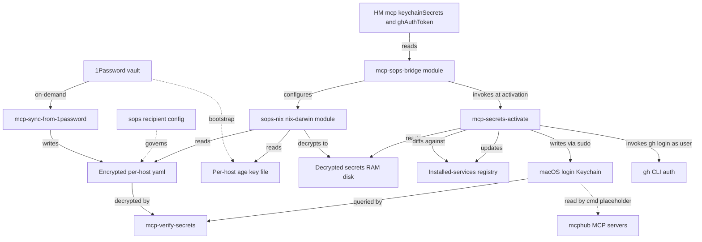
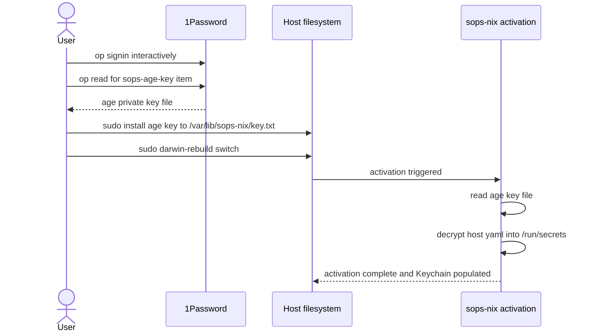
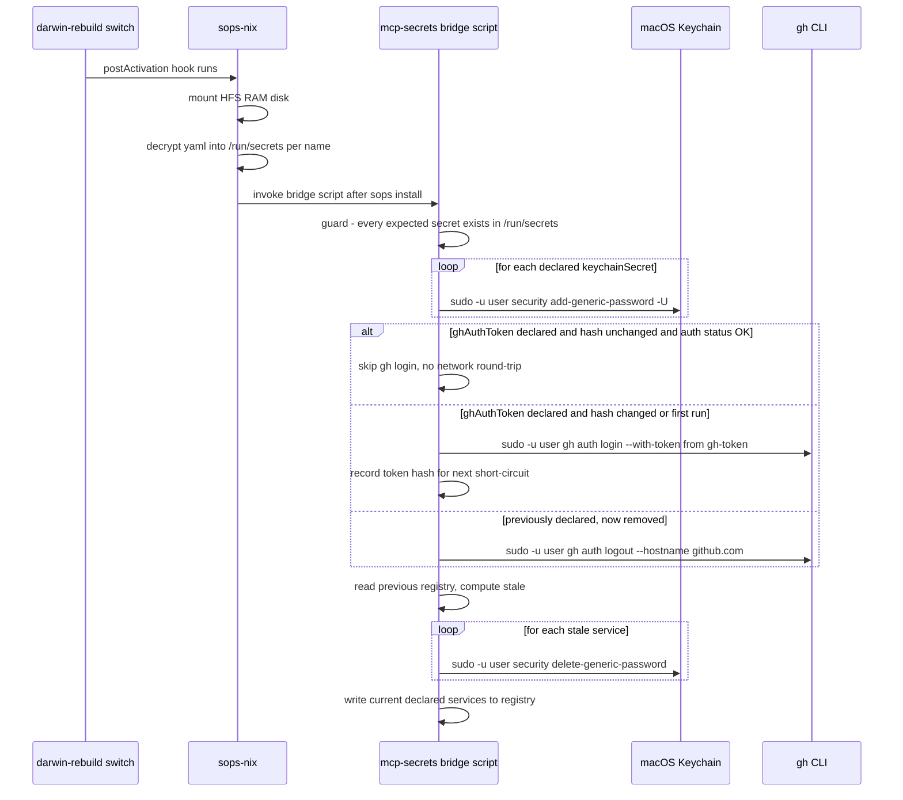
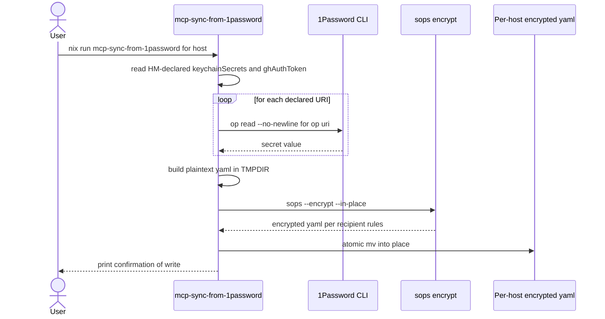
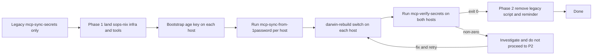

# Design Document: mcp-secrets-sops-nix

## Overview

This feature replaces the imperative `mcp-sync-secrets` 1Password→Keychain
bridge in `home-manager/mcp/default.nix` with a declarative deployment
pipeline built on sops-nix. The 14 MCP keychain secrets and a new `gh`
CLI authentication token are encrypted with per-host age recipients into
`secrets/mcp.{shopify,personal}.yaml`, decrypted at `darwin-rebuild
switch` by sops-nix's nix-darwin system module, and bridged into the
existing macOS Keychain layout (and gh CLI) by a small activation
script.

**Users**: the maintainer (Brandon) operating ShopifyLaptop and
Brandons-MacBook-Pro. After bootstrap, `darwin-rebuild switch` populates
all secrets without 1Password being available; secrets removed from
declarations are removed from Keychain on the next switch; `gh` works
on a fresh laptop without `gh auth login`.

**Impact**: changes the population mechanism for `mcp-<name>` Keychain
entries from imperative shell script to nix-darwin activation. Consumer
contract for mcphub MCP servers (`${cmd: security
find-generic-password ...}` placeholders, `mcp-<name>` / `mcp-hub`
service/account layout, `readKeychainSecret` helper signature) is
preserved verbatim. Adds one flake input (`sops-nix`), one new
nix-darwin system module, three new helper scripts, and operator
documentation. Phased landing: legacy `mcp-sync-secrets` script and
its activation reminder remain as a fallback until parity is verified
on both hosts.

### Goals

- Activation alone (`darwin-rebuild switch`) populates every declared
  MCP Keychain entry and configures `gh` auth, with no manual
  follow-up step
- Decryption requires only the host's local age key — works while
  1Password is offline, locked, or uninstalled
- Per-host encrypted yamls with mechanically enforced recipient scoping
  (compromise of one host's age key does not expose the other host's
  secrets)
- Stale Keychain entries (removed from declarations) are cleaned up at
  the next activation, only touching entries this pipeline installed
- Existing mcphub consumer surface (`keychainSecrets` attrset,
  `readKeychainSecret`, `${cmd: security find-generic-password}`)
  unchanged
- Operator documentation (`secrets/README.md`) covers bootstrap,
  recipient enrollment for new hosts, secret rotation, recovery from
  lost keys, and explicit non-scope rationale

### Non-Goals

- OpenCode `OPENCODE_API_KEY` (devx-llm-gateway minted per invocation)
  — out of scope per the brief
- `~/.cache/tool-gateway-token` (populated by external Shopify tooling)
  — out of scope
- Direct file consumption by mcphub (skipping the Keychain bridge) —
  deferred to a future spec until upstream sops-nix PR #952 stabilises
  `$DARWIN_USER_TEMP_DIR`
- 1Password SSH commit signing, Atuin sync key, AWS credentials, SSH
  host/user keys — out of scope
- Reclassification of `mcp-fastmail-username` as a non-secret —
  cosmetic; deferred

## Boundary Commitments

### This Spec Owns

- The `sops-nix` flake input pin and its inclusion in both
  `darwinConfigurations`
- A new nix-darwin SYSTEM module
  `configurations/common-darwin/mcp-sops-bridge.nix` that derives sops
  secret declarations from HM-declared `home.mcp.keychainSecrets` +
  `home.mcp.ghAuthToken` and orchestrates activation
- The encrypted secrets store: `.sops.yaml` recipient rules, two
  encrypted yamls `secrets/mcp.shopify.yaml` and
  `secrets/mcp.personal.yaml`
- The age key location convention (`/var/lib/sops-nix/key.txt`) and
  the per-host bootstrap procedure for placing it
- Three new helper scripts:
  `scripts/mcp-secrets-activate.nix` (the activation worker invoked by
  the system module), `scripts/mcp-sync-from-1password.nix` (on-demand
  refresh of encrypted yaml from 1P), `scripts/mcp-verify-secrets.nix`
  (parity check for R8 gate)
- A registry file at `/var/lib/mcp-keychain-sync/installed-services`
  tracking which services this pipeline installs
- A registry flag at `/var/lib/mcp-keychain-sync/gh-token-installed`
  tracking the `gh` auth slot
- New flake apps `apps.${system}.{mcp-sync-from-1password,
  mcp-verify-secrets}`
- A new HM option `home.mcp.ghAuthToken` (nullable string, holds the
  1P URI for the gh CLI token)
- `secrets/README.md` operator documentation
- The Phase 2 removal of `mcpSyncSecretsScript` and
  `home.activation.mcpKeychainSecrets` from
  `home-manager/mcp/default.nix` once verification passes on both hosts

### Out of Boundary

- The `home.mcp.keychainSecrets` attrset shape and the
  `readKeychainSecret` helper signature (preserved per R7.3; the bridge
  module reads them but does not redefine them)
- mcphub server configurations in `configurations/{shopify,personal}/
  home-manager/default.nix` `extraServers` blocks (the
  `${cmd: security find-generic-password ...}` placeholders these emit
  remain unchanged; the bridge module never touches them)
- The launchd configuration of `mcp-hub` itself
- OpenCode wrapper scripts and the `devx llm-gateway print-token`
  flow
- The 1Password client install (`configurations/common-darwin/
  1password.nix`) and the 1P SSH agent
- gh CLI module configuration (`home-manager/common/gh-cli.nix`) other
  than the activation-time auth invocation
- Any secrets not currently in `home.mcp.keychainSecrets` (Atuin, AWS,
  SSH host/user keys, etc.)
- 1Password vault path conventions (`Employee` for Shopify, `Private`
  for Personal — already established; the bridge module is agnostic to
  paths since URIs are user-supplied)

### Allowed Dependencies

- **External Nix flake input**: `sops-nix` (Mic92/sops-nix), MIT,
  imported as `inputs.sops-nix.darwinModules.default`. Pinned in
  flake.lock; bumps are explicit
- **Transitive runtime tools** (resolved by sops-nix's transitive
  closure): `sops`, `age`, `ssh-to-age`. No direct flake input for
  these
- **Existing repo modules**:
  - `home-manager.darwinModules.home-manager` (already imported in
    `common-darwin/default.nix`) — provides the
    `config.home-manager.users.${username}` config tree the bridge
    module reads
  - `home-manager/mcp/default.nix` — read-only access to its declared
    `home.mcp.keychainSecrets` and the new `home.mcp.ghAuthToken`
    options
- **System binaries** invoked from the activation script: `/usr/bin/
  security` (macOS Keychain), `/usr/bin/sudo`, `${pkgs.gh}/bin/gh`
- **1Password CLI** (`pkgs._1password-cli`): used ONLY by the
  on-demand sync tool (`mcp-sync-from-1password`), never at activation

### Revalidation Triggers

- Bumping the `sops-nix` flake input — re-validate that the Darwin
  module's `secretType` shape and activation hook locations
  (`system.activationScripts.postActivation` `mkAfter`) haven't changed
- Adding a third host — `.sops.yaml` recipient enrollment workflow
  must run; bridge module + per-host `default.nix` need a new
  `defaultSopsFile` slot
- Renaming, adding, or removing a key in `home.mcp.keychainSecrets` —
  the encrypted yaml must be re-synced via
  `mcp-sync-from-1password`; otherwise activation will fail on the
  missing secret guard
- Changing the macOS Keychain service-name layout (`mcp-<name>` /
  `mcp-hub`) — would break R7.1 consumer contract; downstream mcphub
  consumers and the legacy `mcp-sync-secrets` script (during Phase 1)
  both depend on the current shape
- Changing `gh auth login --with-token` semantics in upstream gh CLI
  (e.g., format breakage in `~/.config/gh/hosts.yml`) — re-validate
  the gh activation step
- Decommissioning `mcp-sync-secrets` (Phase 2) — must follow successful
  `mcp-verify-secrets` run on both hosts (R8.1 → R8.2)

## Architecture

### Existing Architecture Analysis

- HM-first secrets declaration: `home.mcp.keychainSecrets` lives in HM
  modules, even though it deploys system-wide artefacts (Keychain).
  Keep this — it's the consumer contract surface (R7.3).
- Activation today is no-op for secrets: existing `home.activation.
  mcpKeychainSecrets` only prints a reminder. The new pipeline
  introduces the first real activation-time secrets work in this repo.
- Cross-layer config reads: nix-darwin already imports
  `home-manager.darwinModules.home-manager` in
  `configurations/common-darwin/default.nix`, making
  `config.home-manager.users.${username}.home.*` evaluatable from
  system modules. The bridge module exploits this — system module
  reads HM data, no new option duplication.
- `extraSpecialArgs` threading: `inputs`, `outputs`, `username`
  available everywhere. The new bridge module uses this same channel.
- Pre-commit guards: `no-tmp-paths`, `no-builtins-fetch`,
  `no-hardcoded-users`, `nixfmt-rfc-style`, `statix`, `deadnix`,
  `flake-checker`. New code must comply.

### Architecture Pattern & Boundary Map



**Architecture Integration**:

- **Selected pattern**: HM-declares-data + system-deploys-data. The
  bridge is a SYSTEM module (per viability finding: HM sops module on
  Darwin has known launchd issues, upstream #801) that reads HM-layer
  config to know what to deploy.
- **Domain boundaries**: HM owns the data shape (`keychainSecrets`,
  `ghAuthToken`); sops-nix owns encryption/decryption; the bridge owns
  the runtime delivery (Keychain + gh) and registry-tracked stale
  cleanup.
- **Existing patterns preserved**: `programs.opencode`-style HM module
  shape; `scripts/<name>.nix` `pkgs.writeShellApplication` wrappers;
  flake-app exposure via `apps.${system}`; per-host `default.nix`
  importing host-specific bits.
- **New components rationale**: each addresses one R# requirement set
  cleanly; see Components and Interfaces table below.
- **Steering compliance**: no `.kiro/steering/` exists in this repo
  yet; design follows established repo conventions inferred from
  existing modules.

### Technology Stack

| Layer | Choice / Version | Role in Feature | Notes |
|-------|------------------|-----------------|-------|
| Encryption | sops + age (transitive via sops-nix) | Encrypts `secrets/*.yaml` with per-host age recipients; decrypts at activation | sops MPL-2.0 file-level — invoked as binary, no source linkage; age BSD-3 |
| Activation framework | sops-nix nix-darwin module (Mic92/sops-nix, MIT) | Decrypts to `/run/secrets/<name>` on a 64MB HFS-on-RAM disk; provides `system.activationScripts.postActivation` hook | New flake input; pinned at a specific commit |
| Secret sync (1P → repo) | `_1password-cli` + `sops --encrypt` | On-demand re-encryption of yamls from 1P contents | Existing pkg; only used by the new sync tool |
| Activation script runtime | `pkgs.writeShellApplication` over `/usr/bin/security`, `/usr/bin/sudo`, `${pkgs.gh}/bin/gh` | Bridges sops decrypted files into macOS Keychain + gh CLI auth | shellcheck-validated by writeShellApplication |
| Storage | `secrets/*.yaml` (encrypted, committed); `/var/lib/sops-nix/key.txt` (per-host age private key, NOT in repo); `/var/lib/mcp-keychain-sync/{installed-services,gh-token-installed}` (registry) | Persistence | Repo holds ciphertext; host filesystem holds plaintext age key + activation registry |

## File Structure Plan

### Directory Structure

```
flake.nix                                                    [MODIFIED]
  + inputs.sops-nix flake input
  + apps.${system}.mcp-sync-from-1password
  + apps.${system}.mcp-verify-secrets

configurations/
├── common-darwin/
│   ├── default.nix                                          [unchanged]
│   └── mcp-sops-bridge.nix                                  [NEW]
│       # System module. Owns the inputs.sops-nix import.
│       # Reads HM config, declares sops.secrets, owns activation
│       # script. Per-host configs import this module only;
│       # they do NOT separately import sops-nix (ordering matters).
├── shopify/
│   ├── default.nix                                          [MODIFIED]
│   │   # Imports ../common-darwin/mcp-sops-bridge.nix only.
│   │   # Sets sops.defaultSopsFile = ../../secrets/mcp.shopify.yaml
│   └── home-manager/default.nix                             [MODIFIED]
│       # Adds home.mcp.ghAuthToken (1P URI for gh CLI token)
└── personal/
    ├── default.nix                                          [MODIFIED]
    │   # Imports ../common-darwin/mcp-sops-bridge.nix only.
    │   # Sets sops.defaultSopsFile = ../../secrets/mcp.personal.yaml
    └── home-manager/default.nix                             [MODIFIED]
        # Adds home.mcp.ghAuthToken

home-manager/mcp/default.nix                                 [MODIFIED]
  Phase 1:
    + home.mcp.ghAuthToken option (nullable string, 1P URI)
    [legacy mcpSyncSecretsScript + activation reminder remain]
  Phase 2 (after R8 verification, separate commit):
    - mcpSyncSecretsScript definition
    - home.activation.mcpKeychainSecrets reminder
    - conditional inclusion of mcpSyncSecretsScript in home.packages
    [keychainSecrets option + readKeychainSecret stay — R7.3]

scripts/
├── mcp-secrets-activate.nix                                 [NEW]
│   # writeShellApplication invoked by mcp-sops-bridge module's
│   # activation hook. Reads /run/secrets/*, syncs Keychain via
│   # sudo -u, syncs gh auth, diffs against registry, removes stale
├── mcp-sync-from-1password.nix                              [NEW]
│   # writeShellApplication exposed as flake app. Reads HM-declared
│   # 1P URIs via op, re-encrypts host's yaml via sops
└── mcp-verify-secrets.nix                                   [NEW]
    # writeShellApplication exposed as flake app. Decrypts yaml in
    # memory, compares each value to security find-generic-password,
    # exit 0 = parity, non-0 = mismatch (R8 gate)

secrets/                                                     [NEW directory]
├── README.md                                                [NEW]
│   # Bootstrap, recipient enrollment, rotation, recovery, non-scope
├── mcp.shopify.yaml                                         [NEW]
│   # sops-encrypted: 6 MCP secrets + 1 gh-token, ShopifyLaptop age
├── mcp.personal.yaml                                        [NEW]
│   # sops-encrypted: 8 MCP secrets + 1 gh-token, Personal age
└── (no .sops.yaml here — lives at repo root)

.sops.yaml                                                   [NEW, repo root]
  # creation_rules with path_regex per yaml + per-host age recipient

.gitignore                                                   [MODIFIED]
  # No new ignores; secrets/*.yaml IS committed (it's encrypted)
```

### Modified Files

- `flake.nix` — add `sops-nix` input; expose two flake apps
- `configurations/{shopify,personal}/default.nix` — import bridge module + set per-host `sops.defaultSopsFile`
- `configurations/{shopify,personal}/home-manager/default.nix` — set `home.mcp.ghAuthToken`
- `home-manager/mcp/default.nix` — Phase 1: add `ghAuthToken` option; Phase 2 (separate commit): remove legacy script and reminder

## System Flows

### One-time bootstrap on a new host



### Steady-state activation (every `darwin-rebuild switch`)



### On-demand sync from 1Password



## Requirements Traceability

| Req | Summary | Components | Interfaces | Flows |
|---|---|---|---|---|
| 1.1 | Switch populates Keychain | mcp-sops-bridge, mcp-secrets-activate | activation script invoked from postActivation | Steady-state activation |
| 1.2 | No manual post-activation | mcp-secrets-activate | (no manual step exists in design) | Steady-state activation |
| 1.3 | Works without 1P at activation | sops-nix, mcp-secrets-activate | sops decrypt uses local age key only | Steady-state activation |
| 1.4 | Works with 1P offline | sops-nix | same as 1.3 | Steady-state activation |
| 1.5 | Idempotent re-runs | mcp-secrets-activate | `security add-generic-password -U` is idempotent; registry diff stable | Steady-state activation |
| 2.1 | Shopify yaml not decryptable by Personal key | .sops.yaml, secrets/mcp.shopify.yaml | path_regex creation_rule with Shopify-only recipient | (encryption-at-rest property) |
| 2.2 | Personal yaml not decryptable by Shopify key | .sops.yaml, secrets/mcp.personal.yaml | path_regex creation_rule with Personal-only recipient | (encryption-at-rest property) |
| 2.3 | Decryption failure with diagnostic | sops-nix, mcp-secrets-activate | sops's "no key could decrypt the data" surfaces in activation log | Steady-state (failure path) |
| 2.4 | Adding secret doesn't expand cross-host visibility | .sops.yaml | recipient lists are per-path; no shared key recipient | (encryption-at-rest property) |
| 3.1 | Bootstrap = one op read | secrets/README.md | documented one-line procedure | One-time bootstrap |
| 3.2 | Subsequent switches need no 1P | sops-nix | local age key only | One-time bootstrap → steady-state |
| 3.3 | Missing key fails informatively | sops-nix | sops-install-secrets prints "Cannot read age key" diagnostic | One-time bootstrap (failure) |
| 3.4 | Third-host enrollment workflow | secrets/README.md | documented procedure: existing host adds recipient, runs `sops updatekeys`, commits | (operational) |
| 4.1 | Sync tool refreshes encrypted store | mcp-sync-from-1password | flake app `nix run .#mcp-sync-from-1password -- <host>` | On-demand sync |
| 4.2 | Sync requires 1P auth | mcp-sync-from-1password | first `op read` fails fast with diagnostic | On-demand sync (failure) |
| 4.3 | Missing 1P URI fails before partial write | mcp-sync-from-1password | gather phase before sops --encrypt; aborts on any URI failure | On-demand sync (failure) |
| 4.4 | Idempotent re-sync produces no value diff | mcp-sync-from-1password | sops re-encrypt deterministic when input unchanged (after MAC normalisation) | On-demand sync |
| 4.5 | Partial failure leaves store untouched | mcp-sync-from-1password | gather-then-write pattern; encrypt to $TMPDIR, atomic mv | On-demand sync (failure) |
| 5.1 | Stale entries removed | mcp-secrets-activate | registry diff + `security delete-generic-password` | Steady-state activation |
| 5.2 | Don't touch unmanaged entries | mcp-secrets-activate | registry-driven (only delete what we recorded installing) | Steady-state activation |
| 5.3 | Operator-visible logs | mcp-secrets-activate | `printf` per add/update/delete to stderr | Steady-state activation |
| 6.1 | gh authenticated after switch | mcp-secrets-activate | `gh auth login --with-token` invocation when slot declared | Steady-state activation |
| 6.2 | gh token from same store | sops-nix, secrets/mcp.<host>.yaml | `gh-token` is a yaml key alongside MCP secrets | (data layout) |
| 6.3 | Removal cleans up gh auth | mcp-secrets-activate | `gh-token-installed` flag; transition triggers `gh auth logout` | Steady-state activation |
| 6.4 | Rotation propagates | mcp-sync-from-1password + mcp-secrets-activate | re-sync writes new value; next switch re-runs `gh auth login --with-token` | On-demand sync → steady-state |
| 7.1 | Keychain layout preserved | mcp-secrets-activate | service `mcp-<name>`, account `mcp-hub`, target `login.keychain-db` | Steady-state activation |
| 7.2 | mcphub `${cmd:}` placeholders return same value | mcp-secrets-activate | values written match what legacy script wrote | (consumer contract) |
| 7.3 | No change to consumer surface | mcp-sops-bridge (read-only on HM data) | `keychainSecrets` attrset shape, `readKeychainSecret` signature unmodified | (consumer contract) |
| 8.1 | Preserve legacy during verification | home-manager/mcp/default.nix | Phase 1 leaves `mcpSyncSecretsScript` + reminder in place | (sequencing) |
| 8.2 | Remove legacy after verification | home-manager/mcp/default.nix | Phase 2 commit deletes the legacy code | (sequencing) |
| 8.3 | No lingering doc references | grep audit | Phase 2 also removes any AGENTS.md / steering / README mentions | (sequencing) |
| 9.1 | Bootstrap procedure documented | secrets/README.md | Bootstrap section | One-time bootstrap |
| 9.2 | Recipient enrollment documented | secrets/README.md | Adding-a-host section | (operational) |
| 9.3 | Rotation workflow documented | secrets/README.md | Rotation section | On-demand sync |
| 9.4 | Non-scope rationale documented | secrets/README.md | Out-of-scope section | (operational) |
| 9.5 | Recovery from lost key documented | secrets/README.md | Recovery section | (operational) |

## Components and Interfaces

| Component | Layer | Intent | Req Coverage | Key Dependencies | Contracts |
|---|---|---|---|---|---|
| mcp-sops-bridge | nix-darwin system module | Wire sops-nix; derive `sops.secrets` from HM data; orchestrate activation | 1.1, 1.3, 2.1–2.4, 5.1, 5.2, 6.2, 7.3 | sops-nix (P0), HM `home.mcp.*` (P0) | State |
| mcp-secrets-activate | activation script | Bridge `/run/secrets/*` to Keychain + gh CLI; registry diff for stale | 1.1, 1.2, 1.5, 5.1–5.3, 6.1, 6.3, 6.4, 7.1, 7.2 | mcp-sops-bridge (P0), `/usr/bin/security` (P0), `pkgs.gh` (P0) | Service |
| mcp-sync-from-1password | flake app | Refresh encrypted yaml from 1P on demand | 4.1–4.5, 6.4 | `pkgs._1password-cli` (P0), `sops --encrypt` (P0), HM `home.mcp.*` (P0) | Service |
| mcp-verify-secrets | flake app | Compare encrypted yaml values vs Keychain; R8 gate | 8.1, 8.2 | `sops --decrypt` (P0), `/usr/bin/security` (P0) | Service |
| home-manager/mcp/default.nix (extended) | HM module | Add `ghAuthToken` option; preserve existing surface | 6.2, 7.3, 8.1, 8.2 | none new | State |
| .sops.yaml + secrets/*.yaml | data | Encrypted secrets store with per-host scoping | 2.1, 2.2, 2.4, 6.2 | sops, age | (data) |
| secrets/README.md | docs | Operator workflows | 9.1–9.5 | none | (docs) |

### nix-darwin system layer

#### mcp-sops-bridge

| Field | Detail |
|---|---|
| Intent | Wire sops-nix into both hosts; derive `sops.secrets` from HM-declared data; invoke activation script after sops decryption |
| Requirements | 1.1, 1.3, 2.1–2.4, 5.1, 5.2, 6.2, 7.3 |

**Responsibilities & Constraints**
- **Owns the sops-nix import.** The bridge module's own `imports = [ inputs.sops-nix.darwinModules.default ]` brings sops-nix into the system layer. Per-host `default.nix` files import ONLY this bridge module — they do NOT separately import sops-nix. This keeps the sops-nix option declarations on the merged-config graph before this module's `config = { sops = ...; }` block reads them, which is the option-merge half of the ordering story. (See the Update note below for the activation-text ordering half, which the original design got wrong.)
- **Update (Task 3.1 remediation):** the original design claimed import-placement also guarantees the bridge's `mkAfter` block runs AFTER sops-nix's `mkAfter installScript` within the merged `postActivation.text`. **This is empirically wrong on this nix-darwin/module-system version**: two `mkAfter` fragments at the same priority (1500) have undefined relative order, and on this version the bridge's fragment landed FIRST, causing `mcp-secrets-activate` to run BEFORE `sops-install-secrets` had populated `/run/secrets/<name>`. The activation guard then exited 1 every switch (R6.1 regression). Fix: bridge uses `lib.mkOrder 9999` for its fragment so it sorts strictly after sops-nix's `mkAfter` (1500). nix-darwin does NOT support `system.activationScripts.<name>.deps` for custom names (silently no-ops). Documented at `configurations/common-darwin/mcp-sops-bridge.nix:9-53`.
- Reads `config.home-manager.users.${username}.home.mcp.{keychainSecrets, ghAuthToken}` to enumerate which sops secrets to declare
- Sets `sops.age.keyFile = "/var/lib/sops-nix/key.txt"` (absolute path; default is null on Darwin)
- Sets BOTH `sops.age.sshKeyPaths = []` AND `sops.gnupg.sshKeyPaths = []` to silence the SSH-host-key derivation probes. **Update (Task 4.5 fix):** the original design only set `age.sshKeyPaths`, missing the parallel `gnupg.sshKeyPaths` (default `["/etc/ssh/ssh_host_rsa_key"]`). On macOS hosts that don't run sshd, the GPG path probe emits a `Cannot read ssh key '/etc/ssh/ssh_host_rsa_key'` warning at every activation even when no GPG decryption is in use. Both probes are guarded by `len(manifest.SSHKeyPaths) != 0` and `len(manifest.AgeSSHKeyPaths) != 0` respectively in `sops-install-secrets/main.go`.
- Generates `sops.secrets.<name>` declarations for each `keychainSecrets` key + (if non-null) `gh-token`
- Sets each secret's `sopsFile` from the host's `sops.defaultSopsFile` (set by per-host `default.nix`)
- Adds activation script invocation via `system.activationScripts.postActivation.text = lib.mkOrder 9999 "..."`; script body is `${pkgs.mcp-secrets-activate}/bin/mcp-secrets-activate "$USERNAME" ${manifestPath}`. (Original design said `lib.mkAfter`; see Update note above for why this changed.)
- Defensive guard inside the activation script (`[ -e /run/secrets/<name> ] || exit 1`) catches any future ordering regression with a clear diagnostic instead of corrupting Keychain state. With the `mkOrder 9999` fix the guard now defends against future regressions instead of being load-bearing for steady-state behavior.
- Read-only against HM config — does NOT redefine `home.mcp.keychainSecrets` (would cause module-merge error)

**Dependencies**
- Inbound: per-host `configurations/{shopify,personal}/default.nix` imports this module (P0)
- Outbound: `sops-nix.darwinModules.default` (P0); `pkgs.mcp-secrets-activate` (P0); reads HM config tree (P0)
- External: `inputs.sops-nix` flake input (P0)

**Contracts**: Service [ ] / API [ ] / Event [ ] / Batch [ ] / State [x]

##### State Management
- State model: pure module function over `(config, lib, pkgs, inputs, username)` → declarative system config. No runtime state owned by this module
- Persistence & consistency: state lives in `/run/secrets/*` (sops-nix) and `/var/lib/mcp-keychain-sync/*` (activation script); not this module's concern
- Concurrency strategy: nix-darwin activation is single-threaded; no concurrency

**Implementation Notes**
- Integration: per-host `default.nix` becomes the seam: `imports = [../common-darwin ../common-darwin/mcp-sops-bridge.nix]; sops.defaultSopsFile = ../../secrets/mcp.shopify.yaml;`
- Validation: `nix flake check --no-build` evaluates cleanly; `nix build .#darwinConfigurations.<host>.system` succeeds
- Risks: HM config evaluation order — confirmed safe (read-only); module-system semantics guarantee mutual visibility

### Activation runtime layer

#### mcp-secrets-activate

| Field | Detail |
|---|---|
| Intent | At every activation, bridge sops-decrypted secrets to macOS Keychain + gh CLI, with registry-tracked stale cleanup |
| Requirements | 1.1, 1.2, 1.5, 5.1–5.3, 6.1, 6.3, 6.4, 7.1, 7.2 |

**Responsibilities & Constraints**
- Single binary built via `pkgs.writeShellApplication` (shellcheck-validated)
- Argument: `$1` = target username (so the script can be tested with arbitrary user; in production, the bridge module passes `${username}` from specialArgs)
- Operates at activation context as root (per nix-darwin model); drops to user via `sudo -u "$USERNAME" -H` for every Keychain and gh invocation
- Targets the user's login keychain by absolute path: `/Users/$USERNAME/Library/Keychains/login.keychain-db`
- Defensive guard at start: for each declared secret, assert `[ -e /run/secrets/<name> ]` else `exit 1` with diagnostic
- Reads declared secret list from a Nix-rendered manifest file (the bridge module writes the expected service names into a known location at build time, e.g., `${pkgs.writeText "mcp-secrets-manifest.json" (builtins.toJSON {...})}`, and the script receives its path as `$2`)
- For each MCP secret: `sudo -u $USERNAME -H /usr/bin/security add-generic-password -U -s '<svc>' -a mcp-hub -w "$(cat /run/secrets/<svc>)" /Users/$USERNAME/Library/Keychains/login.keychain-db`
- For gh-token (if declared): short-circuit network round-trip when no work is needed. Compute the SHA-256 of `/run/secrets/gh-token` and compare against the previously-recorded hash in `/var/lib/mcp-keychain-sync/gh-token-hash`. If the hashes match AND `sudo -u $USERNAME -H ${pkgs.gh}/bin/gh auth status --hostname github.com` exits 0, skip the login (preserves R1.3/R1.4 offline-capable invariant). Otherwise, run `sudo -u $USERNAME -H ${pkgs.gh}/bin/gh auth login --with-token --hostname github.com < /run/secrets/gh-token`, then write the new hash to the hash file. Set `gh-token-installed` flag on success.
- Stale Keychain cleanup: read `/var/lib/mcp-keychain-sync/installed-services` (sorted, one per line); compute `was - is` set difference; for each stale, `sudo -u $USERNAME -H /usr/bin/security delete-generic-password -s '<svc>' -a mcp-hub /Users/$USERNAME/Library/Keychains/login.keychain-db || true`
- Stale gh cleanup: if `gh-token-installed` flag exists but `ghAuthToken` is no longer declared, `sudo -u $USERNAME -H ${pkgs.gh}/bin/gh auth logout --hostname github.com` and remove flag
- After all sync ops succeed, write current declared service names (sorted) to registry; create `gh-token-installed` flag if appropriate
- Logging: `printf 'mcp-secrets: %s %s\n' add|update|remove <svc>` per operation, to stderr

**Dependencies**
- Inbound: invoked from `mcp-sops-bridge`'s `system.activationScripts.postActivation.text` (P0)
- Outbound: `/usr/bin/security` (P0); `${pkgs.gh}/bin/gh` (P0); `/usr/bin/sudo` (P0); `/run/secrets/<name>` files (P0)
- External: macOS Keychain Services (P0); GitHub OAuth via gh CLI (P1, only on token rotation)

**Runtime Dependencies (`pkgs.writeShellApplication.runtimeInputs`)**

The activation script's Nix derivation MUST declare these as `runtimeInputs` so they appear on PATH inside the strict-mode shell:

| Package | Purpose |
|---|---|
| `pkgs.jq` | Parse the JSON manifest passed by the bridge module (`$2`) |
| `pkgs.coreutils` | `cat`, `mktemp`, `chmod`, `install`, `sort`, `comm`, `sha256sum` for value reads, atomic writes, registry diffs, and gh-token hashing |
| `pkgs.gh` | `gh auth login --with-token`, `gh auth status`, `gh auth logout` for the gh-token slot |
| `pkgs.diffutils` | `comm` for set-difference between previous and current declared service names |

System binaries invoked by absolute path (NOT in `runtimeInputs`):

| Path | Purpose |
|---|---|
| `/usr/bin/security` | macOS Keychain reads/writes (system-provided) |
| `/usr/bin/sudo` | Drop privileges to the target user for Keychain and `gh` operations |

**Contracts**: Service [x] / API [ ] / Event [ ] / Batch [ ] / State [x]

##### Service Interface

```bash
# Synopsis (called from activation):
#   mcp-secrets-activate <username> <manifest-path>
#
# Inputs:
#   $1 — username (e.g., "brandonmcnama")
#   $2 — JSON manifest path (e.g., /nix/store/.../mcp-secrets-manifest.json)
#        Manifest schema:
#        {
#          "keychainSecrets": ["mcp-github-token", "mcp-vault-token", ...],
#          "ghAuthToken": true|false
#        }
#
# Side effects:
#   - Adds/updates/removes Keychain entries with service ∈ keychainSecrets
#   - Conditionally invokes gh auth login --with-token / gh auth logout
#   - Updates /var/lib/mcp-keychain-sync/installed-services (atomic write)
#   - Touches/removes /var/lib/mcp-keychain-sync/gh-token-installed
#
# Exit codes:
#   0 — success
#   1 — guard failure (missing /run/secrets/<name>)
#   2 — Keychain add/update failure
#   3 — gh auth failure
#   4 — registry write failure
```

- Preconditions: invoked as root; sops-nix has populated `/run/secrets/<name>` for every name in manifest's `keychainSecrets` (and `gh-token` if `ghAuthToken=true`); user is logged into GUI session (login keychain unlocked)
- Postconditions: every declared Keychain entry's value matches the corresponding `/run/secrets/<name>` content; gh auth state matches `ghAuthToken` declaration; registry reflects current declared set
- Invariants: never modifies Keychain entries outside the declared set + previously-tracked set; never writes plaintext secrets to disk outside `/run/secrets.d` (sops-nix's RAM disk)

**Implementation Notes**
- Integration: bridge module passes manifest path via `pkgs.writeText "mcp-secrets-manifest.json" (builtins.toJSON {...})` so every change to declared secrets re-renders the manifest, keeping it in lockstep with sops declarations
- Validation: shellcheck enforced by `writeShellApplication`; pre-commit hooks run on the .nix wrapper file; manual smoke test on each host before R8 verification gate
- Risks: locked-keychain on remote SSH activation — documented in `secrets/README.md` as a known limitation (user must be logged into GUI session); `gh auth login` failure modes (network, token revoked) — script exits 3 with diagnostic, leaves Keychain populated

### On-demand tooling layer

#### mcp-sync-from-1password

| Field | Detail |
|---|---|
| Intent | On-demand: read each declared secret from 1P, write a fresh encrypted yaml |
| Requirements | 4.1–4.5, 6.4 |

**Responsibilities & Constraints**
- `pkgs.writeShellApplication` exposed as `apps.${system}.mcp-sync-from-1password`
- Argument: `$1` = host name (`shopify` or `personal`), determines which yaml to write
- Builds the secret list by reading `nix eval --json` of `darwinConfigurations.<host>.config.home-manager.users.${username}.home.mcp.{keychainSecrets, ghAuthToken}`
- Pre-flight: `op whoami` to assert authenticated session; aborts with diagnostic if not (R4.2)
- Gather phase: for every declared URI, `op read --no-newline '<uri>'` into an in-memory associative array; aborts on first failure with the failing URI named (R4.3, R4.5)
- Build plaintext yaml in `$(mktemp -d)` (per `no-tmp-paths` pre-commit guard, this is OK in shell, NOT in .nix code)
- Encrypt: `sops --encrypt --in-place "$tmpfile"`. `.sops.yaml`'s path_regex won't match the tmp path, so use `--config "$REPO_ROOT/.sops.yaml"` and `--input-type yaml --output-type yaml` to force application
- Atomic move: `mv "$tmpfile" "$REPO_ROOT/secrets/mcp.<host>.yaml"`
- Print summary: count of secrets written, path of output

**Dependencies**
- Inbound: user invokes via `nix run .#mcp-sync-from-1password -- shopify` (P0)
- Outbound: `pkgs._1password-cli` (P0), `pkgs.sops` (P0), `nix eval` for HM config (P0)
- External: 1Password vault via `op` (P0)

**Runtime Dependencies (`pkgs.writeShellApplication.runtimeInputs`)**

| Package | Purpose |
|---|---|
| `pkgs._1password-cli` | `op read --no-newline` for each declared 1P URI |
| `pkgs.sops` | `sops --encrypt --in-place` against the host's yaml |
| `pkgs.coreutils` | `mktemp`, `mv`, `cat` for atomic write |
| `pkgs.nix` | `nix eval --json` to read the HM-declared secret list |
| `pkgs.jq` | Parse `nix eval --json` output into iterable URI list |

**Contracts**: Service [x] / API [ ] / Event [ ] / Batch [ ] / State [ ]

##### Service Interface

```bash
# Synopsis: nix run .#mcp-sync-from-1password -- <host>
#
# Inputs:
#   $1 — host name: "shopify" | "personal"
#
# Side effects:
#   - Writes secrets/mcp.<host>.yaml (encrypted) on success
#   - Leaves filesystem unchanged on any failure (atomic)
#
# Exit codes:
#   0 — success
#   1 — invalid host name
#   2 — op not authenticated
#   3 — op read failure (URI naming the missing item printed)
#   4 — sops encrypt failure
```

- Preconditions: `op` is authenticated; `.sops.yaml` exists at repo root; per-host yaml exists OR will be created by this run
- Postconditions: yaml is well-formed sops-encrypted; decrypted contents include every URI declared in HM config
- Invariants: no partial writes; either the new yaml replaces the old atomically or the old yaml is unchanged

**Implementation Notes**
- Integration: invoked by user before commit. The output IS the canonical encrypted store
- Validation: `sops -d secrets/mcp.<host>.yaml` round-trips successfully after sync; `mcp-verify-secrets` post-switch confirms parity
- Risks: 1P session expiry mid-run (rare; aborts cleanly with R4.5 atomicity); URI typo (caught at gather phase per R4.3); `nix eval` slow on first invocation (cached after)

#### mcp-verify-secrets

| Field | Detail |
|---|---|
| Intent | Compare every encrypted-yaml value to the corresponding Keychain entry; exit 0 = parity; primary R8 verification gate |
| Requirements | 8.1, 8.2 |

**Responsibilities & Constraints**
- `pkgs.writeShellApplication` exposed as `apps.${system}.mcp-verify-secrets`
- Argument: `$1` = host name
- Decrypts host's yaml in memory: `sops -d --output-type json secrets/mcp.<host>.yaml | jq -r 'to_entries[] | select(.key != "sops") | "\(.key)\t\(.value)"'`
- For each `(key, expected)` pair: query `security find-generic-password -s '<key>' -a mcp-hub -w` (or `gh auth status` for `gh-token`); compare
- Aggregate result: print per-key MATCH/MISMATCH/MISSING; exit non-zero if any non-MATCH
- Designed to be safe to invoke as the user (no sudo; reads own login keychain)

**Dependencies**
- Inbound: user invokes via `nix run .#mcp-verify-secrets -- shopify` (P0)
- Outbound: `pkgs.sops` (P0), `pkgs.jq` (P0), `/usr/bin/security` (P0), `pkgs.gh` (P0 for gh-token verification)
- External: macOS Keychain (P0)

**Runtime Dependencies (`pkgs.writeShellApplication.runtimeInputs`)**

| Package | Purpose |
|---|---|
| `pkgs.sops` | `sops -d --output-type json` to decrypt the host yaml in memory |
| `pkgs.jq` | Walk decrypted JSON, extract `(key, value)` pairs |
| `pkgs.gh` | `gh auth status --hostname github.com` for the gh-token verification leg |
| `pkgs.coreutils` | `cat`, `printf`, exit-code aggregation |

System binaries: `/usr/bin/security` (NOT in `runtimeInputs`).

**Contracts**: Service [x] / API [ ] / Event [ ] / Batch [ ] / State [ ]

**Implementation Notes**
- Integration: gates R8.2 (legacy decommissioning); user runs it on both hosts after first activation; if both report exit 0, the second commit removes legacy
- Validation: own integration test — purposely break a Keychain entry (`security delete-generic-password -s mcp-vault-token -a mcp-hub`), confirm exit non-0 with `mcp-vault-token MISSING`
- Risks: locked keychain reports MISSING for entries that exist — user must be in GUI session

### Data layer

#### .sops.yaml + secrets/*.yaml

The encrypted secrets store. `.sops.yaml` (repo root) declares two
`creation_rules` with `path_regex` patterns matching each per-host yaml,
each pointing to a single age recipient that's the target host's age
public key.

```yaml
# .sops.yaml (illustrative)
keys:
  - &host_shopify age1<shopifylaptop-public-key>
  - &host_personal age1<brandonsmacbookpro-public-key>
creation_rules:
  - path_regex: secrets/mcp\.shopify\.yaml$
    key_groups:
      - age:
          - *host_shopify
  - path_regex: secrets/mcp\.personal\.yaml$
    key_groups:
      - age:
          - *host_personal
```

Each `secrets/mcp.<host>.yaml` is a flat mapping of secret name → value,
sops-encrypted. Plaintext shape (before encryption):

```yaml
mcp-github-token: <token>
mcp-vault-token: <token>
mcp-incident-dashboard-token: <token>
mcp-infra-central-token: <token>
mcp-explainify-token: <token>
mcp-buildkite-token: <token>
gh-token: <token>           # only present if ghAuthToken declared
```

(Personal host has its own set of 8 MCP secrets + gh-token; same shape.)

## Data Models

### Logical structures

- **HM-declared secret manifest** (`home.mcp.keychainSecrets`):
  `attrsOf string` — keys are Keychain service names (without
  `mcp-hub` account suffix), values are 1P URIs. Existing shape
  preserved per R7.3.
- **HM-declared gh token** (`home.mcp.ghAuthToken`): `nullOr string`
  — value is a 1P URI for the gh CLI auth token. `null` means "no gh
  token managed by this pipeline on this host".
- **Encrypted yaml** (`secrets/mcp.<host>.yaml`): flat mapping `string
  → string` after decryption; keys must match HM-declared service
  names. `gh-token` is a reserved key when `ghAuthToken` is declared.
- **Decrypted runtime files** (`/run/secrets/<name>`): plaintext, mode
  0400, owner root, group staff. Lifetime: existence only during host
  uptime (RAM disk).
- **Activation registry**:
  - `/var/lib/mcp-keychain-sync/installed-services`: sorted text file,
    one Keychain service name per line; written atomically at end of
    each successful activation.
  - `/var/lib/mcp-keychain-sync/gh-token-installed`: empty marker
    file; presence = gh CLI was logged in by this pipeline at last
    activation.
  - `/var/lib/mcp-keychain-sync/gh-token-hash`: SHA-256 hex digest of
    `/run/secrets/gh-token` from the last successful `gh auth login`.
    Used to short-circuit re-login when the token value is unchanged,
    avoiding a GitHub network round-trip on every switch.

### Cross-component contracts

- **HM → bridge**: bridge reads `config.home-manager.users.${username}.home.mcp.{keychainSecrets, ghAuthToken}`; HM never writes back. No version negotiation needed (single-machine, single-config).
- **Bridge → activation script**: bridge passes a JSON manifest at a
  build-time-rendered Nix store path. Manifest schema is internal to
  this spec; script and bridge are versioned together.
- **Activation script → Keychain**: service name = manifest entry verbatim, account = constant `mcp-hub`, target = absolute path to user's `login.keychain-db`. Preserves the contract documented in R7.1.
- **Activation script → gh CLI**: stdin = decrypted token, args = `auth login --with-token --hostname github.com`. gh handles its own storage (Keychain via service `gh:github.com`).
- **Sync tool → encrypted yaml**: yaml plaintext schema = flat string-to-string map, keys ∈ {declared `keychainSecrets` keys} ∪ ({`gh-token`} if declared). `.sops.yaml` `path_regex` rules govern recipient selection.

## Error Handling

### Error Strategy

- **Fail-fast at activation**: if `/run/secrets/<name>` is missing for any declared service, exit 1 immediately with the missing path named. Do NOT partially populate the Keychain — aligned with R4.5's atomicity principle for the sync side.
- **Idempotent retries**: every Keychain write is `security add-generic-password -U` (update-or-create); every delete is `... || true`. Re-running activation after a transient failure converges.
- **Diagnostic-rich exits from sync tool**: every error carries the failing URI / file / Keychain service so the user knows what to fix without reading the script.
- **Defensive guards in the activation script**: assert all expected `/run/secrets/<name>` exist before any Keychain mutation (defends against module-eval drift between bridge declarations and what sops-nix actually decrypted).

### Error Categories and Responses

**User errors** (sync tool):
- 1P not authenticated → exit 2 with `op signin` hint (R4.2)
- Bad host name → exit 1 with usage text
- Missing 1P URI → exit 3 naming the URI; no partial yaml written (R4.3, R4.5)

**System errors** (activation):
- Missing `/run/secrets/<name>` → exit 1 (sops-nix didn't run successfully; surfaced to user via `darwin-rebuild` output)
- Locked keychain → exit 2 with "user must be logged into GUI session"; documented in `secrets/README.md`
- gh auth failure → exit 3, but Keychain population already succeeded (don't roll it back)
- Registry write failure → exit 4 with the registry path; user can manually inspect / repair

**Configuration errors**:
- Decryption fails (wrong age key, missing recipient) → sops-nix prints "no key could decrypt the data"; activation fails before our script runs; user's first response is to confirm `/var/lib/sops-nix/key.txt` is the expected key (R3.3, R2.3)

### Monitoring

- All activation script output is logged to system log via nix-darwin's standard activation logging
- Per-operation `printf` lines in the script are operator-readable in `darwin-rebuild` output (R5.3)
- No external monitoring — this is a single-machine personal config

## Testing Strategy

### Unit Tests

Skipped — this is a Nix module + shell script change in a no-CI repo. Pre-commit hooks (shellcheck via `writeShellApplication`, statix, deadnix, nixfmt) provide the static-analysis layer. Behavioral verification is end-to-end manual.

### Integration Tests (manual, per-host)

These map to the EARS criteria they validate:

1. **Bootstrap on a clean host** (R3.1, R3.2, R3.3): on a host with no `/var/lib/sops-nix/key.txt`, run `darwin-rebuild switch`; assert it fails with a diagnostic naming the missing key path. Then `op read 'op://...' | sudo install ...`; re-run switch; assert it succeeds.
2. **Steady-state activation** (R1.1, R1.2, R1.5): with bootstrap done, run `darwin-rebuild switch` twice in succession; assert all 6 (Shopify) or 8 (Personal) Keychain entries are present after both runs; assert no spurious changes between runs.
3. **Offline 1Password decryption** (R1.3, R1.4): turn off network, sign out of 1P CLI; run `darwin-rebuild switch`; assert success and Keychain populated.
4. **Per-host isolation** (R2.1, R2.2, R2.3): swap `/var/lib/sops-nix/key.txt` between hosts; run `darwin-rebuild switch`; assert sops-nix exits with "no key could decrypt" diagnostic.
5. **Sync from 1P** (R4.1, R4.4): `nix run .#mcp-sync-from-1password -- shopify`; `git diff secrets/mcp.shopify.yaml` should show value changes only when 1P contents differ from previous sync. Re-run with no change → no value-level diff (sops MAC may differ — that's acceptable per R4.4 phrasing).
6. **Sync error paths** (R4.2, R4.3, R4.5): sign out of 1P → run sync → exit 2, no file change. Edit declarations to add a non-existent 1P URI → run sync → exit 3 naming the URI, no file change.
7. **Stale cleanup** (R5.1, R5.2): add a sentinel via `security add-generic-password -s sentinel-not-managed -a mcp-hub ...` (NOT in declared set); switch; assert sentinel UNTOUCHED. Then remove a real declaration, sync, switch; assert removed entry is GONE from Keychain, sentinel still UNTOUCHED.
8. **gh auth at activation** (R6.1, R6.4): `gh auth status` after switch → "Logged in to github.com" with the expected user. Rotate gh token in 1P, re-sync, switch; `gh auth status` → still logged in (gh handles re-login transparently).
9. **gh auth removal** (R6.3): set `home.mcp.ghAuthToken = null`; switch; `gh auth status` → "not logged into github.com".
10. **Backwards compat** (R7.1, R7.2): a running mcphub server (e.g., `vault-mcp`) continues to authenticate after the migration switch; `mcp-verify-secrets` returns exit 0.
11. **Verification gate** (R8.1, R8.2): `nix run .#mcp-verify-secrets -- shopify` → exit 0 on both hosts; this triggers the Phase 2 commit removing `mcpSyncSecretsScript`.
12. **Phase 2 cleanup parity** (R8.3): after Phase 2 commit, `git grep mcp-sync-secrets` returns no hits in user-facing surfaces (AGENTS.md, README, steering, comments).

### Migration Strategy



Phase 1 and Phase 2 are separate commits per the project's
established direct-to-main pattern. Phase 1 is reversible by `git
revert` plus `darwin-rebuild --rollback`. Phase 2 is reversible by
`git revert` (re-introduces legacy script).

## Security Considerations

- **Encrypted store committed to repo**: `secrets/*.yaml` is sops-encrypted with per-host age recipients; reading the repo without an age private key reveals nothing. age + sops are well-vetted (no relevant CVEs as of late April 2026).
- **Per-host scoping**: a compromise of one host's age key does not expose the other host's secrets — different recipient lists, different key material. Aligned with R2.
- **Decrypted files on disk**: live on a 64MB HFS-on-RAM disk (`/run/secrets.d`) that doesn't persist across reboot; permissions `0400 root:staff`. Not accessible to non-root processes.
- **Keychain values readable by user**: this is the same risk surface as today; mcphub already reads them. No regression.
- **gh CLI token storage**: gh stores in macOS Keychain under `gh:github.com`; same locked-keychain security as MCP entries.
- **Bootstrap key transmission**: user copies age private key from 1P via `op read | sudo install`; the key never appears on disk in plaintext outside the destination file. 1P session is the trust root for bootstrap; the encrypted store is the trust root for steady-state.
- **Locked-keychain failure mode** (already documented above): activation cannot populate a locked keychain. User must be in active GUI session — not a security issue but a usability constraint.

## Performance & Scalability

Not applicable. Single-machine personal config; 14 secrets per host max in foreseeable future. `darwin-rebuild switch` activation latency added by this feature: ~1s for sops decryption + ~14 × ~50ms `security` calls + ~1 `gh auth login` ≈ 2–3 seconds. Acceptable.

## Supporting References

Detailed sops-nix Darwin-module internals, gh CLI hosts.yml schema notes, activation-ordering investigation, and the Q1–Q10 research findings live in:

- `.kiro/specs/mcp-secrets-sops-nix/research.md` — gap analysis with requirement-to-asset map and synthesis
- `.kiro/specs/mcp-secrets-sops-nix/research-q1-q10-findings.md` — citation-backed answers to the 10 design-phase technical questions
- `.kiro/specs/mcp-secrets-sops-nix/brief.md` — discovery context, decisions register, boundary candidates
- `.kiro/specs/mcp-secrets-sops-nix/tasks.md` Implementation Notes section — cross-cutting insights surfaced during execution
- Vault memories:
  - `2026-04-17-cc-sdd-framework.md` (unrelated but loaded prior session)
  - `2026-05-10-cc-sdd-integration-plan.md` (planning-pattern reference)
  - `2026-05-11-nix-darwin-activation-script-ordering.md` — the `lib.mkOrder 9999` finding that drove the D3 update above
  - `2026-05-11-sops-nix-darwin-bootstrap-gotchas.md` — the five non-obvious bootstrap gotchas surfaced during Phase 4 walkthrough (op CLI URI quirk, gnupg.sshKeyPaths probe, install /dev/stdin warning, parent dir pre-create, mcp-verify-secrets sudo dependency)
  - `2026-05-11-mcp-secrets-sops-nix-complete.md` — completion summary across both sessions
- Upstream: `Mic92/sops-nix/modules/nix-darwin/default.nix` (Darwin secretType source of truth)
