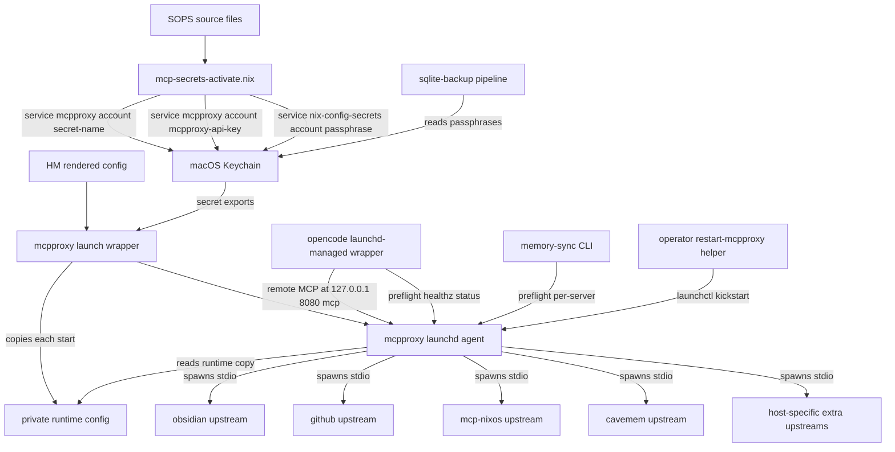
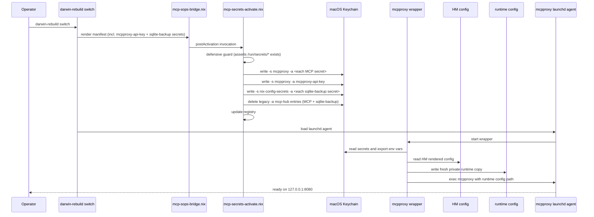
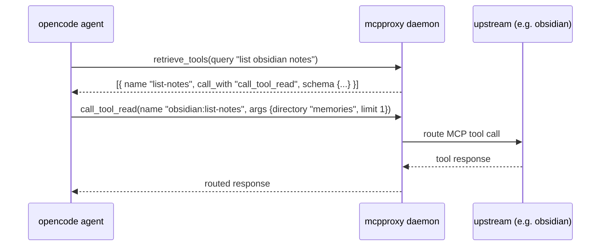
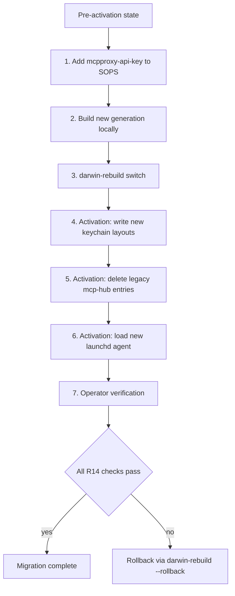

# Design Document: mcpproxy-migration

## Overview

**Purpose**: Replace `ravitemer/mcp-hub` with `smart-mcp-proxy/mcpproxy-go`
as the single MCP entrypoint for this nix-darwin home-manager config.
Eliminate three documented costs: ~140 unfiltered tool schemas in
opencode's uncached prefix on every request, mcp-hub v4.2.1's
18 GB/day log-bloat bug, and the `${cmd:...}` / `:37373` /
`com.ravitemer.mcp-hub` coupling baked into 20+ files. After migration
the agent sees mcpproxy's four-tool surface (`retrieve_tools` +
three `call_tool_*` primitives) instead of the unfiltered upstream
schemas.

**Users**: The single nix-darwin operator on two hosts (Shopify +
personal). Downstream consumers: opencode, the memory-sync CLI,
launchd, the SOPS→Keychain bridge, sqlite-backup, and the rewritten
AGENTS.md + subagent prompts. Nvim ceases to be an MCP consumer
(codecompanion stays as a non-MCP chat tool).

**Impact**: Single coordinated cutover. mcp-hub and `mcphub.nvim` are
gone from packaging, launchd, and config. The macOS Keychain
ownership swaps from `(-s <secret-name> -a mcp-hub)` to
`(-s mcpproxy -a <secret-name>)` in one activation pass. Sqlite-backup
secrets move to a separate `nix-config-secrets` account in the same
pass. Codecompanion's MCP wiring is stripped (~10 lines); the rest
of the plugin stays.

### Goals

- Replace the orchestrator daemon without breaking access to any of
  the four base upstream MCP servers (obsidian, github, mcp-nixos,
  cavemem) or any host-specific extra server.
- Reduce opencode's token consumption per session by hiding
  upstream tool schemas behind mcpproxy's `retrieve_tools` discovery
  surface.
- Close the documented cavemem split-brain by removing the direct
  `programs.opencode.settings.mcp.cavemem` entry; cavemem reaches
  opencode only via mcpproxy.
- Migrate keychain layouts (MCP + sqlite-backup) in a single
  `darwin-rebuild switch` per host with no operator follow-up.
- Preserve the Home Manager-owned mcpproxy config as the declarative
  source of truth even when mcpproxy performs startup cleanup or
  runtime config persistence.
- Preserve every existing operator-visible failure mode (opencode
  wrapper preflight, memory-sync CLI exit codes, sqlite-backup
  verification) while pointing them at mcpproxy.

### Non-Goals

- Adding new MCP servers, tuning BM25 / `top_k` / `tools_limit`
  beyond defaults, replacing SOPS, migrating sqlite-backup off the
  macOS Keychain, introducing a nvim-side replacement for
  `mcphub.nvim`, modifying cavemem internals (Zod schema, embedding,
  upstream patches), or customising mcpproxy's quarantine workflow
  beyond per-server defaults. (Mirrors requirements.md
  `Out of scope`.)
- Formally closing the `mcp-server-allowlist` deferred spec —
  superseded but kept in roadmap for traceability.
- Preventing mcpproxy from maintaining its own runtime state, or
  relying on manual filesystem immutability flags such as
  `chflags uchg` to protect declarative files.

## Boundary Commitments

### This Spec Owns

- The `pkgs.mcpproxy-go` overlay entry and its `buildGoModule`
  derivation (sourced from a tag-pinned `fetchFromGitHub`).
- The rewritten `home-manager/mcp/default.nix` module:
  `mcp_config.json` rendering, launchd plist, listen port option,
  quarantine settings, restart helper, runtime config copy
  preparation, and config-ownership protection.
- The new SOPS-bridged `mcpproxy-api-key` secret added to
  `secrets/mcp.{shopify,personal}.yaml` and consumed by both the
  bridge and the renderer.
- The modified `scripts/mcp-secrets-activate.nix`: writes new
  keychain layout for both MCP secrets and sqlite-backup secrets;
  deletes legacy `-a mcp-hub` entries in the same pass.
- The modified `scripts/mcp-verify-secrets.nix`: reads new layouts
  for both pathways.
- The wrapper preflight snippets in `home-manager/common/opencode.nix`
  and `home-manager/common/cavemem.nix` rewritten against mcpproxy's
  HTTP API.
- The `scripts/memory-sync.nix` probe rewrite (URL + per-server
  endpoint shape; exit codes preserved).
- The per-host opencode MCP wiring on both hosts
  (`mcp.mcpproxy` remote entry added on personal;
  `mcp.hub` flipped on shopify).
- The cavemem split-brain closure: the direct
  `programs.opencode.settings.mcp.cavemem` block removed from
  `home-manager/common/cavemem.nix`.
- The agent-contract rewrite across `agents.md`, all common subagents, and
  all Shopify-host subagents for the four-tool surface.
- The nvim teardown: deletion of `nixvim/plugins/mcphub.nix`,
  stripping of MCP-related blocks in `codecompanion.nix` and
  `lualine.nix`, removal of the imports entry, removal of the
  `mcphub` + `mcphub-nvim` flake inputs.
- The sqlite-backup keychain account rename: cli script reads
  account from manifest (jq), module manifest emits the new account
  name, activation pathway migrates legacy entries.
- Documentation alignment: `agents.md`, `agents-cc-sdd.md`,
  `secrets/README.md`, `agents/nix-pkg.md`, `cavemem.nix` narrative
  comments.
- Updated `roadmap.md`: `mcp-server-allowlist` marked as
  SUPERSEDED.

### Out of Boundary

- The mcpproxy upstream codebase. Pin only; no patches.
- The SOPS source layer (continues to be the source of truth for
  secret values).
- The `home.cavemem` option surface: `dataDir`, `embedding.*`,
  `compression.intensity`, settings.json rendering — unchanged.
- The `cavemem` package derivation in `overlays/mcp-servers.nix` —
  unchanged.
- Opencode's plugin / hook architecture, the
  `home.opencode.wrapperCommands` option type, the
  `home.opencode.lspPackages` LSP suffix, the prewarm launchd agent's
  unwrapped invocation.
- Sqlite-backup's runtime behaviour (backup, restore, replication,
  list, status, verify-credentials) — only the keychain account name
  it reads from changes.
- mcpproxy quarantine workflow customisation beyond a single
  global flag.
- mcpproxy's own runtime state outside the Home Manager-owned config
  path; runtime config copies and backups may be created only under
  the managed runtime path.
- Manual filesystem immutability flags, root-owned local config
  edits, or operator-maintained patches as the protection mechanism.
- BM25 / `top_k` / `tools_limit` tuning (defer to future spec if
  needed).
- `enabled_tools` / `disabled_tools` per-server filters (not used
  in this spec; available as a future hook).
- Nvim-side replacement for `mcphub.nvim` (no nvim MCP surface
  after this spec).
- Codecompanion's non-MCP functionality (preserved as-is by
  stripping only the MCP blocks).

### Allowed Dependencies

- The SOPS bridge in `configurations/common-darwin/mcp-sops-bridge.nix`
  (consumed via its rendered manifest at `/var/lib/.../manifest.json`).
- The existing `home.mcp.extraServers` option surface — kept at
  current shape (`attrsOf attrs`) with internal translation to
  mcpproxy's array shape during rendering.
- The existing `home.mcp.readKeychainSecret` helper — body changes
  to emit `${env:<NAME>}` placeholders; the launchd wrapper reads
  Keychain entries and file-sourced values before exec. Existing
  call-site consumers remain unchanged.
- The existing `mcpproxy-launchd-wrapper` — extended to prepare the
  effective runtime config before execing mcpproxy.
- The existing `home.opencode.wrapperCommands` option — appended to
  with new probe snippets (matches current cavemem/opencode patterns).
- The existing `home.cavemem.dataDir` option — consumed unchanged
  as the source for `CAVEMEM_DATA_DIR` env on the mcpproxy-routed
  upstream.
- The existing buildGoModule template
  (`pkgs.buildkite-mcp-server`, `pkgs.slack-mcp-server`) — followed
  verbatim for `pkgs.mcpproxy-go`.
- The existing launchd PATH supplementation (`google-cloud-sdk`,
  `git-lfs`) — replicated in mcpproxy's plist for spawned upstreams.

### Revalidation Triggers

- **mcpproxy schema break**: any `Config` / `ServerConfig` field
  shape change in mcpproxy ≥ v0.34. Revalidate the renderer.
- **mcpproxy config persistence behaviour changes**: startup cleanup,
  backup creation, or save semantics change. Revalidate the runtime
  config copy and symlink-preservation checks.
- **mcpproxy env placeholder semantics change**: `${env:<NAME>}`
  resolution no longer applies to top-level `api_key`, per-server
  env, or headers. Revalidate the wrapper export flow.
- **mcpproxy `retrieve_tools` mode change**: change to the
  4-tool surface (different tool names, different `call_with`
  semantics). Revalidate AGENTS.md and all subagent prompts.
- **mcpproxy HTTP API change**: `/healthz`, `/api/v1/status`, or
  `/api/v1/servers` collection shape change. Revalidate all four probe
  consumers (opencode wrapper, cavemem wrapper, memory-sync CLI,
  restart helper).
- **Sopsbridge contract change**: if `mcp-secrets-sops-nix` spec
  changes the manifest shape, revalidate
  `mcp-secrets-activate.nix`'s consumer side.
- **Cavemem locked contract**: any change to the
  `home.cavemem.dataDir` option or the `cavemem mcp` stdio
  entrypoint. Revalidate the orchestrator's upstream registration.

## Architecture

### Existing Architecture Analysis

The current MCP stack centres on `home-manager/mcp/default.nix`,
which renders `~/.config/mcphub/servers.json` from a static
`{nixos, github, obsidian} // extraServers` attrset and starts
mcp-hub under launchd on `:37373`. Cross-cutting consumers:

- **Opencode** connects to mcp-hub's `/mcp/` SSE endpoint as a
  remote MCP provider (Shopify only; personal has no remote entry).
- **Cavemem** is registered into mcp-hub's `servers.json` AND
  registered as a separate `programs.opencode.settings.mcp.cavemem`
  local-MCP entry — the documented split-brain.
- **The SOPS → Keychain bridge** writes
  `(-s <secret> -a mcp-hub)` entries; mcp-hub's runtime resolves
  `${cmd: ...}` placeholders in `servers.json` by shelling out at
  server-spawn time.
- **The opencode wrapper, cavemem wrapper, and memory-sync CLI**
  each have curl-based preflight probes against mcp-hub's HTTP API
  (`/api/health` for liveness, `POST /api/servers/info` for per-server
  state).
- **Nvim** consumes mcp-hub via `mcphub.nvim` (which talks to the
  same `:37373` HTTP API) + `codecompanion`'s MCP extension +
  lualine status component.
- **Sqlite-backup** opportunistically stores its restic and rclone
  passphrases under the same `mcp-hub` keychain account
  (unrelated to MCP).

Dependency direction today: SOPS → activation script → Keychain →
mcp-hub runtime → spawned upstream servers. Opencode + cavemem +
memory-sync + nvim all probe mcp-hub HTTP API independently.

### Architecture Pattern & Boundary Map

In-place rewrite of the orchestrator module. mcpproxy replaces
mcp-hub at the same architectural position; consumers see a new
launchd label and a new HTTP API but the same routing surface
(single daemon, multiple stdio upstreams).



**Key decisions** (full rationale in `research.md`):

- mcpproxy occupies the same architectural slot mcp-hub vacated; no
  parallel-run, no two-daemon arrangement.
- Cavemem is reached only through mcpproxy (the
  `programs.opencode.settings.mcp.cavemem` direct entry is gone).
- The SOPS → Keychain bridge writes both MCP secrets
  (`-s mcpproxy -a <name>`) and sqlite-backup secrets
  (`-s nix-config-secrets -a <name>`) in one activation script.
- All four probe consumers (opencode wrapper, cavemem wrapper,
  memory-sync CLI, restart helper) talk to mcpproxy's HTTP API on
  `127.0.0.1:8080`.
- Nvim has no edge into mcpproxy. `codecompanion-nvim` remains as
  a non-MCP chat plugin.

### Technology Stack

| Layer | Choice / Version | Role in Feature | Notes |
|-------|------------------|-----------------|-------|
| MCP orchestrator | `smart-mcp-proxy/mcpproxy-go` v0.33.1 (commit `1356c60`) | Single MCP entrypoint; agent sees 4-tool surface | Tag-pinned; replaces `ravitemer/mcp-hub` v4.2.1 |
| Packaging | `buildGoModule` (nixpkgs 24.11+) | `pkgs.mcpproxy-go` derivation | Matches `buildkite-mcp-server` / `slack-mcp-server` pattern; `CGO_ENABLED=0`; `vendorHash`; tag pin |
| Go toolchain | `pkgs.go_1_24` (≥ 1.24.2) | mcpproxy's required Go version | No `replace` directives in mcpproxy's `go.mod`; offline vendoring works |
| Process supervision | Apple `launchd` | Run mcpproxy daemon at login + restart on exit | New label `com.smart-mcp-proxy.mcpproxy`; PATH supplemented with `google-cloud-sdk` + `git-lfs` for spawned upstreams |
| Secret material storage | macOS Keychain (via `/usr/bin/security`) | Launch wrapper exports `${env:<NAME>}` placeholders before mcpproxy starts | service = `"mcpproxy"` for MCP secrets; service = `"nix-config-secrets"` for sqlite-backup secrets; account = secret name in both cases |
| Runtime config copy | User-private file under mcpproxy data dir | Mutable effective config passed to mcpproxy so HM config remains untouched | Runtime copy and `.bak` are treated as secret-bearing because mcpproxy may persist resolved API keys |
| Secret source-of-truth | SOPS (per-host yaml in `secrets/`) | Encrypted source for all 13+ MCP secrets + sqlite-backup passphrases + new `mcpproxy-api-key` | Unchanged |
| Agent runtime | opencode (existing pinned version) | Consumes mcpproxy at `http://127.0.0.1:8080/mcp` | New per-host `programs.opencode.settings.mcp.mcpproxy` entry replaces `mcp.hub` (Shopify) / adds first MCP entry (personal) |
| Codecompanion plugin | `codecompanion-nvim` (existing pinned version) | Non-MCP chat plugin in nvim | MCP extension stripped; rest of the plugin preserved |

## File Structure Plan

### Modified

#### Packaging
- `overlays/mcp-servers.nix` — add `mcpproxy-go` derivation
  (~25 lines, matches `buildkite-mcp-server` shape); remove the
  `mcp-hub = inputs.mcphub.packages....default;` alias at L36.
- `flake.nix` — remove `mcphub` and `mcphub-nvim` flake inputs
  (L73-79); no new flake input added.

#### Orchestrator module
- `home-manager/mcp/default.nix` — full rewrite. New options:
  `home.mcp.listenPort` (default 8080). Removed: `extraServers`
  shape stays attrset but internal translator emits mcpproxy's
  array form. `readKeychainSecret` body changes to emit
  `"\${env:" + toEnvVarName name + "}"`. The launchd wrapper
  reads the corresponding Keychain entries and file-sourced env vars,
  prepares a private runtime copy of the HM-rendered config on each
  start, then passes that runtime copy to mcpproxy. Launchd label flips
  to `com.smart-mcp-proxy.mcpproxy`. `restart-mcp-hub` script renamed
  to `restart-mcpproxy`. PATH supplementation preserved.

#### Secret bridge
- `scripts/mcp-secrets-activate.nix` — keychain write axes swap
  from `(-s <secret> -a mcp-hub)` to `(-s mcpproxy -a <secret>)`
  for MCP secrets; new path for sqlite-backup secrets at
  `(-s nix-config-secrets -a <secret>)`; one-shot cleanup
  deletes both old layouts (`-a mcp-hub` for both MCP and
  sqlite-backup secrets); preserves the existing registry,
  defensive guard, and gh-token short-circuit.
- `scripts/mcp-verify-secrets.nix` — keychain read axes swap to
  match.
- `configurations/common-darwin/mcp-sops-bridge.nix` — add the
  new `mcpproxy-api-key` secret to the manifest output;
  passthrough the sqlite-backup secret list (currently flows
  through a separate manifest).

#### Cavemem integration
- `home-manager/common/cavemem.nix` — remove L491-501 (the
  `programs.opencode.settings.mcp.cavemem` block); rewrite
  L549-557 (wrapper probe) to target mcpproxy's `/api/v1/servers/cavemem`
  endpoint; update narrative comments referencing mcphub.

#### Opencode integration
- `home-manager/common/opencode.nix` — rewrite the wrapper probe
  at L85-92 to target mcpproxy's `/healthz` + per-server endpoints;
  recovery hints reference the new launchd label.
- `configurations/shopify/home-manager/opencode.nix` — rename the
  `mcp.hub` entry to `mcp.mcpproxy` and flip the URL to
  `http://127.0.0.1:8080/mcp`.
- `configurations/personal/home-manager/opencode.nix` — add a new
  `mcp.mcpproxy` entry (same shape as Shopify).

#### Memory-sync CLI
- `scripts/memory-sync.nix` — `MCPHUB_BASE` constant renamed and
  repointed; `probe_mcp_server` helper rewritten to call
  `GET /api/v1/servers/<name>` with API key; recovery hints
  reference the new launchd label; exit codes preserved.

#### Agent contracts (109 hub_* refs)
- `home-manager/common/agents.md` — startup gate rewritten as
  2-step retrieve_tools + call_tool_read pair (×2 for obsidian +
  cavemem); memory-recall section rewritten with the discover-
  then-invoke pattern; failure message + recovery hint updated.
- `home-manager/common/agents-cc-sdd.md` — no `hub_*` refs today,
  but check narrative for stale "mcphub" mentions (R13.2).
- `home-manager/common/agents/vault-curator.md` — 14 refs
  rewritten with the discover-then-invoke pattern.
- `home-manager/common/agents/vault-synthesizer.md` — 51 refs
  rewritten; negative allow-list changes from
  "no `hub_buildkite__*`" to "tools from any server other than
  obsidian and cavemem" (per the synthesis decision).
- `home-manager/common/agents/security-auditor.md` — 2 refs
  rewritten.
- `home-manager/common/agents/nix-pkg.md` — troubleshooting
  table mcphub→mcpproxy.
- `configurations/shopify/home-manager/agents/stack-captain.md` —
  13 refs rewritten.
- `configurations/shopify/home-manager/agents-graphite.md` —
  3 refs rewritten.

#### Nvim teardown
- `home-manager/nixvim/plugins/mcphub.nix` — **deleted**.
- `home-manager/nixvim/plugins/codecompanion.nix` — strip
  L15-25 (`before.__raw` lz.n hook) and L43-58
  (`extensions.mcphub` block); preserve everything else.
- `home-manager/nixvim/plugins/lualine.nix` — remove L8
  (let-binding for `mcphub`) and L34 (use-site in `lualine_x`).
- `home-manager/nixvim/default.nix` — remove L40
  (`./plugins/mcphub.nix` from imports).

#### Sqlite-backup keychain account
- `scripts/sqlite-backup-cli.nix` — replace
  `readonly KEYCHAIN_ACCOUNT=mcp-hub` at L79 with a `jq` read
  from the existing manifest path; update L18 docstring; update
  the constants at L73-83 with the manifest-read pattern.
- `home-manager/common/sqlite-backup.nix` — change
  `keychainAccount = "mcp-hub"` at L350 to
  `keychainAccount = "nix-config-secrets"`; update option
  docstrings at L205-210 and L215-220.
- `configurations/common-darwin/sqlite-backup-verify.nix` — no
  code change (already reads `keychainAccount` from manifest);
  update L35-37 docstring.

#### Documentation
- `secrets/README.md` — rotation docs reference both `mcpproxy`
  and `nix-config-secrets` accounts; mention the new
  `mcpproxy-api-key` secret + how to generate it
  (`openssl rand -hex 32`).
- `.kiro/steering/roadmap.md` — already updated during discovery
  (R4 + supersession of `mcp-server-allowlist`).

## Requirements Traceability

| Requirement | Summary | Components | Interfaces / Contracts | Flows |
|---|---|---|---|---|
| 1.1, 1.4 | mcpproxy under launchd on configurable port; logs to per-host paths | Orchestrator module + launchd plist | launchd `ProgramArguments`, `StandardOutPath`/`StandardErrorPath` | Activation flow |
| 1.2 | Listen port as Nix option with documented default | Orchestrator module | `home.mcp.listenPort` option (default 8080) | — |
| 1.3 | Daemon restart on unexpected exit | launchd plist | `KeepAlive = true` | — |
| 1.5 | Restart helper script | Orchestrator module | `restart-mcpproxy` writeScriptBin | — |
| 1.6 | No `mcp-hub` launchd agent / binary after activation | Orchestrator module + packaging | Removed `pkgs.mcp-hub` from `home.packages`; absent launchd label; flake input removal | Activation flow |
| 2.1, 2.5 | 4 upstream servers configured with secret env propagation | Orchestrator module + extraServers translator | `mcpServers[]` array; per-server `env` map | — |
| 2.2 | All upstreams bypass quarantine | Orchestrator module | Global `quarantine_enabled: false` | — |
| 2.3 | Extension surface for new servers | Orchestrator module | `home.mcp.extraServers` (attrset, internally translated) | — |
| 2.4 | Connected status reachable via runtime API | Orchestrator module + mcpproxy daemon | `GET /api/v1/servers` collection filtered by server name | Probe flow |
| 3.1, 3.2, 3.3 | Exactly 4 tools exposed; no hub_* prefix; default tools_limit | Orchestrator module + mcpproxy daemon | `mcp_config.json` defaults (no `tools_limit` override); mcpproxy `/mcp` endpoint | — |
| 3.4, 3.5 | retrieve_tools + call_tool_* primitives behave | mcpproxy daemon (out-of-spec; vetted) | mcpproxy's MCP transport | Agent invocation flow |
| 4.1, 4.2, 4.3 | No `hub_*` refs; retrieve_tools idiom; semantics preserved | Agent contracts rewrite | AGENTS.md startup-gate format; subagent prompt format | Agent invocation flow |
| 4.4 | Failure message names mcpproxy + launchd label | AGENTS.md startup-gate | Failure-message string | — |
| 4.5 | Startup gate succeeds fresh session | Agent contracts + orchestrator | End-to-end through mcpproxy | R14 acceptance |
| 5.1, 5.2, 5.3 | Env placeholders; no Nix-store secret values; no mcpproxy keyring write | Secret bridge + orchestrator module + launch wrapper | `${env:<NAME>}` placeholders; wrapper Keychain export; `readKeychainSecret` helper body | Activation flow |
| 5.4, 5.5 | Bridge writes new layout; updates on SOPS change | Secret bridge | `security add-generic-password -U -s mcpproxy -a <secret-name>` | Activation flow |
| 6.1, 6.2, 6.3, 6.4 | One-shot migration: write new + delete old; idempotent on clean hosts | Secret bridge activation pathway | Activation script: write new + cleanup old in same pass | Activation flow |
| 6.5 | Verify reports new-layout presence + mismatches | Secret bridge verification | `mcp-verify-secrets.nix` MATCH/MISMATCH/MISSING per secret | — |
| 7.1, 7.2 | No direct cavemem entry; cavemem via mcpproxy only | Cavemem integration | Removed `programs.opencode.settings.mcp.cavemem` block | — |
| 7.3 | CAVEMEM_DATA_DIR propagation preserved | Orchestrator module + cavemem upstream registration | `env.CAVEMEM_DATA_DIR` in mcpproxy's server entry | — |
| 7.4 | Cavemem option surface preserved | (Out of boundary) | `home.cavemem.dataDir`, etc. — unchanged | — |
| 7.5 | Cavemem reachability via mcpproxy in startup gate | Agent contracts + orchestrator | retrieve_tools query targeting cavemem server | R14 acceptance |
| 8.1, 8.2, 8.3, 8.4 | Opencode preflight probes mcpproxy + obsidian + cavemem; named-component error + recovery hint | Opencode wrapper preflight | Probe snippet in `home-manager/common/opencode.nix` | Opencode launch flow |
| 8.5 | opencode-prewarm bypasses preflight | (Behavior preservation) | Existing launchd agent invokes unwrapped binary | — |
| 9.1, 9.2, 9.3 | memory-sync probes mcpproxy; per-precondition exit codes preserved; recovery hint references new label | Memory-sync CLI | `probe_mcp_server` helper in `scripts/memory-sync.nix` | Probe flow |
| 10.1, 10.2, 10.3, 10.4 | Both hosts have mcpproxy remote MCP entry; no legacy :37373 ref; tool invocation routes correctly | Per-host opencode wiring | `programs.opencode.settings.mcp.mcpproxy.url` | — |
| 11.1, 11.5 | mcphub.nvim removed; nvim starts clean | Nvim teardown | Deletion of `nixvim/plugins/mcphub.nix`; imports + flake-input removal | — |
| 11.2 | codecompanion without MCP extension; chat still works | Nvim teardown | Strip of L15-25 + L43-58 in `codecompanion.nix` | — |
| 11.3 | lualine `mcphub` status component removed | Nvim teardown | Strip of L8 + L34 in `lualine.nix` | — |
| 11.4 | No mcphub flake inputs | Nvim teardown + packaging | Removal of `mcphub` + `mcphub-nvim` from `flake.nix` | — |
| 12.1, 12.2, 12.3, 12.4, 12.5 | sqlite-backup secrets under neutral account; migration + verification + docs updated | Sqlite-backup keychain rename + secret bridge | Manifest-driven account read (jq); activation cleanup of legacy entries | Activation flow |
| 13.1, 13.2, 13.3, 13.4, 13.5 | Docs reference mcpproxy; historical context optional | Documentation alignment | Plain text edits | — |
| 14.1, 14.2, 14.3, 14.4, 14.5 | End-to-end acceptance evidence | Cross-cutting (all components) | — | All flows |
| 15.1, 15.2, 15.3, 15.4, 15.5, 15.6 | HM-owned config remains untouched while mcpproxy uses a mutable runtime copy | Orchestrator module + launch wrapper + runtime config copy | HM config source path; runtime config path; wrapper fail-fast stderr contract | Runtime config preparation flow |

## Components and Interfaces

### Domain A: Packaging

#### `pkgs.mcpproxy-go` overlay derivation

| Field | Detail |
|-------|--------|
| Intent | Nix-packaged mcpproxy binary from pinned upstream commit |
| Requirements | 1.1, 1.6 |

Single binary `mcpproxy` at `bin/mcpproxy`. Pinned to tag `v0.33.1` (commit `1356c60`). `CGO_ENABLED=0`; no tray binary; no special build tags. `vendorHash` resolves via offline vendoring (no `replace` directives in upstream `go.mod`). Matches `pkgs.buildkite-mcp-server` shape verbatim (<30 LOC).

**Dependencies**: `fetchFromGitHub` (P0), `buildGoModule` (P0), `pkgs.go_1_24` (P0). Outbound: consumed by `home-manager/mcp/default.nix`.

**Contracts**: Service [ ] / API [ ] / Event [ ] / Batch [ ] / State [ ]

### Domain B: Orchestrator module

#### `home-manager/mcp/default.nix` (rewritten)

| Field | Detail |
|-------|--------|
| Intent | Render mcpproxy's declarative config, prepare a runtime config copy, manage its launchd agent, expose extension points, emit env placeholders |
| Requirements | 1.1, 1.2, 1.3, 1.4, 1.5, 1.6, 2.1, 2.2, 2.3, 2.5, 3.2, 5.1, 5.2, 5.3, 7.3, 15.1, 15.2, 15.3, 15.4, 15.5, 15.6 |

**Responsibilities & Constraints**
- Renders `~/.config/mcpproxy/mcp_config.json` from a Nix-side
  attrset of upstream servers; preserves the `attrsOf attrs` shape
  of `home.mcp.extraServers` by converting attrset → array
  internally.
- Treats the XDG config path as the declarative source only. The
  wrapper copies it into a private runtime path on every managed
  start and passes that runtime path to `mcpproxy --config` so
  startup cleanup and runtime saves cannot replace the Home Manager
  symlink.
- Defines the launchd plist with label
  `com.smart-mcp-proxy.mcpproxy`, listening on
  `127.0.0.1:${listenPort}`, replicating the existing PATH
  supplementation (`google-cloud-sdk`, `git-lfs`).
- Adds `--log-to-file=false` to mcpproxy's ProgramArguments to
  avoid duplicate logs in `~/Library/Logs/mcpproxy/main.log`.
- Provides `restart-mcpproxy` script (writeScriptBin) that runs
  `launchctl kickstart -k "gui/$(id -u)/com.smart-mcp-proxy.mcpproxy"`.
- Emits `${env:<NAME>}` for every secret reference via the
  `readKeychainSecret` helper. The wrapper exports those env vars
  from Keychain and file-sourced inputs before exec.
- References `mcpproxy-api-key` through `${env:MCPPROXY_API_KEY}` in
  the rendered config; wrapper-time export provides the value.
- Sets `quarantine_enabled: false` globally; omits per-server
  quarantine fields.

**Dependencies**
- Inbound: 15 cross-host call sites of
  `config.home.mcp.readKeychainSecret`; the cavemem module's
  `home.mcp.extraServers.cavemem` entry.
- Outbound: `pkgs.mcpproxy-go`, the launchd subsystem, the
  rendered source `mcp_config.json`, the private runtime config copy,
  and wrapper-exported env vars.
- External: macOS launchd (P0); macOS Keychain via `/usr/bin/security`
  in the wrapper (P0).

**Contracts**: Service [x] / API [x] / Event [ ] / Batch [ ] / State [ ]

##### Service Interface (HM options surface)

```nix
options.home.mcp = {
  enable = mkEnableOption ...;
  listenPort = mkOption { type = port; default = 8080; ... };
  obsidianVaultPath = mkOption { type = str; ... };           # preserved
  githubToken = mkOption { type = nullOr str; ... };          # preserved
  ghAuthToken = mkOption { type = nullOr str; ... };          # preserved
  keychainSecrets = mkOption { type = attrsOf str; ... };     # preserved
  extraServers = mkOption { type = attrsOf attrs; ... };      # preserved
  readKeychainSecret = mkOption {                              # preserved
    type = raw; readOnly = true;
    default = name: "\${env:" + toEnvVarName name + "}";
  };
};
```

- Preconditions: `obsidianVaultPath` must be set; SOPS bridge
  must have populated keychain entries for every referenced
  secret name before mcpproxy starts.
- Postconditions: `mcp_config.json` is rendered to the XDG config
  path; a private runtime copy is prepared on launch; launchd agent
  is loaded; restart helper is on PATH.
- Invariants: `readKeychainSecret` output is a `${env:<NAME>}`
  placeholder string; no secret values appear in the Nix store; the
  XDG config path remains Home Manager-owned; no `mcp-hub`
  references remain.

##### Service Interface (runtime config preparation)

```text
prepareRuntimeConfig(sourcePath, runtimePath) -> runtimePath | failure
```

- Preconditions: source path exists and contains valid JSON; runtime
  parent directory can be created with user-private permissions.
- Postconditions: runtime path contains a fresh copy of the source;
  runtime path mode is `0600`; stale runtime `.bak` artifacts are
  removed or confined under the runtime directory; mcpproxy receives
  `--config=<runtimePath>`.
- Invariants: the source path is never opened for writing by the
  wrapper; mcpproxy never receives the Home Manager-owned source path.

##### API Contract (HTTP probe targets exposed by mcpproxy)

mcpproxy itself owns the HTTP API; this component depends on it
remaining at these paths.

| Method | Endpoint | Auth | Use |
|--------|----------|------|-----|
| GET | `/healthz` | none | Liveness probe (opencode wrapper, restart helper) |
| GET | `/api/v1/status` | API key | Aggregate state probe |
| GET | `/api/v1/servers` | API key | Collection endpoint filtered by server name for per-upstream connection state (opencode wrapper, cavemem wrapper, memory-sync) |
| GET | `/mcp` (or POST) | none (default) | Opencode remote-MCP transport |

**Implementation Notes**
- Integration: `xdg.configFile."mcpproxy/mcp_config.json".text =
  builtins.toJSON (renderConfig cfg)`. Renderer is a pure Nix
  function from option set → JSON-ready attrset. The launchd wrapper
  prepares the runtime copy before `exec` and rewrites the `--config`
  argument to that copy.
- Validation: an assertion verifies that every entry in
  `home.mcp.extraServers` has the required `command` or `url`
  field for its `protocol`; runtime validation verifies the config
  copy exists and is parseable before starting mcpproxy.
- Risks: schema drift in mcpproxy v0.34+ — pinned at v0.33.1;
  flagged in revalidation triggers. Runtime copies and `.bak` files
  are treated as secret-bearing because mcpproxy may persist the
  resolved API key.

### Domain C: Secret bridge

#### `scripts/mcp-secrets-activate.nix` (modified)

| Field | Detail |
|-------|--------|
| Intent | Write current secrets to macOS Keychain in mcpproxy's expected layout AND in sqlite-backup's neutral account; delete legacy entries from `mcp-hub` account |
| Requirements | 5.4, 5.5, 6.1, 6.2, 6.3, 6.4, 12.2 |

**Responsibilities & Constraints**
- Reads the rendered manifest at
  `/var/lib/mcp-keychain-sync/manifest.json` (path unchanged).
- For each MCP secret (incl. new `mcpproxy-api-key`): writes
  `(-s mcpproxy -a <secret-name>)`. For each sqlite-backup
  secret: writes `(-s nix-config-secrets -a <secret-name>)`.
- For each legacy entry (any `-a mcp-hub` previously written by
  this script): deletes the entry in the same pass.
- Preserves the existing defensive guard (asserts
  `/run/secrets/<name>` exists for every entry before any
  mutation), the registry-driven stale cleanup mechanism, the
  gh-token short-circuit, and the existing exit-code contract
  (0/1/2/3/4).
- Cleanup ordering: WRITE new entries before DELETE old entries
  (preserves rollback path if the write step partially fails).

**Dependencies**
- Inbound: `system.activationScripts.postActivation` in
  `configurations/common-darwin/mcp-sops-bridge.nix`.
- External: `/usr/bin/security` (P0); SOPS-decrypted secret files
  under `/run/secrets/` (P0); the manifest renderer in
  `mcp-sops-bridge.nix` (P1).

**Contracts**: Service [ ] / API [ ] / Event [ ] / Batch [x] / State [x]

##### Batch / Job Contract

- Trigger: home-manager activation (`darwin-rebuild switch`).
- Input: manifest JSON with `keychainSecrets` and the
  sqlite-backup secret list; expected secret values under
  `/run/secrets/`.
- Output: keychain entries in two new layouts; legacy entries
  deleted.
- Idempotency: re-runs are safe — `add-generic-password -U`
  upserts; deletes silently no-op when the legacy entry is
  absent. The registry tracks which secrets the script
  installed, preventing accidental deletion of unmanaged keychain
  entries.
- Recovery: failure exit codes 1-4 abort activation before any
  mutation propagates further. If the script aborts mid-write,
  rerun activation; the script is idempotent.

##### State Management

- State model: the registry at
  `/var/lib/mcp-keychain-sync/installed-services` (root-owned,
  mode 0600) tracks the set of secret names this script has
  installed.
- Consistency: registry write happens AFTER both keychain write
  and legacy cleanup, so a crash mid-script leaves the registry
  pointing at a stable prior state.

**Implementation Notes**
- Integration: shells out to `/usr/bin/security` exactly as
  today; only the `-s` / `-a` argument values change.
- Validation: existing defensive guard catches missing
  `/run/secrets/<name>` files.
- Risks: legacy cleanup deleting a keychain entry the operator
  hand-created (e.g. test secret stored under `mcp-hub` for ad
  hoc use). Mitigation: cleanup only deletes entries whose secret
  names appear in the registry — anything operator-installed
  outside the script is left alone.

#### `scripts/mcp-verify-secrets.nix` (modified)

| Field | Detail |
|-------|--------|
| Intent | Verify both MCP and sqlite-backup keychain entries exist in their new layouts and match SOPS source |
| Requirements | 6.5, 12.5 |

**Responsibilities & Constraints**
- Per-host arg (`shopify | personal`) unchanged.
- For each MCP secret: `security find-generic-password -s mcpproxy -a <secret>`
  and compare to SOPS-decrypted value.
- For each sqlite-backup secret: same with
  `-s nix-config-secrets -a <secret>`.
- Output format unchanged: `MATCH | MISMATCH | MISSING` per
  service.
- Exit codes preserved (0/1/2/3).

**Contracts**: Service [ ] / API [ ] / Event [ ] / Batch [x] / State [ ]

**Implementation Notes**
- Integration: `sops`-decrypt + per-secret `security` lookup, same
  control flow as today.
- Validation: gh-token still verified via `gh auth status`
  (unchanged).
- Risks: minimal.

### Domain D: Cavemem integration

#### `home-manager/common/cavemem.nix` (modified — split-brain closure + probe rewrite)

| Field | Detail |
|-------|--------|
| Intent | Remove the direct opencode local-MCP entry for cavemem; rewrite the wrapper probe against mcpproxy's API |
| Requirements | 7.1, 7.2, 7.3, 7.5, 8.3 |

**Responsibilities & Constraints**
- Deletes the L491-501 block
  (`programs.opencode.settings.mcp.cavemem`).
- Keeps the L431-437 entry (`home.mcp.extraServers.cavemem`) —
  the orchestrator module renders it into mcpproxy's array form,
  preserving the `CAVEMEM_DATA_DIR` env propagation (R7.3).
- Rewrites the L549-557 wrapper probe to:
  1. `GET http://127.0.0.1:8080/healthz` for mcpproxy liveness
     (no auth);
  2. `GET http://127.0.0.1:8080/api/v1/servers` with
     `X-API-Key` header, filtered for the `cavemem` entry whose
     `connected` field is true.
- Failure messages name "mcpproxy" and the new launchd label.
- Cavemem module's option surface (`dataDir`, `embedding.*`,
  `compression.intensity`) is unchanged.
- Narrative comments referencing mcphub updated to mcpproxy with
  pre-migration history clearly framed as historical.

**Dependencies**
- Inbound: opencode wrapper (via `wrapperCommands`).
- Outbound: mcpproxy daemon at `127.0.0.1:8080`.

**Contracts**: Service [ ] / API [ ] / Event [ ] / Batch [ ] / State [ ]

**Implementation Notes**
- Integration: `wrapperCommands` snippet replaces the existing
  cavemem probe with two curl invocations; preserves the
  single-quote rule documented in
  `memories/2026-05-14-mcp-hub-api-surface-and-wrapper-quoting.md`.
- Validation: the snippet aborts with `exit 1` on any probe
  failure.
- Risks: API key handling — the probe must read the api key from
  the keychain at probe time (via `security find-generic-password
  -s mcpproxy -a mcpproxy-api-key -w`). Failure of the key lookup
  triggers a clear error message before the curl call.

### Domain E: Opencode wrapper + per-host wiring

#### `home-manager/common/opencode.nix` (modified — wrapper probe rewrite)

| Field | Detail |
|-------|--------|
| Intent | Replace the mcp-hub `/api/health` preflight with mcpproxy's `/healthz` + collection-filtered obsidian probe |
| Requirements | 8.1, 8.2, 8.4, 8.5 |

**Responsibilities & Constraints**
- Probe sequence (in `wrapperCommands` order):
  1. `GET /healthz` → exit 1 if non-2xx.
   2. `GET /api/v1/servers` (API key) → filter for the `obsidian`
      entry and exit 1 if `connected != true`.
  3. (Cavemem probe contributed by `cavemem.nix`'s own
     `wrapperCommands` entry — appended via HM list-merge.)
- Each failure emits a stderr line naming the failing component
  (mcpproxy, obsidian, or cavemem) and a recovery hint that
  references the new launchd label.
- API key resolution: shell-time
  `security find-generic-password -s mcpproxy -a mcpproxy-api-key -w`
  invocation; fails fast with a clear error if the key isn't in
  the keychain.
- Opencode-prewarm launchd agent at L237 stays unchanged
  (continues to invoke unwrapped opencode, bypassing the
  preflight).

**Contracts**: Service [ ] / API [ ] / Event [ ] / Batch [ ] / State [ ]

**Implementation Notes**
- Integration: replaces L85-92 snippet; quoting follows the
  single-quote rule (no literal single quotes inside the
  snippet).
- Risks: `mcpproxy-api-key` not yet in keychain on first boot
  after activation — but the SOPS bridge runs as part of the
  same activation, so by the time the wrapper is invoked, the
  key is present. Defensive guard in the activation script
  prevents this race.

#### Per-host opencode MCP wiring

| Field | Detail |
|-------|--------|
| Intent | Add an `mcp.mcpproxy` remote entry on both hosts pointing at `127.0.0.1:8080/mcp`; remove the legacy `mcp.hub` entry on Shopify |
| Requirements | 10.1, 10.2, 10.3, 10.4 |

**Responsibilities & Constraints**
- Shopify: rename the `mcp.hub` block to `mcp.mcpproxy`; change
  `url` from `http://localhost:37373/mcp/` to
  `http://127.0.0.1:8080/mcp` (no trailing slash; explicit IPv4).
- Personal: add a new `mcp.mcpproxy` block with the same shape.
- Both hosts: `type = "remote"`, `enabled = true`.
- Both hosts: no `mcp.cavemem` direct entry (removed by R7).
- Neither host emits `:37373` anywhere in opencode's rendered
  config.

**Contracts**: Service [ ] / API [ ] / Event [ ] / Batch [ ] / State [ ]

**Implementation Notes**
- Integration: pure config delta in each host's `opencode.nix`.
- Risks: opencode's remote-MCP client may have edge cases around
  trailing-slash URL handling. If issues arise, flip back to
  `/mcp/` — mcpproxy responds at both.

### Domain F: Memory-sync CLI

#### `scripts/memory-sync.nix` (modified — probe rewrite)

| Field | Detail |
|-------|--------|
| Intent | Rewrite the MCP-availability probes to target mcpproxy's HTTP API; preserve the existing exit-code contract |
| Requirements | 9.1, 9.2, 9.3 |

**Responsibilities & Constraints**
- `MCPHUB_BASE` renamed to `MCPPROXY_BASE = "http://127.0.0.1:8080"`.
- `probe_mcp_server` helper rewritten to call
  `GET /api/v1/servers` with `X-API-Key` header and filter by
  server name.
- Recovery hint on failure: references new launchd label
  `com.smart-mcp-proxy.mcpproxy`.
- Per-precondition exit codes preserved verbatim (4 for cavemem
  unreachable, 5 for obsidian unreachable, etc.).

**Contracts**: Service [ ] / API [ ] / Event [ ] / Batch [x] / State [ ]

**Implementation Notes**
- Integration: factory function in `scripts/memory-sync.nix`;
  HM module at `home-manager/common/memory-sync.nix` wraps it.
- Risks: minimal; mechanical rewrite.

### Domain G: Agent contracts

#### Agent prompt rewrite (AGENTS.md + 7 subagent files)

| Field | Detail |
|-------|--------|
| Intent | Replace 109 direct `hub_*` tool calls with the 2-step retrieve_tools + call_tool_* idiom, preserving semantic intent |
| Requirements | 4.1, 4.2, 4.3, 4.4 |

**Responsibilities & Constraints**
- Apply the discover-then-invoke pattern uniformly across all
  files (synthesis decision).
- AGENTS.md startup gate becomes 4 calls (2 retrieve + 2 invoke).
- AGENTS.md memory-recall rules describe invocations in
  retrieve_tools terms while preserving "when to search,
  deduplicate before create, memory format" intent.
- AGENTS.md failure message names mcpproxy and the new launchd
  label.
- Subagent allowlists shift from "tool name prefix"
  (`hub_obsidian__*`) to "upstream server name"
  ("from the obsidian server").
- vault-synthesizer.md's negative allowlist becomes "tools from
  any server other than obsidian and cavemem".

**Rewrite pattern (canonical example)**:

Before:
```
hub_obsidian__list-notes(directory: "memories", limit: 1)
```

After:
```
1. retrieve_tools(query: "obsidian list-notes")
   → expect a tool name in `obsidian:<tool>` form
2. call_tool_read(name: <returned tool name>,
                  args: { directory: "memories", limit: 1 })
```

**Contracts**: Service [ ] / API [ ] / Event [ ] / Batch [ ] / State [ ]

**Implementation Notes**
- Integration: pure documentation rewrite. No code emitter
  involved; opencode reads the markdown files at session start.
- Validation: post-rewrite grep for `hub_` across all in-scope
  files MUST return zero hits.
- Risks: subtle semantic drift if a rewrite misses an edge case
  (e.g. a deeply nested example call). Mitigation: structured
  rewrite passes per file, with reviewer subagent dispatched per
  file (kiro-review skill).

### Domain H: Nvim teardown

#### Nvim MCP plugin removal

| Field | Detail |
|-------|--------|
| Intent | Remove `mcphub.nvim` from nvim entirely; strip codecompanion's MCP wiring while preserving the chat plugin; remove flake inputs |
| Requirements | 11.1, 11.2, 11.3, 11.4, 11.5 |

**Responsibilities & Constraints**
- Delete `home-manager/nixvim/plugins/mcphub.nix` (85 lines).
- Remove L40 from `home-manager/nixvim/default.nix` (imports
  entry).
- Strip exactly L15-25 (`before.__raw` lz.n hook) and L43-58
  (`extensions.mcphub` block) from `codecompanion.nix`. Verify
  the remainder is syntactically valid Nix.
- Remove L8 (`mcphub` let-binding) and L34 (`mcphub` use-site in
  `lualine_x`) from `lualine.nix`. Clean up empty `let` if it
  becomes vacuous.
- Remove `mcphub-nvim` and `mcphub` from `flake.nix` inputs
  (L73-79).
- Remove the `mcp-hub` alias from `overlays/mcp-servers.nix:L36`
  (this is what consumes the `mcphub` flake input from the
  overlay side; without it, the input has no consumers).

**Contracts**: Service [ ] / API [ ] / Event [ ] / Batch [ ] / State [ ]

**Implementation Notes**
- Integration: ordering matters. The `mcp-hub` overlay alias
  must come out BEFORE the flake input is removed (otherwise
  Nix evaluation breaks). Both removals land in the same commit
  as the orchestrator rewrite (R1).
- Validation: `darwin-rebuild check` evaluates the post-removal
  flake; nvim opens cleanly post-activation (`nvim +qa` smoke
  test).
- Risks: codecompanion's `before` hook also handles other lz.n
  triggers in some configs — confirmed via file inspection that
  this codebase uses it only for the mcphub trigger. Safe to
  remove.

### Domain I: Sqlite-backup keychain rename

#### Keychain account migration for sqlite-backup secrets

| Field | Detail |
|-------|--------|
| Intent | Move sqlite-backup's restic + rclone passphrases out of the `mcp-hub` keychain account into a neutral `nix-config-secrets` account |
| Requirements | 12.1, 12.2, 12.3, 12.4, 12.5 |

**Responsibilities & Constraints**
- `scripts/sqlite-backup-cli.nix` reads `KEYCHAIN_ACCOUNT` from
  the manifest at runtime (jq), matching the verify script.
- `home-manager/common/sqlite-backup.nix` emits
  `keychainAccount = "nix-config-secrets"` in the rendered
  manifest.
- Activation pathway (the same `mcp-secrets-activate.nix` that
  handles MCP secrets) writes
  `(-s nix-config-secrets -a <secret-name>)` for each
  sqlite-backup secret AND deletes the legacy
  `(-s <secret-name> -a mcp-hub)` entries.
- Sqlite-backup operations (backup, restore, replication, list,
  status, verify-credentials) read the account from the manifest
  and resolve secrets via the new account name.
- Module docstrings updated to reference the new account.

**Contracts**: Service [ ] / API [ ] / Event [ ] / Batch [x] / State [ ]

**Implementation Notes**
- Integration: secret bridge (Domain C) is responsible for the
  migration. This component owns the cli/module/verify side that
  reads the new account.
- Validation: after activation, on-demand
  `sqlite-backup verify-credentials` should report success on
  the migrated host.
- Risks: a sqlite-backup operation kicked off mid-activation
  (during the brief window when new entries exist but old aren't
  yet deleted) could find duplicates. Mitigation: the cli reads
  by `(-s nix-config-secrets -a <secret>)` — there's only one
  matching entry; duplicate-elsewhere doesn't affect this lookup.

### Domain J: Documentation alignment

#### Operator-facing documentation updates

| Field | Detail |
|-------|--------|
| Intent | Replace `mcphub`/`mcp-hub` references in operator-visible docs with `mcpproxy` where they describe live behaviour |
| Requirements | 13.1, 13.2, 13.3, 13.4, 13.5 |

**Files**: `agents.md` (narrative refs in startup-gate + memory-system + failure messages); `agents-cc-sdd.md` (scan for stale mentions); `secrets/README.md` (rotation docs, new `mcpproxy-api-key` with `openssl rand -hex 32` instructions); `agents/nix-pkg.md` (troubleshooting table); `cavemem.nix` (live integration comments; pre-migration history allowed if framed historically). `roadmap.md` already updated during discovery.

**Contracts**: Service [ ] / API [ ] / Event [ ] / Batch [ ] / State [ ]

**Validation**: post-edit grep for `mcphub`/`mcp-hub` across in-scope files returns only historically-framed mentions.

## System Flows

### Activation flow (keychain layout migration)



Key decisions:
- Defensive guard runs before any keychain mutation; aborts on
  missing source files.
- Write-then-delete ordering preserves a recovery path: if write
  fails, legacy entries are intact; if delete fails after write,
  duplicate entries exist but consumers read from the new layout.
- The activation script handles BOTH MCP secrets and
  sqlite-backup secrets in one pass.

### Opencode launch + preflight

```mermaid
sequenceDiagram
    participant Op as Operator
    participant Wrap as opencode wrapper
    participant KC as macOS Keychain
    participant MP as mcpproxy daemon
    participant OC as opencode binary

    Op->>Wrap: invoke opencode
    Wrap->>KC: security find-generic-password -s mcpproxy -a mcpproxy-api-key
    KC-->>Wrap: api key
    Wrap->>MP: GET /healthz
    alt healthz fails
        Wrap->>Op: stderr "mcpproxy unreachable"; exit 1
    end
    Wrap->>MP: GET /api/v1/servers with X-API-Key filter obsidian
    alt obsidian not connected
        Wrap->>Op: stderr "obsidian not connected via mcpproxy"; exit 1
    end
    Wrap->>MP: GET /api/v1/servers with X-API-Key filter cavemem
    alt cavemem not connected
        Wrap->>Op: stderr "cavemem not connected via mcpproxy"; exit 1
    end
    Wrap->>OC: exec opencode binary
    OC->>MP: connect via /mcp (remote MCP)
    OC-->>Op: ready
```

Key decisions:
- Per-server probes use the same `X-API-Key`-authenticated
  endpoint; key is fetched once at probe start and reused.
- Each probe is a separate snippet in `wrapperCommands`
  (opencode.nix contributes obsidian probe; cavemem.nix
  contributes cavemem probe) — HM list-merge concatenates them.

### Agent invocation (retrieve_tools idiom)



Key decisions:
- Each direct `hub_*` call in legacy prompts maps to a 2-step
  retrieve+invoke pair.
- Tool name in `call_tool_*` is the server-qualified name returned by
  `retrieve_tools` (for example `obsidian:list-notes`). Subagent
  allowlists reference the upstream server name in retrieve_tools'
  returned metadata, and call arguments use the mcpproxy wrapper's
  `args` field.

## Data Models

### `mcp_config.json` (rendered by the orchestrator module)

mcpproxy's schema is external; this design pins to v0.33.1 and
renders only the fields needed:

- Top-level: `listen`, `data_dir`, `routing_mode = "retrieve_tools"`,
  `quarantine_enabled = false`, `api_key = "${env:MCPPROXY_API_KEY}"`,
  `require_mcp_auth = false`, and `mcpServers`.
- Per-server: `name`, `protocol`, `command`/`url`, optional `args`, optional
  `env` / `headers`, `enabled = true`, and `quarantined = false`.
- Base servers: `obsidian`, `github`, `mcp-nixos`, and `cavemem`; host-specific
  extras append through the same renderer.

Fields intentionally omitted (mcpproxy populates defaults via
`Validate()`): `tls`, `logging`, `docker_isolation`, `tokenizer`,
`intent_declaration`, `sensitive_data_detection`, `environment`,
`registries`, and `tools_limit`. The module does not override
`tools_limit`; retrieve_tools mode is selected by `routing_mode`.

The Home Manager-rendered file is a source artifact. The wrapper
copies it to a private runtime path on every launch and passes that
runtime copy to mcpproxy. Any runtime copy or `.bak` file is treated
as secret-bearing because mcpproxy may persist the resolved API key
after reading `${env:MCPPROXY_API_KEY}`.

Host-specific extra servers are appended to the `mcpServers` array
by the same renderer reading `home.mcp.extraServers`.

## Error Handling

### Error Strategy

Fail-fast at every boundary; surface specific component names in
operator-visible error messages; preserve recovery hints.

### Error Categories and Responses

| Category | Source | Response |
|---|---|---|
| Activation guard failure (missing /run/secrets/*) | `mcp-secrets-activate.nix` | Exit 1; named-path stderr message |
| Keychain write failure | `mcp-secrets-activate.nix` | Exit 2; legacy entries preserved |
| Keychain legacy cleanup failure | `mcp-secrets-activate.nix` | Exit 4 (registry-related); host has duplicate entries; manual cleanup possible |
| Runtime config preparation failure | `mcpproxy-launchd-wrapper` | Exit before `exec`; stderr prefix `mcpproxy-launchd-wrapper:` names copy/validation failure |
| mcpproxy refuses to start (missing env value or malformed runtime config) | mcpproxy daemon / wrapper | logged in `~/Library/Logs/mcpproxy/launchd.error.log`; launchd restart loop until operator intervenes |
| Opencode wrapper probe failure (mcpproxy down) | `opencode.nix` wrapper | Exit 1; "mcpproxy unreachable; launchctl kickstart gui/$(id -u)/com.smart-mcp-proxy.mcpproxy" |
| Opencode wrapper probe failure (obsidian or cavemem not connected) | `opencode.nix` + `cavemem.nix` wrappers | Exit 1; named-component stderr message |
| Memory-sync probe failure | `memory-sync.nix` | Distinct non-zero exit per precondition; recovery hint references new label |
| Sqlite-backup verify-credentials failure | `sqlite-backup-cli.nix` | Named-secret + named-account error message |
| API key missing in keychain (probe time) | wrapper preflight | Exit 1 with clear "mcpproxy-api-key not in keychain; re-run darwin-rebuild" hint |
| mcpproxy creates runtime `.bak` with resolved API key | mcpproxy daemon | Backup remains confined to the private runtime config directory; source HM path remains untouched |

### Monitoring

- mcpproxy logs only through launchd paths under
  `~/Library/Logs/mcpproxy/`; `--log-to-file=false` disables
  duplicate mcpproxy-managed logs.
- The opencode-prewarm agent keeps its existing separate logs.
- Config ownership monitoring is file-state based: acceptance checks
  inspect `~/.config/mcpproxy/mcp_config.json` and its adjacent `.bak`
  path to confirm mcpproxy never rewrites the HM-owned source.

## Testing Strategy
**Unit / Module**:
- Orchestrator config rendering (Nix module test): assert rendered `mcp_config.json` shape — array `mcpServers`, `quarantine_enabled: false`, `${env:...}` placeholders, no secret literal values, no `mcp-hub` strings, no `tools_limit` override.
- Runtime config preparation test: with a sample HM-rendered config, the wrapper prepares a `0600` runtime copy, passes that copy as `--config`, and leaves the source path untouched; with invalid source JSON or unwritable runtime directory, it exits before `exec` with a `mcpproxy-launchd-wrapper:` error.
- Activation script idempotency: run twice in succession; both runs succeed; keychain ends in new layout each time, no legacy entries remain.
- Agent contract grep gate (R4.1): CI grep for `hub_[a-z]` across in-scope agent files returns zero matches.

**Integration**:
- End-to-end startup gate (R4.5, R14.1): post-activation on a host with legacy entries, fresh opencode session passes AGENTS.md startup gate.
- Per-server preflight (R8.2): kill obsidian upstream; wrapper preflight reports "obsidian not connected" and exits non-zero.
- Memory-sync probe (R9.1, R9.2): with mcpproxy down, CLI exits with obsidian-unreachable code; recovery hint references new launchd label.
- Sqlite-backup operations (R12.3): `sqlite-backup verify-credentials` succeeds against `-a nix-config-secrets` after migration.
- Nvim startup (R11.5): `nvim +qa` returns clean with no mcphub-related errors.
- Config ownership protection (R15): after launchd restart and after an mcpproxy operation that previously triggered config persistence, `~/.config/mcpproxy/mcp_config.json` remains the Home Manager-managed source file/symlink and no adjacent source-path `mcp_config.json.bak` is created.

**E2E Acceptance (R14)**: Fresh activation on each host → all 5 R14 checks pass on both Shopify and personal.

## Migration Strategy



### Phase 1: Pre-activation

Operator generates `openssl rand -hex 32`, runs `nix develop -c
sops-nix-sudo edit secrets/mcp.<host>.yaml`, adds the
`mcpproxy-api-key` entry with the generated value. Builds the new
generation locally (no switch) to validate the renderer.

### Phase 2: Activation

`darwin-rebuild switch` runs `mcp-secrets-activate.nix` first
(writes new layout, deletes legacy), then loads the new launchd
agent. The wrapper reads `mcpproxy-api-key` from the freshly
populated keychain, exports `MCPPROXY_API_KEY`, prepares the private
runtime config copy, and starts mcpproxy against that copy. The old
`com.ravitemer.mcp-hub` launchd agent is implicitly unloaded when
its `.plist` no longer exists in `~/Library/LaunchAgents/`.

### Phase 3: Verification + cleanup

Operator runs the R14 acceptance commands (startup gate,
memory-sync probe, opencode preflight, `darwin-rebuild check`).
If any check fails, `darwin-rebuild --rollback` reverts to the
previous generation; the activation script's write-before-delete
ordering makes the migration forward-safe. Manual cleanup of
`~/Library/Logs/mcp-hub*.log` is optional (operator-driven, not
script-managed).

### Rollback Triggers

- mcpproxy refuses to start (likely missing `mcpproxy-api-key`).
- Opencode preflight fails persistently (likely upstream
  registration issue).
- Sqlite-backup operations fail to find secrets (likely
  activation-ordering bug).
