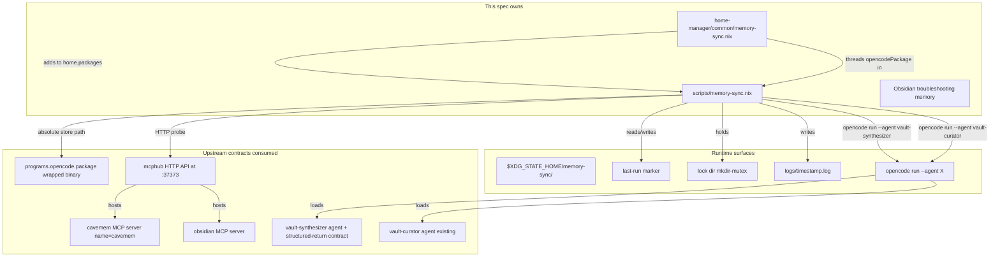

# Design Document: memory-sync-cli

## Overview

**Purpose**: Ship `memory-sync` — a single shell command on PATH on
both nix-darwin hosts that orchestrates the cavemem → vault promotion
pipeline end-to-end. The command computes a [marker, now] window,
invokes the `vault-synthesizer` opencode subagent over that window via
`opencode run --agent vault-synthesizer --format json`, parses the
synthesizer's structured return out of the JSON event stream, then
chains `vault-curator` over the freshly drafted memories, and finally
updates a marker file atomically iff the whole pipeline succeeded. A
lock file prevents concurrent runs; a per-run log captures the full
output with last-10 retention; pre-flight HTTP probes against mcphub
distinguish "MCP server is down" from agent-level failures.

**Users**: The two-host nix-darwin operator (Shopify + personal) is
the only direct user — invoking `memory-sync` from any terminal,
periodically and by hand. A future `memory-sync-schedule` spec is the
only programmatic consumer.

**Impact**: Adds one new shell script
(`scripts/memory-sync.nix`), one thin HM module
(`home-manager/common/memory-sync.nix`) that puts the binary on
`home.packages` and threads the opencode wrapped derivation through to
the script, and one Obsidian memory note explaining the architecture.
No new opencode wiring (the synthesizer and curator agents are
already loaded by the upstream specs). No new MCP server. No changes
to cavemem, opencode-wrapper, agents.md, or `vault-curator.md`.

### Goals

- A `memory-sync` binary on PATH on both hosts via the established
  HM-module-adds-to-home.packages pattern (mirrors
  `home-manager/common/cc-sdd.nix` shape; mirrors `programs.cc-sdd`
  option surface only insofar as the script needs the wrapped
  opencode binary to be threaded in).
- The script invokes `opencode run --agent X` with `--format json` and
  parses the structured-return summary out of the JSON event stream.
- Marker file at `$XDG_STATE_HOME/memory-sync/last-run` updated
  atomically only on full success.
- Lock file at `$XDG_STATE_HOME/memory-sync/lock` prevents concurrent
  runs (mkdir-mutex pattern from `sqlite-backup-cli`).
- Per-run log at `$XDG_STATE_HOME/memory-sync/logs/<ts>.log` with
  last-10 retention; mode 0600 via `umask 0077`.
- Pre-flight cavemem and Obsidian MCP probes at the mcphub HTTP API
  level (matches the opencode-wrapper health-check pattern from
  `cavemem-integration` Requirement 5).
- Documented exit codes 0–6 + a usage-error band (64) so a future
  scheduler can react to specific failure classes.

### Non-Goals

- Auto-scheduling (`launchd` plist, `systemd` timer) — separate
  follow-up spec.
- Defining the `vault-synthesizer` or `vault-curator` agents'
  behavior — both owned upstream.
- Building or modifying cavemem itself.
- Cross-host marker coordination.
- Per-project sync variants.
- Notification / desktop alert UI.
- Reading or writing any `.kiro/` files.
- Any new MCP tool, MCP server, or modification to mcphub's server
  configuration.
- Any change to the opencode wrapper health check (the wrapper
  already refuses to start when cavemem MCP is down — `memory-sync`
  duplicates the check at the orchestrator layer because
  `memory-sync` may be invoked while opencode is not running and we
  want to fail fast with a specific exit code).

## Boundary Commitments

### This Spec Owns

- The new shell script source at `scripts/memory-sync.nix`,
  including every flag, every exit code, the marker / lock / log
  file lifecycle, the pre-flight probe logic, the `opencode run`
  invocation strings, the JSON-event-stream parsing, the
  marker-update atomicity, and the log-pruning policy.
- The new home-manager module at
  `home-manager/common/memory-sync.nix` that puts the binary on
  `home.packages` and threads the wrapped opencode derivation
  through to the script via the `opencodePackage` argument.
- The Obsidian memory note documenting the orchestration model
  and the troubleshooting procedure (Requirement 12).
- The documented marker / lock / log paths under
  `$XDG_STATE_HOME/memory-sync/`.

### Out of Boundary

- The `vault-synthesizer.md` agent file (owned by
  `vault-synthesizer-agent`).
- The `vault-curator.md` agent file (existing, untouched).
- The cavemem package, HM module, mcphub server registration,
  opencode wrapper health check, importer, and smoke tests (all
  owned by `cavemem-integration`).
- The `programs.opencode.agents` attrset and the `withCaveman`
  helper (existing in `home-manager/common/opencode.nix`;
  `memory-sync` does NOT modify it).
- Any HM module that wires cavemem state, scheduling, or
  notifications.
- The mcphub launchd agent itself (already running on every
  host).
- Any `.kiro/` files (the script doesn't touch them at runtime
  and the HM module doesn't generate them).

### Allowed Dependencies

- `pkgs.writeShellApplication` (existing pattern from
  `cc-sdd-init`, `mcp-verify-secrets`, `mcp-sync-from-1password`,
  `sqlite-backup-cli`).
- `pkgs.coreutils` (mkdir / mv / date / rm).
- `pkgs.curl` for the mcphub HTTP probes (NOT the system
  `/usr/bin/curl` used by the opencode wrapper, because the
  `writeShellApplication` already locks PATH and the nixpkgs
  `curl` is more reproducible; the opencode wrapper uses
  `/usr/bin/curl` because it runs before PATH is set).
- `pkgs.jq` for JSON-event-stream parsing.
- The wrapped opencode derivation surfaced via
  `programs.opencode.package` (read by the new HM module and
  threaded into the script as a baked-at-derivation-time absolute
  Nix-store path).
- The mcphub HTTP API at `http://localhost:37373/api/...`
  (existing; cavemem and obsidian servers reachable under that
  endpoint per `cavemem-integration` and the existing
  obsidian wiring).

### Revalidation Triggers

- Cavemem MCP server name change (anything other than the literal
  `cavemem`) → invalidates the pre-flight probe URL. Mitigation:
  `cavemem-integration` Requirement 10.AC2 locks the name; if it
  changes, update both this script and the upstream cavemem
  health check in lock-step.
- Obsidian MCP server name change → invalidates the obsidian
  pre-flight probe URL. Mitigation: the obsidian wiring is stable
  and predates this spec; documented in the troubleshooting
  memory.
- mcphub HTTP API path or port change → invalidates both probes.
  Mitigation: track via the existing
  `home-manager/common/opencode.nix:55-61` snippet — if it ever
  changes, update this script's probe to match.
- `opencode run` flag rename or removal (`--agent`,
  `--format json`, `--dangerously-skip-permissions`, `--dir`) →
  invalidates the invocation strings. Mitigation: pin opencode
  via `pkgs.opencode-pinned` (already done); on a version bump
  re-verify against `opencode run --help` before merging the
  bump.
- Synthesizer structured-return shape change (any of `time_range`,
  `observations_scanned`, `clusters_identified`,
  `clusters_promoted`, `clusters_skipped`, `drafts_written`,
  `draft_paths` renamed or removed) → invalidates the JSON
  parsing. Mitigation: `vault-synthesizer-agent` Requirement 8
  locks the shape; if it changes, update the parser in
  lock-step.
- XDG state directory layout change for sibling tools (e.g.,
  another tool starts writing under `memory-sync/`) → not
  applicable; the directory namespace is exclusive to this
  spec.
- The `--format json` event-stream protocol change (opencode
  internals): documented opencode upgrade gate. Mitigation: the
  parser extracts the synthesizer's final assistant message
  by event type and parses a documented JSON block out of it
  (per Requirement 7.AC3); we do NOT depend on internal event
  ordering or non-published event fields.

## Architecture

### Existing Architecture Analysis

**Script packaging pattern**: Every existing operator script in this
repo is a `pkgs.writeShellApplication` block in a single
`scripts/<name>.nix` file with a top-level argument shape
`{ pkgs, ... }` (or `{ pkgs, lib, ... }` when more is needed). The
derivation is then either:

- imported into a HM module that puts it on `home.packages` (the
  `cc-sdd-init` and `sqlite-backup-cli` pattern), OR
- exposed as a flake `apps.<system>.<name>` for one-shot CLI use
  (the `mcp-sync-from-1password` and `mcp-verify-secrets` pattern).

`memory-sync` follows the FIRST pattern (HM module adds to
`home.packages`), because: (a) the user runs it interactively from a
shell prompt, not via `nix run`; (b) we need the wrapped opencode
derivation threaded in at HM-eval time, which is straightforward in
a HM module and awkward in a flake-app definition.

**MCP probe pattern**: `home-manager/common/opencode.nix:55-61`
already has the canonical mcphub probe — a `curl -sf --max-time 2
http://localhost:37373/api/health` against the local mcphub server.
The opencode wrapper uses `/usr/bin/curl` because it runs before
PATH is set; `memory-sync` runs inside `writeShellApplication`'s
locked PATH and uses `pkgs.curl`. Per-server health (cavemem-server
status, obsidian-server status) is reachable via mcphub's
per-server endpoint shape — the design here probes
`http://localhost:37373/api/servers/cavemem` and
`http://localhost:37373/api/servers/obsidian`, exact endpoint
verified at implementation time against the running mcphub instance
(the implementer confirms the path and adjusts the script if the
mcphub version on this host uses a different path; the probe is a
single line in the script and trivial to refit).

**Opencode non-interactive surface**: Verified by running
`opencode run --help` against `~/.nix-profile/bin/opencode` (output
captured in
`memories/2026-05-14-opencode-run-non-interactive.md`). The
relevant flags:

- `opencode run [message..]` — non-interactive mode; positional
  args become the user message.
- `--agent <name>` — explicitly pick a loaded agent
  (`vault-synthesizer`, `vault-curator`).
- `--format json` — emit raw JSON events to stdout, one event per
  line. The agent's final assistant message is one of those events
  and contains the structured-return block.
- `--dangerously-skip-permissions` — auto-approve any permission
  prompt that isn't explicitly denied. REQUIRED here because both
  agents have `bash` allow-list entries that would otherwise
  prompt interactively; without this flag the run hangs waiting
  for an operator who is not present.
- `--dir <path>` — run in a specified working directory. Set to
  `$HOME` so the command is independent of the operator's pwd.
- `--print-logs` + `--log-level WARN` — direct stderr logging;
  used in `--verbose` mode.

**State directory pattern**: `sqlite-backup-cli.nix` establishes the
per-tool subdirectory layout under `$XDG_STATE_HOME` (`STATE_DIR=
"${XDG_STATE_HOME:-$HOME/.local/state}/sqlite-backup"`). `memory-sync`
follows the same shape with its own subdirectory.

**Lock pattern**: `sqlite-backup-cli.nix:209-228` uses a
mkdir-mutex (`mkdir $LOCK_DIR_BASE/sqlite-backup-<db>.lock`) with
an EXIT/INT/TERM trap to release. `memory-sync` adopts the same
pattern verbatim: `mkdir $XDG_STATE_HOME/memory-sync/lock` →
trap-on-exit removes it.

**Atomic file update pattern**: `mcp-sync-from-1password.nix:108-196`
uses the tempfile-in-same-dir + `mv` pattern for atomic replacement
(rename(2) within a single filesystem). `memory-sync` mirrors that
shape for the marker update.

### Architecture Pattern & Boundary Map



**Architecture Integration**:

- Selected pattern: thin orchestration shell script + HM-module
  wrapper. No new abstractions.
- Domain/feature boundaries: the script owns orchestration logic
  (flag parsing, time-range computation, pre-flight, marker /
  lock / log management, subagent invocation, exit-code
  discipline). The HM module owns derivation wiring (threading
  the wrapped opencode derivation in, putting the binary on
  PATH, host opt-in via `enable`).
- Existing patterns preserved: `writeShellApplication`,
  mkdir-mutex lock, tempfile-in-same-dir + mv atomic replacement,
  per-tool `$XDG_STATE_HOME` subdirectory, mcphub HTTP probe at
  `:37373/api/...`, baked-at-derivation-time absolute Nix-store
  paths to other binaries, host-opt-in via HM module enable
  option.
- New components rationale: the script is the orchestration value-
  add; the HM module is the minimum wiring needed to ship it on
  PATH with the opencode dependency threaded in correctly.
- Steering compliance: declarative-first invariant maintained
  (the HM module is HM-managed; the script is built reproducibly
  by Nix); macOS-only target reflected (no Linux carve-outs
  needed); no GPL contamination (shell + jq + curl all MIT/BSD/
  curl-license).

### Architectural Decisions

#### Decision 1 — Subagent invocation: Option 1 (`opencode run --agent X`)

**Decision**: Invoke the synthesizer and curator subagents via
`opencode run --agent <name> --format json
--dangerously-skip-permissions --dir <safe-cwd> <prompt>`. Parse the
JSON event stream from stdout to extract the synthesizer's
structured-return summary. The orchestrator does NOT call any
Anthropic API directly and does NOT instantiate any MCP client of
its own.

**Investigation evidence** (`memories/2026-05-14-opencode-run-non-interactive.md`):

- `opencode --help` lists `opencode run [message..]` as a real
  subcommand of the binary pinned in this repo's overlay
  (`pkgs.opencode-pinned`).
- `opencode run --help` lists `--agent <name>`,
  `--format <"default"|"json">`, `--dangerously-skip-permissions`,
  `--dir <path>`, `--print-logs`, `--log-level
  <DEBUG|INFO|WARN|ERROR>`, `--prompt <text>` as documented
  flags.
- `--format json` is documented as "raw JSON events" output,
  designed for programmatic consumption.
- The agents loaded by `programs.opencode.agents` (per
  `home-manager/common/opencode.nix:142-157` and the upstream
  `vault-synthesizer-agent` spec's wiring addition) are
  resolvable by `--agent <name>` from any cwd because the agent
  files are written by HM into
  `~/.config/opencode/agents/<name>.md` (or equivalent), which
  is global per-user state.

**Rejected — Option 2 (direct LLM API + agent.md as system prompt)**:
A Node or Python script that loads the agent .md files from disk,
extracts the system prompt, calls the Anthropic API directly, and
implements its own MCP client to wire cavemem and obsidian tools
into the API call. Trade-offs against Option 1:

- (–) Re-implements opencode's agent loader, MCP wiring, and
  permission enforcement. Three new failure modes
  (`agent.md` parse drift, MCP client bugs, auth-flow drift).
- (–) Introduces a new dependency on `mcp-secrets-sops-nix`
  for the Anthropic API key delivery; today opencode handles
  auth via `opencode providers` and the system keychain, so
  the orchestrator inherits that for free in Option 1.
- (–) Re-implements permission posture (deny edit/write/
  webfetch on the synthesizer); subtle differences would
  weaken defense-in-depth.
- (+) Slightly faster startup (no opencode runtime spawn).
  Negligible because `memory-sync` is manually invoked and
  the opencode runtime is already pre-warmed by the
  `opencode-prewarm` launchd agent declared in
  `home-manager/common/opencode.nix:199-211`.

**Rejected — Option 3 (mechanical translation)**: Already ruled
out in the brief; would sacrifice the synthesizer's
selectivity-judgment value-add and demote `memory-sync` to a
dumb timeline-to-Obsidian pipe.

**Trade-offs we accept by choosing Option 1**:

- Each `opencode run` invocation spawns a full opencode runtime
  (~1s warm, more cold). Acceptable: the command is manually
  invoked and not on a tight-loop schedule.
- `memory-sync` cannot reuse a single opencode session across
  the synthesizer and curator runs (Requirement 7.AC10 spells
  out why: independent sessions are simpler, and the curator's
  prompt explicitly names the synthesizer's draft paths).
  Cost: a second runtime spawn. Acceptable.
- The `--dangerously-skip-permissions` flag is required
  because the subagents have `bash` allow-list entries that
  prompt interactively. Acceptable because (a) the agents
  themselves enforce strict allow-lists at the prompt layer,
  (b) `permission.edit / write / webfetch = deny` still
  applies (the dangerous-skip flag only auto-approves prompts
  that aren't explicitly denied), and (c) `memory-sync` is
  invoked by the operator and inherits the operator's trust
  posture.
- Output parsing requires `jq`-driven extraction of the final
  assistant message from the JSON event stream. We pin the
  parser to look for events of a specific type and parse the
  documented structured-return block out of the message body
  (per `vault-synthesizer-agent` Requirement 8).

#### Decision 2 — State directory layout: `$XDG_STATE_HOME/memory-sync/`

**Decision**: Marker / lock / logs all under one directory tree at
`$XDG_STATE_HOME/memory-sync/` (defaulting `$XDG_STATE_HOME` to
`$HOME/.local/state`).

- `$XDG_STATE_HOME/memory-sync/last-run` — marker
- `$XDG_STATE_HOME/memory-sync/lock/` — mkdir-mutex lock dir
- `$XDG_STATE_HOME/memory-sync/logs/<ts>.log` — per-run logs

**Rationale**: XDG Base Directory Spec is the established convention
on darwin (multiple existing scripts in this repo use it). One
parent directory keeps `tree $XDG_STATE_HOME/memory-sync/` readable
for the operator and one `mkdir -p` covers all three children.

**Rejected — `~/.cache/memory-sync/`**: cache implies "safe to
delete and regenerate"; the marker is not safe to lose
(re-running with no marker reprocesses 30 days). State is the
correct semantic.

**Rejected — `~/Library/Application Support/memory-sync/`**: macOS
convention but the existing nix-darwin scripts in this repo
already standardize on XDG; deviating here would create needless
inconsistency.

#### Decision 3 — Lock primitive: mkdir-mutex (no flock)

**Decision**: `mkdir $XDG_STATE_HOME/memory-sync/lock` for the
lock; trap-on-exit removes it.

**Rationale**: matches `sqlite-backup-cli.nix:219-228` verbatim;
portable across darwin without depending on `flock(1)` (which
isn't always present on macOS as a separate binary). `mkdir(2)`
is atomic per POSIX (the directory either exists or doesn't; the
syscall returns EEXIST cleanly for the loser). The trap clears
the lock on every exit path including SIGINT/SIGTERM, so an
interrupted run does not leave a stale lock. Stale-lock recovery
(if the script is `kill -9`'d): operator removes the lock dir
manually; the error message in Requirement 4.AC3 includes that
hint.

**Rejected — file-based flock**: not portable enough on darwin
without an explicit `pkgs.util-linux` dep (and even then,
`flock(1)` is Linux-only — `pkgs.util-linux` provides Linux
binaries that may not work on darwin; `pkgs.lockfile-progs` is
Linux-specific).

**Rejected — single sentinel file with PID**: races between
"check sentinel" and "write sentinel"; mkdir is atomic for free.

#### Decision 4 — Marker format: ISO 8601 UTC timestamp single line

**Decision**: `YYYY-MM-DDTHH:MM:SSZ` on a single line in
`last-run`. UTC always; no local-TZ marker file (the operator
runs from two machines in different timezones — UTC is the only
sane shared format).

**Rationale**: GNU `date -u +%Y-%m-%dT%H:%M:%SZ` produces it
trivially; `date -u -d "<value>"` parses it back; jq can
manipulate it as a string. Plain text means a curious operator
can `cat` and `vim` the marker without tooling.

**Rejected — Unix epoch integer**: less human-readable; same
parsing complexity.

**Rejected — multi-line metadata file (timestamp + last-success-
counts + …)**: marker is a single timestamp; counts and details
live in the per-run log. Marker stays simple; the file is one
line and one syscall to write.

#### Decision 5 — Default range when marker missing: 30 days ago

**Decision**: If the marker is missing AND no `--since` argument
is supplied, the start of the time range is `date -u -d "30
days ago"`.

**Rationale**: The brief explicitly calls this out as a guard
against accidentally reprocessing years of cavemem data on first
run. 30 days is long enough to capture the first useful synthesis
window after fresh cavemem activation but short enough that the
synthesizer's first run remains tractable in one invocation.

**Rejected — no default (require `--since` on first run)**:
worse UX; the user has to remember the magic incantation. The
explicit `--since` override remains available for unusual cases.

**Rejected — beginning of cavemem.db**: unbounded; user pain on
first run after a fresh install.

#### Decision 6 — Pre-flight checks at HTTP-transport layer (not MCP-tool layer)

**Decision**: Pre-flight probes are mcphub HTTP API GETs (e.g.
`http://localhost:37373/api/servers/cavemem`,
`http://localhost:37373/api/servers/obsidian`), not actual MCP
tool calls (no `cavemem search`, no `hub_obsidian__list-notes`).

**Rationale**: The brief's "health-check semantics" constraint
(`Health-check semantics: Pre-flight checks distinguish "MCP
server is down" from "MCP tools returned an error"`) means we
want the failure mode "mcphub doesn't have cavemem registered"
or "cavemem MCP process crashed" to surface as exit 4 (exit 5
for obsidian) at the orchestrator layer, distinct from the
synthesizer/curator failure exit codes (1/2). HTTP-level probes
catch the transport class of failures cleanly; tool-level
probes would conflate transport with tool behavior.

**Rejected — using `opencode run` itself as the health check**:
spawns a full opencode runtime; defeats the "fail fast"
requirement.

#### Decision 7 — Subagent invocation order: synthesizer THEN curator (sequential, independent sessions)

**Decision**: Two separate `opencode run` invocations: first
synthesizer, then (if successful) curator. The curator's prompt
includes the synthesizer's draft paths (so the curator can
prioritize the new drafts) but the runs are otherwise
independent.

**Rationale**:

- Sequential because the curator depends on the synthesizer's
  output (the new drafts).
- Independent sessions because (a) `opencode run --continue`
  would couple the two runs in a way that makes the curator's
  exit code depend on the synthesizer's session state, and (b)
  passing draft paths via the curator's prompt is more
  inspectable in the per-run log than relying on session
  context.
- Curator failure does NOT roll back the drafts the synthesizer
  produced — those drafts are valid memory notes by design
  (vault-synthesizer-agent Requirement 9 mandates curator-
  audit-passing format), and a re-run of `memory-sync` will
  still process the same window (because the marker hasn't
  been updated) so curator gets a second chance.

**Rejected — single chained session via `--continue`**:
session-state coupling makes failure modes harder to reason
about and less inspectable.

**Rejected — concurrent invocations**: curator MUST run after
the synthesizer's writes have settled or it has nothing new to
dedup.

#### Decision 8 — `--dangerously-skip-permissions` is required, not optional

**Decision**: Every `opencode run` invocation passes
`--dangerously-skip-permissions`.

**Rationale**: Both subagents have `bash` allow-list entries with
the wildcard `"*"` set to `ask` (per
`home-manager/common/agents/vault-curator.md:11-18` and the
matching block in `vault-synthesizer.md` per
`vault-synthesizer-agent` Requirement 3.AC4). Without
`--dangerously-skip-permissions`, opencode prompts on the
console for any bash command outside the allow-list (or any
unfamiliar tool) — and there is no console operator in a
`memory-sync` run. The flag's auto-approval ONLY applies to
prompts that aren't explicitly denied; `permission.edit /
write / webfetch = deny` still apply, and the bash allow-list's
explicit `allow` entries still apply. The risk surface is the
"`*: ask` falls through to auto-approve" path, which is
narrow because the agents' Markdown bodies further constrain
what bash they invoke.

**Rejected — running without the flag and accepting that
`memory-sync` hangs on first prompt**: defeats the whole
orchestration premise.

**Rejected — replacing `*: ask` with `*: allow` in the agent
files**: would weaken interactive-session safety for the user;
the agent files are owned by upstream specs and we don't modify
them here.

#### Decision 9 — Wrapped opencode binary, baked-in absolute path

**Decision**: The HM module reads `programs.opencode.package`
(the wrapped derivation that includes the cavemem health check)
and threads it into the script as the `opencodePackage` argument.
The script invokes opencode by absolute Nix-store path
(`${opencodePackage}/bin/opencode`) baked at derivation time.

**Rationale**:

- Using the WRAPPED derivation (not `pkgs.opencode-pinned`)
  ensures `memory-sync`'s opencode invocations get the same
  pre-flight checks the user gets when invoking opencode by
  hand. If cavemem MCP comes up between the orchestrator's
  pre-flight and the wrapper's pre-flight, both succeed; if
  cavemem MCP goes down between, the wrapper catches it (and
  the synthesizer invocation fails with exit 1, the
  orchestrator surfaces the wrapper's stderr, and the operator
  sees the same kickstart hint they'd see in interactive use).
- Absolute Nix-store path means `command -v opencode` in the
  operator's shell pointing at a foreign opencode (e.g., a
  `brew install opencode` shadowed by their PATH) is
  irrelevant — the orchestrator picks the HM-managed binary.

**Rejected — `command -v opencode`**: subject to PATH
shadowing; unreproducible.

**Rejected — `pkgs.opencode-pinned/bin/opencode` (unwrapped)**:
bypasses the cavemem and obsidian wrapper checks; loses the
defense-in-depth those checks provide.

#### Decision 10 — Synthesizer prompt body: bare ISO 8601 timestamp pair (no natural-language framing)

**Decision**: The user-message prompt passed to
`opencode run --agent vault-synthesizer` is the bare string
`"<start> to <end>"` where each side is `YYYY-MM-DDTHH:MM:SSZ`
(e.g., `"2026-05-01T00:00:00Z to 2026-05-14T01:30:00Z"`). No
natural-language framing ("synthesize", "synthesize cavemem
observations from …") is wrapped around the timestamps.

**Rationale**: An opencode subagent receives its job description
from the agent `.md` file body (loaded as the system prompt by
opencode at session start). The user-message prompt is for
arguments only. The synthesizer's mission ("read cavemem
observations over a time window and draft memory notes") is
already in `home-manager/common/agents/vault-synthesizer.md`'s
Mission section; repeating "synthesize cavemem observations
from …" in the user prompt is redundant with the system prompt
and adds no behavioral signal.

The bare shape also satisfies `vault-synthesizer-agent`
Requirement 10.AC7 literally: AC7 names `"<start> to <end>"`
where each side is `YYYY-MM-DDTHH:MM:SSZ` as the "exact shape
`memory-sync-cli` emits when it composes the synthesizer prompt
from its marker file." Combined with Requirement 10.AC4 (the
synthesizer refuses runs whose argument doesn't match one of
the four documented shapes), wrapping the timestamps in
natural-language framing would risk the synthesizer rejecting
the orchestrator's prompt under a strict-parsing
implementation.

The curator prompt remains a natural-language string naming
the freshly drafted paths, because the curator agent has no
analogous "exact shape" contract — it accepts free-form prompts
that name the work to do.

**Rejected — `"synthesize cavemem observations from <start>
to <end>"`**: redundant with the system prompt; risks AC4
rejection if the synthesizer's parser is strict about
matching one of the four documented shapes.

**Rejected — `"synthesize <start> to <end>"`**: also redundant
with the system prompt; the leading `synthesize` token would
need to be tolerated as a prefix by the synthesizer's parser,
which is not part of the AC7 contract.

### Technology Stack

| Layer | Choice / Version | Role in Feature | Notes |
|-------|------------------|-----------------|-------|
| Shell script runtime | bash (via `pkgs.writeShellApplication`) | Orchestration, flag parsing, marker / lock / log management | Matches every other operator script in `scripts/` |
| HTTP probes | `pkgs.curl` | Pre-flight cavemem and obsidian MCP probes against mcphub | Separate from `/usr/bin/curl` used by the opencode wrapper because `writeShellApplication` locks PATH to the listed runtimeInputs |
| JSON parsing | `pkgs.jq` | Extract synthesizer's structured-return summary from `--format json` event stream | Established dependency in this repo (used by sqlite-backup-cli, mcp-sync-from-1password, mcp-verify-secrets) |
| Time arithmetic | `pkgs.coreutils` `date -u -d "..."` | Compute "30 days ago", parse `--since` relative durations, format timestamps | GNU coreutils; `pkgs.writeShellApplication` brings it in via `runtimeInputs` |
| File operations | `pkgs.coreutils` mkdir / mv / rm | Atomic marker update, lock dir, log pruning | Same set as above |
| Subagent runtime | `programs.opencode.package` (wrapped, threaded in) | Runs `opencode run --agent vault-{synthesizer,curator}` | Wrapped derivation includes cavemem + obsidian wrapper checks |
| HM module | nix (home-manager 25.11) | Adds binary to `home.packages`; threads `opencodePackage` into the script | Mirrors `home-manager/common/cc-sdd.nix` shape |

## File Structure Plan

### Directory Structure

```
scripts/
└── memory-sync.nix                # NEW: writeShellApplication

home-manager/
└── common/
    └── memory-sync.nix            # NEW: thin HM module that puts
                                   #      the binary on home.packages
                                   #      and threads opencodePackage in

configurations/                     # MODIFIED: each host's HM profile
                                   # imports memory-sync.nix and sets
                                   # programs.memory-sync.enable = true
                                   # (per-host one-line addition)

memories/                           # NEW (in Obsidian vault, not the
                                   # repo): troubleshooting memory note
                                   # written via hub_obsidian__write-note
                                   # at implementation time
└── 2026-XX-XX-memory-sync-cli-overview.md
```

### Modified Files

- `configurations/personal/...` and `configurations/shopify/...`
  (exact path determined at implementation time) — import
  `memory-sync.nix` and set `programs.memory-sync.enable = true`.
  This is the same per-host wiring shape used by `cc-sdd.nix`
  and other common modules.

### New Files

- `scripts/memory-sync.nix` — the orchestrator script (the bulk
  of the implementation; ~250-350 lines of bash inside a
  `writeShellApplication` block).
- `home-manager/common/memory-sync.nix` — the HM module
  (~30-50 lines: option surface (`programs.memory-sync.enable`,
  `programs.memory-sync.package`), import the script, add it to
  `home.packages`).
- The Obsidian troubleshooting memory note is written at
  implementation time via `hub_obsidian__write-note` (no repo
  file).

> Each file has one clear responsibility. The script owns
> orchestration; the HM module owns derivation wiring; the
> memory note owns operator documentation. There is no shared
> mutable state between files — the only data flow is at
> derivation time (HM module reads `programs.opencode.package`
> and threads it as `opencodePackage` into the script's
> derivation arguments).

## System Flows

### Successful end-to-end run (no `--since`, no `--dry-run`)

```mermaid
sequenceDiagram
    actor Op as Operator
    participant MS as memory-sync
    participant FS as $XDG_STATE_HOME/memory-sync/
    participant HUB as mcphub :37373
    participant OC as opencode (wrapped)
    participant VS as vault-synthesizer agent
    participant VC as vault-curator agent

    Op->>MS: memory-sync
    MS->>MS: parse flags (none)
    MS->>FS: mkdir -p memory-sync/{logs,}
    MS->>FS: mkdir lock/  (acquire)
    MS->>HUB: GET /api/servers/cavemem
    HUB-->>MS: 200 OK healthy
    MS->>HUB: GET /api/servers/obsidian
    HUB-->>MS: 200 OK healthy
    MS->>FS: cat last-run  (or "30 days ago" default)
    MS->>MS: now := date -u +%Y-...
    MS->>MS: open log file (umask 0077)
    MS->>OC: opencode run --agent vault-synthesizer --format json --dangerously-skip-permissions --dir $HOME "<start> to <now>"
    OC->>VS: invoke
    VS-->>OC: JSON events (final summary block)
    OC-->>MS: stdout JSON event stream
    MS->>MS: jq-extract structured return (counts + draft_paths)
    MS->>OC: opencode run --agent vault-curator --format json --dangerously-skip-permissions --dir $HOME "dedup new drafts: <paths>"
    OC->>VC: invoke
    VC-->>OC: JSON events
    OC-->>MS: stdout
    MS->>MS: log: marker before / time-range / synth-counts / curator-output
    MS->>FS: write last-run.tmp; sync; mv to last-run
    MS->>FS: prune logs/ to last 10
    MS->>FS: rmdir lock/  (trap)
    MS-->>Op: human summary + exit 0
```

### Failure: cavemem MCP unreachable (exit 4)

```mermaid
sequenceDiagram
    actor Op as Operator
    participant MS as memory-sync
    participant FS as $XDG_STATE_HOME/memory-sync/
    participant HUB as mcphub :37373

    Op->>MS: memory-sync
    MS->>FS: mkdir -p; mkdir lock/  (acquire)
    MS->>HUB: GET /api/servers/cavemem (timeout 2s)
    HUB-->>MS: connect refused / timeout / non-2xx
    MS-->>Op: stderr: "ERROR: cavemem MCP unreachable. launchctl kickstart gui/$UID/com.ravitemer.mcp-hub"
    MS->>FS: rmdir lock/  (trap)
    MS-->>Op: exit 4
```

### Failure: synthesizer crashed (exit 1; marker untouched; retry-safe)

```mermaid
sequenceDiagram
    actor Op as Operator
    participant MS as memory-sync
    participant FS as $XDG_STATE_HOME/memory-sync/
    participant OC as opencode
    participant VS as vault-synthesizer

    Op->>MS: memory-sync
    MS->>FS: pre-flight + lock + read marker (T_prev)
    MS->>OC: opencode run --agent vault-synthesizer --format json ...
    OC->>VS: invoke
    VS-->>OC: error mid-run
    OC-->>MS: exit non-zero; stderr block
    MS->>FS: log: full synth stderr
    MS-->>Op: stderr: synthesizer's stderr verbatim
    MS->>FS: rmdir lock/  (trap)  -- marker NOT touched
    MS-->>Op: exit 1
    Note over Op,FS: Next memory-sync run reads the same T_prev marker and retries the same window.
```

### `--dry-run` flow

```mermaid
sequenceDiagram
    actor Op as Operator
    participant MS as memory-sync
    participant FS as $XDG_STATE_HOME/memory-sync/

    Op->>MS: memory-sync --dry-run
    MS->>FS: mkdir -p; mkdir lock/  (acquire)
    MS->>MS: pre-flight (probes still run -- catches MCP outages)
    MS->>FS: read marker (no write)
    MS->>MS: compute time range
    MS-->>Op: stdout: "DRY RUN: would invoke opencode run --agent vault-synthesizer ... '<start> to <end>'"
    MS-->>Op: stdout: "DRY RUN: would invoke opencode run --agent vault-curator ..."
    MS-->>Op: stdout: "DRY RUN: would update marker to <now>"
    MS-->>Op: stdout: "DRY RUN: would prune logs (currently N retained)"
    MS->>FS: rmdir lock/  (trap)
    MS-->>Op: exit 0  -- no log file written, no marker update, no log pruning
```

### `--no-curator` flow (synthesizer succeeds, curator skipped)

```mermaid
sequenceDiagram
    actor Op as Operator
    participant MS as memory-sync
    participant OC as opencode

    Op->>MS: memory-sync --no-curator
    MS->>MS: pre-flight + lock + marker + range
    MS->>OC: opencode run --agent vault-synthesizer ...
    OC-->>MS: exit 0; structured summary
    Note over MS: SKIP curator entirely
    MS->>MS: log: synth-counts + "curator skipped (--no-curator)"
    MS->>MS: marker update (run is "successful" per Requirement 3.AC7)
    MS-->>Op: exit 0
```

## Requirements Traceability

| Requirement | Summary | Components | Interfaces | Flows |
|-------------|---------|------------|------------|-------|
| 1.1 | scripts/memory-sync.nix derivation | OrchestratorScript | overlay attr or HM-module-import | n/a (build-time) |
| 1.2 | Binary on PATH via overlay/HM | MemorySyncHmModule | `home.packages` contribution | First-time activation |
| 1.3 | runtimeInputs declared | OrchestratorScript | `writeShellApplication.runtimeInputs` | n/a |
| 1.4 | Opencode by absolute Nix-store path | OrchestratorScript, MemorySyncHmModule | baked-in `opencodePackage` arg | Successful run |
| 1.5 | Runs from any cwd; no cwd dependency | OrchestratorScript | (negative assertion) | All flows |
| 2.1, 2.2, 2.3, 2.4 | --help prints usage including all flags + exit codes + paths | OrchestratorScript | `--help` arm | n/a |
| 2.5 | Unknown flag → usage-error exit | OrchestratorScript | flag parser | n/a |
| 2.6 | --since shape doc | OrchestratorScript | usage block content | n/a |
| 2.7 | --dry-run side-effect doc | OrchestratorScript | usage block content | --dry-run flow |
| 3.1 | Marker at $XDG_STATE_HOME/memory-sync/last-run | OrchestratorScript | filesystem | Successful run |
| 3.2 | mkdir -p parent dir | OrchestratorScript | `mkdir -p` | All flows |
| 3.3 | Marker format: ISO 8601 UTC single line | OrchestratorScript | `date -u +%Y-%m-%dT%H:%M:%SZ` | Successful run |
| 3.4 | Default 30 days when missing AND no --since | OrchestratorScript | `date -u -d "30 days ago"` | Successful run (first invocation) |
| 3.5 | Read marker when present AND no --since | OrchestratorScript | `cat last-run` | Successful run (subsequent) |
| 3.6 | --since one-shot, no marker update | OrchestratorScript | flag-driven branch | (operator override) |
| 3.7 | Atomic marker update on success | OrchestratorScript | tempfile + sync + mv | Successful run |
| 3.8 | Marker untouched on failure | OrchestratorScript | (negative assertion) | Synthesizer-failure flow |
| 3.9 | Marker-unwritable → exit 3 | OrchestratorScript | error path | n/a |
| 4.1 | Lock at $XDG_STATE_HOME/memory-sync/lock | OrchestratorScript | filesystem | All flows |
| 4.2 | mkdir-mutex acquisition | OrchestratorScript | `mkdir lock/` | All flows |
| 4.3 | Lock held → exit 6 with hint | OrchestratorScript | error path | n/a |
| 4.4 | EXIT/INT/TERM trap releases lock | OrchestratorScript | `trap '...' EXIT INT TERM` | All flows |
| 4.5 | Lock acquired BEFORE marker read AND BEFORE pre-flight | OrchestratorScript | flow ordering | All flows |
| 4.6 | Lock acquisition does not race against parent mkdir | OrchestratorScript | `mkdir -p memory-sync/` then `mkdir memory-sync/lock` | All flows |
| 5.1 | Pre-flight cavemem probe at mcphub HTTP | OrchestratorScript | `curl http://localhost:37373/api/servers/cavemem` | Successful run; cavemem-down flow |
| 5.2 | Cavemem failure → exit 4 with hint | OrchestratorScript | error path | cavemem-down flow |
| 5.3 | Pre-flight obsidian probe (after cavemem) | OrchestratorScript | `curl http://localhost:37373/api/servers/obsidian` | Successful run |
| 5.4 | Obsidian failure → exit 5 with hint | OrchestratorScript | error path | n/a |
| 5.5 | Silent on success unless --verbose | OrchestratorScript | flag-gated stdout | All flows |
| 5.6 | Probes are HTTP-transport-level only | OrchestratorScript | (negative assertion: no MCP-tool calls in pre-flight) | All flows |
| 6.1 | end := now (captured once) | OrchestratorScript | `now=$(date -u +...)` at script top | All flows |
| 6.2 | --since YYYY-MM-DD → midnight UTC | OrchestratorScript | `date -u -d "<value> 00:00:00 UTC"` | (operator override) |
| 6.3 | --since ISO 8601 → exact | OrchestratorScript | `date -u -d "<value>"` | (operator override) |
| 6.4 | --since relative → date -d | OrchestratorScript | `date -u -d "<value>"` | (operator override) |
| 6.5 | Unparseable --since → exit usage-error | OrchestratorScript | error path | n/a |
| 6.6 | No --since AND marker present → marker | OrchestratorScript | `cat last-run` | Successful run |
| 6.7 | No --since AND marker absent → 30 days ago | OrchestratorScript | `date -u -d "30 days ago"` | Successful run (first) |
| 6.8 | start >= end → usage-error exit | OrchestratorScript | error path | n/a |
| 7.1 | Synthesizer invocation flags | OrchestratorScript | `opencode run --agent vault-synthesizer ...` | Successful run |
| 7.2 | --dir = $HOME safe-cwd | OrchestratorScript | `--dir "$HOME"` | All flows |
| 7.3 | Parse JSON event stream → structured summary | OrchestratorScript | jq filter | Successful run |
| 7.4 | Synth fail → exit 1; marker untouched; no curator | OrchestratorScript | error path | Synthesizer-failure flow |
| 7.5 | Curator invocation includes draft paths in prompt | OrchestratorScript | `opencode run --agent vault-curator ... "<paths>"` | Successful run |
| 7.6 | --no-curator skips curator | OrchestratorScript | flag-gated branch | --no-curator flow |
| 7.7 | Curator fail → exit 2; marker untouched | OrchestratorScript | error path | n/a |
| 7.8 | Both succeed → marker update + exit 0 | OrchestratorScript | success path | Successful run |
| 7.9 | --dangerously-skip-permissions on every invocation | OrchestratorScript | invocation flags | All `opencode run` flows |
| 7.10 | No --continue / --session | OrchestratorScript | (negative assertion) | All flows |
| 7.11 | --dry-run announces but does not invoke | OrchestratorScript | flag-gated branch | --dry-run flow |
| 8.1–8.9 | Documented exit codes 0–6 + 64 usage band | OrchestratorScript | every error path's exit statement | All flows |
| 9.1, 9.2 | Per-run log path + parent mkdir | OrchestratorScript | filesystem | All flows |
| 9.3 | Log header (invocation ts, range, marker-before, flags, opencode path) | OrchestratorScript | `printf` block | All flows |
| 9.4 | Synth output captured | OrchestratorScript | `tee` or `2>&1 >> log` | Successful run |
| 9.5 | Curator output captured | OrchestratorScript | same | Successful run |
| 9.6 | Log footer (marker after, exit code, summary) | OrchestratorScript | `printf` block | All flows |
| 9.7 | Last-10 retention pruning on success | OrchestratorScript | `ls | sort | head -n -10 | xargs rm` | Successful run |
| 9.8 | --dry-run skips log + pruning | OrchestratorScript | flag-gated branch | --dry-run flow |
| 9.9 | --verbose tees log to stdout | OrchestratorScript | `tee >(cat)` | All flows when --verbose |
| 9.10 | umask 0077 → mode 0600 logs | OrchestratorScript | `umask 0077` before log open | All flows |
| 10.1 | Failure exits leave marker alone | OrchestratorScript | (negative assertion across all error paths) | All failure flows |
| 10.2 | Failure exits release lock via trap | OrchestratorScript | EXIT trap | All failure flows |
| 10.3 | Marker N-days-old → process whole window in one run | OrchestratorScript | (no artificial cap) | Successful run |
| 10.4 | Crash-between-agents → curator dedup catches re-promotion next run | (delegated to vault-curator agent's existing dedup) | n/a | n/a |
| 10.5 | --since does not progress marker | OrchestratorScript | flag-gated branch | (operator override) |
| 11.1 | No reads/writes under .kiro/ | OrchestratorScript | (negative assertion) | All flows |
| 11.2 | No writes outside $XDG_STATE_HOME/memory-sync/ | OrchestratorScript | (negative assertion) | All flows |
| 11.3 | No git / project-root dependency | OrchestratorScript | (negative assertion) | All flows |
| 11.4 | Launchd-friendly (no stdin / tty) | OrchestratorScript | (negative assertion) | All flows |
| 11.5 | Coexists with sibling tools | OrchestratorScript, MemorySyncHmModule | distinct $XDG_STATE_HOME subdir | n/a |
| 12.1, 12.2, 12.3 | Obsidian troubleshooting memory note | TroubleshootingMemoryNote | `hub_obsidian__write-note` | n/a (doc) |

## Components and Interfaces

| Component | Domain/Layer | Intent | Req Coverage | Key Dependencies | Contracts |
|-----------|--------------|--------|--------------|------------------|-----------|
| OrchestratorScript | Operator script (writeShellApplication) | End-to-end orchestration: flag parsing, pre-flight, marker / lock / log management, synth + curator invocation, exit-code discipline | 1.1, 1.3, 1.4, 1.5, 2.1–2.7, 3.1–3.9, 4.1–4.6, 5.1–5.6, 6.1–6.8, 7.1–7.11, 8.1–8.9, 9.1–9.10, 10.1–10.5, 11.1–11.5 | `pkgs.coreutils` (P0), `pkgs.curl` (P0), `pkgs.jq` (P0), wrapped opencode derivation threaded as `opencodePackage` (P0), `programs.opencode.agents.{vault-synthesizer,vault-curator}` (P0; loaded by upstream specs), mcphub HTTP API (P0), $XDG_STATE_HOME (P0) | Service (operator-facing CLI) + Batch (per-run) |
| MemorySyncHmModule | Home-manager | Option surface (`programs.memory-sync.{enable,package}`); puts script on `home.packages`; threads wrapped opencode derivation in | 1.2, 1.4, 11.5 | `programs.opencode.package` (existing wrapped derivation, P0); `OrchestratorScript` derivation (P0) | State (rendered into HM activation) |
| TroubleshootingMemoryNote | Documentation | Operator-facing memory note explaining model + paths + exit codes + recovery | 12.1, 12.2, 12.3 | Obsidian vault | n/a |

### Operator script (writeShellApplication)

#### OrchestratorScript

| Field | Detail |
|-------|--------|
| Intent | End-to-end orchestration of cavemem → synthesizer → curator with marker / lock / log discipline |
| Requirements | 1.1, 1.3, 1.4, 1.5, 2.1–2.7, 3.1–3.9, 4.1–4.6, 5.1–5.6, 6.1–6.8, 7.1–7.11, 8.1–8.9, 9.1–9.10, 10.1–10.5, 11.1–11.5 |

**Responsibilities & Constraints**

- Single `pkgs.writeShellApplication` block. Argument shape:
  `{ pkgs, lib, opencodePackage }` — `opencodePackage` is the
  wrapped opencode derivation, threaded in by the HM module.
- The script's bash body is the orchestration logic. Section
  layout (mirrors `sqlite-backup-cli.nix` for readability):
  1. Constants (state dir, lock dir, log dir, marker path,
     opencode binary path baked from `opencodePackage`, mcphub
     base URL).
  2. Helpers: `usage`, `acquire_lock` / `release_lock` (with
     EXIT trap), `probe_mcp_server <name> <exit-code>`,
     `read_marker`, `write_marker_atomic`, `compute_range`,
     `parse_since`, `extract_synth_summary` (jq filter over
     the JSON event stream), `prune_logs`, `log_header`,
     `log_footer`, `die_usage`, `die_with_code`.
  3. Flag parser (case statement over `$@`).
  4. Main flow: lock → pre-flight cavemem → pre-flight
     obsidian → read marker → compute range → open log
     (umask 0077) → invoke synthesizer (tee to log) → parse
     summary → invoke curator (tee to log; skipped if
     `--no-curator`) → atomic marker update → prune logs →
     release lock → exit 0.
  5. Each error path explicitly names its exit code.
- The `--dry-run` branch short-circuits before opening the log
  file (Requirement 9.8) and before calling
  `write_marker_atomic` (Requirement 7.11). Pre-flight probes
  still run on dry-run so the operator catches MCP outages
  while previewing.

**Dependencies**

- Inbound: invoked by the operator; potentially by a future
  `memory-sync-schedule` launchd agent (P1).
- Outbound: `pkgs.coreutils` (mkdir, mv, rm, date) (P0);
  `pkgs.curl` (HTTP probes) (P0); `pkgs.jq` (JSON parse) (P0);
  `${opencodePackage}/bin/opencode` (subagent runs) (P0);
  mcphub HTTP API at `:37373` (P0); $XDG_STATE_HOME (P0).
- External: `programs.opencode.agents.vault-synthesizer` and
  `programs.opencode.agents.vault-curator` MUST be loaded by
  opencode (delivered by upstream `vault-synthesizer-agent`
  spec and the existing curator wiring) for the `--agent`
  flag to resolve (P0).

**Contracts**: Service [x] / API [ ] / Event [ ] / Batch [x] / State [ ]

##### Service Interface (CLI surface)

- **Input**: command-line flags per Requirement 2.
  - `--since <when>` (optional; one-shot override)
  - `--dry-run` (optional)
  - `--verbose` / `-v` (optional)
  - `--no-curator` (optional)
  - `--help` / `-h` (prints usage and exits)
- **Preconditions**: cavemem MCP and Obsidian MCP reachable
  via mcphub at `:37373`; `programs.opencode.agents.{vault-
  synthesizer,vault-curator}` loaded; `$XDG_STATE_HOME` (or
  `$HOME/.local/state`) writable.
- **Output**:
  - On success (exit 0): a human-readable summary on stdout
    (range processed; counts of drafts / clusters /
    skipped; marker before/after; log path).
  - On failure (exit 1–6): an actionable error on stderr
    naming the failure class and the recovery hint;
    structured-return parsing failures from the
    synthesizer surface as exit 1 with the JSON parse
    error in stderr and the per-run log.
  - In `--verbose` mode: the entire log content tee'd to
    stdout in real time.
  - On usage error (exit 64): the offending flag named on
    stderr with a pointer to `--help`.
- **Postconditions**:
  - On exit 0 with no `--since` and no `--dry-run`: marker
    advanced to invocation `now`; log file written; logs
    pruned to last 10.
  - On exit 0 with `--since` or `--dry-run`: marker
    untouched; logs untouched (dry-run) or written but not
    pruned (--since).
  - On any non-zero exit: marker untouched; lock released
    via EXIT trap.
- **Invariants**: never writes outside
  `$XDG_STATE_HOME/memory-sync/` (other than via the
  subagent invocations); never reads from cwd; never
  prompts for stdin input.

##### Batch / Job Contract

- **Trigger**: operator invokes `memory-sync` (or future
  scheduler does so non-interactively).
- **Input / validation**: `--since` parsed via `date -u -d`;
  unparseable → usage-error exit. Marker file presence and
  parseability checked before time-range computation.
- **Output / destination**: per-run log written to
  `$XDG_STATE_HOME/memory-sync/logs/<ts>.log`; marker
  optionally updated; structured-return summary surfaced on
  stdout.
- **Idempotency & recovery**: failed runs leave the marker
  untouched; re-running with no flags retries the same
  window. The mid-run failure scenario (synthesizer wrote
  drafts, curator crashed) is handled by relying on
  vault-curator's existing dedup threshold (Requirement
  10.4).

**Implementation Notes**

- Integration: the HM module imports the script via
  `import ../../scripts/memory-sync.nix { inherit pkgs lib;
  opencodePackage = config.programs.opencode.package; }` —
  the same pattern `home-manager/common/sqlite-backup.nix:277`
  uses for `sqlite-backup-cli`.
- Validation: the manual smoke test (per the Testing
  Strategy section below) is the canonical end-to-end
  regression detector. The shellcheck pass that
  `writeShellApplication` runs at build time catches
  syntactic regressions.
- Risks:
  - mcphub HTTP API path drift between the obsidian-server
    and cavemem-server endpoints — mitigation:
    implementer verifies the path against the running
    mcphub instance before merging the script; the
    troubleshooting memory documents the verification step.
  - opencode `run` flag rename in a future opencode bump —
    mitigation: pin opencode via the existing
    `pkgs.opencode-pinned`; on bump, re-run `opencode run
    --help` and update the script if any flag changed.
  - Synthesizer's structured-return shape change — the
    upstream spec locks the field names, but a future bump
    could rename them; mitigation: the parser's jq filter
    is one line and trivially updatable; the upstream
    spec's revalidation triggers list will catch this.
  - `--dangerously-skip-permissions` regression: a future
    opencode change that makes the flag a no-op would
    cause `memory-sync` runs to hang. Mitigation: the
    troubleshooting memory documents the symptom (hang on
    first agent invocation) and the recovery (re-verify
    `opencode run --help` documents the flag).

### Home-manager

#### MemorySyncHmModule

| Field | Detail |
|-------|--------|
| Intent | Option surface for `programs.memory-sync.enable`; threads wrapped opencode derivation into the script; puts the resulting binary on `home.packages` |
| Requirements | 1.2, 1.4, 11.5 |

**Responsibilities & Constraints**

- Lives at `home-manager/common/memory-sync.nix`.
- Defines `programs.memory-sync.enable`
  (lib.mkEnableOption) and `programs.memory-sync.package`
  (a read-only computed option exposing the built
  derivation, for hosts that want to reference it from
  another module).
- When `enable = true`: imports
  `../../scripts/memory-sync.nix` with
  `opencodePackage = config.programs.opencode.package`
  threaded in; adds the result to `home.packages`.
- Asserts that `programs.opencode.enable` is also true on
  the same host (the script can't run if opencode isn't
  installed and wrapped).
- Does NOT create any HM-managed state files itself
  (state directory creation is the script's runtime
  concern).
- Does NOT register any launchd agent (auto-scheduling is
  out of scope per the brief).

**Dependencies**

- Inbound: per-host HM profile imports this module and
  toggles `programs.memory-sync.enable = true` (P0).
- Outbound: `programs.opencode.package` read-only (P0);
  `home.packages` list (P0); the `OrchestratorScript`
  derivation (P0).
- External: none.

**Contracts**: Service [ ] / API [ ] / Event [ ] / Batch [ ] / State [x]

##### State Management

- State model: pure-functional. Option values → derivation
  argument → script binary on PATH.
- Persistence & consistency: HM activation writes a single
  symlink under `~/.nix-profile/bin/memory-sync` (HM's
  standard `home.packages` mechanism). Re-rendering is
  idempotent.
- Concurrency strategy: not applicable
  (single-writer activation).

**Implementation Notes**

- Integration: imported by per-host HM profiles. The
  module's `config = lib.mkIf cfg.enable { ... }` gates
  every contribution.
- Validation: `nix flake check` (or the host's equivalent
  rebuild dry-run) passes on each host with
  `programs.memory-sync.enable = true`.
- Risks: forgetting to also enable
  `programs.opencode.enable` on a host — caught by the
  assertion.

### Documentation

#### TroubleshootingMemoryNote

| Field | Detail |
|-------|--------|
| Intent | Operator-facing memory note explaining the orchestration model, marker semantics, exit codes, and recovery procedures |
| Requirements | 12.1, 12.2, 12.3 |

**Responsibilities & Constraints**

- Written via `hub_obsidian__write-note` to
  `memories/2026-XX-XX-memory-sync-cli-overview.md` at
  implementation time.
- Tagged with `memory`, `nix-config`, `cavemem`,
  `memory-system`, `memory-sync`, `operations`.
- Includes:
  - The orchestration model (cavemem → synthesizer →
    curator, with marker advancing on full success only).
  - The marker / lock / log paths and what each does.
  - The seven documented exit codes (0–6) with
    one-line explanations and the recovery for each.
  - A troubleshooting checklist for common failure
    modes (cavemem MCP down, obsidian MCP down,
    synthesizer crashed, curator crashed,
    marker-unwritable, lock held).
  - References to the upstream specs
    (`cavemem-integration`,
    `vault-synthesizer-agent`) and the existing
    `vault-curator.md` agent.

**Dependencies**

- Inbound: future operators searching the vault for
  `memory-sync` troubleshooting.
- Outbound: Obsidian vault (P0).

**Contracts**: n/a (documentation).

## Data Models

### Domain Model

This spec has no persistent data model of its own beyond
the marker file (a single ISO 8601 timestamp). The script
operates on:

- The marker — a single-line timestamp, opaque to
  every consumer except `memory-sync` itself.
- The lock — a directory whose existence is the lock
  signal; no contents.
- The per-run log — append-only plaintext; not
  consumed programmatically by any sibling tool.
- The synthesizer's structured-return summary —
  consumed transiently from the JSON event stream;
  not persisted by `memory-sync`.

### Marker file

```
YYYY-MM-DDTHH:MM:SSZ
```

Single ISO 8601 UTC timestamp on a single line
(terminating newline acceptable). Updated atomically
via tempfile-in-same-dir + `mv` (rename(2) on the same
filesystem is atomic per POSIX).

### Lock dir

```
$XDG_STATE_HOME/memory-sync/lock/
```

A directory. Its existence IS the lock signal. Created
via `mkdir` (atomic; returns EEXIST if held). Removed
via `rmdir` (or `rm -rf` if any subcontent ever leaks
in — defensive; `mkdir` won't put anything there).

### Per-run log file

```
$XDG_STATE_HOME/memory-sync/logs/<YYYY-MM-DDTHH-MM-SSZ>.log
```

Plaintext. Filename uses dashes instead of colons to
avoid filesystem quirks. Sorts chronologically by name
because the timestamp prefix is fixed-width.

Header (one block at the top):

```
=== memory-sync run <ts> ===
range:        <start>  ->  <end>
marker-before: <prev-marker-or-absent>
flags:         --since=<...> --dry-run=<...> --verbose=<...> --no-curator=<...>
opencode:      </nix/store/.../bin/opencode>
```

Body: synthesizer's stdout+stderr, then curator's
stdout+stderr (or "(curator skipped: --no-curator)").

Footer:

```
=== summary ===
marker-after:  <new-marker-or-unchanged>
exit-code:     <0..6>
synth-summary: scanned=N clusters=N promoted=N skipped=N drafts=N
```

### Synthesizer structured-return (consumed transiently)

The synthesizer's final assistant message contains a
fenced JSON block matching the shape locked by
`vault-synthesizer-agent` Requirement 8:

```json
{
  "time_range":            { "start": "<iso>", "end": "<iso>" },
  "observations_scanned":  <int>,
  "clusters_identified":   <int>,
  "clusters_promoted":     <int>,
  "clusters_skipped":      <int>,
  "drafts_written":        <int>,
  "draft_paths":           [ "memories/<...>.md", ... ]
}
```

The script's jq filter extracts this block from the
`--format json` event stream, picks the
`message.assistant` event whose body contains the
structured summary, and reads the named fields.

## Error Handling

### Error Strategy

- **Build-time errors**: `pkgs.writeShellApplication`
  runs `shellcheck` on the script body; any shell
  syntactic or basic correctness error fails the Nix
  build. HM module evaluation errors (missing
  `programs.opencode`) surface as standard HM eval
  output.
- **Runtime errors**: every error path exits with the
  documented exit code (Requirement 8) and prints an
  actionable message on stderr.
- **Concurrent invocation**: the second invocation
  exits 6 with a hint pointing at the lock dir and
  suggesting `rm -rf` only if the operator is sure no
  other run is in progress.
- **Pre-flight failures**: exits 4 (cavemem) or 5
  (obsidian) with a launchctl kickstart hint
  matching the existing opencode wrapper's recovery
  guidance.
- **Subagent failures**: synthesizer exit non-zero →
  exit 1; curator exit non-zero → exit 2. The
  subagent's stderr is mirrored to the operator's
  stderr verbatim (and to the per-run log) so the
  operator can diagnose without opening the log
  file.
- **Marker-write failures**: exit 3 with the path and
  underlying errno surfaced in the error message.

### Error Categories and Responses

- **Usage errors (exit 64)**: unknown flag,
  unparseable `--since`, start>=end. Operator fixes
  the input and retries.
- **Pre-flight outages (exit 4 / 5)**: operator runs
  the printed `launchctl kickstart` hint; if mcphub
  itself is down, operator runs the broader recovery
  per `cavemem-integration` Requirement 5.
- **Subagent failures (exit 1 / 2)**: operator
  inspects the per-run log and the subagent's
  stderr; common causes are cavemem MCP transient
  errors mid-run (re-run usually fixes it) or a
  malformed time range that the synthesizer
  refused (covered by Requirement 6.AC8).
- **Marker unwritable (exit 3)**: operator checks
  $XDG_STATE_HOME permissions; rare and almost
  always operator misconfiguration.
- **Lock held (exit 6)**: operator waits or removes
  the lock dir manually.

### Monitoring

- The per-run log file IS the audit trail. The
  troubleshooting memory documents how to read it
  and what each section means.
- A future `memory-sync-schedule` spec will likely
  pipe per-run logs into mcphub's log directory or
  surface them via a notification mechanism; out of
  scope here.

## Testing Strategy

### Build-Level Tests

- `pkgs.writeShellApplication`'s built-in
  `shellcheck` pass succeeds on the script (any
  shellcheck error fails the Nix build).
- `nix flake check` (or the host's equivalent
  rebuild dry-run) passes with
  `programs.memory-sync.enable = true` on each host.

### Integration Tests

- After a rebuild that toggles
  `programs.memory-sync.enable = true`, `command -v
  memory-sync` resolves to the binary on PATH and
  `memory-sync --help` exits 0 with the expected
  usage block (Requirement 2.AC1–2.AC4).
- `memory-sync --dry-run` on a host with cavemem +
  obsidian MCP up produces the expected "would-do"
  output, leaves the marker untouched, and writes
  no log file (Requirement 7.AC11 + 9.AC8).
- `memory-sync` (no args) on a host with cavemem +
  obsidian MCP up runs both subagents (or the
  synthesizer alone with `--no-curator`) and
  updates the marker (Requirement 7.AC8 +
  3.AC7).
- Stop mcphub (`launchctl bootout
  gui/$UID/com.ravitemer.mcp-hub`); `memory-sync`
  exits 4 (cavemem-down flow) within ~2s
  (Requirement 5.AC2).

### Manual Smoke Test (the canonical regression detector)

Documented inside the troubleshooting memory note
(Requirement 12). The implementer runs:

1. `memory-sync --help` → expect usage output on
   stdout, exit 0, no side effects.
2. `memory-sync --dry-run` → expect "would-do"
   output on stdout, lock acquired+released, no
   log file written, no marker update.
3. `memory-sync --no-curator --since "1 hour ago"` →
   expect synthesizer to run against the last hour
   of cavemem activity, curator skipped, marker
   NOT updated (because `--since`).
4. `memory-sync` (no args) → expect both subagents
   to run, marker updated to invocation `now`, log
   written under `$XDG_STATE_HOME/memory-sync/
   logs/`.
5. While the previous run is in progress, run a
   second `memory-sync` from another terminal →
   expect exit 6 with the lock-held hint.
6. Stop mcphub via `launchctl bootout`; run
   `memory-sync` → expect exit 4 with the cavemem
   kickstart hint.

## Security Considerations

- The script writes only inside
  `$XDG_STATE_HOME/memory-sync/` (state) and
  invokes opencode (which writes inside the
  Obsidian vault via the synthesizer / curator
  agents). No new write surface is introduced
  beyond what the agents already have.
- Log files are mode 0600 via `umask 0077`
  before the log open (Requirement 9.AC10).
  Synthesizer / curator output may include
  sensitive observation content; restricting log
  visibility to the user matches the privacy
  posture of the source cavemem.db (also
  user-owned).
- The pre-flight probes are local-only HTTP
  calls to mcphub at `127.0.0.1:37373`; no
  external network access.
- `--dangerously-skip-permissions` is required
  (Decision 8); its risk is bounded by the
  agents' existing `permission.{edit, write,
  webfetch} = deny` declarations and their bash
  allow-lists.
- The wrapped opencode binary path is baked at
  derivation time (Decision 9); a malicious
  `opencode` shadow on PATH cannot affect the
  orchestrator.

## Performance & Scalability

- Pre-flight probes are bounded at 2s each
  (curl `--max-time 2`); worst-case pre-flight
  latency is ~4s.
- Each `opencode run` invocation is dominated
  by model-call latency for the agent; the
  orchestrator overhead is negligible.
- Log pruning is `ls | sort | head -n -10 |
  xargs rm`, O(N) in the number of existing
  logs; with last-10 retention, N is bounded.
- Marker update is a single tempfile write +
  one rename(2) syscall; constant-time.
- The script is invoked manually; no SLO
  applies.

## Migration Strategy

This spec ships net-new functionality. There
is no migration:

- No existing script is replaced or moved.
- No existing marker / lock / log file
  exists; the script creates them on first
  run.
- No existing behavior changes (the
  cavemem and Obsidian MCP servers run
  unchanged; the synthesizer and curator
  agents are unchanged).

The first invocation of `memory-sync` after
this spec ships will use the 30-days-ago
default (Requirement 3.AC4) because no
marker yet exists. Subsequent invocations
use the persisted marker.

## Supporting References

- `scripts/cc-sdd-init.nix` — closest precedent
  for a small `writeShellApplication`-packaged
  shell command without external dependencies.
- `scripts/sqlite-backup-cli.nix` — closest
  precedent for state-file + lock + atomic-update
  patterns; the mkdir-mutex helper, the
  log-start/log-end pattern, and the manifest-
  baked-into-derivation approach are all
  mirrored here for the wrapped opencode
  derivation.
- `scripts/mcp-verify-secrets.nix` — closest
  precedent for pre-flight verification with
  exit-code conventions distinguishing failure
  classes.
- `scripts/mcp-sync-from-1password.nix` —
  closest precedent for atomic file replacement
  via tempfile-in-same-dir + `mv` (Requirement
  3.AC7 mirrors this).
- `home-manager/common/cc-sdd.nix` — closest
  precedent for the HM-module-puts-script-on-PATH
  shape that `memory-sync.nix` will mirror.
- `home-manager/common/sqlite-backup.nix:277` —
  exemplar for the
  `import ../../scripts/<name>.nix { inherit pkgs
  lib; <derivation-arg> = ...; }` pattern that
  threads a HM-evaluated value into a shell-script
  derivation at build time.
- `home-manager/common/opencode.nix:55-78` —
  exemplar for the mcphub HTTP probe and the
  wrapped-opencode pattern; defines the
  `programs.opencode.package` attribute that this
  spec consumes.
- `.kiro/specs/cavemem-integration/design.md` —
  upstream contracts: cavemem MCP server name
  (literal `cavemem`), opencode wrapper health-
  check pattern that the orchestrator's pre-
  flight mirrors.
- `.kiro/specs/vault-synthesizer-agent/design.md` —
  upstream contracts: agent's invocation surface
  (time-range argument shape), structured-return
  contract (the seven fields the orchestrator
  parses out of `--format json` output).
- `.kiro/steering/roadmap.md` — the three-spec
  decomposition that positions this spec as Wave 3.
- `memories/2026-05-14-opencode-run-non-interactive.md`
  — investigation evidence for Decision 1.
