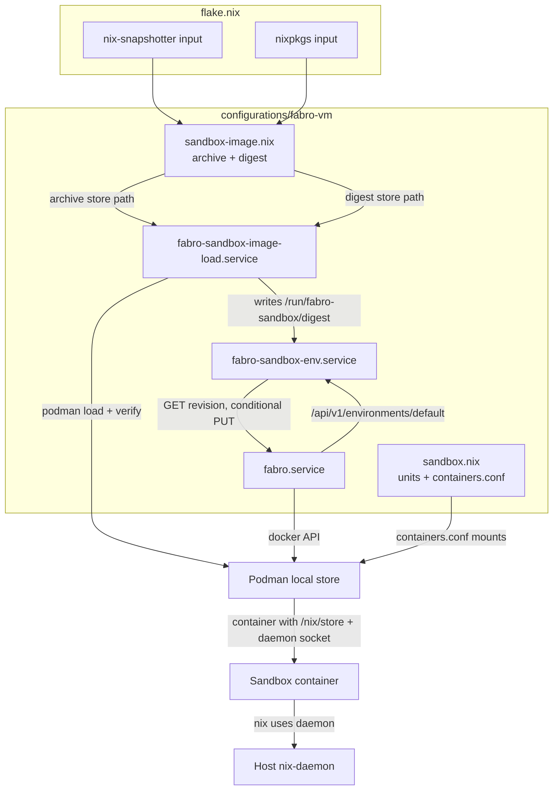
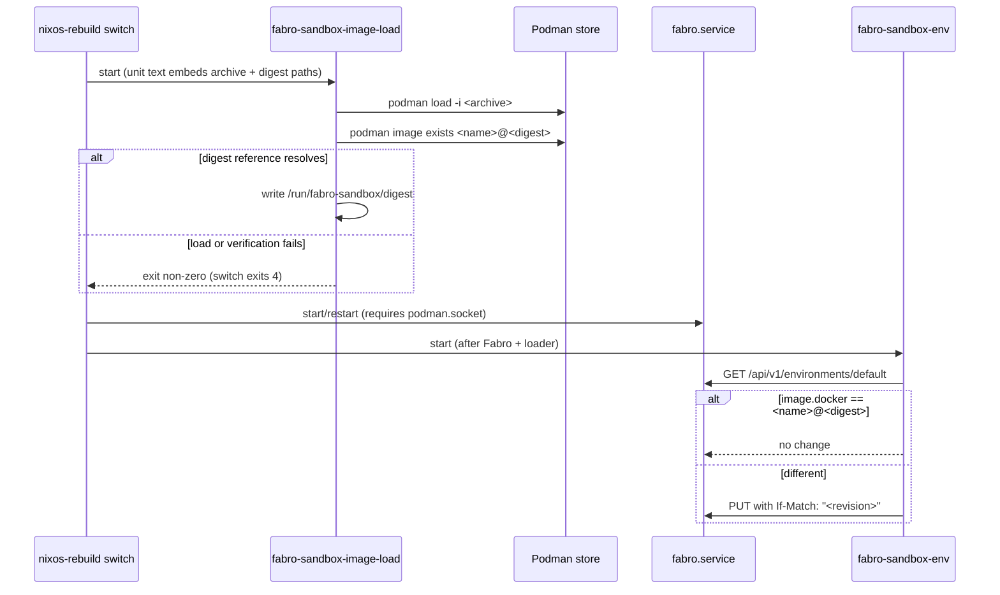
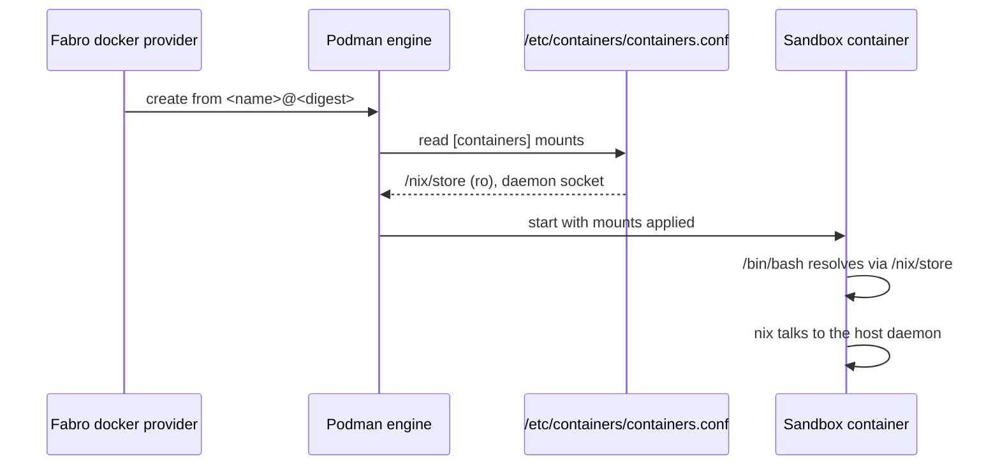

# Design Document

## Overview

This design defines the repo-owned sandbox image for Fabro's `default`
environment, how it is built with `nix-snapshotter`, published into the guest's
local Podman store, referenced by digest, and how sandbox containers reach the
guest's Nix store and daemon. Problem, approach, and scope live in `brief.md`;
the behavioral contract lives in `requirements.md`; external findings and
sources live in `research.md`.

### Goals

- Build a reproducible `aarch64-linux` image carrying `/bin/bash`, Git,
  coreutils, and Nix, and identify it by an OCI manifest digest.
- Load the image into the local Podman store on every switch that changes it,
  with no registry interaction.
- Keep Fabro's persisted `default` environment reconciled to the current
  digest through the environments API.
- Give every sandbox container the guest's `/nix/store` (read-only) and Nix
  daemon socket at the container-engine layer.
- Verify all of the above through repository checks plus a guest smoke check.

### Non-Goals

- CRI-O/containerd integration and registry/store content de-duplication.
- Any registry push, per-workflow environments, or additional providers.
- The `fabro-vm-image` boot image, replacing Podman, or sandbox hardening.
- Host-GC interaction with store paths a running sandbox needs.

## Boundary Commitments

### This Spec Owns

- The `nix-snapshotter` flake input and the sandbox image derivation
  (`copyToRoot`, OCI `config`, tag/name).
- The companion digest derivation that extracts the OCI manifest digest.
- The guest loader unit and its script (load, verify, record digest).
- The digest reference and the environment reconciliation unit and script.
- The global Podman `containers.conf` mounts for host-store/daemon sharing.
- The repository checks and the guest sandbox smoke check.

### Out of Boundary

- Fabro's environment schema (no mount field) and Fabro upgrades.
- The `fabro-vm` guest's other services, secrets, or tailnet wiring.
- `nix-snapshotter`'s snapshotter/dedup behaviour (deferred to a CRI-O spec).
- Registry publication, image signing, and store GC policy.
- Sandbox network policy and the Nix daemon's trust boundary (exposing the
  daemon to agents is accepted by design).

### Allowed Dependencies

- Flake inputs `nixpkgs` and `nix-snapshotter` (pinned through `flake.lock`).
- The `fabro-vm` guest config: `virtualisation.podman`, `sops.templates."fabro-env"`
  (already carries `FABRO_DEV_TOKEN`), `systemd.services.fabro`, and the
  `/var/lib/fabro` state share.
- The Fabro server's `/api/v1/environments/{id}` REST API and the seeded
  `default` environment.
- `pkgs.buildEnv`, `pkgs.writeShellApplication`, `pkgs.runCommand`,
  `pkgs.jq`, and `pkgs.podman` from the guest's locked nixpkgs.

### Revalidation Triggers

- `nix-snapshotter`'s `buildImage` signature, archive format, or layer
  semantics change.
- Fabro's environment schema, revision/`If-Match` semantics, or `default`
  seeding changes.
- Podman's `containers.conf` schema, `[containers] mounts`, or OCI-archive
  digest recording changes.
- The guest's Podman enablement, Fabro settings, or state-share layout
  changes.
- NixOS `switch-to-configuration` failure semantics change.

## Architecture

### Existing Architecture Analysis

- `nixosConfigurations.fabro-vm` is an `aarch64-linux` NixOS system built from
  the flake's `nixpkgs`, evaluable on the darwin host but only buildable with a
  Linux builder (the guest itself). `packages.aarch64-linux.fabro-vm-image`
  already follows this pattern.
- Podman runs rootful with `dockerSocket.enable` (so `/run/docker.sock` serves
  the Docker API) and `dockerCompat`; `virtualisation.podman.enable` already
  turns on `virtualisation.containers`, so `containers.conf` generation is
  available.
- `fabro.service` runs as the Lima cidata user, requires `podman.socket` and
  `litellm.service`, installs the generated `settings.toml` (with
  `run.environment.id = "default"`) before every start, and loads the
  `fabro-env` sops template (which already exports `FABRO_DEV_TOKEN`).
- The `default` environment is seeded into SQLite by install; the server
  auto-migrates `[environments.*]` from `settings.toml` only for missing IDs,
  so a rebuild does not move the persisted image reference on its own.

### Architecture Pattern & Boundary Map

Pattern: a build-time image pair (archive + digest) plus two run-time guest
units, with the container engine as the host-store seam.



Dependency direction: flake inputs → image/digest derivations → unit scripts →
Podman store and Fabro API. Run-time state (the recorded digest) flows only
from the loader to the reconciler; it never flows back into Nix evaluation.

Key decisions:

- The image is a `nix-snapshotter` store-path manifest; the archive's layers
  hold empty store-path mountpoints and rootfs symlinks. Real content comes
  from the host `/nix/store` bind mount, so the image is not self-contained by
  design.
- Identity is the OCI manifest digest from the archive's `index.json`; the
  reference is `<name>@<digest>`. The digest is a build artifact consumed at
  run time, never forced during evaluation (IFD would require a Linux builder
  on darwin).
- Host-store/daemon sharing is a global `containers.conf` `[containers] mounts`
  list, because Fabro's environment schema has no mount field.
- A failing loader oneshot fails the switch (`switch-to-configuration` exits 4
  on failed units).

### Technology Stack

| Layer | Choice / Version | Role in Feature | Notes |
|---|---|---|---|
| Image build | `pkgs.nix-snapshotter.buildImage` (input pinned in `flake.lock`) | Produce the OCI archive | `aarch64-linux`; built on the guest |
| Image contents | `pkgs.bashInteractive`, `pkgs.git`, `pkgs.coreutils`, `pkgs.nix` via `pkgs.buildEnv` | `/bin` tools and Nix | Closures come from the host store at run time |
| Digest | `pkgs.runCommand` + `pkgs.jq` | Extract `index.json` manifest digest | `$out` is a text file |
| Publication | Podman + systemd oneshot | Load and verify into the local store | No registry |
| Environment API | Fabro `/api/v1/environments/{id}` | Digest wiring and reconciliation | ETag/`If-Match` |
| Host store sharing | `virtualisation.containers.containersConf.settings` | Global `[containers] mounts` | Engine-level, all containers |
| Verification | flake `checks` + Node tests + shell smoke | Repo checks and runtime smoke | Pure eval on darwin; smoke on guest |

## File Structure Plan

### Directory Structure

```text
configurations/fabro-vm/
├── sandbox-image.nix   # fabro.sandboxImage options: archive + digest derivations
├── sandbox.nix         # loader + reconciler units, containers.conf mounts, wiring
├── default.nix         # imports ./sandbox-image.nix and ./sandbox.nix
└── fabro.nix           # unchanged: run.environment.id = "default"
scripts/
├── fabro-sandbox-image-load.nix     # podman load, verify digest reference, record digest
├── fabro-sandbox-env-reconcile.nix  # GET revision, conditional PUT to /environments/default
└── fabro-sandbox-smoke.nix          # runtime smoke check (tools, store, daemon)
tests/fabro-sandbox/
├── helpers.js          # nixEvalJson over the repo (same pattern as tests/fabro-service)
├── image.test.js       # image config, contents, digest derivation, pinned input
├── wiring.test.js      # loader/reconciler units, containers.conf mounts, settings
└── package.json        # test entry point for `node --test`
flake.nix               # input, guest overlay, specialArgs, packages, checks, test check
```

### Modified Files

- `flake.nix` — add the `nix-snapshotter` input; add
  `inputs.nix-snapshotter.overlays.default` to the fabro-vm overlay list; pass
  `nixSnapshotter` through `specialArgs`; add `packages.aarch64-linux.*` for the
  archive, digest, and smoke script; extend the `fabro-vm-guest-eval` check; add
  `fabro-sandbox-pinned` and `fabro-sandbox-tests` checks.
- `configurations/fabro-vm/default.nix` — import `./sandbox-image.nix` and
  `./sandbox.nix`.
- `configurations/fabro-vm/sandbox.nix` — add the loader/reconciler units and
  the `containers.conf` mounts; wire `fabro.service` to the loader; add the
  smoke script to `environment.systemPackages`.
- `configurations/fabro-vm/fabro.nix` — unchanged.

## System Flows

### Guest switch



The loader unit's `ExecStart` embeds the archive and digest store paths, so a
contents change rewrites the unit text and the switch reloads the image; an
unchanged image leaves the unit (and the store) as is.

### Sandbox container start



Mounts apply to every container Podman creates, so no per-environment
configuration is needed; the read-only store mount prevents container writes.

## Requirements Traceability

| Requirement | Summary | Components | Contracts / Flows |
|---|---|---|---|
| 1.1–1.5 | Image provides bash, git, coreutils, nix on the default path | Sandbox Image Derivation, Host-Store Sharing | Image config; sandbox start flow |
| 2.1–2.6 | Reproducible, pinned, aarch64 build with a content digest | Sandbox Image Derivation, Image Digest Derivation | Derivation contract; digest file |
| 3.1–3.6 | Load on change into the local store, no registry, before use, tagged, fail the switch | Sandbox Image Loader | Loader service contract; switch flow |
| 4.1–4.6 | `default` environment references the digest and reconciles | Environment Reconciler | API contract; switch flow |
| 5.1–5.5 | Host store/daemon sharing for every container, read-only store | Host-Store Sharing | containers.conf mounts; sandbox start flow |
| 6.1–6.5 | Repository checks and a runtime smoke check | Repository Checks, Sandbox Smoke Check | Check contracts; testing strategy |

## Components and Interfaces

| Component | Domain/Layer | Intent | Requirements | Key Dependencies | Contracts |
|---|---|---|---|---|---|
| Sandbox Image Derivation | Build | Produce the reproducible image archive | 1, 2 | nix-snapshotter, nixpkgs | Batch |
| Image Digest Derivation | Build | Extract the OCI manifest digest | 2.5, 2.6 | Archive, jq | Batch |
| Sandbox Image Loader | Runtime | Load and verify the image locally | 3 | Podman, systemd | Service, State |
| Environment Reconciler | Runtime | Reconcile `default` to the digest | 4 | Fabro API, dev token | Service, API |
| Host-Store Sharing | Runtime | Give containers the host store and daemon | 5 | Podman, containers.conf | State |
| Repository Checks | Verification | Assert configuration in pure eval | 6.1, 6.2 | flake checks, Node | Batch |
| Sandbox Smoke Check | Verification | Exercise the image in a container | 6.3–6.5 | Podman, digest file | Batch |

### Build

#### Sandbox Image Derivation

| Field | Detail |
|---|---|
| Intent | Build the pinned, reproducible sandbox image archive. |
| Requirements | 1.1–1.5, 2.1–2.4 |

**Responsibilities & Constraints**

- Own the image name/tag, contents, and OCI config; produce a single OCI
  archive derivation.
- Build only from the locked `nixpkgs` and `nix-snapshotter` inputs.
- `aarch64-linux` only; built on the guest.

**Dependencies**

- Outbound: `pkgs.nix-snapshotter.buildImage` — archive generation (Critical).
- External: `pkgs.bashInteractive`, `pkgs.git`, `pkgs.coreutils`, `pkgs.nix` —
  image contents (Critical).

**Option contract**

```text
fabro.sandboxImage = {
  enable: bool;                       # default true
  name: string;                       # default "localhost/fabro-sandbox"
  tag: string;                        # default "latest"
  contents: listOf package;           # default [ bashInteractive git coreutils nix ]
  imageConfig: attrs;                 # default { Env = [ "PATH=/bin" "NIX_REMOTE=daemon" ];
                                      #           Cmd = [ "/bin/bash" ]; WorkingDir = "/"; }
  copyToRoot: package;                # readOnly: buildEnv { pathsToLink = [ "/bin" ]; }
  archive: package;                   # readOnly: the OCI archive (.tar)
  digest: package;                    # readOnly: text file holding "sha256:<hex>"
};
```

Invariants:

- `archive` is `buildImage { inherit name tag; inherit copyToRoot; config = imageConfig; }`.
- `copyToRoot` is `pkgs.buildEnv { name = "fabro-sandbox-root"; paths = contents;
  pathsToLink = [ "/bin" ]; }`.
- `imageConfig.Env` must contain `PATH=/bin` and `NIX_REMOTE=daemon`; the Docker
  provider runs a non-login shell, so `PATH` cannot come from profiles.

**Implementation Notes**

- Apply `inputs.nix-snapshotter.overlays.default` to the guest's `nixpkgs` in
  the fabro-vm inline module so `pkgs.nix-snapshotter` resolves.
- The archive's layers hold empty store-path mountpoints and rootfs symlinks;
  content is realized by the host store mount (see Host-Store Sharing).
- Reproducibility follows from `nix-snapshotter`'s epoch-0 tar timestamps and
  content-addressed output.

#### Image Digest Derivation

| Field | Detail |
|---|---|
| Intent | Extract the OCI manifest digest that identifies the archive contents. |
| Requirements | 2.5, 2.6 |

**Batch Contract**

- Trigger: realization of the guest system (or the flake package).
- Input: `${archive}` (an OCI image layout tar).
- Processing: `tar -xOf <archive> index.json | jq -r '.manifests[0].digest'`.
- Output: `$out` contains a single line `sha256:<hex>`.
- Failure: a missing `index.json` or a non-`sha256:` value fails the build.

**Implementation Notes**

- The digest is a store path embedded in the loader unit; it is never read
  during evaluation (no IFD).
- The archive also carries `manifest.json`; its `Config` digest is the image ID
  if the manifest reference form ever needs to change.

### Runtime

#### Sandbox Image Loader

| Field | Detail |
|---|---|
| Intent | Load the archive into the local Podman store and record its digest. |
| Requirements | 3.1–3.6 |

**Responsibilities & Constraints**

- Own loading, digest verification, and the run-time digest file.
- Never contact a registry.
- Fail the unit (and therefore the switch) on any error.

**Dependencies**

- Inbound: `sandbox-image-load.service` — started by the switch (Critical).
- Outbound: `podman` — load/verify (Critical); `/run/fabro-sandbox/digest` —
  the recorded digest (Critical).
- Inbound: `fabro.service` — depends on the loader completing first.

**Service Contract**

- Unit `fabro-sandbox-image-load.service`: `Type = "oneshot"`,
  `RemainAfterExit = true`, `wantedBy = [ "multi-user.target" ]`,
  `after`/`requires = [ "podman.socket" ]`, `RuntimeDirectory = "fabro-sandbox"`.
- Script (`scripts/fabro-sandbox-image-load.nix`), `runtimeInputs = [ podman
  coreutils ]`:
  1. `podman load -i ${archive}`.
  2. Read `digest=$(cat ${digest})`; compute `ref="${name}@${digest}"`.
  3. `podman image exists "$ref"` — fail with the ref on mismatch.
  4. Write `$digest` to `/run/fabro-sandbox/digest` (mode 0644).
- Invariants: the archive and digest store paths are embedded in `ExecStart`
  (so a contents change rewrites the unit); the local tag `<name>:<tag>` is
  retained; the digest file is recreated on every boot.

**State Management**

- State model: one text file `/run/fabro-sandbox/digest` (tmpfs, rebuilt each
  boot/switch).
- Persistence: none beyond the Podman store; the image is reloaded on change.

#### Environment Reconciler

| Field | Detail |
|---|---|
| Intent | Keep the persisted `default` environment pointing at the loaded digest. |
| Requirements | 4.1–4.6 |

**Responsibilities & Constraints**

- Own the `default` environment's image reference; never create duplicates.
- Idempotent: no write when the reference already matches.

**Dependencies**

- Inbound: `fabro-sandbox-env.service` — started by the switch (Critical).
- Outbound: `fabro.service` — the environments API (Critical).
- Inbound: `/run/fabro-sandbox/digest` — the declared digest (Critical).
- External: `FABRO_DEV_TOKEN` from `sops.templates."fabro-env"` (Critical).

**API Contract**

| Method | Endpoint | Request | Response | Errors |
|---|---|---|---|---|
| GET | `/api/v1/environments/default` | `Authorization: Bearer $FABRO_DEV_TOKEN` | `Environment` (+ `ETag`) | 404, 401/403, 5xx |
| PUT | `/api/v1/environments/default` | `If-Match: "<revision>"`, body = persisted env minus `id`/`revision` with `image.docker` replaced | 200 `Environment` (+ new `ETag`) | 409, 422, 428, 5xx |

**Service Contract**

- Unit `fabro-sandbox-env.service`: `Type = "oneshot"`,
  `RemainAfterExit = true`, `wantedBy = [ "multi-user.target" ]`,
  `after`/`requires = [ "fabro.service" "fabro-sandbox-image-load.service" ]`,
  `EnvironmentFile = config.sops.templates."fabro-env".path`, runs as root.
- Script (`scripts/fabro-sandbox-env-reconcile.nix`), `runtimeInputs = [ curl
  jq coreutils ]`:
  1. `ref="${name}@$(cat /run/fabro-sandbox/digest)"`.
  2. GET `default`; 200 → read `revision` and `.image.docker`; 404 → error
     naming `declared=<ref> persisted=<missing>`.
  3. If `.image.docker == ref` → exit 0 (idempotent).
  4. PUT with `If-Match: "<revision>"` and a body built with
     `jq 'del(.id, .revision) | .image.docker = $ref'`; 200 → exit 0; any other
     status → error naming `declared` and `persisted`.

**Implementation Notes**

- `If-Match` carries the quoted revision (the `ETag` value).
- The body preserves `provider`, `resources`, `network`, `lifecycle`, `labels`,
  and `env` verbatim from the GET response.
- `default` is seeded by install, so the GET+PUT path updates rather than
  creates; a 404 is reported, not repaired, per 4.6.

#### Host-Store Sharing

| Field | Detail |
|---|---|
| Intent | Make the guest's Nix store and daemon reachable from every sandbox container. |
| Requirements | 5.1–5.5 |

**Responsibilities & Constraints**

- Own the engine-level mounts; apply to all containers without per-environment
  configuration.
- The store is read-only; the daemon socket directory is read-write so the
  socket is usable.

**State Contract**

```text
virtualisation.containers.containersConf.settings.containers.mounts = [
  "type=bind,source=/nix/store,destination=/nix/store,ro"
  "type=bind,source=/nix/var/nix/daemon-socket,destination=/nix/var/nix/daemon-socket"
];
```

Invariants:

- Mounts are global (`[containers]`), not per-environment.
- `/nix/store` is read-only in the container.
- The daemon socket path matches the host daemon's default, so the image's
  `NIX_REMOTE=daemon` resolves inside the container.

**Implementation Notes**

- `virtualisation.podman.enable` already sets `virtualisation.containers.enable`,
  so the `containers.conf` is generated and merged with the Podman defaults.
- Because the image's store paths are empty mountpoints, this mount is what
  makes the image's `/bin` symlinks resolve.

### Verification

#### Repository Checks

| Field | Detail |
|---|---|
| Intent | Assert image contents, digest wiring, loader, and host-store sharing in pure eval. |
| Requirements | 6.1, 6.2 |

**Batch Contract**

- Trigger: `nix build .#checks.<darwin>.fabro-sandbox-tests` and
  `.#checks.<darwin>.fabro-vm-guest-eval` (plus `fabro-sandbox-pinned`).
- Input: `self.nixosConfigurations.fabro-vm.config` and `flake.lock`.
- Processing: `assertMsg` chains in the guest-eval check; `node --test` over
  `tests/fabro-sandbox/` for finer assertions.
- Output: a `runCommand` store path; any failed assertion fails the check.
- Failure: a missing or misconfigured element aborts evaluation with a named
  message.

**Implementation Notes**

- Extend `fabro-vm-guest-eval` with asserts: `fabro.sandboxImage.enable`;
  the loader unit exists, is a oneshot, and its `ExecStart` references the
  archive and digest store paths; `fabro.service` is `after`/`wants` the loader;
  the reconciler unit exists, is a oneshot, is `after` `fabro.service` and the
  loader, and consumes `sops.templates."fabro-env"`; the
  `containersConf.settings.containers.mounts` list contains the `/nix/store` ro
  bind and the daemon-socket bind; `settings` `run.environment.id == "default"`.
  Update the check's summary string.
- Add `fabro-sandbox-pinned`: read `flake.lock`, assert the `nix-snapshotter`
  node has `locked.rev` and `locked.narHash` (Requirement 2.2/2.3).
- Add `tests/fabro-sandbox/` asserting the image `config.Env`/`Cmd`, the
  `copyToRoot` package names, and the loader/reconciler structural wiring,
  using the `tests/fabro-service` `nixEvalJson` pattern.

#### Sandbox Smoke Check

| Field | Detail |
|---|---|
| Intent | Prove the image runs and reaches the host store and daemon. |
| Requirements | 6.3–6.5 |

**Batch Contract**

- Trigger: operator runs `fabro-sandbox-smoke` in the guest.
- Input: an optional image reference; default `localhost/fabro-sandbox@$(cat
  /run/fabro-sandbox/digest)`.
- Processing, each step printed and failing loudly:
  1. tools: `podman run --rm <ref> /bin/bash -c 'bash --version; git --version;
     command -v nix'`.
  2. store: `podman run --rm <ref> /bin/bash -c 'test -e /nix/store; ls /nix/store'`.
  3. daemon: `podman run --rm <ref> /bin/bash -c 'nix store ping'`.
- Output: exit 0 on success; a failed step prints the step name and exits
  non-zero.
- Recovery: re-run after fixing the loader or mounts; the check is read-only.

**Implementation Notes**

- `scripts/fabro-sandbox-smoke.nix` is a `writeShellApplication` added to the
  guest's `environment.systemPackages` and exposed as
  `packages.aarch64-linux.fabro-sandbox-smoke`.
- Running by digest (not tag) proves Requirement 4.1's reference resolves.

## Data Models

### OCI Image Config (image contents)

```text
ImageConfig {
  Env: ["PATH=/bin", "NIX_REMOTE=daemon"]
  Cmd: ["/bin/bash"]
  WorkingDir: "/"
}
```

Invariants: `PATH` includes `/bin`; `NIX_REMOTE=daemon` targets the mounted
daemon socket; no secret or host path is embedded.

### Digest File

```text
/run/fabro-sandbox/digest   # single line: "sha256:<64 hex>"
```

Invariants: written by the loader only after `podman image exists` confirms the
reference; read by the reconciler and the smoke check; recreated each boot.

### Environment Reference

```text
image.docker = "<name>@<digest>"     # e.g. localhost/fabro-sandbox@sha256:...
```

Invariants: never a mutable tag; the rest of the environment (`provider`,
`resources`, `network`, `lifecycle`, `labels`, `env`) is preserved from the
persisted record.

## Error Handling

### Error Strategy

- Build errors (missing `index.json`, unpinned input) fail evaluation or the
  derivation.
- Load errors fail the loader unit, which fails the switch (`exit_code = 4`).
- Reconciliation errors fail the reconciler unit and name the declared and
  persisted references.

### Error Categories and Responses

| Error | Response | Impact |
|---|---|---|
| Digest derivation cannot read `index.json` or the digest is not `sha256:` | Fail the derivation with the archive path | Image/digest not realized; switch build fails |
| `nix-snapshotter` input unpinned | `fabro-sandbox-pinned` fails; a build without a lock entry fails | No unpinned image |
| `podman load` fails | Loader exits non-zero with the archive path | Switch exits 4; image unchanged |
| Digest reference not resolvable after load | Loader exits non-zero naming the ref | Switch exits 4; no mutable-tag fallback |
| `default` environment missing (404) | Reconciler reports `declared=<ref> persisted=<missing>` | Unit fails; operator recreates `default` |
| PUT revision mismatch (409) or validation (422) | Reconciler reports both references and the HTTP status | Unit fails; next switch retries |
| Smoke step fails | Check prints the step and exits non-zero | Operator investigates loader/mounts |

### Monitoring

- The loader and reconciler log to journald (`journalctl -u
  fabro-sandbox-image-load -u fabro-sandbox-env`); the reconciler prints the
  declared/persisted references on failure.
- The smoke check prints a step banner before each probe so a failure localizes
  to tools, store, or daemon.
- No secret value is logged; only the dev-token-bearing request is sent over
  loopback.

## Testing Strategy

### Unit / Eval tests

- Evaluate `fabro.sandboxImage.imageConfig` and assert `Env` contains
  `PATH=/bin` and `NIX_REMOTE=daemon`, `Cmd == [ "/bin/bash" ]`.
- Assert `copyToRoot` paths resolve to packages named `bash-interactive` (or
  `bash`), `git`, `coreutils`, and `nix`.
- Assert the digest derivation's `buildCommand` reads `index.json` and writes a
  `sha256:` line.
- Assert the `fabro-sandbox-pinned` lock-node check fails for an unpinned input
  (fixture `flake.lock`).

### Integration / Render tests

- Assert the loader unit is a oneshot, `wantedBy multi-user.target`,
  `after`/`requires` `podman.socket`, has `RuntimeDirectory = "fabro-sandbox"`,
  and its `ExecStart` references the archive and digest store paths.
- Assert `fabro.service` is `after`/`wants` the loader.
- Assert the reconciler unit is a oneshot, `after`/`requires` `fabro.service`
  and the loader, and consumes `sops.templates."fabro-env".path`.
- Assert `containersConf.settings.containers.mounts` contains the `/nix/store`
  `ro` bind and the daemon-socket bind, and that `run.environment.id` is
  `default`.
- Render the reconciler script text and assert it issues a GET, compares
  `.image.docker`, and sends `If-Match` on the PUT.

### Runtime / Smoke

- On the guest, build the image and digest, run `nixos-rebuild switch`, and
  confirm the loader recorded the digest and the reconciler set
  `image.docker` to the digest reference.
- Run `fabro-sandbox-smoke`: tools present, `/nix/store` reachable, and
  `nix store ping` succeeds through the host daemon.
- Build the image twice from identical inputs and confirm the digest is
  unchanged (reproducibility), and that a contents change changes both the
  digest and the environment reference.

## Security Considerations

- The host `/nix/store` is mounted read-only; the Nix daemon is exposed to
  sandboxed agents by design (brief Out of Boundary), granting store access
  equivalent to the guest's trusted users.
- The reconciler runs as root on loopback and reads the root-only `fabro-env`
  sops template; the dev token never enters the image or a container.
- The image carries no secrets and no host paths beyond `/nix/store`.
- Loading is rootful; no registry credentials are used because nothing is
  pushed.

## Supporting References

- `research.md` — nix-snapshotter `buildImage`/archive semantics, Fabro
  environments API, containers.conf, and switch-to-configuration findings with
  sources.
- `brief.md`, `requirements.md` — problem, approach, scope, and the behavioral
  contract.
