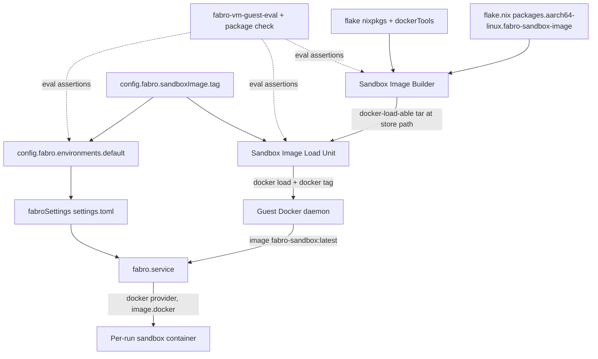
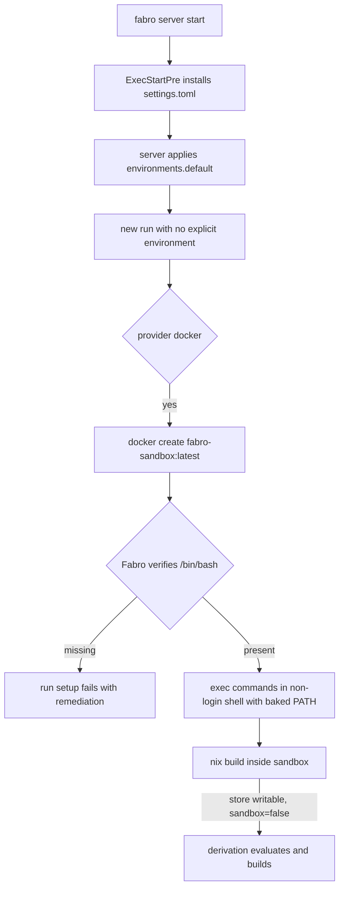

# Design Document

## Overview

**Purpose**: This feature defines Fabro's default sandbox image inside this
repository and points the `fabro-vm` server's `default` environment at it, so
sandbox runs use the same Nix-built toolchain as the server instead of the
seeded `buildpack-deps:noble` image.

**Users**: The operator of the `fabro-vm` Lima guest, who deploys the guest with
`lima-vm-deploy` and expects every new Fabro run to execute in the repo-built
image with a working Nix, without any manual image step.

**Impact**: Adds a Nix-built `aarch64-linux` OCI image plus a systemd load/tag
unit to the guest, and replaces the seeded `default` environment definition with
a declarative one that names the image's stable tag. Fabro's provider selection,
run resources, and network policy are preserved.

### Goals

- Define the default sandbox image in this repo as an `aarch64-linux` package
  built from the same flake/nixpkgs as the server.
- Satisfy Fabro's Docker runtime contract: `/bin/bash`, a baked non-login
  `PATH`, `git`/`coreutils`/`curl`/`jq`, CA certificates, and a working Nix with
  no host mounts.
- Deliver the image into the guest Docker under one stable tag from a systemd
  oneshot, and make the `default` environment reference that tag declaratively.
- Provide repository checks that fail when the package, the delivery wiring, or
  the environment wiring drifts.

### Non-Goals

- Publishing the image to a registry, or distributing it across hosts.
- Per-language or per-project sandbox images; additional catalog environments.
- Changing Fabro's provider selection, run resources, or network policy.
- The server and OpenCode host packages, and specific Nix dev shells.

## Boundary Commitments

### This Spec Owns

- The sandbox image derivation (`configurations/fabro-vm/sandbox-image.nix`),
  its `aarch64-linux` flake package, its contents, and its baked image config
  (`Env` `PATH`, `User`, `/bin/bash`, `/etc/nix/nix.conf`, writable store state
  root).
- The stable image tag and the guest systemd unit that loads and tags the image.
- The declarative `[environments.default]` entry in the generated
  `fabroSettings` `settings.toml`, and the eval-visible environment value the
  repository checks assert.
- The `fabro-vm-guest-eval` assertions and the package-existence check that
  verify the above.

### Out of Boundary

- Fabro's environment/sandbox model, docker provider, and SQLite environment
  catalog (consumed, not modified).
- The image's publish/pull lifecycle and any registry (explicitly rejected by
  the brief).
- Any environment other than `default`, and any per-run environment override.
- The existing `fabro.service` lifecycle, hardening, secrets, and PATH beyond
  adding the load unit as a start dependency.

### Allowed Dependencies

- `pkgs.dockerTools.buildLayeredImage` and `pkgs.dockerTools` helpers from the
  flake's nixpkgs.
- `virtualisation.docker` (already enabled in `configurations/fabro-vm/default.nix`)
  and its `virtualisation.docker.package` CLI.
- The existing `fabroSettings`/`tomlFormat` machinery in
  `configurations/fabro-vm/fabro.nix`, and `lima-vm-deploy` for delivery.
- Fabro's `settings.toml` `[environments.<slug>]` schema and Docker provider
  (see `research.md`).

Dependency direction (must not be violated):
`image derivation → load unit → fabro.service start dependency` and
`tag option → environment value → settings.toml`. The image builder never reads
the Fabro settings; the settings read only the tag option.

### Revalidation Triggers

- The pinned Fabro version changes (environment schema, Docker provider
  behavior, or the settings.toml auto-migration behavior in `research.md`).
- The stable tag or image name changes (it is referenced by both the load unit
  and `[environments.default]`).
- `pkgs.dockerTools`/nixpkgs changes the `buildLayeredImage` output shape or the
  `contents` merge semantics.
- Fabro starts running sandbox commands as a non-root user (breaks single-user
  Nix; see Risks).
- `virtualisation.docker.enable` or the guest's `server.sandbox.providers.docker`
  setting changes.

## Architecture

### Existing Architecture Analysis

- `configurations/fabro-vm/fabro.nix` generates `fabroSettings` with
  `pkgs.formats.toml` and `install`s it into `<FABRO_HOME>/settings.toml` on
  every `fabro.service` start (`ExecStartPre`). This is the declarative-wins
  path the new environment entry rides on.
- `fabro.service` already `requires`/`after` `docker.service` and runs as the
  Lima cidata user with the `docker` supplementary group, so the Docker socket
  is reachable.
- `configurations/fabro-vm/default.nix` enables `virtualisation.docker` and
  imports the per-service modules; it is where the new module is imported.
- `flake.nix` evaluates the guest inline (`nixosConfigurations.fabro-vm`),
  exposes `packages.aarch64-linux.fabro-vm-image`, and runs the pure-eval
  `fabro-vm-guest-eval` check. There are no `aarch64-linux` checks: the mac has
  no Linux builder, so the image is built in-guest during `lima-vm-deploy`.
- Nothing in the repo currently defines an OCI/container image or a Docker load
  step (`research.md`).

### Architecture Pattern & Boundary Map

Selected pattern: a **build-and-load sidecar** for the guest. A Nix derivation
owns the image; a systemd oneshot owns delivery into the local Docker daemon;
the existing `fabroSettings` path owns the environment pointer. The three are
tied by a single stable tag so any one drifting fails the repository checks.



Key decisions: one stable tag (`fabro-sandbox:latest`) is the only coupling
between builder, delivery, and Fabro config; the image is single-user root Nix
with no daemon and no host mounts; `fabro.service` `requires`/`after`s the load
unit so a failed load stops Fabro rather than starting runs against a missing
image.

### Technology Stack

| Layer | Choice / Version | Role in Feature | Notes |
|-------|------------------|-----------------|-------|
| Image build | `pkgs.dockerTools.buildLayeredImage` | Builds the `aarch64-linux` OCI image | Same flake/nixpkgs as the server; output is `docker load`-able |
| Runtime (sandbox) | nixpkgs `bashInteractive`, `coreutils`, `git`, `curl`, `jq`, `cacert`, `nix` | Tools Fabro and Nix dev shells need | Baked `PATH` and `User` in the image config |
| Nix model | Single-user root Nix, `sandbox = false` | Working Nix without host mounts | Writable in-container store; no daemon, no mounts |
| Delivery | systemd oneshot `fabro-sandbox-image-load.service` | `docker load` + `docker tag` under one stable tag | Carries the image store path (GC root) |
| Config | `pkgs.formats.toml` `[environments.default]` | Points Fabro's `default` at the tag | Installed before every server start |
| Checks | `fabro-vm-guest-eval` + package check | Eval-only drift detection on darwin | Image build verified in-guest |

## File Structure Plan

### Directory Structure

```
configurations/fabro-vm/
├── sandbox-image.nix   # NEW: image derivation, tag/image options,
│                       #      fabro-sandbox-image-load.service,
│                       #      system.build.fabroSandboxImage
├── fabro.nix           # MODIFIED: [environments.default] in fabroSettings,
│                       #           fabro.service requires/after the load unit
├── default.nix         # MODIFIED: imports ./sandbox-image.nix
└── image.nix           # UNCHANGED: qcow-efi VM image (unrelated)

flake.nix               # MODIFIED: packages.aarch64-linux.fabro-sandbox-image;
                        #           extended fabro-vm-guest-eval assertions
```

### Modified Files

- `configurations/fabro-vm/default.nix` — add `./sandbox-image.nix` to
  `imports` so the image, tag, and load unit are part of the guest.
- `configurations/fabro-vm/fabro.nix` — declare
  `environments = config.fabro.environments` in `fabroSettings`, define
  `config.fabro.environments.default` from `config.fabro.sandboxImage.tag`, and
  add `fabro-sandbox-image-load.service` to `fabro.service`'s `requires` and
  `after`.
- `flake.nix` — expose
  `packages.aarch64-linux.fabro-sandbox-image = self.nixosConfigurations.fabro-vm.config.system.build.fabroSandboxImage`
  and extend the `fabro-vm-guest-eval` assertion set (see Testing Strategy).

> No new test directory is added: the guest has no Node test harness, and the
> existing `fabro-vm-guest-eval` check is the established eval-assertion home
> for `nixosConfigurations.fabro-vm`.

## System Flows

### Deploy and load (R1, R4)

```mermaid
sequenceDiagram
    participant Op as Operator (mac)
    participant Lima as lima-vm-deploy
    participant Guest as fabro-vm guest
    participant Nix as guest nix-daemon
    participant Sysd as systemd
    participant Docker as guest docker
    Op->>Lima: lima-vm-deploy
    Lima->>Guest: stream tree, nixos-rebuild switch --flake .#fabro-vm
    Guest->>Nix: build fabro-sandbox-image (aarch64-linux)
    Nix-->>Guest: image tar store path
    Guest->>Sysd: activate fabro-sandbox-image-load.service
    Sysd->>Docker: docker load --input <image>
    Sysd->>Docker: docker tag fabro-sandbox:latest <tag>
    Sysd->>Guest: fabro.service starts (requires/after load)
    Note over Sysd,Docker: load failure fails the unit; fabro does not start
```

Gating notes: the load unit is `Type = "oneshot"` with `RemainAfterExit = true`
and `requires`/`after` `docker.service`; it re-runs whenever the image store path
changes because the unit text embeds it. `fabro.service` requiring the load unit
is what turns a failed load into a visible deploy failure (R4.5).

### Run environment resolution (R2, R3, R5)



Gating notes: Fabro owns container lifecycle; the image only guarantees
`/bin/bash`, the baked `PATH`/`User`, and a functional single-user Nix. The
`settings.toml` declaration is re-installed on every server start (R5.3
verification in Testing Strategy).

## Requirements Traceability

| Requirement | Summary | Components | Interfaces | Flows |
|-------------|---------|------------|------------|-------|
| 1.1 | Image defined in repo Nix config | Sandbox Image Builder | `config.fabro.sandboxImage.image` | Deploy and load |
| 1.2 | Image is `aarch64-linux` | Sandbox Image Builder | flake package / `drv.system` | Deploy and load |
| 1.3 | Built from the repo flake/nixpkgs | Sandbox Image Builder | `pkgs.dockerTools.buildLayeredImage` | Deploy and load |
| 1.4 | Loadable into guest Docker | Sandbox Image Load Unit | `fabro-sandbox-image-load.service` | Deploy and load |
| 1.5 | No remote registry dependency | Sandbox Image Load Unit | stable local tag | Deploy and load |
| 2.1 | Provides `/bin/bash` | Sandbox Image Builder | image `contents` | Run environment resolution |
| 2.2 | `/bin/bash` without login shell | Sandbox Image Builder | image root `/bin/bash` | Run environment resolution |
| 2.3 | `git`/`coreutils`/`curl`/`jq` on PATH | Sandbox Image Builder | image `config.Env` `PATH` | Run environment resolution |
| 2.4 | CA certificates | Sandbox Image Builder | `pkgs.cacert`, `SSL_CERT_FILE` | Run environment resolution |
| 2.5 | PATH/ENV baked into image config | Sandbox Image Builder | image `config.Env` | Run environment resolution |
| 3.1 | Working `nix` command | Nix Runtime Config | image `contents`, `/etc/nix/nix.conf` | Run environment resolution |
| 3.2 | Nix evaluates and builds | Nix Runtime Config | writable store, `sandbox=false` | Run environment resolution |
| 3.3 | Nix works without host mounts | Nix Runtime Config | writable in-container store | Run environment resolution |
| 4.1 | Guest Docker holds the tag on deploy | Sandbox Image Load Unit | `docker load` + `docker tag` | Deploy and load |
| 4.2 | Updated image under same tag | Sandbox Image Load Unit | unit text embeds store path | Deploy and load |
| 4.3 | No manual load/tag step | Sandbox Image Load Unit | `wantedBy = multi-user.target` | Deploy and load |
| 4.4 | From Nix build output | Sandbox Image Load Unit | `ExecStart` references derivation | Deploy and load |
| 4.5 | Load failure fails the deploy loudly | Sandbox Image Load Unit | `fabro.service` `requires`/`after` | Deploy and load |
| 5.1 | Declares `default` with docker + tag | Default Environment Wiring | `config.fabro.environments.default` | Run environment resolution |
| 5.2 | New run uses the image | Default Environment Wiring | `image.docker = tag` | Run environment resolution |
| 5.3 | Applied on every server start | Default Environment Wiring | settings re-install + verification | Run environment resolution |
| 5.4 | Preserves provider/resources/network | Default Environment Wiring | `provider`, `resources`, `network` | Run environment resolution |
| 6.1 | Checks: image is `aarch64-linux` package | Repository Verification | package-existence check | — |
| 6.2 | Checks: delivery wired to the tag | Repository Verification | `fabro-vm-guest-eval` | — |
| 6.3 | Checks: `default` references the tag | Repository Verification | `fabro-vm-guest-eval` | — |
| 6.4 | Run reports the sandbox image | Operator E2E | run environment / `docker ps` | Run environment resolution |
| 6.5 | Nix command succeeds in the sandbox | Operator E2E | `nix build` in sandbox | Run environment resolution |

## Components and Interfaces

| Component | Domain/Layer | Intent | Req Coverage | Key Dependencies (P0/P1) | Contracts |
|-----------|--------------|--------|--------------|--------------------------|-----------|
| Sandbox Image Builder | `configurations/fabro-vm/sandbox-image.nix` | Build the repo OCI image and its tag/image options | 1.1–1.3, 2.1–2.5 | dockerTools (P0), nixpkgs (P0) | Package, State |
| Nix Runtime Config | `configurations/fabro-vm/sandbox-image.nix` | Bake a working single-user Nix into the image | 3.1–3.3 | pkgs.nix (P0), substituter (P0) | Package |
| Sandbox Image Load Unit | `configurations/fabro-vm/sandbox-image.nix` | Load and tag the image into guest Docker | 4.1–4.5, 1.4–1.5 | docker CLI (P0), image (P0) | Batch, State |
| Default Environment Wiring | `configurations/fabro-vm/fabro.nix` | Point `default` at the tag in `settings.toml` | 5.1–5.4 | `sandboxImage.tag` (P0), tomlFormat (P0) | State |
| Repository Verification | `flake.nix` | Eval-assert package, delivery, and wiring | 6.1–6.3 | guest eval (P0) | Batch |
| Operator E2E | in-guest procedure | Prove a run and Nix use the image | 6.4–6.5 | guest Docker (P0) | Batch |

### Sandbox Image Builder (`configurations/fabro-vm/sandbox-image.nix`)

| Field | Detail |
|-------|--------|
| Intent | Build the `aarch64-linux` default sandbox image from the repo flake |
| Requirements | 1.1, 1.2, 1.3, 2.1, 2.2, 2.3, 2.4, 2.5 |

**Responsibilities & Constraints**
- Own the image contents: `bashInteractive`, `coreutils`, `git`, `curl`, `jq`,
  `cacert`, and `nix` (plus the Nix runtime config below).
- Own the image config: `Env` `PATH`/cert vars and `User = "root"`, and a
  `/bin/bash` default `Cmd`.
- Own the stable name/tag options; expose the derivation on
  `system.build.fabroSandboxImage` for the flake package.

**Dependencies**
- External: `pkgs.dockerTools.buildLayeredImage` — image build (Critical).
- External: the flake's nixpkgs — same revision as the server (Critical).

**Contracts**: Package [x] / State [x]

##### Image Contract

```nix
# config.fabro.sandboxImage
{
  image = pkgs.dockerTools.buildLayeredImage {
    name = "fabro-sandbox";
    tag  = "latest";
    contents = [ bashInteractive coreutils git curl jq cacert nix ];
    config = {
      Cmd = [ "/bin/bash" ];
      User = "root";
      Env = [ "PATH=/bin" "SSL_CERT_FILE=/etc/ssl/certs/ca-bundle.crt" "NIX_SSL_CERT_FILE=/etc/ssl/certs/ca-bundle.crt" ];
    };
  };
  tag = "fabro-sandbox:latest";   # the stable reference
}
```

- Preconditions: `pkgs.stdenv.hostPlatform.system == "aarch64-linux"`.
- Postconditions: `$out` is a `docker load`-able tar; `/bin/bash` exists; the
  listed tools resolve on `/bin`; the image config carries `PATH` and `User`.
- Invariants: the image references only store paths from the flake's nixpkgs;
  no registry or network fetch is required to build it.

**Implementation Notes**
- Integration: `contents` are merged into the image root with `buildEnv`
  semantics, so `/bin/bash` and `/bin/<tool>` come from the packages directly;
  the `Env` `PATH=/bin` is what a non-login shell sees (R2.5).
- Validation: the darwin checks assert the derivation exists and is
  `aarch64-linux`; the in-guest deploy builds it and inspects the loaded image.
- Risks: if a future nixpkgs changes the `contents` merge, the `/bin` contract
  breaks — revalidation trigger.

### Nix Runtime Config (`configurations/fabro-vm/sandbox-image.nix`)

| Field | Detail |
|-------|--------|
| Intent | Provide a working Nix inside the container with no host mounts |
| Requirements | 3.1, 3.2, 3.3 |

**Responsibilities & Constraints**
- Bake `/etc/nix/nix.conf` into the image with:
  `experimental-features = nix-command flakes`, `sandbox = false`,
  `build-users-group =` (empty), and the default substituters.
- Pre-create the local store's writable state root
  (`/nix/var/nix/{profiles,gcroots}`) so Nix can initialize its store database
  on first use.
- No daemon and no host bind mounts: Nix runs single-user as root against the
  container's writable `/nix/store`; the shipped closure's paths are not
  pre-registered, so Nix populates its database and downloads substitutes for
  whatever a build needs.

**Dependencies**
- External: `pkgs.nix` — the `nix` binary and store tooling (Critical).
- External: the default substituter (`https://cache.nixos.org`) — build
  substitutes (Critical).

**Contracts**: Package [x]

##### Nix Runtime Contract

```nix
# inside buildLayeredImage
extraCommands = ''
  mkdir -p nix/var/nix/profiles nix/var/nix/gcroots
'';
# /etc/nix/nix.conf
#   experimental-features = nix-command flakes
#   sandbox = false
#   build-users-group =
```

- Preconditions: the container's filesystem is writable and commands run as
  root (`User = "root"`); the sandbox has network access (`allow_all`).
- Postconditions: `nix --version` works; `nix build` can evaluate a derivation
  and download substitutes into `/nix/store`.
- Invariants: no dependency on a host `/nix`, a daemon socket, or a bind mount.

**Implementation Notes**
- Integration: `sandbox = false` and an empty `build-users-group` are required
  because a container has no user namespaces or build users by default; both are
  image-level config, not per-command flags. Registering the shipped closure
  (via `pkgs.closureInfo` + `nix-store --load-db`) is a possible optimization
  but is deliberately not required, because the store database is created and
  maintained by Nix at runtime.
- Validation: the in-guest check runs `nix build` of a trivial derivation inside
  a container from the loaded image.
- Risks: single-user Nix requires root; if Fabro's docker provider later runs
  sandbox commands as a non-root user, this model fails (recorded risk).

### Sandbox Image Load Unit (`configurations/fabro-vm/sandbox-image.nix`)

| Field | Detail |
|-------|--------|
| Intent | Put the repo-built image in guest Docker under one stable tag |
| Requirements | 4.1, 4.2, 4.3, 4.4, 4.5, 1.4, 1.5 |

**Responsibilities & Constraints**
- Define `systemd.services.fabro-sandbox-image-load`: `Type = "oneshot"`,
  `RemainAfterExit = true`, `after`/`requires` `docker.service`,
  `wantedBy = multi-user.target`.
- `ExecStart` runs `docker load --input <image derivation>`; `ExecStartPost`
  runs `docker tag fabro-sandbox:latest <config.fabro.sandboxImage.tag>`.
- Reference the docker CLI by store path (`virtualisation.docker.package`), not
  by ambient PATH.

**Dependencies**
- Inbound: `config.fabro.sandboxImage.image`, `.tag` (Critical).
- External: `virtualisation.docker` CLI and daemon (Critical).

**Contracts**: Batch [x] / State [x]

##### Unit Contract

```nix
systemd.services.fabro-sandbox-image-load = {
  description = "Load the repo-built Fabro sandbox image into Docker";
  wantedBy = [ "multi-user.target" ];
  after = [ "docker.service" ];
  requires = [ "docker.service" ];
  serviceConfig = {
    Type = "oneshot";
    RemainAfterExit = true;
    ExecStart = "${docker}/bin/docker load --input ${image}";
    ExecStartPost = "${docker}/bin/docker tag fabro-sandbox:latest ${tag}";
  };
};
```

- Preconditions: `docker.service` is active and the image derivation is built.
- Postconditions: `docker image inspect <tag>` succeeds on the guest.
- Invariants: the unit text embeds the image store path, so a rebuild changes
  the unit and re-runs it; the tag is constant across builds (R4.2).

**Implementation Notes**
- Integration: because `fabro.service` gains this unit in its `requires` and
  `after`, a load failure prevents Fabro from starting and is visible in
  `systemctl status`/journald with the image name in the message (R4.5).
- Validation: the eval check asserts the unit exists with `Type = "oneshot"`,
  `requires docker.service`, and an `ExecStart` containing both the image path
  and the tag.
- Risks: `docker load` on a repeated tag retags the local image; that is the
  intended update path.

### Default Environment Wiring (`configurations/fabro-vm/fabro.nix`)

| Field | Detail |
|-------|--------|
| Intent | Point Fabro's `default` environment at the stable tag declaratively |
| Requirements | 5.1, 5.2, 5.3, 5.4 |

**Responsibilities & Constraints**
- Define `config.fabro.environments.default` with `provider = "docker"`,
  `image.docker = config.fabro.sandboxImage.tag`,
  `resources = { cpu = 2; memory = "4GB"; }`, and `network.mode = "allow_all"`.
- Include `environments = config.fabro.environments` in the generated
  `fabroSettings`, which is re-installed to `<FABRO_HOME>/settings.toml` on
  every `fabro.service` start.

**Dependencies**
- Inbound: `config.fabro.sandboxImage.tag` (Critical).
- External: `pkgs.formats.toml` (Critical).

**Contracts**: State [x]

##### Environment Contract

```nix
# config.fabro.environments.default
{
  provider = "docker";
  image.docker = config.fabro.sandboxImage.tag;   # fabro-sandbox:latest
  resources = { cpu = 2; memory = "4GB"; };
  network.mode = "allow_all";
}
```

- Preconditions: `run.environment.id = "default"` (already set).
- Postconditions: the generated `settings.toml` carries
  `[environments.default]` with the tag, and a new run with no explicit
  environment resolves to it.
- Invariants: provider, resources, and network match the seeded default, so only
  the image reference changes (R5.4).

**Implementation Notes**
- Integration: exposing the value as `config.fabro.environments` lets the darwin
  check assert the wiring without building the `aarch64-linux` TOML derivation.
- Validation: the eval check asserts `provider`, `image.docker == tag`,
  `resources`, and `network`; the in-guest procedure restarts the server and
  confirms a run still resolves to the tag (R5.3).
- Risks: upstream documents that `[environments.*]` in `settings.toml` may be
  auto-migrated into SQLite (see `research.md`). If the pinned server imports it
  once instead of re-applying it each start, R5.3 requires removing/refreshing
  the persisted `default` row; this is the first thing the R5.3 verification
  checks, and it is a revalidation trigger.

### Repository Verification (`flake.nix`)

| Field | Detail |
|-------|--------|
| Intent | Fail repository checks when the package, delivery, or wiring drifts |
| Requirements | 6.1, 6.2, 6.3 |

**Responsibilities & Constraints**
- Expose `packages.aarch64-linux.fabro-sandbox-image` and assert it exists and
  is `aarch64-linux` (R6.1).
- Extend `fabro-vm-guest-eval` with assertions over the load unit, the tag, and
  `config.fabro.environments.default` (R6.2, R6.3).

**Dependencies**
- Inbound: `self.nixosConfigurations.fabro-vm.config` (Critical).

**Contracts**: Batch [x]

**Implementation Notes**
- Integration: assertions are pure eval over the guest config plus a trivial
  `pkgs.runCommand`, matching the existing `fabro-vm-guest-eval` style; no Linux
  builder is needed on the mac.
- Risks: darwin checks cannot build or inspect the `aarch64-linux` image tar, so
  image contents are verified in-guest, not in the repository check.

## Data Models

### Domain Model

- **SandboxImage**: identified by its stable name/tag; owns contents, image
  config (`Env`, `User`, `Cmd`), and the Nix runtime config. Invariant: built
  from the flake's nixpkgs, `aarch64-linux` only.
- **Environment (`default`)**: a Fabro environment definition —
  `provider`, `image.docker`, `resources`, `network`. Invariant: identical to
  the seeded default except `image.docker`.

### Logical Data Model

Environment entry (rendered into `settings.toml`):

| Field | Type | Value |
|-------|------|-------|
| `provider` | string | `"docker"` |
| `image.docker` | string | `fabro-sandbox:latest` (stable tag) |
| `resources.cpu` | int | `2` |
| `resources.memory` | string | `"4GB"` |
| `network.mode` | string | `"allow_all"` |

Image config contract:

| Field | Value |
|-------|-------|
| `Env` | `PATH=/bin`, `SSL_CERT_FILE`, `NIX_SSL_CERT_FILE` |
| `User` | `root` |
| `Cmd` | `/bin/bash` |
| `/bin/bash` | present via `bashInteractive` |
| `/etc/nix/nix.conf` | `nix-command flakes`, `sandbox = false`, empty `build-users-group` |
| `/nix/var/nix` | writable store state root; DB created by Nix on first use |

## Error Handling

### Error Strategy

Fail closed at delivery: if the image cannot be built or loaded, `fabro.service`
does not start. Surface sandbox-contract violations through Fabro's own
remediation (missing `/bin/bash`) rather than silently degrading.

### Error Categories and Responses

- **Build errors**: a failed image build aborts `nixos-rebuild switch` before
  activation; the current generation keeps running.
- **Load errors (R4.5)**: `docker load`/`docker tag` failure fails
  `fabro-sandbox-image-load.service`; `fabro.service` `requires` it, so Fabro
  does not start and journald names the image and tag.
- **Sandbox contract errors (R2.1)**: Fabro verifies `/bin/bash` at init and on
  resume and fails with remediation instead of reporting the sandbox ready.
- **Nix errors (R3.2)**: a failed `nix build` inside the sandbox surfaces in the
  run's stage output, exactly like any other command failure.

### Monitoring

- `systemctl status fabro-sandbox-image-load` and `journalctl -u
  fabro-sandbox-image-load` report the load/tag result.
- `docker image inspect fabro-sandbox:latest` confirms the loaded image and its
  config on the guest.
- The run's environment and the sandbox listing show which image a run used.

## Testing Strategy

### Static / Eval Checks (repository, darwin)

- Package existence (R6.1): `self.packages.aarch64-linux ? fabro-sandbox-image`
  and the derivation's `system == "aarch64-linux"`.
- Load-unit wiring (R6.2): `systemd.services ? fabro-sandbox-image-load`;
  `Type == "oneshot"`; `requires`/`after` contain `docker.service`; the
  `ExecStart`/`ExecStartPost` strings contain the image store path and
  `config.fabro.sandboxImage.tag`.
- Environment wiring (R6.3): `config.fabro.environments.default.provider ==
  "docker"`; `image.docker == config.fabro.sandboxImage.tag`;
  `resources.cpu == 2`; `resources.memory == "4GB"`; `network.mode ==
  "allow_all"`.
- Start dependency (R4.5): `fabro.service.requires` and `.after` contain
  `fabro-sandbox-image-load.service`.

### Build / Integration (in-guest, during deploy)

- `nix build .#packages.aarch64-linux.fabro-sandbox-image` succeeds on the guest.
- After `lima-vm-deploy`, `docker image inspect fabro-sandbox:latest` shows the
  expected `Env` (`PATH=/bin`) and `User` (`root`) (R2.3, R2.5).
- `docker run --rm fabro-sandbox:latest bash -c 'command -v bash ls mkdir git curl
  jq nix && nix --version'` resolves every tool on `/bin` (R2.1, R2.3, R3.1).
- `docker run --rm fabro-sandbox:latest bash -c 'nix build --no-link
  nixpkgs#hello'` evaluates and builds a derivation (R3.2, R3.3).

### E2E / Operator

- Start a Fabro run with no explicit environment; confirm the run's environment
  resolves to `default` and `docker ps` shows `fabro-sandbox:latest` (R5.2,
  R6.4).
- Restart `fabro.service` and confirm a new run still resolves to the tag (R5.3).
- Inside a run's sandbox, execute a Nix command and confirm it succeeds (R6.5).

## Security Considerations

- The image adds no secrets: it carries only public tooling, CA certificates,
  and Nix; Fabro's own vault/secret handling is unchanged.
- `User = "root"` inside the sandbox is required for single-user Nix; the
  sandbox is already the isolation boundary Fabro provides, and this design does
  not widen it (network stays `allow_all`, matching the seeded default).
- The load unit runs as root only to reach the Docker socket; it reads a store
  path and issues `docker load`/`docker tag`, nothing else.

## Supporting References

- `.kiro/specs/nix-built-container-for-default-fabro-environmen/research.md` —
  upstream Fabro environment schema, Docker provider contract, seeded `default`
  shape, the `settings.toml` auto-migration risk, and the confirmed repository
  facts.
