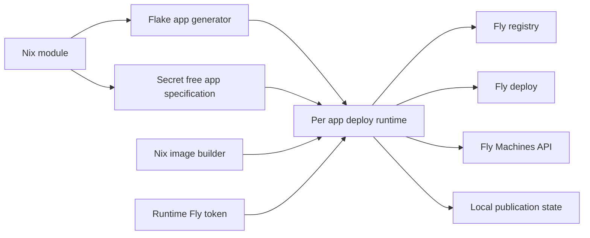

# Design Document

## Overview

Each declared Fly app becomes an independently callable flake app. A local deploy program builds and publishes derivation-backed images, then applies app settings and full Machine configurations using only a runtime Fly token; the feature boundary is in `brief.md`.

## Boundary Commitments

### This Spec Owns
- A reusable, non-NixOS Nix module for app settings, complete Machine declarations, per-image source selection, and secret-free evaluation.
- A flake output generator exporting `apps.<linux-system>.deploy-<app>` from a caller's declared app set; each app command has an independent target and exit code.
- Local OCI packaging through a self-contained `dockerTools` base plus pinned `nix-snapshotter.buildImage`, registry publication/state, and Fly deployment/reconciliation.
- Runtime credential handling for Fly CLI, registry, and Machines API; deterministic tests and an operator-run compatibility gate.

### Out of Boundary
- Stock deploy-rs/Colmena host deployment, NixOS activation, a NixOps4 provider, and multi-app scheduling/rollback. External scripts and NixOps4 resources may call the per-app commands without integration changes.
- Fly app/account lifecycle, Fly application secrets, token issuance, a general-purpose OCI builder, deleting undeclared Fly Machines, native Darwin publisher execution, and enforcement against out-of-band `flyctl deploy`.

### Allowed Dependencies
- Repository-pinned nixpkgs and `pdtpartners/nix-snapshotter`; `dockerTools` supplies the complete runtime closure before the pinned OCI build/push API is used.
- Nix flake apps run in a Linux environment capable of building the target image and executing the pinned Linux publisher. macOS operators invoke the app from a local Linux environment such as a VM; a Darwin wrapper is not provided.
- Fly registry, `flyctl` deploy, and Machines API authenticated with one operator-supplied Fly token at invocation time. The operator does not run out-of-band `flyctl deploy` on app-managed Machines; no guard enforces this.

### Revalidation Triggers
- Pinned image builder's `fromImage`/`copyToRegistry` interface or closure representation changes.
- Fly registry authentication, `flyctl` Machine conversion, Machines API full-config semantics, or multi-container Pilot requirements change.
- Flake app naming, state location/identity format, or supported build system changes.

## Architecture

### Existing Architecture Analysis
- `flake.nix` already pins the snapshotter and exports system-specific `apps` but exports no reusable Fly module or per-app deploy generator.
- `configurations/fabro-vm/sandbox-image.nix` demonstrates the builder interface; its image relies on local store mounts and is not reusable on Fly as-is.
- `scripts/fabro-sandbox-image-load.nix` loads images to Podman, not Fly's registry. No existing deployment state or Fly Machine reconciliation exists.

### Architecture Pattern & Boundary Map



The dependency direction is module declarations → evaluated specification and builder outputs → per-app command → Fly interfaces and local state. External orchestration invokes commands but does not own module options or image state.

### Technology Stack

| Layer | Choice | Role |
|---|---|---|
| Declaration | Nix `lib.evalModules` and flake apps | Pure option evaluation and per-app entry points |
| Linux image | Pinned nixpkgs `dockerTools` + `nix-snapshotter.buildImage` | Self-contained base, then OCI archive/push |
| Deployment | Nix-built executable with pinned `flyctl` and API/registry clients | Render app config, publish images, reconcile Machines |
| State | Linux-host local non-secret per-app record | Distinguish first publish from missing previously published image while intact |

## File Structure Plan

```text
modules/fly-app.nix                 # Pure reusable app/Machine/image options and validation
lib/fly-apps.nix                   # Evaluate named app declarations and generate flake apps
lib/fly-app-image.nix              # Self-contained base plus pinned snapshotter OCI derivation
scripts/fly-app-deploy.nix         # Per-app runtime orchestration and secret handling
scripts/fly-app-publish.nix        # Registry inspection/push and per-app publication state
scripts/fly-app-reconcile.nix      # Fly CLI settings and full Machines API reconciliation
tests/fly-app/module.test.nix      # Evaluation, option errors, serialization, output naming
tests/fly-app/deploy.test.js       # Stubbed registry, API, credentials, state and failure tests
tests/fly-app/image.test.nix       # Image closure and builder contract checks
tests/fly-app/contract-smoke.sh    # Operator-token live Fly boot and repeated deploy checks
tests/fly-app/fixture/flake.nix    # Consumer-flake fixture with two independently callable apps
flake.nix                          # Export module, generator, deploy package and checks
```

No existing Fabro VM image or loader file is changed; those paths are examples, not shared implementation.

## Components and Interfaces

| Component | Contract | Requirements |
|---|---|---|
| Module and app generator | Evaluate named app map, emit store-safe per-app spec and `apps.<system>.deploy-<app>` with selected app fixed | 1, 2, 3.6-3.7, 4, 6 |
| OCI image builder | Convert derivation closure to standalone base, then pinned snapshotter OCI output; no token at build time | 3.2, 3.4, 6.1 |
| Deploy runtime | Read selected spec and runtime token, invoke publisher then reconciler; return failure synchronously | 4, 5, 6 |
| Publisher and local state | Track `(app, image identity, registry reference, published digest)` without secrets; inspect/push through registry | 3.1-3.5, 3.8, 4.3, 5.1, 6.2 |
| Reconciler | Apply app settings through Fly CLI, then fully apply/verify all declared Machines through API | 1, 2, 4.3-4.4 |

### Module and app generator

- Input: named app declarations with existing Fly app identity; supported app-level settings; Machines keyed by stable logical identity with full JSON-compatible `config`; image-bearing Machine or container uses exactly one tagged `existingImage` or `derivation` source. A selected deploy container is explicit for multi-container app deployment.
- Output: token-free JSON specification, image derivations, and independent `nix run '.#deploy-<app>'` commands on Linux in a consumer flake. App names must map unambiguously to flake attribute names; collisions and invalid sources fail evaluation.
- The module is not a NixOS module. It does not fetch secrets, deploy Fly resources during evaluation, or infer an SSH/NixOS host.

### OCI image builder

- A `dockerTools` base contains the Linux runtime closure, entrypoint, and filesystem needed without a host Nix store. The pinned snapshotter imports it with `fromImage` and generates the final OCI archive without a snapshotter-dependent closure layer. Both image build and the pinned publisher execute on Linux.
- The image's realized identity maps to a deterministic app-scoped registry tag; `copyToRegistry` publishes using runtime Docker-compatible credentials. Record and verify the remote manifest digest, not just the tag's existence. No token enters the base or image derivation.
- A live Fly boot test gates the claim that the combined image works on Fly; failure blocks derivation-backed deployment rather than falling back to Nixpacks or a native snapshotter-only layer.

### Deploy runtime, publisher, and reconciler

```text
fly-app-deploy --spec <secret-free-store-path>
  input: selected app spec; FLY_API_TOKEN at runtime; local non-secret publication state
  output: exit 0 after images are available and Fly accepts app and full Machine configuration
  failure: nonzero for invalid input, auth, build, missing image, publish, or Fly rejection
```

- For each derivation image, compare realized identity against the last successful publication in per-app state. On a new identity, publish then persist the image reference and registry manifest digest after confirmation. For unchanged identity, inspect the remote digest and skip push only on a match; if the recorded image is missing or differs, fail without republishing. First deployment without a record may adopt an existing matching digest or publish automatically if absent. The user accepts that lost state or a new host can republish an unchanged image.
- The publisher scopes persistent state per app and protects it against concurrent runs of the same app. It contains no credential and cannot be trusted as proof of remote presence. Missing, malformed, or migrated records are treated as first deployment; registry inspection auth/network failure is a hard failure, never interpreted as absence.
- Create private temporary runtime Docker credentials from `FLY_API_TOKEN` using stdin and an isolated runtime home, with cleanup on failure; Fly CLI and Machines API use the same token. Never embed it in store paths, command arguments, generated config, persistent state, or diagnostics.
- The reconciler renders app settings into a runtime `fly.toml` and invokes `flyctl deploy --app <existing-app> --image <primary-reference>` without a Fly remote build. Disable automatic first-deploy HA when it would create undeclared replicas; retain the declared process-group counts on later deploys. Afterwards enumerate the module-managed Machine set (declaration keys and Fly Launch process groups), match stable declaration identities to Fly IDs, create missing ones where Fly allows, then fully update and verify every declared Machine through the Machines API. Managed count, identity, image and supported config fields must match; ambiguous matches or surplus Machines in the managed set cause failure rather than silent success or deletion. Preserve Fly Launch ownership metadata for managed Machines. Unrelated unmanaged Machines are outside this set. Direct API reconciliation always follows `flyctl`, including on repeated deployments; the operator is responsible for not running other `flyctl deploy` commands outside this workflow. Do not delete undeclared Machines or implement an enforcement guard.
- A failed partial deployment returns failure with the affected app/Machine; it does not claim rollback. Retries re-enumerate stable identities and reuse already-published unchanged images. Changes to immutable Machine fields fail with an actionable replacement-required error rather than silently deleting/recreating Machines.

## Requirements Traceability

| IDs | Design coverage |
|---|---|
| 1.1-1.4 | Module app/settings contract; deploy runtime existing-app handling and acceptance checks |
| 2.1-2.4 | Open full Machine config and per-container sources; post-deploy direct API reconciliation and verification |
| 3.1-3.2 | Existing-image bypass and self-contained local builder/publish contract |
| 3.3-3.5 | Realized identity, per-app state, registry presence and strict no-republish missing-image rule |
| 3.6-3.8 | Module assertions and build/publish/availability failure contract |
| 4.1-4.4 | Named independent flake apps; single-app targeting and synchronous failure |
| 5.1-5.3 | Runtime token shared across registry/CLI/API; fail-fast authentication |
| 6.1-6.3 | Secret-free Nix outputs, private temporary credentials, redacted arguments/output and state |

## Testing Strategy

- Module fixture: two named app commands, distinct app identities, open API fields, containers with individual image sources, and evaluation errors for both/neither image choices.
- Builder checks: Linux closure lives in the final OCI image without host `/nix/store`; pinned `fromImage` and publish interfaces are exercised independently of a live credential.
- Stubbed runtime: automatic first publish, unchanged digest skip, changed publish, intact-state missing or wrong digest fails without push, lost-state first publish, concurrent same-app commands, app-only config changes, and cross-app targeting isolation.
- API/CLI stubs: prove app settings render, full arbitrary Machine fields survive a lossy CLI stage through final API reconciliation on two consecutive deployments, stable ID retries, managed metadata retention, first-deploy HA and surplus detection, multi-container Pilot behavior, rejection/partial failure and nonzero exit.
- Token fixture: validate missing/rejected token, registry authentication with only that token, cleanup and no fixture value in derivations, generated artifacts, arguments, persistent state, or logs.
- Operator-run acceptance: on an existing Fly app with a supplied token, prove a standalone image boots, the managed Machine count and multi-container/app settings survive two deployments, a recorded missing image fails without republish, and a caller script sees nonzero status. Without this evidence, live compatibility remains unverified.

## Security Considerations

- The deployment host's `FLY_API_TOKEN` is operator-managed and scoped to the app. Temporary Docker-compatible authentication is private and removed after every run; no additional Fly credential is required.
- Fly API errors are redacted before logging. Image/state metadata are non-secret; runtime secrets are never passed to Nix evaluation.
