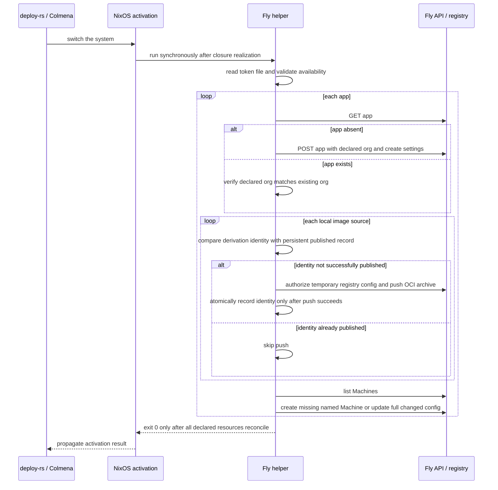

# Design Document

## Overview

This design defines a reusable NixOS module and synchronous activation deployer for the contracts in `requirements.md`; the problem, approach, and scope remain in `brief.md`. The module renders and reconciles Fly App creation settings and full Machines API configurations, publishes local OCI derivations only after their Nix derivation identity changes, and authenticates with a runtime Fly access token. External Fly API and registry behavior researched for these decisions is recorded in `research.md`.

### Goals

**Summary:** Make Fly app and Machine configuration part of a NixOS system's normal switch operation.

**Scope:** Cover API-supported app creation settings, complete per-Machine configuration including multi-container Machines, existing image references, and local Nix-built OCI archives.

**Decisions:** Run deployment synchronously in NixOS activation so deploy-rs and Colmena receive the success or failure through their normal switch invocation.

**Impacts/Risks:** A switch that includes Fly apps requires network access and a valid runtime token; it fails rather than silently leaving declared state unapplied.

### Non-Goals

**Summary:** This module is a Fly deploy adapter, not a general cloud control plane.

**Scope:** Fly organization/user lifecycle, volume creation, IP allocation, certificates, Fly app secrets, undeclared-Machine cleanup, deployment from non-NixOS hosts, and replacing deploy-rs or Colmena are excluded.

**Decisions:** Operators provision Fly apps' organizations, persistent volumes, IP addresses, and app secrets separately; the module only creates an app when absent and reconciles named Machines.

**Impacts/Risks:** Existing organizations and app resources must already meet those external prerequisites; this module will not destroy resources that are not declared.

## Boundary Commitments

**Summary:** The module owns the translation from NixOS declarations to Fly App creation and Machines API create/update operations.

**Scope:** The boundary includes image derivation realization, conditional registry publication, runtime token wiring, activation ordering, status propagation, and evaluation/runtime tests.

**Decisions:** NixOS activation on the configured host is the sole deployment executor. `deploy-rs` and Colmena remain wrappers around that host's normal NixOS activation and require no provider-specific patch.

**Impacts/Risks:** Activation is not a distributed transaction: a later Machine update can fail after an earlier update succeeded. The helper stops on the first error and a subsequent activation retries reconciliation.

### This Spec Owns

- The exported NixOS module contract for Fly app definitions, image sources, and named Machine configurations.
- Conversion of derivation-backed OCI images to stable Fly registry references and publication state under `/var/lib/nix-fly/`.
- Synchronous Fly API reconciliation, noninteractive authentication, error/status reporting, and structural and live verification.

### Out of Boundary

- Managing Fly organizations, users, volumes, IP addresses, certificates, app secrets, or Fly account policy.
- Deleting Machines omitted from Nix, replacing existing app names, or changing immutable Machine names/regions in place.
- Adding or configuring deploy-rs or Colmena, or providing a deployment controller for Darwin/other non-NixOS hosts.
- Making secret application values available in Nix evaluation, generated JSON, derivations, or image contents.

### Allowed Dependencies

- NixOS module options and `system.activationScripts`; the consuming system's `pkgs` and NixOS activation status.
- The pinned `pdtpartners/nix-snapshotter` input already used by this repository, exposed through its Nixpkgs overlay when users build OCI archives.
- Fly's public Machines API (`https://api.machines.dev`), `flyctl` for token-based private-registry authorization, and `skopeo` for OCI-archive publication.
- A root-readable operator-managed token file, defaulting to `/run/secrets/fly-api-token`; no separate credential service is required by the module.

### Revalidation Triggers

- Fly changes the Apps or Machines endpoint paths, accepted request fields, multi-container `containers` behavior, or response/error contract.
- `nix-snapshotter` changes its image archive format or build interface, or Fly changes registry image tagging/authentication.
- NixOS changes activation-script ordering or failure propagation; deploy-rs/Colmena change how they invoke NixOS activation.
- The token path, its owner/mode, or the operator provisioning source changes.

## Architecture

### Existing Architecture Analysis

**Summary:** The repository has a local OCI-image precedent but no Fly deployment module or deployment-tool adapter.

**Scope:** `flake.nix` pins `pdtpartners/nix-snapshotter` and applies its overlay to `nixosConfigurations.fabro-vm`; `configurations/fabro-vm/sandbox-image.nix` builds an OCI archive and extracts its manifest digest. `scripts/fabro-sandbox-image-load.nix` and `configurations/fabro-vm/sandbox.nix` load a local Podman image only; they intentionally do not publish to a registry.

**Decisions:** Preserve the separation between pure Nix image construction and runtime effects, but implement Fly publication and API calls in an activation-time helper, never in a derivation builder.

**Impacts/Risks:** Existing code proves the repository's snapshotter pattern only; it does not establish registry auth or Fly API behavior. The new live test must exercise those boundaries explicitly.

### Architecture Pattern & Boundary Map

**Summary:** A reusable NixOS options module feeds a pure configuration renderer and a synchronous runtime reconciler.

**Scope:** Module evaluation selects the pinned image builder through the consumer's `pkgs.nix-snapshotter` overlay, places generated non-secret configuration and helper executables in the system closure, and attaches the helper to activation only when `services.fly.apps` is non-empty.

**Decisions:** The exported `nixosModules.fly` wrapper imports `modules/fly/default.nix` and applies `inputs.nix-snapshotter.overlays.default`, so the repository-pinned builder is the `pkgs.nix-snapshotter` used by the module. Its image option accepts either an immutable external image reference or an OCI archive package built by `pkgs.nix-snapshotter.buildImage`. The helper uses the public API with `FLY_API_TOKEN` at runtime, and creates a private temporary auth directory for Fly registry credentials before invoking `skopeo`.

**Impacts/Risks:** The NixOS host must be able to realize the archive package and must have `flyctl`, `skopeo`, `curl`, and `jq` available in the helper closure. A registry auth file and temporary work directory are created only at runtime, are never Nix inputs, and are removed on success or failure.

```mermaid
graph LR
  NixConfig[NixOS app declarations] --> Module[modules/fly/default.nix]
  Snapshotter[pkgs.nix-snapshotter derivations] --> Module
  Module --> Closure[System closure: renderer + helper + OCI archives]
  Closure --> Activation[NixOS activation script]
  Token[/run/secrets/fly-api-token] --> Activation
  Activation --> Auth[flyctl auth docker in private temporary HOME]
  Activation --> Registry[skopeo copy to registry.fly.io]
  Activation --> API[Fly Machines API]
  API --> Apps[Fly App and named Machines]
  DeployTool[deploy-rs or Colmena] --> Activation
```

### Technology Stack

**Summary:** Use existing NixOS and Fly interfaces rather than introducing a new daemon or API service.

**Scope:** NixOS module evaluation and activation, Nix-built OCI archives, a shell/Python-compatible runtime helper, Fly Machines HTTP JSON endpoints, and the Fly private OCI registry.

**Decisions:** Use raw JSON-compatible Machine config attributes for Fly's evolving API surface and retain typed Nix options for app identity, image source selection, and Machine name/region. Use `skopeo` to copy OCI archives directly to Fly's registry without requiring a Docker daemon.

**Impacts/Risks:** Fly remains authoritative for field validation. Detailed external contracts and source URLs are in `research.md`; implementation pins helper tool packages from the configured Nixpkgs.

| Layer | Choice | Role | Notes |
|-------|--------|------|-------|
| Module | NixOS module exported as `nixosModules.fly` | Declares app/image/Machine contracts and activation wiring | Imported by a consumer's NixOS configuration |
| Image build | Pinned `pdtpartners/nix-snapshotter` via `pkgs.nix-snapshotter` | Produces a local OCI archive derivation | No remote Fly builder |
| Registry | `flyctl auth docker` plus `skopeo copy` | Runtime auth and local OCI archive publication | Credentials confined to a temporary auth directory |
| API | Fly Machines API at `https://api.machines.dev` | Create app, list/create/update Machines | Bearer token in runtime request only |
| State | `/var/lib/nix-fly/<app>/images/<source>.json` | Records last successfully published derivation identity | Root-owned persistent state, not a build input |

## File Structure Plan

### Directory Structure

**Summary:** Keep the module, runtime effect helper, and tests separate.

**Scope:** These are proposed new implementation files; `modules/` and `tests/fly/` do not currently exist as feature directories.

**Decisions:** The module exports an importable NixOS module, the script derivation holds all imperative behavior, and flake checks use fake API/registry executables for deterministic tests.

**Impacts/Risks:** `flake.nix` must expose the module and check entry points; consumers outside this flake import the exported module and provide the snapshotter overlay in their package set.

```text
modules/fly/
└── default.nix                 # options, image reference rendering, activation wiring
scripts/fly-apps-deploy.nix     # activation-time app/API/image reconciliation helper
tests/fly/
├── module.test.nix             # pure module evaluation and generated closure checks
└── deploy.test.nix             # fake Fly API/registry behavior and failure tests
```

### Modified Files

**Summary:** Only the flake export/check wiring and new feature files change.

**Scope:** Do not modify existing Fabro image/module behavior or the unrelated Home Manager `flyctl` install and Fly operations skill.

**Decisions:** Add `nixosModules.fly` and a `checks.<system>.fly-module` check in `flake.nix`, while sharing the existing pinned snapshotter input rather than adding a second image-builder dependency.

**Impacts/Risks:** The existing flake's supported systems include Darwin and Linux; pure evaluation tests must not execute deployment effects or require a live Fly account.

- `flake.nix` — export the module and add pure evaluation / script behavior checks.
- `modules/fly/default.nix` — new module option schema, validation, image-source rendering, and activation integration.
- `scripts/fly-apps-deploy.nix` — new runtime helper for image publication, app existence/create, and Machine reconciliation.
- `tests/fly/module.test.nix` and `tests/fly/deploy.test.nix` — new tests for rendering, idempotency, errors, token redaction, and auth isolation.

## System Flows

### NixOS switch and reconciliation

**Summary:** A switch first realizes the new system closure and then performs Fly actions from the host's activation phase.

**Scope:** Each enabled Fly app is processed sequentially. Activation reconciles an app and all declared named Machines; the helper never treats a skipped registry push as a skipped API deployment.

**Decisions:** On app absence, create it with the declared `orgSlug` and API-supported creation fields. On app presence, verify its organization and fail on mismatch. For each local image, compare the archive derivation identity with the last successful publication record; publish before any Machine request that references its new tag, then atomically persist the success record. For each named Machine, list the app's Machines, match by declared name, create when absent, or send the full desired config to the update endpoint when present and changed. Do not delete undeclared Machines.

**Impacts/Risks:** The Fly Machines API has per-action rate limits, so calls are sequential. Partial success is possible; retrying activation re-reads remote state and only republishes images without a success record for the current derivation.



## Requirements Traceability

**Summary:** The contract maps across module options, activation behavior, image lifecycle, and runtime security.

**Scope:** Every acceptance criterion in `requirements.md` is mapped to its implementing components and flow.

**Decisions:** Tests cover all rows through pure evaluation, fake API/registry integration, and an operator-run live Fly verification.

**Impacts/Risks:** Live verification requires the operator-provisioned token; missing token material does not prevent secret-independent tests or implementation work.

| Requirement | Summary | Components | Interfaces | Flows |
|-------------|---------|------------|------------|-------|
| 1.1 | Apply declared app and Machine settings | Module; API reconciler | App create JSON; Machine API config | NixOS switch |
| 1.2 | Preserve declared API-supported settings | Module; API reconciler | Raw JSON-compatible config and pass-through fields | NixOS switch |
| 1.3 | Preserve every declared container | Module; API reconciler | `config.containers[]` and per-container `imageSource` | Machine create/update |
| 1.4 | Report rejected settings | API reconciler; error reporter | HTTP status/body field path, sanitized diagnostics | NixOS switch failure |
| 2.1 | Use an existing reference | Module; image renderer | `{ reference = "..."; }` image source | Image resolution |
| 2.2 | Build locally and publish before deploy | Module; publisher | OCI archive package; `skopeo copy` | NixOS switch |
| 2.3 | Publish changed derivation first | Publisher; persistent state | Derivation identity and per-app/source success record | Image publication |
| 2.4 | Do not republish unchanged successful derivation | Publisher; persistent state | Atomic state record | Image publication |
| 2.5 | Build/push failure fails deployment | Publisher; error reporter | Non-zero helper exit | NixOS switch failure |
| 3.1 | deploy-rs normal flow | Activation integration | Synchronous NixOS activation status | NixOS switch |
| 3.2 | Colmena normal flow | Activation integration | Synchronous NixOS activation status | NixOS switch |
| 3.3 | Caller receives success/failure without separate Fly step | Activation integration; error reporter | Exit status and stderr | NixOS switch |
| 4.1 | Token authenticates without interactive login | Auth adapter | `FLY_API_TOKEN` runtime env for `flyctl`; bearer header for API | Auth and publish/API flows |
| 4.2 | No credential beyond Fly token | Auth adapter | Single token file/runtime token | Auth and publish/API flows |
| 4.3 | Missing/rejected token fails | Auth adapter; error reporter | Missing-file check; HTTP 401 handling | NixOS switch failure |
| 4.4 | Token absent from derivations, store paths, config artifacts, and images | Module; auth adapter; publisher | Runtime-only secret file and temporary auth state | Build and publish flows |

## Components and Interfaces

**Summary:** The implementation has three boundaries: declarative module, image publisher, and Fly API reconciler.

**Scope:** The module owns stable user-facing option structure; helper subcommands own runtime side effects and provide a single exit status to activation.

**Decisions:** Keep API config flexible instead of mirroring every Machines API field as a Nix option. Type only fields needed for resource identity, image source resolution, and safe provisioning.

**Impacts/Risks:** Untyped pass-through fields are validated by Fly at deployment time rather than by Nix evaluation; the resulting API validation failure is surfaced with the affected resource and sanitized field detail.

| Component | Domain/Layer | Intent | Req Coverage | Dependencies | Contracts |
|-----------|--------------|--------|--------------|--------------|-----------|
| `services.fly.apps` module | NixOS module | Build declarative app and Machine plan | 1, 2, 3, 4 | NixOS module system; snapshotter package set | Options, generated plan |
| Image publisher | Runtime helper | Push each new local derivation once | 2, 4 | `flyctl`, `skopeo`, Nix store archive, `/var/lib/nix-fly` | Runtime subcommand/state |
| API reconciler | Runtime helper | Create/check apps and reconcile named Machines | 1, 3, 4 | Fly Machines API, token file | HTTP JSON, process exit |

### NixOS Module

#### `services.fly.apps`

| Field | Detail |
|-------|--------|
| Intent | Declare Fly apps, image sources, and named Machines in the host's NixOS module tree |
| Requirements | 1.1-1.3, 2.1-2.4, 3.1-3.3, 4.4 |
| Contracts | Service / State |

**Responsibilities & Constraints**

- Each app declares `orgSlug`, optional API-supported `create` fields, an `images` attrset, and a `machines` attrset.
- Each image source is exactly one of `{ reference = "registry/path:tag"; }` or `{ archive = <package>; }`. A derivation-backed source must be an OCI archive package produced locally using the pinned snapshotter package exposed as `pkgs.nix-snapshotter`.
- Each Machine has a stable `name`, optional `region`, and `config` JSON-compatible attribute set matching the Fly Machine `config` object. `config.imageSource` selects a declared image source for a single-container Machine; each entry under `config.containers` selects its image with `imageSource`. The renderer removes `imageSource` and emits the corresponding Fly `image` string, preserving all other fields.
- `config.containers` remains an array; the module does not flatten, filter, or reorder container entries. It preserves Fly fields such as `depends_on`, health checks, env, services, mounts, init, guest, and future API-supported JSON fields.
- The module validates unique app names and Machine names, exactly one image source form, references to declared image source IDs, and absolute token/state paths. It does not put the token path's contents in a derivation.
- `services.fly.apps.<name>.create` is limited to the Apps API create body fields supported at app creation (`network`, `enable_subdomains`); `app_name` and `org_slug` are supplied by the module. Existing apps are checked, not overwritten or moved between organizations.

**Dependencies**

- Inbound: NixOS host configuration — supplies declarations and `pkgs.nix-snapshotter` overlay.
- Outbound: `system.activationScripts` — runs helper only after the new closure is installed.
- External: NixOS module system — evaluates options; no external API access occurs during evaluation.

**Service Interface**

```nix
services.fly = {
  enable = true;
  tokenFile = "/run/secrets/fly-api-token";
  apps.example = {
    orgSlug = "personal";
    images.web.archive = pkgs.nix-snapshotter.buildImage { /* OCI image definition */ };
    machines.web = {
      name = "example-web";
      region = "ord";
      config = {
        imageSource = "web";
        guest = { cpu_kind = "shared"; cpus = 1; memory_mb = 256; };
        services = [ /* Fly service JSON */ ];
      };
    };
  };
};
```

- Preconditions: The NixOS package set exposes `pkgs.nix-snapshotter` when a derivation-backed archive is used; the token file exists at activation; the declared organization and app permissions are valid.
- Postconditions: Activation exits successfully only after all app/Machine operations succeed.
- Invariants: No token value is evaluated, serialized, or embedded in Nix store paths; images are referenced by exact external image string or content-addressed publication tag.

**Implementation Notes**

- Integration: Add `nixosModules.fly` to `flake.nix`; consumers import it in their NixOS module list; the flake wrapper supplies the pinned snapshotter overlay.
- Validation: Pure-evaluation tests inspect options, resolved `imageSource` fields, preserved multi-container arrays, and generated activation helper dependencies.
- Risks: App creation settings such as org and network are not mutable through the documented Apps API create endpoint; later mismatch is reported rather than silently ignored.

### Runtime Image Publisher

#### `fly-apps-deploy` image operations

| Field | Detail |
|-------|--------|
| Intent | Publish a local OCI archive only when its Nix derivation identity has not been successfully published for this app/source |
| Requirements | 2.1-2.5, 4.4 |
| Contracts | Batch / Job / State |

**Responsibilities & Constraints**

- For external references, return the declared image string without pulling or publishing it.
- For an archive, compute a stable tag from the archive derivation path identity, forming `registry.fly.io/<app-name>:nix-<derivation-hash>`; the derivation path, archive, and tag contain no token material.
- Read the per-app/source publication record under `/var/lib/nix-fly/<app>/images/<source>.json`. If it records the current derivation identity, skip the push. Otherwise use `flyctl auth docker` with a private temporary `HOME`/Docker config, then `skopeo copy --dest-authfile <temporary-auth-file> oci-archive:<archive-path> docker://registry.fly.io/<app-name>:nix-<derivation-hash>`.
- Write the record with temp-file-plus-rename only after the registry push succeeds. A failed push leaves the previous record unchanged so the next switch retries.
- Keep the Fly token and derived registry credentials out of stdout, stderr, request payload files, Nix store paths, and published OCI contents. Remove temporary auth and work directories in an unconditional cleanup trap.

**Dependencies**

- Inbound: Module-generated plan — app name, source ID, archive path, derivation identity.
- Outbound: API reconciler — receives the resolved image reference after successful push.
- External: `flyctl auth docker` and `skopeo` — authenticate and publish the local archive.

**Batch / Job Contract**

- Trigger: NixOS activation for an enabled app.
- Input / validation: App name, source ID, archive package path, derivation identity, and runtime token file; fail before external mutation if required values are missing.
- Output / destination: Published immutable-by-convention tag under `registry.fly.io/<app>` and a root-owned success record under `/var/lib/nix-fly`.
- Idempotency & recovery: Same successful derivation identity skips push. Different identity publishes first. Failed publication does not advance state.

**Implementation Notes**

- Integration: The archive is realized as part of the system closure before activation; the token file is read only at runtime.
- Validation: Fake `flyctl` and registry executables assert the token is only used in temporary runtime context, push counts, and retry behavior.
- Risks: Registry auth config compatibility between `flyctl auth docker` and Skopeo's Docker auth-file reader is an explicit integration test; if Fly changes the credential format, update only the auth adapter.

### Fly API Reconciler

#### `fly-apps-deploy` API operations

| Field | Detail |
|-------|--------|
| Intent | Reconcile declared app creation metadata and named Machine configurations through Fly's public REST API |
| Requirements | 1.1-1.4, 3.1-3.3, 4.1-4.3 |
| Contracts | Batch / Job / API |

**Responsibilities & Constraints**

- Send HTTP requests to `https://api.machines.dev` with `Authorization: Bearer <runtime token>` and JSON content type; do not invoke interactive login.
- `GET /v1/apps/{app_name}` checks existence. On 404, send `POST /v1/apps` with `app_name`, `org_slug`, and declared create fields. On 200, verify the returned organization slug matches `orgSlug`; fail on mismatch.
- `GET /v1/apps/{app_name}/machines` enumerates existing Machines. Match by declared stable `name`. If absent, call `POST /v1/apps/{app_name}/machines` with `name`, optional `region`, and `{ "config": <full rendered config> }`. If present and config differs, call `POST /v1/apps/{app_name}/machines/{machine_id}` with the complete rendered config; the API does not support partial Machine config updates.
- Do not call DELETE for Machines or apps. Detect a requested name/region change on an existing Machine and fail with a recreate instruction because those fields are immutable on update.
- For no-op detection, recursively compare only declared object keys against the API-returned config; compare arrays as ordered values and scalars exactly. Ignore API-added fields absent from the desired config, but send the complete desired config for every update. This avoids perpetual updates from server defaults while preserving declared values.
- Process apps, images, and Machines in stable sorted order to make failures reproducible and to respect Fly per-action rate limits.

**Dependencies**

- Inbound: NixOS module and image publisher — provide the complete JSON plan and resolved image refs.
- Outbound: Fly Apps and Machines endpoints — persists declared state.
- External: Fly Machines API — validates fields and request authority.

**API Contract**

| Method | Endpoint | Request | Response / Errors |
|--------|----------|---------|-------------------|
| GET | `/v1/apps/{app_name}` | Bearer token | 200 app; 404 means absent; 401/other non-2xx fails |
| POST | `/v1/apps` | `{app_name, org_slug, network?, enable_subdomains?}` | 201 create; 4xx/5xx fail |
| GET | `/v1/apps/{app_name}/machines` | Bearer token | 200 Machine list used for name lookup |
| POST | `/v1/apps/{app_name}/machines` | `{name, region?, config}` | 2xx creates; response identifies Machine; 4xx/5xx fail |
| POST | `/v1/apps/{app_name}/machines/{machine_id}` | `{config}` full desired config | 2xx updates; 4xx/5xx fail |

**Implementation Notes**

- Integration: Use `curl`/`jq` or an equivalent pure runtime client; no API client is introduced at Nix evaluation.
- Validation: Fake API responses cover app create/existing/mismatched org, Machine create/update/no-op, multi-container preservation, 401, validation failure, timeout, and partial failure retry.
- Risks: API response details may include values echoed from submitted config. Error reporting extracts status and a field/path message only, never dumps request bodies, token headers, or unfiltered response bodies.

## Data Models

### Domain Model

**Summary:** Nix is authoritative for the declared app creation settings and each managed Machine config; Fly remains authoritative for generated identifiers and runtime state.

**Scope:** Image source definitions and last-successful local image publication identity are module-owned. Machine IDs are looked up from Fly by stable name rather than embedded mutable local state.

**Decisions:** Each Machine name is unique within one app. A local image's publication state key is `(app name, image source ID)` and its value is the last successfully pushed Nix derivation identity.

**Impacts/Risks:** A machine renamed outside Nix is no longer matched by its declared name and can result in a new Machine; operators must treat managed names as stable identifiers.

### Logical Data Model

| Entity | Attributes | Invariant |
|--------|------------|-----------|
| App declaration | `app_name`, `orgSlug`, `create` | App name is stable and belongs to one org slug |
| Image source | `sourceId`, `reference` or `archive`, derivation identity if local | Exactly one source form; local source identity comes from the `.drvPath` |
| Machine declaration | `name`, optional `region`, raw API `config` | Unique name per app; config includes one image source selection per Machine/container |
| Publication record | `derivationIdentity`, generated tag, success timestamp | Written only after successful registry publication |
| Fly Machine | API `id`, `name`, `region`, `config` | API ID is discovered from Fly; name/region cannot be changed on update |

### Data Contracts & Integration

**Summary:** All generated API requests are JSON and contain only non-secret configuration and resolved image references.

**Scope:** Raw Machine config supports Fly's API fields without schema-loss; image source selectors are a module extension and are converted before requests are serialized.

**Decisions:** User-provided non-sensitive env/config values may enter the system closure. Credentials for workloads must use Fly app secrets/secret references provisioned outside this feature, never literal secret material in Nix Machine config.

**Impacts/Risks:** Because arbitrary Nix config is store-readable, users must not place sensitive values in `config.env`, raw file contents, or other serialized fields.

- Apps API create payload: `{ "app_name": string, "org_slug": string, "network"?: string, "enable_subdomains"?: boolean }`.
- Machine create payload: `{ "name": string, "region"?: string, "config": FlyMachineConfig }`.
- Machine update payload: `{ "config": FlyMachineConfig }`; pass the complete config, including all containers.
- Local image output: OCI archive path in the Nix store, derivation identity, deterministic `registry.fly.io/<app>:nix-<hash>` tag.
- Runtime credential: token-file path is configuration; token bytes are read by root during activation and only provided to child auth/API processes in memory/runtime environment.

## Operator Provisioning

**Summary:** The module requires one operator-owned Fly access token and does not create or manage its value.

**Scope:** Operators create a scoped organization token with permission to create the declared app, publish its image, and manage its Machines, then expose it to the NixOS host at `/run/secrets/fly-api-token` as a root-owned mode-0400 file. The module consumes that path only during activation.

**Decisions:** Provisioning and token rotation remain operator-owned. The module default is `services.fly.tokenFile = "/run/secrets/fly-api-token"`; the host's existing secret manager must materialize the file before any activation that includes Fly apps.

**Impacts/Risks:** The example command uses the configured Fly organization slug via `FLY_ORG_SLUG`; the operator must store the emitted value in the host secret manager without committing it or placing it in a Nix expression.

| Secret | Source | Provisioning command | Verification command | Owner |
|--------|--------|----------------------|----------------------|-------|
| `fly-api-token` | Fly.io organization-scoped deploy token, stored by the operator's existing secret manager and materialized at `/run/secrets/fly-api-token` | `fly tokens create org --org "$FLY_ORG_SLUG" --expiry 720h --name nixos-fly-deploy` then store its output in the host secret manager entry that materializes `/run/secrets/fly-api-token` | `sudo sh -c 'test -s /run/secrets/fly-api-token && FLY_API_TOKEN="$(cat /run/secrets/fly-api-token)" fly auth whoami'` | Fly organization operator |

## Error Handling

### Error Strategy

**Summary:** Any missing prerequisite or non-success Fly operation fails the activation helper with a non-zero exit.

**Scope:** Handle configuration validation, token/authentication, image build/push, app ownership, Machine API validation, timeout/rate limit, and partial reconciliation failures.

**Decisions:** Use bounded retries only for transient network/5xx/rate-limit failures; do not retry 4xx validation/authorization failures. Never advance image publication state on a failed push. Never report success after any failed operation.

**Impacts/Risks:** NixOS activation may have applied local system changes before external Fly reconciliation fails; remote operations already completed remain and are reconciled on retry.

### Error Categories and Responses

| Failure | Detection | Response |
|---------|-----------|----------|
| Token file missing/empty | Runtime preflight | Fail naming configured path; never print contents |
| Invalid/expired token | Fly 401 or flyctl auth failure | Fail with authentication guidance; redact token and auth file |
| App exists in different org | Returned org slug mismatch | Fail without changing app |
| Unsupported/rejected config | Fly 400/422 | Report app/Machine name, status, and sanitized field detail |
| Machine name/region changed | Existing named Machine immutable field mismatch | Fail with manual recreate guidance; do not delete/recreate implicitly |
| Image build/format failure | Nix realization or archive validation fails | Fail before API deployment; identify image source ID |
| Image push failure | `skopeo` non-zero or registry error | Fail before Machines reference new tag; leave success state unchanged |
| API timeout/5xx/rate limit | HTTP status or transport timeout | Bounded backoff for transient responses; then fail for retry by caller |
| Partial multi-resource failure | Any operation fails after earlier successes | Stop processing; return non-zero; next activation re-read state and resume |

### Monitoring

**Summary:** Diagnostics are operator-facing activation output, not a long-running monitoring service.

**Scope:** Log app name, Machine name, source ID, action, HTTP status, and sanitized field-level error; avoid image archive contents, credentials, and full request/response bodies.

**Decisions:** Emit one concise success line per app and clear error lines to stderr; return the first failing app/resource and exit code.

**Impacts/Risks:** There is no persistent telemetry or Fly audit-log integration in this scope.

## Testing Strategy

**Summary:** Verify module evaluation without credentials, helper behavior with fakes, and one opt-in live Fly smoke test.

**Scope:** Tests assert exact JSON transformations, ordering, authentication hygiene, image publication state transitions, API failure propagation, and deploy-tool-visible activation status.

**Decisions:** Required automated tests use fake API/auth/registry commands and temporary state directories; live checks are operator-run and may be skipped when no token is provisioned.

**Impacts/Risks:** Fake tests do not validate Fly platform acceptance or current registry auth interoperability; an operator-run smoke test is required before production adoption.

### Pure Evaluation Tests

- Evaluate `nixosModules.fly` with no apps and verify no activation side effect is wired.
- Evaluate an external image reference and ensure it remains unchanged.
- Evaluate a local OCI archive package and assert the archive path and derivation identity are helper inputs, never the token value.
- Render single-container and multi-container Machines; assert all container entries and non-image fields survive and all `imageSource` selectors become API `image` references.
- Reject duplicate names, missing image sources, both/neither source selectors, undeclared source IDs, and immutable field contradictions.

### Runtime Integration Tests

- Fake app API returns 404 then 201; verify create JSON includes org slug and API-supported create settings.
- Fake existing app has matching/mismatching org; assert only matching org continues.
- Fake registry verifies a first derivation publishes before the API create/update and a repeated successful identity skips publication.
- Change the derivation identity and verify a new tag is published before Machine config changes; simulate push failure and assert the prior publication record remains unchanged.
- Reconcile named Machine absent/present/changed; verify create, full-config update, no-op detection, preserved `containers`, and no deletes.
- Simulate 401, 422 identifying a field, timeout/5xx, and partial failure; verify non-zero activation result, safe diagnostics, bounded retry, and retry recovery.
- Inspect child process arguments, temporary `HOME`/auth files, generated plan, and Nix outputs to ensure token bytes are absent and temporary credentials are cleaned up.

### Live Verification

- On an operator-selected disposable Fly app, supply the operator-provisioned token at the configured token file and run the normal NixOS switch through the intended deployment wrapper.
- Confirm the local snapshotter image appears in `registry.fly.io/<app>` and the named Machine's returned API config contains the declared single- or multi-container settings.
- Repeat an unchanged switch and confirm the registry push is skipped while API reconciliation still runs; then change the archive derivation and confirm the new tag is pushed before Machine update.
- Run the provisioning verification command from `## Operator Provisioning`; record unavailable credentials as environment-blocked rather than failing secret-independent checks.

## Security Considerations

**Summary:** The Fly token is a runtime-only credential; the Nix store and OCI image are treated as public-readable.

**Scope:** Protect the token and derived registry credentials across evaluation, activation, subprocesses, logs, temporary files, and image publication.

**Decisions:** Read token bytes from a root-only runtime file after closure realization. Do not interpolate token contents into Nix expressions, derivation env/args, generated JSON, state records, shell command arguments, or log output. Invoke `flyctl`/HTTP clients with runtime-only credentials; use a mode-0700 temporary directory for registry auth and remove it on all exits. Machine config must reference separately provisioned Fly app secrets instead of containing secret values.

**Impacts/Risks:** A root activation process and its privileged child processes necessarily access the token in memory. The host operator is responsible for restricting root access and provisioning/rotation; this module cannot make an operator-managed token safe from a compromised host.

## Supporting References

**Summary:** This design's external contract research is in `research.md`.

**Scope:** The repository-local snapshotter precedent and Fly API/registry sources are summarized there with citations.

**Decisions:** Keep this document self-contained for implementation decisions; consult `research.md` only for upstream API detail and source verification.

**Impacts/Risks:** Revalidate these references when Fly or snapshotter changes an interface listed under `Revalidation Triggers`.
