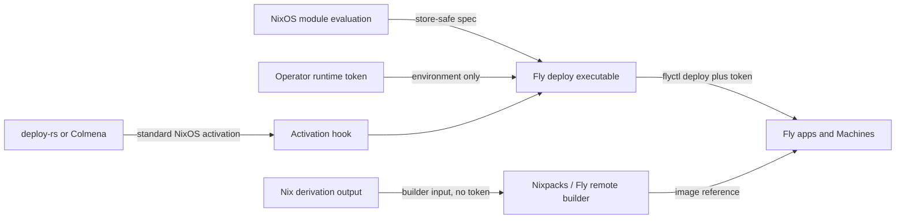
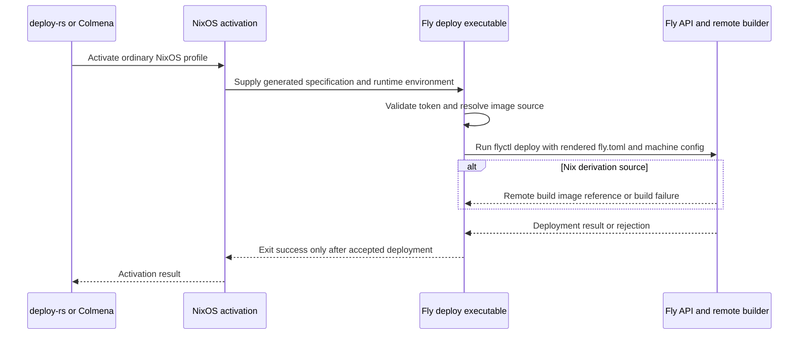

# Design Document

## Overview

This design specifies the Nix module and runtime deploy path for the contract in `requirements.md`; the problem and scope are in `brief.md`. It keeps app and Machine declarations in Nix, sends the rendered app and machine configuration through Fly's documented deploy path, and uses an operator-supplied token only at runtime.

The module must serve NixOS configurations deployable by either deploy-rs or Colmena. External builder behavior required for Nix derivations is recorded in `research.md` and remains a delivery gate: Fly's documented builders do not currently establish the required Nixpacks integration.

### Goals
- Declare existing Fly app identity and settings through a reusable Nix module.
- Preserve complete Machine API configuration, including multiple containers and unmodeled API fields.
- Support existing image references and the required remotely built Nix derivation path.
- Run deployment from ordinary NixOS activation so deploy-rs and Colmena need no Fly-specific option support.
- Keep the Fly token out of Nix evaluation, derivations, the store, generated app configuration, and logs.
- Support evaluation and deployment invocation from `aarch64-darwin`, `x86_64-linux`, and `aarch64-linux`.

### Non-Goals
- Creating or deleting Fly apps, organizations, users, or credentials.
- Replacing deploy-rs, Colmena, or Fly's Machines API.
- Managing Fly secrets used by applications; only deployment authentication is in scope.
- Building a general Nix-to-OCI service or supporting non-Fly providers.
- Modifying `home-manager/common/fly-skill.nix` or the existing personal `flyctl` installation.

## Boundary Commitments

### This Spec Owns
- A reusable NixOS module interface for an existing Fly app, its app settings, Machine configurations, and image source.
- Validation of mutually exclusive image-source choices and required image presence.
- A deployment executable and NixOS activation integration that apply declared settings and Machines through Fly's API.
- Runtime-only token wiring and secret-independent tests for evaluation, serialization, platform support, and API failure behavior.

### Out of Boundary
- Fly account/app lifecycle and token provisioning.
- Fly's API semantics and any external builder implementation operated by Fly or another provider.
- Secrets-management service setup and operator deployment-host hardening.
- Non-NixOS host activation systems and deployment tools other than NixOS-compatible consumers such as deploy-rs and Colmena.

### Allowed Dependencies
- Nix module evaluation and the repository's locked nixpkgs inputs.
- Fly's Machines API and Fly access token supplied at activation time.
- The caller's standard NixOS activation path, which deploy-rs and Colmena both use for a NixOS profile.
- A Nixpacks/Fly remote-builder integration only if it can be demonstrated to satisfy the locked requirement; `research.md` records that no supported documented path was found.

### Revalidation Triggers
- Fly changes the Machines API request/configuration schema, authentication behavior, or multi-container support.
- Fly or Nixpacks exposes a documented, supported integration for remotely building a Nix derivation.
- deploy-rs or Colmena changes whether or how it invokes standard NixOS activation.
- The runtime token source, systemd/activation boundary, or target system model changes.
- Any supported Nix system identifier changes.

## Architecture

### Existing Architecture Analysis
- `flake.nix` currently exposes repository NixOS configuration and packages but no Fly module or deploy-rs/Colmena-specific Fly integration.
- `configurations/personal/home-manager/default.nix` installs `flyctl`; `home-manager/common/fly-skill.nix` is an operational skill, not app configuration or deployment support.
- Existing feature patterns keep Nix-generated artifacts separate from runtime actions, as in `configurations/fabro-vm/sandbox-image.nix` and `configurations/fabro-vm/sandbox.nix`.
- The repo's supported system spelling is `aarch64-darwin`, `x86_64-linux`, and `aarch64-linux`; these are deploy-client/evaluation platforms, not the Fly Machine's guest architecture.
- Fly's Machines API uses bearer authentication and accepts a full Machine `config` object. An update requires the full config, so a partial option model or patch serializer would risk dropping settings. Multi-container Machines use a `containers` array and require Pilot as init system.
- The Apps API documentation exposes create/get/list/delete, but no app-settings update operation. The design therefore renders Fly app settings as `fly.toml` input consumed by `flyctl deploy`, while Machine API config is retained in full JSON and passed through Fly's documented machine-config deployment path. See `research.md` for sources and the builder compatibility risk.

### Architecture Pattern & Boundary Map

Pattern: a NixOS module renders a secret-free deployment specification and activation hook; a runtime deploy executable reads that specification and the token, then invokes Fly's deploy tooling. NixOS deployment tools activate the module as an ordinary profile and remain unaware of Fly options.



Decisions:
- The module is an ordinary NixOS module, not a deploy-rs or Colmena plugin; its store-safe deployment specification is consumed by a host-platform deploy package invoked alongside the existing deployment pipeline.
- Nix evaluation emits a store-safe JSON request specification and a deploy executable reference. It never evaluates or interpolates the token.
- The activation hook executes deployment synchronously and fails activation if build, authentication, or Fly deployment fails; success is reported only after `flyctl deploy` succeeds.
- App settings are rendered to `fly.toml` in the runtime deployment work directory; Machine configuration is represented as an open JSON-compatible attribute set and preserved in full in machine-config JSON referenced by `fly.toml`'s `[experimental].machine_config` setting. The Fly Apps API resource documents no app-settings update endpoint, so app settings use the documented `flyctl deploy` configuration path rather than an invented Apps API operation.
- Machine configs with a `containers` array also include the Fly-required Pilot init configuration; the module does not rewrite or omit any other declared API fields.
- The image source is a tagged choice: exactly one of an existing image reference or a Nix derivation output. Nix module assertions reject both and neither when an app requires an image.
- Nixpacks remote building is not treated as a confirmed Fly capability. The deploy executable's builder boundary must not silently fall back to local builds or ordinary Fly buildpacks; inability to implement the required path is a blocking compatibility failure (see `research.md`).
- The deployment operation targets an existing app and reconciles its declared settings/Machines. It does not create or destroy app resources.

### Technology Stack

| Layer | Choice | Role | Notes |
|---|---|---|---|
| Module | NixOS module system | Options, assertions, JSON specification, activation hook | Proposed reusable flake module; no existing Fly module is present |
| Deployment runtime | Nix-built wrapper plus `flyctl` | Apply app and Machine configuration through `fly.toml` and the documented machine-config deploy path | Must work on `aarch64-darwin`, `x86_64-linux`, `aarch64-linux` |
| API | Fly Machines API through `flyctl deploy` | App and Machine operations | Runtime bearer token; preserve complete Machine config |
| Image selection | Existing image reference or Nix derivation | Resolve the deployed image | Exclusive alternatives |
| Derivation build | Nixpacks on Fly remote builder | Required derivation-to-image route | Unsupported by documented Fly builder references at research time; validate before implementation |
| Tests | Nix evaluation/checks and stubbed API tests | Structural, serialization, security, and error verification | Live Fly test is operator-run |

## File Structure Plan

### Directory Structure

```text
modules/
└── fly-app.nix                 # Proposed reusable NixOS module and option assertions
scripts/
└── fly-app-deploy.nix          # Proposed cross-platform runtime deploy executable
tests/fly-app/
├── module.test.nix             # Module assertions and generated spec evaluation
├── deploy.test.js              # Stubbed API, token, errors, and serialization tests
└── platform.test.nix           # Evaluation/build coverage for the supported system set
flake.nix                       # Export the module and cross-platform deploy package/checks
```

### Modified Files
- `flake.nix` — export the new module and deploy/check outputs for the supported client systems.

## System Flows

### Deployment activation



The token is read at runtime from `FLY_API_TOKEN`; absence fails before API calls, and invalid credentials or API/build errors produce a non-zero activation result. No token value is copied into the NixOS configuration, derivation, process arguments, or generated JSON. The target activation environment must be wired by the operator/deployment environment without echoing the value.

### Machine reconciliation contract

- The module serializes each declared Machine as a complete JSON configuration, including the selected image and all user-supplied API fields; when `containers` is present it also configures Pilot as required by Fly.
- The deploy executable invokes `flyctl deploy` with rendered `fly.toml` referencing the complete machine-config JSON through `[experimental].machine_config`, so Fly's documented deploy path applies supported app settings and Machine configuration. It does not issue separate raw Machines API requests.
- The executable does not delete undeclared Machines. Destructive lifecycle policy is outside this requirement and requires explicit future scope.
- A failed API request or remote build aborts the run and is surfaced to NixOS activation; partial changes already accepted by Fly are not rolled back.

## Requirements Traceability

| Requirement | Summary | Design sections |
|---|---|---|
| 1 | Declare existing app identity and app settings; permit API extensions | Architecture; Components and Interfaces; Data Models |
| 2 | Preserve complete Machine configurations including multiple containers | Architecture; Components and Interfaces; Data Models; Testing Strategy |
| 3 | Select one image source; remote derivation build; clear source errors and build failures | Architecture; System Flows; Error Handling; Testing Strategy; `research.md` builder risk |
| 4 | deploy-rs/Colmena compatibility and failure propagation | Architecture; System Flows; Error Handling; Testing Strategy |
| 5 | Runtime-only Fly token authentication without interactive login | Components and Interfaces; Operator Provisioning; Security Considerations |
| 6 | Exclude token from derivations, store, generated configuration | Architecture; Components and Interfaces; Operator Provisioning; Security Considerations |
| 7 | Consistent behavior from Darwin ARM and Linux x64/ARM | Technology Stack; Testing Strategy |

## Components and Interfaces

| Component | Responsibility | Contract | Requirements |
|---|---|---|---|
| Fly app NixOS module | Declare app, settings, machine configurations, and image source; assert validity; render store-safe specification and standard activation hook | Open JSON-compatible API fields; mutually exclusive image source | 1, 2, 3, 4, 6, 7 |
| Fly deployment executable | Validate runtime inputs, resolve image, invoke Fly deploy, propagate errors | Read generated specification plus `FLY_API_TOKEN` at runtime; never accept token as an argument | 1-7 |
| Fly Machines API via `flyctl deploy` | Authoritative app/Machine state and result | Full machine-config JSON and runtime `FLY_API_TOKEN` | 1, 2, 4, 5 |
| Nixpacks/Fly builder integration | Convert derivation output into a Fly-usable image | Required operation must be evidenced by a working supported integration; no local-build fallback | 3 |

### NixOS Module and Deployment Executable

**Responsibilities & Constraints**
- The module is the only declaration boundary; app-level convenience settings and arbitrary API-compatible fields are projected to the request specification without dropping fields.
- Machine configuration is passed as full JSON objects. The module does not translate between a lossy narrower schema and Fly API data.
- The activation hook invokes the deployment executable using standard NixOS activation; deploy-rs and Colmena do not parse Fly-specific options.
- The runtime reads `FLY_API_TOKEN` from environment only. It must reject missing or empty values and must redact credentials from diagnostic output.

**Runtime contract**

```text
fly-app-deploy --spec <store-path-json>
  input: store-safe app/Machine specification; FLY_API_TOKEN in runtime environment
  result: exit 0 only when flyctl deploy accepts and applies the request
  failure: non-zero with redacted category/message for missing token, auth, build, or API errors
```

- Preconditions: the referenced app already exists; the operator supplied a valid runtime token; the runtime and builder can reach Fly.
- Postconditions: `flyctl deploy` has accepted the requested app/Machine changes or the executable returns failure.
- Invariants: no secret appears in request-spec JSON, derivation inputs/paths, command-line arguments, or logs.

**Builder contract**
- Input: selected Nix derivation output and non-secret build metadata.
- Output: immutable/deployable image reference or a named build error.
- Constraint: the required Nixpacks-on-Fly-remote-builder path must be proven; a local Nix build that outputs an image is not equivalent and is not an accepted fallback.

## Data Models

### Domain Model

- `FlyApp`: existing app identity plus supported app settings.
- `ImageSource`: exactly one of `existingImage: string` or `derivation: derivation`; required when app Machine configuration needs an image.
- `MachineDeclaration`: stable declaration identity plus a complete JSON-compatible Fly Machine configuration.
- `DeploymentSpec`: secret-free serialized FlyApp, MachineDeclaration set, and image-source reference. It contains no token and no runtime credential path.

### Logical Data Model

| Record | Key | Content | Store handling |
|---|---|---|---|
| `DeploymentSpec` | App name | App settings, Machine configs, image-source metadata | Nix-generated JSON and `fly.toml` referencing machine config; token-free |
| `MachineDeclaration` | Stable declared machine name/ID | Complete API config object including extensible fields and `containers` array; Pilot init when required | Included in `DeploymentSpec` |
| Runtime token | None in Nix data model | Fly API bearer credential | Process environment only; never serialized |
| Resolved image | Image reference | Existing reference or remote-build result | Runtime result, not a secret |

The module rejects both image source choices and missing required image sources during evaluation. Machine API fields remain JSON-compatible data, and app settings are encoded in `fly.toml`; token-bearing values are prohibited from generated configuration by security tests and documentation.

## Operator Provisioning

- **Secret**: Fly access token (`FLY_API_TOKEN`). **Source**: the Fly.io account/operator's deploy-token issuance through authenticated `flyctl`. **Provisioning command**: `fly tokens create deploy -a <existing-app> -x 720h` (run interactively by the operator; retain its returned value in the operator's approved secret store). **Runtime wiring command**: `read -r -s -p 'Fly access token: ' FLY_API_TOKEN; export FLY_API_TOKEN`. **Verification command**: `flyctl apps show "$FLY_APP"` with `FLY_APP` set to the existing app and `FLY_API_TOKEN` in the environment. **Owner**: Fly app operator. Never add the value or provisioning operation to a Kiro implementation task.

## Error Handling

### Error Strategy
- Nix evaluation errors identify missing or conflicting image-source options and invalid JSON-compatible config values before activation.
- Runtime validation fails fast for missing token or invalid specification; messages name the category but never print the token or Authorization header.
- Authentication errors, Fly deployment rejection, remote builder errors, and network failures produce non-zero exit status and prevent successful activation reporting.
- The executable reports Fly deployment errors with the app identity and redacted provider message. If Fly accepts part of a deployment before another operation fails, no rollback is claimed.

### Monitoring
- Deployment status is the NixOS activation result and executable's redacted stderr.
- No token, request Authorization header, or secret-expanded command is included in logs or process arguments.

## Testing Strategy

- **Module evaluation**: assert required/exclusive image source behavior; verify app identity and app settings in rendered `fly.toml`, and arbitrary API fields and multi-container configuration in generated Machine JSON.
- **Runtime/deploy tests**: stub `flyctl` to verify runtime token environment wiring, rendered app and Machine config inputs, success/failure exit propagation, auth/build/deploy rejection paths, and no false success on failed requests.
- **Builder tests**: use a stub builder for deterministic success/failure behavior; separately prove the actual Nixpacks/Fly remote-builder operation before claiming requirement 3.3 complete. Do not substitute the stub as evidence of Fly compatibility.
- **Secret tests**: scan generated specifications, derivation references, process arguments, and captured logs for a fixture token; confirm the executable uses only runtime environment input.
- **Platform checks**: evaluate the module and build/run the deployment package for `aarch64-darwin`, `x86_64-linux`, and `aarch64-linux`; compare serialized request payloads for parity.
- **Live operator verification**: with operator-provisioned token and an existing app, deploy representative single-container and multi-container configurations; confirm Fly's observed config and verify invalid token, build, or deploy failures do not report success.

## Security Considerations

- Nix store paths and generated JSON are readable artifacts; token values are forbidden from all evaluation-time options that reach derivations or generated configuration.
- The deployment executable obtains the bearer token only from `FLY_API_TOKEN` at runtime and must avoid logging its environment or curl-equivalent headers.
- The implementation must not persist the token, place it in generated app/Machine config, or pass it as a process argument. Operator-side activation environment handling is outside module provisioning and must keep the value private.
- Application secrets sent to Fly are not deployment credentials and remain outside this module's boundary.

## Supporting References
- `.kiro/specs/nix-module-for-fly-io-app/research.md` — source notes on Fly Machines API, builder capability mismatch, and supported Nix system identifiers.
- `.kiro/specs/nix-module-for-fly-io-app/requirements.md` — authoritative behavioral acceptance criteria.
