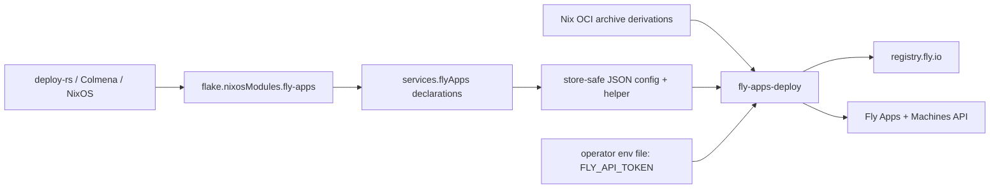

# Design: nix-module-for-fly-io-app

## Overview

This design specifies the reusable NixOS module, deployment helper, and Fly Machines API contract for issue #307. The user problem, approach, and scope are in `brief.md`; the behavioral contract is in `requirements.md`; external findings are recorded in `research.md`.

## Goals

- Let a NixOS configuration declare a Fly app and its complete Fly Machine configuration, including multi-container Machines.
- Deploy declaratively through system activation, making the app available as a NixOS target to deploy-rs, Colmena, and ordinary NixOS deployment tools.
- Support a public image reference or a Nix derivation producing an OCI archive, safely publish the latter to Fly's registry, and apply its image reference.
- Use only operator-supplied `FLY_API_TOKEN` for Fly authentication and keep it out of the Nix store and generated artifacts.

## Non-Goals

- Replacing or adding Fly organization, user, volume, certificate, or IP lifecycle management.
- Managing app settings that the Fly Machines API does not permit to update in place.
- Building a general Nix-to-OCI service or supporting image registries other than Fly's private registry for Nix-built images.
- Creating, rotating, or distributing the Fly access token.
- Automatically destroying Machines or apps to match removed declarations; destructive reconciliation requires an explicit follow-on decision.

## Boundary Commitments

### This Spec Owns

- A reusable NixOS module exported from the repository's flake.
- The `services.flyApps` option model for Fly app identity, create-time settings, Machine configurations, image source, and secret path.
- A Nix-built deployment helper that reconciles app existence and named Machines through Fly's Machines API.
- Publication of Nix-produced OCI archives to `registry.fly.io` and image-reference rendering in Machine configs.
- Evaluation, API-client, deployment-tool, and secret-confidentiality tests.

### Out of Boundary

- Existing `home-manager/common/fly-skill.nix` and the personal `flyctl` install.
- Fly organization membership, token generation, volumes, app secrets, IP allocations, certificates, app destruction, and Machine deletion.
- Non-Fly providers, deploy-rs/Colmena internals, or any new deployment-tool plugin.
- Application build derivation contents beyond the documented OCI archive contract.

### Allowed Dependencies

- The NixOS module system and `nixpkgs` package set; the repo's `flake.nix`/`flake.lock` patterns.
- Fly's public Machines API at `https://api.machines.dev` and Fly's image registry at `registry.fly.io`.
- `curl`, `jq`, `flyctl`, and `skopeo` from the evaluated NixOS package set where used by the deployment helper.
- deploy-rs and Colmena as external consumers of NixOS configurations and normal system activation.
- An operator-provisioned token exposed only through the declared runtime environment file.

### Revalidation Triggers

- Fly adds or changes app settings update operations, app creation fields, Machine config schema, container support, or API auth.
- flyctl's `FLY_API_TOKEN`/`fly auth docker --access-token` behavior changes.
- Skopeo changes OCI archive transport or auth-file behavior.
- NixOS activation ordering or failure propagation changes.
- The module is exported in a different flake boundary, or new consumers need Home Manager rather than NixOS integration.

## Architecture

### Existing Architecture Analysis

- The repository is a flake with NixOS configuration `nixosConfigurations.fabro-vm`, but `flake.nix` currently exports no reusable `nixosModules` attribute. The module must therefore be exposed as a new independent flake output, not implicitly coupled to the Fabro VM.
- `home-manager/common/fly-skill.nix` only installs a skill, and personal Home Manager installs `flyctl`; neither is a system deployment lifecycle.
- The repo's current NixOS service configuration uses `systemd.services` and NixOS modules. A Fly deployment service can be composed as an independent module without touching Fabro VM settings.
- Machines API create and update are separate from NixOS activation: NixOS activation invokes a one-shot helper that makes the remote side effect and returns nonzero on failure.

### Architecture Pattern and Boundary Map

Selected pattern: exported NixOS module plus idempotent systemd oneshot reconciler. deploy-rs and Colmena build and activate the target NixOS system normally; neither receives Fly-specific options.



**Architecture Integration**:
- **Selected pattern**: NixOS module and target-side oneshot deployment, because deploy-rs and Colmena already apply NixOS system generations without understanding application-specific settings.
- **Domain boundaries**: module evaluation produces immutable non-secret declarations; the runtime helper resolves image sources, contacts Fly, and reports remote-operation results.
- **Existing patterns preserved**: flake outputs, NixOS modules, typed Nix options, systemd services, Nix-store-built tooling, explicit runtime secret files.
- **New components rationale**: the helper is required to perform API requests only at activation time and to keep Fly API calls/registry auth out of derivation evaluation.
- **Steering compliance**: no conflicting architecture or build-hygiene steering applies. Secret handling follows `.kiro/settings/rules/secret-material-handling.md`.

### Technology Stack

| Layer | Choice / Version | Role in Feature | Notes |
|-------|------------------|-----------------|-------|
| Module host | NixOS module system | Declare and enable Fly apps | Exposed as `nixosModules.fly-apps`; not auto-imported by this repository's hosts. |
| Configuration | Nix options + JSON serialization | Store-safe API config and app declarations | Generic `attrs` preserve API fields not represented by convenience options. |
| Deployment | systemd oneshot + NixOS activation script | Apply remote app/Machine state at boot and every target switch | `systemctl start --wait` propagates failures to target activation. |
| Fly API | Machines API REST | Create/read/update apps and Machines | API base `https://api.machines.dev`; Bearer token. |
| Image publication | `skopeo` + `flyctl` | Push Nix OCI archive to Fly registry | Fly token is supplied through process environment; auth artifacts are runtime-only. |
| Testing | Nix evaluation checks + script/API fixture tests | Validate render, idempotency, error mapping, and integrations | Live Fly smoke test is operator-run and optional. |

## File Structure Plan

### Directory Structure

```text
modules/
└── nixos/
    └── fly-apps.nix                 # Exported NixOS module: options and activation unit
scripts/
└── fly-apps-deploy.nix              # Nix-built deployment helper package

tests/
└── fly-apps/
    ├── module.test.nix             # NixOS option and generated unit evaluation
    ├── deploy.test.js               # Fake API/registry contract tests
    └── fixtures/                    # Non-secret API responses and OCI archive metadata
```

### Modified Files

- `flake.nix` — export `nixosModules.fly-apps` and add module evaluation, wiring, and helper checks.
- `.kiro/specs/nix-module-for-fly-io-app/research.md` — record external API, token, container, and OCI publication facts referenced by this design.

## System Flows

### Activation and reconciliation

```mermaid
sequenceDiagram
    participant Tool as deploy-rs / Colmena / NixOS
    participant System as NixOS activation
    participant Unit as fly-apps-deploy.service
    participant Helper as fly-apps-deploy
    participant API as Fly Machines API
    participant Registry as Fly registry
    Tool->>System: activate target generation
    System->>Unit: start deployment unit during activation
    Unit->>Helper: pass store config; load runtime token file
    Helper->>Helper: validate token and image source selection
    opt Nix derivation selected
        Helper->>Registry: authenticate and push OCI archive
        Registry-->>Helper: accept image reference
    end
    Helper->>API: GET app and declared Machines
    alt app does not exist
        Helper->>API: POST app with immutable create-time settings
    end
    loop each declared Machine
        alt named Machine does not exist
            Helper->>API: POST full config
        else declared config differs
            Helper->>API: POST update with full config
        end
    end
    API-->>Helper: success or API error
    Helper-->>Unit: exit 0 only when all declared work succeeds
    Unit-->>Tool: activation result
```

**Flow decisions**:
- The helper uses stable Machine names as reconciliation keys and never matches by array order or generated Fly IDs. Since the Machine list response exposes names and IDs, not a client-side desired-config marker, it reads each matching Machine's full config and compares normalized config before updating.
- App name, organization, and network are checked as immutable fields. If the existing app differs, deployment fails with an explicit migration; it never deletes or recreates an app. `enableSubdomains` is creation-only and absent from the App response schema, so it cannot be drift-checked or updated through the Apps resource.
- Existing app/Machine reads are compared with normalized declared JSON. Machine listing follows pagination; no update call is issued when the complete desired Machine config already matches.
- Removed declarations do not delete remote resources. Reconciliation is additive/update-only until a separately approved destructive lifecycle is designed.

## Components and Interfaces

| Component | Domain/Layer | Intent | Req Coverage | Key Dependencies | Contracts |
|-----------|--------------|--------|--------------|-----------------|-----------|
| `services.flyApps` NixOS module | NixOS configuration | Validate declarations, expose store-safe config, wire activation | 1, 2, 3, 4, 6 | NixOS module system | Options, assertions, systemd unit |
| `fly-apps-deploy` helper | Runtime deployment | Publish selected image and reconcile app/Machines | 1, 2, 3, 4, 5, 6 | Fly API, `flyctl`, `skopeo`, `jq`, `curl` | CLI, JSON protocol, environment |
| Runtime token file | Operator secret wiring | Make token available only to the runtime helper | 5, 6 | NixOS `EnvironmentFile` | File path and mode |

### NixOS Configuration

#### `services.flyApps`

| Field | Detail |
|-------|--------|
| Intent | Define and activate a set of Fly apps from a NixOS target system. |
| Requirements | 1.1-1.4, 2.1-2.3, 3.1-3.4, 4.1-4.4, 5.1-5.4, 6.1-6.3 |
| Dependencies | Inbound: NixOS module evaluator. Outbound: generated helper config and systemd unit. |
| Contracts | Configuration and state. |

**Responsibilities & Constraints**
- `enable` gates module activation; `apps` is an attribute set keyed by stable local deployment name.
- Each app declaration includes `appName`, `organization`, optional create-time `network` and `enableSubdomains`, and a map of named machines.
- Each machine includes `region`, optional API create controls, a freeform Fly `config`, and an image source declaration. For a single-container Machine, the options are `image` (existing image reference) and `imageDerivation` (OCI archive derivation); exactly one is required when that machine is deployed.
- For a multi-container Machine, `config.containers` remains the canonical Fly API array. Existing container images stay in each container's raw `image` field; optional `containerImageDerivations` is an attribute set keyed by container `name` for containers whose image comes from a Nix derivation. A container cannot specify both a literal `image` and a derivation, and every container must resolve to exactly one source.
- The app-level validator collects image source kinds across every declared Machine and container: one app may use existing references or Nix derivations, but cannot mix both; an app with Machines cannot omit its image source. It reports all conflicting declaration paths and missing image fields before API calls.
- The module injects a single-container `image` into `config.image`; it injects each selected multi-container derivation image into the named container's `image` field after resolving the archive to a published Fly registry reference. It rejects unknown derivation container names before any remote API mutation.
- `tokenFile` names a runtime-provisioned file containing `FLY_API_TOKEN=...`; it is referenced by systemd `EnvironmentFile` and never read by Nix evaluation.
- `systemd.services.fly-apps-deploy` runs after network-online with `StateDirectory=fly-apps`, `RemainAfterExit = false`, and `wantedBy = [ "multi-user.target" ]` for boot-time reconciliation. `system.activationScripts.fly-apps` explicitly starts it with `systemctl start --wait` on every switch, so a nonzero deployment result fails target activation in deploy-rs, Colmena, and direct NixOS switches; remaining inactive after success lets subsequent switches run it again. It is not a persistent service.

**Options contract (conceptual)**

```nix
services.flyApps = {
  enable = true;
  tokenFile = "/run/secrets/fly-api-token.env";
  apps.example = {
    appName = "example-app";
    organization = "personal";
    network = null;
    enableSubdomains = false;
    machines.web = {
      region = "ord";
      config = {
        guest = { cpu_kind = "shared"; cpus = 1; memory_mb = 512; };
        services = [ ... ];
      };
      image = "ghcr.io/example/web:1.2.3";
      imageDerivation = null;
      containerImageDerivations = { };
    };
  };
};
```

The final option definitions use Nix option types and defaults; this fragment illustrates the declaration shape and is not a complete module implementation.

**Implementation Notes**
- The flake exports `nixosModules.fly-apps = import ./modules/nixos/fly-apps.nix`; consumers opt in by adding it to their host module list.
- `appName`, `organization`, and create-only fields are emitted in generated JSON, with no secret or token-derived content.
- Stable app names and machine names are validated as non-empty strings and escaped by JSON serialization, not shell interpolation.

### Deployment Runtime

#### `fly-apps-deploy`

| Field | Detail |
|-------|--------|
| Intent | Publish derivation images and converge declared apps and named Machines. |
| Requirements | 1.4, 2.2-2.3, 3.1-3.4, 4.1-4.4, 5.1-5.4, 6.1-6.3 |
| Dependencies | Inbound: systemd oneshot. Outbound: Fly Machines API and registry. |
| Contracts | CLI, API, batch job. |

**Responsibilities & Constraints**
- Input is a generated non-secret JSON file plus `FLY_API_TOKEN` from the runtime environment; the token is never a CLI argument.
- The helper first verifies the token is present and non-empty, then performs requests with `Authorization: Bearer` and non-interactive Fly CLI auth.
- The deployment system realizes the target-platform image derivation through the configured remote Nix builder before activation; the output store path is retained by the generated configuration closure and is readable on the target during the runtime publish step.
- For each Nix OCI archive, the helper creates restrictive temporary runtime state, sets `DOCKER_CONFIG` to a private temporary directory, runs `fly auth docker` with `FLY_API_TOKEN` supplied only in the environment, and points Skopeo at the resulting auth file. It publishes to `registry.fly.io/<app>:nix-<sha256-of-store-path>` and uses the resulting reference in the Machine config; auth state is removed on exit and signal.
- For a public/pre-existing image, the helper does not publish or rewrite the image reference.
- App lookup uses `GET /v1/apps/{app_name}`. A not-found response triggers `POST /v1/apps` with declared `name`, `org_slug`, and create-time fields. If create returns a name conflict (for example, the app exists but the token cannot read it), the helper fails closed instead of assuming success. For an accessible pre-existing app, the helper compares name, organization slug, and network with API response values and fails before Machine updates on mismatch. `enable_subdomains` is creation-only and is not returned by the App response schema, so it cannot be verified or reconciled after creation; it is recorded as an operator-owned immutable create-time setting.
- Machine lookup uses `GET /v1/apps/{app_name}/machines` and follows Fly's `fly-next-cursor` pagination until exhausted; create uses `POST /v1/apps/{app_name}/machines` with a complete body containing `name`, `region`, and `config`. Update uses `POST /v1/apps/{app_name}/machines/{machine_id}` with the complete Machine config and immutable name/region match.
- The helper handles Fly API errors by returning nonzero with app/machine context, HTTP status, and a sanitized response message. It never prints request authorization headers or token content.
- Transient transport, 408, and 5xx errors may retry with bounded exponential backoff respecting documented rate limits; validation, missing/invalid auth, and other 4xx responses fail without retry.

**CLI Interface**

```text
fly-apps-deploy --config <store-json>
```

- Preconditions: config is valid JSON generated by the Nix module; runtime token is present; image derivation output is an OCI archive when selected.
- Postconditions: app exists and every declared named Machine matches its desired config, or command exits nonzero with an actionable error.
- Invariants: only declared Machines are created or updated; removed declarations are not deleted; no secret enters the store config or logs.

## Data Models

### Domain Model

- **Fly app declaration**: stable local app key, Fly app name, organization slug, and immutable app-create settings.
- **Machine declaration**: stable machine name, region, create controls, complete Fly Machine config, and single-container image-source selector or per-container derivation map.
- **Image source**: one app-wide source kind (all existing references or all Nix derivations). A single-container Machine declares the selected source in `image` or `imageDerivation`; `containers` Machine configs preserve literal image references or use derivations keyed by stable container `name` in `containerImageDerivations`.
- **Remote resource identity**: Fly Machine ID is discovered from the list response and used only for subsequent API update calls; the local name remains the authoritative reconciliation key.

### Logical Data Model

```text
AppDeclaration 1 --- * MachineDeclaration
MachineDeclaration 1 --- 1 MachineConfig
AppDeclaration 1 --- 1 ImageSourceKind (existing | Nix derivation)
MachineDeclaration 1 --- 0..1 ImageReference (single-container)
MachineConfig 1 --- * ContainerConfig (optional multi-container)
ContainerConfig 1 --- 0..1 DerivationImage (keyed by container name)
RuntimeEnvironment 1 --- 1 FlyAccessToken (not serialized)
```

**Consistency & Integrity**:
- App names are unique at Fly; machine names are unique within an app and stable across updates.
- Machine config passed to update is complete, because Fly's API does not support partial updates.
- The Nix module's generated JSON contains only public configuration and store paths for image artifacts; token bytes never enter this model.
- All config attributes unsupported by dedicated Nix convenience settings remain available through raw freeform configuration, preserving future Machines API fields.

### Data Contracts & Integration

- **Generated JSON**: contains app name, organization, create-only fields, each machine's name/region/create controls, complete config, and image derivation output paths where applicable. Single-container images use `image`/`imageDerivation`; multi-container images use raw container image references plus `containerImageDerivations` keyed by container name. It contains no token, token-file contents, or secret-derived string.
- **Machines API**: requests use JSON and Fly's documented app/Machine resource endpoints. Multi-container `containers` is preserved under Machine config as the API requires.
- **OCI image output**: a Nix derivation selected for publication must produce a valid OCI archive compatible with Skopeo's `oci-archive:` transport; invalid archives fail before API mutation.
- **App setting scope**: app creation supports only create-time fields documented by the API. Existing app name, organization, and network are compared with the GET response and mismatches fail with migration instructions. `enable_subdomains` is supplied only at creation because the API response does not expose it for drift checking; there is no documented update endpoint.

## Operator Provisioning

- **Secret**: `FLY_API_TOKEN` for each NixOS deployment target.
- **Source**: operator-managed secret file exposed at the target through an existing secret delivery mechanism; `services.flyApps.tokenFile` points to the file.
- **Provisioning command**: `install -m 0600 /secure/operator/source/fly-api-token.env /run/secrets/fly-api-token.env`, where the source file contains the operator-created `FLY_API_TOKEN=value` assignment; this command installs operator-provisioned material and does not create or rotate the token.
- **Verification command**: `test -s /run/secrets/fly-api-token.env && grep -q '^FLY_API_TOKEN=.' /run/secrets/fly-api-token.env && stat -c '%a' /run/secrets/fly-api-token.env` (on NixOS/Linux; check ownership and mode remain restricted).
- **Owner**: Fly app operator. Token creation, authorization scope, renewal, and rotation are never Kiro tasks.

## Error Handling

### Error Strategy

- Nix evaluation catches missing/conflicting image sources and invalid declaration shape before system activation.
- Runtime validates token presence before network operations and emits a named authentication error without printing the token.
- Fly API 401/403 errors identify authentication/authorization failure; 400/422 errors identify invalid config; 404 distinguishes expected app/machine absence from unexpected resource errors; 5xx/transport errors report a failed deployment after bounded retry.
- Registry publication failure prevents Machine create/update from applying a new Nix image.
- A deployment succeeds only after every required Fly API operation returns success; any failure makes the systemd unit and deploy-rs/Colmena activation fail.
- Re-running after partial success is safe: app creation checks existence, each named Machine is rediscovered, already matching config is skipped, and a later run retries failed operations.

### Error Categories and Responses

| Category | Example | Behavior |
|----------|---------|----------|
| Configuration | Both image inputs set; none set; malformed container declaration | Nix evaluation fails with app and machine/container path. |
| Authentication | Token absent or Fly returns 401/403 | Helper fails before claiming deployment success and provides the token-file/environment contract. |
| Fly validation | Fly returns 400/422 | Helper reports app, machine, status, and sanitized API detail; no destructive fallback. |
| Immutable app config | Organization/network/subdomain differs | Helper fails with explicit migration instruction; it does not delete/recreate. |
| Registry/build | OCI archive invalid, publish fails, image unauthorized | Helper fails before updating any Machine to the new image. |
| Fly availability | Timeout/5xx/rate-limit error | Bounded retry for transient cases, then fail activation. |

### Monitoring

- systemd journal captures one operation summary per app/Machine, image reference, elapsed time, and failure status.
- Logs exclude environment dumps, auth headers, token values, and temporary auth-file contents.
- The unit reports a single success only after all declared reconciliation succeeds; no separate monitoring service is introduced.

## Testing Strategy

### Unit and Evaluation Tests

- NixOS module evaluation enables/disables the module and confirms generated service, helper package, and runtime token-file wiring.
- Assertions reject missing and conflicting image sources with the full option path.
- Render tests verify arbitrary nested Machine config, multi-container config, and unknown API keys survive JSON serialization without flattening or omission.
- Confidentiality tests force generated JSON, derivation environment, command arguments, and unit text; assert no token value or token-file contents appear.
- Immutability tests verify app create-only fields are emitted and a runtime mismatch produces a failure rather than delete/recreate actions.

### Deployment Helper Tests

- Fake HTTP API tests cover app missing/create/existing, stable named Machine create/update/no-op, multi-container payloads, and API rejection.
- Image selection tests cover public references, OCI archive publication, invalid OCI archive, and missing/conflicting source rejection.
- Failure tests cover absent token, 401, 403, 422, timeout, 429, and 5xx, including sanitized logs and bounded retry behavior.
- Idempotency tests rerun deployment after each partial API success and verify no duplicate app or Machine creation.
- Removed declarations do not issue Machine or app deletion calls.

### Integration and Deployment-Tool Tests

- NixOS evaluation test imports the exported `nixosModules.fly-apps` into a minimal NixOS system.
- Consumer fixtures adapt the same module through a deploy-rs target configuration and a Colmena `hive` configuration; both must expose the ordinary NixOS system closure and invoke the same activation unit without tool-specific Fly options.
- The helper test runs with a fake API and fixture OCI archive without contacting Fly or needing a real token.
- Optional operator smoke test uses a provisioned Fly token and a disposable app to validate public-image and derivation-image flows; never run as a default flake check.

## Security Considerations

- Token values are supplied only through the runtime environment file and inherited process environment; they are not Nix options accepting a value, command-line arguments, generated JSON, or derivation inputs.
- The helper uses a private temporary directory for Fly registry auth state, restrictive permissions, cleanup traps, and no debug mode that emits credentials.
- The deployment unit runs under the target's operator-controlled systemd identity; access to the token file is restricted by its provisioning mechanism.
- User-defined Machine configuration is not inherently secret-safe; callers must not place token material in ordinary `env`, metadata, files/raw values, or other store-rendered app fields. Fly application secrets remain outside this module's scope and should use Fly's secret resource/another operator-managed workflow.

## Requirements Traceability

| Requirement | Summary | Design sections | Components / Interfaces |
|-------------|---------|-----------------|-------------------------|
| 1.1-1.4 | Declare app identity and settings and apply accepted settings | Architecture, Components / NixOS Configuration, Data Contracts, Error Handling | `services.flyApps`, deployment helper |
| 2.1-2.3 | Preserve complete Machine API fields and multi-container declarations | Components / NixOS Configuration, System Flows, Data Models | Freeform `config`, `containers` array |
| 3.1-3.4 | Support image source alternatives and selection errors | Components / NixOS Configuration, Deployment Runtime, Error Handling | Image source selector, OCI publisher |
| 4.1-4.4 | Work through deploy-rs/Colmena and report deploy/API failures | Architecture, System Flows, Testing Strategy | NixOS activation unit, `fly-apps-deploy` |
| 5.1-5.4 | Token-only, noninteractive auth and visible auth failures | Components / Deployment Runtime, Operator Provisioning, Error Handling | Runtime `FLY_API_TOKEN`, API client, flyctl registry auth |
| 6.1-6.3 | Keep token outside Nix derivations, store, and generated config | Components / NixOS Configuration, Data Models, Security Considerations, Testing Strategy | Runtime token file, store-safe JSON, confidentiality checks |
