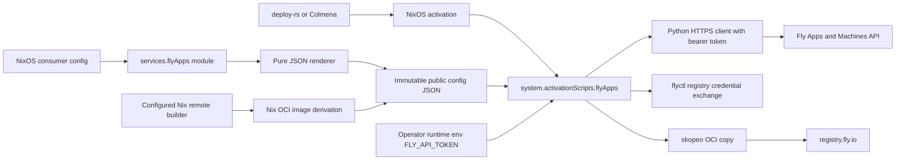
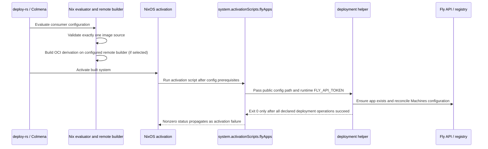
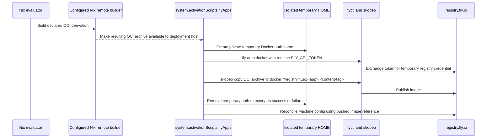

# Design Document

## Overview

The feature adds a reusable NixOS module for declaring Fly apps and reconciling their Machines configuration through Fly's API. It exposes an open Machines API configuration payload, builds optional Nix OCI images on a configured remote Nix builder, and runs deployment during NixOS activation so deploy-rs and Colmena remain generic NixOS deployers.

### Goals

- Keep Fly app identity and desired Machine configuration in Nix.
- Support raw Machines API fields, including `containers` for multi-container Machines.
- Support existing image references and Nix-built OCI images, with exclusive source selection.
- Use only a runtime `FLY_API_TOKEN` for Fly authentication and keep it out of Nix artifacts.
- Return deployment failures to the normal system activation result.

### Non-Goals

- Managing Fly organizations, users, volumes, IP allocation, app secrets, or other resources outside the app and Machines configuration required for this deployment.
- Replacing or configuring deploy-rs or Colmena.
- Building a generic OCI publishing platform or supporting arbitrary registries.
- Deploying Fly apps from Darwin/Home Manager activation.
- Provisioning or rotating the Fly access token.

## Boundary Commitments

### This Spec Owns

- A reusable NixOS module and a `services.flyApps` option contract.
- JSON serialization and validation of declared Fly App and Machine config.
- The per-app NixOS activation script, image build/publish flow, and Fly Machines API reconciliation.
- Structural and mocked verification of evaluation, generated payloads, failure propagation, and token confidentiality.

### Out of Boundary

- Credentials beyond the Fly token, the Fly account/organization lifecycle, and operator-created app tokens.
- Long-term creation/removal of Fly resources unrelated to app and Machines deployment. The module must not delete apps or Machines as a side effect of an option removal.
- A multi-tenant remote image builder or non-Fly registry support.
- Integrating this feature into repository host configurations; the module is reusable and enabled by consumers.
- Running secret-dependent integration tests as a required build gate.

### Allowed Dependencies

- NixOS module system, `lib`, `pkgs`, and a configured remote Nix builder available to the deployment host.
- Nix OCI image derivations supplied by consumers.
- `flyctl` for Fly deployment and registry operations, with its version pinned through Nixpkgs or the repo's package overlay.
- Fly Apps and Machines APIs and Fly's documented token environment contract.
- deploy-rs and Colmena as NixOS system activators, without Fly-specific hooks or plugins.

### Revalidation Triggers

- Fly changes the Machines API request/config schema, multi-container support, or update behavior.
- `flyctl` changes its token precedence, app deployment behavior, or registry credential path.
- The image artifact type or store transfer assumptions change for remote Nix builds.
- NixOS activation ordering, `system.activationScripts` environment inheritance, deploy-rs, or Colmena stops invoking normal system activation scripts.
- The option prefix, image target selector, or JSON serialization contract changes.

## Architecture

### Existing Architecture Analysis

The repository currently has no Fly app module or Fly integration with deploy-rs or Colmena. `configurations/fabro-vm/sandbox-image.nix` demonstrates a NixOS module exposing an OCI archive derivation; `configurations/fabro-vm/sandbox.nix` demonstrates declarative systemd service configuration and `EnvironmentFile` use. Those files are architectural precedents only and are not modified by this feature. `home-manager/common/fly-skill.nix` installs operations guidance and is not a deployment integration.

### Architecture Pattern & Boundary Map

- Selected pattern: NixOS module plus `system.activationScripts.flyApps` script; ordinary NixOS activation gives deploy-rs and Colmena the same behavior without coupling to either tool.
- Domain boundaries: module options and pure JSON rendering own evaluated desired state; the NixOS activation script owns imperative API calls; Fly owns remote state and validation.
- Existing patterns preserved: Nix module options, derivation-based immutable configuration, NixOS activation script integration, and store-free runtime secrets.
- New components rationale: the JSON payload preserves the wide Machines API schema; a deploy helper handles idempotent API operations; `flyctl` obtains registry credentials and `skopeo` pushes OCI artifacts; a system activation script provides consistent behavior across NixOS deployment frontends while inheriting the activation process environment.
- Steering compliance: only secret-free values enter evaluation and derivations; external mutations run at activation; verification has pure eval and mock modes independent of credentials.



### Technology Stack

| Layer | Choice | Role in Feature | Notes |
|-------|--------|-----------------|-------|
| Nix interface | NixOS module under `services.flyApps` | App declarations, type checking, image source choice | Module is importable by any NixOS config. |
| Config format | JSON generated by `builtins.toJSON` or `pkgs.writeText` from secret-free attrs | Exact API configuration payload | Raw Machines API attrs are passed through without field allowlisting. |
| Deployment | NixOS `system.activationScripts.flyApps` and packaged helper | Ensure each app update runs as a normal system activation action | Script is part of the activation transaction and exits nonzero on failure. |
| Fly interface | Python stdlib HTTPS client, pinned `flyctl`, and `skopeo` | Bearer-authenticated App/Machines API calls, registry auth exchange, and OCI publish | No `fly auth login` state is required. |
| Image | Consumer-provided OCI derivation built by the configured remote Nix builder | Produce image artifact before activation and publish to `registry.fly.io` | Nix builder availability is an operator prerequisite. |
| Tests | Nix eval checks and helper tests with mocked Fly/registry commands | Validate serialization, invalid choices, idempotency, error and secret behavior | Live Fly calls are optional verification only. |

## File Structure Plan

### Directory Structure

```text
nixos/fly-apps/
├── default.nix       # services.flyApps NixOS module, validation, config and activation script
├── deploy.nix        # pure app payload renderer and deployment command contract
└── deploy.py         # deployment helper, API reconciliation and isolated image publish
scripts/fly-apps/
└── README.md         # operator use, remote builder, token wiring and manual smoke steps
tests/fly-apps/
├── module.nix        # NixOS module evaluation test fixtures
└── deploy.py         # mocked API and image-publish contract tests
```

### Modified Files

- `flake.nix` — expose the NixOS module and add focused evaluation/helper checks; use the repo's existing flake outputs rather than adding deploy-rs or Colmena inputs.
- No current Fly files are modified: `home-manager/common/fly-skill.nix` and the personal `flyctl` package declarations retain their separate responsibilities.

> File paths listed above are planned new files. Their exact implementation names are contract choices for this spec, not existing repository files.

## System Flows

### NixOS activation deployment

The token must be present in the environment of the process that executes NixOS activation. When deploy-rs or Colmena performs remote activation, the consumer/operator must explicitly arrange runtime environment forwarding or provide the token on the activation target; the module does not persist the token in the system closure.



The activation script must run after activation reaches the state where its packaged helper and config path are available. The deployment helper must not run from Nix evaluation or derivation build. API errors, auth errors, build transfer errors, registry push errors, and incomplete Machine readiness all exit nonzero; retries are bounded and limited to retryable transport/capacity failures.

### Nix image source publish path



The Nix build output contains only the OCI image and public config. The helper invokes `fly auth docker` with the token inherited from the activation environment and routes `$HOME` to a mode-0700 runtime directory, because flyctl writes registry auth to `$HOME/.docker/config.json`. It then runs `skopeo copy --authfile <path> oci-archive:<archive-path> docker://registry.fly.io/<app>:<tag>` to push the OCI archive; `<path>` is the auth file under the isolated HOME and `<archive-path>` is the OCI archive. This does not require a Docker daemon. Remove the temporary HOME in a `finally`/trap path. Never persist registry credentials under `/root/.docker`, the Nix store, or a generated configuration file.

## Requirements Traceability

Fly exposes app-level create fields, not a general mutable App configuration resource. Therefore, the module supports app identity and creation-time settings on first creation and applies ongoing mutable app behavior through Machine config; changed creation-only fields fail explicitly instead of being falsely reported as reconciled.

| Requirement | Summary | Components | Interfaces | Flows |
|-------------|---------|------------|------------|-------|
| 1.1–1.4 | Declarative app identity/settings and applied desired config | `services.flyApps`; `deploy.py` | `services.flyApps.apps.<name>`; app identity/org and machine config | NixOS activation deployment |
| 2.1–2.3 | Preserve Machine API config and multi-container `containers` payloads | `deploy.nix`; `deploy.py` | JSON Machine config object with arbitrary supported fields | NixOS activation deployment |
| 3.1–3.4 | Choose existing image or Nix OCI derivation; reject missing/conflicting | `default.nix`; `deploy.py` | `image` or `imageDerivation`, exactly one; with `imageDerivation` and `containers[]`, `imageContainer` selects the app-image target | Nix image source publish path |
| 4.1–4.4 | deploy-rs/Colmena activation compatibility, changed state applies, errors fail | `system.activationScripts.flyApps`; `deploy.py` | Normal NixOS activation result code | NixOS activation deployment |
| 5.1–5.4 | Token-only authentication without login state; missing/rejected token fails | `system.activationScripts.flyApps`; `deploy.py` | Runtime `FLY_API_TOKEN` environment | Both flows |
| 6.1–6.3 | Token absent from derivation inputs, store, and config | module; renderer; activation script | Secret-free generated JSON; inherited process environment | Nix image source publish path |

## Components and Interfaces

| Component | Domain/Layer | Intent | Req Coverage | Key Dependencies | Contracts |
|-----------|--------------|--------|--------------|------------------|-----------|
| `services.flyApps` module | NixOS module | Type-check app declarations, render immutable public config, add activation script | 1, 2, 3, 4, 6 | NixOS module system, `lib`, `pkgs` | Options, State |
| `deploy.nix` renderer | Pure Nix | Convert app declaration to Fly request model and select image | 1, 2, 3, 6 | `builtins.toJSON`, `pkgs.writeText` | State |
| `deploy.py` helper | Deployment boundary | Apply app, publish image, reconcile Machines, return accurate status | 1–6 | Python HTTPS client, `flyctl`, `skopeo`, runtime environment | Batch, API |
| `system.activationScripts.flyApps` | Runtime integration | Execute one helper per app during regular system activation | 4, 5, 6 | NixOS activation, packaged helper, operator environment | Batch, State |

### NixOS module

#### `nixos/fly-apps/default.nix`

| Field | Detail |
|-------|--------|
| Intent | Define a reusable `services.flyApps` NixOS module and activation wiring |
| Requirements | 1.1–1.4, 2.1–2.3, 3.3–3.4, 4.1–4.4, 5.1–5.4, 6.1–6.3 |

**Responsibilities & Constraints**
- Declare one attrset entry per app name and ensure app names are unique by Nix attrset semantics.
- Validate required app identity fields, Machines configuration shape, and exclusive image-source selection during evaluation.
- Generate public JSON through `deploy.nix` and expose it as a store path; never interpolate `FLY_API_TOKEN` or other secret values into it.
- Add an activation script for each enabled app, and make its failure non-ignorable so system activation does not report success after a failed Fly deployment.
- The `enable` false/default state installs no deployment action and performs no external action; removing an app declaration does not delete the remote app.

**Dependencies**
- Inbound: NixOS consumer module — declares apps and machine specs.
- Outbound: `deploy.nix` — renders public JSON and selected image artifact.
- External: NixOS `system.activationScripts` — invokes helper within normal system deployment.

**Contracts**: Service [x] / State [x]

##### Option Contract

```nix
services.flyApps = {
  enable = true;
  apps."example-app" = {
    org = "my-org";
    # Select exactly one source: image = "registry.example.com/app:v1";
    imageDerivation = pkgs.dockerTools.buildLayeredImage { /* OCI output */ };
    imageContainer = "web"; # required when using imageDerivation with containers[]
    machine = {
      guest = { cpu_kind = "shared"; cpus = 1; memory_mb = 256; };
      services = [ { protocol = "tcp"; internal_port = 8080; } ];
    };
    machines = [
      {
        name = "web-ord";
        region = "ord";
        config.containers = [
          { name = "web"; image = "registry.fly.io/example-app:<content-tag>"; env.PORT = "8080"; }
          { name = "metrics"; image = "example/metrics:1"; }
        ];
      }
    ];
  };
};
```

- Preconditions: each app has a nonempty `org` and at least one machine declaration; each machine has a stable name and region; exactly one image source is selected for the app. App payload uses raw `machine` and/or complete per-machine `config` attrs to keep the option extensible. `image` selects a pre-existing image reference. `imageDerivation` must produce an OCI archive accepted by the push helper. When `imageDerivation` and multi-container `containers` are declared, `imageContainer` must name exactly one member.
- Postconditions: evaluated options produce only serializable public attrs and an activation script; invalid image selection fails evaluation with an app-specific message.
- Invariants: the token is not an option; the configuration JSON contains no token; activation is the only path that contacts Fly.

**Implementation Notes**
- `machine` is the default template for every declared machine. Per-machine `config` is merged over the template recursively for objects, with per-machine values taking precedence; lists and scalars replace the template value, omitted values inherit, and explicit null remains explicit. For existing Machines, the helper overlays this declared config onto the fetched full remote config before submitting an update, preserving server-defaulted and unmanaged keys. The helper applies the selected image source after merge: set `config.image` for single-image machines, or replace the `image` of the uniquely named `imageContainer` when `config.containers` is present and `imageDerivation` is selected. For a pre-existing image source, container images remain part of the raw Machines API config.
- Where API fields are undocumented by the Nix convenience schema, accept them unchanged in raw attrsets instead of adding options for each one.
- The file names and option shape are design contracts and will be introduced by implementation; there are no existing module symbols to reuse.

The helper uses `fly auth docker` to exchange the runtime token for registry credentials, then runs `skopeo copy --authfile <path> oci-archive:<archive-path> docker://registry.fly.io/<app>:<tag>`; `<path>` and `<archive-path>` refer to runtime temp files. This avoids requiring a local Docker daemon and prevents registry credentials from persisting in the normal user config.

### Pure configuration renderer

#### `nixos/fly-apps/deploy.nix`

| Field | Detail |
|-------|--------|
| Intent | Produce serializable public app metadata and Machines API payloads without runtime side effects |
| Requirements | 1.1–1.3, 2.1–2.3, 3.1–3.4, 6.1–6.3 |

**Responsibilities & Constraints**
- Return app name, organization slug, app API create attrs, ordered machine payloads, source image metadata, and image derivation path when present.
- Preserve every supported API key in supplied raw attrs, including multi-container `containers`, `services`, `guest`, `init`, `files`, `mounts`, and future fields.
- Reject image source count other than one for an app requiring machines.
- Remain pure: no HTTP, subprocess, token lookup, import-from-derivation, or filesystem writes beyond Nix's normal generated text derivation.

**Dependencies**
- Inbound: `default.nix` — provides type-checked evaluated attrs.
- Outbound: NixOS store — immutable public JSON consumed at activation.

**Contracts**: State [x]

##### Service Interface

```nix
renderApp = {
  appName,
  appConfig,
  lib,
}: {
  appName: String;
  appCreate: AttrSet;
  machines: List AttrSet;
  imageSource: "existing" | "derivation";
  imageArtifact: Path | null;
  publicConfig: Path;
};
```

- Preconditions: Nix option validation succeeded; derivation image has an OCI archive type/path; raw API values are JSON-serializable.
- Postconditions: `publicConfig` serializes app/machine deployment state without secret material; generated payload preserves the declared machine configuration.
- Invariants: renderer output is deterministic for identical option inputs; no image push occurs during evaluation or build.

### Deployment helper and activation script

#### `nixos/fly-apps/deploy.py`

| Field | Detail |
|-------|--------|
| Intent | Apply one app's declared state and report completion/failure to NixOS activation |
| Requirements | 1.1–1.4, 2.1–2.3, 3.1–3.4, 4.1–4.4, 5.1–5.4, 6.1–6.3 |

**Responsibilities & Constraints**
- Require `FLY_API_TOKEN` in its process environment before any Fly operation; do not print it, pass it as an argv value, or store it.
- Check whether the named app exists using the Machines API; create with `app_name`, `org_slug`, and supported create-time app fields only when absent. Existing app identity/org mismatch is an explicit failure; never silently move or delete the app. Because the Apps API exposes no general app-update endpoint, app create-time fields are not advertised as mutable; mutable deployment changes are Machine config updates. Reject a declared change to an unsupported app-level field instead of reporting it applied.
- For each desired machine, list by app and use its stable name to find the matching remote machine; create when absent and update the full config when changed. For an existing Machine, recursively overlay declared object keys onto the fetched full remote config; arrays and scalars replace, omitted keys are preserved, and explicit null values remain explicit. Compare this resolved full config with the remote config before updating, so server defaults do not trigger update loops. Do not delete undeclared remote machines, since pruning is destructive and outside boundary.
- Wait for create/update completion and fail if Fly reports a rejected/failed machine or deployment. Do not equate an accepted asynchronous response with successful readiness. Machine updates always submit the full resolved config, as required by Fly; app creation settings without a supported update endpoint are immutable after create.
- For Nix OCI images, push the derivation output to `registry.fly.io/<app>:<content-derived-tag>` before setting that image reference on a single-image Machine or the explicitly selected `imageContainer`. For existing image sources, set the supplied image reference on `config.image` for single-image machines. In multi-container configs, the consumer supplies each container image through raw config and the helper preserves those values. Preserve all non-target container image fields.
- Keep operation concurrency per app serialized to prevent overlapping activation changes from racing.
- Redact credential-bearing CLI output and API headers from logs; preserve non-secret diagnostics and exit nonzero on auth, build transfer, registry, API, or readiness errors.

**Dependencies**
- Inbound: NixOS activation script — passes public config path; inherits runtime `FLY_API_TOKEN`.
- Outbound: Fly Apps and Machines API — app existence/create, list, create/update and readiness, using an HTTPS client with `Authorization: Bearer $FLY_API_TOKEN`.
- External: pinned `flyctl` — token-to-registry-auth exchange; `skopeo` — OCI archive registry push.

**Contracts**: API [x] / Batch [x]

##### API Contract

| Method | Endpoint | Request | Response | Errors |
|--------|----------|---------|----------|--------|
| GET | `/v1/apps/{app_name}` | App name | Existing app/org identity | 404 means absent; auth/network errors fail |
| POST | `/v1/apps` | `{app_name, org_slug, ...app attrs}` | Created app identity | Any rejection or identity mismatch fails |
| GET | `/v1/apps/{app_name}/machines` | App name | Current machine list | API/auth errors fail |
| POST | `/v1/apps/{app_name}/machines` | `{name, region, config}` | Created machine | API/auth errors fail; wait for readiness |
| POST | `/v1/apps/{app_name}/machines/{id}` | `{name?, region?, config: full-config}` | Updated machine | Full config required; immutable region/name cannot be changed |
| GET | `/v1/apps/{app_name}/machines/{id}/wait` | Machine ID and target state/timeout | State success response | Timeout, failed state, API/auth errors fail |

##### Batch / Job Contract

- Trigger: NixOS activation invokes helper when this app's module is enabled.
- Input / validation: public config JSON path; inherited `FLY_API_TOKEN`; optional OCI archive path. Helper validates required input before calling Fly.
- Output / destination: Fly app and named Machines reflect declared attrs; success status is a zero exit code only after all API actions and waits succeed.
- Idempotency & recovery: app identity and stable Machine names are reconciliation keys. Repeated identical activation performs no unnecessary update; compare normalized complete configs while preserving remote fields not declared by the module. Re-run is safe after partial success; next attempt discovers already-created resources and proceeds. No remote destructive pruning.

**Implementation Notes**
- Fly's Machine update endpoint requires full Machine config, so the helper must always submit a complete desired config, not a field patch.
- Use JSON request bodies and structured error categories. Retry only bounded transport and capacity conflicts; do not retry authorization, validation, or other permanent errors.
- The helper is a new component, not a current repo file or repository-wide deployment standard.

#### `system.activationScripts.flyApps`

The NixOS module generates `system.activationScripts.flyApps` with dependencies on the generated helper/config prerequisites. It runs the helper once per enabled app in deterministic name order, inherits the activation process environment containing `FLY_API_TOKEN`, and propagates the first nonzero helper status so system activation fails. deploy-rs and Colmena need only activate the normal NixOS configuration; neither receives Fly-specific module options.

## Data Models

### Domain Model

- **Fly app declaration**: local desired state keyed by globally unique app name; owns org slug, app creation fields, image source choice, and an ordered desired list of Machines.
- **Machine declaration**: desired named, regional Machine and its complete Fly API config; `containers` is an API-supported array under the config and can hold multiple `ContainerConfig` values.
- **Remote state**: Fly-owned app and Machine records. The helper reads current remote state only to identify existing resources and reconcile desired state; it does not claim ownership of or delete omitted resources.
- **Image**: exactly one of a pre-existing registry reference or an OCI archive derivation. A derivation image gets a deterministic tag based on the app plus derivation output hash and maps to `registry.fly.io/<app>:<tag>`.

### Logical Data Model

| Entity | Fields | Key / invariant |
|--------|--------|-----------------|
| App declaration | `name`, `org`, `appCreate`, `machine`, `machines`, `image` or `imageDerivation`, optional `imageContainer` | `name`; exactly one image source; container selector valid when required; no token field |
| Machine declaration | `name`, `region`, `config` | `(app name, machine name)`; name/region immutable after creation |
| Machine config | arbitrary Fly Machines API JSON object | Preserve keys and values; `containers` may be an array of container configs |
| Public deployment JSON | app metadata, Machine payloads, image derivation store path/ref | Store-safe and secret-free |
| Runtime deployment inputs | token environment, helper argv, temporary registry auth directory | Token exists only in activation process memory/environment and downstream authenticated requests |

### Data Contracts & Integration

- Serialization is JSON. Nix attrsets become JSON objects; lists remain ordered arrays; strings/numbers/bools/null retain JSON types.
- The app create body contains required `app_name` and `org_slug` plus supported app create-time fields such as network and subdomain settings. Fly's Apps API does not expose a general whole-App update endpoint; subsequent declared settings belong in Machine config, and changes to immutable app create-time settings fail visibly rather than being silently ignored. App identity/settings are declarative in Nix, but an app creation setting is only applied when the app is first created.
- Machine create/update bodies use the API shape `{ "name": ..., "region": ..., "config": { ... } }`; for multi-container Machines, `config.containers` is retained as an array.
- The `machines` list is declarative expected state, not a count. Stable names identify resources. Omitted remote Machines are not removed.
- A Nix OCI derivation is expected to yield an OCI archive. The upload helper must validate and push that artifact, then set the resulting Fly registry image reference at `config.image` or the selected `config.containers[]` entry for every declared Machine.

## Operator Provisioning

- Secret: Fly API token (`FLY_API_TOKEN`). Source: operator-created Fly token stored in the deployment host's existing secret manager or passed ephemerally by the activation wrapper. The operator injects it into the actual NixOS activation process environment (including remote activation through deploy-rs or Colmena); it is never a Nix option value or generated file.
- Provisioning command (operator-owned; not a Kiro task): for a pre-created app, `fly tokens create deploy -a <app-name> -x 720h`; when this module must create apps, use `fly tokens create org -o <org-slug> -x 720h` because app creation requires organization scope. For multiple apps, use one organization token scoped to their shared organization or an appropriate token per organization.
- Verification command: `read -rs -p 'Fly API token: ' FLY_API_TOKEN; export FLY_API_TOKEN; fly auth whoami` (run in a private interactive shell without tracing; the value is not echoed or persisted). Verify activation wiring by running the deployment wrapper's non-mutating `fly apps show <app-name>` check in its actual activation environment and confirming it exits successfully. The helper's mocked verification must not call Fly.
- Owner: operator / Fly account administrator. Kiro tasks may wire the runtime environment and test with a dummy fixture, but must never mint, rotate, write, or log a real token.

## Error Handling

### Error Strategy

- Evaluation errors: fail before system build for no image source, both image sources, malformed required identity, missing stable machine name/region, or non-serializable API config. Name the app and invalid field in the diagnostic.
- Runtime auth errors: missing `FLY_API_TOKEN` fails before network calls with an instruction to provision the activation environment; rejected tokens fail with a redacted Fly status message and nonzero exit.
- API errors: distinguish not-found on app lookup from all other failures; only the not-found case proceeds to app create. Conflict on create triggers one re-read and reconciliation; other non-2xx responses fail.
- Image errors: remote derivation build, transfer to deployment host, invalid OCI archive, registry credential, and push failures stop the activation before machine update; temporary credentials are removed even on error.
- Partial deployment: preserve already-applied remote resources, report the failing app/machine, and allow a later idempotent activation to continue. No compensating deletion is attempted.
- Logging: emit app/machine identifiers and error categories; never output token values, auth headers, full environment dumps, or the temporary Docker auth JSON.

### Monitoring

- Activation output is the operator-visible deployment result. A failed app activation is a failed system activation with a nonzero script result and structured redacted message.
- No background polling or continuous reconciliation daemon is introduced; a future lifecycle controller would require a separate spec.

## Testing Strategy

### Unit Tests

- Evaluate default-disabled module and confirm no activation command or external action is added.
- Evaluate valid single-container and multi-container attrs and assert generated JSON preserves arbitrary nested API fields, arrays, booleans, and nulls.
- Assert no image source and both image sources fail with app-specific messages; assert an invalid or missing `imageContainer` fails when using a Nix-built image with `containers[]`.
- Assert `FLY_API_TOKEN` is not a declared option and is absent from generated config text, Nix drv inputs, and derivation paths.
- Test stable image tag generation and invalid OCI archive rejection with fixtures.

### Integration Tests

- Run helper against a mocked Fly API for missing app create, existing app match, app identity mismatch, first Machine create, identical no-op, changed full-config update, and partial retry/resume.
- Mock API rejection, unauthorized token response, network timeout, capacity retry, Machine wait timeout, and assert every failure produces nonzero exit without success output.
- Mock `fly auth docker` and `skopeo` registry copy; assert token is inherited only as environment, no token appears in argv/logs/config, Docker auth is isolated under temporary HOME, and cleanup runs on success and failure.
- Test multi-container request body with at least two named containers and assert no container config fields are dropped; with a Nix-built image, assert only the selected `imageContainer` image is replaced.
- Test that omitted remote machines and disabled module do not issue DELETE requests.

### E2E Tests

- Operator smoke test with an org-scoped token and disposable Fly app: create the app with the declared org settings, deploy a public existing image, then change a mutable Machine setting and verify it remotely. An app-scoped deploy token is sufficient only when app creation is not requested.
- Operator smoke test with a remote-built OCI archive and two-container Machine, verifying both container entries and readiness in Fly's current config.
- These tests are optional, operator-triggered, and not CI gates; no secret is required for pure/module verification.

## Security Considerations

- `FLY_API_TOKEN` is supplied at activation runtime only, never as a Nix option, derivation input, command-line argument, derivation environment, app config value, or generated artifact.
- The activation script environment must not be serialized into a derivation or logged. The operator's deployment runner/secret manager is responsible for making the variable available to activation; missing runtime wiring is a clear failure, not a fabricated fallback.
- Fly registry auth is temporarily materialized by `fly auth docker` in an isolated `HOME` directory with private permissions and always-cleaned lifecycle; do not use the normal root or service user's Docker config.
- Nix-built image outputs and public Fly configuration may be world-readable in the store. The module must reject or document that Fly Machine `files.raw_value` and other fields are public config and must never be used to smuggle credentials into generated config.
- App creation requires an organization-capable token; existing app/Machine deployment should use the narrowest Fly token whose scope permits all required operations. Operator provisioning recommends short expiration.

## Supporting References

- `.kiro/specs/nix-module-for-fly-io-app/research.md` — sourced Fly API, multi-container, token, and registry facts.
- `.kiro/settings/rules/secret-material-handling.md` — operator-owned token provisioning and secret-independent work rules.
- `configurations/fabro-vm/sandbox-image.nix` — existing NixOS OCI archive module precedent.
- `configurations/fabro-vm/sandbox.nix` — existing NixOS systemd and secret environment wiring precedent.
- `home-manager/common/fly-skill.nix` — adjacent Fly operations skill; explicitly out of boundary for this module.
