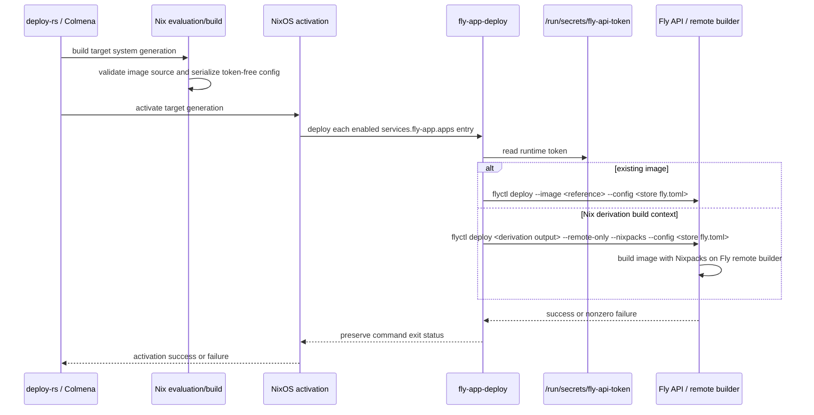

# Design Document

## Overview

This design specifies a reusable NixOS Fly app module and its activation-time deployment contract. Problem and scope are in `brief.md`, behavior is in `requirements.md`, and Fly platform research is recorded in `research.md`.

### Goals

- Declare app settings and complete Machines API machine configuration in Nix, retaining multi-container and unmodeled API fields.
- Apply config changes during ordinary NixOS deployment activation through deploy-rs, Colmena, or compatible tooling.
- Support an existing image or a Nix derivation that produces a source/build-context directory for Fly's remote Nixpacks build.
- Keep the Fly access token out of evaluation, derivations, store artifacts, and generated app configuration.

### Non-Goals

- Creating or deleting Fly organizations, users, or apps; the named Fly App must already exist.
- Provisioning, rotating, or revoking the access token.
- Local image building, general Nix-to-OCI conversion, or non-Fly deployment support.
- Replacing deploy-rs, Colmena, `flyctl`, or the Machines API.

## Boundary Commitments

### This Spec Owns

- A reusable NixOS module interface for app identity, Fly app settings, image source, and Machine API configuration.
- Pure serialization of declared configuration into a store-resident, token-free `fly.toml` artifact.
- A target-side deployment action invoked during NixOS activation, with runtime-only token access and failure propagation.
- Tests for evaluation, serialization, deployment invocation, token separation, and failure signaling.

### Out of Boundary

- Provisioning the Fly App or Fly organization; operators create the app and supply its name before enabling this module.
- Fly account lifecycle, app deletion, app secrets management, IP allocation, certificates, and volume lifecycle.
- Application-specific runtime secrets and the security posture inside the deployed Machines.
- Building Nix derivations on Fly. The derivation output is a source/build context; Nixpacks builds the deployable image on Fly's remote builder.

### Allowed Dependencies

- NixOS module system and the flake's pinned nixpkgs for option evaluation, serialization, and scripts.
- `flyctl` for Fly remote-builder image builds and Fly app/Machine deployment; it is supplied by `pkgs.flyctl` and its flags are verified by tests against the package version in the flake's locked nixpkgs.
- Fly Machines API configuration and supported `fly.toml` settings.
- An operator-provisioned runtime file containing the Fly access token, readable only by the deployment activation identity.
- deploy-rs and Colmena as unchanged consumers of NixOS activation; no Fly-specific integration is added to either tool.

### Revalidation Triggers

- Changes to Fly Machines API or `fly.toml` configuration shape, especially `experimental.machine_config` or `containers`.
- Changes to `flyctl deploy` support for `--remote-only`, `--nixpacks`, `--image`, token environment variables, or source-context handling.
- Changes to NixOS activation ordering or deploy-rs/Colmena activation semantics.
- Changes to the runtime token file path, ownership, or secret-delivery mechanism.

## Architecture

### Existing Architecture Analysis

- `flake.nix` currently has no Fly module output or deploy-rs/Colmena wiring; `configurations/personal/home-manager/default.nix` only installs `flyctl`, and `home-manager/common/fly-skill.nix` only installs an operations skill.
- NixOS feature modules are imported by a system configuration, as in `configurations/fabro-vm/default.nix`; the flake uses Nix-evaluated checks and Node test suites such as `tests/fabro-sandbox` to test module output.
- deploy-rs and Colmena deploy NixOS systems by activating the target generation. Using NixOS activation is the shared seam and does not require either deploy tool to understand Fly options.

### Architecture Pattern & Boundary Map

Pattern: declarative NixOS module plus an activation-time adapter to the Fly CLI. Nix evaluation produces immutable config and retains source derivations; activation supplies runtime credentials and performs external effects.

```mermaid
graph LR
  Nix[NixOS configuration] --> M[services.fly-app module]
  M --> TOML[Token-free fly.toml in Nix store]
  M --> CTX[Optional source derivation output]
  DR[deploy-rs] --> ACT[NixOS activation]
  CO[Colmena] --> ACT
  ACT --> RUN[fly-app-deploy action]
  TOKEN[/run/secrets/fly-api-token] --> RUN
  TOML --> RUN
  CTX -->|--remote-only --nixpacks| FB[Fly remote builder]
  RUN -->|Fly API deployment| FLY[Existing Fly App / Machines]
  FB --> FLY
```

- **Architecture Integration**: NixOS owns declaration and activation; the deployment adapter owns argument selection and exit status; Fly owns remote image construction and Machine application.
- **Boundary decision**: The activation action runs on the target NixOS host, so both deploy-rs and Colmena invoke the same code path after system activation begins.
- **Image decision**: A Nix derivation must produce a directory containing the source and build files Nixpacks needs. The generated Fly deployment invokes `flyctl deploy` with both `--remote-only` and `--nixpacks`; it does not run `nix build` on Fly or build an image locally.
- **Machine config decision**: The option surface includes a typed convenience layer for identity/image selection and a raw attrset for the complete Machines API config. The serializer writes the attrset as JSON at a generated `machine-config.json` file and references it through `[experimental] machine_config` in `fly.toml`; `primaryContainer` selects the image replaced by `fly deploy`, preserving sidecar container images/configuration.
- **Impacts/Risks**: Fly deployment becomes part of activation and can lengthen or fail a system switch; that is intentional so deploy-rs/Colmena do not report success when Fly rejects the update. Each configured app deploys sequentially; the generated activation snippet records the first nonzero result, so NixOS activation exits nonzero before its final `/run/current-system` update.

### Technology Stack

| Layer | Choice | Role | Notes |
|---|---|---|---|
| Module | NixOS module system | User-facing declaration and assertions | Exported as `nixosModules.fly-app` from the repository flake |
| Serialization | `pkgs.formats.toml` plus JSON encoding for Machine config | Store-resident `fly.toml` | Contains no token values |
| Deployment CLI | `pkgs.flyctl` | Remote Nixpacks build and Fly deployment | Explicit remote-only flags for derivation sources |
| Runtime secret | Operator-provisioned `/run/secrets/fly-api-token` | Bearer token source | Read only at activation; never evaluated by Nix |
| Verification | Flake checks and Node's built-in test runner | Module assertions, output shape, and command contract | Live Fly credentials are not required for structural tests |

## File Structure Plan

### Directory Structure

```text
modules/nixos/
└── fly-app.nix                    # services.fly-app options, assertions, artifact generation, activation wiring
scripts/
└── fly-app-deploy.nix             # parameterized activation-time wrapper around flyctl
tests/fly-app/
├── helpers.js                     # Nix evaluation helper following tests/fabro-sandbox
├── module.test.js                 # options, generated config, source selection, token absence
├── deploy.test.js                 # fake-flyctl invocation and failure propagation
└── package.json                   # Node test entry point
```

### Modified Files

- `flake.nix` — export `nixosModules.fly-app`; wire the module tests into `checks` following the existing flake test pattern.
- `modules/nixos/fly-app.nix` — new NixOS module; the repository currently has no Fly app module.
- `scripts/fly-app-deploy.nix` — new script derivation; accepts only store paths and a runtime token-file path as inputs.
- `tests/fly-app/*` — new test suite for the module and deploy wrapper.

## System Flows

### NixOS deployment activation



The action supplies the token to the CLI through `FLY_API_TOKEN` in its runtime child environment, not a command-line flag or generated file. It passes `--yes` to avoid confirmation prompts and does not use interactive `flyctl auth login`. A missing or rejected token, remote build error, or Fly deployment rejection exits nonzero and stops the activation's Fly deployment phase.

## Requirements Traceability

| Requirement | Summary | Design elements | Flow |
|---|---|---|---|
| 1.1 | App identity/settings are declared | `services.fly-app.apps.<name>`; Fly App Module | Activation |
| 1.2 | Machines API settings can be declared | `machineConfig` raw API object; JSON artifact + `experimental.machine_config` | Activation |
| 1.3 | Unmodeled API features remain expressible | Freeform Machine config attrset | Activation |
| 1.4 | Accepted declared settings are applied | Fly CLI deployment adapter | Activation |
| 2.1 | Multiple containers can be declared | `machineConfig.containers` | Activation |
| 2.2 | Multi-container declaration is deployed | `experimental.machine_config` JSON file reference and selected primary container | Activation |
| 2.3 | Other supported Machine config is preserved | Raw Machine config pass-through | Activation |
| 3.1 | Existing image source is applied | Mutually exclusive image source option; `--image` path | Activation |
| 3.2 | Derivation output supplies the build path | Derivation-output build context | Activation |
| 3.3 | Build is remote-only and uses Nixpacks | Fixed `--remote-only --nixpacks` invocation | Activation |
| 3.4 | Conflicting source selections fail evaluation | NixOS assertion names app and both fields | Evaluation |
| 3.5 | Missing required image source fails evaluation | NixOS assertion names app and missing source | Evaluation |
| 3.6 | Remote build failure is deployment failure | CLI status propagates to activation | Activation |
| 4.1 | deploy-rs can deploy the declaration | Target NixOS activation action | Activation |
| 4.2 | Colmena can deploy the declaration | Same target NixOS activation action | Activation |
| 4.3 | Config changes reach the app | Re-run `flyctl deploy` with current generated config | Activation |
| 4.4 | Fly rejection fails deployment | Nonzero CLI status propagates | Activation |
| 5.1 | Supplied token authenticates | Runtime token file read by adapter; Fly CLI bearer auth | Activation |
| 5.2 | No interactive login is required | CLI invocation never calls login or reads local login session | Activation |
| 5.3 | No other authentication credential is required | Only Fly token is supplied | Activation |
| 5.4 | Missing/rejected token fails | Runtime preflight and CLI status propagation | Activation |
| 6.1 | Token is not a derivation input/path | Token path/value is not interpolated into derivation data; script reads at runtime | Evaluation / activation |
| 6.2 | Token is not stored in the Nix store | No token content enters Nix evaluation or generated store files | Evaluation |
| 6.3 | Token is absent from app config artifacts | Config serializer receives only declared non-secret settings and image metadata | Evaluation |

## Components and Interfaces

| Component | Layer | Intent | Requirements | Dependencies | Contract |
|---|---|---|---|---|---|
| Fly App Module | NixOS module | Declare app, validate source, serialize config, add activation action | 1, 2, 3.4-3.5, 4, 6 | NixOS module system, `pkgs.formats.toml` | Options and activation script |
| `fly-app-deploy` | Runtime script | Select image/build path, read token, invoke Fly, propagate result | 3.1-3.3, 3.6, 4.3-4.4, 5 | `flyctl`, runtime token file | Shell process exit status |
| Fly Machines API / remote builder | External service | Build Nixpacks image remotely and apply app/Machine config | 1.4, 2.2-2.3, 3.6, 4.4, 5.1 | Fly bearer token | Fly API requests and CLI result |

### NixOS Module

| Field | Detail |
|---|---|
| Intent | Expose a reusable `services.fly-app.apps` attrset for NixOS configurations. |
| Requirements | 1.1-1.3, 2.1, 3.4-3.5, 4.1-4.3, 6.1-6.3 |

**Responsibilities & Constraints**

- Each app entry declares an existing Fly app name, Fly TOML-level settings, one image source, and complete Machine API config.
- `machineConfig` is a freeform attrset serialized as JSON in a separate generated file referenced by `experimental.machine_config`, retaining all API fields, including `containers`, per-container config, and fields not modeled by convenience options. The generated config sets `primaryContainer` as `experimental.container` when the module supplies a replacement image.
- `image.existing` and `image.source` are mutually exclusive; one must be set when an enabled app needs an image. For multi-container config, `primaryContainer` identifies the container whose image is supplied by the selected source; sidecar images remain part of `machineConfig`.
- The module writes `fly.toml` and `machine-config.json` plus script derivations from non-secret configuration only and adds a `system.activationScripts` entry for enabled apps. `tokenFile` is a string path option, not a Nix path type, so Nix does not copy the runtime secret file into the store. It sets `experimental.machine_config` to the JSON artifact and, when `primaryContainer` is set, sets `experimental.container` to that container name.
- The module does not create an app or organization. The target app must already exist and the `appName` must match it.

**Dependencies**

- Inbound: NixOS system configuration — declares `services.fly-app.apps`.
- Outbound: NixOS activation — runs the generated deploy action and treats a nonzero result as activation failure.
- External: `pkgs.formats.toml`, `pkgs.writeShellApplication`, and `pkgs.flyctl` — serialize config and run deployment.

**Contracts**: Service [x] / API [ ] / Event [ ] / Batch [ ] / State [ ]

##### Option Contract

```nix
services.fly-app = {
  enable = true;
  tokenFile = "/run/secrets/fly-api-token";
  apps.example = {
    enable = true;
    appName = "existing-fly-app";
    appConfig = { primary_region = "ord"; };
    machineConfig = { containers = [ ]; };
    primaryContainer = null;
    image.existing = "registry.example/app:tag";
    image.source = null;
  };
};
```

`image.existing` and `image.source` default to `null`; `appConfig` and `machineConfig` default to empty attrsets. `primaryContainer` is required when the machine config uses a `containers` array and an image source supplies one container image. The exact types and option descriptions are implementation details, but the behavioral invariants above are fixed.

##### Activation Contract

- Preconditions: An enabled named Fly App already exists; the token file is provisioned and readable at activation; a derivation source output contains a Nixpacks-compatible build context when selected.
- Postconditions: The deployment adapter exits zero only after `flyctl deploy` completes successfully; a nonzero Fly CLI result is recorded as an activation-snippet failure and makes the final system activation exit nonzero.
- Invariants: The token is not an option value, generated config value, command argument, or derivation environment input. Derivation-source invocations always include `--remote-only` and `--nixpacks`.

**Impacts/Risks**

- All enabled apps are deployed during each activation; this makes a NixOS switch the deployment event and can add latency.
- `machineConfig` deliberately favors API completeness over field-level Nix type validation; Fly remains the final schema validator.

### Deployment Adapter

| Field | Detail |
|---|---|
| Intent | Translate a module entry into a safe, noninteractive Fly CLI invocation. |
| Requirements | 3.1-3.3, 3.6, 4.3-4.4, 5.1-5.4, 6.1-6.3 |

**Responsibilities & Constraints**

- Read the token from the runtime-only file when activation runs and set `FLY_API_TOKEN` only in the child Fly CLI process environment; flyctl documents this as a noninteractive auth input, so never pass the token as an argument.
- Use `--image` for a pre-existing image and use the derivation output directory as the build context with `--remote-only --nixpacks` for a Nix source.
- Use a fixed generated config path and noninteractive deployment flags, including `--yes`; never invoke `flyctl auth login` or rely on a user profile's flyctl credential store.
- Return the `flyctl` exit status unchanged and avoid logging token contents.

**Dependencies**

- Inbound: NixOS activation script — supplies generated paths and starts the action.
- Outbound: `flyctl deploy` — builds/pushes/deploys to Fly.
- External: Runtime token file — credential source; Fly CLI/API — authentication and remote build/deployment.

**Contracts**: Service [x] / API [ ] / Event [ ] / Batch [ ] / State [ ]

##### Service Interface

```text
fly-app-deploy --app <name> --config <store-path> --token-file <runtime-path>
               [--machine-config <store-json-path>]
               [--image <reference> | --source <derivation-output>]
               [--primary-container <name>]
```

- Preconditions: Exactly one of `--image` or `--source` is selected; config and source are readable; token file exists and is non-empty.
- Postconditions: Exit 0 means `flyctl deploy` completed; any preflight, builder, API, or deployment error exits nonzero.
- Invariants: Token value is only read at invocation, is omitted from argv/config/output, and does not outlive the child process environment.

**Impacts/Risks**

- The deployment action runs as root under `system.activationScripts`, so it can read a root-owned runtime token file. Permissions must be least-privilege and the token is still passed to `flyctl` only through the child environment.
- A failed Fly update leaves external state owned by Fly; the module reports failure but does not attempt an unsafe compensating rollback.

## Data Models

### Domain Model

- **App declaration**: one `services.fly-app.apps.<app-id>` entry identifies an existing Fly app, carries Fly app-level configuration, complete Machine configuration, and one selected image source.
- **Image source**: `ExistingImage(reference)` or `NixBuildContext(derivation)`; the sum type is exclusive and is validated during Nix evaluation.
- **Machine configuration**: JSON-compatible Nix attrset matching Fly's Machine config object. Its `containers` array preserves multi-container machines; arbitrary API keys pass through unchanged.
- **Generated artifact**: `fly.toml` in the Nix store containing app settings and the serialized Machine config, with no access token or runtime credential path value.
- **Runtime credential**: the token exists only at the operator-selected runtime path and in the deploy process environment during activation.

### Logical Data Model

| Entity | Fields | Invariants |
|---|---|---|
| App entry | `appName`, `appConfig`, `machineConfig`, `image`, `primaryContainer`, `enable` | Unique Nix attr key; app name non-empty; exactly one image source when required |
| Existing image | `reference: string` | Non-empty registry reference; used without an image build |
| Nix build context | `source: derivation` | Output is a directory suitable as Nixpacks source; build happens only remotely |
| Runtime token | `tokenFile: path` | Path is a runtime activation input, not a derivation reference; file content is never evaluated or copied into the store |

### Data Contracts & Integration

- Fly-level settings are emitted as TOML according to the pinned `pkgs.formats.toml` serializer.
- `machineConfig` is encoded as JSON at `machine-config.json` and referenced by `experimental.machine_config` in generated `fly.toml` so API-only fields and multi-container entries are preserved. `experimental.container` is set from `primaryContainer` when the build source replaces a single image in the multi-container list.
- Nix evaluation retains a derivation reference to the source context so the output remains available to the target deployment closure; the token file is not a closure reference.

### Operator Provisioning

- **Secret**: Fly.io API access token. **Source**: operator's existing secure secret manager, materialized on the target as a protected source file named by `FLY_API_TOKEN_FILE`. **Provisioning command**: `sudo install -o root -g root -m 0600 "$FLY_API_TOKEN_FILE" /run/secrets/fly-api-token`. **Verification command**: `sudo test -s /run/secrets/fly-api-token && sudo stat -c '%a %U:%G' /run/secrets/fly-api-token` (expected `600 root:root`). **Owner**: operator. The command copies an already-provisioned token; it does not mint or rotate it.

## Error Handling

### Error Strategy

- Nix source conflicts and missing image sources are evaluation-time assertions naming the app and option fields.
- Runtime preflight reports the app and missing token-file path, but never prints token contents.
- Fly CLI build, authentication, and deployment errors are surfaced on stderr and propagated as a nonzero activation result; success is never emitted after a failed Fly operation.
- The adapter does not retry independently of `flyctl` or perform destructive cleanup; Fly-side partial state is inspected and corrected by a subsequent declarative activation.

### Error Categories and Responses

| Category | Example | Response |
|---|---|---|
| Configuration | Both image fields set or neither selected | Fail Nix evaluation with app-specific assertion |
| Authentication | Token file absent/empty or Fly rejects token | Fail preflight or CLI invocation; no success status |
| Build | Fly remote builder cannot build derivation context | Preserve Fly CLI failure; stop activation |
| API/deployment | Fly rejects config or Machine update | Preserve Fly CLI failure; stop activation |

### Monitoring

- Use NixOS activation output and `flyctl` stderr for deployment diagnostics.
- Error messages may include app name and Fly request context, never token content.

## Testing Strategy

### Unit Tests

- Evaluate a valid single-container entry and verify app name, settings, generated Machine config, and selected existing-image source.
- Evaluate a multi-container entry with a sidecar and verify container fields, dependencies, health checks, and unknown API keys survive serialization.
- Assert that both image sources and no image source produce evaluation errors identifying the affected app and source fields.
- Inspect generated store artifacts and derivation environment inputs to ensure the token value cannot enter them; use only a synthetic test token in fixtures.

### Integration Tests

- Run the deploy adapter with a fake `flyctl`; assert existing image invocation uses `--image`, while a derivation source always uses `--remote-only --nixpacks` and the source output path.
- Verify the fake CLI receives the token only via the runtime environment and that the value is absent from argv, config, stdout, and stderr.
- Make fake `flyctl` fail for remote-build, authentication, and API cases and assert the adapter returns nonzero so activation cannot claim success.
- Evaluate the exported module through the flake's NixOS module system and verify the activation script is present only for enabled apps.

### End-to-End Tests

- With an operator-provided Fly token and pre-created test Fly app, deploy an existing-image single-container config and verify the resulting Machine config.
- Deploy a Nixpacks-compatible derivation source and confirm the build is performed by a Fly remote builder, then verify the resulting image and Machine config.
- Submit an intentionally rejected config in a disposable test app and verify NixOS activation fails rather than reporting successful deployment.

## Security Considerations

- Token configuration contains only a runtime path; no token content is a Nix option, `writeText` input, app config field, derivation argument, or process argument.
- Token access is restricted by the runtime file's ownership/mode; root activation reads it and passes it through `FLY_API_TOKEN` only to `flyctl`. Tests use synthetic values and inspect observable command/artifact boundaries.
- App configuration remains visible in the Nix store by design. Users must not put secret application values in non-secret app/Machine config fields; Fly app secrets management is outside this feature.

## Supporting References

- `research.md` records Fly API, multi-container, remote Nixpacks builder, and `flyctl deploy` source findings.
