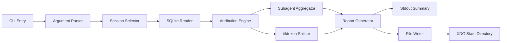
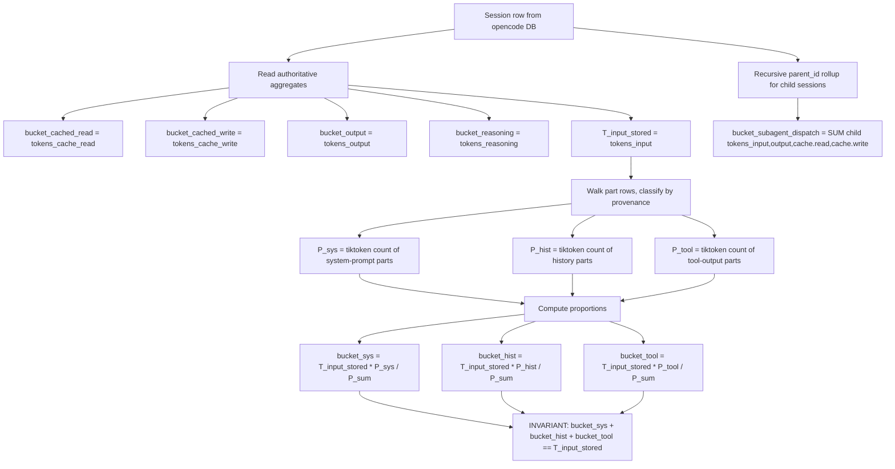
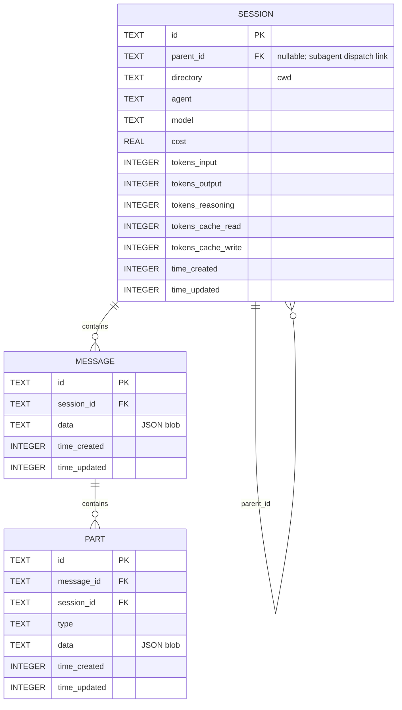

# Design Document

## Overview

The diagnostic is a Node CLI installed via Nix overlay + Home Manager
module on both nix-darwin hosts. It reads opencode's local SQLite
session database read-only and emits per-session and per-project
cost-attribution reports (Markdown + JSON) that break down input
tokens into five buckets per the requirements. The diagnostic is the
success-measurement primitive for every follow-on cost-reduction spec
catalogued in `roadmap.md`.

**Purpose**: Produce evidence-grade attribution of opencode token
spend across system-prompt cached / system-prompt uncached /
conversation history / tool outputs / subagent dispatches, so
follow-on specs can target the dominant cost driver with measurable
before/after impact.

**Users**: The operator (sole user across two nix-darwin hosts) runs
the CLI on-demand. No other consumers; no UI; no service.

**Impact**: Adds one always-on CLI on both hosts. Read-only consumer
of opencode's session DB; never modifies it. Does not change opencode
behavior or any cost-reduction interventions.

### Goals

- Five-bucket attribution per assistant turn with sum-correctness
  against opencode's authoritative `tokens_input` aggregate
- tiktoken-derived proportional split within uncached input, with a
  structured accuracy disclaimer embedded in every report
- Subagent attribution via recursive `parent_id` rollup (no
  double-counting)
- Schema-drift detection against a pinned opencode version range,
  with loud failure outside the range
- Privacy default-exclude posture for message bodies and tool-output
  content; opt-in via `--include-content`
- Multi-host parity via the project's existing Nix overlay + HM
  module pattern

### Non-Goals

- Any cost-reduction intervention itself (deferred specs)
- Real-time dashboards, web UIs, or hosted services
- Cross-host data merge or shared aggregation
- Anthropic Admin Cost Report API integration as primary data source
- Comparison reports between runs (diffing JSON reports is a future
  convenience)
- Live-logger plugin in v1 (DEFERRED — see Plugin Decision below)
- Per-host source-DB backup wiring (Shopify is wired; personal is
  deferred per the cavemem precedent, governed by host config, not
  by this spec)

## Boundary Commitments

### This Spec Owns

- The diagnostic CLI (`opencode-cost-report`) and its full install
  pipeline (Nix derivation, vendored npm deps, HM module, smoke test)
- The cost-attribution algorithm (5-bucket split with sum-correctness
  guarantee against opencode's stored `tokens_input`)
- The schema-drift detection mechanism (opencode version range
  check + migration-set verification)
- The report shapes (Markdown structure, JSON schema, disclaimer
  format)
- The privacy/disclosure policy (default-exclude, `--include-content`
  opt-in, mode 0600 on report files, XDG state-dir output)
- The selector argument surface (`--last`, `--session`, `--cwd` and
  their combination semantics)

### Out of Boundary

- Cost-reduction interventions (the seven deferred specs in
  `.kiro/steering/roadmap.md`)
- Modifying opencode behavior, prompts, schema, or source code in any
  way
- Per-host source-DB backup wiring (Shopify host already wired; the
  personal host is a host-config decision, not a diagnostic concern)
- Live-logger plugin (DEFERRED in v1 — trigger condition documented
  below)
- Anthropic API integration of any kind (Messages API, Admin Cost
  Report API, Token Count API)
- Cost forecasting, anomaly detection, alerting
- Per-model pricing recompute (v1 trusts opencode's stored
  per-session `cost` from `session.cost` for the authoritative
  `CostBuckets.total`; per-bucket cost values require tokens ×
  pricing recompute and are deferred to a follow-on spec; v1 emits
  all per-bucket cost fields as `null` with a
  `per_bucket_cost_deferred` finding so the JSON shape is
  forward-compatible)
- Cache-creation 5m vs 1h split within `tokens_cache_write`
  (upstream limitation — opencode flattens; document, don't fix)

### Allowed Dependencies

- `pkgs.nodejs` (nixpkgs default, currently `nodejs_22`)
- `better-sqlite3@12.10.0` via vendored deps tree at
  `overlays/opencode-cost-diagnosis-deps/` (mirrors
  `overlays/cavemem-importer-deps/` exactly)
- `tiktoken@^1.0.x` (WASM, MIT) via the same vendored deps tree
- The opencode session database file at
  `${config.xdg.dataHome}/opencode/opencode-stable.db` (read-only)
- The project's existing Nix overlay + HM module + `writeShellApplication`
  patterns (`scripts/cavemem-import-vault.nix`,
  `home-manager/common/memory-sync.nix`,
  `home-manager/common/cc-sdd.nix`)
- HM-eval-time assertion against `config.programs.opencode.enable`

### Revalidation Triggers

The following changes require dependent specs or consumers to
re-check integration:

- **opencode bumps a database migration** that touches `session`,
  `message`, `part`, or `message.data` JSON shape → schema-drift
  check fires; diagnostic may need a version-range pin bump and a
  smoke-test refresh
- **opencode changes `tokens.cache.{read,write}` semantics** (e.g.,
  splits cache_write into 5m/1h) → cache-bucket attribution layer
  needs to absorb the new dimensions; cached-bucket report shape
  may change
- **opencode changes `session.parent_id` populated-ness or
  semantics** → subagent recursive rollup may need to switch
  fallback path
- **Operator revises the privacy policy** (e.g., wants content
  emitted by default) → R4 needs revision; report shape changes
- **Decision to implement the deferred live-logger plugin** → R7
  Where-clauses become active; new spec required
- **Decision to implement per-bucket cost recompute** → `CostBuckets`
  per-bucket fields stop being `null`; new spec defines the pricing
  source (likely models.dev snapshot) and the population algorithm;
  `per_bucket_cost_deferred` finding stops being emitted
- **Follow-on cost-reduction spec needs an additional bucket** (e.g.,
  a future "reasoning intensity by step" view) → diagnostic JSON
  schema versioning required

## Architecture

### Architecture Pattern & Boundary Map

Single Node CLI organized as five logical layers in strict
left-to-right dependency direction. Each layer imports only from
layers to its left; circular imports are a build error.



**Architecture Integration**:

- **Selected pattern**: Pipeline + adapter. Each layer transforms its
  input into a richer dataset for the next layer. SQLite Reader
  adapts persistence; Attribution Engine adapts raw aggregates into
  bucket totals; Reporter adapts bucket totals into emit-ready text.
- **Domain boundaries**: Persistence (Reader), pure logic
  (Selector, Attribution, Aggregator, Splitter), output
  (Reporter, FileWriter). Tokenizer is treated as a pure logic
  service even though it loads WASM under the hood.
- **Existing patterns preserved**: `writeShellApplication` wrapper
  around `node ${./script.js}` (cavemem-import-vault precedent); HM
  module shape with `programs.<name>.{enable, package}`
  (memory-sync precedent); vendored deps via `buildNpmPackage` +
  `importNpmLock` (cavemem-importer-deps precedent).
- **New components rationale**: All components are new to this
  repo; the diagnostic introduces no extensions to existing
  components per Gap Analysis Option B (Create New Components).
- **Steering compliance**: Mode 0600 on sensitive files
  (memory-sync precedent); XDG state-dir conventions; declarative
  install only (no imperative installers); no GPL deps; no upstream
  SaaS dependency.

### Technology Stack

| Layer | Choice / Version | Role in Feature | Notes |
|-------|------------------|-----------------|-------|
| CLI Runtime | `pkgs.nodejs` (nixpkgs default, currently `nodejs_22`) | Executes the diagnostic | Bare `final.nodejs`; no Node version pin (matches cavemem-importer-deps convention) |
| SQLite Driver | `better-sqlite3@12.10.0` | Read-only opencode DB access | Vendored via `overlays/opencode-cost-diagnosis-deps/`; native build with `npm_config_build_from_source=true`; mirrors cavemem-importer-deps Darwin build pattern |
| Tokenizer | `tiktoken@^1.0.x` (cl100k_base encoding) | Proportional split of uncached input | MIT, WASM (no native build); ~10-30% over-counts Claude; used for relative proportions only — see Attribution Engine for sum-correctness math |
| CLI argument parsing | Hand-rolled (no dep) | Parse flags, dispatch to actions | Small flag surface (`--last`, `--session`, `--cwd`, `--include-content`, `--format`, `--output`, `--help`); avoids `commander`/`yargs` bloat |
| Time-range parsing | Hand-rolled (no dep) | `--last 30d` → ms | Single function mirrors `parse_since` from memory-sync (bash) |
| Markdown generator | Hand-rolled template literals | Report MD body | Fixed structure; templating library would be over-engineering |
| JSON generator | `JSON.stringify` (Node stdlib) | Report JSON body | Stable key order enforced via custom replacer for byte-identical output (6.3) |
| Install | `writeShellApplication` + HM module | CLI on PATH on both hosts | Mirrors `scripts/cavemem-import-vault.nix` |
| Schema-drift verifier | `writeShellApplication` calling `sqlite3` CLI | Post-`nix flake update` smoke test | Mirrors `scripts/cavemem-smoke-test.nix` |

## File Structure Plan

### Directory Structure

```
overlays/
├── opencode-cost-diagnosis-deps/
│   ├── package.json                            # NEW: pins better-sqlite3@12.10.0 + tiktoken@^1.0.x
│   └── package-lock.json                       # NEW: generated by `npm install`
└── mcp-servers.nix                             # MODIFIED: add pkgs.opencode-cost-diagnosis-deps derivation

scripts/
├── opencode-cost-report.nix                    # NEW: writeShellApplication wrapper (~20 LOC Nix)
├── opencode-cost-report.js                     # NEW: Node CLI logic (~500-700 LOC)
└── opencode-cost-diagnosis-smoke-test.nix      # NEW: writeShellApplication post-flake-update verifier (~50 LOC)

home-manager/common/
├── opencode-cost-diagnosis.nix                 # NEW: HM module exposing programs.opencode-cost-diagnosis.{enable, package}
└── default.nix                                 # MODIFIED: import opencode-cost-diagnosis.nix; programs.opencode-cost-diagnosis.enable = true
```

**File count**: 5 new files, 2 modified.

### Component-to-File Mapping

All nine logic-layer components (CLI Entry, Argument Parser, Session
Selector, SQLite Reader, Attribution Engine, Subagent Aggregator,
Tokenizer Splitter, Reporter, File Writer) live as internal modules
within the single file `scripts/opencode-cost-report.js`. Single-file
structure chosen given the ~500-700 LOC estimate and the strict
left-to-right dependency direction shown in Architecture (no
circular imports possible inside one file). If the file grows past
1000 LOC during implementation, split per logical layer (data /
logic / output) into sibling files; until then, single-file keeps
review and grep simple. The other three components map to dedicated
files: HM Module → `home-manager/common/opencode-cost-diagnosis.nix`;
Vendored Deps Derivation → `overlays/opencode-cost-diagnosis-deps/`
plus a derivation block in `overlays/mcp-servers.nix`; Smoke Test →
`scripts/opencode-cost-diagnosis-smoke-test.nix`.

### Modified Files

- `overlays/mcp-servers.nix` — Append the
  `opencode-cost-diagnosis-deps` derivation block at the end of the
  existing overlay function. Pattern mirrors `cavemem-importer-deps`
  block at lines 328-378 of that file.
- `home-manager/common/default.nix` — Add
  `./opencode-cost-diagnosis.nix` to `imports`; add
  `programs.opencode-cost-diagnosis.enable = true;` to `config`.
  Both changes are one-liners in the existing common-aggregator
  shape.

### Runtime File Layout

Reports are written at runtime to
`${XDG_STATE_HOME:-$HOME/.local/state}/opencode-cost-diagnosis/reports/<iso8601>.{md,json}`
with file mode `0600` (umask `0o077` before open, per 4.4). The
writer prunes older runs to keep the last 10 reports per format —
mirrors `scripts/memory-sync.nix:467-489`'s last-N-prune. When the
operator passes `--output <path>`, the writer emits to that single
path and skips pruning entirely.

## System Flows

### Flow 1: Per-session bucket attribution

```mermaid
sequenceDiagram
    participant CLI
    participant Selector
    participant Reader
    participant DB as opencode DB
    participant Attribution
    participant Aggregator
    participant Tokenizer
    participant Reporter

    CLI->>Selector: parsed args
    Selector->>Reader: SQL filter + read request
    Reader->>DB: SELECT FROM session WHERE filter
    DB-->>Reader: in-scope session rows
    loop For each in-scope session
        Reader->>DB: SELECT FROM message JOIN part WHERE session_id=?
        DB-->>Reader: time-ordered parts + message.data JSON
        Reader->>Attribution: session aggregates + parts
        Attribution->>Attribution: cached_read, cached_write, output, reasoning from session row
        Attribution->>Aggregator: trigger subagent rollup if root session
        Aggregator->>DB: WITH RECURSIVE descendants AS ...
        DB-->>Aggregator: child-session aggregates
        Aggregator-->>Attribution: subagent_dispatch bucket
        Attribution->>Tokenizer: per-part chunks classified by provenance
        Tokenizer-->>Attribution: per-part token counts
        Attribution->>Attribution: compute proportions; apply to tokens_input
    end
    Attribution-->>Reporter: full attribution dataset
```

**Key decisions in this flow**:

- Reader returns parts in time-of-creation order so Attribution can
  reconstruct prompt composition (system prompt → history → tool
  outputs).
- Aggregator runs ONLY for root sessions (parent_id IS NULL); child
  sessions are folded into their root's subagent bucket and not
  reported individually. This avoids double-counting.
- Tokenizer is invoked once per non-cached part; cached portions
  (counted by `tokens.cache.read`) are not re-tokenized. Cache buckets
  are authoritative regardless of tokenizer.

### Flow 2: Bucket math (the sum-correctness guarantee)



**Guarantees**:

- Buckets (a) `bucket_cached_read`, (b'-cache part of b)
  `bucket_cached_write`, (output), (reasoning), and (e)
  `bucket_subagent_dispatch` are **authoritative** — derived from
  opencode's stored values, no tokenizer.
- Buckets (b'-uncached part), (c), (d) **sum exactly** to
  `tokens_input` (opencode-stored). Their **internal split** is
  tiktoken-proportional and is the only place the relative-accuracy
  caveat applies (R2.AC9 disclaimer).
- If `P_sum == 0` (no parts classifiable), all three uncached
  sub-buckets receive `0` and the entire `tokens_input` value is
  surfaced as a notable finding `"unclassifiable_input"` — never
  silently dropped.

## Requirements Traceability

| Requirement | Summary | Components | Flows |
|-------------|---------|------------|-------|
| 1.1 | Common HM install on both hosts | HM Module, Vendored Deps Derivation, writeShellApplication wrapper | — |
| 1.2 | PATH entrypoint after rebuild | HM Module | — |
| 1.3 | HM-eval-time peer assertion | HM Module | — |
| 1.4 | No imperative install / runtime fetch | Vendored Deps Derivation | — |
| 1.5 | Identical command surface across hosts | CLI Entry, Argument Parser | — |
| 2.1 | Markdown report default | Reporter | — |
| 2.2 | JSON report alongside Markdown | Reporter | — |
| 2.3 | 5-bucket attribution | Attribution Engine, Subagent Aggregator, Tokenizer Splitter | Flows 1, 2 |
| 2.4 | Per-session totals + grand total | Reporter | — |
| 2.5 | Per-project (cwd) totals | Reporter | — |
| 2.6 | Per-bucket monetary cost | Attribution Engine, Reporter | — |
| 2.7 | "Caching not enabled" finding | Reporter | — |
| 2.8 | Empty-DB success | CLI Entry, Reporter | — |
| 2.9 | Accuracy disclaimer in every report | Reporter | — |
| 3.1 | Time-range filter | Argument Parser, Session Selector | — |
| 3.2 | Session-ID filter | Argument Parser, Session Selector | — |
| 3.3 | Project (cwd) filter | Argument Parser, Session Selector | — |
| 3.4 | Logical AND combination | Session Selector | — |
| 3.5 | Bad-arg actionable error | Argument Parser | — |
| 4.1 | Default fields-only output | Reporter | — |
| 4.2 | Default-exclude content | Reporter | — |
| 4.3 | `--include-content` opt-in | Argument Parser, Reporter | — |
| 4.4 | Report files mode 0600 | File Writer | — |
| 4.5 | XDG state-dir output | File Writer | — |
| 5.1 | Supported version range readable from diagnostic | Schema-Drift Check (in Reader) | — |
| 5.2 | Loud fail on out-of-range schema | Schema-Drift Check | — |
| 5.3 | Missing parent-child link → warn, conservative attribution | Subagent Aggregator | Flow 2 |
| 5.4 | Other schema gaps → warn, partial-data finding | Attribution Engine, Reporter | — |
| 6.1 | No writes to source DB | SQLite Reader | — |
| 6.2 | Concurrent-safe with active opencode session | SQLite Reader | — |
| 6.3 | Byte-identical JSON for identical inputs | Reporter | — |
| 6.4 | Missing-DB actionable error | SQLite Reader | — |
| 6.5 | I/O error actionable error | File Writer, SQLite Reader | — |
| 7.1 | Works without plugin | All components — by construction | — |
| 7.2 | Plugin event emission (Where-clause) | DEFERRED — see Plugin Decision | — |
| 7.3 | Plugin privacy posture (Where-clause) | DEFERRED | — |
| 7.4 | Plugin XDG output location (Where-clause) | DEFERRED | — |
| 7.5 | Binary decision recorded | This design document (Plugin Decision section) | — |

## Components and Interfaces

### Summary

| Component | Layer | Intent | Req Coverage | Key Dependencies |
|-----------|-------|--------|--------------|------------------|
| CLI Entry | Top | Process-entry, top-level error handler, dispatch to actions | 1.2, 1.5, 2.8 | Argument Parser (P0) |
| Argument Parser | Top | Parse and validate CLI flags | 1.5, 3.1, 3.2, 3.3, 3.5, 4.3 | — |
| Session Selector | Logic | Build SQL WHERE clauses from validated selectors | 3.1, 3.2, 3.3, 3.4 | SQLite Reader (P0) |
| SQLite Reader | Data | Read-only DB access; schema-drift check; row iteration | 5.1, 5.2, 6.1, 6.2, 6.4 | opencode DB (P0 external), better-sqlite3 (P0 external) |
| Attribution Engine | Logic | Compute 5-bucket split per session with sum-correctness | 2.3, 2.4, 2.5, 2.6, 2.7, 5.4 | SQLite Reader (P0), Subagent Aggregator (P0), Tokenizer Splitter (P0) |
| Subagent Aggregator | Logic | Recursive parent_id rollup of child-session token totals | 2.3 (e), 5.3 | SQLite Reader (P0) |
| Tokenizer Splitter | Logic | Tokenize parts, compute uncached-input proportions | 2.3 (b/c/d), 2.9 | tiktoken (P0 external) |
| Reporter | Output | Generate Markdown + JSON; embed accuracy disclaimer | 2.1, 2.2, 2.7, 2.9, 4.1, 4.2, 4.3, 6.3 | Attribution Engine (P0) |
| File Writer | Output | Write reports to XDG state dir with mode 0600 | 4.4, 4.5, 6.5 | — |
| HM Module | Install | Module shape, peer assertion, package wiring | 1.1, 1.3, 1.4, 1.5 | opencode HM module (P0 external) |
| Vendored Deps Derivation | Install | Build better-sqlite3 + tiktoken via buildNpmPackage | 1.4 | nodejs (P0 external) |
| Smoke Test | Install | Post-`nix flake update` schema-drift verifier | 5.1 | SQLite Reader (P0), opencode DB (P0 external) |

### Data Layer

#### SQLite Reader

| Field | Detail |
|-------|--------|
| Intent | Read-only access to opencode session DB; schema-drift detection; row iteration in deterministic order |
| Requirements | 5.1, 5.2, 6.1, 6.2, 6.4 |

**Responsibilities & Constraints**

- Open `${dbPath}` with `{ readonly: true, fileMustExist: true }`
  so any attempt to write is a programming error
- Verify the opencode schema is within the supported version range
  before any other operation; fail loudly on drift
- Iterate `session`, `message`, `part` rows in time-of-creation order
  so callers can reason about prompt composition
- Never enable extensions, never run pragmas that alter state, never
  begin a write transaction

**Dependencies**

- Outbound: opencode session DB file at
  `${config.xdg.dataHome}/opencode/opencode-stable.db` (Criticality:
  P0 external)
- Outbound: `better-sqlite3` (Criticality: P0 external)

**Contracts**: Service [x] / API [ ] / Event [ ] / Batch [ ] / State [x]

##### Service Interface

```typescript
interface SqliteReader {
  // Throws SchemaDriftError if the opencode schema is outside the
  // supported version range. Otherwise opens read-only.
  open(dbPath: string): void;

  close(): void;

  // The version range this build of the diagnostic supports. Read
  // from a constant in this module. Surfaced via --supported-opencode-version.
  readonly supportedVersionRange: string;

  // Returns the highest opencode migration applied. Compared against
  // a pinned set to drive the schema-drift check.
  detectMigrationSet(): string[];

  // Returns root sessions (parent_id IS NULL) matching the selector.
  // Caller iterates; reader does not buffer.
  rootSessionsMatching(selector: SessionFilter): Iterable<SessionRow>;

  // Returns child sessions reachable via parent_id from the given root.
  // Used by Subagent Aggregator.
  descendantSessionsOf(rootSessionId: string): Iterable<SessionRow>;

  // Returns parts for a single session in time-of-creation order.
  partsOfSession(sessionId: string): Iterable<PartRow>;

  // Returns messages for a single session in time-of-creation order,
  // with `role` parsed out of `message.data` JSON so callers do not
  // need to re-parse the blob for the most-needed field.
  // Used by Tokenizer Splitter for per-part role-based classification.
  messagesOfSession(sessionId: string): Iterable<MessageRow>;
}

interface MessageRow {
  id: string;
  sessionId: string;
  role: "user" | "assistant" | "system";
  timeCreated: number;
  // The full `message.data` JSON string. Reader parses `role` only;
  // any other fields callers want come from re-parsing `data`.
  data: string;
}

interface SessionRow {
  id: string;
  parentId: string | null;
  directory: string;          // cwd
  agent: string | null;
  model: string | null;
  cost: number;
  tokensInput: number;
  tokensOutput: number;
  tokensReasoning: number;
  tokensCacheRead: number;
  tokensCacheWrite: number;
  timeCreated: number;        // ms epoch
  timeUpdated: number;
}

interface PartRow {
  id: string;
  messageId: string;
  sessionId: string;
  type: "text" | "tool" | "step-start" | "step-finish" | "reasoning"
      | "patch" | "compaction" | "agent" | "file";
  timeCreated: number;
  // Caller parses `data` JSON. Reader does not interpret it.
  data: string;
}

interface SessionFilter {
  timeRangeStart?: number;    // ms epoch, inclusive
  timeRangeEnd?: number;      // ms epoch, exclusive
  sessionId?: string;
  cwdPattern?: string;        // exact match or glob; selector decides
}

class SchemaDriftError extends Error {
  constructor(
    readonly detectedMigrationSet: string[],
    readonly supportedMigrationSet: string[],
    readonly supportedVersionRange: string
  ) { super(/* actionable message */); }
}
```

- **Preconditions**: `dbPath` exists and is readable; opencode is not
  currently holding an exclusive lock (WAL mode allows concurrent
  reads regardless)
- **Postconditions**: No writes to the source DB; iterators are
  lazy; close() releases the file handle
- **Invariants**: `open` either succeeds with a supported schema or
  throws `SchemaDriftError`; never silently proceeds with a drifted
  schema

##### State Management

- Connection state held in the reader instance only; not shared
  globally
- Schema-drift check runs once per `open()`; result cached for the
  reader's lifetime

**Implementation Notes**

- Integration: imported only by Session Selector, Subagent Aggregator,
  Attribution Engine, and Tokenizer Splitter
- Validation: the schema-drift check reads the `data_migration`
  table — verified live in opencode at design time as
  `CREATE TABLE data_migration (name TEXT PRIMARY KEY, time_completed INTEGER NOT NULL)`
  — and compares the set of `name` rows against a pinned const in the
  reader module. **v1 baseline pinned set**:
  `["session_usage_from_messages"]` (verified live on the Shopify host
  on 2026-05-16). Any additional, removed, or renamed migration name
  triggers `SchemaDriftError` with both sets named in the error
  message.
- Risks: opencode renames or removes the `data_migration` table →
  `open()` fails with a clear "data_migration table not found"
  diagnostic; operator must bump the diagnostic's pinned migration
  set or revert opencode. No silent fallback path; this is by-design
  loud failure on upstream change.

### Logic Layer

#### Attribution Engine

| Field | Detail |
|-------|--------|
| Intent | Per-session 5-bucket attribution with sum-correctness against opencode's authoritative `tokens_input` |
| Requirements | 2.3, 2.4, 2.5, 2.6, 2.7, 5.4 |

**Responsibilities & Constraints**

- For each root session: compute the five primary buckets per the
  Flow 2 math
- Authoritative buckets (`cached_read`, `cached_write`, `output`,
  `reasoning`, `subagent_dispatch`) come directly from
  opencode-stored values or the Aggregator
- Uncached-input sub-buckets (`uncached_system_prompt`, `history`,
  `tool_outputs`) come from tiktoken proportions applied to
  `tokens_input`
- INVARIANT: `uncached_system_prompt + history + tool_outputs ==
  tokens_input` (within rounding; emit a finding if not)
- Populate `CostBuckets.total` from `session.cost` (opencode's
  authoritative per-session value)
- Set every per-bucket cost field to `null` and emit one
  `per_bucket_cost_deferred` finding per session, explaining that
  per-bucket cost requires tokens × pricing recompute, deferred to a
  follow-on spec
- If `provenanceCounts.unclassifiedCount > 0` for a session, emit
  one `schema_partial_data` finding per session naming the count
  and the set of unrecognized `part.type` values encountered; the
  proportional split for that session uses only the classified
  totals (unclassified tokens are NOT folded into any bucket)
- Surface "caching not enabled" as a finding when
  `sum(tokens_cache_read across all sessions) == 0`
- Surface "unclassifiable_input" finding when `P_sum == 0` for a
  session (no parts classifiable by provenance)

**Dependencies**

- Inbound: SQLite Reader (sessions, parts) (P0)
- Inbound: Subagent Aggregator (subagent bucket per root session) (P0)
- Inbound: Tokenizer Splitter (per-part counts) (P0)

**Contracts**: Service [x]

##### Service Interface

```typescript
interface AttributionEngine {
  // Compute bucket totals for one root session. Throws if the
  // session row is malformed; emits Findings for partial data.
  attributeSession(
    session: SessionRow,
    parts: PartRow[],
    subagentBucket: SubagentBucketTotals
  ): SessionAttribution;
}

interface BucketTotals {
  cachedRead: number;
  cachedWrite: number;
  uncachedSystemPrompt: number;
  history: number;
  toolOutputs: number;
  output: number;
  reasoning: number;
  subagentDispatch: number;
}

interface CostBuckets {
  // Per-session total cost from opencode's authoritative `session.cost`
  // field. Always populated in v1; this is the only cost number R2.AC6
  // requires.
  total: number;

  // Per-bucket cost values require recomputing from token counts ×
  // model pricing (opencode stores only the per-session aggregate).
  // v1 emits all per-bucket fields as null and surfaces a
  // `per_bucket_cost_deferred` finding. A follow-on spec is the
  // trigger to populate these (see Revalidation Triggers below).
  // Type preserved here so the JSON shape is forward-compatible when
  // the recompute spec lands.
  cachedRead: number | null;
  cachedWrite: number | null;
  uncachedInput: number | null;
  output: number | null;
  reasoning: number | null;
  subagentDispatch: number | null;
}

interface SessionAttribution {
  sessionId: string;
  directory: string;
  agent: string | null;
  model: string | null;
  timeCreated: number;
  timeUpdated: number;
  tokens: BucketTotals;
  cost: CostBuckets;
  findings: Finding[];
}

interface Finding {
  kind: "caching_not_enabled" | "unclassifiable_input"
      | "schema_partial_data" | "tokenizer_proportional_split"
      | "per_bucket_cost_deferred";
  detail: string;
}

interface SubagentBucketTotals {
  tokensTotal: number;
  cost: number;
  childCount: number;
}
```

**Implementation Notes**

- Integration: composes Reader + Aggregator + Tokenizer; itself
  imported only by Reporter
- Validation: every SessionAttribution must satisfy
  `uncachedSystemPrompt + history + toolOutputs == session.tokensInput`
  (modulo rounding < 1 token); if violated, emit
  `schema_partial_data` finding with the discrepancy
- Risks: part-classification logic (system vs history vs tool
  output) depends on opencode's `part.type` and `part.data` shape;
  needs care in implementation tests against a fixture DB

#### Subagent Aggregator

| Field | Detail |
|-------|--------|
| Intent | Recursive rollup of child-session token + cost totals into the parent's subagent bucket |
| Requirements | 2.3 (e), 5.3 |

**Responsibilities & Constraints**

- For a given root session, walk `parent_id` chain via recursive CTE
  and SUM tokens (input, output, cache.read, cache.write) and cost
  across all descendants
- Detect cycles defensively (parent_id pointing to a session that's
  already in the path) and emit a finding + bail out of that subtree
- If `session.parent_id` column is missing (5.3 fallback), attribute
  zero to the subagent bucket and emit a `schema_partial_data`
  finding

**Dependencies**

- Inbound: SQLite Reader (descendantSessionsOf, partsOfSession) (P0)

**Contracts**: Service [x]

##### Service Interface

```typescript
interface SubagentAggregator {
  // Roll up all descendants of the root into a single SubagentBucketTotals.
  // Returns zero totals if the root has no children.
  rollup(rootSessionId: string): SubagentBucketTotals;

  // Returns true if the schema supports parent_id-based attribution.
  // False triggers conservative fallback per 5.3.
  schemaSupportsParentLink: boolean;
}
```

**Implementation Notes**

- Integration: invoked once per root session by Attribution Engine
- Validation: aggregator must produce disjoint totals from parent
  (no double-counting); verified by integration test against fixture
  DB where parent + children sum equals known expected total
- Risks: a malformed DB with a cycle in parent_id; detected by
  tracking visited session IDs in the walk

#### Tokenizer Splitter

| Field | Detail |
|-------|--------|
| Intent | Compute tiktoken token counts per part and per provenance category for the uncached-input proportional split |
| Requirements | 2.3 (b/c/d), 2.9 |

**Responsibilities & Constraints**

- Load `cl100k_base` encoding once at startup (lazy-init on first
  use)
- Classify each part by provenance: system-prompt vs conversation
  history vs tool-output (see classification rules below)
- For each classified chunk, return `tiktoken.encode(text).length`
- Skip parts marked as cached in the prompt (those belong to the
  authoritative cached_read bucket, not the proportional split)
- Tokenizer never emits absolute token counts to the report; only
  proportions

**Classification rules**:

The session-aggregate view simplifies the rules. Token totals sum
across every turn in the session; the diagnostic does not need to
distinguish "current turn's tool output" from "prior turn's tool
output" — it's all input that ever flowed into any turn's prompt.

- `part.type == "text"` AND `message.role == "system"` →
  `system-prompt`
- `part.type == "text"` AND `message.role == "user"` → `history`
- `part.type == "text"` AND `message.role == "assistant"` →
  `history` (assistant text from prior turns becomes input on
  subsequent turns)
- `part.type == "tool"` AND `part.data.state.output` present →
  `tool-output`
- `part.type == "reasoning"` → skip (counted in `tokens_reasoning`,
  not in the input bucket)
- `part.type == "step-start" | "step-finish" | "compaction" | "agent"
  | "patch" | "file"` → skip (metadata; not in prompt body)
- Any other `part.type` value → `unclassified`; emit
  `schema_partial_data` finding, do NOT silently include in any
  bucket

**Dependencies**

- Outbound: `tiktoken` (Criticality: P0 external)

**Contracts**: Service [x]

##### Service Interface

```typescript
interface TokenizerSplitter {
  // Returns per-category token sums for the parts of one session.
  classifyAndCount(
    parts: PartRow[],
    messages: ReadonlyMap<string, MessageRow>   // for role lookup
  ): ProvenanceCounts;
}

interface ProvenanceCounts {
  systemPrompt: number;
  history: number;
  toolOutput: number;
  // Tokens summed across parts whose `part.type` did not match any
  // classification rule. Tokenizer returns the count here; Attribution
  // Engine inspects it and (if > 0) emits one `schema_partial_data`
  // finding per session naming the count AND the unrecognized
  // `part.type` values encountered. NEVER folded into any of the three
  // classified buckets above — the proportional split uses only the
  // classified totals.
  unclassifiedCount: number;
}

// MessageRow is defined as part of SqliteReader's interface above.
// Tokenizer Splitter consumes it through Attribution Engine, which
// builds a `ReadonlyMap<string, MessageRow>` keyed by message.id
// before invoking `classifyAndCount`.
```

**Implementation Notes**

- Integration: invoked once per session by Attribution Engine
- Validation: classification rules tested against fixture sessions
  representing each `part.type` × `message.role` combination
- Risks: opencode adds a new `part.type` value the classifier
  doesn't know about → emit `schema_partial_data` finding; do NOT
  silently include in any bucket. Add a default branch in the
  classifier that returns an "unclassified" count surfaced as a
  finding.

### Output Layer

#### Reporter

| Field | Detail |
|-------|--------|
| Intent | Generate Markdown + JSON reports with embedded disclaimer and per-project aggregation |
| Requirements | 2.1, 2.2, 2.7, 2.9, 4.1, 4.2, 4.3, 6.3 |

**Responsibilities & Constraints**

- Markdown output: human-readable, headline-disclaimer-then-detail
  layout, default-exclude content
- JSON output: stable key order (custom replacer enforces alphabetical
  or schema-defined order); same data as Markdown; structured
  `tokenizer_disclaimer` object
- Both formats embed the R2.AC9 disclaimer when uncached-input
  sub-buckets are present
- Per-project aggregation: group sessions by `session.directory`;
  produce a separate per-project subsection in MD and a
  `byProject: Record<string, ProjectAggregate>` key in JSON

**Dependencies**

- Inbound: Attribution Engine (P0)

**Contracts**: Service [x]

##### Service Interface

```typescript
interface Reporter {
  formatMarkdown(
    sessions: SessionAttribution[],
    options: ReporterOptions
  ): string;

  formatJson(
    sessions: SessionAttribution[],
    options: ReporterOptions
  ): string;          // serialized, stable key order
}

interface ReporterOptions {
  includeContent: boolean;        // R4.AC3 opt-in
  reportGeneratedAt: number;      // ms epoch; included in MD only
                                  // (NOT in JSON — preserves 6.3)
  supportedOpencodeVersionRange: string;   // for disclaimer block
}

interface DiagnosticReport {
  schemaVersion: 1;
  reportType: "opencode-cost-diagnosis";
  tokenizer_disclaimer: TokenizerDisclaimer;
  // globalTotals.tokens sums every session's BucketTotals (cache buckets
  // and subagent_dispatch are authoritative; the three uncached
  // sub-buckets inherit the tokenizer-proportional caveat).
  // globalTotals.cost.total sums every session's session.cost; per-bucket
  // cost fields are `null` in v1 (CostBuckets shape preserved for
  // forward-compat with the deferred per-bucket cost recompute spec).
  globalTotals: { tokens: BucketTotals; cost: CostBuckets };
  sessionCount: number;
  byProject: Record<string, ProjectAggregate>;
  sessions: SessionAttributionJson[];
  findings: Finding[];          // global findings
}

interface TokenizerDisclaimer {
  library: "tiktoken";
  encoding: "cl100k_base";
  accuracyClass: "relative-only";
  affectedBuckets: ["uncachedSystemPrompt", "history", "toolOutputs"];
  authoritativeBuckets: ["cachedRead", "cachedWrite", "output",
                         "reasoning", "subagentDispatch"];
  sumCorrectnessGuarantee: string;
  humanReadable: string;
}

interface ProjectAggregate {
  directory: string;
  sessionCount: number;
  tokens: BucketTotals;
  // cost.total sums session.cost across the project's sessions;
  // per-bucket cost fields are `null` in v1 (CostBuckets shape
  // preserved for forward-compat with the deferred per-bucket cost
  // recompute spec — when that spec lands, per-bucket aggregates
  // appear here without a JSON schema bump for downstream consumers).
  cost: CostBuckets;
}
```

**Implementation Notes**

- Integration: invoked once by CLI Entry after Attribution Engine
  produces the dataset
- Validation: golden-file tests of the Markdown and JSON output for
  a known fixture DB; byte-identical JSON across runs (6.3)
- Risks: stable JSON key order requires deterministic stringification;
  use a custom replacer or `json-stable-stringify` (but that's a
  dep we'd vendor — prefer custom replacer)

## Data Models

### Domain Model

The diagnostic operates on opencode's session database. Its
domain model is read-only — it does not own any persistent entities.
Its in-memory dataset (`SessionAttribution[]` flowing from Attribution
Engine to Reporter) is the only "owned" data shape.

Opencode's relevant subset:



`message.data` JSON shape (assistant turn):
```json
{
  "role": "assistant",
  "cost": 0.147388,
  "tokens": {
    "total": 271062,
    "input": 1,
    "output": 143,
    "reasoning": 0,
    "cache": { "write": 1452, "read": 269466 }
  },
  "modelID": "claude-opus-4-7",
  "providerID": "anthropic",
  "path": { "cwd": "...", "root": "..." }
}
```

Diagnostic's own data shapes: `SessionAttribution`, `BucketTotals`,
`CostBuckets`, `Finding`, `DiagnosticReport`, `ProjectAggregate`,
`TokenizerDisclaimer` (all defined in Components above).

### Data Contracts & Integration

- **Input contract**: opencode session DB schema (read-only consumer
  contract). Pinned via supported version range; verified at every
  invocation by Schema-Drift Check.
- **Output contract (Markdown)**: free-form human-readable; tested
  against golden fixture
- **Output contract (JSON)**: `DiagnosticReport` (versioned via
  `schemaVersion: 1`); follow-on cost-reduction specs depend on
  this shape stability

## Error Handling

### Error Strategy

Single top-level try/catch in CLI Entry. Each error category maps to
a stable exit code and an actionable stderr message. The diagnostic
never silently miscount; every recoverable degradation surfaces as a
`Finding` in the report.

### Error Categories and Responses

| Category | Trigger | Exit Code | Behavior |
|----------|---------|-----------|----------|
| User error (bad CLI arg) | Argument Parser rejects | 1 | Print usage block + named offending arg to stderr |
| Missing source DB | Reader open fails with ENOENT | 2 | Print expected path + recovery hint (`darwin-rebuild switch`? `cavemem` install hint?) to stderr |
| Schema drift | Reader detects schema outside supported range | 3 | Print detected migration set + supported set + supported version range + recommended next action ("bump diagnostic's pin or revert opencode") to stderr |
| I/O error (read or write) | Any read/write fails with non-ENOENT errno | 4 | Print errno + affected path + operation (read or write) to stderr |
| Programming error / assertion failure | Internal invariant violated (e.g., bucket sum mismatch beyond rounding tolerance) | 5 | Print component + invariant + observed values to stderr; this is a bug, not a user error |

Recoverable conditions (do NOT exit non-zero):

- No sessions match selectors → empty report, exit 0
- Caching not enabled (sum of cache_read = 0) → finding in report, exit 0
- Subagent parent_id missing → `schema_partial_data` finding, exit 0
- Unknown `part.type` → `schema_partial_data` finding, exit 0

### Monitoring

The diagnostic is invoked manually. No long-running daemon, no
metrics emission. Per-run logs are the only artifact; the report
files themselves serve as the audit trail.

## Testing Strategy

### Unit Tests

1. **Time-range parser** — `"30d"` → `2592000000` ms; `"24h"` →
   `86400000`; `"7d6h"` → reject as unsupported syntax
2. **Bucket sum-correctness** — for a synthetic SessionAttribution
   with known inputs, verify `uncachedSystemPrompt + history +
   toolOutputs == tokensInput` exactly
3. **Subagent recursive rollup** — given a fixture with root session +
   3 descendants at depth 2, rollup returns sum of all descendant
   tokens with no double-counting
4. **Privacy default-exclude** — Reporter output for a session with
   message-body text contains none of that text when
   `includeContent: false`; contains it when `true`
5. **Schema-drift detector** — fixture DB with unknown migration in
   `data_migration` table → `SchemaDriftError` with detected vs
   supported sets named; fixture with the pinned baseline set
   `["session_usage_from_messages"]` succeeds
6. **Assistant-role text classification** — fixture session with text
   parts under each of `message.role ∈ {system, user, assistant}`;
   Tokenizer attributes system → `system-prompt`, user → `history`,
   assistant → `history`; tool parts → `tool-output`; reasoning →
   skipped
7. **Per-bucket cost deferral finding** — for any session, the
   attribution result has `cost.total > 0` (from `session.cost`)
   AND all per-bucket cost fields are `null` AND findings include
   exactly one `per_bucket_cost_deferred` entry
8. **Unclassified part.type surfaces a finding** — fixture session
   with one part whose `part.type` is an unrecognized value (e.g.
   `image`); Tokenizer returns `unclassifiedCount > 0`; Attribution
   Engine emits one `schema_partial_data` finding naming the count
   and the unrecognized `part.type` value; the proportional split
   for that session uses only the classified totals (the
   unclassified tokens do not appear in any bucket)
9. **Aggregate cost forward-compat** — for a fixture with N
   sessions, `DiagnosticReport.globalTotals.cost.total` equals the
   sum of every session's `cost.total`; per-bucket fields on
   globalTotals.cost AND every ProjectAggregate.cost are `null` in
   v1

### Integration Tests

1. **End-to-end on fixture DB** — synthetic opencode-shaped fixture
   DB with 3 root sessions, 2 of which have subagent children;
   verify Markdown output matches golden file; verify JSON output is
   byte-identical to golden file
2. **Concurrent reader vs active writer** — fixture writer process
   writes to a separate fixture DB while diagnostic reads it; neither
   blocks the other; diagnostic completes without corruption
3. **Empty-DB success** — fixture DB with schema but no rows;
   diagnostic exits 0 with valid-but-empty Markdown and JSON
4. **Disclaimer presence** — every report whose attribution includes
   uncached sub-buckets contains the structured `tokenizer_disclaimer`
   object (JSON) and the human-readable disclaimer block (MD)
5. **CLI-flag combination** — `--last 30d --cwd /Users/x/foo` returns
   only sessions matching both filters (AND semantics per 3.4)

### Smoke Test (Install-Layer)

The `opencode-cost-diagnosis-smoke-test` derivation, shipped on PATH
via the HM module, runs:

1. Open the live opencode DB at the expected path (read-only).
2. Verify the `data_migration` set is within the supported range.
3. Verify the diagnostic binary is on PATH and reports the supported
   range via `--supported-opencode-version`.
4. Exit with a named failure label (`schema_drift`, `cli_missing`,
   `db_missing`) on any failure; exit 0 otherwise.

This is the operator's first action after `nix flake update` if they
care about the diagnostic being current.

## Plugin Decision (R7.AC5)

**Decision**: The live-logger plugin is DEFERRED from v1. v1 produces
a usable cost-attribution baseline via the snapshot CLI alone (every
requirement except R7.AC2/3/4 is satisfied); shipping the plugin
also doubles the test surface without delivering the baseline any
sooner.

**Trigger condition for revisiting**: If a snapshot report identifies
a session where a single turn consumes more than 50% of that session's
total cost, AND the operator wants continuous intra-session hot-spot
visibility without rerunning the diagnostic, open a follow-on spec to
enable the plugin. The plugin source would then live at
`home-manager/common/opencode-plugins/opencode-cost-logger.ts`,
installed via `xdg.configFile."opencode/plugins/opencode-cost-logger.ts".source`
per the cavemem.js / zellij-attention.ts precedent. The follow-on spec
would define the event schema and the diagnostic's mechanism for
consuming the resulting `events.jsonl` (if any).
