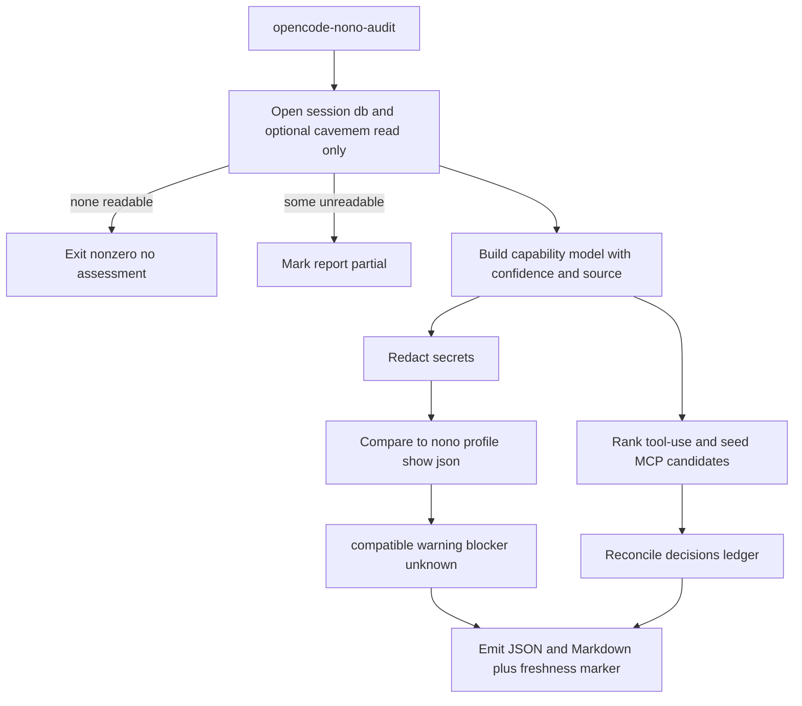

# Design Document

## Overview

**Purpose**: `opencode-nono-audit` is a read-only Node CLI that audits historical
OpenCode tool usage, assesses it against the managed nono profiles from
`opencode-nono-sandbox`, and emits a ranked common-tool-use list with advisory
MCP-replacement decisions.

**Users**: The operator, who runs the audit before flipping the sandbox
`defaultState` toward `enforced`, and reads the compatibility + replacement
reports.

**Impact**: Adds `opencode-nono-audit` (CLI + thin HM module + flake app/check)
reusing the `SqliteReader` from `opencode-cost-report.js`. It never mutates any
source and never changes OpenCode permissions or MCP registrations. Its
compatibility report doubles as the freshness marker the sandbox
strict-enforcement check reads.

### Goals
- Produce a read-only observed-capability inventory from the OpenCode session DB
  (and optionally cavemem).
- Compare observed usage to managed profiles' resolved grants and classify
  findings.
- Rank common tool-use and record advisory keep/replace/defer/none decisions.
- Redact secrets by default; emit human + machine readable output.

### Non-Goals
- Launching/sandboxing OpenCode, rendering profiles, rollout state (owned by
  `opencode-nono-sandbox`).
- Acting on replacement decisions; changing OpenCode permissions/MCP.
- Modifying nono.

## Boundary Commitments

### This Spec Owns
- The `opencode-nono-audit` CLI: usage audit, compatibility assessment,
  tool-use replacement review.
- The report formats (JSON + Markdown), the decisions-ledger format, and the
  report freshness marker.
- Its thin HM module / packaging, flake app + checks, and tests.

### Out of Boundary
- Launch/sandbox/profile rendering/rollout — `opencode-nono-sandbox`.
- The `nono` package and its `profile show` semantics.
- The `SqliteReader` implementation — `opencode-cost-diagnosis` (read-only reuse).
- Acting on decisions; OpenCode permission or MCP registration changes (R3.7).

### Allowed Dependencies
- `scripts/opencode-cost-report.js` `SqliteReader` export (via env-injected lib
  path) and the `opencode-cost-diagnosis-deps` NODE_PATH tree (read-only reuse).
- Read-only access to the OpenCode session DB and the cavemem `data.db`.
- `nono profile show <name> --json` (read-only) for resolved profile grants.
- The managed profiles rendered by `opencode-nono-sandbox` (read-only) and its
  metadata at `${XDG_CONFIG_HOME}/opencode/opencode-nono/metadata.json` — the
  single source of the `profileVersion` string namespace.

Dependency direction (must not be violated):
`SqliteReader (lib) → capability model → assessor/review → reporter`.

### Revalidation Triggers
- The audit report or decisions-ledger schema version changes.
- The freshness-marker contract consumed by `opencode-nono-sandbox` changes.
- `nono profile show --json` output shape changes (package bump).
- The OpenCode session DB schema drifts (SqliteReader migration set).
- cavemem `data.db` schema/version changes.

## Architecture

### Existing Architecture Analysis
- `SqliteReader` (`opencode-cost-report.js`) opens the session DB read-only with
  a `SUPPORTED_MIGRATION_SET` drift gate; `require.main===module` guards CLI
  side effects, so `require()` reuse is clean. Tool name = `data.tool`||
  `data.name`; output = `data.state.output`; tool ARG sub-shape is unpinned.
- DB path: `OPENCODE_DB_PATH` else `${XDG_DATA_HOME:-~/.local/share}/opencode/opencode-stable.db`.
- cavemem `${dataDir}/data.db` `observations(kind,content,ts,metadata,compressed)`;
  content is lossily compressed; the CLI cannot use the cavemem MCP (not an
  agent) — it reads `data.db` directly, read-only.
- `subagent-context-budget.js` provides the deterministic report shape (stable
  key ordering, explicit `observed|absent`, Result envelopes);
  `opencode-cost-report.js` `FileWriter` provides 0600 + XDG-state + retention.
- No reusable redactor exists in the repo → new module.

### Architecture Pattern & Boundary Map
A read-only pipeline: open sources → build capability model → redact → (assess |
rank+review) → report. The assessor adopts nono's resolver via `profile show
--json`.



### Technology Stack

| Layer | Choice / Version | Role | Notes |
|-------|------------------|------|-------|
| CLI / Audit | Node (repo nodejs) + `better-sqlite3` via `opencode-cost-diagnosis-deps` | Read-only audit/assess/review | Reuses `SqliteReader` |
| Profile grants | `nono profile show --json` | Resolved grants for assessment | Adopt nono's resolver |
| Data / Storage | JSON+MD reports; JSON ledger; JSON freshness marker | `$XDG_STATE_HOME/opencode-nono/` | 0600, retention |
| Infrastructure | `flake.nix` app/checks + thin HM module | `nix run`/`nix flake check` | Mirrors `opencode-cost-diagnosis` |

## File Structure Plan

### New Files
```
scripts/
├── opencode-nono-audit.js         # Audit + compatibility + review engine
└── opencode-nono-audit.nix        # writeShellApplication wrapper
                                   # (NODE_PATH + OPENCODE_NONO_COST_REPORT_LIB)

home-manager/common/
└── opencode-nono-audit.nix        # Thin module: package option, home.packages,
                                   # metadata; peer assertion on programs.opencode

tests/opencode-nono-audit/
├── run.js                         # node --test dispatcher (mirror cost-diag)
├── audit.test.js                  # Audit over fixture session DB (+ cavemem)
├── assess.test.js                 # Classification over fixture profile-show JSON
├── review.test.js                 # Ranking + ledger validation
└── fixtures/                      # Synthetic session DB, cavemem db, profile-show JSON
```

### Modified Files
- `home-manager/common/default.nix` — import `./opencode-nono-audit.nix`,
  enable.
- `flake.nix` — `apps.opencode-nono-audit`; `checks.opencode-nono-audit-tests`,
  `checks.opencode-nono-audit-validate-check`.

## Requirements Traceability

| Requirement | Summary | Components | Interfaces | Flows |
|-------------|---------|------------|------------|-------|
| 1.1 | inspect historical sessions | Usage Audit CLI | `SqliteReader` | Audit |
| 1.2 | summarize derivable tool usage | Capability Model | `CapabilityRecord` | Audit |
| 1.3 | use cavemem when available | Usage Audit CLI | cavemem `data.db` source | Audit |
| 1.4 | missing/unreadable source → partial | Usage Audit CLI | `SourceStatus` | Audit |
| 1.5 | no source readable → fail | Usage Audit CLI | exit-nonzero | Audit |
| 1.6 | audit does not mutate sources | Usage Audit CLI | read-only opens | Audit |
| 1.7 | redact secrets by default | Redactor | `redact()` | Audit |
| 2.1 | compare usage to selected profiles | Compatibility Assessor | `nono profile show --json` | Assess |
| 2.2 | classify compatible/warning/blocker/unknown | Compatibility Assessor | `Finding.classification` | Assess |
| 2.3 | identify profile/usage/context/missing cap | Compatibility Assessor | `Finding` | Assess |
| 2.4 | unmappable → unknown | Compatibility Assessor | classification rule | Assess |
| 2.5 | human + machine readable | Reporter | JSON + Markdown | Assess |
| 3.1 | ranked common tool-use list | Tool-Use Replacement Review | `RankedToolUse` | Review |
| 3.2 | evaluate Git MCP replacement | Tool-Use Replacement Review | candidate map | Review |
| 3.3 | identify MCP alternative when known | Tool-Use Replacement Review | candidate map | Review |
| 3.4 | record keep/replace/defer/none decision | Tool-Use Replacement Review | decisions ledger | Review |
| 3.5 | replace decision documents perm reduction | Tool-Use Replacement Review | ledger entry | Review |
| 3.6 | keep decision documents reason + needed cap | Tool-Use Replacement Review | ledger entry | Review |
| 3.7 | review does not change perms/MCP | Boundary (advisory only) | — | — |

## Components and Interfaces

| Component | Domain/Layer | Intent | Req Coverage | Key Dependencies (P0/P1) | Contracts |
|-----------|--------------|--------|--------------|--------------------------|-----------|
| Usage Audit CLI | scripts | Read-only usage inventory | 1.1-1.6 | SqliteReader (P0), cavemem db (P1) | Service, Batch |
| Redactor | scripts | Strip secrets from output | 1.7 | — | Service |
| Compatibility Assessor | scripts | Compare usage to profiles | 2.1-2.5 | nono profile show (P0) | Service |
| Tool-Use Replacement Review | scripts | Rank + decisions ledger | 3.1-3.6 | capability model (P0) | Service, State |
| Reporter | scripts | JSON+MD + freshness marker | 2.5,1.7 | FileWriter pattern (P1) | Batch |
| Packaging | scripts/HM/flake | CLI install + app/check | all | cost-diagnosis-deps (P0) | — |

The implementation is JSDoc-typed JS consistent with the repo scripts; the
interfaces below are the documented contracts.

### Usage Audit CLI (`scripts/opencode-nono-audit.js`)

| Field | Detail |
|-------|--------|
| Intent | Build a read-only observed-capability inventory |
| Requirements | 1.1, 1.2, 1.3, 1.4, 1.5, 1.6 |

**Responsibilities & Constraints**
- Open the OpenCode session DB read-only (`OPENCODE_DB_PATH` else default path)
  via `SqliteReader` (`{readonly:true,fileMustExist:true}`, schema-drift gated).
- Optionally open cavemem `${dataDir}/data.db` read-only (`observations`) as a
  best-effort secondary source (R1.3), version-guarded.
- Build a capability model: derive tool name + output reliably; derive
  command/path/URL from tool-arg parsing best-effort (confidence + source);
  treat sockets/ports/env as inference-only.
- Enumerate the capability classes that could NOT be observed from the
  available sources (e.g. `unix-socket`, `env-var`) in `unobservableClasses`,
  so the report states coverage gaps explicitly rather than implying full
  coverage (see the Phase 0 minimum-fidelity gate).
- Treat a `SqliteReader` open failure or `SchemaDriftError` as an
  `incompatible` source → mark `partial` (R1.4); never crash on drift.
- Missing/unreadable/incompatible source → mark `partial`, name the source
  (R1.4). No source readable → exit nonzero, no assessment (R1.5).
- Never open any source writable; never write back to sources (R1.6).

**Dependencies**: External: `SqliteReader` (P0), cavemem `data.db` (P1, optional).

**Contracts**: Service [x] / Batch [x]
```typescript
type Confidence = "high" | "medium" | "low";
type EvidenceSource = "opencode-sqlite" | "cavemem";
interface CapabilityRecord {
  tool: string; count: number;
  commands: string[]; paths: string[]; endpoints: string[];
  ports: number[]; envVars: string[];
  confidence: Confidence; sources: EvidenceSource[];
}
interface SourceStatus { source: EvidenceSource; status: "ok" | "missing" | "unreadable" | "incompatible"; detail?: string; }
interface UsageAudit {
  schemaVersion: 1; generatedAt: string; partial: boolean;
  sources: SourceStatus[]; capabilities: CapabilityRecord[];
  unobservableClasses: string[];   // capability classes not derivable from sources
}
function runAudit(opts: AuditOptions): Result<UsageAudit, AuditError>;
```
- Preconditions: at least one source readable (else R1.5).
- Postconditions: no source mutated; all string fields redaction-passed.
- Invariants: unmappable structured fields are omitted, not guessed.

**Implementation Notes**
- Integration: `.nix` wrapper sets `NODE_PATH=${opencode-cost-diagnosis-deps}`
  and `OPENCODE_NONO_COST_REPORT_LIB=${../scripts/opencode-cost-report.js}`; the
  CLI does `require(process.env.OPENCODE_NONO_COST_REPORT_LIB)` for
  `SqliteReader`.
- Risks: tool-arg sub-shape unpinned → defensive, confidence-tagged. cavemem
  content lossy/compressed → secondary only.
- Coupling: reusing `SqliteReader` inherits opencode-cost-diagnosis's
  `SUPPORTED_MIGRATION_SET` window (`>=0.18 <0.30`); the two specs' supported
  OpenCode windows must stay aligned (revalidation trigger). A drift outside the
  window surfaces as an `incompatible` source (partial report), not a crash.

### Redactor

| Field | Detail |
|-------|--------|
| Intent | Strip secrets from all serialized content |
| Requirements | 1.7 |

**Contracts**: Service [x]
```typescript
function redact(value: string): string; // masks tokens, api keys, KEY=VALUE env, URL creds
```
- On by default; applied to every command/path/endpoint/env string before
  serialization. New module (no reusable redactor in the repo).

### Compatibility Assessor

| Field | Detail |
|-------|--------|
| Intent | Compare observed usage to managed profiles' resolved grants |
| Requirements | 2.1, 2.2, 2.3, 2.4, 2.5 |

**Responsibilities & Constraints**
- For each selected profile, obtain resolved grants from
  `nono profile show <name> --json` (adopt nono's resolver).
- Classify each observed capability: `compatible | warning | blocker |
  unknown`. Unmappable → `unknown` (R2.4), never `compatible`.
- For blockers/warnings, identify profile, observed usage, affected session
  context, and missing capability when available (R2.3).
- If `nono` is unavailable (e.g. the sandbox feature is not yet enabled on the
  host), skip assessment with an explicit `assessment: skipped (nono
  unavailable)` status and still emit the R1 usage inventory and R3 review. This
  is distinct from the R1.5 no-source hard failure.

**Dependencies**: External: `nono profile show --json` (P0; absence → assessment
skipped, not a hard failure).

**Contracts**: Service [x]
```typescript
type Classification = "compatible" | "warning" | "blocker" | "unknown";
interface Finding {
  profile: string; classification: Classification;
  capability: string;            // redacted
  sessionContext?: string;       // session id / cwd, redacted
  missingCapability?: string;
}
function assess(audit: UsageAudit, profiles: string[]): Result<Finding[], AssessError>;
```
- Preconditions: `nono` available; profiles exist.
- Postconditions: every observation maps to exactly one classification.

**Implementation Notes**
- `profile show --json` shape unverified upstream → defensive parse;
  unparseable grant → `unknown`. False-compatible avoidance is mandatory.

### Tool-Use Replacement Review

| Field | Detail |
|-------|--------|
| Intent | Rank tool-use and record advisory MCP-replacement decisions |
| Requirements | 3.1, 3.2, 3.3, 3.4, 3.5, 3.6 |

**Responsibilities & Constraints**
- Rank common tool-use by `riskScore = count × capabilityRisk`, where
  `capabilityRisk` comes from a static map (e.g. `bash`/external-command and
  `git` = high; `webfetch` = medium; `read`/`glob`/`grep` = low; unknown tool =
  medium). Ties break by descending frequency, then tool name ascending, so the
  ranking is deterministic (R3.1).
- Seed MCP-replacement candidates from a static map (git → Git MCP servers,
  extensible) (R3.2, 3.3); mark "no viable replacement" when none known.
- Read/reconcile an operator-maintained decisions ledger: each candidate gets
  `keep | replace | defer | none` (R3.4). `replace` documents permission
  reduction + workflow change (R3.5); `keep` documents reason + required
  capability (R3.6).
- Advisory only: never mutate OpenCode permissions or MCP registrations (R3.7,
  enforced by boundary — this component emits no such outputs).

**Contracts**: Service [x] / State [x]
```typescript
type Decision = "keep" | "replace" | "defer" | "none";
interface RankedToolUse { tool: string; count: number; riskScore: number; rank: number; } // riskScore = count × capabilityRisk (static map)
interface ReplacementCandidate { tool: string; mcpCandidate?: string; rationale: string; }
interface LedgerEntry {
  tool: string; decision: Decision;
  permissionReduction?: string;   // required when "replace"
  workflowChange?: string;        // required when "replace"
  keepReason?: string;            // required when "keep"
  requiredCapability?: string;    // required when "keep"
}
```
- State: ledger is the source of truth; the CLI echoes undecided candidates and
  validates required fields per decision.

### Reporter
- Writes JSON + Markdown (R2.5) from one stably-key-ordered object (mirror
  `subagent-context-budget.js`); 0600 + XDG-state + retention (mirror
  `opencode-cost-report.js` `FileWriter`). All content redaction-passed (R1.7).
- Reads the active profile version from the sandbox-rendered metadata
  (`${XDG_CONFIG_HOME}/opencode/opencode-nono/metadata.json`, `profileVersion`
  field) — the single source of the version-string namespace.
- Writes the freshness marker `${XDG_STATE_HOME}/opencode-nono/last-report.json`
  = `{ markerSchemaVersion: 1, profileVersion, generatedAt, host }` — a
  versioned cross-spec contract `opencode-nono-sandbox`'s strict-enforcement
  check reads. A marker whose `profileVersion` differs from the live metadata is
  treated as stale (the sandbox warns). The `markerSchemaVersion` and the
  `metadata.json` path are owned jointly and are revalidation triggers on both
  specs.

## Data Models

### Domain Model
- **UsageAudit** (aggregate): `sources[]` + `capabilities[]`; invariant =
  read-only provenance, `partial` set when any source degrades.
- **Finding**: belongs to a profile + capability; one classification.
- **LedgerEntry**: keyed by `tool`; operator-owned; conditional-required fields
  per `decision`.

### Logical Data Model
- Reports: `${XDG_STATE_HOME:-~/.local/state}/opencode-nono/reports/<ISO>.{json,md}`
  (0600, last-N retained).
- Decisions ledger: `${XDG_STATE_HOME}/opencode-nono/review-decisions.json`
  (operator-maintained).
- Freshness marker: `${XDG_STATE_HOME}/opencode-nono/last-report.json`.

### Data Contracts & Integration
- `report.schemaVersion = 1`; additive evolution only; a schema bump is a
  revalidation trigger. All report string fields pass `redact()`.

## Error Handling

### Error Strategy
Fail fast at source-open; degrade to `partial` for evidence gaps; never mutate.

### Error Categories and Responses
- **Sources (R1.4, 1.5)**: per-source `missing|unreadable|incompatible` → named
  in `sources[]`, `partial`; zero readable → exit nonzero, no assessment.
- **Assessment (R2.4)**: unmappable observation → `unknown`, never compatible.
- **Assessment availability**: `nono` absent → assessment `skipped (nono
  unavailable)`; R1 usage + R3 review still emit (distinct from the R1.5 hard
  failure).
- **Ledger**: `replace`/`keep` missing required fields → validation error naming
  the tool + missing field.

### Monitoring
- The report header records schema version, host, profile version, and
  timestamp; the freshness marker enables the sandbox spec's R3.5 check.

## Testing Strategy

### Unit Tests
- Redactor: tokens, `KEY=VALUE` env, URL credentials masked (1.7).
- Capability model: tool name/output derived; unmappable fields omitted;
  confidence/source tagged (1.2).
- Ledger validation: `replace` requires reduction+workflow; `keep` requires
  reason+capability (3.4,3.5,3.6).
- Determinism: identical inputs → byte-identical JSON (stable key ordering).

### Integration Tests
- Audit over fixture session DB (+ optional cavemem fixture): produces
  capabilities, marks `partial` on a missing source, exits nonzero with no
  sources (1.1,1.3,1.4,1.5).
- Read-only guarantee: audit run leaves session DB mtime/size unchanged (1.6).
- Assessment over fixture `nono profile show --json`: classification incl.
  `unknown` for unmappable (2.1-2.4).
- Review: ranking is deterministic for fixed input (`riskScore = count ×
  capabilityRisk`, documented tie-break); git candidate surfaced; undecided
  candidates echoed (3.1,3.2).
- Assessment skip: with `nono` absent, the report marks assessment
  `skipped (nono unavailable)` while R1 usage + R3 review still emit; distinct
  from the no-source hard failure (2.1,1.5).
- Freshness-marker contract: the written `last-report.json` matches the
  versioned schema and its `profileVersion` equals the value in the sandbox
  `metadata.json` fixture; a mismatched fixture is reported stale (cross-spec
  contract) (2.1).
- Unobservable-class disclosure: a fixture lacking derivable args populates
  `unobservableClasses` rather than emitting empty coverage (1.2).
- Schema-drift degradation: a session-DB fixture outside the migration window
  yields an `incompatible` source + `partial` report, not a crash (1.4).

### E2E / Operator Tests (host-run)
- `nix run .#opencode-nono-audit` over the real session DB produces JSON+MD +
  freshness marker; `--help`/`--version` short-circuit (flake check).

## Security Considerations
- Read-only against all sources; no mutation (R1.6).
- Redaction on by default; reports 0600; no raw secret-bearing payloads
  serialized (R1.7).
- The CLI is not an agent — it never uses the cavemem MCP; cavemem is read via
  `data.db` directly.
- Advisory only: emits no OpenCode permission or MCP registration changes (R3.7).

## Open Questions / Phase 0 Spike
The Phase 0 spike is a HARD GATE before the capability parser and Assessor are
built: it sets the minimum evidence-fidelity bar. If structured args are not
reliably extractable, the audit ships with `unobservableClasses` populated and
the report states the coverage gap rather than implying coverage. Shared with
`opencode-nono-sandbox` (run once, on-host, nono 0.5.0):
- `nono profile show --json` exact output shape (drives the Assessor parser).
- Whether the tool-arg sub-shape in `part.data` reliably yields commands/paths/
  URLs and at what confidence — and the minimum-fidelity bar that makes R2
  findings actionable rather than mostly `unknown`.
- cavemem `data.db` current schema/version and how lossy the compressed
  `observations.content` is for capability extraction.
