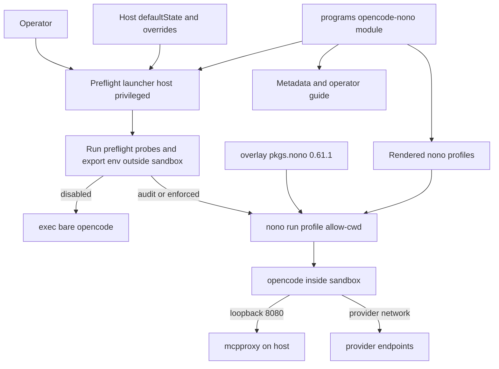
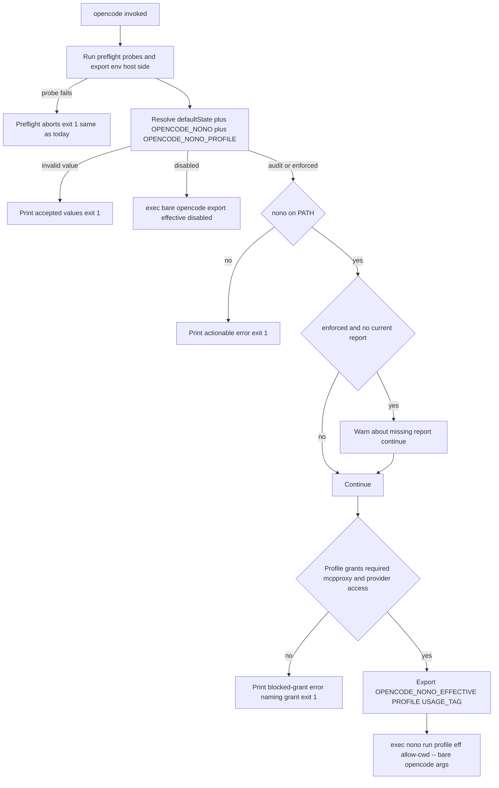
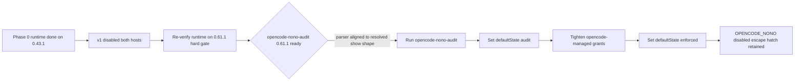

# Design Document

## Overview

**Purpose**: `opencode-nono-sandbox` launches OpenCode under the `nono`
kernel-enforced sandbox through a declarative Home Manager feature, with staged
rollout state, a minimal sandbox surface, and a repo-owned nono package pinned
to the latest upstream release.

**Users**: The operator of the personal and Shopify nix-darwin hosts, who picks
rollout state, overrides per launch, and reads the operator guide.

**Impact**: Introduces an outer **preflight launcher** that runs the existing
OpenCode preflight/credential/env setup host-privileged (outside the sandbox),
then launches `nono run --profile <name> --allow-cwd -- opencode`. Topology is
**preflight launcher → nono → opencode**: only the bare OpenCode binary runs
inside the sandbox. Existing OpenCode behavior is unchanged while the host
default state is `disabled`. The historical audit, compatibility assessment, and
tool-use replacement review are owned by the sibling spec `opencode-nono-audit`.

### Goals
- Launch OpenCode under a repo-managed nono profile, controlled by host
  configuration and a per-launch override.
- Keep the sandbox surface minimal: no `/usr/bin/security`, `/usr/bin/curl`, or
  macOS Keychain access inside the sandbox.
- Render a small, documented, secret-free profile catalog that builds and
  validates declaratively against the pinned nono version's schema.
- Provision nono at the latest upstream-published version via a repo overlay,
  with an operator version-override.
- Provide staged rollout state with a rollback path and a smoke test.

### Non-Goals
- Historical usage audit, compatibility assessment, tool-use replacement review
  (sibling spec `opencode-nono-audit`).
- Modifying nono itself or publishing profile packs.
- Replacing OpenCode permission prompts, MCP quarantine, or provider routing.

## Boundary Commitments

### This Spec Owns
- The `programs.opencode-nono` Home Manager module: enable flag, package
  selection (with version override), profile catalog model + rendering, rollout
  state options, rendered metadata, and operator guide.
- The nono package provisioning: the `pkgs.nono` overlay pinned to the latest
  upstream-published version (R7), and the module's `package` override.
- The launch contract: the outer launcher that runs preflight/env setup
  host-side, resolves effective sandbox state/profile, and execs `nono` (or the
  bare OpenCode binary when disabled).
- The rendered nono profile files for OpenCode under `~/.config/nono/profiles/`.
- The `opencode-nono-validate` and `opencode-nono-smoke-test` operator scripts
  and their flake check/app wiring.
- The narrow seam added to `opencode.nix` that lets the launcher run the
  existing preflight outside nono.

### Out of Boundary
- The historical usage audit, compatibility assessment, and tool-use
  replacement review — owned by `opencode-nono-audit`.
- The `nono` upstream source/implementation (packaged, not modified).
- OpenCode's permission model, MCP quarantine, tool-approval behavior (R5.5
  preserves them; this spec does not redefine them).
- The content of the existing preflight/credential/env snippets
  (`opencode.nix`, `cavemem.nix`, `opencode-rtk.nix`, host modules) — relocated
  to run outside nono, not rewritten.
- cavemem capture, mcpproxy routing, provider credential acquisition logic.

### Allowed Dependencies
- `pkgs.nono` — the repo overlay package (`overlays/misc.nix`) pinned to the
  latest upstream-published nono (0.61.1), built via the `fenix` rust toolchain.
- The `opencode.nix` seam (`home.opencode.basePackage`, `preflightScript`,
  `lspPath`, `finalPackage`).
- The existing host preflight (`home.opencode.wrapperCommands`) executed by the
  launcher, including its existing reads from the SOPS→Keychain bridge via
  `/usr/bin/security` (read-only; no bridge change needed — those run outside
  the sandbox).
- The `fenix` flake input (already present; used by `zellij-plugins.nix`) for
  the overlay's rust toolchain.
- Existing RTK/flake/test patterns.

Dependency direction (must not be violated):
`overlay (pkgs.nono) → profile model (Nix options) → module render →
launcher/scripts → flake wiring`. Each layer imports only from layers to its
left.

### Revalidation Triggers
- The `opencode.nix` seam (`basePackage`/`preflightScript`/`lspPath`/
  `finalPackage`) changes shape.
- The `OPENCODE_NONO*` env contract changes.
- The `nono` version changes (overlay bump): the profile schema, the resolved
  `profile show --json` shape consumed by `opencode-nono-audit`, the built-in
  profile/group catalog, and launch-flag behavior must all be re-verified.
- The set of environment variables the launcher must pass into the sandbox
  changes (profile `environment.allow_vars` must track it).
- The managed profile names, versions, or the `metadata.json` `profileVersion`
  field change (the `opencode-nono-audit` spec and its freshness check consume
  them).

## Architecture

### Existing Architecture Analysis
- `opencode.nix` builds `programs.opencode.package` as a
  `symlinkJoin`+`wrapProgram` whose `--run` block executes
  `home.opencode.wrapperCommands` (mcpproxy/obsidian preflight, LSP env) and
  suffixes LSP packages onto PATH. `cavemem.nix`, `opencode-rtk.nix`, and the
  Shopify host append more `wrapperCommands` (cavemem probe, RTK resolver,
  `devx` token mint, session id). The seam in this design does NOT exist yet —
  `opencode.nix` currently exposes only `package`/`wrapperCommands`/`lspPackages`.
- Today those snippets run INSIDE the wrapper. The new topology relocates them
  to the OUTER launcher so they run host-privileged before `nono`; their env
  exports are inherited into the sandbox.
- opencode's `mcp.mcpproxy` entry (both hosts) carries no auth header — opencode
  reaches mcpproxy over loopback `127.0.0.1:8080` only. The mcpproxy api key and
  Keychain reads belong to the preflight probe, not to opencode.
- The login prewarm launchd agent invokes the UNWRAPPED `home.opencode.package`
  and stays outside both the launcher and nono.
- RTK (`opencode-rtk.nix`) is the rollout template (enable/default/package,
  metadata + guide, resolver, named failure labels, peer assertion).
- `pkgs.nono` (0.61.1) is already provided by `overlays/misc.nix` (R7) but is
  not yet consumed by any host/module.

### Architecture Pattern & Boundary Map

Selected pattern: a **preflight launcher decorator** that runs existing setup
host-side and execs `nono` around the bare OpenCode binary, plus a **feature
module** (mirrors RTK). nono 0.61.1 has no built-in `opencode` profile, so
managed profiles **extend the built-in `default` profile** and reconstruct the
opencode grant set from groups (`node_runtime`, `git_config`, `nix_runtime`,
`user_caches_macos`) plus explicit `filesystem.allow` for opencode data paths.



Key decisions: preflight (`security`/`curl`/`devx`) runs OUTSIDE nono; only
opencode runs sandboxed; profiles never grant Keychain/`security`/`curl`;
opencode-inside needs `--allow-cwd`, loopback 8080, provider network,
`/nix/store` read+exec, opencode data paths, and inherited env.

### Technology Stack

| Layer | Choice / Version | Role in Feature | Notes |
|-------|------------------|-----------------|-------|
| CLI / Sandbox | `pkgs.nono` 0.61.1 (overlay) | Kernel-enforced sandbox launcher | R7: latest upstream, overlay-pinned; `package` option overrides |
| Config / Module | Home Manager (Nix) | Module options, profile render, launcher, metadata, guide | Mirrors `opencode-rtk.nix` |
| Launcher | `writeShellApplication` | Preflight + state resolve + exec nono/bare | Reuses existing `wrapperCommands` |
| Data / Storage | JSON/JSONC profiles | Profiles under `~/.config/nono/profiles` | Secret-free; 0.61.1 schema |
| Infrastructure | `flake.nix` apps/checks | `nix run`/`nix flake check` wiring | Mirrors RTK |

## File Structure Plan

### New Files
```
home-manager/common/
└── opencode-nono.nix              # Module: options, profile model+render,
                                   # metadata, guide, finalPackage launcher impl,
                                   # packages wiring, peer assertion, version

scripts/
├── opencode-nono-launcher.nix     # Builds the preflight launcher: run
│                                  # preflightScript, resolve state, exec
│                                  # nono run --profile <eff> --allow-cwd -- opencode
├── opencode-nono-validate.nix     # Profile validate/schema + launch-contract
└── opencode-nono-smoke-test.nix   # Start opencode under default managed profile

tests/opencode-nono/
├── run.js                         # node --test dispatcher (mirror cost-diag)
├── hm-render.test.js              # Both-host render: module, profiles, meta,
│                                  # guide, seam, packages, assertion, nonoVersion
├── resolver.test.js               # Launcher state-resolution extraction test
└── validate.test.js              # Failure-label assertions
```

### Modified Files
- `home-manager/common/opencode.nix` — expose read-only internals
  `home.opencode.basePackage` (= unwrapped `package`), `home.opencode.preflightScript`
  (joined `wrapperCommands`), `home.opencode.lspPath` (LSP bin path), and add
  `home.opencode.finalPackage` (package option; default = today's
  preflight-inside symlinkJoin). Set `programs.opencode.package = finalPackage`.
- `home-manager/common/default.nix` — import `./opencode-nono.nix` and set
  `programs.opencode-nono.enable = true;`.
- `configurations/personal/home-manager/opencode.nix` — `defaultState`
  (`disabled` v1) and profile selection.
- `configurations/shopify/home-manager/opencode.nix` — `defaultState`
  (`disabled` v1), host-specific profile additions/labels, optional `nono` usage
  tag. (Shopify `devx` token mint already runs in the preflight, now outside
  nono — no change to that snippet.)
- `flake.nix` — `checks.opencode-nono-tests`,
  `checks.opencode-nono-validate-check`; both-host host-eval check;
  `apps.opencode-nono-validate`.
- `overlays/misc.nix` — DONE (R7): `pkgs.nono` 0.61.1. A version bump edits the
  pin here.

> No change to `mcp-sops-bridge.nix` / `mcp-secrets-activate.nix`: under the
> inverted topology the launcher reuses the existing host secret path
> (`/usr/bin/security -s mcpproxy`, `devx`) outside the sandbox and passes
> results in as env, so no nono keystore service is provisioned.

## Requirements Traceability

| Requirement | Summary | Components | Interfaces | Flows |
|-------------|---------|------------|------------|-------|
| 1.1 | nono available when enabled | Package Provision | `programs.opencode-nono.package`, `home.packages` | Build |
| 1.2 | launch under selected profile | State Resolver, Preflight Launcher Seam | launcher `exec nono run --allow-cwd` | Launch |
| 1.3 | disabled leaves launch unchanged | Preflight Launcher Seam | `finalPackage` default | Launch |
| 1.4 | nono requested but unavailable → stop | State Resolver | fail-closed branch | Launch |
| 1.5 | expose effective state | State Resolver | `OPENCODE_NONO_EFFECTIVE` | Launch |
| 2.1 | profile catalog (coding/audit/review) | Profile Catalog Renderer | profile model | Build |
| 2.2 | profile has name/version/desc/use | Profile Catalog Renderer | `meta` (use folded into description) | Build |
| 2.3 | host-specific access labeled | Profile Catalog Renderer, Host Profiles | host profile + label | Build |
| 2.4 | validation reports syntax/inherit/group errors | Profile Validation | `nono profile validate` | Validate |
| 2.5 | no secrets in profiles | Profile Catalog Renderer | secret-free model | Build |
| 3.1 | host defaults disabled/audit/enforced | Rollout Controls | `defaultState` | Launch |
| 3.2 | per-launch override, no rebuild | State Resolver | `OPENCODE_NONO` | Launch |
| 3.3 | invalid override → stop + accepted values | State Resolver | error branch | Launch |
| 3.4 | enforced still has rollback path | State Resolver, Guide | `OPENCODE_NONO=disabled` | Launch |
| 3.5 | strict without report → warn | State Resolver | freshness check | Launch |
| 4.1 | document env pass/inject per profile | Profile Catalog Renderer, Guide | `environment.allow_vars` | Build |
| 4.2 | support host-required credentials | Preflight Launcher, Host Profiles | preflight env export → pass-through | Launch |
| 4.3 | document network posture | Profile Catalog Renderer, Guide | `network` model | Build |
| 4.4 | blocked provider/MCP → actionable error | State Resolver, Profile Catalog Renderer | pre-launch `profile show --json` grant check | Launch |
| 4.5 | secrets out of docs/profiles | Profile Catalog Renderer | secret-free model | Build |
| 5.1 | preserve mcpproxy preflight | Preflight Launcher Seam | preflight runs outside nono | Launch |
| 5.2 | preserve provider setup | Preflight Launcher Seam, Host Profiles | devx runs outside nono | Launch |
| 5.3 | plugin failures surface, not silent | Profile Catalog Renderer, Guide | profile grants + error surfacing | Launch |
| 5.4 | RTK + nono state visible together | State Resolver, Metadata, Guide | `OPENCODE_NONO_*` + `OPENCODE_RTK_*` | Launch |
| 5.5 | do not weaken permissions/quarantine | Boundary (no-op on those systems) | — | — |
| 6.1 | checks validate profiles + launch contract | Profile Validation | validate script + flake check | Validate |
| 6.2 | validation names failure + fix | Profile Validation | `[validate-failure: <label>]` | Validate |
| 6.3 | operator guide | Metadata + Guide | rendered README | — |
| 6.4 | smoke under default profile | Smoke Test | `opencode-nono-smoke-test` | Validate |
| 6.5 | record launch metadata | Metadata + Guide | metadata.json | — |
| 7.1 | provision latest upstream nono | Package Provision | `pkgs.nono` overlay (0.61.1) | Build |
| 7.2 | overlay fallback when nixpkgs lacks it | Package Provision | `overlays/misc.nix` | Build |
| 7.3 | operator pin/override version | Package Provision | `programs.opencode-nono.package` | Build |
| 7.4 | record resolved nono version | Metadata + Guide | `metadata.json.nonoVersion` | — |
| 7.5 | revalidate profiles on version change | Profile Validation | validate-check vs pinned schema | Validate |

## System Flows

### Launch resolution (R1, R3, R4, R5.4)

Gating notes: preflight runs first, host-side, and keeps its existing fail-fast
behavior (R5.1, R5.2). `disabled` bypasses nono; a requested sandbox with nono
missing fails closed (R1.4). `--allow-cwd` is mandatory: Phase 0 showed
non-interactive `nono run` refuses CWD access without it even when the profile
grants `workdir.access`. The freshness check (R3.5) consults the
`opencode-nono-audit` report and warns but does not block. The pre-launch grant
check (R4.4) resolves `nono profile show <eff> --json --silent` and fails closed
when the selected profile omits required mcpproxy-loopback or provider-network
access, rather than launching a broken opencode.

## Components and Interfaces

| Component | Domain/Layer | Intent | Req Coverage | Key Dependencies (P0/P1) | Contracts |
|-----------|--------------|--------|--------------|--------------------------|-----------|
| Preflight Launcher Seam | opencode.nix | Expose base pkg + preflight snippet + finalPackage hook | 1.2,1.3,5.1,5.2 | makeWrapper (P0) | Service |
| State Resolver / Launcher | opencode-nono | Preflight, resolve state, exec nono or bare | 1.2,1.4,1.5,3.2,3.3,3.4,3.5,4.4,5.4 | nono (P0), basePackage (P0) | Service, State |
| Package Provision | overlay + opencode-nono | Provide latest nono; version override | 1.1,7.1,7.2,7.3 | overlay pkgs.nono (P0), fenix (P0) | — |
| Profile Catalog Renderer | opencode-nono | Render profile JSON model (extends default) | 2.1,2.2,2.3,2.5,4.1,4.3,4.5,5.3 | profile model (P0) | Batch (build) |
| Host Profiles | host modules | Host-specific grants/labels + creds | 2.3,4.2,5.2 | renderer (P0) | Batch |
| Rollout Controls | opencode-nono | defaultState + override surface | 3.1 | resolver (P0) | State |
| Profile Validation | scripts/flake | Validate profiles + contract + version schema | 2.4,6.1,6.2,7.5 | nono (P0) | Batch |
| Metadata + Guide | opencode-nono | Render metadata (+nonoVersion) + README | 5.4,6.3,6.5,7.4 | module options (P0) | State |
| Smoke Test | scripts/flake | Start under default managed profile | 6.4 | nono (P0) | Batch |

### Preflight Launcher Seam (`opencode.nix`)

| Field | Detail |
|-------|--------|
| Intent | Let the launcher run the existing preflight outside nono without a circular reference |
| Requirements | 1.2, 1.3, 5.1, 5.2 |

**Responsibilities & Constraints**
- Expose read-only internals: `home.opencode.basePackage` (unwrapped
  `package`), `home.opencode.preflightScript` (joined `wrapperCommands`),
  `home.opencode.lspPath` (`makeBinPath lspPackages`).
- Add `home.opencode.finalPackage` (package option). Default = today's
  `symlinkJoin`+`wrapProgram` (preflight INSIDE), so the feature being disabled
  reproduces current behavior exactly (R1.3).
- Set `programs.opencode.package = config.home.opencode.finalPackage`.
- Prewarm launchd agent keeps using the unwrapped `basePackage`.

**Dependencies**: Inbound: opencode-nono (overrides `finalPackage`). External:
`pkgs.makeWrapper` (P0).

**Contracts**: Service [x]
```typescript
interface OpencodeSeam {
  basePackage: Package;        // read-only: unwrapped opencode
  preflightScript: string;     // read-only: joined wrapperCommands
  lspPath: string;             // read-only: LSP bin PATH fragment
  finalPackage: Package;       // option; default = preflight-inside wrapper
}
```
- Preconditions: `programs.opencode.enable == true`.
- Postconditions: exactly one `opencode` on PATH = `finalPackage`.
- Invariants: no circular reference (`finalPackage` override depends on
  `basePackage`/`preflightScript`/`lspPath` + nono).

**Implementation Notes**
- Sequencing: the seam refactor + the disabled-path equivalence gate is the
  FIRST task (it touches the live launch path on both hosts). The both-host
  eval check must assert the module-disabled `finalPackage` is byte-identical to
  today's `programs.opencode.package` before any launcher work proceeds. Because
  v1 ships the module ENABLED with `defaultState=disabled` (launcher active,
  preflight relocated outside the wrapper), a second gate covers that path: the
  launcher's disabled branch preserves the preflight set and suffixes `lspPath`
  onto PATH (parity with today's `--suffix PATH`).
- Integration: when opencode-nono is disabled, `finalPackage` default keeps
  preflight inside the wrapper (today's behavior). When enabled, opencode-nono
  overrides `finalPackage` with the inverted launcher.
- Risks: a host force-overriding `programs.opencode.package` bypasses the seam
  (revalidation trigger).

### State Resolver / Outer Launcher (`opencode-nono`, `scripts/opencode-nono-launcher.nix`)

| Field | Detail |
|-------|--------|
| Intent | Run preflight host-side, resolve sandbox state, exec nono or bare opencode |
| Requirements | 1.2, 1.4, 1.5, 3.2, 3.3, 3.4, 3.5, 4.4, 5.4 |

**Responsibilities & Constraints**
- Run `preflightScript` host-privileged (outside nono): mcpproxy/obsidian/
  cavemem probes (`/usr/bin/security`, `/usr/bin/curl`), Shopify `devx` token
  mint, LSP env, RTK resolver. Preserve its existing fail-fast exits.
- `export PATH="$PATH:<lspPath>"` (suffix, matching today's `--suffix PATH`
  wrapper so project-local / user-provided binaries still win) so spawned LSP
  servers resolve inside the sandbox via inherited PATH.
- Resolve `(defaultState, OPENCODE_NONO, OPENCODE_NONO_PROFILE)` →
  `(effectiveState, effectiveProfile, disableReason)`; export the env contract.
- `disabled` → `exec basePackage/bin/opencode "$@"`. `audit`/`enforced` →
  require `nono` on PATH (else fail closed, R1.4) → pre-launch grant check
  (R4.4): run `nono profile show <eff> --json --silent` and assert the resolved
  grants admit the required access (loopback `open_port 8080` for mcpproxy, and
  provider network via `network.block=false` or matching `allow_domain`); a
  missing required grant exits 1 naming the grant rather than launching a broken
  opencode →
  `exec nono run --profile <eff> --allow-cwd -- basePackage/bin/opencode "$@"`.
  `--allow-cwd` is required in non-interactive mode (Phase 0).
- Invalid override → exit 1 listing accepted values (R3.3). For R3.5, read the
  audit freshness marker `${XDG_STATE_HOME}/opencode-nono/last-report.json`
  (`{ markerSchemaVersion: 1, profileVersion, … }`); if it is absent,
  unreadable, has an unknown `markerSchemaVersion`, or its `profileVersion`
  differs from the active managed profile's `profileVersion` in `metadata.json`,
  warn and continue when `enforced` is requested.

**Dependencies**: Inbound: seam (`finalPackage`). Outbound: rendered profiles
(by name). External: `nono` (P0), `basePackage` (P0).

**Contracts**: Service [x] / State [x]

##### State Management
- States: `disabled | audit | enforced`; `effectiveProfile` ∈ rendered catalog
  names; `disableReason ∈ {host-default, override, missing-binary,
  invalid-override, ""}` (mirrors RTK).
- Persistence: none; resolved per launch from env + baked default.

##### Env Contract
| Env var | Direction | Value |
|---------|-----------|-------|
| `OPENCODE_NONO` | in | `disabled\|audit\|enforced` override, or unset |
| `OPENCODE_NONO_PROFILE` | in | explicit profile name override, or unset |
| `OPENCODE_NONO_EFFECTIVE` | out | `disabled\|audit\|enforced` |
| `OPENCODE_NONO_PROFILE_EFFECTIVE` | out | resolved profile name (empty when disabled) |
| `OPENCODE_NONO_DISABLE_REASON` | out | reason text or empty |
| `OPENCODE_NONO_USAGE_TAG` | out | `nono:<effectiveState>` (optional Shopify header use) |

**Implementation Notes**
- Integration: `writeShellApplication` named `opencode`, referencing
  `basePackage`, `preflightScript`, `lspPath`, and `nono` by store path. RTK's
  `OPENCODE_RTK_*` exports happen in the same preflight, so both states are
  observable together (R5.4).
- Validation: `resolver.test.js` extracts the resolution snippet (after the
  preflight block) and asserts each override → `(effective, profile, reason)`.
- Risks: the freshness marker is a versioned cross-spec contract owned jointly
  with `opencode-nono-audit` (`markerSchemaVersion: 1`, `profileVersion`); it is
  read best-effort (absence / parse-failure / version-mismatch → warn, never
  block).

### Package Provision (`overlays/misc.nix`, `opencode-nono`)

| Field | Detail |
|-------|--------|
| Intent | Provide nono at the latest upstream-published version with an operator override |
| Requirements | 1.1, 7.1, 7.2, 7.3 |

**Responsibilities & Constraints**
- `overlays/misc.nix` defines `pkgs.nono` pinned to the latest
  upstream-published nono (0.61.1), built with the `fenix` rust 1.95 toolchain
  via `buildRustPackage` (nono needs rust ≥1.95; nixpkgs stable 1.91 / unstable
  1.94 are too old). This is the overlay fallback required because nixpkgs does
  not package 0.61.1 (R7.1, R7.2). DONE (commit `307e20f`); not yet consumed.
- `programs.opencode-nono.package` defaults to `pkgs.nono` and is an operator
  override point for pinning a different version (R7.3).
- A version bump edits the `version`/`src.hash`/`cargoHash` in `overlays/misc.nix`
  and fires the version-change revalidation trigger (schema + resolved-show +
  built-in catalog re-verification).

**Dependencies**: External: `fenix` (P0), `buildRustPackage` (P0).

**Implementation Notes**
- Risks: "latest" is a bumpable pin, not a floating reference (Nix is
  reproducible-by-pin). R7.1 intent = track latest by bumping the pin as
  releases land; R7.5 ties each bump to profile-schema revalidation.
- The 18-minor-version gap between nixpkgs (0.43.1) and the pin (0.61.1) is why
  this overlay exists; the schema, built-in profiles, and CLI flags all drifted
  across that range (see research.md 0.61.1 verification).

### Profile Catalog Renderer (`opencode-nono`)

| Field | Detail |
|-------|--------|
| Intent | Render the managed nono profile catalog as JSON (0.61.1 schema) |
| Requirements | 2.1, 2.2, 2.3, 2.5, 4.1, 4.3, 4.5, 5.3 |

**Responsibilities & Constraints**
- Render three base profiles to `~/.config/nono/profiles/`. nono 0.61.1 has NO
  built-in `opencode` profile (removed; only `default` + dev profiles remain),
  so each profile `extends ["default"]` and reconstructs the opencode grant set:
  - `groups.include = [node_runtime, git_config, nix_runtime, user_caches_macos]`
    (`nix_runtime` supplies `/nix/store`; node/git/caches mirror the old
    built-in opencode grants).
  - `filesystem.allow` for opencode data paths: `$HOME/.config/opencode`,
    `$HOME/.cache/opencode`, `$HOME/.local/share/opencode`,
    `$HOME/.local/state/opencode`, `$HOME/.opencode`,
    `$HOME/.local/share/opentui`, `$TMPDIR`.
  - Per-profile deltas:
    - `opencode-managed` (enforced): `workdir.access = readwrite`;
      `network.open_port = [8080]` (mcpproxy loopback); `environment.allow_vars`
      admits the launcher-exported env (PATH, HOME, TERM, LANG, `OPENCODE_*`,
      `DEFAULT_PROXY_BASE`, …); optionally `network.allow_domain`/`network_profile`
      to scope providers + mcpproxy (tightened post-audit).
    - `opencode-audit` (compatibility-audit): permissive — `network.block=false`,
      broad `allow_vars`, `open_port [8080]`; nono audit recording is on by
      default. This is the first state operators flip to, so it must not break
      workflows.
    - `opencode-review` (read-only): `workdir.access = read`; no write grants.
- `meta{name, version, description, author}` on every profile. 0.61.1 `meta` has
  no `intendedUse` field, so the intended-use statement is folded into
  `description` (R2.2).
- No secret literals anywhere; under the D1 credential model no `env_credentials`
  are required (the launcher exports provider env which `allow_vars` admits)
  (R2.5, R4.5).
- Document per-profile env pass-through (R4.1) and network posture (provider,
  mcpproxy loopback, blocked modes) (R4.3) in the rendered guide.
- Host-specific profiles `extends` a base profile, add host grants, and set a
  host-specific label in `description` (R2.3).

**Dependencies**: Inbound: State Resolver (selects by name); Validation.

**Contracts**: Batch [x]

##### Profile Model (typed option, 0.61.1 schema)
```typescript
interface NonoProfileModel {
  meta: { name: string; version: string; description: string; author?: string };
  extends: string[];                       // ["default"] (no built-in opencode in 0.61.1)
  groups: { include: string[]; exclude: string[] };
  workdir: { access: "none" | "read" | "write" | "readwrite" };
  filesystem: { allow: string[]; read: string[]; write: string[]; deny: string[] };
  network: { block: boolean; networkProfile?: string | null;
             allowDomain: string[]; openPort: number[]; listenPort: number[] };
  environment: { allowVars: string[]; denyVars: string[] };
}
```
- Preconditions: names unique; no secret literals.
- Postconditions: one JSON file per profile under `~/.config/nono/profiles/`,
  valid against the pinned nono version's `profile schema`.
- Invariants: secrets never serialized; profiles grant no Keychain,
  `/usr/bin/security`, or `/usr/bin/curl` access.

**Implementation Notes**
- Derivation (do this FIRST, before authoring the catalog): the grant set is
  derived EMPIRICALLY, not guessed. Run the real opencode binary under nono on
  0.61.1 and let nono learn from sandbox denials (`nono run` denial-learning;
  `nono run … --json` emits a profile path fragment) and use `nono why <path>`
  to confirm allow/deny decisions. The groups (`node_runtime`/`git_config`/
  `nix_runtime`/`user_caches_macos`) + opencode data paths above are the
  STARTING point; the authored catalog uses the discovered set. (`nono learn`
  is deprecated in 0.61.1 → use `nono run`.)
- Integration: v1 `opencode-managed` is authored conservatively but is NOT the
  default state (host default `disabled`); it is tightened after the audit spec
  runs. `opencode-audit` must be permissive enough that opencode + its plugins
  start cleanly, so plugin failures surface as real errors rather than silent
  disables (R5.3).
- Validation: rendered files are checked by `nono profile validate` (R2.4); the
  R6.4 smoke launch under `opencode-managed` confirms the derived grant set is
  complete (incl. `nix_runtime`'s `/nix/store` coverage).

### Host Profiles (`configurations/*/home-manager/opencode.nix`)
- Set `programs.opencode-nono.defaultState` (`disabled` v1) and select the
  profile per state. Shopify adds host-specific grants/labels and (optionally) a
  `nono` usage tag; its `devx` token mint already runs in the preflight, now
  host-side outside nono, exported and admitted by `allow_vars` (R4.2, 5.2).

### Validation & Operator Domain

#### Profile Validation (`scripts/opencode-nono-validate.nix`)
- Runs `nono profile validate <each rendered profile>`, `nono profile schema`
  conformance, and asserts the launch contract (resolver execs `nono run
  --allow-cwd` with the expected profile per state; preflight precedes nono).
  Validates against the PINNED nono version, so a version bump that changes the
  schema is caught here (R7.5). Emits `[validate-failure: <label>]` + corrective
  action (R2.4, 6.1, 6.2, 7.5). Flake check builds it and runs `--help`/`--version`.

#### Smoke Test (`scripts/opencode-nono-smoke-test.nix`)
- Host-run: starts opencode under the default managed profile
  (`nono run --profile opencode-managed --allow-cwd -- opencode --version`) to
  confirm startup (R6.4). Labels `[smoke-test-failure: <label>]`. This is the
  authoritative check that the `extends default` + groups reconstruction
  actually lets opencode run.

#### Metadata + Operator Guide (`opencode-nono`)
- Renders `opencode/opencode-nono/metadata.json` with: per-profile
  `{ name, version }`; a canonical `profileVersion` = the active managed
  profile's version (the single field `opencode-nono-audit` reads and the R3.5
  check compares against); the resolved `nonoVersion` (R7.4); host `defaultState`;
  and the env contract. Plus a README covering profile selection, noninteractive
  launch behavior, runtime overrides, rollback, and combined RTK+nono visibility
  (R5.4, 6.3, 6.5).
- The `metadata.json` `profileVersion` field and the audit freshness marker's
  `markerSchemaVersion` form a cross-spec contract jointly owned with
  `opencode-nono-audit` (revalidation trigger on both specs).

## Data Models

### Domain Model
- **Profile** (aggregate): identified by `meta.name`; owns grant fields;
  invariant = no secret literals, no Keychain/`security`/`curl` grants.
- **LaunchState**: `{ effectiveState, effectiveProfile, disableReason }` derived
  per launch.

### Logical Data Model
- Profiles: `~/.config/nono/profiles/{opencode-managed,opencode-audit,opencode-review}.json`
  plus optional host-suffixed variants.
- Metadata: `${XDG_CONFIG_HOME}/opencode/opencode-nono/metadata.json`
  (`{ profileVersion, nonoVersion, defaultState, profiles[], envContract }`).

## Error Handling

### Error Strategy
Fail fast at the launcher; fail closed on requested-but-unavailable sandbox;
preserve the existing preflight fail-fast.

### Error Categories and Responses
- **Preflight (R5.1, 5.2)**: existing probe/`devx` failures abort before nono,
  unchanged.
- **Launch (R1.4, 3.3, 4.4)**: nono missing while sandbox requested → exit 1
  actionable; invalid override → exit 1 listing accepted values; the pre-launch
  `nono profile show --json` grant check finds required provider/mcpproxy access
  blocked by the selected profile → exit 1 naming the grant rather than a broken
  launch.
- **Validation (R6.2, 7.5)**: `[validate-failure: <label>]` /
  `[smoke-test-failure: <label>]` with corrective action, including a profile
  that fails the pinned version's schema after a nono bump.

### Monitoring
- Effective state observable per launch via `OPENCODE_NONO_*` and metadata;
  nono's own audit log records sandbox activity (not owned here).

## Testing Strategy

### Unit Tests
- State resolver: each `OPENCODE_NONO` / `OPENCODE_NONO_PROFILE` input →
  expected `(effective, profile, disableReason)`, incl. invalid-override exit
  and missing-nono fail-closed (1.2,1.4,1.5,3.2,3.3). Grant-check branch: a
  `profile show --json` fixture missing `open_port 8080` / provider network →
  exit 1 naming the grant (4.4).
- Disabled-path equivalence (gating, both hosts): with the module disabled,
  `finalPackage` is byte-identical to today's `programs.opencode.package` on
  ShopifyLaptop and Brandons-MacBook-Pro (1.3) — a host-eval check, run first.
- Enabled-disabled launch path (gating, both hosts): with the module enabled and
  `defaultState=disabled` (the v1 config), the launcher runs the preflight
  host-side and `exec`s bare opencode with `lspPath` suffixed onto PATH; a
  resolver/host-eval check asserts this path preserves the preflight set and LSP
  PATH ordering rather than relying on the module-disabled fallback (1.3,5.1,5.3).

### Integration Tests
- HM render (both hosts): module renders three profiles with meta/version/use,
  host-specific label, metadata (incl. `nonoVersion`), guide, packages, and the
  `finalPackage` override; profiles `extends ["default"]` and grant no
  Keychain/`security`/`curl`; peer assertion fires without
  `programs.opencode.enable` (2.1,2.2,2.3,2.5,4.5,6.3,6.5,7.4).
- Profile content: `opencode-managed` declares `groups.include` with
  `nix_runtime`, `open_port [8080]`, opencode-data `filesystem.allow`, and
  `allow_vars` for the launcher env (4.1,4.3).

### E2E / Operator Tests (host-run)
- `opencode-nono-validate`: `nono profile validate` passes for all profiles
  against the pinned 0.61.1 schema; launch-contract assertion holds; failure
  labels on a broken profile (2.4,6.1,6.2,7.5).
- `opencode-nono-smoke-test`: opencode starts under `opencode-managed` with
  `--allow-cwd` (6.4) — proves the `extends default` grant reconstruction works.
- Rollback: `OPENCODE_NONO=disabled opencode` starts without enforcement while
  host default is `enforced` (3.4).
- Blocked-grant stop: a profile that omits `open_port 8080` / provider network
  makes the launcher exit 1 naming the missing grant before exec (4.4).
- Coexistence: under `opencode-audit`, mcpproxy preflight passes (outside nono)
  and opencode reaches mcpproxy over loopback; RTK and nono states both visible
  (5.1,5.4).

## Security Considerations
- Topology keeps `/usr/bin/security`, `/usr/bin/curl`, and macOS Keychain access
  OUTSIDE the sandbox: the preflight launcher runs host-privileged and exports
  results as env; `nono` then wraps only the bare OpenCode binary.
- Credentials reach opencode via the existing host secret path executed in the
  launcher (mcpproxy api key via `/usr/bin/security -s mcpproxy`; Shopify `devx`
  token), exported and admitted by the profile's `environment.allow_vars` (D1).
  No new keychain service, no nono `env_credentials`, no SOPS-bridge change for
  v1. Secrets never enter profiles or generated docs (R2.5, R4.5).
- opencode-inside is granted only: workdir (via `--allow-cwd`), opencode data
  paths, `/nix/store` read+exec (via `nix_runtime`), loopback `open_port 8080`,
  and provider network. No Keychain, no secret-bearing files.
- Env blocklist caveat (Phase 0, 0.43.1): setting `DYLD_INSERT_LIBRARIES` was
  NOT stripped by nono and reached the child's dyld. The launcher only exports
  benign env (provider URLs/tokens, PATH, `OPENCODE_*`), never `DYLD_*`/`LD_*`,
  so this does not affect the design; confirm nono's env blocklist on 0.61.1
  before relying on it as a control.
- The feature does not weaken OpenCode permissions, MCP quarantine, or tool
  approval (R5.5) — it adds an orthogonal kernel-enforced layer.
- Future option (deferred): nono `network.credentials` proxy injection (D2) so
  opencode never holds provider keys; blocked for Gemini and the Shopify `devx`
  gateway, so v1 stays on D1.

## Migration Strategy
Audit-first, staged by host `defaultState`; the audit/report steps are owned by
`opencode-nono-audit`. Phase 0 runtime verification is done on 0.43.1; the
0.61.1 runtime re-verification is a hard gate before the `audit` flip (see below).

Cross-spec precondition: the `audit` state and the R3.5 freshness check require
`opencode-nono-audit` to parse 0.61.1's resolved `profile show --json`
(`security.groups[]`/`filesystem.allow[]`/`network{}`); its shipped parser
targets a different shape, so that fix (owned by the audit spec) gates the
`Set defaultState audit` step.

Rollback shapes: one launch (`OPENCODE_NONO=disabled`), host default
(`defaultState`), full removal (`programs.opencode-nono.enable = false`).

## Phase 0 Verification & Remaining Gates
Runtime behavior was verified on nono **0.43.1** (the version the flake's pinned
`nixpkgs-unstable` builds); profile/schema shape was verified by introspection on
the overlay's **0.61.1** (full results in `research.md`). The runtime checks have
NOT yet been re-run on 0.61.1.

Verified on 0.43.1 (runtime — topology hard gate):
- `/nix/store` read+exec works under macOS Seatbelt (default profile +
  `--allow-cwd`); the inverted topology is viable. Non-interactive `nono run`
  REQUIRES `--allow-cwd` (now in the launch contract).
- Launcher-exported env passes through `nono run` into opencode (default-allow);
  the managed profile still lists the needed vars in `environment.allow_vars`.
- Loopback `open_port [8080]` reaches mcpproxy while `--block-net` blocks other
  egress (control confirmed).

Verified on 0.61.1 (introspection only):
- nono 0.61.1 removed the built-in `opencode` profile → managed profiles
  `extends default` + groups + explicit `filesystem.allow` (design updated).
  Authoring schema is top-level `groups{include,exclude}`; `meta` has no
  `intendedUse`.

HARD GATE before the `defaultState=audit` flip — re-run on 0.61.1, not 0.43.1
(schema and behavior are version-coupled across the 18-minor-version gap):
- Re-verify `/nix/store` read+exec under the 0.61.1 `default` profile, env
  pass-through vs `allow_vars`, and loopback `open_port 8080`.
- Confirm the group names the catalog relies on (`node_runtime`, `git_config`,
  `nix_runtime`, `user_caches_macos`) exist on 0.61.1 and that `nix_runtime`
  supplies `/nix/store`.

Remaining (covered by implementation tasks, not blockers):
- FIRST profile task: derive opencode's required grants empirically via `nono
  run` denial-learning (`--json` fragment) + `nono why` on 0.61.1, then author
  the catalog from the discovered set (do not hand-guess); the R6.4 smoke launch
  under `opencode-managed`/`opencode-audit` confirms completeness.
- Confirm the exact `network.allow_domain`/`network_profile` posture for
  providers once an enforced profile is tightened post-audit.
- `opencode-nono-audit` follow-up (its spec): re-verify `nono profile show
  --json` resolved shape against a rendered managed profile on 0.61.1 and align
  its grant parser/fixture.
