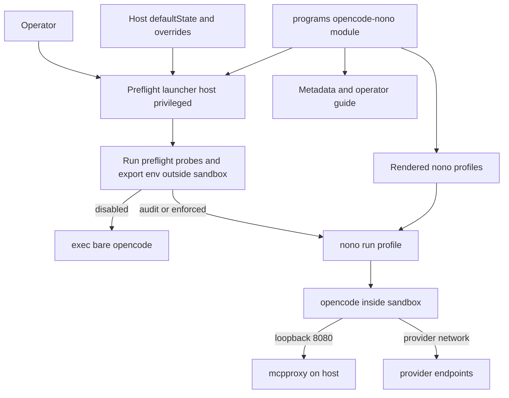
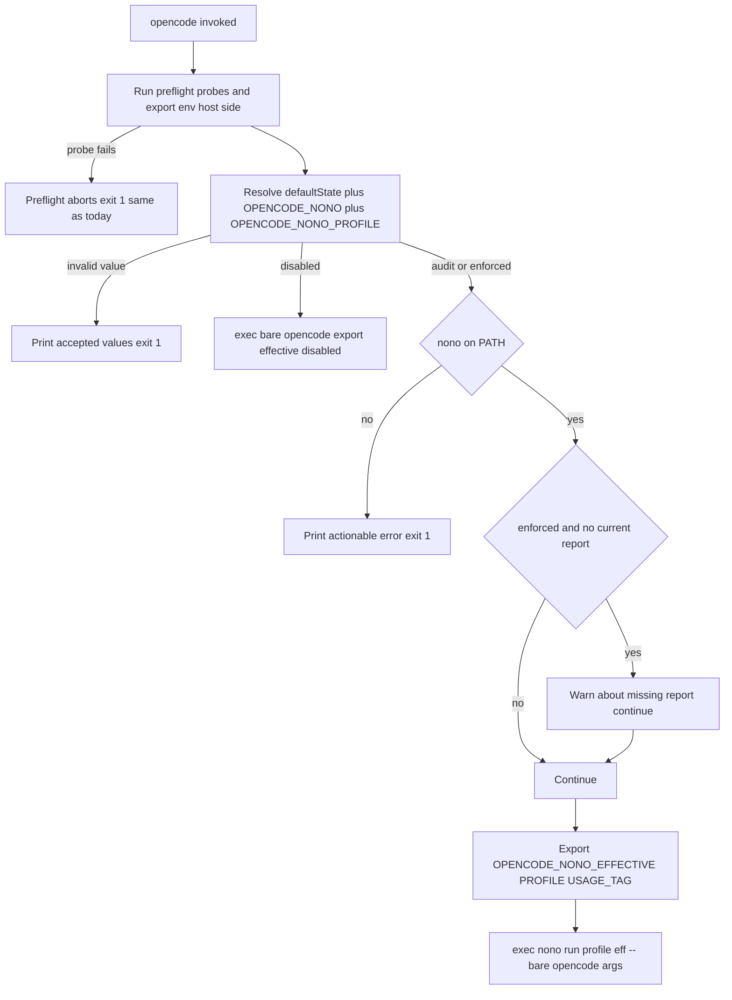
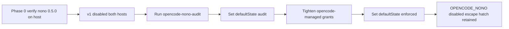

# Design Document

## Overview

**Purpose**: `opencode-nono-sandbox` launches OpenCode under the `nono`
kernel-enforced sandbox through a declarative Home Manager feature, with staged
rollout state and a minimal sandbox surface.

**Users**: The operator of the personal and Shopify nix-darwin hosts, who picks
rollout state, overrides per launch, and reads the operator guide.

**Impact**: Introduces an outer **preflight launcher** that runs the existing
OpenCode preflight/credential/env setup host-privileged (outside the sandbox),
then launches `nono run --profile <name> -- opencode`. Topology is
**preflight launcher → nono → opencode**: only the bare OpenCode binary runs
inside the sandbox. Existing OpenCode behavior is unchanged while the host
default state is `disabled`. The historical audit, compatibility assessment, and
tool-use replacement review are owned by the sibling spec `opencode-nono-audit`.

### Goals
- Launch OpenCode under a repo-managed nono profile, controlled by host
  configuration and a per-launch override.
- Keep the sandbox surface minimal: no `/usr/bin/security`, `/usr/bin/curl`, or
  macOS Keychain access inside the sandbox.
- Render a small, documented, secret-free profile catalog that builds and
  validates declaratively.
- Provide staged rollout state with a rollback path and a smoke test.

### Non-Goals
- Historical usage audit, compatibility assessment, tool-use replacement review
  (sibling spec `opencode-nono-audit`).
- Modifying nono itself or publishing profile packs.
- Replacing OpenCode permission prompts, MCP quarantine, or provider routing.

## Boundary Commitments

### This Spec Owns
- The `programs.opencode-nono` Home Manager module: enable flag, package
  selection, profile catalog model + rendering, rollout state options, rendered
  metadata, and operator guide.
- The launch contract: the outer launcher that runs preflight/env setup
  host-side, resolves effective sandbox state/profile, and execs `nono` (or the
  bare OpenCode binary when disabled).
- The rendered nono profile files for OpenCode under `~/.config/nono/profiles/`.
- The `opencode-nono-validate` and `opencode-nono-smoke-test` operator scripts
  and their flake check/app wiring.
- The narrow seam added to `opencode.nix` that lets the launcher run the
  existing preflight outside nono.

### Out of Boundary
- The historical usage audit, compatibility assessment, and tool-use
  replacement review — owned by `opencode-nono-audit`.
- The `nono` package implementation (adopted from nixpkgs unstable).
- OpenCode's permission model, MCP quarantine, tool-approval behavior (R5.5
  preserves them; this spec does not redefine them).
- The content of the existing preflight/credential/env snippets
  (`opencode.nix`, `cavemem.nix`, `opencode-rtk.nix`, host modules) — relocated
  to run outside nono, not rewritten.
- cavemem capture, mcpproxy routing, provider credential acquisition logic.

### Allowed Dependencies
- `pkgs.unstable.nono` (sandbox CLI).
- The `opencode.nix` seam (`home.opencode.basePackage`, `preflightScript`,
  `lspPath`, `finalPackage`).
- The existing host preflight (`home.opencode.wrapperCommands`) executed by the
  launcher, including its existing reads from the SOPS→Keychain bridge via
  `/usr/bin/security` (read-only; no bridge change needed — those run outside
  the sandbox).
- Existing RTK/flake/test patterns.

Dependency direction (must not be violated):
`profile model (Nix options) → module render → launcher/scripts → flake wiring`.
Each layer imports only from layers to its left.

### Revalidation Triggers
- The `opencode.nix` seam (`basePackage`/`preflightScript`/`lspPath`/
  `finalPackage`) changes shape.
- The `OPENCODE_NONO*` env contract changes.
- `nono` profile schema changes (package bump).
- The set of environment variables the launcher must pass into the sandbox
  changes (profile `environment.allow_vars` must track it).
- The managed profile names or versions change (the `opencode-nono-audit` spec
  and its freshness check consume them).

## Architecture

### Existing Architecture Analysis
- `opencode.nix` builds `programs.opencode.package` as a
  `symlinkJoin`+`wrapProgram` whose `--run` block executes
  `home.opencode.wrapperCommands` (mcpproxy/obsidian preflight, LSP env) and
  suffixes LSP packages onto PATH. `cavemem.nix`, `opencode-rtk.nix`, and the
  Shopify host append more `wrapperCommands` (cavemem probe, RTK resolver,
  `devx` token mint, session id).
- Today those snippets run INSIDE the wrapper. The new topology relocates them
  to the OUTER launcher so they run host-privileged before `nono`; their env
  exports are inherited into the sandbox.
- opencode's `mcp.mcpproxy` entry (both hosts) carries no auth header — opencode
  reaches mcpproxy over loopback `127.0.0.1:8080` only. The mcpproxy api key and
  Keychain reads belong to the preflight probe, not to opencode.
- The login prewarm launchd agent invokes the UNWRAPPED `home.opencode.package`
  and stays outside both the launcher and nono.
- RTK (`opencode-rtk.nix`) is the rollout template (enable/default/package,
  metadata + guide, resolver, named failure labels, peer assertion).

### Architecture Pattern & Boundary Map

Selected pattern: a **preflight launcher decorator** that runs existing setup
host-side and execs `nono` around the bare OpenCode binary, plus a **feature
module** (mirrors RTK). Managed profiles **extend the built-in `opencode`
profile** to adopt nono's curated grants and add only deltas.



Key decisions: preflight (`security`/`curl`/`devx`) runs OUTSIDE nono; only
opencode runs sandboxed; profiles never grant Keychain/`security`/`curl`;
opencode-inside needs loopback 8080, provider network, `/nix/store` read+exec,
opencode data paths, and inherited env.

### Technology Stack

| Layer | Choice / Version | Role in Feature | Notes |
|-------|------------------|-----------------|-------|
| CLI / Sandbox | `pkgs.unstable.nono` 0.5.0 | Kernel-enforced sandbox launcher | Adopted; `package` option allows pin |
| Config / Module | Home Manager (Nix) | Module options, profile render, launcher, metadata, guide | Mirrors `opencode-rtk.nix` |
| Launcher | `writeShellApplication` | Preflight + state resolve + exec nono/bare | Reuses existing `wrapperCommands` |
| Data / Storage | JSON/JSONC profiles | Profiles under `~/.config/nono/profiles` | Secret-free |
| Infrastructure | `flake.nix` apps/checks | `nix run`/`nix flake check` wiring | Mirrors RTK |

## File Structure Plan

### New Files
```
home-manager/common/
└── opencode-nono.nix              # Module: options, profile model+render,
                                   # metadata, guide, finalPackage launcher impl,
                                   # packages wiring, peer assertion

scripts/
├── opencode-nono-launcher.nix     # Builds the preflight launcher: run
│                                  # preflightScript, resolve state, exec
│                                  # nono run --profile <eff> -- bare opencode
├── opencode-nono-validate.nix     # Profile validate/schema + launch-contract
└── opencode-nono-smoke-test.nix   # Start opencode under default profile

tests/opencode-nono/
├── run.js                         # node --test dispatcher (mirror cost-diag)
├── hm-render.test.js              # Both-host render: module, profiles, meta,
│                                  # guide, seam, packages, assertion
├── resolver.test.js               # Launcher state-resolution extraction test
└── validate.test.js              # Failure-label assertions
```

### Modified Files
- `home-manager/common/opencode.nix` — expose read-only internals
  `home.opencode.basePackage` (= unwrapped `package`), `home.opencode.preflightScript`
  (joined `wrapperCommands`), `home.opencode.lspPath` (LSP bin path), and add
  `home.opencode.finalPackage` (package option; default = today's
  preflight-inside symlinkJoin). Set `programs.opencode.package = finalPackage`.
- `home-manager/common/default.nix` — import `./opencode-nono.nix` and set
  `programs.opencode-nono.enable = true;`.
- `configurations/personal/home-manager/opencode.nix` — `defaultState`
  (`disabled` v1) and profile selection.
- `configurations/shopify/home-manager/opencode.nix` — `defaultState`
  (`disabled` v1), host-specific profile additions/labels, optional `nono` usage
  tag. (Shopify `devx` token mint already runs in the preflight, now outside
  nono — no change to that snippet.)
- `flake.nix` — `checks.opencode-nono-tests`,
  `checks.opencode-nono-validate-check`; both-host host-eval check;
  `apps.opencode-nono-validate`.
- `overlays/misc.nix` — OPTIONAL: only if pinning `nono` instead of tracking
  unstable.

> No change to `mcp-sops-bridge.nix` / `mcp-secrets-activate.nix`: under the
> inverted topology the launcher reuses the existing host secret path
> (`/usr/bin/security -s mcpproxy`, `devx`) outside the sandbox and passes
> results in as env, so no nono keystore service is provisioned.

## Requirements Traceability

| Requirement | Summary | Components | Interfaces | Flows |
|-------------|---------|------------|------------|-------|
| 1.1 | nono available when enabled | Package Provision | `programs.opencode-nono.package`, `home.packages` | Build |
| 1.2 | launch under selected profile | State Resolver, Preflight Launcher Seam | launcher `exec nono run` | Launch |
| 1.3 | disabled leaves launch unchanged | Preflight Launcher Seam | `finalPackage` default | Launch |
| 1.4 | nono requested but unavailable → stop | State Resolver | fail-closed branch | Launch |
| 1.5 | expose effective state | State Resolver | `OPENCODE_NONO_EFFECTIVE` | Launch |
| 2.1 | profile catalog (coding/audit/review) | Profile Catalog Renderer | profile model | Build |
| 2.2 | profile has name/version/desc/use | Profile Catalog Renderer | `meta` schema | Build |
| 2.3 | host-specific access labeled | Profile Catalog Renderer, Host Profiles | host profile + label | Build |
| 2.4 | validation reports syntax/inherit/group errors | Profile Validation | `nono profile validate` | Validate |
| 2.5 | no secrets in profiles | Profile Catalog Renderer | secret-free model | Build |
| 3.1 | host defaults disabled/audit/enforced | Rollout Controls | `defaultState` | Launch |
| 3.2 | per-launch override, no rebuild | State Resolver | `OPENCODE_NONO` | Launch |
| 3.3 | invalid override → stop + accepted values | State Resolver | error branch | Launch |
| 3.4 | enforced still has rollback path | State Resolver, Guide | `OPENCODE_NONO=disabled` | Launch |
| 3.5 | strict without report → warn | State Resolver | freshness check | Launch |
| 4.1 | document env pass/inject per profile | Profile Catalog Renderer, Guide | `environment.allow_vars` | Build |
| 4.2 | support host-required credentials | Preflight Launcher, Host Profiles | preflight env export → pass-through | Launch |
| 4.3 | document network posture | Profile Catalog Renderer, Guide | `network` model | Build |
| 4.4 | blocked provider/MCP → actionable error | State Resolver, Profile Catalog Renderer | launch error | Launch |
| 4.5 | secrets out of docs/profiles | Profile Catalog Renderer | secret-free model | Build |
| 5.1 | preserve mcpproxy preflight | Preflight Launcher Seam | preflight runs outside nono | Launch |
| 5.2 | preserve provider setup | Preflight Launcher Seam, Host Profiles | devx runs outside nono | Launch |
| 5.3 | plugin failures surface, not silent | Profile Catalog Renderer, Guide | profile grants + error surfacing | Launch |
| 5.4 | RTK + nono state visible together | State Resolver, Metadata, Guide | `OPENCODE_NONO_*` + `OPENCODE_RTK_*` | Launch |
| 5.5 | do not weaken permissions/quarantine | Boundary (no-op on those systems) | — | — |
| 6.1 | checks validate profiles + launch contract | Profile Validation | validate script + flake check | Validate |
| 6.2 | validation names failure + fix | Profile Validation | `[validate-failure: <label>]` | Validate |
| 6.3 | operator guide | Metadata + Guide | rendered README | — |
| 6.4 | smoke under default profile | Smoke Test | `opencode-nono-smoke-test` | Validate |
| 6.5 | record launch metadata | Metadata + Guide | metadata.json | — |

## System Flows

### Launch resolution (R1, R3, R4, R5.4)

Gating notes: preflight runs first, host-side, and keeps its existing fail-fast
behavior (R5.1, R5.2). `disabled` bypasses nono; a requested sandbox with nono
missing fails closed (R1.4). The freshness check (R3.5) consults the
`opencode-nono-audit` report and warns but does not block.

## Components and Interfaces

| Component | Domain/Layer | Intent | Req Coverage | Key Dependencies (P0/P1) | Contracts |
|-----------|--------------|--------|--------------|--------------------------|-----------|
| Preflight Launcher Seam | opencode.nix | Expose base pkg + preflight snippet + finalPackage hook | 1.2,1.3,5.1,5.2 | makeWrapper (P0) | Service |
| State Resolver / Launcher | opencode-nono | Preflight, resolve state, exec nono or bare | 1.2,1.4,1.5,3.2,3.3,3.4,3.5,4.4,5.4 | nono (P0), basePackage (P0) | Service, State |
| Package Provision | opencode-nono | Make nono available | 1.1 | unstable.nono (P0) | — |
| Profile Catalog Renderer | opencode-nono | Render profile JSON model | 2.1,2.2,2.3,2.5,4.1,4.3,4.5,5.3 | profile model (P0) | Batch (build) |
| Host Profiles | host modules | Host-specific grants/labels + creds | 2.3,4.2,5.2 | renderer (P0) | Batch |
| Rollout Controls | opencode-nono | defaultState + override surface | 3.1 | resolver (P0) | State |
| Profile Validation | scripts/flake | Validate profiles + contract | 2.4,6.1,6.2 | nono (P0) | Batch |
| Metadata + Guide | opencode-nono | Render metadata + README | 5.4,6.3,6.5 | module options (P0) | State |
| Smoke Test | scripts/flake | Start under default profile | 6.4 | nono (P0) | Batch |

### Preflight Launcher Seam (`opencode.nix`)

| Field | Detail |
|-------|--------|
| Intent | Let the launcher run the existing preflight outside nono without a circular reference |
| Requirements | 1.2, 1.3, 5.1, 5.2 |

**Responsibilities & Constraints**
- Expose read-only internals: `home.opencode.basePackage` (unwrapped
  `package`), `home.opencode.preflightScript` (joined `wrapperCommands`),
  `home.opencode.lspPath` (`makeBinPath lspPackages`).
- Add `home.opencode.finalPackage` (package option). Default = today's
  `symlinkJoin`+`wrapProgram` (preflight INSIDE), so the feature being disabled
  reproduces current behavior exactly (R1.3).
- Set `programs.opencode.package = config.home.opencode.finalPackage`.
- Prewarm launchd agent keeps using the unwrapped `basePackage`.

**Dependencies**: Inbound: opencode-nono (overrides `finalPackage`). External:
`pkgs.makeWrapper` (P0).

**Contracts**: Service [x]
```typescript
interface OpencodeSeam {
  basePackage: Package;        // read-only: unwrapped opencode
  preflightScript: string;     // read-only: joined wrapperCommands
  lspPath: string;             // read-only: LSP bin PATH fragment
  finalPackage: Package;       // option; default = preflight-inside wrapper
}
```
- Preconditions: `programs.opencode.enable == true`.
- Postconditions: exactly one `opencode` on PATH = `finalPackage`.
- Invariants: no circular reference (`finalPackage` override depends on
  `basePackage`/`preflightScript`/`lspPath` + nono).

**Implementation Notes**
- Integration: when opencode-nono is disabled, `finalPackage` default keeps
  preflight inside the wrapper (today's behavior). When enabled, opencode-nono
  overrides `finalPackage` with the inverted launcher.
- Risks: a host force-overriding `programs.opencode.package` bypasses the seam
  (revalidation trigger).

### State Resolver / Outer Launcher (`opencode-nono`, `scripts/opencode-nono-launcher.nix`)

| Field | Detail |
|-------|--------|
| Intent | Run preflight host-side, resolve sandbox state, exec nono or bare opencode |
| Requirements | 1.2, 1.4, 1.5, 3.2, 3.3, 3.4, 3.5, 4.4, 5.4 |

**Responsibilities & Constraints**
- Run `preflightScript` host-privileged (outside nono): mcpproxy/obsidian/
  cavemem probes (`/usr/bin/security`, `/usr/bin/curl`), Shopify `devx` token
  mint, LSP env, RTK resolver. Preserve its existing fail-fast exits.
- `export PATH="<lspPath>:$PATH"` so spawned LSP servers resolve inside the
  sandbox via inherited PATH.
- Resolve `(defaultState, OPENCODE_NONO, OPENCODE_NONO_PROFILE)` →
  `(effectiveState, effectiveProfile, disableReason)`; export the env contract.
- `disabled` → `exec basePackage/bin/opencode "$@"`. `audit`/`enforced` →
  require `nono` on PATH (else fail closed, R1.4) →
  `exec nono run --profile <eff> -- basePackage/bin/opencode "$@"`.
- Invalid override → exit 1 listing accepted values (R3.3). For R3.5, read the
  audit freshness marker `${XDG_STATE_HOME}/opencode-nono/last-report.json`
  (`{ markerSchemaVersion: 1, profileVersion, … }`); if it is absent,
  unreadable, has an unknown `markerSchemaVersion`, or its `profileVersion`
  differs from the active managed profile's `profileVersion` in `metadata.json`,
  warn and continue when `enforced` is requested.

**Dependencies**: Inbound: seam (`finalPackage`). Outbound: rendered profiles
(by name). External: `nono` (P0), `basePackage` (P0).

**Contracts**: Service [x] / State [x]

##### State Management
- States: `disabled | audit | enforced`; `effectiveProfile` ∈ rendered catalog
  names; `disableReason ∈ {host-default, override, missing-binary,
  invalid-override, ""}` (mirrors RTK).
- Persistence: none; resolved per launch from env + baked default.

##### Env Contract
| Env var | Direction | Value |
|---------|-----------|-------|
| `OPENCODE_NONO` | in | `disabled\|audit\|enforced` override, or unset |
| `OPENCODE_NONO_PROFILE` | in | explicit profile name override, or unset |
| `OPENCODE_NONO_EFFECTIVE` | out | `disabled\|audit\|enforced` |
| `OPENCODE_NONO_PROFILE_EFFECTIVE` | out | resolved profile name (empty when disabled) |
| `OPENCODE_NONO_DISABLE_REASON` | out | reason text or empty |
| `OPENCODE_NONO_USAGE_TAG` | out | `nono:<effectiveState>` (optional Shopify header use) |

**Implementation Notes**
- Integration: `writeShellApplication` named `opencode`, referencing
  `basePackage`, `preflightScript`, `lspPath`, and `nono` by store path. RTK's
  `OPENCODE_RTK_*` exports happen in the same preflight, so both states are
  observable together (R5.4).
- Validation: `resolver.test.js` extracts the resolution snippet (after the
  preflight block) and asserts each override → `(effective, profile, reason)`.
- Risks: the freshness marker is a versioned cross-spec contract owned jointly
  with `opencode-nono-audit` (`markerSchemaVersion: 1`, `profileVersion`); it is
  read best-effort (absence / parse-failure / version-mismatch → warn, never
  block).

### Profile Catalog Renderer (`opencode-nono`)

| Field | Detail |
|-------|--------|
| Intent | Render the managed nono profile catalog as JSON |
| Requirements | 2.1, 2.2, 2.3, 2.5, 4.1, 4.3, 4.5, 5.3 |

**Responsibilities & Constraints**
- Render three base profiles to `~/.config/nono/profiles/`, each `extends` the
  built-in `opencode` profile (adopt nono's curated opencode grants, add deltas):
  - `opencode-managed` (enforced): `workdir.access = readwrite`;
    `network.open_port = [8080]` (mcpproxy loopback); `filesystem.read`
    includes `/nix/store` (opencode/node/LSP exec); `environment.allow_vars`
    admits the launcher-exported env (PATH, HOME, TERM, LANG, `OPENCODE_*`,
    `DEFAULT_PROXY_BASE`, …); optionally `network.allow_domain`/`network_profile`
    to scope providers + mcpproxy (tightened post-audit).
  - `opencode-audit` (compatibility-audit): permissive — network allowed,
    broad `allow_vars`, `open_port [8080]`, `/nix/store` read; nono audit
    recording is on by default. This is the first state operators flip to, so
    it must not break workflows.
  - `opencode-review` (read-only): `workdir.access = read`; no write grants.
- `meta{name,version,description,intendedUse}` on every profile (R2.2).
- No secret literals anywhere; under the D1 credential model no `env_credentials`
  are required (the launcher exports provider env which `allow_vars` admits)
  (R2.5, R4.5).
- Document per-profile env pass-through (R4.1) and network posture (provider,
  mcpproxy loopback, blocked modes) (R4.3) in the rendered guide.
- Host-specific profiles `extends` a base profile, add host grants, and set a
  `meta` host-specific label (R2.3).

**Dependencies**: Inbound: State Resolver (selects by name); Validation.

**Contracts**: Batch [x]

##### Profile Model (typed option)
```typescript
interface NonoProfileModel {
  meta: { name: string; version: string; description: string; intendedUse: string;
          hostSpecific?: boolean };
  extends: string;                        // "opencode" for the managed catalog
  workdir: { access: "none" | "read" | "write" | "readwrite" };
  groups: { include: string[]; exclude: string[] };
  filesystem: { allow: string[]; read: string[]; write: string[]; deny: string[] };
  network: { block: boolean; networkProfile?: string | null;
             allowDomain: string[]; openPort: number[]; listenPort: number[] };
  environment: { allowVars: string[]; denyVars: string[] };
}
```
- Preconditions: names unique; no secret literals.
- Postconditions: one JSON file per profile under `~/.config/nono/profiles/`.
- Invariants: secrets never serialized; profiles grant no Keychain,
  `/usr/bin/security`, or `/usr/bin/curl` access.

**Implementation Notes**
- Integration: v1 `opencode-managed` is authored conservatively but is NOT the
  default state (host default `disabled`); it is tightened after the audit spec
  runs. `opencode-audit` must be permissive enough that opencode + its plugins
  start cleanly, so plugin failures surface as real errors rather than silent
  disables (R5.3).
- Validation: rendered files are checked by `nono profile validate` (R2.4).
- Risks: whether the built-in `opencode` profile already covers `/nix/store`
  exec under Seatbelt is unverified — covered by the Phase 0 spike.

### Host Profiles (`configurations/*/home-manager/opencode.nix`)
- Set `programs.opencode-nono.defaultState` (`disabled` v1) and select the
  profile per state. Shopify adds host-specific grants/labels and (optionally) a
  `nono` usage tag; its `devx` token mint already runs in the preflight, now
  host-side outside nono, exported and admitted by `allow_vars` (R4.2, 5.2).

### Validation & Operator Domain

#### Profile Validation (`scripts/opencode-nono-validate.nix`)
- Runs `nono profile validate <each rendered profile>`, `nono profile schema`
  conformance, and asserts the launch contract (resolver execs `nono run` with
  the expected profile per state; preflight precedes nono). Emits
  `[validate-failure: <label>]` + corrective action (R2.4, 6.1, 6.2). Flake
  check builds it and runs `--help`/`--version`.

#### Smoke Test (`scripts/opencode-nono-smoke-test.nix`)
- Host-run: starts opencode under the default managed profile
  (`nono run --profile opencode-managed -- opencode --version`) to confirm
  startup (R6.4). Labels `[smoke-test-failure: <label>]`.

#### Metadata + Operator Guide (`opencode-nono`)
- Renders `opencode/opencode-nono/metadata.json` with: per-profile
  `{ name, version }`; a canonical `profileVersion` = the active managed
  profile's version (the single field `opencode-nono-audit` reads and the R3.5
  check compares against); host `defaultState`; and the env contract. Plus a
  README covering profile selection, noninteractive launch behavior, runtime
  overrides, rollback, and combined RTK+nono visibility (R5.4, 6.3, 6.5).
- The `metadata.json` `profileVersion` field and the audit freshness marker's
  `markerSchemaVersion` form a cross-spec contract jointly owned with
  `opencode-nono-audit` (revalidation trigger on both specs).

## Data Models

### Domain Model
- **Profile** (aggregate): identified by `meta.name`; owns grant fields;
  invariant = no secret literals, no Keychain/`security`/`curl` grants.
- **LaunchState**: `{ effectiveState, effectiveProfile, disableReason }` derived
  per launch.

### Logical Data Model
- Profiles: `~/.config/nono/profiles/{opencode-managed,opencode-audit,opencode-review}.json`
  plus optional host-suffixed variants.
- Metadata: `${XDG_CONFIG_HOME}/opencode/opencode-nono/metadata.json`.

## Error Handling

### Error Strategy
Fail fast at the launcher; fail closed on requested-but-unavailable sandbox;
preserve the existing preflight fail-fast.

### Error Categories and Responses
- **Preflight (R5.1, 5.2)**: existing probe/`devx` failures abort before nono,
  unchanged.
- **Launch (R1.4, 3.3, 4.4)**: nono missing while sandbox requested → exit 1
  actionable; invalid override → exit 1 listing accepted values; required
  provider/MCP access blocked by a profile → exit 1 rather than a broken launch.
- **Validation (R6.2)**: `[validate-failure: <label>]` / `[smoke-test-failure:
  <label>]` with corrective action.

### Monitoring
- Effective state observable per launch via `OPENCODE_NONO_*` and metadata;
  nono's own audit log records sandbox activity (not owned here).

## Testing Strategy

### Unit Tests
- State resolver: each `OPENCODE_NONO` / `OPENCODE_NONO_PROFILE` input →
  expected `(effective, profile, disableReason)`, incl. invalid-override exit
  and missing-nono fail-closed (1.2,1.4,1.5,3.2,3.3).
- Disabled-path equivalence: with feature disabled, `finalPackage` equals
  today's wrapper construction (1.3).

### Integration Tests
- HM render (both hosts): module renders three profiles with meta/version/use,
  host-specific label, metadata, guide, packages, and the `finalPackage`
  override; profiles grant no Keychain/`security`/`curl`; peer assertion fires
  without `programs.opencode.enable` (2.1,2.2,2.3,2.5,4.5,6.3,6.5).
- Profile content: `opencode-managed` declares `open_port [8080]` + `/nix/store`
  read + `allow_vars` for the launcher env (4.1,4.3).

### E2E / Operator Tests (host-run)
- `opencode-nono-validate`: `nono profile validate` passes for all profiles;
  launch-contract assertion holds; failure labels on a broken profile
  (2.4,6.1,6.2).
- `opencode-nono-smoke-test`: opencode starts under `opencode-managed` (6.4).
- Rollback: `OPENCODE_NONO=disabled opencode` starts without enforcement while
  host default is `enforced` (3.4).
- Coexistence: under `opencode-audit`, mcpproxy preflight passes (outside nono)
  and opencode reaches mcpproxy over loopback; RTK and nono states both visible
  (5.1,5.4).

## Security Considerations
- Topology keeps `/usr/bin/security`, `/usr/bin/curl`, and macOS Keychain access
  OUTSIDE the sandbox: the preflight launcher runs host-privileged and exports
  results as env; `nono` then wraps only the bare OpenCode binary.
- Credentials reach opencode via the existing host secret path executed in the
  launcher (mcpproxy api key via `/usr/bin/security -s mcpproxy`; Shopify `devx`
  token), exported and admitted by the profile's `environment.allow_vars` (D1).
  No new keychain service, no nono `env_credentials`, no SOPS-bridge change for
  v1. Secrets never enter profiles or generated docs (R2.5, R4.5).
- opencode-inside is granted only: workdir, opencode data paths (via `extends
  opencode`), `/nix/store` read+exec, loopback `open_port 8080`, and provider
  network. No Keychain, no secret-bearing files.
- The feature does not weaken OpenCode permissions, MCP quarantine, or tool
  approval (R5.5) — it adds an orthogonal kernel-enforced layer.
- Future option (deferred): nono `network.credentials` proxy injection (D2) so
  opencode never holds provider keys; blocked for Gemini and the Shopify `devx`
  gateway, so v1 stays on D1.

## Migration Strategy
Audit-first, staged by host `defaultState`; the audit/report steps are owned by
`opencode-nono-audit`.

Rollback shapes: one launch (`OPENCODE_NONO=disabled`), host default
(`defaultState`), full removal (`programs.opencode-nono.enable = false`).

## Open Questions / Phase 0 Spike
Before profile authoring, an early task verifies on-host nono 0.5.0 behavior
(shared with `opencode-nono-audit`):
- Does the built-in `opencode` profile (or `extends opencode` + our deltas)
  permit executing a `/nix/store` opencode + spawning `/nix/store` LSP/node
  binaries under macOS Seatbelt, or is an explicit `/nix/store` read+exec grant
  required?
- Does env exported by the launcher pass through `nono run` into opencode by
  default, or must each var be listed in `environment.allow_vars`?
- Does loopback `open_port [8080]` suffice for opencode→mcpproxy, including any
  Unix-socket fallbacks, under the chosen `network` posture?
- `nono profile validate`/`schema` exact CLI surface on 0.5.0.
