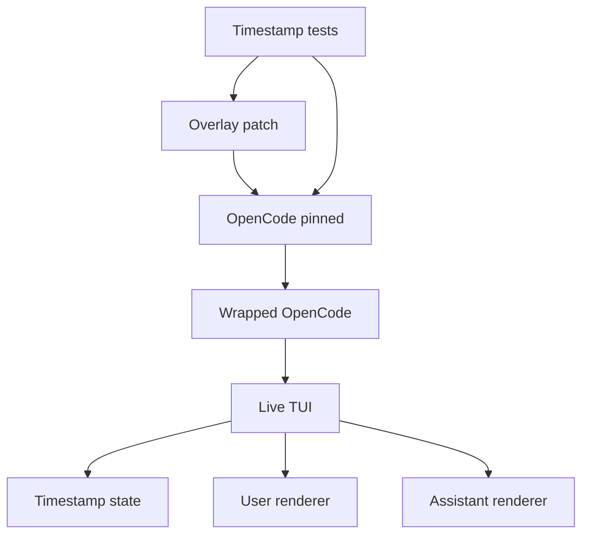
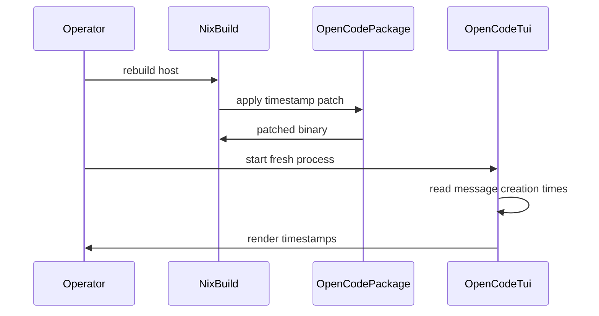

# Design Document

## Overview

`opencode-turn-timestamps` extends this repo's pinned OpenCode package so the
live terminal transcript shows turn creation timestamps by default. The operator
uses this for session reconstruction, latency debugging, and long-session
awareness across both nix-darwin hosts.

The design patches OpenCode's existing TUI timestamp feature instead of adding a
local plugin. OpenCode `v1.15.5` already has `/timestamps`, user-message
timestamp rendering, and message creation metadata; the missing pieces are
assistant-turn rendering and a feature-owned visible default.

### Goals

- Show user and assistant turn timestamps in the live TUI by default.
- Preserve message text, model context, tool inputs, session storage, and
  adjacent OpenCode integrations.
- Fail during repo verification when the OpenCode patch stops applying or stops
  expressing the timestamp contract.

### Non-Goals

- New per-session timestamp logs.
- OpenCode session database or schema changes.
- Cavemem, Obsidian, RTK, session-compaction, cost-diagnosis, or mcpproxy
  behavior changes.
- Upstream plugin API work or alternate custom TUI routes.
- Transcript copy/export changes unless future discovery proves they share the
  same live rendering path.

## Boundary Commitments

### This Spec Owns

- A repo-carried patch against OpenCode's pinned TUI session route.
- Visible-by-default turn timestamp state for the live TUI transcript.
- User and assistant timestamp rendering from existing turn creation metadata.
- Patch wiring through the existing Nix overlay and verification through flake
  checks.

### Out of Boundary

- OpenCode persistent session storage, message serialization, SDK schemas, tool
  execution, provider request payloads, and LLM prompt construction.
- Home Manager module changes unless implementation discovers that package-level
  patching cannot reach both configured hosts.
- New plugin files, new transcript logs, and new external dependencies.
- Upstream PR creation or OpenCode version bumps.

### Allowed Dependencies

- OpenCode `v1.15.5` TUI session route and existing SDK message types.
- OpenCode's existing `Locale.todayTimeOrDateTime` formatter.
- The existing `opencode-pinned` overlay and prompt `postPatch` pipeline.
- Existing flake check patterns using Node's test runner and Nix build canaries.

### Revalidation Triggers

- OpenCode pin changes or source route relocation.
- Changes to `UserMessage`, `AssistantMessage`, or `time.created` shape.
- Changes to OpenCode's timestamp toggle, KV state API, or command palette
  contract.
- Changes to the shared OpenCode package selection path in Home Manager.
- New requirements for export/copy/web/desktop timestamp display.

## Architecture

### Existing Architecture Analysis

`home.opencode.package` defaults to `pkgs.opencode-pinned`, and
`programs.opencode.package` wraps that package for all hosts. `opencode-pinned`
fetches `anomalyco/opencode` at `v1.15.5`, applies local prompt replacements in
`postPatch`, and builds with a custom `node_modules` derivation. Plugins are
available for event/tool hooks, but they do not wrap the built-in live transcript
row renderer.

OpenCode already exposes `session.toggle.timestamps`, `/timestamps`, and user
timestamp rendering in `packages/opencode/src/cli/cmd/tui/routes/session/index.tsx`.
The patch stays in that route and avoids changes to core session data.

### Architecture Pattern & Boundary Map



**Architecture Integration**:
- Selected pattern: overlay source patch, because the required behavior lives in
  OpenCode's core TUI route rather than a supported plugin hook.
- Existing patterns preserved: central `opencode-pinned` package, shared wrapped
  OpenCode package, flake checks, and no runtime installer.
- New components rationale: a discrete patch file and timestamp-specific tests
  isolate this feature from prompt compression and plugin work.

### Technology Stack

| Layer | Choice / Version | Role in Feature | Notes |
|-------|------------------|-----------------|-------|
| TUI | OpenCode `v1.15.5` Solid TUI | Live transcript rendering | Patched through overlay only |
| Formatting | Existing `Locale.todayTimeOrDateTime` | Local-time timestamp string | No new dependency |
| Infrastructure | Nix overlay and Home Manager wrapper | Host distribution | Rebuild plus OpenCode restart |
| Verification | Node test runner and Nix flake checks | Patch contract and build canary | Mirrors existing checks |

## File Structure Plan

### Directory Structure

```text
overlays/
├── misc.nix                         # wires timestamp patch into opencode-pinned
└── opencode-turn-timestamps.patch   # OpenCode TUI source patch

tests/
└── opencode-turn-timestamps/
    └── patch-contract.test.js       # static contract checks for patch scope and behavior

flake.nix                            # adds timestamp tests and package build canary
.kiro/specs/opencode-turn-timestamps/
├── design.md                        # this design
├── research.md                      # discovery and synthesis log
└── spec.json                        # design metadata
```

### Modified Files

- `overlays/misc.nix` — Add the timestamp patch to `opencode-pinned` without
  changing prompt `postPatch` or dependency hashes unless the upstream source
  hash changes.
- `flake.nix` — Add `opencode-turn-timestamps-tests` and a package canary that
  forces `pkgs.opencode-pinned` to build with the patch.
- `.kiro/specs/opencode-turn-timestamps/spec.json` — Track design generation.
- `.kiro/specs/opencode-turn-timestamps/research.md` — Append design discovery
  and synthesis decisions.

### Created Files

- `overlays/opencode-turn-timestamps.patch` — Owns all upstream OpenCode source
  edits for this feature.
- `tests/opencode-turn-timestamps/patch-contract.test.js` — Verifies the patch
  remains restricted to the allowed route and expresses timestamp behavior for
  user, assistant, default visibility, streaming stability, and content
  preservation.

### Component to File Mapping

| Component | File Path |
|-----------|-----------|
| OverlayPatchApplicator | `overlays/misc.nix`, `overlays/opencode-turn-timestamps.patch` |
| TimestampVisibilityPolicy | `overlays/opencode-turn-timestamps.patch` |
| TurnTimestampFormatter | `overlays/opencode-turn-timestamps.patch` |
| UserTurnTimestampRenderer | `overlays/opencode-turn-timestamps.patch` |
| AssistantTurnTimestampRenderer | `overlays/opencode-turn-timestamps.patch` |
| PatchBoundaryGuard | `tests/opencode-turn-timestamps/patch-contract.test.js` |
| TimestampVerificationSuite | `tests/opencode-turn-timestamps/patch-contract.test.js`, `flake.nix` |

## System Flows



The build path is the only activation path. Existing OpenCode processes keep the
previous package until restarted.

## Requirements Traceability

| Requirement | Summary | Components | Interfaces | Flows |
|-------------|---------|------------|------------|-------|
| 1.1 | User timestamp visible | UserTurnTimestampRenderer | `TurnTimestampSource` | Runtime render |
| 1.2 | Assistant timestamp visible | AssistantTurnTimestampRenderer | `TurnTimestampSource` | Runtime render |
| 1.3 | Streaming timestamp stable | AssistantTurnTimestampRenderer | `TurnTimestampSource.time.created` | Runtime render |
| 1.4 | Historical timestamps | UserTurnTimestampRenderer, AssistantTurnTimestampRenderer | SDK message types | Runtime render |
| 1.5 | User and assistant only | PatchBoundaryGuard | Patch path allowlist | Verification |
| 2.1 | Creation-time source | TurnTimestampFormatter | `TurnTimestampSource` | Runtime render |
| 2.2 | Host local time | TurnTimestampFormatter | Locale formatter | Runtime render |
| 2.3 | Consistent format | TurnTimestampFormatter | Locale formatter | Runtime render |
| 2.4 | Cross-day distinction | TurnTimestampFormatter | Locale formatter | Runtime render |
| 2.5 | Missing metadata fallback | TurnTimestampFormatter | Optional timestamp contract | Runtime render |
| 3.1 | Preserve message text | PatchBoundaryGuard | Patch path allowlist | Verification |
| 3.2 | No model timestamp content | PatchBoundaryGuard | Patch path allowlist | Verification |
| 3.3 | No tool timestamp input | PatchBoundaryGuard | Patch path allowlist | Verification |
| 3.4 | Preserve order labels streaming | UserTurnTimestampRenderer, AssistantTurnTimestampRenderer | Existing render order | Runtime render |
| 3.5 | Narrow terminal preservation | UserTurnTimestampRenderer, AssistantTurnTimestampRenderer | Metadata line contract | Runtime render |
| 4.1 | Rebuild plus restart activates | OverlayPatchApplicator | Nix package patch | Build flow |
| 4.2 | Both hosts | OverlayPatchApplicator | Shared package selection | Build flow |
| 4.3 | No runtime network | OverlayPatchApplicator | Nix store package | Build flow |
| 4.4 | Build failure before availability | OverlayPatchApplicator, TimestampVerificationSuite | Build canary | Verification |
| 4.5 | Restart documented | Design and tasks | Operator note | Build flow |
| 5.1 | No timestamp logs | PatchBoundaryGuard | Patch path allowlist | Verification |
| 5.2 | No session schema change | PatchBoundaryGuard | Patch path allowlist | Verification |
| 5.3 | No cavemem change | PatchBoundaryGuard | Patch path allowlist | Verification |
| 5.4 | No Obsidian change | PatchBoundaryGuard | Patch path allowlist | Verification |
| 5.5 | No adjacent behavior change | PatchBoundaryGuard | Patch path allowlist | Verification |
| 5.6 | Existing history unchanged | TurnTimestampFormatter | Read-only message metadata | Runtime render |
| 6.1 | Verify user display | TimestampVerificationSuite | Patch contract | Verification |
| 6.2 | Verify assistant display | TimestampVerificationSuite | Patch contract | Verification |
| 6.3 | Verify streaming stability | TimestampVerificationSuite | Patch contract | Verification |
| 6.4 | Verify text preservation | TimestampVerificationSuite | Patch path allowlist | Verification |
| 6.5 | Fail on OpenCode drift | OverlayPatchApplicator, TimestampVerificationSuite | Build canary | Verification |

## Components and Interfaces

| Component | Domain | Intent | Req Coverage | Key Dependencies | Contracts |
|-----------|--------|--------|--------------|------------------|-----------|
| OverlayPatchApplicator | Nix overlay | Applies the OpenCode TUI patch to the pinned package | 4.1, 4.2, 4.3, 4.4, 6.5 | OpenCode source P0, Nix overlay P0 | Batch |
| TimestampVisibilityPolicy | TUI state | Makes turn timestamps visible by default while retaining `/timestamps` control | 1.1, 1.2, 4.1 | OpenCode KV P0 | State |
| TurnTimestampFormatter | TUI presentation | Formats existing creation timestamps consistently | 2.1, 2.2, 2.3, 2.4, 2.5, 5.6 | OpenCode Locale P0 | Service |
| UserTurnTimestampRenderer | TUI presentation | Shows user turn timestamps without replacing text or queued state | 1.1, 1.4, 1.5, 3.1, 3.4, 3.5 | Formatter P0, visibility policy P0 | State |
| AssistantTurnTimestampRenderer | TUI presentation | Shows assistant turn creation timestamps during streaming and after completion | 1.2, 1.3, 1.4, 1.5, 3.1, 3.4, 3.5 | Formatter P0, visibility policy P0 | State |
| PatchBoundaryGuard | Verification | Prevents source drift outside the approved TUI-only boundary | 3.1, 3.2, 3.3, 5.1, 5.2, 5.3, 5.4, 5.5, 6.4 | Patch file P0 | Batch |
| TimestampVerificationSuite | Verification | Exercises patch contract and package build canary | 6.1, 6.2, 6.3, 6.4, 6.5 | Node P0, Nix P0 | Batch |

### Overlay and Packaging

#### OverlayPatchApplicator

| Field | Detail |
|-------|--------|
| Intent | Apply the timestamp patch to `opencode-pinned` at build time. |
| Requirements | 4.1, 4.2, 4.3, 4.4, 6.5 |

**Responsibilities & Constraints**
- Add `overlays/opencode-turn-timestamps.patch` to the existing
  `opencode-pinned` override.
- Keep prompt replacement `postPatch` behavior unchanged.
- Avoid dependency changes; timestamp rendering uses existing OpenCode utilities.

**Dependencies**
- Outbound: `anomalyco/opencode` `v1.15.5` source — patch target (P0).
- Outbound: Nix overlay evaluation — package distribution (P0).
- Inbound: `programs.opencode.package` wrapper — host activation (P0).

**Contracts**: Batch

**Batch / Job Contract**
- Trigger: host rebuild, flake check, or direct package build.
- Input: pinned OpenCode source plus repo patch file.
- Output: patched `opencode-pinned` binary in the Nix store.
- Failure: patch application or build failure stops timestamp support from being
  reported as available.

### OpenCode TUI Patch

#### TimestampVisibilityPolicy

| Field | Detail |
|-------|--------|
| Intent | Define the live TUI timestamp visibility state. |
| Requirements | 1.1, 1.2, 4.1 |

**Responsibilities & Constraints**
- Use a feature-owned TUI KV key with default `show` so stale upstream
  `timestamps=hide` values do not suppress initial visibility after activation.
- Keep the existing `session.toggle.timestamps`, `/timestamps`, and
  `/toggle-timestamps` operator surface bound to the effective timestamp state.
- Do not introduce a Home Manager toggle for this spec.

**Contracts**: State

**State Management**
- State model: `"hide" | "show"`.
- Persistence: OpenCode TUI KV only; not OpenCode session history.
- Invariant: `showTimestamps()` returns true on first run for the feature-owned
  key unless the operator later toggles it.

#### TurnTimestampFormatter

| Field | Detail |
|-------|--------|
| Intent | Convert existing message creation times into visible local-time text. |
| Requirements | 2.1, 2.2, 2.3, 2.4, 2.5, 5.6 |

**Responsibilities & Constraints**
- Read only `time.created` from user and assistant message objects.
- Use `Locale.todayTimeOrDateTime` for consistency with existing user timestamp
  behavior.
- Return no timestamp when creation metadata is absent or invalid.

**Contracts**: Service

##### Service Interface

```typescript
type TurnTimestampRole = "user" | "assistant"

interface TurnTimestampSource {
  readonly id: string
  readonly role: TurnTimestampRole
  readonly time: {
    readonly created?: number
  }
}

interface TurnTimestampFormatter {
  formatCreatedTime(source: TurnTimestampSource): string | undefined
}
```

- Preconditions: `source.role` is user or assistant.
- Postconditions: returned text represents `source.time.created` in local time.
- Invariants: formatter does not mutate `source`.

#### UserTurnTimestampRenderer

| Field | Detail |
|-------|--------|
| Intent | Render user turn timestamp metadata in the existing user message block. |
| Requirements | 1.1, 1.4, 1.5, 3.1, 3.4, 3.5 |

**Responsibilities & Constraints**
- Preserve existing message text rendering and border styling.
- When a queued user message is shown and timestamps are visible, show both the
  queued badge and the timestamp rather than replacing one with the other.
- Render timestamp metadata outside message text so copy/model/tool content is
  unchanged.

**Contracts**: State

**Implementation Notes**
- Validation: patch contract test checks that user timestamp rendering still uses
  creation time.
- Risk: existing queued fallback currently replaces timestamp display; this is a
  required local delta.

#### AssistantTurnTimestampRenderer

| Field | Detail |
|-------|--------|
| Intent | Render assistant turn timestamp metadata in the assistant footer. |
| Requirements | 1.2, 1.3, 1.4, 1.5, 3.1, 3.4, 3.5 |

**Responsibilities & Constraints**
- Render assistant `time.created` whenever timestamps are visible, including
  while `time.completed` is absent.
- Preserve existing mode, model, duration, and interruption metadata.
- Ensure assistant metadata can appear for historical turns even when duration is
  unavailable.

**Contracts**: State

**Implementation Notes**
- Validation: patch contract test checks assistant rendering references
  `message.time.created`, not `time.completed`.
- Risk: footer crowding in narrow terminals; metadata stays outside text content
  and may wrap before message text is hidden.

### Verification

#### PatchBoundaryGuard

| Field | Detail |
|-------|--------|
| Intent | Keep the patch inside the approved TUI-only scope. |
| Requirements | 3.1, 3.2, 3.3, 5.1, 5.2, 5.3, 5.4, 5.5, 6.4 |

**Responsibilities & Constraints**
- Assert the patch only targets the OpenCode TUI session route.
- Assert the patch does not modify session schemas, plugin files, tool runtime,
  cavemem, Obsidian, RTK, cost-diagnosis, or mcpproxy files.

**Contracts**: Batch

**Batch / Job Contract**
- Trigger: `opencode-turn-timestamps-tests` flake check.
- Input: `overlays/opencode-turn-timestamps.patch`.
- Output: pass/fail with labels identifying the violated boundary.

#### TimestampVerificationSuite

| Field | Detail |
|-------|--------|
| Intent | Verify timestamp contract and patch buildability. |
| Requirements | 6.1, 6.2, 6.3, 6.4, 6.5 |

**Responsibilities & Constraints**
- Check static patch contract for visible default, user rendering, assistant
  rendering, stable creation-time source, and no message text mutation.
- Force `pkgs.opencode-pinned` to build in a flake check so upstream route drift
  fails before runtime.

**Contracts**: Batch

**Batch / Job Contract**
- Trigger: flake check.
- Input: repo source and patched OpenCode package.
- Output: completed check derivations.
- Recovery: failed check message identifies timestamp display or patch boundary.

## Data Models

### Domain Model

- Turn timestamp: display metadata derived from an existing user or assistant
  message creation time.
- Timestamp visibility: TUI state controlling whether timestamps render.

### Logical Data Model

- Existing user message: `id`, `role = "user"`, `time.created`.
- Existing assistant message: `id`, `role = "assistant"`, `time.created`, optional
  `time.completed`.
- Feature-owned TUI KV key: `"hide" | "show"`, default `"show"`.

### Physical Data Model

No OpenCode session storage, SQLite, cavemem, or Obsidian schema changes.

## Error Handling

- Missing creation metadata: renderer omits the timestamp for that turn rather
  than fabricating one.
- OpenCode route drift: the Nix patch fails to apply or the static contract test
  fails.
- Narrow terminal: metadata may wrap, but message text remains rendered.
- Existing running process: unchanged until restarted; tasks must include a
  restart note in operator-facing output.

## Testing Strategy

### Unit and Static Contract Tests

- `tests/opencode-turn-timestamps/patch-contract.test.js` verifies the patch
  targets only the TUI session route (3.1, 3.2, 3.3, 5.1, 5.2, 5.3, 5.4, 5.5).
- The same test verifies user timestamp rendering remains based on
  `time.created` (1.1, 2.1, 6.1).
- The same test verifies assistant timestamp rendering uses `time.created`, not
  `time.completed` (1.2, 1.3, 2.1, 6.2, 6.3).
- The same test verifies visible default state is `show` for the feature-owned
  key (4.1).

### Integration Checks

- `opencode-turn-timestamps-tests` flake check runs the Node contract suite.
- `opencode-turn-timestamps-package` flake check references
  `pkgs.opencode-pinned` so patch application and package build fail on OpenCode
  source drift (4.4, 6.5).

### Manual Smoke

- After host rebuild and OpenCode restart, run a short OpenCode session and
  confirm user and assistant turns show timestamps (1.1, 1.2, 4.1).
- Toggle `/timestamps` once to confirm the existing operator control still works,
  then toggle it back on.

## Security Considerations

- The feature exposes timestamps already present in local OpenCode session data.
- It sends no timestamp text to models, tools, providers, cavemem, Obsidian, or
  remote services.
- It adds no runtime network dependency.

## Performance & Scalability

- Rendering adds one local-time formatter call per visible user or assistant
  turn when timestamps are visible.
- No polling, background jobs, database reads, or plugin subprocesses are added.
- The design should not change scrolling or message ordering behavior.

## Migration Strategy

No data migration is required. The patch uses a feature-owned timestamp
visibility key with a default of `show`; older upstream `timestamps=hide` state
does not suppress first-run visibility for this feature. The operator can still
use `/timestamps` to hide or show timestamps after activation.
