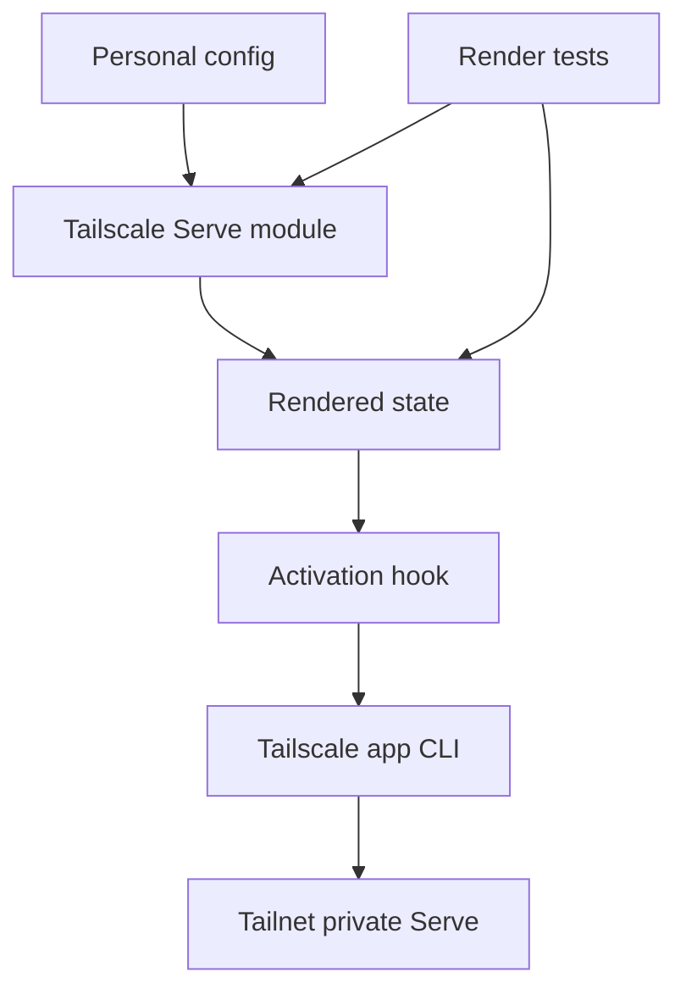

# Design Document

## Overview

The personal Tailscale service feature adds a reusable Home Manager module for declaring tailnet-private Tailscale Serve proxy entries and applies them during activation through the installed macOS Tailscale app.

### Goals

- Declare local port and localhost URL Serve entries in Nix.
- Apply declared entries during Home Manager activation without managing `tailscaled`.
- Keep the module reusable, render-testable, and dormant on the personal host until entries are added later.

### Non-Goals

- Managing Tailscale installation, login, ACLs, certificates, or device authorization.
- Funnel, file serving, directory serving, static text serving, and public internet exposure.
- Selecting or declaring initial personal service entries.
- Removing unmanaged or previously removed Serve entries.
- Adding a launchd reapply agent in the first implementation.

## Boundary Commitments

### This Spec Owns

- `home.tailscaleServe` Home Manager option schema, validation, defaults, and rendered internal state.
- Activation-time application of declared entries through the configured macOS Tailscale CLI path.
- Personal-host render coverage proving the module is available and dormant without initial entries.
- Render tests and flake check coverage for disabled, declared, invalid, and personal-host states.

### Out of Boundary

- Tailscale app installation beyond the existing `homebrew.masApps."Tailscale"` declaration.
- `tailscaled` lifecycle, Tailscale authentication, tailnet policy, certificates, and first-run Serve/HTTPS consent.
- Tailscale Funnel and any internet-public exposure.
- File, directory, and static text targets.
- Authoritative cleanup of Serve state not represented by the current activation command set.
- Host-specific service selection for `Brandons-MacBook-Pro`.

### Allowed Dependencies

- Home Manager option, assertion, and activation APIs.
- Existing common Home Manager import hub at `home-manager/common/default.nix`.
- Personal host wiring under `configurations/personal/home-manager/`.
- Existing Mac App Store Tailscale app CLI at `/Applications/Tailscale.app/Contents/MacOS/Tailscale` by default.
- Tailscale Serve CLI semantics documented for `serve --bg` local proxy targets.
- Existing Node render-test and flake check patterns.

### Revalidation Triggers

- Tailscale CLI Serve syntax changes.
- A requirement to support Funnel, Services virtual IPs, files, directories, static text, or cleanup of removed entries.
- Moving from the Mac App Store app to a Nix-managed or open-source macOS Tailscale variant.
- Adding a launchd reapply hook or background daemon ownership.

## Architecture

### Existing Architecture Analysis

This is an extension of the Home Manager module layer. Existing patterns provide reusable modules, personal-host imports, activation hooks after `writeBoundary`, and render tests that inspect evaluated Home Manager state without running host side effects.

### Architecture Pattern & Boundary Map



- Selected pattern: reusable Home Manager module with host-level declarations.
- Dependency direction: personal config → module options → rendered state → activation hook → external CLI.
- No new runtime service is introduced.

### Technology Stack

| Layer | Choice | Role | Notes |
|-------|--------|------|-------|
| Configuration | Nix Home Manager module | Option schema, validation, activation rendering | Matches existing common modules. |
| Runtime integration | macOS Tailscale app CLI | Applies Serve entries | Default path remains configurable. |
| Tests | Node `node:test` plus Nix eval | Render and validation checks | Mirrors `tests/git-clone-isolation/`. |
| CI/checks | `flake.nix` checks | Builds test suite in copied source | No real Tailscale invocation. |

## File Structure Plan

### New Files

- `home-manager/common/tailscale-serve.nix` — Owns `home.tailscaleServe` options, validation, rendered command state, and activation hook.
- `tests/personal-tailscale-service/hm-render.test.js` — Verifies module render behavior, validation failures, and personal host wiring.
- `tests/personal-tailscale-service/helpers.js` — Minimal Nix eval helpers local to the new test suite.

### Modified Files

- `home-manager/common/default.nix` — Imports `./tailscale-serve.nix`.
- `flake.nix` — Adds a `personal-tailscale-service` check that runs the new test suite in a copied writable source.

### Existing Files Referenced

- `configurations/personal/home-manager/default.nix` — Existing personal host import path used by host render tests; no direct modification in this spec.
- `configurations/personal/default.nix` — Existing Tailscale app install declaration used as a runtime prerequisite; no direct modification in this spec.

## Requirements Traceability

| Requirement | Summary | Components | Interfaces | Flows |
|-------------|---------|------------|------------|-------|
| 1.1 | Declared entries become desired tailnet-private proxy state | HM Module | Option schema, rendered entries | Render and activation |
| 1.2 | Local port and localhost URL targets supported | HM Module | Entry schema | Render and activation |
| 1.3 | Unsupported exposures rejected before activation | HM Module, Render Tests | Assertions | Evaluation failure |
| 1.4 | Empty declarations render no Serve behavior | HM Module, Render Tests | Defaults | Render |
| 1.5 | CLI path configurable | HM Module | `cliPath` option | Activation |
| 2.1 | Personal host has option namespace available | Personal Host Readiness | Common import | Host eval |
| 2.2 | Personal host renders no convergence without entries | Personal Host Readiness, HM Module | Defaults | Host eval |
| 2.3 | No local service exposed before entries exist | Personal Host Readiness, HM Module | Defaults | Host eval |
| 2.4 | External Tailscale prerequisites stay external | Personal Host Readiness, Activation | Preconditions | Activation |
| 3.1 | Activation converges each declared entry | Activation Convergence | Command contract | Activation |
| 3.2 | Missing CLI fails with path | Activation Convergence | Error contract | Activation |
| 3.3 | Entry apply failure identifies entry | Activation Convergence | Error contract | Activation |
| 3.4 | No interactive consent or auth | Activation Convergence | Preconditions | Activation |
| 3.5 | No `tailscaled` lifecycle management | Activation Convergence | Boundary | Activation |
| 3.6 | No broad unmanaged state cleanup | Activation Convergence | Boundary | Activation |
| 4.1 | Disabled or empty state tested | Render Tests | Test cases | Render |
| 4.2 | Declared state tested | Render Tests | Test cases | Render |
| 4.3 | Invalid declarations tested | Render Tests | Test cases | Evaluation failure |
| 4.4 | Personal host dormant availability tested | Render Tests | Test cases | Host eval |

## Components and Interfaces

| Component | Domain/Layer | Intent | Req Coverage | Key Dependencies | Contracts |
|-----------|--------------|--------|--------------|------------------|-----------|
| HM Module | Home Manager | Define and validate declarative Serve entries | 1.1-1.5, 2.2, 3.5, 3.6 | Home Manager APIs P0 | Service, State |
| Activation Convergence | Activation | Apply rendered entries through Tailscale.app CLI | 3.1-3.6 | HM Module P0, Tailscale CLI P0 | Batch |
| Personal Host Readiness | Host config | Verify personal host receives the module without entries | 2.1-2.4, 4.4 | HM Module P0 | State |
| Render Tests | Tests | Verify rendered behavior without side effects | 4.1-4.4 | Nix eval P0, Node test P1 | Test contract |

### Home Manager Layer

#### HM Module

| Field | Detail |
|-------|--------|
| Intent | Provide the declarative API and rendered command state for Tailscale Serve. |
| Requirements | 1.1, 1.2, 1.3, 1.4, 1.5, 2.2, 3.5, 3.6 |

**Responsibilities & Constraints**
- Owns the `home.tailscaleServe` option namespace.
- Validates supported local proxy entries at evaluation time.
- Exposes internal rendered state for activation and tests.
- Does not import or depend on personal-host configuration.

**Service Interface**
```nix
home.tailscaleServe = {
  enable = bool;
  cliPath = str;
  entries = attrsOf TailscaleServeEntry;
  _renderedCommands = listOf RenderedServeCommand; # internal, read-only
};

TailscaleServeEntry = {
  listen = {
    protocol = enum [ "https" "http" "tcp" "tls-terminated-tcp" ];
    port = int; # 1-65535
    path = nullOr str; # only for http and https
  };
  target = {
    kind = enum [ "port" "url" ];
    port = nullOr int;
    url = nullOr str;
  };
};

RenderedServeCommand = {
  name = str;
  argv = listOf str;
};
```
- Preconditions: enabled module, Darwin platform, valid local target shape.
- Postconditions: empty entries render no activation command; non-empty entries render one command per entry.
- Invariants: rendered commands never include `funnel`, file paths, directory paths, `text:` targets, `serve reset`, `tailscaled`, or non-local targets.

**Implementation Notes**
- Default `cliPath` is `/Applications/Tailscale.app/Contents/MacOS/Tailscale`.
- Local URL validation accepts loopback/localhost forms needed by Tailscale Serve and rejects public hostnames.
- The module may use assertions for cross-field checks such as `path` only on HTTP/HTTPS entries.

#### Activation Convergence

| Field | Detail |
|-------|--------|
| Intent | Apply rendered Serve commands during Home Manager activation. |
| Requirements | 3.1, 3.2, 3.3, 3.4, 3.5, 3.6 |

**Batch Contract**
- Trigger: Home Manager activation after `writeBoundary` when `home.tailscaleServe.enable = true` and rendered commands are non-empty.
- Input: `cliPath` and `_renderedCommands` from the HM Module.
- Execution environment: `TAILSCALE_BE_CLI=1`.
- Command contract: each entry runs the configured CLI with `serve --bg --yes` plus the rendered listen flags and local target.
- Idempotency: repeated activation reapplies declared endpoints; removed or unmanaged endpoints are not reset.
- Recovery: missing CLI or failed entry exits nonzero and reports the CLI path or entry name.

**Implementation Notes**
- Use Home Manager activation helpers where they preserve dry-run and verbose behavior.
- Do not call `tailscale serve reset`; this avoids claiming ownership of unmanaged state.
- Do not add launchd in this spec.

### Host Configuration Layer

#### Personal Host Readiness

| Field | Detail |
|-------|--------|
| Intent | Keep personal service exposure dormant until entries are added later. |
| Requirements | 2.1, 2.2, 2.3, 2.4, 4.4 |

**State Contract**
- `Brandons-MacBook-Pro` receives `home.tailscaleServe` through `../../../home-manager/common` after `home-manager/common/default.nix` imports the module.
- No host-specific entries are declared in this spec.
- The personal host does not configure Tailscale installation or login through this module.

**Implementation Notes**
- Future service entries should live in a host-specific file or the existing personal Home Manager config after a separate service-selection decision.
- Candidate services discovered in the repository are product inputs, not design defaults.

### Test Layer

#### Render Tests

| Field | Detail |
|-------|--------|
| Intent | Prove rendered behavior without invoking the Tailscale CLI. |
| Requirements | 4.1, 4.2, 4.3, 4.4 |

**Test Contract**
- Disabled/default module evaluation reports `enable = false` or empty entries with no rendered commands.
- Supported sample entries render expected argv fragments and CLI path.
- Unsupported target shapes fail Nix evaluation.
- `Brandons-MacBook-Pro` evaluation includes the option namespace and no rendered commands while no entries are configured.

## Data Models

### Domain Model

- Serve entry: named declaration of one tailnet listener and one local target.
- Listen endpoint: Tailscale-facing protocol, port, and optional HTTP path.
- Local target: loopback service target represented as a local port or localhost URL.
- Rendered command: testable command intent consumed by activation.

### Consistency & Integrity

- Entry names are stable keys in the `entries` attrset and appear in activation errors.
- Evaluation rejects unsupported exposure modes before activation.
- Activation is additive for declared entries and does not guarantee deletion of removed entries.

## Error Handling

- Evaluation errors cover unsupported protocols, invalid ports, invalid paths, non-local targets, and disallowed target kinds.
- Activation errors cover missing CLI path and failed Tailscale command execution.
- Error messages include the affected option path or entry name.

## Testing Strategy

- Unit/render tests for dormant defaults: disabled module and enabled module with empty entries render no commands. Covers 1.4, 4.1.
- Unit/render tests for supported entries: HTTP/HTTPS path and TCP target samples render expected internal state. Covers 1.1, 1.2, 1.5, 4.2.
- Evaluation-failure tests for Funnel-like, file/directory-like, static text, non-local URL, invalid port, and HTTP path on TCP entries. Covers 1.3, 4.3.
- Host render test for `Brandons-MacBook-Pro` module availability and dormant rendered state. Covers 2.1, 2.2, 2.3, 4.4.
- Flake check `personal-tailscale-service` runs `node --test tests/personal-tailscale-service/` in copied writable source. Covers 4.1-4.4.

## Security Considerations

- The module only supports tailnet-private Serve commands and never invokes `tailscale funnel`.
- Local targets must resolve to loopback or localhost forms.
- Secrets are not introduced in the module; exposed local services remain responsible for their own authentication.
- No local services are exposed by this spec; exposing MCP-like services later is a product decision.
