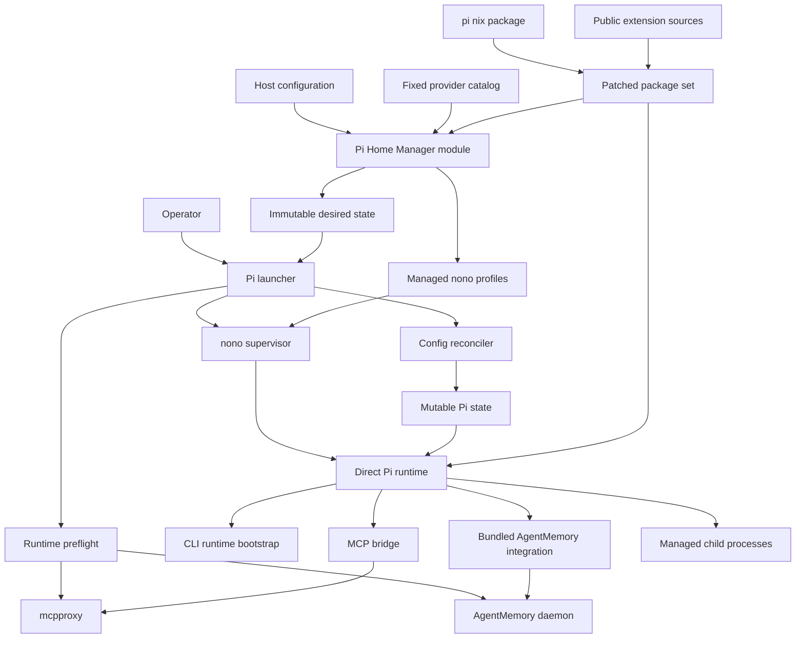
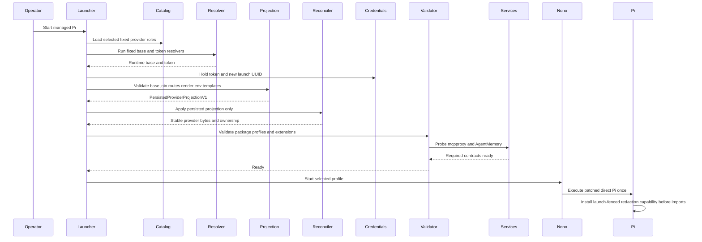
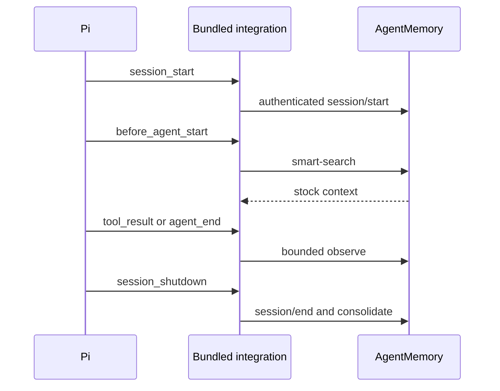

# Design Document

## Overview
This feature adds one direct, Nix-managed Pi runtime to each supported Mac while
preserving host-specific provider boundaries. The repository owns Pi's wrapper,
configuration reconciliation, sandbox profiles, extension surface, AgentMemory
Pi wiring, and acceptance evidence; existing mcpproxy and the AgentMemory
runtime remain shared services.

### Goals
- Provide the same managed Pi command and required extension baseline on both
  hosts.
- Keep declarative configuration authoritative without replacing unrelated Pi
  state.
- Fail before the TUI when provider, sandbox, MCP, AgentMemory, or extension
  prerequisites are invalid.
- Keep provider credentials out of model-invoked subprocess environments.
- Make sandbox, child-process, and stock AgentMemory behavior testable.

### Non-Goals
- Sieve or another output compressor.
- Exact `devx pi` package, migration, telemetry, or update behavior.
- Cohere or Perplexity provider support.
- A private Shopify extension or direct Shopify Tool Gateway connection.
- A generic wrapper framework shared with OpenCode.
- Cross-host Pi state synchronization or non-Darwin support.

## Boundary Commitments

### This Spec Owns
- The patched Pi package, including its launch-fenced CLI bootstrap, derived from the pinned `pi.nix` package output.
- The fixed-lock public extension closure and repository-owned Pi extensions.
- The `programs.pi-agent` option surface and both host configurations.
- The closed personal and Shopify provider-role catalog, resolver catalog, and
  generated request policies.
- Immutable desired-state rendering and launch-time mutable-state reconciliation.
- Provider preflight, direct Pi launch, status, validation, and rollout controls.
- Standalone Pi nono profiles adapted from the pinned public Pi pack.
- Pi-to-mcpproxy contracts and Pi-harness consumption of the migration-owned
  AgentMemory integration.
- AgentMemory managed-config readback, launch credential handoff, health,
  child inheritance, sandbox/status behavior, and Pi acceptance tests.
- Pi-specific package, render, security, and runtime acceptance checks.

### Out of Boundary
- mcpproxy upstream registration, daemon lifecycle, secret bridge, and routing
  implementation.
- AgentMemory packaging, daemon lifecycle, persistence/query contracts, stock
  core MCP tools, and existing OpenCode plugin behavior.
- AgentMemory Pi activation, Cavemem removal, import, backup, and OpenCode
  rollback owned by `agentmemory-opencode-migration`.
- OpenCode package, wrapper, profiles, plugins, and host settings.
- Pi-core reference-monitor changes, hostile managed extensions, immutable provider payloads, or crash-atomic Plan state.
- Arbitrary subprocesses that call `setsid()`, double-fork, or otherwise leave a
  registered managed child process group.
- Private Shopify source, provider parity features, Sieve, and optional `shop-pi-fy` resources.
- Arbitrary providers, headers, credential commands, model metadata, extension ecosystems, or embedded-text secret parsing.

### Allowed Dependencies
- `pi.nix` as the pinned base-package source; its mutable settings/model wrapper
  and jail are not used.
- Existing `pkgs.nono`, mcpproxy at the configured local endpoint, and the
  managed AgentMemory package, launchd runtime, REST endpoint, secret reference,
  and core MCP upstream from `agentmemory-opencode-migration`.
- The Shopify host's managed `devx` package only through the fixed
  `shopify-gateway-token` and `shopify-gateway-base` resolvers. Resolver argv is
  launcher-owned.
- The public extension pins recorded in `research.md` and Nix-managed language
  servers declared by the host.
- Existing Home Manager, overlay, flake-check, SOPS/Keychain, and agent-rule
  composition patterns.

### Revalidation Triggers
- A Pi or extension version changes its CLI, event, tool, settings, provider,
  session, child-process, or output-artifact contract.
- `pi.nix` changes its package output shape or starts mutating state in the base
  package.
- mcpproxy changes the standard MCP transport at `/mcp`, its six approved tools, strict mutation
  validation, health endpoints, or authentication posture.
- AgentMemory changes its bundled Pi entrypoint, hook inventory, REST routes,
  authentication, observation limits, context injection, or health semantics.
- nono changes profile schema, Darwin process signaling, environment filtering,
  network policy, or `--allow-cwd` semantics.
- Shopify or Pi changes a fixed route/API, built-in model catalog, resolver CLI,
  env-reference interpolation, exact header/template, projection schema, or
  concurrent provider-file semantics.
- The Pi Home Manager module exposes a new provider, header, URL, resolver, or
  user-supplied store-path surface.
- `programs.agentmemory` changes the REST endpoint, bearer-reference, service,
  MCP registration, data-directory, or backup ownership consumed by Pi.

## Architecture

### Existing Architecture Analysis
- Both hosts compose common/host Home Manager modules, pinned overlays, and flake checks.
- Pi follows OpenCode's preflight-to-nono pattern without sharing its wrapper.
- mcpproxy and AgentMemory retain their existing endpoint and ownership boundaries.

### Architecture Pattern & Boundary Map



### Technology Stack

| Layer | Choice / Version | Role | Constraint |
|---|---|---|---|
| Agent CLI | Pi `0.83.0` from pinned `pi.nix` | Direct coding-agent runtime | Carry security, context-recovery, and launch-bootstrap patches |
| Package runtime | Node `>=22.19.0` | Pi and TypeScript extensions | One Pi runtime in the closure |
| Configuration | Home Manager and JSON | Closed provider selections and desired state | Package references in, rendered paths out; no secrets |
| Reconciliation | Node ESM, JSON Schema, `proper-lockfile` | Atomic managed-key updates | Runtime only; provenance-aware |
| Sandbox | Existing nono package and Pi pack `0.2.0` policy | Darwin filesystem, network, and process boundary | Standalone rendered profiles |
| MCP | mcpproxy `0.52.1`, `pi-mcp-adapter@2.20.1` | Six direct tools over the standard local MCP transport | No ambient MCP config merge |
| Memory | AgentMemory `e04ba888` bundled Pi integration | Stock capture, recall, save, and consolidation over authenticated REST | Managed runtime is owned upstream; stock limits apply |
| Extensions | Pins in `research.md` | Required Pi capabilities | Fixed lock; no nested Pi dependencies |
| Native process | `node-pty@1.2.0-beta.14` | Interactive background tasks | Preserve Darwin ARM prebuild |

## File Structure Plan

### Directory Structure
```text
overlays/
├── pi-agent/
│   ├── default.nix                       # Patched Pi and extension packages
│   ├── pi-context-recovery.patch         # Upstream context-limit backport
│   ├── pi-launch-redaction-bootstrap.patch # Pre-import process capability
│   ├── pi-undici-8.9.0.patch             # Production dependency remediation
│   ├── pi-package-lock.json              # Patched Pi dependency lock
│   └── extensions/
│       ├── package.json                  # Exact extension inventory
│       ├── package-lock.json             # Fixed extension closure
│       ├── mcpproxy.ts                   # Isolated MCP adapter configuration
│       └── patches/                      # Scoped upstream extension patches
└── default.nix                           # Adds the Pi overlay

home-manager/common/pi-agent/
├── default.nix                           # Closed selectors and package references
├── managed-config.nix                    # Catalog and persisted provider projection
├── credential-policy.nix                 # Runtime secrets, resolvers, spawn boundaries
├── profiles.nix                          # Standalone Pi nono profile catalog
├── lsp-wrappers.nix                      # Package-backed scrubbed server launchers
├── instructions.md                       # Pi MCP, package, plan, and safety rules
└── guide.md                              # Operator setup, status, and rollback

scripts/
├── pi-agent-launcher.nix                 # Preflight and supervised execution
├── pi-agent-reconcile.mjs                # Managed JSON transaction
├── pi-agent-reconcile.nix                # Reconciler package
├── pi-agent-shell.nix                    # Credential-scrubbed command shell
├── pi-agent-status.nix                   # Redacted machine and human status
└── pi-agent-validate.nix                 # Runtime compatibility validation

configurations/personal/home-manager/
└── pi-agent.nix                          # Personal OpenAI selection and default

configurations/shopify/home-manager/
└── pi-agent.nix                          # Shopify role selection and default

tests/pi-agent/
├── package.test.mjs                      # Package, patches, licenses, PTY
├── module-contract.test.mjs              # Closed options and forbidden surfaces
├── reconcile.test.mjs                    # Ownership, drift, and concurrency
├── launcher.test.mjs                     # States, preflight, and fail-closed launch
├── extensions.test.mjs                   # Inventory, tools, plan, LSP, background
├── agentmemory.test.mjs                  # Bundled integration, routes, and limits
├── hm-render.test.mjs                    # Both host render contracts
├── runtime-personal.test.mjs             # Personal runtime smoke path
├── runtime-shopify.test.mjs              # Shopify stub and live-gate path
├── fixtures/                             # Fake providers and process probes
├── package.json                          # Node test entrypoints
└── run.js                                # Flake-check runner
```

### Modified Files
- `flake.nix` and `flake.lock` — add the pinned `pi-nix` input and Pi checks.
- `overlays/pi-agent/default.nix` — consume the bundled AgentMemory Pi
  integration from the managed package and remove the repository Cavemem bridge.
- `home-manager/common/default.nix` — import the Pi module.
- `home-manager/common/pi-agent/**` and `scripts/pi-agent-*` — replace
  Pi-specific Cavemem configuration, launch, status, sandbox, and validation
  contracts with AgentMemory endpoint and bearer wiring.
- `configurations/personal/home-manager/default.nix` — import personal Pi values.
- `configurations/shopify/home-manager/default.nix` — import Shopify Pi values.

No Pi production component writes outside the paths listed above and Pi's
existing mutable agent directory. Pi receives no AgentMemory data-directory
grant.

## System Flows

### Managed Launch


The projection writes `${SHOPIFY_PI_TOKEN}` and `${PI_AGENT_LAUNCH_ID}` templates,
never their values. For equal generation and validated base, concurrent launches
produce byte-identical provider JSON and the second locked reconcile is a no-op;
their root/child Pi environments still contain distinct token and UUID values.

### AgentMemory Capture and Recall


The bundled integration retains AgentMemory's stock 8,000-character slices,
fire-and-forget observation calls, project attribution, context injection,
session identity, and consolidation behavior. This spec adds no full-payload
transport, FIFO, retry queue, sticky capture error, or raw-event store.

### Sandbox Selection
`PI_NONO` selects `disabled`, `audit`, or `enforced`; `PI_NONO_PROFILE` selects
the managed profile. Review appends its read-only tool ceiling after user args.

## Requirements Traceability

| Requirement IDs | Summary | Components | Contracts / Flows |
|---|---|---|---|
| 1.1, 1.2, 1.3, 1.4, 1.5, 1.6 | Declarative two-host Pi | Package Set, Home Module, Runtime Control | Package manifest, Managed Launch |
| 2.1, 2.2, 2.3, 2.4, 2.5, 2.6, 2.7 | Managed state coexistence | Home Module, Reconciler | ManagedConfigV1, PersistedProviderProjectionV1, OwnershipStateV1 |
| 3.1, 3.2, 3.3, 3.4, 3.5, 3.6, 3.7 | Host providers | Provider Composition, Credential Boundary, Runtime Control | ProviderCatalogV1, ProviderRequestPolicyV1, PersistedProviderV1, ProviderRuntimeSecretsV1, Managed Launch |
| 4.1, 4.2, 4.3, 4.4, 4.5 | Preflight and status | Runtime Control, Acceptance Harness | StatusV1, Error Strategy |
| 5.1, 5.2, 5.3, 5.4, 5.5, 5.6, 5.7, 5.8, 5.9, 5.10 | nono profiles | Sandbox Catalog, Runtime Control | SandboxSelection, Sandbox State |
| 6.1, 6.2, 6.3, 6.4, 6.5, 6.6, 6.7 | Sole MCP entrypoint | MCP Bridge, Runtime Control | MCP config contract, Managed Launch |
| 7.1, 7.2, 7.3, 7.4, 7.5, 7.6 | Extension inventory | Package Set, Extension Runtime | ExtensionManifestV1 |
| 8.1, 8.2, 8.3, 8.4, 8.5, 8.6, 8.7, 8.8 | Sub-agents | Extension Runtime, Sandbox Catalog | ChildPolicyV1, ManagedChildAgentCatalogV1 |
| 9.1, 9.2, 9.3, 9.4, 9.5, 9.6, 9.7 | Plan mode | Extension Runtime, Sandbox Catalog | Active tool names, Plan session state |
| 10.1–10.13 | AgentMemory integration | AgentMemory Pi Integration, Runtime Control | AgentMemoryConfigV1, AgentMemory Capture and Recall |
| 11.1, 11.2, 11.3, 11.4, 11.5, 11.6, 11.7 | Session aids | Extension Runtime | ExtensionManifestV1 |
| 12.1, 12.2, 12.3, 12.4, 12.5, 12.6 | Code intelligence | Extension Runtime, Sandbox Catalog | ExtensionManifestV1, SandboxSelection |
| 13.1, 13.2, 13.3, 13.4, 13.5, 13.6, 13.7 | Background tasks | Extension Runtime, Sandbox Catalog | ChildPolicyV1, SandboxSelection |
| 14.1, 14.2, 14.3, 14.4, 14.5 | Credential isolation | Provider Composition, Credential Boundary, AgentMemory Pi Integration | PersistedProviderV1, ProviderRuntimeSecretsV1, AgentMemoryRuntimeSecretsV1, CredentialBoundaryV1 |
| 15.1, 15.2, 15.3, 15.4, 15.5, 15.6, 15.7 | Release gates | Package Set, Acceptance Harness | ValidationReportV1 |

## Components and Interfaces

| Component | Domain | Intent | Requirement Coverage | Critical Dependencies | Contracts |
|---|---|---|---|---|---|
| Package Set | Build | Produce patched Pi and one extension closure | 1, 7, 15 | pi.nix P0, npm pins P0 | State |
| Home Module | Configuration | Render closed provider plans and package-backed artifacts | 1, 2, 4, 5, 7, 11, 14 | Home Manager P0 | State |
| Runtime Control | Launch | Reconcile persisted projection, validate, and execute Pi | 2, 3, 4, 5, 11, 14 | Provider P0, nono P0 | Service, State |
| Provider Composition | Integration | Own the exact catalog and generation-stable projection | 3, 14 | devx P0 on Shopify | Service, State |
| Credential Boundary | Security | Own per-launch values and scrub non-provider spawns | 3, 14 | Provider Composition P0 | Service, State |
| Sandbox Catalog | Security | Define OS profiles and the launch-time review ceiling | 5, 8, 9, 12, 13 | nono P0 | State |
| MCP Bridge | Integration | Expose six governed mcpproxy tools | 6 | mcpproxy P0, adapter P0 | Service |
| Extension Runtime | Agent | Supply required tools and controlled subprocesses | 7, 8, 9, 11, 12, 13, 14 | Extension bundle P0 | Service, State |
| AgentMemory Consumption | Memory | Compose the migration-owned integration into Pi launch, children, sandbox, status, and validation | 8, 10, 14 | agentmemory-opencode-migration P0 | Service, State |
| Acceptance Harness | Validation | Prove package, host, runtime, and security contracts | 4, 15 | Both host outputs P0 | Batch |

### Build and Configuration

#### Package Set

| Field | Detail |
|---|---|
| Intent | Produce immutable, auditable Pi runtime inputs |
| Requirements | 1.1, 1.2, 1.5, 1.6, 7.2, 7.4, 7.5, 15.1, 15.2, 15.6 |

**Responsibilities & Constraints**
- Consume `inputs.pi-nix.packages.${system}.coding-agent` without importing its
  Home Manager wrapper.
- Apply the `undici >=8.9.0` dependency lock and complete upstream context-limit
  recovery patch; run their focused upstream tests.
- Build one exact extension dependency closure with the pins from `research.md`,
  the Darwin ARM PTY prebuild, and all license notices.
- Reject a nested `@earendil-works` Pi runtime in extension dependencies.
- Publish an immutable manifest mapping logical extension names to entry paths
  and versions.

**Dependencies**
- External P0: pinned `pi.nix`, npm sources, upstream Pi patch provenance.
- Outbound P0: Home Module and Runtime Control consume package paths only.

**Contracts**: State.

```typescript
interface ExtensionManifestV1 {
  readonly schemaVersion: 1; readonly piVersion: string;
  readonly extensions: Readonly<Record<string, {
    readonly version: string; readonly entryPath: string; readonly license: string;
  }>>;
}
```

The package check rejects missing entries, mutable source references, nested Pi
runtimes, missing license texts, wrong `undici`, or absent recovery markers.

#### Home Module

| Field | Detail |
|---|---|
| Intent | Convert typed common and host values into secret-free artifacts |
| Requirements | 1.1–1.6, 2.1, 2.6, 2.7, 4.4, 5.1, 7.1, 7.2, 11.3, 14.1 |

**Responsibilities & Constraints**
- Define `programs.pi-agent` with typed package, state, provider, MCP, sandbox, extension, sub-agent, plan, timeout, LSP, resource, and security options.
- Let personal hosts select a built-in OpenAI default; Shopify hosts enable only the fixed five roles and select a default through an enabled role.
- Accept packages as Nix derivations. Package-backed resources pair a package with a canonical relative path; only the module renders complete store paths.
- Render `ManagedConfigV1`, profiles, instructions, metadata, the module-owned scrubbed shell path, and `bashDefaultMs` bounded from 1 through 2147483647.
- Enforce closed submodules, finite enums, unique references, canonical relative paths, and host/default compatibility. Provider URLs, argv, headers, store roots, and credential literals are absent from the public options.
- Disable telemetry, analytics, self-version checks, and unmanaged updates; compose Pi rules without OpenCode-only commands.
- Represent advisory exceptions by ID, rationale, approver, and expiry; incomplete or expired exceptions fail evaluation.
- Add only repository-owned runtime commands to `home.packages`; activation never mutates Pi state.

**Dependencies**
- Inbound P0: common and host module values.
- Outbound P0: Runtime Control reads immutable rendered paths.
- External P1: existing mcpproxy and AgentMemory option read-backs.

**Contracts**: State.

```typescript
type ShopifyProviderRole = "anthropic" | "openai" | "google" | "groq" | "xai";
type ProviderRole = "openai" | ShopifyProviderRole;
type NonEmptyReadonlyArray<T> = readonly [T, ...T[]];
type Opaque<T, Name extends string> = T & { readonly __type: Name };
type NixPackage = Opaque<object, "NixPackage">;
type CanonicalRelativePath = Opaque<string, "CanonicalRelativePath">;
type RenderedStorePath = Opaque<string, "RenderedStorePath">;
interface ModelRef { readonly provider: ProviderRole; readonly modelId: string; }
interface PackageResourceRef { readonly package: NixPackage; readonly relativePath: CanonicalRelativePath; }

type HostProviderSelection =
  | { readonly mode: "personal";
      readonly defaultModel: ModelRef & { readonly provider: "openai" } }
  | {
      readonly mode: "shopify-gateway";
      readonly enabledRoles: NonEmptyReadonlyArray<ShopifyProviderRole>;
      readonly defaultModel: ModelRef;
    };

interface ManagedSettingsV1 {
  readonly defaultModel: ModelRef;
  readonly defaultThinkingLevel: "off" | "minimal" | "low" | "medium" | "high" | "xhigh";
  readonly shellPath: RenderedStorePath;
  readonly installTelemetry: false; readonly selfUpdate: false; readonly unmanagedPackages: false;
}

type BashTimeoutMs = Opaque<number, "BashTimeoutMs">;
interface ManagedTimeoutsV1 { readonly bashDefaultMs: BashTimeoutMs; }

interface ManagedConfigV1 {
  readonly schemaVersion: 1;
  readonly generation: string;
  readonly agentDir: string;
  readonly settings: ManagedSettingsV1;
  readonly timeouts: ManagedTimeoutsV1;
  readonly providerCatalog: ProviderCatalogV1;
  readonly providerSelection: HostProviderSelection;
  readonly extensionManifest: RenderedStorePath;
  readonly extensionOrder: readonly string[];
  readonly instructionResources: readonly RenderedStorePath[];
  readonly lspExecutables: Readonly<Record<string, RenderedStorePath>>;
  readonly mcpEndpoint: string;
  readonly agentMemory: AgentMemoryConfigV1;
  readonly sandboxDefault: "disabled" | "audit" | "enforced";
}

interface AgentMemoryConfigV1 {
  readonly url: `http://127.0.0.1:${number}`;
  readonly secretReference: string;
}
```

`NixPackage`, `CanonicalRelativePath`, and `RenderedStorePath` denote Nix-native package values, validated relative paths, and module-generated outputs; they are not interchangeable strings.
`ManagedSettingsV1` contains only module-owned Pi keys: the selected default, scrubbed shell path, and disabled update paths.

Validation layers remain independent:

| Layer | Correctness responsibility |
|---|---|
| Module evaluation | Structural types, timeout bounds, closed enums, references, canonical relative paths, and cross-field compatibility |
| Generated-manifest validation | Schema, package membership, executable bits, shell path, extension order, catalog, selection, and persisted projection shape |
| Closure scans | Defense-in-depth checks for known sentinels, private source, and suspicious rendered literals |
| Launcher | Resolver availability, bounded output, concrete HTTPS gateway base, fixed-route joining, and auth conflicts |

Heuristic secret scans may reject suspicious output, but the closed option graph makes credential-bearing provider URLs, headers, commands, and store roots unrepresentable before scans run.

### Runtime Control

#### Reconciler and Launcher

| Field | Detail |
|---|---|
| Intent | Commit one managed generation and launch direct Pi once |
| Requirements | 2.1–2.7, 3.1–3.7, 4.1–4.5, 5.2, 5.5–5.8, 11.3, 14.1, 14.3–14.5 |

**Responsibilities & Constraints**
- Reject Pi package mutation commands and invalid launch overrides first.
- Dispatch only the catalog's fixed resolvers with launcher-owned argv and
  bounded timeouts; personal mode invokes none.
- Ask Provider Composition for `PersistedProviderProjectionV1` and Credential
  Boundary for `ProviderRuntimeSecretsV1`. Never pass runtime secrets to the
  reconciler or serialize them for rollback, status, or ownership.
- Hold one integration lock across provider materialization and JSON updates.
- Coordinate `settings.json` with Pi's `proper-lockfile`; update managed JSON by private same-directory write, fsync, and atomic rename, with `/shellPath` under the same ownership and drift rules.
- Record each owned JSON pointer/provider, prior managed value hash, generation,
  and transaction state in `OwnershipStateV1`.
- Remove a stale value only when the current value still equals the prior
  managed value. Drift on an active managed provider or security key fails.
- Canonically sort persisted providers/keys and skip writes when bytes match.
  Concurrent same-generation projections with different joined URLs fail as
  `provider-projection-conflict` instead of overwriting each other.
- Validate manifests, closure membership, provider materialization, extensions,
  profiles, MCP, AgentMemory, and credentials; then exec patched bare Pi through
  nono exactly once; its CLI installs the provider redaction bootstrap before
  importing Pi modules.
- Add validated `bashDefaultMs` to root and foreground child Pi as `PI_AGENT_BASH_TIMEOUT_MS`, outside `ProviderRuntimeSecretsV1`.
- Expose the same checks through dry-run, status, and validation modes.

**Dependencies**
- Inbound P0: ManagedConfigV1, PersistedProviderProjectionV1, and Package Set.
- Outbound P0: nono and direct Pi executable.
- External P0: Shopify gateway in Shopify mode; mcpproxy and AgentMemory on both.

**Contracts**: Service, State.

```typescript
interface OwnershipStateV1 {
  readonly schemaVersion: 1; readonly generation: string;
  readonly transaction: "committed" | "pending";
  readonly files: Readonly<Record<string, Readonly<Record<string,
    { readonly valueHash: string }>>>>;
}

type ReconcileResult =
  | { readonly ok: true; readonly generation: string; readonly changed: readonly string[] }
  | { readonly ok: false; readonly error: ReconcileError };

type ReconcileError =
  | { readonly kind: "invalid-json"; readonly path: string }
  | { readonly kind: "managed-drift"; readonly path: string; readonly pointer: string }
  | { readonly kind: "provider-projection-conflict"; readonly providerId: string }
  | { readonly kind: "lock-timeout"; readonly path: string }
  | { readonly kind: "write-failure"; readonly path: string };
```

`--managed-status` returns a redacted `StatusV1`; it never starts Pi.

```typescript
interface StatusV1 {
  readonly generation: string; readonly piVersion: string;
  readonly providerMode: "personal" | "shopify-gateway";
  readonly sandboxState: "disabled" | "audit" | "enforced"; readonly profile: string | null;
  readonly mcpEndpoint: string; readonly mcpReady: boolean;
  readonly agentMemoryUrl: string;
  readonly agentMemoryHealth: "healthy" | "degraded" | "critical" | "unavailable";
  readonly extensions: Readonly<Record<string, string>>;
  readonly drift: readonly string[];
}
```

#### Provider Composition

| Field | Detail |
|---|---|
| Intent | Resolve host routing without crossing credential boundaries |
| Requirements | 3.1–3.7, 14.1–14.5 |

**Responsibilities & Constraints**
- `ProviderCatalogV1` is the only source of provider IDs, routes, APIs, model
  provenance, request policies, defaults, and unsupported-provider decisions.
- Personal emits no `models.json` provider override: Pi uses built-in OpenAI,
  Pi auth, and `openai/gpt-5.6-sol` at `xhigh`.
- Shopify host input selects catalog roles only. It cannot add or override URLs,
  model metadata, headers, policies, resolver behavior, or public literals.
- Validate the resolved base as HTTPS with no userinfo, query, or fragment; join
  fixed suffixes while retaining origin; reject auth precedence conflicts.
- Project catalog roles into generation-stable `PersistedProviderV1` objects.
  Per-launch token/UUID values belong only to Credential Boundary.

**Dependencies**
- External P0: `devx llm-gateway` in Shopify mode.
- Outbound P0: Runtime Control and Pi provider composer.
- Outbound P1: Credential scrubbers receive the exact sensitive-name set.

**Contracts**: Service, State.

```typescript
type ConcreteHttpsUrl = Opaque<string, "ConcreteHttpsUrl">;
type TokenEnvRef = { readonly kind: "environment-reference";
  readonly name: "SHOPIFY_PI_TOKEN"; readonly template: "${SHOPIFY_PI_TOKEN}" };
type LaunchEnvRef = { readonly kind: "environment-reference";
  readonly name: "PI_AGENT_LAUNCH_ID"; readonly template: "${PI_AGENT_LAUNCH_ID}" };
type AffinityHeadersV1 = readonly [
  { readonly name: "X-Shopify-Session-Affinity-Header"; readonly value: { readonly kind: "fixed-public-literal"; readonly value: "pi-agent-session-id" } },
  { readonly name: "pi-agent-session-id"; readonly value: LaunchEnvRef },
  { readonly name: "Shopify-Usage-Tag"; readonly value: { readonly kind: "fixed-public-literal"; readonly value: "pi-agent" } },
];
type GoogleHeadersV1 = readonly [...AffinityHeadersV1,
  { readonly name: "Authorization"; readonly value: { readonly kind: "bearer-environment-reference"; readonly name: "SHOPIFY_PI_TOKEN"; readonly template: "Bearer ${SHOPIFY_PI_TOKEN}" } }];
type ProviderRequestPolicyV1 =
  | { readonly kind: "personal-pi-auth-v1"; readonly credential: { readonly kind: "pi-auth" }; readonly headers: readonly [] }
  | { readonly kind: "shopify-standard-v1"; readonly credential: { readonly field: "apiKey"; readonly value: TokenEnvRef }; readonly headers: AffinityHeadersV1 }
  | { readonly kind: "shopify-google-bearer-v1"; readonly credential: { readonly field: "apiKey"; readonly value: TokenEnvRef }; readonly headers: GoogleHeadersV1 };

interface ProviderCatalogV1 {
  readonly schemaVersion: 1;
  readonly personal: { readonly role: "personal-openai"; readonly providerId: "openai";
    readonly api: "openai-responses"; readonly modelSource: "pi-0.83.0-built-in:openai";
    readonly modelOverrides: "none"; readonly requestPolicy: "personal-pi-auth-v1" };
  readonly shopify: readonly [
    ProviderCatalogEntryV1<"anthropic", "anthropic-api-v1", "anthropic-messages", "shopify-standard-v1">,
    ProviderCatalogEntryV1<"openai", "openai-vendor-v1", "openai-responses", "shopify-standard-v1">,
    ProviderCatalogEntryV1<"google", "google-vertex-global", "google-generative-ai", "shopify-google-bearer-v1">,
    ProviderCatalogEntryV1<"groq", "groq-openai-v1", "openai-completions", "shopify-standard-v1">,
    ProviderCatalogEntryV1<"xai", "xai-vendor-v1", "pi-per-model", "shopify-standard-v1">,
  ];
  readonly defaults: { readonly personal: ProviderDefaultV1; readonly shopify: ProviderDefaultV1 };
  readonly unsupported: readonly [
    { readonly providerId: "cohere"; readonly policy: "reject"; readonly reason: "no-pi-core-api" },
    { readonly providerId: "perplexity"; readonly policy: "reject"; readonly reason: "no-required-coding-tool-path" },
  ];
}
interface ProviderCatalogEntryV1<R extends ShopifyProviderRole, RR extends FixedRouteV1["role"], A extends CatalogApiV1, P extends "shopify-standard-v1" | "shopify-google-bearer-v1"> { readonly role: R; readonly providerId: R;
  readonly route: Extract<FixedRouteV1, { readonly role: RR }>; readonly api: A;
  readonly modelSource: `pi-0.83.0-built-in:${R}`; readonly modelOverrides: "none";
  readonly requestPolicy: P; }
type ProviderDefaultV1 = { readonly model: "openai/gpt-5.6-sol"; readonly reasoning: "xhigh" };
type ProviderDefaultSelectionV1 = { readonly model: ModelRef; readonly reasoning: ManagedSettingsV1["defaultThinkingLevel"] };
type CatalogApiV1 = "anthropic-messages" | "openai-responses" | "google-generative-ai" | "openai-completions" | "pi-per-model";
type FixedRouteV1 =
  | { readonly owner: "pi-agent-module"; readonly role: "anthropic-api-v1"; readonly suffix: "/apis/anthropic/v1" } | { readonly owner: "pi-agent-module"; readonly role: "openai-vendor-v1"; readonly suffix: "/vendors/openai/v1" }
  | { readonly owner: "pi-agent-module"; readonly role: "google-vertex-global"; readonly suffix: "/vendors/googlevertexai-global/v1beta1/projects/shopify-ml-production/locations/global/publishers/google" } | { readonly owner: "pi-agent-module"; readonly role: "groq-openai-v1"; readonly suffix: "/vendors/groq/openai/v1" } | { readonly owner: "pi-agent-module"; readonly role: "xai-vendor-v1"; readonly suffix: "/vendors/xai/v1" };

type PersistedApiFor<R extends ShopifyProviderRole> =
  R extends "anthropic" ? { readonly kind: "provider-api"; readonly value: "anthropic-messages" } : R extends "openai" ? { readonly kind: "provider-api"; readonly value: "openai-responses" } :
  R extends "google" ? { readonly kind: "provider-api"; readonly value: "google-generative-ai" } : R extends "groq" ? { readonly kind: "provider-api"; readonly value: "openai-completions" } :
  { readonly kind: "pi-per-model-api"; readonly providerApiField: "omit" };
type PersistedProviderV1 = { [R in ShopifyProviderRole]: {
  readonly providerId: R; readonly catalogRole: R; readonly baseUrl: ConcreteHttpsUrl; readonly api: PersistedApiFor<R>;
  readonly modelCatalog: { readonly source: `pi-0.83.0-built-in:${R}`; readonly overrides: readonly [] };
  readonly credential: { readonly field: "apiKey"; readonly value: TokenEnvRef };
  readonly headers: R extends "google" ? GoogleHeadersV1 : AffinityHeadersV1;
} }[ShopifyProviderRole];
type PersistedProviderProjectionV1 =
  | { readonly schemaVersion: 1; readonly generation: string; readonly mode: "personal";
      readonly default: ProviderDefaultSelectionV1; readonly providers: readonly [] }
  | { readonly schemaVersion: 1; readonly generation: string; readonly mode: "shopify-gateway";
      readonly default: ProviderDefaultSelectionV1; readonly providers: readonly PersistedProviderV1[] };
```

| Role | Provider ID | Module-owned route role / suffix | Pi API | Built-in model policy | Request policy |
|---|---|---|---|---|---|
| Personal OpenAI | `openai` | No override | `openai-responses` | `pi-0.83.0-built-in:openai`; no overrides | `personal-pi-auth-v1` |
| Anthropic | `anthropic` | `anthropic-api-v1` / `/apis/anthropic/v1` | `anthropic-messages` | Built-in Anthropic; no overrides | `shopify-standard-v1` |
| OpenAI | `openai` | `openai-vendor-v1` / `/vendors/openai/v1` | `openai-responses` | Built-in OpenAI; no overrides | `shopify-standard-v1` |
| Google | `google` | `google-vertex-global` / `/vendors/googlevertexai-global/v1beta1/projects/shopify-ml-production/locations/global/publishers/google` | `google-generative-ai` | Built-in Google; no overrides | `shopify-google-bearer-v1` |
| Groq | `groq` | `groq-openai-v1` / `/vendors/groq/openai/v1` | `openai-completions` | Built-in Groq; no overrides | `shopify-standard-v1` |
| xAI | `xai` | `xai-vendor-v1` / `/vendors/xai/v1` | Omit provider API | Built-in xAI; preserve every model's Pi API; no overrides | `shopify-standard-v1` |

The renderer writes selected rows to managed `models.json` in catalog order.
`modelCatalog` is validation provenance and emits no model override; provider
objects contain joined URLs, finite API fields, public literals, and exact env
templates only. Pi expands both refs at request time; token/UUID values are forbidden.

#### Credential Boundary

| Field | Detail |
|---|---|
| Intent | Give provider-capable Pi processes credentials without leaking them to tools |
| Requirements | 3.5, 3.6, 3.7, 14.1–14.5 |

**Responsibilities & Constraints**
- `credential-policy.nix` is the sole source of provider resolver dispatch,
  generated environment names, `ProviderRuntimeSecretsV1`, and spawn-boundary
  mappings. AgentMemory endpoint and bearer resolution remain a separate
  launcher-owned runtime input.
- `pi-auth` leaves resolution to Pi and has no executable. Shopify uses exactly
  `shopify-gateway-token` and `shopify-gateway-base`; both reference the managed
  gateway package, while the launcher derives fixed argv from resolver kind.
- Host configuration cannot provide environment source names, executable paths,
  argv, shell fragments, or resolver extensions.
- The token resolver returns one bounded value; each launch generates a fresh
  UUID. Only root and foreground child Pi receive `SHOPIFY_PI_TOKEN` and
  `PI_AGENT_LAUNCH_ID`; Pi expands persisted templates against that process env.
- Root and foreground child Pi also receive `AGENTMEMORY_URL` and the bearer
  resolved from `AgentMemoryConfigV1.secretReference`. The bearer is not part of
  managed JSON or `ProviderRuntimeSecretsV1`.
- Every model-invoked subprocess uses the policy's `scrubbedEnvironment`
  result, built from an allowlist plus removal of all declared provider names
  and `AGENTMEMORY_SECRET`.
- `pi-agent-shell` may receive root Pi's environment, but removes sensitive names and `PI_AGENT_BASH_TIMEOUT_MS` before executing the model-controlled shell under the fixed allowlist.
- The patched CLI installs only the immutable process-global
  `PiRuntimeBootstrapV1` provider-redaction capability before imports. The
  Cavemem process-environment capability is removed.
- The bundled AgentMemory integration reads its managed URL and bearer from the
  trusted root or foreground-child Pi environment. Those values never enter
  managed files, status, diagnostics, or model-invoked child environments.
- `ProviderRuntimeSecretsV1` is never reconciler input and has no JSON encoder,
  ownership entry, status representation, or persisted rollback form.

**Dependencies**
- Inbound P0: HostProviderSelection and resolver outputs.
- Outbound P0: Runtime Control, Extension Runtime, status, and validator spawn sites.
- External P0: managed Shopify `devx` package in Shopify mode.

**Contracts**: Service, State.

```typescript
type ResolverPlan =
  | { readonly kind: "pi-auth" }
  | { readonly kind: "shopify-gateway-token"; readonly executable: RenderedStorePath }
  | { readonly kind: "shopify-gateway-base"; readonly executable: RenderedStorePath };
type InMemorySecretSet = Opaque<object, "InMemorySecretSet">;
type RuntimeToken = Opaque<string, "RuntimeToken">;
type RuntimeLaunchUuid = Opaque<string, "RuntimeLaunchUuid">;

type ProviderRuntimeSecretsV1 =
  | { readonly mode: "personal"; readonly rootPiEnvironment: Readonly<Record<never, never>>;
      readonly childPiEnvironment: Readonly<Record<never, never>>; readonly exactRedactionValues: InMemorySecretSet }
  | { readonly mode: "shopify-gateway"; readonly token: RuntimeToken; readonly launchId: RuntimeLaunchUuid;
      readonly rootPiEnvironment: Readonly<{ SHOPIFY_PI_TOKEN: RuntimeToken; PI_AGENT_LAUNCH_ID: RuntimeLaunchUuid }>;
      readonly childPiEnvironment: Readonly<{ SHOPIFY_PI_TOKEN: RuntimeToken; PI_AGENT_LAUNCH_ID: RuntimeLaunchUuid }>;
      readonly exactRedactionValues: InMemorySecretSet };
interface PiRuntimeBootstrapV1 { readonly schemaVersion: 1; readonly mode: "personal" | "shopify-gateway"; readonly redactExact: (value: string) => string; }
interface AgentMemoryRuntimeSecretsV1 {
  readonly url: string;
  readonly secret: Opaque<string, "AgentMemoryBearer">;
}

interface CredentialBoundaryV1 {
  readonly resolvers: readonly ResolverPlan[];
  readonly runtime: ProviderRuntimeSecretsV1;
  readonly scrubbedEnvironment: Readonly<Record<string, string>>;
  readonly sensitiveNames: readonly string[];
}
```

| Resolver kind | Launcher-owned argv |
|---|---|
| `pi-auth` | None; Pi reads its authentication state |
| `shopify-gateway-token` | `<managed-devx>/bin/devx llm-gateway print-token --key` |
| `shopify-gateway-base` | `<managed-devx>/bin/devx llm-gateway print-token --base` |

The resolver union contains no argv field, and the executable is a module output
derived from a package plus the fixed `bin/devx` relative path.

| Spawn site | Environment owner | Credential result |
|---|---|---|
| Root Pi | Launcher | Declared provider values plus managed AgentMemory URL and bearer |
| Foreground child Pi | Patched sub-agent spawn | Same provider and AgentMemory contracts as parent |
| Built-in Bash | `pi-agent-shell` through Pi `shellPath` | Scrubbed |
| Background pipe and PTY | Patched background extension | Scrubbed |
| Language server | Managed LSP wrapper and patched spawn | Scrubbed |
| Status and validator probes | Owning script | Scrubbed and redacted |

The blocked review bypasses are impossible at the public boundary: there is no
arbitrary `X-ApiKey` literal/header map, `runtimeBasePath` query, `baseUrl`
secret path, command argv, or user-supplied `/nix/store` root. Adding any such
field is an unknown-option error rather than a value that a scanner must judge.

### Security and Integration

#### Sandbox Catalog

| Field | Detail |
|---|---|
| Intent | Pair OS isolation with managed tool selection |
| Requirements | 5.1–5.10, 8.4, 8.7, 9.1–9.7, 12.4, 12.6, 13.6, 13.7 |

**Responsibilities & Constraints**
- Render `pi-managed`, `pi-audit`, and `pi-review` as standalone profiles
  derived from the pinned public policy; runtime pack installation is absent.
- Exclude git config, credential, LaunchServices, profile-draft, and package
  wiring grants. Deny sensitive credential directories explicitly.
- Grant Pi state, private temp, immutable closures, current workspace, required
  caches, local mcpproxy and AgentMemory REST ports, and same-sandbox process
  signaling. Do not grant AgentMemory's data directory.
- Managed uses provider-host allowlisting when validated. Audit permits outbound
  network for compatibility diagnosis. Review makes the workspace read-only.
- `PI_NONO=disabled|audit|enforced` and `PI_NONO_PROFILE` are one-launch
  overrides. Unknown values and missing profiles fail closed.
- `PI_NONO_LISTEN_PORTS` admits only validated explicit numeric ports for one
  launch. No wildcard listen range exists. On macOS with nono 0.69.0,
  granting the required local service ports also grants blanket localhost
  bind/inbound access because the backend cannot filter bind by port; validation
  records this limitation instead of claiming per-port denial enforcement.
- Review appends a managed Pi allowlist after user arguments. Plan selects `read`,
  `grep`, `find`, `ls`, and interaction tools, then blocks other calls before execution.
- Before sandbox launch, resolve the profile with
  `nono profile show <name> --json --silent`, parse it, and run strict profile
  validation. An unreadable or unparseable resolved profile fails closed.
- Check resolved grants against `SandboxGrantContractV1`; do not infer readiness
  from profile source text.

**Dependencies**
- External P0: resolved nono package and current profile schema.
- Inbound P0: Home Module profile values and Runtime Control selection.
- Outbound P0: Pi runtime and every child process remain in one sandbox tree.

**Contracts**: State.

```typescript
interface SandboxSelection {
  readonly state: "disabled" | "audit" | "enforced";
  readonly profile: "pi-managed" | "pi-audit" | "pi-review" | null;
  readonly listenPorts: readonly number[]; readonly piTools: readonly string[] | null;
}

interface SandboxGrantContractV1 {
  readonly mcpPort: number; readonly agentMemoryUrl: string;
  readonly providerHost: string | null;
  readonly agentDirAccess: "readwrite";
  readonly tempDirAccess: "readwrite";
  readonly workspaceAccess: "read" | "readwrite";
  readonly processMode: "isolated" | "allow_same_sandbox";
  readonly requiredEnvironmentNames: readonly string[];
}
```

Grant validation requires the managed mcpproxy port, the managed AgentMemory
REST port, the resolved provider host or unrestricted audit egress, declared
Pi/temp/workspace access, readable package and extension closures, admitted
root-Pi environment names including `AGENTMEMORY_URL` and
`AGENTMEMORY_SECRET`, and same-sandbox process control whenever sub-agents, LSP,
or background tasks are enabled. It validates and materializes explicit listen
ports, then reports backend limitations when the selected nono version cannot
enforce them. Review requires read-only workspace access and no execution tools.

Sandbox execution is exactly:

```text
NONO_NO_SAVE_PROMPT=1 nono run --profile <resolved-profile> --allow-cwd -- <bare-pi> <user-args> <managed-final-args>
```

`<managed-final-args>` contains the review tool ceiling when selected, so user
arguments cannot restore excluded tools. Disabled state executes `<bare-pi>`
once without nono only after the explicit state override is reported.

nono enforces filesystem, network, initial environment, process inspection, and
signals. Pi configuration manages tool selection, sub-agents, and plan/review
transitions; the Plan call gate blocks non-allowlisted execution.

#### MCP Bridge

| Field | Detail |
|---|---|
| Intent | Expose one deterministic mcpproxy client surface |
| Requirements | 4.1, 4.2, 6.1–6.7, 9.2 |

**Responsibilities & Constraints**
- Load only the repository-owned wrapper around `createMcpAdapter`; do not load
  the adapter's default extension or merge ambient MCP files.
- Connect eagerly to `http://127.0.0.1:8080/mcp` through the standard MCP
  transport with adapter authentication discovery, resources, sampling,
  elicitation, script mode, and generic proxy disabled.
- Set no tool prefix and freeze these six direct tools:
  `retrieve_tools`, `describe_tool`, `call_tool_read`, `call_tool_write`,
  `call_tool_destructive`, and `read_cache`.
- Approval-gate `call_tool_write` and `call_tool_destructive`. Headless approval
  fails closed. `call_tool_read` relies on mcpproxy routing without another
  target-effect approval gate.
- Use typed direct-tool selection and await live metadata before isolated registration; Task 3.9 owns cache hardening.
- Export the surface validator; Task 4.12 runs the final duplicate/forbidden/missing guard after all extensions register.

**Dependencies**
- External P0: mcpproxy health, ready, admin status, and standard `/mcp` transport contracts.
- Inbound P0: Runtime Control preflight and managed endpoint.
- Outbound P1: Pi agent instructions describe discover-then-invoke use.

**Contracts**: Service.

| Config field | Contract |
|---|---|
| Server name | `mcpproxy` only |
| Transport | Standard MCP at `http://127.0.0.1:8080/mcp` |
| Lifecycle | eager, no idle timeout |
| Tools | six-name include and direct allowlists |
| Approval | `call_tool_write`, `call_tool_destructive` only |
| Cache | private agent-dir metadata, seven-day adapter TTL |
| Preflight | health, ready, mandatory upstream status, initialize, tools list |

#### Extension Runtime

| Field | Detail |
|---|---|
| Intent | Load the approved capabilities with bounded child processes |
| Requirements | 7.1–7.6, 8.1–8.8, 9.1–9.7, 11.1–11.7, 12.1–12.6, 13.1–13.7, 14.1, 14.2 |

**Responsibilities & Constraints**
- Disable ambient extension, skill, and prompt discovery. Load the closed
  manifest as AgentMemory, MCP, sub-agents, plan, timestamps, timeout, questions,
  code intelligence, and background tasks; hosts cannot add extensions.
- Keep sub-agent artifacts in the parent session and give children explicit
  extensions. Children load AgentMemory/provider resources and MCP only when
  declared.
- Preserve single, parallel, and chain semantics, independent failures, and
  predecessor-only chain input. Managed agent definitions own child ceilings.
- Expose only the fixed `reader` and `worker` definitions. Reject user/project
  agent discovery and call-level overrides of model, turns, tool calls, tools,
  workspace/cwd, extensions, MCP access, depth, output, or agent scope.
- Reject async/detached/scheduled sub-agents and recursive controllers. Terminate
  each registered child process group through bounded cancellation and shutdown
  escalation; ordinary descendants remaining in that group share termination.
- Plan mode selects read-only built-ins and interaction tools by name, blocks
  other tool calls before execution, requires approval, and restores captured
  available pre-plan names. Valid session state restores the mode on resume.
- Managed Plan names are exactly `read`, `grep`, `find`, `ls`,
  `plan_mode_question`, and `plan_mode_complete`. Entry captures ordered active
  names before selection. State is valid only with phase `normal`, `planning`,
  `awaiting-approval`, or `approved` and a unique string-name array. Invalid state
  reports normal-mode fallback; restoration reports unavailable names.
- Read the Bash default only from `PI_AGENT_BASH_TIMEOUT_MS`, require 1 through 2147483647, convert milliseconds only when timeout is omitted, and preserve explicit seconds; mutable Supi settings cannot override it.
- Use Pi's detached process-group timeout cleanup and timeout result; ordinary descendants remaining in the group share termination.
- Give LSP/background spawns an exact scrubbed environment. Module-rendered LSP
  executables keep refactor preview and apply separate.
- Expose code orientation, resolution, inspection, graph, find, health, and
  refactor plan/apply; one server failure disables only that server.
- Background pipe/PTY tasks expose stable IDs, bounded logs, wait/input/control,
  and process-group cleanup on task termination and session shutdown.
- Keep local timestamps outside model context. Outside Plan, `ask_user` supports
  choice, multiple-choice, and text; cancellation cancels the turn.

**Dependencies**
- Inbound P0: ExtensionManifestV1 and SandboxSelection.
- Outbound P0: Pi extension runner and child-process APIs.
- External P1: configured language servers and Darwin PTY prebuild.

**Contracts**: Service, State.

```typescript
interface ChildPolicyV1 {
  readonly allowAsync: false; readonly artifactDir: "session";
  readonly defaultExtensions: readonly string[]; readonly maxDepth: number;
  readonly termination: { readonly gracefulMs: number; readonly forcedMs: number };
}

interface ManagedChildAgentV1 {
  readonly model: "host-managed-default";
  readonly maxTurns: number; readonly maxToolCalls: number;
  readonly workspace: "parent-read" | "parent-readwrite";
  readonly tools: readonly string[]; readonly extensions: readonly string[];
  readonly mcp: "none" | "read-only";
}

interface ManagedChildAgentCatalogV1 {
  readonly reader: ManagedChildAgentV1;
  readonly worker: ManagedChildAgentV1;
}
```

| Role | Budget | Workspace | Tools | Extensions / MCP |
|---|---|---|---|---|
| `reader` | 8 turns, 32 tool calls | Parent workspace read-only | `read`, `grep`, `find`, `ls`, `retrieve_tools`, `describe_tool`, `call_tool_read`, `read_cache` | AgentMemory and MCP; read-only direct MCP tools only |
| `worker` | 12 turns, 64 tool calls | Parent workspace read-write | `read`, `grep`, `find`, `ls`, `bash`, `edit`, `write` | AgentMemory; no MCP |

Both roles inherit the host-managed default model and provider runtime contract,
use the module-owned maximum depth, write artifacts only to the parent session,
and receive no caller-controlled resource override.

Root and child Pi are trusted credential consumers. Bash, background, LSP,
status, and validation processes receive no provider or AgentMemory credential
value. Managed in-process extensions and their load order remain trusted; plan
mode does not seal provider or memory payloads.

#### AgentMemory Pi Integration

| Field | Detail |
|---|---|
| Intent | Connect the bundled Pi integration to the managed AgentMemory daemon |
| Requirements | 8.6, 10.1–10.13, 14.1, 14.2, 14.4, 14.5 |

**Responsibilities & Constraints**
- Load AgentMemory's packaged `integrations/pi/index.ts` entrypoint with its
  adjacent `security.ts`, metadata, license, and relative layout intact. The
  only compatibility substitution replaces successful `memory_health` details
  with `{ ok: true }`; visible text, hooks, routes, limits, and failures remain.
- Resolve `AgentMemoryConfigV1.secretReference` through the existing bounded
  Keychain bridge and supply `AGENTMEMORY_URL` plus `AGENTMEMORY_SECRET` only to
  root and foreground child Pi.
- Use the standard authenticated health, session start, observe, smart-search,
  remember, session end, and consolidate routes.
- Preserve the bundled `session_start`, `before_agent_start`, `tool_result`,
  `agent_end`, and `session_shutdown` hook behavior; expose `memory_health`,
  `memory_search`, `memory_save`, and `/agentmemory-status`.
- Require full-daemon startup readiness. Accept `healthy`, `degraded`, and
  legacy `ok`; reject critical, unavailable, unauthenticated, and standalone
  fallback states.
- Preserve stock project selection, context injection, 8,000-character
  observation slicing, fire-and-forget observation failures, session handling,
  compression, indexing, and consolidation.
- Do not add a replacement capture bridge, exact-value payload rewriter, FIFO,
  retry queue, full-payload mode, raw-event store, or direct AgentMemory MCP.
- Remove Pi-specific Cavemem extension, process capability, package patches,
  settings, data-directory grant, MCP upstream, backup, and live writes.

**Contracts**: Service, State.

```typescript
interface AgentMemoryPiSurfaceV1 {
  readonly hooks: readonly [
    "session_start", "before_agent_start", "tool_result", "agent_end",
    "session_shutdown",
  ];
  readonly tools: readonly ["memory_health", "memory_search", "memory_save"];
  readonly command: "/agentmemory-status";
  readonly observationLimit: 8000;
}
```

### Validation

#### Acceptance Harness

| Field | Detail |
|---|---|
| Intent | Produce repeatable evidence before host rollout |
| Requirements | 4.1–4.5, 15.1–15.7 |

**Responsibilities & Constraints**
- Separate pure package/render/unit checks from credential-bearing switched-host
  validation.
- Verify both host outputs and reject personal/Shopify provider leakage.
- Use deterministic fake providers, mcpproxy, AgentMemory, nono, language
  servers, PTYs, and subprocess sentinels for hermetic behavior.
- Report each gate as pass, fail, or manual-required with package generation and
  version evidence.
- Permit the personal hermetic gate to report manual-required when the fixed
  mcpproxy endpoint cannot be isolated from the live host service; do not
  substitute an endpoint or bypass managed launch.
- Keep live Shopify model/protocol tests outside publishable derivations.

**Contracts**: Batch.

`ValidationReportV1` records generation plus named `pass`, `fail`, or
`manual-required` gates with value-free evidence references.

## Data Models

### Managed State
- `ManagedConfigV1` is immutable, secret-free, and generation-addressed;
  `ProviderCatalogV1` and host selection contain only closed references.
- Its managed settings own the package-rendered shell path, and its timeout
  contract carries the bounded millisecond value without conversion.
- `PersistedProviderProjectionV1` is the reconciler's only provider input. It
  contains joined HTTPS URLs and templates, never token or UUID values.
- `OwnershipStateV1` is mutable, mode `0600`, and authoritative only for keys
  claimed by this integration.
- Existing Pi JSON remains the source of truth for every unclaimed key.
- Ownership commits after every target is atomically replaced. Pending state is
  checked before mutation; managed-provider drift fails, and unchanged stale
  values alone are removed.

### Runtime-Only State
- The resolved base is ephemeral until route joining. Token and launch UUID live
  only in provider-capable state. The AgentMemory bearer is resolved separately
  and exists only in root and foreground child Pi environments.
- `PI_AGENT_BASH_TIMEOUT_MS` is a public launcher binding for root and foreground
  child Pi. It is not provider-secret state and is removed by `pi-agent-shell`.
- `${PI_AGENT_LAUNCH_ID}` is persisted as an env-reference template, not a UUID;
  distinct concurrent process values therefore require no provider-file rewrite.
- Adapter metadata, extension settings, sub-agent artifacts, and background
  snapshots remain under the Pi agent/session directories with owner-only modes.

### AgentMemory Observation State
- Pi uses AgentMemory's standard session and observation records through the
  shared daemon. The Pi harness does not read or write the managed data
  directory directly.
- Stock compression, bounded BM25 indexing, project attribution, consolidation,
  and persistence behavior remain owned by `agentmemory-opencode-migration`.

## Error Handling

| Category | Trigger | Response | Recovery |
|---|---|---|---|
| Input | Unknown role/field, duplicate role, invalid default reference, relative path, override, or port | Fail evaluation or exit before mutation | Print accepted enum or named reference |
| State | Invalid JSON, pending transaction, managed drift, or projection conflict | Preserve current files and exit | Repair state or stabilize the gateway base; rerun |
| Provider | Resolver timeout, invalid base/token, join, template expansion, or auth conflict | Exit before TUI without provider writes | Restore gateway/package or conflicting auth |
| Package | Invalid generated manifest, closure reference, patch, bootstrap, extension, license, PTY, or version | Block build or launch | Rebuild the managed generation |
| MCP | Health, upstream, handshake, cache, or direct-surface failure | Exit before TUI | Restart mcpproxy or repair declared upstream |
| Sandbox | Missing profile, validation failure, blocked prerequisite | Refuse unsandboxed fallback | Select valid profile or explicit documented rollback |
| Extension | Load failure or unexpected tool surface | Stop before accepting a prompt | Fix package/config and validate again |
| AgentMemory startup | Unavailable, unauthenticated, fallback, critical, endpoint mismatch, or missing bearer | Exit before TUI with a value-free recovery action | Restore the managed daemon or secret reference; rerun |
| AgentMemory capture | Stock observe, search, end, or consolidation failure after startup | Preserve bundled integration behavior; do not add custom durable retries or sticky errors | Inspect AgentMemory logs and daemon status |
| Child process | A registered process group does not finish cancellation or shutdown gracefully | Group TERM then group KILL | Report final process-group state and fail cleanup gate |

Errors use component, resolver/rule kind, safe path, and recovery action only.
Credential values and materialized headers never enter diagnostics, logs, or
status output.

## Security Considerations
- The public extension bundle is trusted in-process code; only fixed reviewed
  sources enter the closure.
- Reconciliation assumes cooperative local `proper-lockfile` users. Crashes,
  stale-lock recovery, and detected compromise fail safely; external lock
  deletion or replacement before heartbeat detection is host compromise and is
  not a fencing guarantee provided by this integration.
- Shopify token, launch UUID, and AgentMemory bearer reach root and foreground
  child Pi only. Sentinel tests scan subprocess output and persisted Pi state.
- The trusted managed shell wrapper receives root Pi's environment only to build
  the allowlisted environment used by the model-controlled shell command.
- `PersistedProviderV1` admits only joined URLs, finite metadata, public literals,
  and exact env templates. `ProviderRuntimeSecretsV1` cannot cross the reconciler
  type boundary; concurrent launch values never alter persisted bytes.
- mcpproxy admin/Keychain probes run before nono. No admin key, Keychain access,
  `~/.mcpproxy`, or `/usr/bin/security` enters Pi's sandbox.
- `call_tool_write` and `call_tool_destructive` require adapter approval.
  `call_tool_read` relies on mcpproxy routing. Code execution and
  server-management tools are absent from Pi.
- The bundled AgentMemory extension is trusted in-process and can read the
  bearer. Model-invoked Bash, background tasks, language servers, status, and
  validation receive environments scrubbed of `AGENTMEMORY_SECRET`.
- Personal configuration contains no Shopify role, resolver, endpoint, header,
  or credential binding. Closure scans cover both host outputs and publication.
- Review mode combines a read-only filesystem profile and a final Pi tool
  allowlist. Plan mode uses cooperative name selection and pre-execution blocking
  within the trusted extension order; nono remains the OS effect boundary.

Residual accepted exposure:
- A mutation accepted by mcpproxy through `call_tool_read` bypasses Pi's
  write/destructive approval prompt.
- Trusted in-process Pi extensions can inspect secrets and alter Plan-visible tools or payloads.
- The bundled `memory_save` tool writes through direct authenticated REST and
  does not pass through mcpproxy's write approval.
- Provider retries may reuse a pre-transition tool payload because payload hooks run once per logical request.
- A crash before session-entry flush may lose Plan state; resume reports fallback to normal mode.
- Audit mode permits unrestricted egress.
- On macOS with nono 0.69.0, granting localhost mcpproxy access also permits
  localhost bind/inbound access beyond `PI_NONO_LISTEN_PORTS`; validation
  reports this backend limitation and does not claim per-port enforcement.
- Managed mode writes the current repository and Pi state.
- Same-sandbox process signaling lets supervised sibling processes signal each
  other.
- A child-created session or process group is outside the registered process
  group's cleanup ownership.
- AgentMemory's bundled Pi integration truncates observation fields to 8,000
  characters and may silently lose fire-and-forget observations after startup.

## Performance and Limits
- Reconciliation performs one bounded transaction per launch and no activation
  mutation. Two cooperative concurrent launches serialize on one lock.
- Provider preflight dispatches two fixed bounded resolvers; no gateway operation
  can hang launch indefinitely.
- Managed Bash timeout input is bounded to Node's 2147483647 millisecond timer
  ceiling before launch.
- MCP cold-cache startup waits for six direct tool schemas before agent start.
- AgentMemory observation payloads use the bundled integration's fixed
  8,000-character slices. Capture adds no Pi-owned queue or persistence work.
- Background output remains extension-bounded; session exit enforces process
  group cleanup.
- AgentMemory endpoint and health are operator-visible in managed status and
  runtime validation; its data directory remains inaccessible to Pi.

## Rollout and Migration
- Completed package and non-memory harness tasks remain valid. The AgentMemory
  migration supersedes the Pi-specific Cavemem bridge, full-payload patches,
  process capability, and tests; they are removed rather than adapted.
- Existing Pi settings, providers, auth, trust, package entries, and sessions are
  imported in place by preservation, not copied or rewritten wholesale.
- First activation installs immutable artifacts only. First launch runs
  reconciliation, records ownership, and starts in host-default audit mode.
- Promotion to enforced requires both-host render checks and host-local provider,
  MCP, AgentMemory, PTY, LSP, sub-agent, and credential-sentinel validation.
- `PI_NONO=disabled pi` is the one-launch rollback. Disabling the module removes
  managed commands/artifacts on the next generation and leaves mutable Pi state.
- A Pi or extension upgrade changes pins and generation together; no runtime
  package update path exists.

## Testing Strategy

### Package and Unit Tests
- Assert patched Pi version, `undici >=8.9.0`, context-limit recovery behavior,
  extension pins, license texts, no nested Pi runtime, and Darwin PTY spawn.
- Exercise reconciler add/update/remove, user drift, invalid JSON, pending
  transaction recovery, file modes, and concurrent launches.
- Assert every `ProviderCatalogV1` row, route/API/model policy, exact header name,
  value-source kind/template, defaults, xAI per-model API, and unsupported role.
- Reject host-authored headers/URLs/models/argv/store roots. Validate package
  refs, fixed resolver argv, URL joining, projection shape, and auth conflicts.
- Validate standalone profile schema, profile deltas, state overrides, ports,
  review tool ceiling, and fail-closed selection.

### Integration Tests
- Render both Home Manager host outputs and inspect launcher, desired state,
  profiles, instructions, extension order, and secret-free closures.
- Run launcher stubs through disabled, audit, enforced, review, invalid,
  unavailable-service, direct-exec, bootstrap, and reload paths; assert one bare Pi execution.
- Launch two concurrent Shopify fixtures with distinct token/UUID values; assert
  byte-identical persisted provider state, one no-op reconcile, distinct root Pi
  envs, and correct request-time apiKey/affinity/usage/Google bearer expansion.
- Start MCP with cold, stale, partial, malformed, and concurrent metadata caches;
  assert only six direct tools and approval behavior.
- Load all extensions together under Pi and verify timestamps, timeout,
  ask-user, Plan name selection, call-time denial, restore/resume behavior, LSP
  apply gating, and background pipe/PTY lifecycle.
- Run single, parallel, and chained sub-agents; reject async mode, verify child
  extension ceilings and artifacts, then cancel and scan registered groups for
  surviving ordinary descendants.
- Exercise the bundled AgentMemory factory against authenticated health, session,
  observe, smart-search, remember, end, and consolidate routes.
- Verify session start, context injection, tool and assistant observation,
  shutdown, memory tools, status command, 8,000-character bounds, and stock
  fire-and-forget failure behavior.
- Assert no Pi Cavemem bridge, package patch, process capability, data-directory
  grant, MCP upstream, backup, or write remains.

### Security Tests
- Inject provider, launch UUID, and AgentMemory bearer sentinels. Root/child
  provider and AgentMemory requests succeed; managed files, ownership, Bash,
  PTY, LSP, status, logs, JSONL, and temp files contain no actual value.
- Verify Pi has no direct AgentMemory data-directory access and no direct
  AgentMemory MCP registration. The bundled extension's direct authenticated
  REST access and `memory_save` write are explicit trusted in-process behavior.
- Deny a direct MCP write/destructive call and assert zero upstream calls;
  approve once and assert exactly one. A mutation accepted by mcpproxy through
  `call_tool_read` receives no additional Pi-side approval.
- Under nono, allow the managed mcpproxy and AgentMemory REST ports plus declared
  provider hosts while blocking unlisted ports, credential directories,
  Keychain, and workspace writes in review mode.
- Scan publishable closures for tokens, private Shopify source, mutable URLs,
  and missing license notices.

### End-to-End Acceptance
- Personal host: launch with a deterministic personal provider, complete one
  tool turn, query mcpproxy, capture/recall AgentMemory events, delegate a child,
  use plan mode, start/stop a PTY task, and exit with no surviving owned process
  group.
- Shopify host: validate gateway preflight and every managed provider/model API
  mode with text, tools, reasoning, affinity, token failure, and context-limit
  cases; repeat the common runtime path under audit and enforced profiles.
- Both hosts: `--managed-status` reports matching common extension versions and
  distinct provider modes without secrets.

Live Shopify tests emit redacted evidence; hermetic flake checks use fakes and no corporate credentials.
