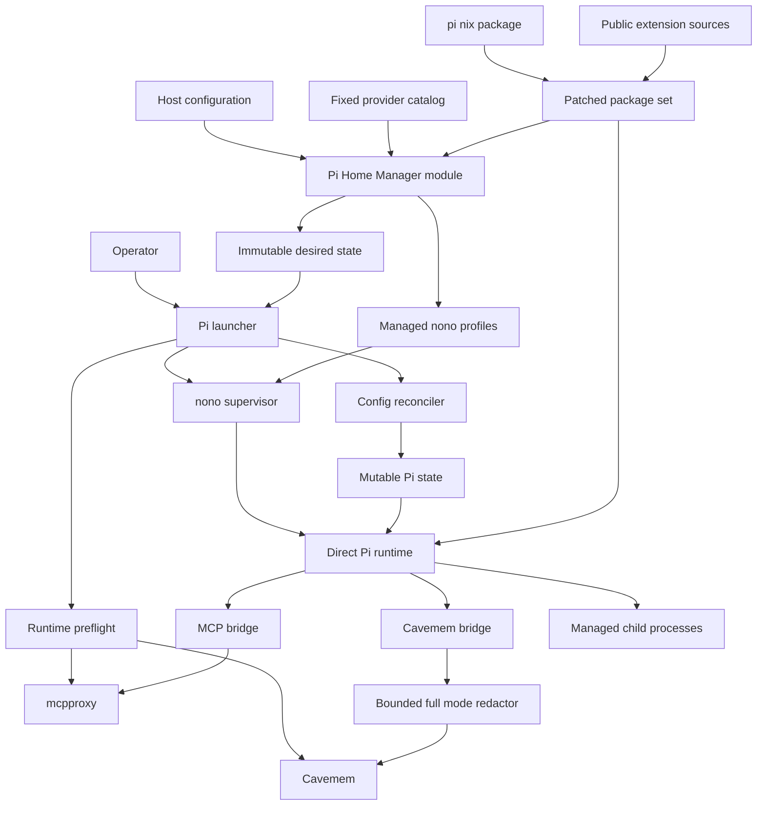
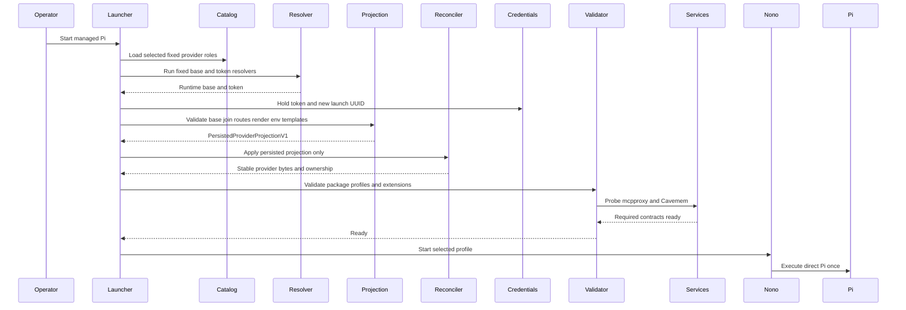
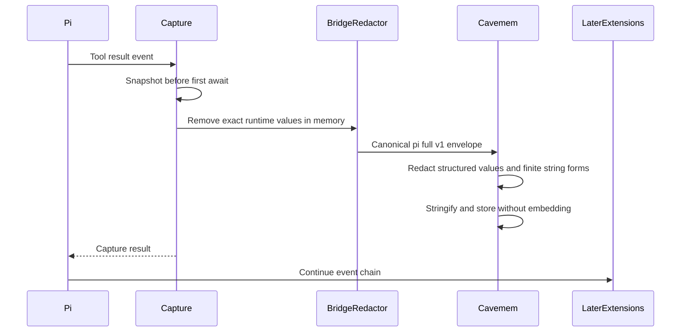

# Design Document

## Overview
This feature adds one direct, Nix-managed Pi runtime to each supported Mac while
preserving host-specific provider boundaries. The repository owns Pi's wrapper,
configuration reconciliation, sandbox profiles, extension surface, Cavemem
capture path, and acceptance evidence; existing mcpproxy and Cavemem storage
remain shared services.

### Goals
- Provide the same managed Pi command and required extension baseline on both
  hosts.
- Keep declarative configuration authoritative without replacing unrelated Pi
  state.
- Fail before the TUI when provider, sandbox, MCP, Cavemem, or extension
  prerequisites are invalid.
- Keep provider credentials out of model-invoked subprocess environments.
- Make sandbox, child-process, and full-payload capture behavior testable.

### Non-Goals
- Sieve or another output compressor.
- Exact `devx pi` package, migration, telemetry, or update behavior.
- Cohere or Perplexity provider support.
- A private Shopify extension or direct Shopify Tool Gateway connection.
- A generic wrapper framework shared with OpenCode.
- Cross-host Pi state synchronization or non-Darwin support.

## Boundary Commitments

### This Spec Owns
- The patched Pi package derived from the pinned `pi.nix` package output.
- The fixed-lock public extension closure and repository-owned Pi extensions.
- The `programs.pi-agent` option surface and both host configurations.
- The closed personal and Shopify provider-role catalog, resolver catalog, and
  generated request policies.
- Immutable desired-state rendering and launch-time mutable-state reconciliation.
- Provider preflight, direct Pi launch, status, validation, and rollout controls.
- Standalone Pi nono profiles adapted from the pinned public Pi pack.
- Pi-to-mcpproxy and Pi-to-Cavemem client contracts.
- The opt-in Cavemem `pi-full-v1` hook mode and its compatibility tests.
- Pi-specific package, render, security, and runtime acceptance checks.

### Out of Boundary
- mcpproxy upstream registration, daemon lifecycle, secret bridge, and routing
  implementation.
- Cavemem database schema, MCP tools, existing OpenCode bridge behavior, and
  default hook compression behavior.
- OpenCode package, wrapper, profiles, plugins, and host settings.
- Upstream extension feature development beyond scoped compatibility and safety
  patches required by these requirements.
- Private Shopify source, provider parity features, Sieve, and optional
  `shop-pi-fy` resources.
- Arbitrary provider endpoints, header maps, credential commands, model metadata,
  extension ecosystems, or parsing of embedded JSON, YAML, shell, and source
  text for secrets.

### Allowed Dependencies
- `pi.nix` as the pinned base-package source; its mutable settings/model wrapper
  and jail are not used.
- Existing `pkgs.nono`, mcpproxy at the configured local endpoint, and the
  existing Cavemem package, data directory, and upstream server.
- The Shopify host's managed `devx` package only through the fixed
  `shopify-gateway-token` and `shopify-gateway-base` resolvers. Resolver argv is
  launcher-owned.
- The public extension pins recorded in `research.md` and Nix-managed language
  servers declared by the host.
- Existing Home Manager, overlay, flake-check, SOPS/Keychain, and agent-rule
  composition patterns.

### Revalidation Triggers
- A Pi or extension version changes its CLI, event, tool, settings, provider,
  session, child-process, or output-artifact contract.
- `pi.nix` changes its package output shape or starts mutating state in the base
  package.
- mcpproxy changes `/mcp/call`, its six approved tools, strict mutation
  validation, health endpoints, or authentication posture.
- Cavemem changes hook input, compression flags, privacy processing, storage
  schema, or uncompressed retrieval.
- nono changes profile schema, Darwin process signaling, environment filtering,
  network policy, or `--allow-cwd` semantics.
- Shopify or Pi changes a fixed route/API, built-in model catalog, resolver CLI,
  env-reference interpolation, exact header/template, projection schema, or
  concurrent provider-file semantics.
- The Pi Home Manager module exposes a new provider, header, URL, resolver, or
  user-supplied store-path surface.
- Cavemem changes the canonical envelope, sensitive-key normalization, private
  region syntax, finite string-rule vocabulary, uncompressed retrieval, or
  embedding eligibility.

## Architecture

### Existing Architecture Analysis
- Both hosts compose common/host Home Manager modules, pinned overlays, and flake checks.
- Pi follows OpenCode's preflight-to-nono pattern without sharing its wrapper.
- mcpproxy and Cavemem retain their existing endpoint, data, and ownership boundaries.

### Architecture Pattern & Boundary Map



**Architecture Integration**
- Selected pattern: hybrid package adoption with repository-owned runtime control.
- Dependency direction: external pins → packages → closed catalogs and typed
  host selection → immutable desired state → reconciliation/preflight →
  supervised Pi runtime → external services.
- Host modules provide values only; they do not import scripts or mutate state.
- Provider routes, header bindings, resolver argv, and rendered store roots flow
  from module-owned catalogs; hosts can only select compatible references.
- OpenCode patterns are reused as contracts, not shared implementation.

### Technology Stack

| Layer | Choice / Version | Role | Constraint |
|---|---|---|---|
| Agent CLI | Pi `0.83.0` from pinned `pi.nix` | Direct coding-agent runtime | Carry security and context-recovery patches |
| Package runtime | Node `>=22.19.0` | Pi and TypeScript extensions | One Pi runtime in the closure |
| Configuration | Home Manager and JSON | Closed provider selections and desired state | Package references in, rendered paths out; no secrets |
| Reconciliation | Node ESM, JSON Schema, `proper-lockfile` | Atomic managed-key updates | Runtime only; provenance-aware |
| Sandbox | Existing nono package and Pi pack `0.2.0` policy | Darwin filesystem, network, and process boundary | Standalone rendered profiles |
| MCP | mcpproxy `0.52.1`, `pi-mcp-adapter@2.20.1` | Six direct tools over local HTTP | No ambient MCP config merge |
| Memory | Cavemem `0.2.1` plus scoped patches | Canonical capture, bounded privacy, raw retrieval | Existing schema and MCP surface retained |
| Extensions | Pins in `research.md` | Required Pi capabilities | Fixed lock; no nested Pi dependencies |
| Native process | `node-pty@1.2.0-beta.14` | Interactive background tasks | Preserve Darwin ARM prebuild |

## File Structure Plan

### Directory Structure
```text
overlays/
├── pi-agent/
│   ├── default.nix                       # Patched Pi and extension packages
│   ├── pi-context-recovery.patch         # Upstream context-limit backport
│   ├── pi-undici-8.9.0.patch             # Production dependency remediation
│   ├── pi-package-lock.json              # Patched Pi dependency lock
│   └── extensions/
│       ├── package.json                  # Exact extension inventory
│       ├── package-lock.json             # Fixed extension closure
│       ├── cavemem.ts                    # First-loaded lifecycle bridge
│       ├── mcpproxy.ts                   # Isolated MCP adapter configuration
│       └── patches/                      # Scoped upstream extension patches
├── cavemem-pi-full-payload-v1.patch      # Opt-in full capture mode
├── cavemem-pi-full-privacy-v1.patch      # Bounded structured and lexical redaction
├── cavemem-pi-full-storage-policy-v1.patch # Raw retrieval and embedding exclusion
└── default.nix                           # Adds the Pi overlay

home-manager/common/pi-agent/
├── default.nix                           # Closed selectors and package references
├── managed-config.nix                    # Catalog and persisted provider projection
├── credential-policy.nix                 # Runtime secrets, resolvers, spawn boundaries
├── profiles.nix                          # Standalone Pi nono profile catalog
├── lsp-wrappers.nix                      # Package-backed scrubbed server launchers
├── instructions.md                       # Pi MCP, package, plan, and safety rules
└── guide.md                              # Operator setup, status, and rollback

scripts/
├── pi-agent-launcher.nix                 # Preflight and supervised execution
├── pi-agent-reconcile.mjs                # Managed JSON transaction
├── pi-agent-reconcile.nix                # Reconciler package
├── pi-agent-shell.nix                    # Credential-scrubbed command shell
├── pi-agent-status.nix                   # Redacted machine and human status
├── pi-agent-validate.nix                 # Runtime compatibility validation
└── cavemem-smoke-test.nix                # Legacy and full-mode capture checks

configurations/personal/home-manager/
└── pi-agent.nix                          # Personal OpenAI selection and default

configurations/shopify/home-manager/
└── pi-agent.nix                          # Shopify role selection and default

tests/pi-agent/
├── package.test.mjs                      # Package, patches, licenses, PTY
├── module-contract.test.mjs              # Closed options and forbidden surfaces
├── reconcile.test.mjs                    # Ownership, drift, and concurrency
├── launcher.test.mjs                     # States, preflight, and fail-closed launch
├── extensions.test.mjs                   # Inventory, tools, plan, LSP, background
├── cavemem.test.mjs                      # Canonical write mode and legacy parity
├── cavemem-privacy.test.mjs              # Leak, false-positive, and bound corpus
├── cavemem-storage.test.mjs              # Raw retrieval and embedding policy
├── hm-render.test.mjs                    # Both host render contracts
├── runtime-personal.test.mjs             # Personal runtime smoke path
├── runtime-shopify.test.mjs              # Shopify stub and live-gate path
├── fixtures/                             # Fake providers and process probes
├── package.json                          # Node test entrypoints
└── run.js                                # Flake-check runner
```

### Modified Files
- `flake.nix` and `flake.lock` — add the pinned `pi-nix` input and Pi checks.
- `overlays/mcp-servers.nix` — apply the scoped Cavemem payload, privacy, and
  storage-policy patches in order.
- `home-manager/common/default.nix` — import the Pi module.
- `configurations/personal/home-manager/default.nix` — import personal Pi values.
- `configurations/shopify/home-manager/default.nix` — import Shopify Pi values.

No Pi production component writes outside the paths listed above and Pi's
existing mutable agent directory.

## System Flows

### Managed Launch


The projection writes `${SHOPIFY_PI_TOKEN}` and `${PI_AGENT_LAUNCH_ID}` templates,
never their values. For equal generation and validated base, concurrent launches
produce byte-identical provider JSON and the second locked reconcile is a no-op;
their root/child Pi environments still contain distinct token and UUID values.

### Tool Capture


Full mode applies no application-level payload cap. SQLite accepts one complete
redacted row up to its active maximum value length; larger, malformed, or
storage-failed events produce no partial observation and surface a sticky Pi
capture error.

### Sandbox Selection
`PI_NONO` selects `disabled`, `audit`, or `enforced`; `PI_NONO_PROFILE` selects
the managed profile. Review appends its read-only tool ceiling after user args.

## Requirements Traceability

| Requirement IDs | Summary | Components | Contracts / Flows |
|---|---|---|---|
| 1.1, 1.2, 1.3, 1.4, 1.5, 1.6 | Declarative two-host Pi | Package Set, Home Module, Runtime Control | Package manifest, Managed Launch |
| 2.1, 2.2, 2.3, 2.4, 2.5, 2.6, 2.7 | Managed state coexistence | Home Module, Reconciler | ManagedConfigV1, PersistedProviderProjectionV1, OwnershipStateV1 |
| 3.1, 3.2, 3.3, 3.4, 3.5, 3.6, 3.7 | Host providers | Provider Composition, Credential Boundary, Runtime Control | ProviderCatalogV1, ProviderRequestPolicyV1, PersistedProviderV1, ProviderRuntimeSecretsV1, Managed Launch |
| 4.1, 4.2, 4.3, 4.4, 4.5 | Preflight and status | Runtime Control, Acceptance Harness | StatusV1, Error Strategy |
| 5.1, 5.2, 5.3, 5.4, 5.5, 5.6, 5.7, 5.8, 5.9 | nono profiles | Sandbox Catalog, Runtime Control | SandboxSelection, Sandbox State |
| 6.1, 6.2, 6.3, 6.4, 6.5, 6.6 | Sole MCP entrypoint | MCP Bridge, Runtime Control | MCP config contract, Managed Launch |
| 7.1, 7.2, 7.3, 7.4, 7.5, 7.6 | Extension inventory | Package Set, Extension Runtime | ExtensionManifestV1 |
| 8.1, 8.2, 8.3, 8.4, 8.5, 8.6, 8.7 | Sub-agents | Extension Runtime, Sandbox Catalog | ChildPolicyV1 |
| 9.1, 9.2, 9.3, 9.4, 9.5, 9.6 | Plan mode | Extension Runtime, Sandbox Catalog | SandboxSelection, Sandbox State |
| 10.1, 10.2, 10.3, 10.4, 10.5, 10.6, 10.7, 10.8, 10.9, 10.10, 10.11 | Cavemem capture | Capture Bridge, Cavemem Full Mode | PiFullToolObservationV1, PiFullPrivacyPolicyV1, Tool Capture |
| 11.1, 11.2, 11.3, 11.4, 11.5, 11.6, 11.7 | Session aids | Extension Runtime | ExtensionManifestV1 |
| 12.1, 12.2, 12.3, 12.4, 12.5, 12.6 | Code intelligence | Extension Runtime, Sandbox Catalog | ExtensionManifestV1, SandboxSelection |
| 13.1, 13.2, 13.3, 13.4, 13.5, 13.6, 13.7 | Background tasks | Extension Runtime, Sandbox Catalog | ChildPolicyV1, SandboxSelection |
| 14.1, 14.2, 14.3, 14.4, 14.5 | Credential isolation | Provider Composition, Credential Boundary, Capture Bridge, Cavemem Full Mode | PersistedProviderV1, ProviderRuntimeSecretsV1, CredentialBoundaryV1, PiFullPrivacyPolicyV1 |
| 15.1, 15.2, 15.3, 15.4, 15.5, 15.6, 15.7 | Release gates | Package Set, Acceptance Harness | ValidationReportV1 |

## Components and Interfaces

| Component | Domain | Intent | Requirement Coverage | Critical Dependencies | Contracts |
|---|---|---|---|---|---|
| Package Set | Build | Produce patched Pi and one extension closure | 1, 7, 15 | pi.nix P0, npm pins P0 | State |
| Home Module | Configuration | Render closed provider plans and package-backed artifacts | 1, 2, 4, 5, 7 | Home Manager P0 | State |
| Runtime Control | Launch | Reconcile persisted projection, validate, and execute Pi | 2, 3, 4, 5, 14 | Provider P0, nono P0 | Service, State |
| Provider Composition | Integration | Own the exact catalog and generation-stable projection | 3, 14 | devx P0 on Shopify | Service, State |
| Credential Boundary | Security | Own per-launch values and scrub non-provider spawns | 3, 14 | Provider Composition P0 | Service, State |
| Sandbox Catalog | Security | Define OS profiles and Pi tool ceilings | 5, 8, 9, 12, 13 | nono P0 | State |
| MCP Bridge | Integration | Expose six governed mcpproxy tools | 6 | mcpproxy P0, adapter P0 | Service |
| Extension Runtime | Agent | Supply required tools and controlled subprocesses | 7, 8, 9, 11, 12, 13, 14 | Extension bundle P0 | Service, State |
| Capture Bridge | Memory | Snapshot events and remove exact runtime values before transport | 8, 10, 14 | Cavemem P0 | Event, Batch, State |
| Cavemem Full Mode | Memory | Apply bounded privacy and uncompressed storage policy | 10, 14 | Canonical envelope P0 | Batch, State |
| Acceptance Harness | Validation | Prove package, host, runtime, and security contracts | 4, 15 | Both host outputs P0 | Batch |

### Build and Configuration

#### Package Set

| Field | Detail |
|---|---|
| Intent | Produce immutable, auditable Pi runtime inputs |
| Requirements | 1.1, 1.2, 1.5, 1.6, 7.2, 7.4, 7.5, 15.1, 15.2, 15.6 |

**Responsibilities & Constraints**
- Consume `inputs.pi-nix.packages.${system}.coding-agent` without importing its
  Home Manager wrapper.
- Apply the `undici >=8.9.0` dependency lock and complete upstream context-limit
  recovery patch; run their focused upstream tests.
- Build one exact extension dependency closure with the pins from `research.md`,
  the Darwin ARM PTY prebuild, and all license notices.
- Reject a nested `@earendil-works` Pi runtime in extension dependencies.
- Publish an immutable manifest mapping logical extension names to entry paths
  and versions.

**Dependencies**
- External P0: pinned `pi.nix`, npm sources, upstream Pi patch provenance.
- Outbound P0: Home Module and Runtime Control consume package paths only.

**Contracts**: State.

```typescript
interface ExtensionManifestV1 {
  readonly schemaVersion: 1; readonly piVersion: string;
  readonly extensions: Readonly<Record<string, {
    readonly version: string; readonly entryPath: string; readonly license: string;
  }>>;
}
```

The package check rejects missing entries, mutable source references, nested Pi
runtimes, missing license texts, wrong `undici`, or absent recovery markers.

#### Home Module

| Field | Detail |
|---|---|
| Intent | Convert typed common and host values into secret-free artifacts |
| Requirements | 1.1–1.6, 2.1, 2.6, 2.7, 4.4, 5.1, 7.1, 7.2 |

**Responsibilities & Constraints**
- Define `programs.pi-agent` with typed package, state, closed provider
  selection, MCP, sandbox, extension, sub-agent, plan, timeout, LSP, resource,
  and security options.
- Let personal hosts select a default from Pi's built-in OpenAI catalog. Let
  Shopify hosts enable only the fixed five role IDs and select a default model
  that resolves through an enabled role.
- Accept packages as Nix derivations. Extension entries, manifests,
  instructions, resources, and LSP executables pair a package with a canonical
  relative path; the module alone renders complete `/nix/store` paths.
- Render `ManagedConfigV1`, three standalone profiles, composed instructions,
  package metadata, and absolute output paths.
- Enforce closed submodules, finite enums, unique role references, canonical
  relative path segments, and host/default compatibility. Do not parse URLs,
  command argv, arbitrary headers, store roots, or credential-shaped strings at
  evaluation time because those inputs do not exist in the public option surface.
- Disable telemetry, analytics, self-version checks, and unmanaged updates;
  compose Pi rules from common agent contracts without OpenCode-only commands.
- Represent any advisory exception as an ID, rationale, approver, and expiry;
  expired or incomplete exceptions fail evaluation.
- Add only repository-owned runtime commands to `home.packages`; activation
  never mutates Pi state.

**Dependencies**
- Inbound P0: common and host module values.
- Outbound P0: Runtime Control reads immutable rendered paths.
- External P1: existing mcpproxy and Cavemem option read-backs.

**Contracts**: State.

```typescript
type ShopifyProviderRole = "anthropic" | "openai" | "google" | "groq" | "xai";
type ProviderRole = "openai" | ShopifyProviderRole;
type NonEmptyReadonlyArray<T> = readonly [T, ...T[]];
type Opaque<T, Name extends string> = T & { readonly __type: Name };
type NixPackage = Opaque<object, "NixPackage">;
type CanonicalRelativePath = Opaque<string, "CanonicalRelativePath">;
type RenderedStorePath = Opaque<string, "RenderedStorePath">;
interface ModelRef { readonly provider: ProviderRole; readonly modelId: string; }
interface PackageResourceRef { readonly package: NixPackage; readonly relativePath: CanonicalRelativePath; }

type HostProviderSelection =
  | { readonly mode: "personal";
      readonly defaultModel: ModelRef & { readonly provider: "openai" } }
  | {
      readonly mode: "shopify-gateway";
      readonly enabledRoles: NonEmptyReadonlyArray<ShopifyProviderRole>;
      readonly defaultModel: ModelRef;
    };

interface ManagedSettingsV1 {
  readonly defaultModel: ModelRef;
  readonly defaultThinkingLevel: "off" | "minimal" | "low" | "medium" | "high" | "xhigh";
  readonly installTelemetry: false; readonly selfUpdate: false; readonly unmanagedPackages: false;
}

interface ManagedConfigV1 {
  readonly schemaVersion: 1;
  readonly generation: string;
  readonly agentDir: string;
  readonly settings: ManagedSettingsV1;
  readonly providerCatalog: ProviderCatalogV1;
  readonly providerSelection: HostProviderSelection;
  readonly extensionManifest: RenderedStorePath;
  readonly extensionOrder: readonly string[];
  readonly instructionResources: readonly RenderedStorePath[];
  readonly lspExecutables: Readonly<Record<string, RenderedStorePath>>;
  readonly mcpEndpoint: string;
  readonly sandboxDefault: "disabled" | "audit" | "enforced";
}
```

`NixPackage`, `CanonicalRelativePath`, and `RenderedStorePath` denote Nix-native
package values, validated relative path segments, and module-generated outputs;
they are not interchangeable strings. `ManagedSettingsV1` contains only the
module-owned Pi keys, including the selected default and disabled update paths.

Validation layers remain independent:

| Layer | Correctness responsibility |
|---|---|
| Module evaluation | Structural types, closed enums, references, canonical relative paths, and cross-field compatibility |
| Generated-manifest validation | Schema, package membership, executable bits, extension order, catalog, selection, and persisted projection shape |
| Closure scans | Defense-in-depth checks for known sentinels, private source, and suspicious rendered literals |
| Launcher | Resolver availability, bounded output, concrete HTTPS gateway base, fixed-route joining, and auth conflicts |

Heuristic secret scans may reject suspicious generated output, but they are not
the correctness boundary. The closed option graph makes credential-bearing
provider URLs, headers, commands, and store roots unrepresentable before scans
run.

### Runtime Control

#### Reconciler and Launcher

| Field | Detail |
|---|---|
| Intent | Commit one managed generation and launch direct Pi once |
| Requirements | 2.1–2.7, 3.1–3.7, 4.1–4.5, 5.2, 5.5–5.8, 14.3–14.5 |

**Responsibilities & Constraints**
- Reject Pi package mutation commands and invalid launch overrides first.
- Dispatch only the catalog's fixed resolvers with launcher-owned argv and
  bounded timeouts; personal mode invokes none.
- Ask Provider Composition for `PersistedProviderProjectionV1` and Credential
  Boundary for `ProviderRuntimeSecretsV1`. Never pass runtime secrets to the
  reconciler or serialize them for rollback, status, or ownership.
- Hold one integration lock across provider materialization and JSON updates.
- Coordinate `settings.json` with Pi's `proper-lockfile`; update all managed JSON
  files by same-directory private temporary write, fsync, and atomic rename.
- Record each owned JSON pointer/provider, prior managed value hash, generation,
  and transaction state in `OwnershipStateV1`.
- Remove a stale value only when the current value still equals the prior
  managed value. Drift on an active managed provider or security key fails.
- Canonically sort persisted providers/keys and skip writes when bytes match.
  Concurrent same-generation projections with different joined URLs fail as
  `provider-projection-conflict` instead of overwriting each other.
- Validate generated manifests, package closure membership, provider
  materialization, extension, profile, MCP, Cavemem, and credential boundaries;
  then exec bare Pi through the selected nono profile exactly once.
- Expose the same checks through dry-run, status, and validation modes.

**Dependencies**
- Inbound P0: ManagedConfigV1, PersistedProviderProjectionV1, and Package Set.
- Outbound P0: nono and direct Pi executable.
- External P0: Shopify gateway in Shopify mode; mcpproxy and Cavemem on both.

**Contracts**: Service, State.

```typescript
interface OwnershipStateV1 {
  readonly schemaVersion: 1; readonly generation: string;
  readonly transaction: "committed" | "pending";
  readonly files: Readonly<Record<string, Readonly<Record<string,
    { readonly valueHash: string }>>>>;
}

type ReconcileResult =
  | { readonly ok: true; readonly generation: string; readonly changed: readonly string[] }
  | { readonly ok: false; readonly error: ReconcileError };

type ReconcileError =
  | { readonly kind: "invalid-json"; readonly path: string }
  | { readonly kind: "managed-drift"; readonly path: string; readonly pointer: string }
  | { readonly kind: "provider-projection-conflict"; readonly providerId: string }
  | { readonly kind: "lock-timeout"; readonly path: string }
  | { readonly kind: "write-failure"; readonly path: string };
```

`--managed-status` returns a redacted `StatusV1`; it never starts Pi.

```typescript
interface StatusV1 {
  readonly generation: string; readonly piVersion: string;
  readonly providerMode: "personal" | "shopify-gateway";
  readonly sandboxState: "disabled" | "audit" | "enforced"; readonly profile: string | null;
  readonly mcpEndpoint: string; readonly mcpReady: boolean;
  readonly cavememDataDir: string; readonly cavememReady: boolean;
  readonly extensions: Readonly<Record<string, string>>;
  readonly drift: readonly string[];
}
```

#### Provider Composition

| Field | Detail |
|---|---|
| Intent | Resolve host routing without crossing credential boundaries |
| Requirements | 3.1–3.7, 14.1–14.5 |

**Responsibilities & Constraints**
- `ProviderCatalogV1` is the only source of provider IDs, routes, APIs, model
  provenance, request policies, defaults, and unsupported-provider decisions.
- Personal emits no `models.json` provider override: Pi uses built-in OpenAI,
  Pi auth, and `openai/gpt-5.6-sol` at `xhigh`.
- Shopify host input selects catalog roles only. It cannot add or override URLs,
  model metadata, headers, policies, resolver behavior, or public literals.
- Validate the resolved base as HTTPS with no userinfo, query, or fragment; join
  fixed suffixes while retaining origin; reject auth precedence conflicts.
- Project catalog roles into generation-stable `PersistedProviderV1` objects.
  Per-launch token/UUID values belong only to Credential Boundary.

**Dependencies**
- External P0: `devx llm-gateway` in Shopify mode.
- Outbound P0: Runtime Control and Pi provider composer.
- Outbound P1: Credential scrubbers receive the exact sensitive-name set.

**Contracts**: Service, State.

```typescript
type ConcreteHttpsUrl = Opaque<string, "ConcreteHttpsUrl">;
type TokenEnvRef = { readonly kind: "environment-reference";
  readonly name: "SHOPIFY_PI_TOKEN"; readonly template: "${SHOPIFY_PI_TOKEN}" };
type LaunchEnvRef = { readonly kind: "environment-reference";
  readonly name: "PI_AGENT_LAUNCH_ID"; readonly template: "${PI_AGENT_LAUNCH_ID}" };
type AffinityHeadersV1 = readonly [
  { readonly name: "X-Shopify-Session-Affinity-Header"; readonly value: { readonly kind: "fixed-public-literal"; readonly value: "pi-agent-session-id" } },
  { readonly name: "pi-agent-session-id"; readonly value: LaunchEnvRef },
  { readonly name: "Shopify-Usage-Tag"; readonly value: { readonly kind: "fixed-public-literal"; readonly value: "pi-agent" } },
];
type GoogleHeadersV1 = readonly [...AffinityHeadersV1,
  { readonly name: "Authorization"; readonly value: { readonly kind: "bearer-environment-reference"; readonly name: "SHOPIFY_PI_TOKEN"; readonly template: "Bearer ${SHOPIFY_PI_TOKEN}" } }];
type ProviderRequestPolicyV1 =
  | { readonly kind: "personal-pi-auth-v1"; readonly credential: { readonly kind: "pi-auth" }; readonly headers: readonly [] }
  | { readonly kind: "shopify-standard-v1"; readonly credential: { readonly field: "apiKey"; readonly value: TokenEnvRef }; readonly headers: AffinityHeadersV1 }
  | { readonly kind: "shopify-google-bearer-v1"; readonly credential: { readonly field: "apiKey"; readonly value: TokenEnvRef }; readonly headers: GoogleHeadersV1 };

interface ProviderCatalogV1 {
  readonly schemaVersion: 1;
  readonly personal: { readonly role: "personal-openai"; readonly providerId: "openai";
    readonly api: "openai-responses"; readonly modelSource: "pi-0.83.0-built-in:openai";
    readonly modelOverrides: "none"; readonly requestPolicy: "personal-pi-auth-v1" };
  readonly shopify: readonly [
    ProviderCatalogEntryV1<"anthropic", "anthropic-api-v1", "anthropic-messages", "shopify-standard-v1">,
    ProviderCatalogEntryV1<"openai", "openai-vendor-v1", "openai-responses", "shopify-standard-v1">,
    ProviderCatalogEntryV1<"google", "google-vertex-global", "google-generative-ai", "shopify-google-bearer-v1">,
    ProviderCatalogEntryV1<"groq", "groq-openai-v1", "openai-completions", "shopify-standard-v1">,
    ProviderCatalogEntryV1<"xai", "xai-vendor-v1", "pi-per-model", "shopify-standard-v1">,
  ];
  readonly defaults: { readonly personal: ProviderDefaultV1; readonly shopify: ProviderDefaultV1 };
  readonly unsupported: readonly [
    { readonly providerId: "cohere"; readonly policy: "reject"; readonly reason: "no-pi-core-api" },
    { readonly providerId: "perplexity"; readonly policy: "reject"; readonly reason: "no-required-coding-tool-path" },
  ];
}
interface ProviderCatalogEntryV1<R extends ShopifyProviderRole, RR extends FixedRouteV1["role"], A extends CatalogApiV1, P extends "shopify-standard-v1" | "shopify-google-bearer-v1"> { readonly role: R; readonly providerId: R;
  readonly route: Extract<FixedRouteV1, { readonly role: RR }>; readonly api: A;
  readonly modelSource: `pi-0.83.0-built-in:${R}`; readonly modelOverrides: "none";
  readonly requestPolicy: P; }
type ProviderDefaultV1 = { readonly model: "openai/gpt-5.6-sol"; readonly reasoning: "xhigh" };
type ProviderDefaultSelectionV1 = { readonly model: ModelRef; readonly reasoning: ManagedSettingsV1["defaultThinkingLevel"] };
type CatalogApiV1 = "anthropic-messages" | "openai-responses" | "google-generative-ai" | "openai-completions" | "pi-per-model";
type FixedRouteV1 =
  | { readonly owner: "pi-agent-module"; readonly role: "anthropic-api-v1"; readonly suffix: "/apis/anthropic/v1" } | { readonly owner: "pi-agent-module"; readonly role: "openai-vendor-v1"; readonly suffix: "/vendors/openai/v1" }
  | { readonly owner: "pi-agent-module"; readonly role: "google-vertex-global"; readonly suffix: "/vendors/googlevertexai-global/v1beta1/projects/shopify-ml-production/locations/global/publishers/google" } | { readonly owner: "pi-agent-module"; readonly role: "groq-openai-v1"; readonly suffix: "/vendors/groq/openai/v1" } | { readonly owner: "pi-agent-module"; readonly role: "xai-vendor-v1"; readonly suffix: "/vendors/xai/v1" };

type PersistedApiFor<R extends ShopifyProviderRole> =
  R extends "anthropic" ? { readonly kind: "provider-api"; readonly value: "anthropic-messages" } : R extends "openai" ? { readonly kind: "provider-api"; readonly value: "openai-responses" } :
  R extends "google" ? { readonly kind: "provider-api"; readonly value: "google-generative-ai" } : R extends "groq" ? { readonly kind: "provider-api"; readonly value: "openai-completions" } :
  { readonly kind: "pi-per-model-api"; readonly providerApiField: "omit" };
type PersistedProviderV1 = { [R in ShopifyProviderRole]: {
  readonly providerId: R; readonly catalogRole: R; readonly baseUrl: ConcreteHttpsUrl; readonly api: PersistedApiFor<R>;
  readonly modelCatalog: { readonly source: `pi-0.83.0-built-in:${R}`; readonly overrides: readonly [] };
  readonly credential: { readonly field: "apiKey"; readonly value: TokenEnvRef };
  readonly headers: R extends "google" ? GoogleHeadersV1 : AffinityHeadersV1;
} }[ShopifyProviderRole];
type PersistedProviderProjectionV1 =
  | { readonly schemaVersion: 1; readonly generation: string; readonly mode: "personal";
      readonly default: ProviderDefaultSelectionV1; readonly providers: readonly [] }
  | { readonly schemaVersion: 1; readonly generation: string; readonly mode: "shopify-gateway";
      readonly default: ProviderDefaultSelectionV1; readonly providers: readonly PersistedProviderV1[] };
```

| Role | Provider ID | Module-owned route role / suffix | Pi API | Built-in model policy | Request policy |
|---|---|---|---|---|---|
| Personal OpenAI | `openai` | No override | `openai-responses` | `pi-0.83.0-built-in:openai`; no overrides | `personal-pi-auth-v1` |
| Anthropic | `anthropic` | `anthropic-api-v1` / `/apis/anthropic/v1` | `anthropic-messages` | Built-in Anthropic; no overrides | `shopify-standard-v1` |
| OpenAI | `openai` | `openai-vendor-v1` / `/vendors/openai/v1` | `openai-responses` | Built-in OpenAI; no overrides | `shopify-standard-v1` |
| Google | `google` | `google-vertex-global` / `/vendors/googlevertexai-global/v1beta1/projects/shopify-ml-production/locations/global/publishers/google` | `google-generative-ai` | Built-in Google; no overrides | `shopify-google-bearer-v1` |
| Groq | `groq` | `groq-openai-v1` / `/vendors/groq/openai/v1` | `openai-completions` | Built-in Groq; no overrides | `shopify-standard-v1` |
| xAI | `xai` | `xai-vendor-v1` / `/vendors/xai/v1` | Omit provider API | Built-in xAI; preserve every model's Pi API; no overrides | `shopify-standard-v1` |

The renderer writes selected rows to managed `models.json` in catalog order.
`modelCatalog` is validation provenance and emits no model override; provider
objects contain joined URLs, finite API fields, public literals, and exact env
templates only. Pi expands both refs at request time; token/UUID values are forbidden.

#### Credential Boundary

| Field | Detail |
|---|---|
| Intent | Give provider-capable Pi processes credentials without leaking them to tools |
| Requirements | 3.5, 3.6, 3.7, 14.1–14.5 |

**Responsibilities & Constraints**
- `credential-policy.nix` is the sole source of resolver dispatch, generated
  environment names, `ProviderRuntimeSecretsV1`, exact-redaction values, and
  spawn-boundary mappings.
- `pi-auth` leaves resolution to Pi and has no executable. Shopify uses exactly
  `shopify-gateway-token` and `shopify-gateway-base`; both reference the managed
  gateway package, while the launcher derives fixed argv from resolver kind.
- Host configuration cannot provide environment source names, executable paths,
  argv, shell fragments, or resolver extensions.
- The token resolver returns one bounded value; each launch generates a fresh
  UUID. Only root and foreground child Pi receive `SHOPIFY_PI_TOKEN` and
  `PI_AGENT_LAUNCH_ID`; Pi expands persisted templates against that process env.
- Every non-provider process uses the policy's `scrubbedEnvironment` result,
  built from an allowlist plus removal of all declared and standard provider
  credential names.
- Status and errors report source kind/name only. Exact resolved values are
  registered with the Capture Bridge in memory before provider use and are
  never serialized into Cavemem input, argv, files, logs, or child environments.
- `ProviderRuntimeSecretsV1` is never reconciler input and has no JSON encoder,
  ownership entry, status representation, or persisted rollback form.

**Dependencies**
- Inbound P0: HostProviderSelection and resolver outputs.
- Outbound P0: Runtime Control, Extension Runtime, and Capture Bridge spawn sites.
- External P0: managed Shopify `devx` package in Shopify mode.

**Contracts**: Service, State.

```typescript
type ResolverPlan =
  | { readonly kind: "pi-auth" }
  | { readonly kind: "shopify-gateway-token"; readonly executable: RenderedStorePath }
  | { readonly kind: "shopify-gateway-base"; readonly executable: RenderedStorePath };
type InMemorySecretSet = Opaque<object, "InMemorySecretSet">;
type RuntimeToken = Opaque<string, "RuntimeToken">;
type RuntimeLaunchUuid = Opaque<string, "RuntimeLaunchUuid">;

type ProviderRuntimeSecretsV1 =
  | { readonly mode: "personal"; readonly rootPiEnvironment: Readonly<Record<never, never>>;
      readonly childPiEnvironment: Readonly<Record<never, never>>; readonly exactRedactionValues: InMemorySecretSet }
  | { readonly mode: "shopify-gateway"; readonly token: RuntimeToken; readonly launchId: RuntimeLaunchUuid;
      readonly rootPiEnvironment: Readonly<{ SHOPIFY_PI_TOKEN: RuntimeToken; PI_AGENT_LAUNCH_ID: RuntimeLaunchUuid }>;
      readonly childPiEnvironment: Readonly<{ SHOPIFY_PI_TOKEN: RuntimeToken; PI_AGENT_LAUNCH_ID: RuntimeLaunchUuid }>;
      readonly exactRedactionValues: InMemorySecretSet };

interface CredentialBoundaryV1 {
  readonly resolvers: readonly ResolverPlan[];
  readonly runtime: ProviderRuntimeSecretsV1;
  readonly scrubbedEnvironment: Readonly<Record<string, string>>;
  readonly sensitiveNames: readonly string[];
}
```

| Resolver kind | Launcher-owned argv |
|---|---|
| `pi-auth` | None; Pi reads its authentication state |
| `shopify-gateway-token` | `<managed-devx>/bin/devx llm-gateway print-token --key` |
| `shopify-gateway-base` | `<managed-devx>/bin/devx llm-gateway print-token --base` |

The resolver union contains no argv field, and the executable is a module output
derived from a package plus the fixed `bin/devx` relative path.

| Spawn site | Environment owner | Credential result |
|---|---|---|
| Root Pi | Launcher | Declared provider values only |
| Foreground child Pi | Patched sub-agent spawn | Same provider contract as parent |
| Built-in Bash | `pi-agent-shell` through Pi `shellPath` | Scrubbed |
| Background pipe and PTY | Patched background extension | Scrubbed |
| Language server | Managed LSP wrapper and patched spawn | Scrubbed |
| Cavemem hook and worker | Cavemem bridge explicit environment | Scrubbed |
| Status and validator probes | Owning script | Scrubbed and redacted |

The blocked review bypasses are impossible at the public boundary: there is no
arbitrary `X-ApiKey` literal/header map, `runtimeBasePath` query, `baseUrl`
secret path, command argv, or user-supplied `/nix/store` root. Adding any such
field is an unknown-option error rather than a value that a scanner must judge.

### Security and Integration

#### Sandbox Catalog

| Field | Detail |
|---|---|
| Intent | Pair OS isolation with an explicit model tool ceiling |
| Requirements | 5.1–5.9, 8.4, 8.7, 9.1–9.6, 12.4, 12.6, 13.6, 13.7 |

**Responsibilities & Constraints**
- Render `pi-managed`, `pi-audit`, and `pi-review` as standalone profiles
  derived from the pinned public policy; runtime pack installation is absent.
- Exclude git config, credential, LaunchServices, profile-draft, and package
  wiring grants. Deny sensitive credential directories explicitly.
- Grant Pi/Cavemem state, private temp, immutable closures, current workspace,
  required caches, local mcpproxy port 8080, and same-sandbox process signaling.
- Managed uses provider-host allowlisting when validated. Audit permits outbound
  network for compatibility diagnosis. Review makes the workspace read-only.
- `PI_NONO=disabled|audit|enforced` and `PI_NONO_PROFILE` are one-launch
  overrides. Unknown values and missing profiles fail closed.
- `PI_NONO_LISTEN_PORTS` admits only validated explicit numeric ports for one
  launch. No wildcard listen range exists.
- Review appends a managed Pi allowlist after user arguments. Plan mode defaults
  to `read`, `grep`, `find`, and `ls`; it excludes every execution or mutation
  extension tool.
- Before sandbox launch, resolve the profile with
  `nono profile show <name> --json --silent`, parse it, and run strict profile
  validation. An unreadable or unparseable resolved profile fails closed.
- Check resolved grants against `SandboxGrantContractV1`; do not infer readiness
  from profile source text.

**Dependencies**
- External P0: resolved nono package and current profile schema.
- Inbound P0: Home Module profile values and Runtime Control selection.
- Outbound P0: Pi runtime and every child process remain in one sandbox tree.

**Contracts**: State.

```typescript
interface SandboxSelection {
  readonly state: "disabled" | "audit" | "enforced";
  readonly profile: "pi-managed" | "pi-audit" | "pi-review" | null;
  readonly listenPorts: readonly number[]; readonly piTools: readonly string[] | null;
}

interface SandboxGrantContractV1 {
  readonly mcpPort: 8080; readonly providerHost: string | null;
  readonly agentDirAccess: "readwrite"; readonly cavememDirAccess: "readwrite";
  readonly tempDirAccess: "readwrite";
  readonly workspaceAccess: "read" | "readwrite";
  readonly processMode: "isolated" | "allow_same_sandbox";
  readonly requiredEnvironmentNames: readonly string[];
}
```

Grant validation requires port 8080, the resolved provider host or unrestricted
audit egress, declared agent/Cavemem/temp/workspace access, readable package and
extension closures, admitted root-Pi environment names, and same-sandbox process
control whenever sub-agents, LSP, or background tasks are enabled. Review
requires read-only workspace access and no execution tools.

Sandbox execution is exactly:

```text
NONO_NO_SAVE_PROMPT=1 nono run --profile <resolved-profile> --allow-cwd -- <bare-pi> <user-args> <managed-final-args>
```

`<managed-final-args>` contains the review tool ceiling when selected, so user
arguments cannot restore excluded tools. Disabled state executes `<bare-pi>`
once without nono only after the explicit state override is reported.

nono enforces filesystem, network, initial environment, process inspection, and
signals. Pi configuration enforces tool visibility, sub-agent parameters, and
plan/review transitions. Neither layer claims the other's controls.

#### MCP Bridge

| Field | Detail |
|---|---|
| Intent | Expose one deterministic mcpproxy client surface |
| Requirements | 4.1, 4.2, 6.1–6.6, 9.2 |

**Responsibilities & Constraints**
- Load only the repository-owned wrapper around `createMcpAdapter`; do not load
  the adapter's default extension or merge ambient MCP files.
- Connect eagerly to `http://127.0.0.1:8080/mcp/call` with authentication,
  resources, sampling, elicitation, script mode, and generic proxy disabled.
- Set no tool prefix and freeze these six direct tools:
  `retrieve_tools`, `describe_tool`, `call_tool_read`, `call_tool_write`,
  `call_tool_destructive`, and `read_cache`.
- Approval-gate write and destructive calls. Headless approval fails closed.
- Set `MCP_DIRECT_TOOLS` so cold-cache session start waits for metadata; invalidate
  only malformed or partial adapter-owned metadata.
- At agent start, reject any `mcp`, `mcpScript`, code-execution, duplicate,
  prefixed, or missing tool.

**Dependencies**
- External P0: mcpproxy health, ready, admin status, and `/mcp/call` contracts.
- Inbound P0: Runtime Control preflight and managed endpoint.
- Outbound P1: Pi agent instructions describe discover-then-invoke use.

**Contracts**: Service.

| Config field | Contract |
|---|---|
| Server name | `mcpproxy` only |
| Lifecycle | eager, no idle timeout |
| Tools | six-name include and direct allowlists |
| Approval | `call_tool_write`, `call_tool_destructive` |
| Cache | private agent-dir metadata, seven-day adapter TTL |
| Preflight | health, ready, mandatory upstream status, initialize, tools list |

#### Extension Runtime

| Field | Detail |
|---|---|
| Intent | Load the approved capabilities with bounded child processes |
| Requirements | 7.1–7.6, 8.1–8.7, 9.1–9.6, 11.1–11.7, 12.1–12.6, 13.1–13.7, 14.1, 14.2 |

**Responsibilities & Constraints**
- Launch Pi with ambient extension, skill, and prompt discovery disabled, then
  supply module-rendered entries from the closed manifest in this order:
  Cavemem, MCP, sub-agents, plan, timestamps, Bash timeout, ask-user, code
  intelligence, background tasks. Hosts cannot add arbitrary extensions.
- Configure sub-agent artifacts under the parent session and explicit child
  extensions. Ordinary children load Cavemem and provider resources; MCP is
  added only for agents declaring it.
- Preserve single, parallel, and chain semantics: parallel failures remain
  independent, and each chain step receives only its declared predecessor
  output. Child tools, model budget, workspace, depth, and extension list come
  from the selected managed agent definition.
- Patch sub-agents to reject async/detached/scheduled runs, prevent recursive
  controller loading, create foreground process groups, and escalate group
  termination on cancel or parent shutdown.
- Configure plan mode with only read-only built-ins and its interaction tools.
  Plan completion requires operator approval and restores the captured prior
  tool set. Planning/approved state persists in the Pi session across resume.
- Apply a default Bash timeout only when omitted and preserve explicit values.
- Patch LSP and background spawn paths to use an exact scrubbed environment.
  Language-server options are package plus canonical relative executable path;
  the module renders the executable, and refactor apply remains separate from
  preview.
- Expose code orientation, resolution, inspection, graph, find, health, and
  refactor-plan/apply contracts. Server failure disables only that server and
  reports its executable and error.
- Require background pipe and PTY modes to expose bounded logs and group cleanup
  on task termination and session shutdown. Each task has a stable ID plus
  status, logs, wait, input, attach, detach, signal, and kill operations.
- Keep timestamp display entries outside model context. `ask_user` is available
  outside plan mode with single-choice, multiple-choice, and free-text forms;
  cancellation cancels the turn. Timestamp entries use the local timezone and
  persist in session state.

**Dependencies**
- Inbound P0: ExtensionManifestV1 and SandboxSelection.
- Outbound P0: Pi extension runner and child-process APIs.
- External P1: configured language servers and Darwin PTY prebuild.

**Contracts**: Service, State.

```typescript
interface ChildPolicyV1 {
  readonly allowAsync: false; readonly artifactDir: "session";
  readonly defaultExtensions: readonly string[]; readonly maxDepth: number;
  readonly termination: { readonly gracefulMs: number; readonly forcedMs: number };
}
```

Root and child Pi are trusted credential consumers. Bash, background, LSP,
Cavemem, status, and validation processes receive no provider credential value.
Trusted in-process extensions remain inside the root Pi trust boundary.

#### Capture Bridge

| Field | Detail |
|---|---|
| Intent | Snapshot ordered Pi events and remove exact runtime values before transport |
| Requirements | 8.6, 10.1–10.9, 14.1, 14.4, 14.5 |

**Responsibilities & Constraints**
- Load first and snapshot each event synchronously before the first `await`.
- Map session start, prompt input, tool completion/failure, assistant turn end,
  resume/fork, compaction barriers, and shutdown to existing Cavemem hooks.
- Use the Pi session UUID with `ide=pi`; compaction retains identity, resume
  reuses it, and fork creates a new ID.
- Replace every exact value in `CredentialBoundaryV1.exactRedactionValues`
  while the snapshot is still in bridge memory, then construct the closed
  `PiFullToolObservationV1`. Exact values never enter JSON, stdin, argv, files,
  logs, diagnostics, or the Cavemem process environment.
- Queue hooks FIFO and await the queue from event handlers. Startup and stdin
  use no-progress deadlines; shutdown waits for the active write. Ambiguous
  writes are not retried.
- Load the bridge in enabled children, emit bounded child attribution, and pass
  only the managed scrubbed environment to Cavemem.
- Surface nonzero, timeout, overflow, malformed, privacy, and storage failures
  as sticky value-free Pi errors.

**Contracts**: Event, Batch, State.

| Pi event | Cavemem action |
|---|---|
| `session_start` | `session-start` with stable Pi identity |
| `input` | `user-prompt-submit` before input transformation |
| `tool_result` | exact-redacted full-mode snapshot |
| `tool_execution_end` | fallback error when no result exists |
| `turn_end` | `stop` with visible assistant result |
| `session_before_compact` | FIFO flush barrier |
| `session_shutdown` | flush and `session-end`, except reload |

#### Cavemem Full Mode

| Field | Detail |
|---|---|
| Intent | Enforce bounded privacy, canonical serialization, and full-row storage policy |
| Requirements | 10.3, 10.6, 10.7, 10.9, 10.10, 10.11, 14.4, 14.5 |

The completed `pi-full-v1` write contract remains authoritative: transport,
envelope, and output objects are closed; unknown fields fail before insertion;
default-mode parsing and bytes are unchanged.

```typescript
interface PiFullToolObservationV1 {
  readonly schemaVersion: 1; readonly toolCallId: string; readonly toolName: string;
  readonly input: unknown;
  readonly output: {
    readonly content: unknown; readonly details: unknown; readonly isError: boolean;
    readonly usage?: Readonly<Record<string, number>>;
  };
}

interface PiFullPrivacyPolicyV1 {
  readonly structuredRule: "normalized-sensitive-object-keys-v1";
  readonly stringRules: readonly [
    "private-region-v1", "complete-authorization-v1", "known-provider-token-v1",
    "jwt-v1", "private-pem-v1", "url-authority-userinfo-v1",
  ];
  readonly malformedRegionPolicy: "redact-through-eof";
  readonly opaqueStringFormats: readonly ["json", "yaml", "shell", "source"];
}
```

**Redaction Boundary**
- Before stringify, recurse through envelope objects and arrays. Normalize object
  keys by ASCII lowercase plus removal of ASCII whitespace, `_`, `-`, and `.`;
  replace the complete value when the result is one of: `accesskey`,
  `accesskeyid`, `accesstoken`, `apikey`, `authtoken`, `authorization`,
  `clientsecret`, `credential`, `credentials`, `idtoken`, `passphrase`,
  `passwd`, `password`, `privatekey`, `proxyauthorization`, `refreshtoken`,
  `secret`, or `token`.
- Strip `<private>...</private>` regions. An unmatched opener redacts through
  end of string.
- Apply only the documented string rules: a complete trimmed Basic/Bearer value;
  `gh[pousr]_[A-Za-z0-9]{20,}`, `github_pat_[A-Za-z0-9_]{20,}`,
  `shpat_[A-Za-z0-9]{20,}`, `xox[baprs]-[A-Za-z0-9-]{20,}`,
  `glpat-[A-Za-z0-9_-]{20,}`, `sk-(proj-)?[A-Za-z0-9_-]{20,}`, and
  `AKIA[0-9A-Z]{16}`; three-segment JWTs; private-key PEM blocks; and URL
  authority userinfo at a lexical URL boundary. A malformed PEM opener redacts
  through end of string.
- Do not parse an arbitrary string leaf as embedded JSON, YAML, environment or
  shell assignment, or source code. Such content must arrive as structured
  objects to receive key recursion and otherwise remains byte-identical except
  for the finite string rules. This is the explicit false-positive boundary.
- Each scanner advances monotonically over the original string with fixed rule
  count and bounded lookahead. It never reparses replacements. Diagnostics name
  rule and structural location only and contain no source value.

**Storage Policy**
- Redaction and raw-storage behavior are separate implementation units. Storage
  accepts only a redacted canonical envelope, stringifies it once, and inserts
  one row with `compressed=0` and `intensity=NULL`.
- Full rows bypass expansion on every retrieval path and return the exact stored
  bytes. Missing-embedding selection, live embedding, backfill, and vector
  enumeration accept only `compressed=1`; stale vectors on full rows are removed.
- Full mode has no application payload cap. SQLite's active maximum value length
  is the boundary; overflow stores no partial row. FTS/BM25 remains available.
- No table, column, index, schema version, default hook, or default embedding
  behavior changes.

### Validation

#### Acceptance Harness

| Field | Detail |
|---|---|
| Intent | Produce repeatable evidence before host rollout |
| Requirements | 4.1–4.5, 15.1–15.7 |

**Responsibilities & Constraints**
- Separate pure package/render/unit checks from credential-bearing switched-host
  validation.
- Verify both host outputs and reject personal/Shopify provider leakage.
- Use deterministic fake providers, mcpproxy, Cavemem, nono, language servers,
  PTYs, and subprocess sentinels for hermetic behavior.
- Report each gate as pass, fail, or manual-required with package generation and
  version evidence.
- Keep live Shopify model/protocol tests outside publishable derivations.

**Contracts**: Batch.

`ValidationReportV1` records generation plus named `pass`, `fail`, or
`manual-required` gates with value-free evidence references.

## Data Models

### Managed State
- `ManagedConfigV1` is immutable, secret-free, and generation-addressed;
  `ProviderCatalogV1` and host selection contain only closed references.
- `PersistedProviderProjectionV1` is the reconciler's only provider input. It
  contains joined HTTPS URLs and templates, never token or UUID values.
- `OwnershipStateV1` is mutable, mode `0600`, and authoritative only for keys
  claimed by this integration.
- Existing Pi JSON remains the source of truth for every unclaimed key.
- Ownership commits after every target is atomically replaced. Pending state is
  checked before mutation; managed-provider drift fails, and unchanged stale
  values alone are removed.

### Runtime-Only State
- The resolved base is ephemeral until route joining. Token and launch UUID live
  only in `ProviderRuntimeSecretsV1` and root/child Pi process environments.
- `${PI_AGENT_LAUNCH_ID}` is persisted as an env-reference template, not a UUID;
  distinct concurrent process values therefore require no provider-file rewrite.
- Adapter metadata, extension settings, sub-agent artifacts, and background
  snapshots remain under the Pi agent/session directories with owner-only modes.

### Cavemem Observation State
- `PiFullToolObservationV1` uses existing storage with `compressed=0` and
  `intensity=NULL`; bridge and Cavemem redaction precede one stringify.
- No schema changes occur. Default rows remain compressed; full rows skip
  embedding and remain BM25/FTS searchable.

## Error Handling

| Category | Trigger | Response | Recovery |
|---|---|---|---|
| Input | Unknown role/field, duplicate role, invalid default reference, relative path, override, or port | Fail evaluation or exit before mutation | Print accepted enum or named reference |
| State | Invalid JSON, pending transaction, managed drift, or projection conflict | Preserve current files and exit | Repair state or stabilize the gateway base; rerun |
| Provider | Resolver timeout, invalid base/token, join, template expansion, or auth conflict | Exit before TUI without provider writes | Restore gateway/package or conflicting auth |
| Package | Invalid generated manifest, closure reference, patch, extension, license, PTY, or version | Block build or launch | Rebuild the managed generation |
| MCP | Health, upstream, handshake, cache, or direct-surface failure | Exit before TUI | Restart mcpproxy or repair declared upstream |
| Sandbox | Missing profile, validation failure, blocked prerequisite | Refuse unsandboxed fallback | Select valid profile or explicit documented rollback |
| Extension | Load failure or unexpected tool surface | Stop before accepting a prompt | Fix package/config and validate again |
| Capture privacy | Exact-value, canonical-envelope, private-region, or bounded-rule failure | Transport/store nothing; sticky value-free error | Repair bridge or redactor; retry the turn |
| Capture storage | SQLite value limit, retrieval-policy, embedding-policy, timeout, or write failure | No partial row; sticky value-free error | Reduce result or repair Cavemem |
| Child process | Cancellation or shutdown does not finish gracefully | Group TERM then group KILL | Report final process state and fail cleanup gate |

Errors use component, resolver/rule kind, safe path, and recovery action only.
Credential values, raw pre-redaction payloads, and materialized headers never
enter diagnostics, logs, or status output.

## Security Considerations
- The public extension bundle is trusted in-process code; only fixed reviewed
  sources enter the closure.
- Reconciliation assumes cooperative local `proper-lockfile` users. Crashes,
  stale-lock recovery, and detected compromise fail safely; external lock
  deletion or replacement before heartbeat detection is host compromise and is
  not a fencing guarantee provided by this integration.
- Shopify token and launch UUID reach root Pi and foreground child Pi only.
  Managed shell, PTY, LSP, and Cavemem spawn paths remove the exact sensitive
  variables. Sentinel tests scan process output, JSONL, logs, temp files, status,
  and nono audit data.
- `PersistedProviderV1` admits only joined URLs, finite metadata, public literals,
  and exact env templates. `ProviderRuntimeSecretsV1` cannot cross the reconciler
  type boundary; concurrent launch values never alter persisted bytes.
- mcpproxy admin/Keychain probes run before nono. No admin key, Keychain access,
  `~/.mcpproxy`, or `/usr/bin/security` enters Pi's sandbox.
- MCP write and destructive calls require adapter approval and mcpproxy strict
  server validation. Code execution and server-management tools are absent.
- The Capture Bridge removes exact runtime values before transport. Cavemem then
  applies normalized structured-key, private-region, and finite lexical rules;
  opaque JSON/YAML/shell/source strings receive no universal parsing.
- Personal configuration contains no Shopify role, resolver, endpoint, header,
  or credential binding. Closure scans cover both host outputs and publication.
- Review mode combines a read-only filesystem profile and a final Pi tool
  allowlist. Plan mode is a tool restriction, not an OS sandbox.

Residual accepted exposure:
- Trusted in-process Pi extensions can inspect root Pi environment and memory.
- Audit mode permits unrestricted egress.
- Managed mode writes the current repository and Pi/Cavemem state.
- Same-sandbox process signaling lets supervised sibling processes signal each
  other.
- A full redacted observation can approach SQLite's active maximum value length
  and is duplicated by FTS indexing.

## Performance and Limits
- Reconciliation performs one bounded transaction per launch and no activation
  mutation. Two cooperative concurrent launches serialize on one lock.
- Provider preflight dispatches two fixed bounded resolvers; no gateway operation
  can hang launch indefinitely.
- MCP cold-cache startup waits for six direct tool schemas before agent start.
- Cavemem serializes accepted events through a backpressured FIFO. Full rows skip
  embedding, use SQLite's active maximum value length, and are not subject to a
  total write deadline while the local hook process continues making progress.
- Privacy work is linear in payload size times a fixed rule count. Malformed
  private/PEM regions terminate at EOF without rescanning consumed text.
- Background output remains extension-bounded; session exit enforces process
  group cleanup.
- Database growth is operator-visible in managed status and runtime validation.

## Rollout and Migration
- Completed package Tasks 1.1–1.5 and canonical-envelope Task 3.1 remain valid.
  Blocked Task 2.1 and 3.2 partial implementations are replaced, not migrated or
  treated as contracts.
- Existing Pi settings, providers, auth, trust, package entries, and sessions are
  imported in place by preservation, not copied or rewritten wholesale.
- First activation installs immutable artifacts only. First launch runs
  reconciliation, records ownership, and starts in host-default audit mode.
- Promotion to enforced requires both-host render checks and host-local provider,
  MCP, Cavemem, PTY, LSP, sub-agent, and credential-sentinel validation.
- `PI_NONO=disabled pi` is the one-launch rollback. Disabling the module removes
  managed commands/artifacts on the next generation and leaves mutable Pi state.
- A Pi or extension upgrade changes pins and generation together; no runtime
  package update path exists.

## Testing Strategy

### Package and Unit Tests
- Assert patched Pi version, `undici >=8.9.0`, context-limit recovery behavior,
  extension pins, license texts, no nested Pi runtime, and Darwin PTY spawn.
- Exercise reconciler add/update/remove, user drift, invalid JSON, pending
  transaction recovery, file modes, and concurrent launches.
- Assert every `ProviderCatalogV1` row, route/API/model policy, exact header name,
  value-source kind/template, defaults, xAI per-model API, and unsupported role.
- Reject host-authored headers/URLs/models/argv/store roots. Validate package
  refs, fixed resolver argv, URL joining, projection shape, and auth conflicts.
- Validate standalone profile schema, profile deltas, state overrides, ports,
  review tool ceiling, and fail-closed selection.

### Integration Tests
- Render both Home Manager host outputs and inspect launcher, desired state,
  profiles, instructions, extension order, and secret-free closures.
- Run launcher stubs through disabled, audit, enforced, review, invalid,
  unavailable-service, and direct-exec paths; assert one bare Pi execution.
- Launch two concurrent Shopify fixtures with distinct token/UUID values; assert
  byte-identical persisted provider state, one no-op reconcile, distinct root Pi
  envs, and correct request-time apiKey/affinity/usage/Google bearer expansion.
- Start MCP with cold, stale, partial, malformed, and concurrent metadata caches;
  assert only six direct tools and approval behavior.
- Load all extensions together under Pi and verify timestamps, timeout,
  ask-user, plan enter/restore, LSP preview/apply gating, and background pipe/PTY
  lifecycle.
- Run single, parallel, and chained sub-agents; reject async mode, verify child
  extension ceilings and artifacts, then cancel and scan for orphan groups.
- Exercise Pi bridge prompts, successes, failures, parallel tools, resume, fork,
  compact, child attribution, later mutation, shutdown, and visible failures.
- Keep Task 3.1's closed-envelope and default-mode golden tests byte-identical.
  Test bounded privacy independently from exact raw retrieval, SQLite-limit
  rejection, compression flags, embedding exclusion, and stale-vector cleanup.

### Security Tests
- Inject token and UUID sentinels. Root/child requests expand templates correctly;
  managed files, ownership, Bash, PTY, LSP, Cavemem, status, logs, JSONL, and temp
  files contain neither actual value.
- Leak corpus: nested object/array sensitive keys, complete Basic/Bearer values,
  every documented provider token form, JWT, closed and malformed private/PEM
  regions, and lexical DNS/IPv4/bracketed-IPv6 URL userinfo. Bridge-only random
  short and long runtime values must be absent from stdin, DB, WAL, and errors.
- False-positive corpus: embedded JSON/YAML/shell/source strings, TypeScript
  declarations, ordinary prose and query parameters, path-adjacent URL-like
  text, and non-sensitive structured keys remain byte-identical. Run malformed
  inputs at scaled sizes under a timeout to verify monotonic bounds.
- Deny an MCP write/destructive call and assert zero upstream calls; approve once
  and assert exactly one. Reject a mutation routed through `call_tool_read`.
- Under nono, allow mcpproxy port 8080 and declared provider hosts while blocking
  unlisted ports, credential directories, Keychain, and workspace writes in
  review mode.
- Scan publishable closures for tokens, private Shopify source, mutable URLs,
  and missing license notices.

### End-to-End Acceptance
- Personal host: launch with a deterministic personal provider, complete one
  tool turn, query mcpproxy, capture/retrieve Cavemem events, delegate a child,
  use plan mode, start/stop a PTY task, and exit with no orphan process.
- Shopify host: validate gateway preflight and every managed provider/model API
  mode with text, tools, reasoning, affinity, token failure, and context-limit
  cases; repeat the common runtime path under audit and enforced profiles.
- Both hosts: `--managed-status` reports matching common extension versions and
  distinct provider modes without secrets.

Live Shopify tests emit redacted evidence; hermetic flake checks use fakes and no corporate credentials.
