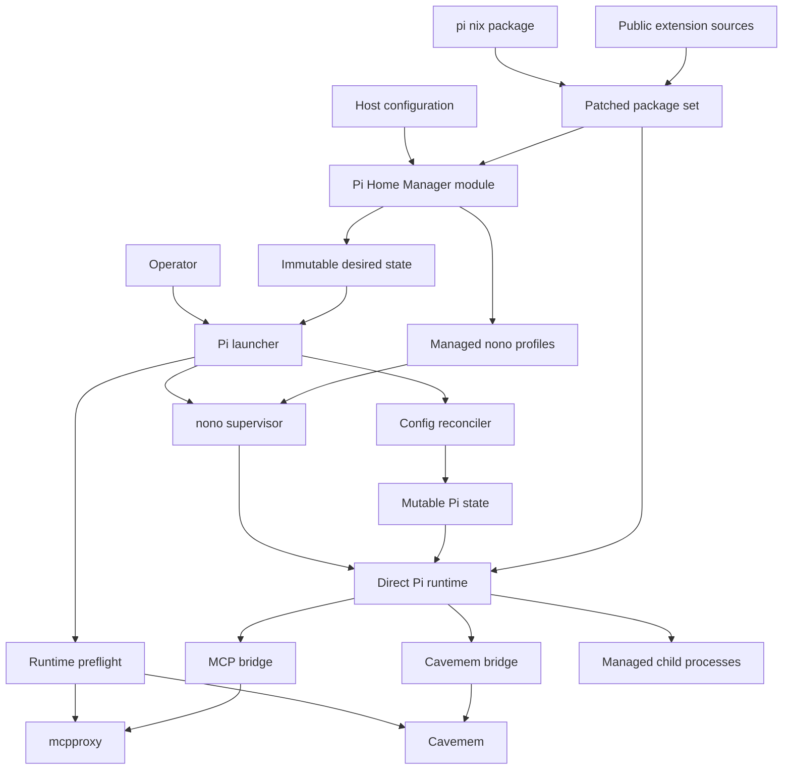
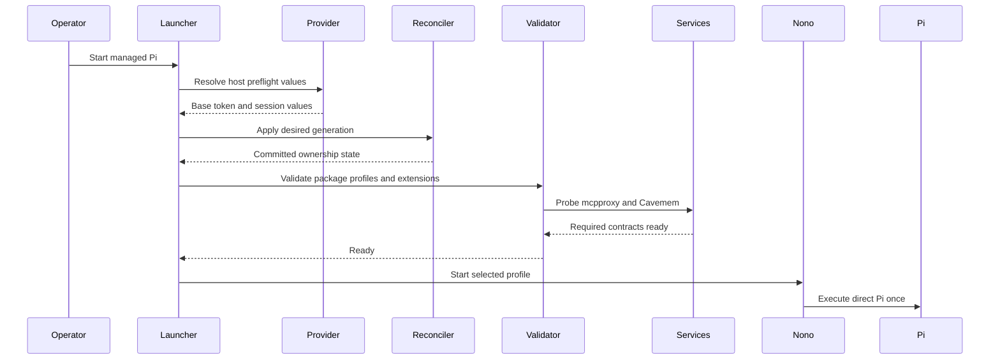
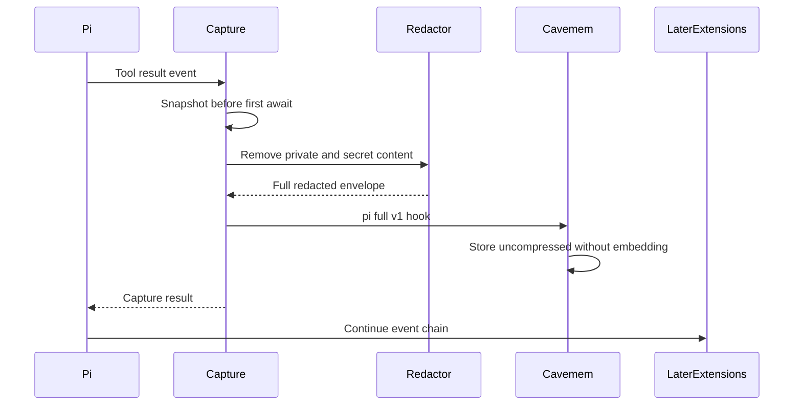
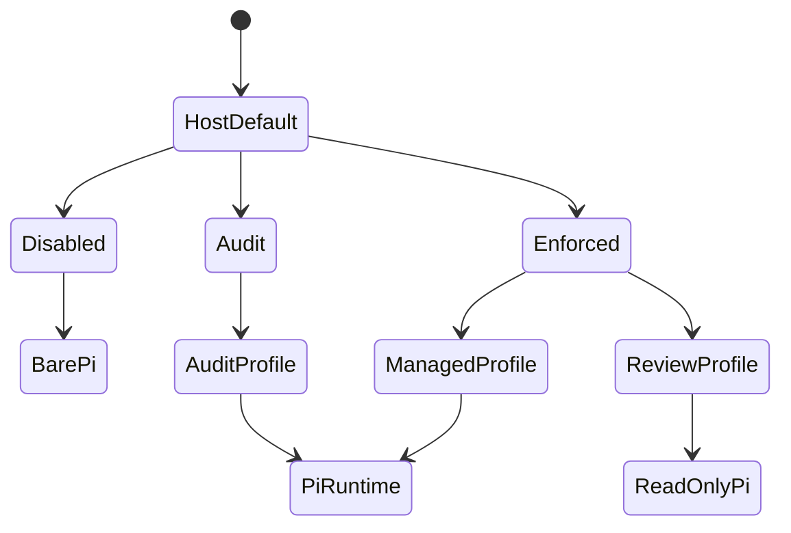

# Design Document

## Overview
This feature adds one direct, Nix-managed Pi runtime to each supported Mac while
preserving host-specific provider boundaries. The repository owns Pi's wrapper,
configuration reconciliation, sandbox profiles, extension surface, Cavemem
capture path, and acceptance evidence; existing mcpproxy and Cavemem storage
remain shared services.

### Goals
- Provide the same managed Pi command and required extension baseline on both
  hosts.
- Keep declarative configuration authoritative without replacing unrelated Pi
  state.
- Fail before the TUI when provider, sandbox, MCP, Cavemem, or extension
  prerequisites are invalid.
- Keep provider credentials out of model-invoked subprocess environments.
- Make sandbox, child-process, and full-payload capture behavior testable.

### Non-Goals
- Sieve or another output compressor.
- Exact `devx pi` package, migration, telemetry, or update behavior.
- Cohere or Perplexity provider support.
- A private Shopify extension or direct Shopify Tool Gateway connection.
- A generic wrapper framework shared with OpenCode.
- Cross-host Pi state synchronization or non-Darwin support.

## Boundary Commitments

### This Spec Owns
- The patched Pi package derived from the pinned `pi.nix` package output.
- The fixed-lock public extension closure and repository-owned Pi extensions.
- The `programs.pi-agent` option surface and both host configurations.
- Immutable desired-state rendering and launch-time mutable-state reconciliation.
- Provider preflight, direct Pi launch, status, validation, and rollout controls.
- Standalone Pi nono profiles adapted from the pinned public Pi pack.
- Pi-to-mcpproxy and Pi-to-Cavemem client contracts.
- The opt-in Cavemem `pi-full-v1` hook mode and its compatibility tests.
- Pi-specific package, render, security, and runtime acceptance checks.

### Out of Boundary
- mcpproxy upstream registration, daemon lifecycle, secret bridge, and routing
  implementation.
- Cavemem database schema, MCP tools, existing OpenCode bridge behavior, and
  default hook compression behavior.
- OpenCode package, wrapper, profiles, plugins, and host settings.
- Upstream extension feature development beyond scoped compatibility and safety
  patches required by these requirements.
- Private Shopify source, provider parity features, Sieve, and optional
  `shop-pi-fy` resources.

### Allowed Dependencies
- `pi.nix` as the pinned base-package source; its mutable settings/model wrapper
  and jail are not used.
- Existing `pkgs.nono`, mcpproxy at the configured local endpoint, and the
  existing Cavemem package, data directory, and upstream server.
- Shopify `devx llm-gateway print-token --key` and `--base` only from the
  Shopify host preflight.
- The public extension pins recorded in `research.md` and Nix-managed language
  servers declared by the host.
- Existing Home Manager, overlay, flake-check, SOPS/Keychain, and agent-rule
  composition patterns.

### Revalidation Triggers
- A Pi or extension version changes its CLI, event, tool, settings, provider,
  session, child-process, or output-artifact contract.
- `pi.nix` changes its package output shape or starts mutating state in the base
  package.
- mcpproxy changes `/mcp/call`, its six approved tools, strict mutation
  validation, health endpoints, or authentication posture.
- Cavemem changes hook input, compression flags, privacy processing, storage
  schema, or uncompressed retrieval.
- nono changes profile schema, Darwin process signaling, environment filtering,
  network policy, or `--allow-cwd` semantics.
- Shopify changes gateway endpoint suffixes, credential commands, headers, or
  supported provider protocols.

## Architecture

### Existing Architecture Analysis
- Both host Home Manager profiles import `home-manager/common` and host modules.
- Overlays provide pinned packages; flake checks evaluate both host outputs.
- OpenCode already uses host-side preflight followed by a nono-wrapped runtime.
- mcpproxy owns MCP upstreams and listens locally on port 8080.
- Cavemem owns one shared data directory and mcpproxy upstream.
- Pi adds a parallel client integration; it does not refactor these boundaries.

### Architecture Pattern & Boundary Map



**Architecture Integration**
- Selected pattern: hybrid package adoption with repository-owned runtime control.
- Dependency direction: external pins → packages → typed host configuration →
  immutable desired state → reconciliation/preflight → supervised Pi runtime →
  external services.
- Host modules provide values only; they do not import scripts or mutate state.
- OpenCode patterns are reused as contracts, not shared implementation.

### Technology Stack

| Layer | Choice / Version | Role | Constraint |
|---|---|---|---|
| Agent CLI | Pi `0.83.0` from pinned `pi.nix` | Direct coding-agent runtime | Carry security and context-recovery patches |
| Package runtime | Node `>=22.19.0` | Pi and TypeScript extensions | One Pi runtime in the closure |
| Configuration | Home Manager and JSON | Desired state and host deltas | No secret values in Nix outputs |
| Reconciliation | Node ESM, JSON Schema, `proper-lockfile` | Atomic managed-key updates | Runtime only; provenance-aware |
| Sandbox | Existing nono package and Pi pack `0.2.0` policy | Darwin filesystem, network, and process boundary | Standalone rendered profiles |
| MCP | mcpproxy `0.52.1`, `pi-mcp-adapter@2.20.1` | Six direct tools over local HTTP | No ambient MCP config merge |
| Memory | Cavemem `0.2.1` plus scoped patch | Ambient Pi event capture | Existing schema and MCP surface retained |
| Extensions | Pins in `research.md` | Required Pi capabilities | Fixed lock; no nested Pi dependencies |
| Native process | `node-pty@1.2.0-beta.14` | Interactive background tasks | Preserve Darwin ARM prebuild |

## File Structure Plan

### Directory Structure
```text
overlays/
├── pi-agent/
│   ├── default.nix                       # Patched Pi and extension packages
│   ├── pi-context-recovery.patch         # Upstream context-limit backport
│   ├── pi-undici-8.9.0.patch             # Production dependency remediation
│   ├── pi-package-lock.json              # Patched Pi dependency lock
│   └── extensions/
│       ├── package.json                  # Exact extension inventory
│       ├── package-lock.json             # Fixed extension closure
│       ├── cavemem.ts                    # First-loaded lifecycle bridge
│       ├── mcpproxy.ts                   # Isolated MCP adapter configuration
│       └── patches/                      # Scoped upstream extension patches
├── cavemem-pi-full-payload-v1.patch      # Opt-in full capture mode
└── default.nix                           # Adds the Pi overlay

home-manager/common/pi-agent/
├── default.nix                           # Typed options and rendered artifacts
├── managed-config.nix                    # Secret-free desired-state manifest
├── credential-policy.nix                 # Credential sources and spawn boundaries
├── profiles.nix                          # Standalone Pi nono profile catalog
├── lsp-wrappers.nix                      # Credential-scrubbed server launchers
├── instructions.md                       # Pi MCP, package, plan, and safety rules
└── guide.md                              # Operator setup, status, and rollback

scripts/
├── pi-agent-launcher.nix                 # Preflight and supervised execution
├── pi-agent-reconcile.mjs                # Managed JSON transaction
├── pi-agent-reconcile.nix                # Reconciler package
├── pi-agent-shell.nix                    # Credential-scrubbed command shell
├── pi-agent-status.nix                   # Redacted machine and human status
├── pi-agent-validate.nix                 # Runtime compatibility validation
└── cavemem-smoke-test.nix                # Legacy and full-mode capture checks

configurations/personal/home-manager/
└── pi-agent.nix                          # Personal providers and defaults

configurations/shopify/home-manager/
└── pi-agent.nix                          # Gateway routes, headers, and defaults

tests/pi-agent/
├── package.test.mjs                      # Package, patches, licenses, PTY
├── reconcile.test.mjs                    # Ownership, drift, and concurrency
├── launcher.test.mjs                     # States, preflight, and fail-closed launch
├── extensions.test.mjs                   # Inventory, tools, plan, LSP, background
├── cavemem.test.mjs                      # Event mapping and full capture
├── hm-render.test.mjs                    # Both host render contracts
├── runtime-personal.test.mjs             # Personal runtime smoke path
├── runtime-shopify.test.mjs              # Shopify stub and live-gate path
├── fixtures/                             # Fake providers and process probes
├── package.json                          # Node test entrypoints
└── run.js                                # Flake-check runner
```

### Modified Files
- `flake.nix` and `flake.lock` — add the pinned `pi-nix` input and Pi checks.
- `overlays/mcp-servers.nix` — apply the scoped Cavemem patch.
- `home-manager/common/default.nix` — import the Pi module.
- `configurations/personal/home-manager/default.nix` — import personal Pi values.
- `configurations/shopify/home-manager/default.nix` — import Shopify Pi values.

No Pi production component writes outside the paths listed above and Pi's
existing mutable agent directory.

## System Flows

### Managed Launch


Provider token material remains in launcher memory and the root Pi environment.
The launcher discards shell-local copies after export; managed command, LSP,
background, and Cavemem boundaries remove credential variables before spawning.

### Tool Capture


Full mode applies no application-level payload cap. SQLite accepts one complete
redacted row up to its active maximum value length; larger, malformed, or
storage-failed events produce no partial observation and surface a sticky Pi
capture error.

### Sandbox State


`PI_NONO` selects `disabled`, `audit`, or `enforced` for one launch.
`PI_NONO_PROFILE` selects a managed profile; the review profile also appends the
managed read-only Pi tool allowlist after user arguments.

## Requirements Traceability

| Requirement IDs | Summary | Components | Contracts / Flows |
|---|---|---|---|
| 1.1, 1.2, 1.3, 1.4, 1.5, 1.6 | Declarative two-host Pi | Package Set, Home Module, Runtime Control | Package manifest, Managed Launch |
| 2.1, 2.2, 2.3, 2.4, 2.5, 2.6, 2.7 | Managed state coexistence | Home Module, Reconciler | ManagedConfigV1, OwnershipStateV1 |
| 3.1, 3.2, 3.3, 3.4, 3.5, 3.6, 3.7 | Host providers | Provider Composition, Runtime Control | ProviderRuntime, Managed Launch |
| 4.1, 4.2, 4.3, 4.4, 4.5 | Preflight and status | Runtime Control, Acceptance Harness | StatusV1, Error Strategy |
| 5.1, 5.2, 5.3, 5.4, 5.5, 5.6, 5.7, 5.8, 5.9 | nono profiles | Sandbox Catalog, Runtime Control | SandboxSelection, Sandbox State |
| 6.1, 6.2, 6.3, 6.4, 6.5, 6.6 | Sole MCP entrypoint | MCP Bridge, Runtime Control | MCP config contract, Managed Launch |
| 7.1, 7.2, 7.3, 7.4, 7.5, 7.6 | Extension inventory | Package Set, Extension Runtime | ExtensionManifestV1 |
| 8.1, 8.2, 8.3, 8.4, 8.5, 8.6, 8.7 | Sub-agents | Extension Runtime, Sandbox Catalog | ChildPolicyV1 |
| 9.1, 9.2, 9.3, 9.4, 9.5, 9.6 | Plan mode | Extension Runtime, Sandbox Catalog | SandboxSelection, Sandbox State |
| 10.1, 10.2, 10.3, 10.4, 10.5, 10.6, 10.7, 10.8, 10.9, 10.10, 10.11 | Cavemem capture | Capture Bridge, Cavemem Full Mode | PiFullToolObservationV1, Tool Capture |
| 11.1, 11.2, 11.3, 11.4, 11.5, 11.6, 11.7 | Session aids | Extension Runtime | ExtensionManifestV1 |
| 12.1, 12.2, 12.3, 12.4, 12.5, 12.6 | Code intelligence | Extension Runtime, Sandbox Catalog | ExtensionManifestV1, SandboxSelection |
| 13.1, 13.2, 13.3, 13.4, 13.5, 13.6, 13.7 | Background tasks | Extension Runtime, Sandbox Catalog | ChildPolicyV1, SandboxSelection |
| 14.1, 14.2, 14.3, 14.4, 14.5 | Credential isolation | Provider Composition, Credential Boundary, Runtime Control | CredentialBoundaryV1 |
| 15.1, 15.2, 15.3, 15.4, 15.5, 15.6, 15.7 | Release gates | Package Set, Acceptance Harness | ValidationReportV1 |

## Components and Interfaces

| Component | Domain | Intent | Requirement Coverage | Critical Dependencies | Contracts |
|---|---|---|---|---|---|
| Package Set | Build | Produce patched Pi and one extension closure | 1, 7, 15 | pi.nix P0, npm pins P0 | State |
| Home Module | Configuration | Render typed desired state and host-independent artifacts | 1, 2, 4, 5, 7 | Home Manager P0 | State |
| Runtime Control | Launch | Reconcile, validate, report, and execute Pi | 2, 3, 4, 5, 14 | Provider P0, nono P0 | Service, State |
| Provider Composition | Integration | Keep personal and Shopify routing separate | 3, 14 | devx P0 on Shopify | Service, State |
| Credential Boundary | Security | Resolve credentials and scrub every non-provider spawn | 3, 14 | Provider Composition P0 | Service, State |
| Sandbox Catalog | Security | Define OS profiles and Pi tool ceilings | 5, 8, 9, 12, 13 | nono P0 | State |
| MCP Bridge | Integration | Expose six governed mcpproxy tools | 6 | mcpproxy P0, adapter P0 | Service |
| Extension Runtime | Agent | Supply required tools and controlled subprocesses | 7, 8, 9, 11, 12, 13, 14 | Extension bundle P0 | Service, State |
| Capture Bridge | Memory | Persist Pi lifecycle and full redacted tool payloads | 8, 10, 14 | Cavemem P0 | Event, Batch, State |
| Acceptance Harness | Validation | Prove package, host, runtime, and security contracts | 4, 15 | Both host outputs P0 | Batch |

### Build and Configuration

#### Package Set

| Field | Detail |
|---|---|
| Intent | Produce immutable, auditable Pi runtime inputs |
| Requirements | 1.1, 1.2, 1.5, 1.6, 7.2, 7.4, 7.5, 15.1, 15.2, 15.6 |

**Responsibilities & Constraints**
- Consume `inputs.pi-nix.packages.${system}.coding-agent` without importing its
  Home Manager wrapper.
- Apply the `undici >=8.9.0` dependency lock and complete upstream context-limit
  recovery patch; run their focused upstream tests.
- Build one exact extension dependency closure with the pins from `research.md`,
  the Darwin ARM PTY prebuild, and all license notices.
- Reject a nested `@earendil-works` Pi runtime in extension dependencies.
- Publish an immutable manifest mapping logical extension names to entry paths
  and versions.

**Dependencies**
- External P0: pinned `pi.nix`, npm sources, upstream Pi patch provenance.
- Outbound P0: Home Module and Runtime Control consume package paths only.

**Contracts**: State.

```typescript
interface ExtensionManifestV1 {
  readonly schemaVersion: 1;
  readonly piVersion: string;
  readonly extensions: Readonly<Record<string, {
    readonly version: string;
    readonly entryPath: string;
    readonly license: string;
  }>>;
}
```

The package check rejects missing entries, mutable source references, nested Pi
runtimes, missing license texts, wrong `undici`, or absent recovery markers.

#### Home Module

| Field | Detail |
|---|---|
| Intent | Convert typed common and host values into secret-free artifacts |
| Requirements | 1.1–1.6, 2.1, 2.6, 2.7, 4.4, 5.1, 7.1, 7.2 |

**Responsibilities & Constraints**
- Define `programs.pi-agent` with typed package, state, provider, MCP, sandbox,
  extension, sub-agent, plan, timeout, LSP, and resource options.
- Render `ManagedConfigV1`, three standalone profiles, composed instructions,
  package metadata, and absolute executable paths.
- Assert host/provider compatibility and prohibit literal credential values.
- Force Pi install telemetry, analytics, self-version checks, and unmanaged
  package updates off.
- Compose Pi-specific memory, mcpproxy, package, plan, and subprocess rules from
  the existing common agent contracts without copying OpenCode-only commands.
- Represent any advisory exception as an ID, rationale, approver, and expiry;
  expired or incomplete exceptions fail evaluation.
- Add only the repository-owned launcher and status/validation commands to
  `home.packages`.
- Leave mutable Pi state untouched during activation.

**Dependencies**
- Inbound P0: common and host module values.
- Outbound P0: Runtime Control reads immutable rendered paths.
- External P1: existing mcpproxy and Cavemem option read-backs.

**Contracts**: State.

```typescript
interface ManagedConfigV1 {
  readonly schemaVersion: 1;
  readonly generation: string;
  readonly agentDir: string;
  readonly settings: Readonly<Record<string, unknown>>;
  readonly providers: Readonly<Record<string, ManagedProvider>>;
  readonly extensionManifest: string;
  readonly extensionOrder: readonly string[];
  readonly mcpEndpoint: string;
  readonly sandboxDefault: "disabled" | "audit" | "enforced";
}

interface ManagedProvider {
  readonly api?: "anthropic-messages" | "openai-responses" |
    "openai-completions" | "google-generative-ai";
  readonly baseUrl?: string;
  readonly runtimeBasePath?: string;
  readonly authSource: CredentialSource;
  readonly headers: Readonly<Record<string, string>>;
  readonly models?: readonly Readonly<Record<string, unknown>>[];
  readonly modelOverrides?: Readonly<Record<string, unknown>>;
}

type CredentialSource =
  | { readonly kind: "pi-auth" }
  | { readonly kind: "environment"; readonly name: string }
  | { readonly kind: "command"; readonly argv: readonly [string, ...string[]] };
```

Exactly one of `baseUrl` and `runtimeBasePath` is present. Shopify uses
`runtimeBasePath`; personal providers select an explicit non-secret source.
Environment names must match the managed allowlist, and command sources are
absolute argument arrays with no shell evaluation.

### Runtime Control

#### Reconciler and Launcher

| Field | Detail |
|---|---|
| Intent | Commit one managed generation and launch direct Pi once |
| Requirements | 2.1–2.7, 3.1–3.7, 4.1–4.5, 5.2, 5.5–5.8, 14.3–14.5 |

**Responsibilities & Constraints**
- Reject Pi package mutation commands and invalid launch overrides first.
- Resolve Shopify base, token, and launch session ID outside nono with bounded
  timeouts; personal mode never invokes Shopify tooling.
- Hold one integration lock across provider materialization and JSON updates.
- Coordinate `settings.json` with Pi's `proper-lockfile`; update all managed JSON
  files by same-directory private temporary write, fsync, and atomic rename.
- Record each owned JSON pointer/provider, prior managed value hash, generation,
  and transaction state in `OwnershipStateV1`.
- Remove a stale value only when the current value still equals the prior
  managed value. Drift on an active managed provider or security key fails.
- Validate package, extension, profile, MCP, Cavemem, and credential boundaries;
  then exec bare Pi through the selected nono profile exactly once.
- Expose the same checks through dry-run, status, and validation modes.

**Dependencies**
- Inbound P0: ManagedConfigV1 and Package Set.
- Outbound P0: nono and direct Pi executable.
- External P0: Shopify gateway in Shopify mode; mcpproxy and Cavemem on both.

**Contracts**: Service, State.

```typescript
interface OwnershipStateV1 {
  readonly schemaVersion: 1;
  readonly generation: string;
  readonly transaction: "committed" | "pending";
  readonly files: Readonly<Record<string, Readonly<Record<string, {
    readonly valueHash: string;
  }>>>>;
}

type ReconcileResult =
  | { readonly ok: true; readonly generation: string; readonly changed: readonly string[] }
  | { readonly ok: false; readonly error: ReconcileError };

type ReconcileError =
  | { readonly kind: "invalid-json"; readonly path: string }
  | { readonly kind: "managed-drift"; readonly path: string; readonly pointer: string }
  | { readonly kind: "lock-timeout"; readonly path: string }
  | { readonly kind: "write-failure"; readonly path: string };
```

`--managed-status` returns a redacted `StatusV1`; it never starts Pi.

```typescript
interface StatusV1 {
  readonly generation: string;
  readonly piVersion: string;
  readonly providerMode: "personal" | "shopify-gateway";
  readonly sandboxState: "disabled" | "audit" | "enforced";
  readonly profile: string | null;
  readonly mcpEndpoint: string;
  readonly mcpReady: boolean;
  readonly cavememDataDir: string;
  readonly cavememReady: boolean;
  readonly extensions: Readonly<Record<string, string>>;
  readonly drift: readonly string[];
}
```

#### Provider Composition

| Field | Detail |
|---|---|
| Intent | Resolve host routing without crossing credential boundaries |
| Requirements | 3.1–3.7, 14.1–14.5 |

**Responsibilities & Constraints**
- Personal mode uses Pi's built-in OpenAI provider, preserves Pi authentication,
  and sets `openai/gpt-5.6-sol` at `xhigh` as the managed default.
- Shopify mode overrides Pi's built-in Anthropic, OpenAI, Google, Groq, and xAI
  providers, preserving their model catalogs and compatibility metadata.
- Cohere and Perplexity are absent. Unsupported provider declarations fail
  module evaluation.
- The launcher validates an HTTPS gateway base and materializes concrete route
  URLs; managed `baseUrl` values never contain placeholders.
- The launcher rejects `auth.json`, CLI, or ambient environment credentials that
  would take precedence over a managed Shopify provider.
- The Shopify token is exported only to root Pi and foreground child Pi. The
  static model catalog references that dedicated variable; no file stores it.
- A launch UUID supplies affinity and usage headers. A new launch obtains a new
  token and UUID; token expiry requires a relaunch.

**Dependencies**
- External P0: `devx llm-gateway` in Shopify mode.
- Outbound P0: Runtime Control and Pi provider composer.
- Outbound P1: Credential scrubbers receive the exact sensitive-name set.

**Contracts**: Service, State.

```typescript
interface ProviderRuntime {
  readonly mode: "personal" | "shopify-gateway";
  readonly concreteBaseUrl?: string;
  readonly sensitiveEnvironmentNames: readonly string[];
  readonly sessionId: string;
}
```

The runtime object is never serialized. Logs contain source names and status,
not values or credential-bearing headers.

Shopify provider routes are host-owned static suffixes joined to the validated
gateway base:

| Provider | Pi API | Route suffix |
|---|---|---|
| Anthropic | `anthropic-messages` | `/apis/anthropic/v1` |
| OpenAI | `openai-responses` | `/vendors/openai/v1` |
| Google | `google-generative-ai` | `/vendors/googlevertexai-global/v1beta1/projects/shopify-ml-production/locations/global/publishers/google` |
| Groq | `openai-completions` | `/vendors/groq/openai/v1` |
| xAI | Existing per-model Pi API | `/vendors/xai/v1` |

All Shopify providers use the dedicated token variable and launch UUID headers. Google also uses
bearer authorization. The initial Shopify default is `openai/gpt-5.6-sol` at
`xhigh`; host options remain the source of truth. Every row is a switched-host
protocol gate before enforced rollout.

#### Credential Boundary

| Field | Detail |
|---|---|
| Intent | Give provider-capable Pi processes credentials without leaking them to tools |
| Requirements | 3.5, 3.6, 3.7, 14.1–14.5 |

**Responsibilities & Constraints**
- `credential-policy.nix` is the sole source of credential source validation,
  sensitive environment names, redaction values, and spawn-boundary mappings.
- `pi-auth` leaves resolution to Pi and exports nothing. `environment` admits
  one declared variable. `command` executes an absolute argv outside nono,
  validates non-empty stdout, and exports it under a generated dedicated name.
- Shopify uses the command path for preflight and exports the resolved token
  under its dedicated managed name. Root and foreground child Pi may receive it.
- Every non-provider process uses the policy's `scrubbedEnvironment` result,
  built from an allowlist plus removal of all declared and standard provider
  credential names.
- Status and errors report source kind/name only. Exact resolved values are
  registered with the redactor in memory and are never serialized.

**Dependencies**
- Inbound P0: ManagedProvider credential sources and ProviderRuntime values.
- Outbound P0: Runtime Control, Extension Runtime, and Capture Bridge spawn sites.
- External P1: personal credential command or Shopify `devx` command.

**Contracts**: Service, State.

```typescript
interface CredentialBoundaryV1 {
  readonly rootPiEnvironment: Readonly<Record<string, string>>;
  readonly childPiEnvironment: Readonly<Record<string, string>>;
  readonly scrubbedEnvironment: Readonly<Record<string, string>>;
  readonly sensitiveNames: readonly string[];
}
```

| Spawn site | Environment owner | Credential result |
|---|---|---|
| Root Pi | Launcher | Declared provider values only |
| Foreground child Pi | Patched sub-agent spawn | Same provider contract as parent |
| Built-in Bash | `pi-agent-shell` through Pi `shellPath` | Scrubbed |
| Background pipe and PTY | Patched background extension | Scrubbed |
| Language server | Managed LSP wrapper and patched spawn | Scrubbed |
| Cavemem hook and worker | Cavemem bridge explicit environment | Scrubbed |
| Status and validator probes | Owning script | Scrubbed and redacted |

### Security and Integration

#### Sandbox Catalog

| Field | Detail |
|---|---|
| Intent | Pair OS isolation with an explicit model tool ceiling |
| Requirements | 5.1–5.9, 8.4, 8.7, 9.1–9.6, 12.4, 12.6, 13.6, 13.7 |

**Responsibilities & Constraints**
- Render `pi-managed`, `pi-audit`, and `pi-review` as standalone profiles
  derived from the pinned public policy; runtime pack installation is absent.
- Exclude git config, credential, LaunchServices, profile-draft, and package
  wiring grants. Deny sensitive credential directories explicitly.
- Grant Pi/Cavemem state, private temp, immutable closures, current workspace,
  required caches, local mcpproxy port 8080, and same-sandbox process signaling.
- Managed uses provider-host allowlisting when validated. Audit permits outbound
  network for compatibility diagnosis. Review makes the workspace read-only.
- `PI_NONO=disabled|audit|enforced` and `PI_NONO_PROFILE` are one-launch
  overrides. Unknown values and missing profiles fail closed.
- `PI_NONO_LISTEN_PORTS` admits only validated explicit numeric ports for one
  launch. No wildcard listen range exists.
- Review appends a managed Pi allowlist after user arguments. Plan mode defaults
  to `read`, `grep`, `find`, and `ls`; it excludes every execution or mutation
  extension tool.
- Before sandbox launch, resolve the profile with
  `nono profile show <name> --json --silent`, parse it, and run strict profile
  validation. An unreadable or unparseable resolved profile fails closed.
- Check resolved grants against `SandboxGrantContractV1`; do not infer readiness
  from profile source text.

**Dependencies**
- External P0: resolved nono package and current profile schema.
- Inbound P0: Home Module profile values and Runtime Control selection.
- Outbound P0: Pi runtime and every child process remain in one sandbox tree.

**Contracts**: State.

```typescript
interface SandboxSelection {
  readonly state: "disabled" | "audit" | "enforced";
  readonly profile: "pi-managed" | "pi-audit" | "pi-review" | null;
  readonly listenPorts: readonly number[];
  readonly piTools: readonly string[] | null;
}

interface SandboxGrantContractV1 {
  readonly mcpPort: 8080;
  readonly providerHost: string | null;
  readonly agentDirAccess: "readwrite";
  readonly cavememDirAccess: "readwrite";
  readonly tempDirAccess: "readwrite";
  readonly workspaceAccess: "read" | "readwrite";
  readonly processMode: "isolated" | "allow_same_sandbox";
  readonly requiredEnvironmentNames: readonly string[];
}
```

Grant validation requires port 8080, the resolved provider host or unrestricted
audit egress, declared agent/Cavemem/temp/workspace access, readable package and
extension closures, admitted root-Pi environment names, and same-sandbox process
control whenever sub-agents, LSP, or background tasks are enabled. Review
requires read-only workspace access and no execution tools.

Sandbox execution is exactly:

```text
NONO_NO_SAVE_PROMPT=1 nono run --profile <resolved-profile> --allow-cwd -- <bare-pi> <user-args> <managed-final-args>
```

`<managed-final-args>` contains the review tool ceiling when selected, so user
arguments cannot restore excluded tools. Disabled state executes `<bare-pi>`
once without nono only after the explicit state override is reported.

nono enforces filesystem, network, initial environment, process inspection, and
signals. Pi configuration enforces tool visibility, sub-agent parameters, and
plan/review transitions. Neither layer claims the other's controls.

#### MCP Bridge

| Field | Detail |
|---|---|
| Intent | Expose one deterministic mcpproxy client surface |
| Requirements | 4.1, 4.2, 6.1–6.6, 9.2 |

**Responsibilities & Constraints**
- Load only the repository-owned wrapper around `createMcpAdapter`; do not load
  the adapter's default extension or merge ambient MCP files.
- Connect eagerly to `http://127.0.0.1:8080/mcp/call` with authentication,
  resources, sampling, elicitation, script mode, and generic proxy disabled.
- Set no tool prefix and freeze these six direct tools:
  `retrieve_tools`, `describe_tool`, `call_tool_read`, `call_tool_write`,
  `call_tool_destructive`, and `read_cache`.
- Approval-gate write and destructive calls. Headless approval fails closed.
- Set `MCP_DIRECT_TOOLS` so cold-cache session start waits for metadata; invalidate
  only malformed or partial adapter-owned metadata.
- At agent start, reject any `mcp`, `mcpScript`, code-execution, duplicate,
  prefixed, or missing tool.

**Dependencies**
- External P0: mcpproxy health, ready, admin status, and `/mcp/call` contracts.
- Inbound P0: Runtime Control preflight and managed endpoint.
- Outbound P1: Pi agent instructions describe discover-then-invoke use.

**Contracts**: Service.

| Config field | Contract |
|---|---|
| Server name | `mcpproxy` only |
| Lifecycle | eager, no idle timeout |
| Tools | six-name include and direct allowlists |
| Approval | `call_tool_write`, `call_tool_destructive` |
| Cache | private agent-dir metadata, seven-day adapter TTL |
| Preflight | health, ready, mandatory upstream status, initialize, tools list |

#### Extension Runtime

| Field | Detail |
|---|---|
| Intent | Load the approved capabilities with bounded child processes |
| Requirements | 7.1–7.6, 8.1–8.7, 9.1–9.6, 11.1–11.7, 12.1–12.6, 13.1–13.7, 14.1, 14.2 |

**Responsibilities & Constraints**
- Launch Pi with ambient extension, skill, and prompt discovery disabled, then
  supply absolute managed paths in this order: Cavemem, MCP, sub-agents, plan,
  timestamps, Bash timeout, ask-user, code intelligence, background tasks.
- Configure sub-agent artifacts under the parent session and explicit child
  extensions. Ordinary children load Cavemem and provider resources; MCP is
  added only for agents declaring it.
- Preserve single, parallel, and chain semantics: parallel failures remain
  independent, and each chain step receives only its declared predecessor
  output. Child tools, model budget, workspace, depth, and extension list come
  from the selected managed agent definition.
- Patch sub-agents to reject async/detached/scheduled runs, prevent recursive
  controller loading, create foreground process groups, and escalate group
  termination on cancel or parent shutdown.
- Configure plan mode with only read-only built-ins and its interaction tools.
  Plan completion requires operator approval and restores the captured prior
  tool set. Planning/approved state persists in the Pi session across resume.
- Apply a default Bash timeout only when omitted and preserve explicit values.
- Patch LSP and background spawn paths to use an exact scrubbed environment.
  Language servers are Nix-store executables, and refactor apply remains
  separate from preview.
- Expose code orientation, resolution, inspection, graph, find, health, and
  refactor-plan/apply contracts. Server failure disables only that server and
  reports its executable and error.
- Require background pipe and PTY modes to expose bounded logs and group cleanup
  on task termination and session shutdown. Each task has a stable ID plus
  status, logs, wait, input, attach, detach, signal, and kill operations.
- Keep timestamp display entries outside model context. `ask_user` is available
  outside plan mode with single-choice, multiple-choice, and free-text forms;
  cancellation cancels the turn. Timestamp entries use the local timezone and
  persist in session state.

**Dependencies**
- Inbound P0: ExtensionManifestV1 and SandboxSelection.
- Outbound P0: Pi extension runner and child-process APIs.
- External P1: configured language servers and Darwin PTY prebuild.

**Contracts**: Service, State.

```typescript
interface ChildPolicyV1 {
  readonly allowAsync: false;
  readonly artifactDir: "session";
  readonly defaultExtensions: readonly string[];
  readonly maxDepth: number;
  readonly termination: {
    readonly gracefulMs: number;
    readonly forcedMs: number;
  };
}
```

Root and child Pi are trusted credential consumers. Bash, background, LSP,
Cavemem, status, and validation processes receive no provider credential value.
Trusted in-process extensions remain inside the root Pi trust boundary.

#### Capture Bridge and Cavemem Full Mode

| Field | Detail |
|---|---|
| Intent | Capture ordered Pi lifecycle events and complete redacted tool data |
| Requirements | 10.1–10.11, 14.1, 14.4, 14.5 |

**Responsibilities & Constraints**
- Load first and snapshot each event synchronously before the first `await`.
- Map session start, prompt input, tool completion/failure, assistant turn end,
  resume/fork, compaction barriers, and session shutdown to Cavemem hooks.
- Use the Pi session UUID with `ide=pi`; compaction retains identity, resume
  reuses it, and fork creates a new ID.
- Serialize tool calls into `PiFullToolObservationV1`, redact exact runtime
  credentials and private content, and invoke `post-tool-use` with
  `--capture-mode pi-full-v1`.
- Queue hooks FIFO per process and await the queue from each Pi event handler,
  applying backpressure instead of dropping accepted payloads. Process startup
  and stdin streaming use no-progress deadlines; full-mode local storage has no
  total duration cap. Shutdown waits for the active write before `session-end`.
- Surface nonzero, timeout, overflow, malformed, and storage failures as a
  sticky Pi status and sanitized error. Do not retry ambiguous writes.
- Load the bridge in every enabled child. Emit one synthetic child-start
  observation containing parent session, run, agent, and child index.
- Pass a scrubbed environment to Cavemem; the bridge and mcpproxy upstream use
  the same absolute data directory.

The Cavemem patch adds an explicit versioned branch. Default hook parsing,
truncation, compression, metadata, and exit behavior remain unchanged.

```typescript
interface PiFullToolObservationV1 {
  readonly schemaVersion: 1;
  readonly toolCallId: string;
  readonly toolName: string;
  readonly input: unknown;
  readonly output: {
    readonly content: unknown;
    readonly details: unknown;
    readonly isError: boolean;
    readonly usage?: Readonly<Record<string, number>>;
  };
}
```

Full mode requires canonical fields, rejects unserializable input, applies
private and enhanced secret redaction, stores `compressed=false` and
`intensity=null`, disables embedding, and leaves schema version 2 unchanged.
It sets no application payload cap; SQLite's active maximum value length is the
storage boundary. Uncompressed retrieval bypasses expansion, and FTS indexes the
redacted envelope.

**Contracts**: Event, Batch, State.

| Pi event | Cavemem action |
|---|---|
| `session_start` | `session-start` with stable Pi identity |
| `input` | `user-prompt-submit` before input transformation |
| `tool_result` | full-mode `post-tool-use` snapshot |
| `tool_execution_end` | fallback error when no result exists |
| `turn_end` | `stop` with visible assistant result |
| `session_before_compact` | FIFO flush barrier |
| `session_shutdown` | flush and `session-end`, except reload |

### Validation

#### Acceptance Harness

| Field | Detail |
|---|---|
| Intent | Produce repeatable evidence before host rollout |
| Requirements | 4.1–4.5, 15.1–15.7 |

**Responsibilities & Constraints**
- Separate pure package/render/unit checks from credential-bearing switched-host
  validation.
- Verify both host outputs and reject personal/Shopify provider leakage.
- Use deterministic fake providers, mcpproxy, Cavemem, nono, language servers,
  PTYs, and subprocess sentinels for hermetic behavior.
- Report each gate as pass, fail, or manual-required with package generation and
  version evidence.
- Keep live Shopify model/protocol tests outside publishable derivations.

**Contracts**: Batch.

```typescript
interface ValidationReportV1 {
  readonly generation: string;
  readonly gates: readonly {
    readonly name: string;
    readonly status: "pass" | "fail" | "manual-required";
    readonly evidence: readonly string[];
  }[];
}
```

## Data Models

### Managed State
- `ManagedConfigV1` is immutable, secret-free, and generation-addressed.
- `OwnershipStateV1` is mutable, mode `0600`, and authoritative only for keys
  claimed by this integration.
- Existing Pi JSON remains the source of truth for every unclaimed key.
- A committed ownership file is published only after all target files are
  atomically replaced. A pending transaction causes the next launch to check
  every target before mutation.
- Managed Shopify provider IDs use strict ownership; user drift fails. Removed
  values are deleted only when unchanged since the previous generation.

### Runtime-Only State
- Provider token and launcher-local copies are memory-only.
- Concrete non-secret base URLs and route suffixes are written to managed
  provider objects because Pi does not interpolate `baseUrl`.
- Launch session ID is non-secret and available to provider headers.
- Adapter metadata, extension settings, sub-agent artifacts, and background
  snapshots remain under the Pi agent/session directories with owner-only modes.

### Cavemem Observation State
- `PiFullToolObservationV1` is a versioned JSON envelope stored in existing
  `observations.content` with `compressed=0`, `intensity=NULL`, and full-mode
  metadata.
- The patch adds no table, column, index, or schema migration.
- Default hook rows retain existing compressed representation.
- Full-mode rows skip embedding and remain BM25/FTS searchable.

## Error Handling

| Category | Trigger | Response | Recovery |
|---|---|---|---|
| Input | Invalid override, provider declaration, port, or command | Exit before mutation | Print accepted values or conflicting field |
| State | Invalid JSON, lock timeout, pending transaction, managed drift | Preserve all current files and exit | Repair named file or resolve drift; rerun check |
| Provider | Gateway timeout, invalid base, empty token, auth precedence conflict | Exit before TUI | Restore gateway or remove conflicting auth source |
| Package | Missing patch, extension, license, PTY, or wrong version | Block build or launch | Rebuild the managed generation |
| MCP | Health, upstream, handshake, cache, or direct-surface failure | Exit before TUI | Restart mcpproxy or repair declared upstream |
| Sandbox | Missing profile, validation failure, blocked prerequisite | Refuse unsandboxed fallback | Select valid profile or explicit documented rollback |
| Extension | Load failure or unexpected tool surface | Stop before accepting a prompt | Fix package/config and validate again |
| Capture | Redaction, serialization, SQLite value limit, timeout, storage failure | No partial row; sticky sanitized Pi error | Reduce result or repair Cavemem; restart capture |
| Child process | Cancellation or shutdown does not finish gracefully | Group TERM then group KILL | Report final process state and fail cleanup gate |

All error output uses component names, paths when safe, and recovery commands.
Credential values, raw pre-redaction payloads, and sensitive headers never enter
logs or status output.

## Security Considerations
- The public extension bundle is trusted in-process code; only fixed reviewed
  sources enter the closure.
- Shopify provider credentials reach root Pi and foreground child Pi only.
  Managed shell, PTY, LSP, and Cavemem spawn paths remove the exact sensitive
  variables. Sentinel tests scan process output, JSONL, logs, temp files, status,
  and nono audit data.
- mcpproxy admin/Keychain probes run before nono. No admin key, Keychain access,
  `~/.mcpproxy`, or `/usr/bin/security` enters Pi's sandbox.
- MCP write and destructive calls require adapter approval and mcpproxy strict
  server validation. Code execution and server-management tools are absent.
- Full Cavemem capture applies exact runtime-token redaction, `<private>`
  stripping, and enhanced secret-pattern/JSON-key redaction before storage.
- Personal configuration contains no Shopify command, endpoint, header, or
  credential name. Closure scans cover both host outputs and cache publication.
- Review mode combines a read-only filesystem profile and a final Pi tool
  allowlist. Plan mode is a tool restriction, not an OS sandbox.

Residual accepted exposure:
- Trusted in-process Pi extensions can inspect root Pi environment and memory.
- Audit mode permits unrestricted egress.
- Managed mode writes the current repository and Pi/Cavemem state.
- Same-sandbox process signaling lets supervised sibling processes signal each
  other.
- A full redacted observation can approach SQLite's active maximum value length
  and is duplicated by FTS indexing.

## Performance and Limits
- Reconciliation performs one bounded transaction per launch and no activation
  mutation. Two concurrent launches serialize on one lock.
- Provider preflight uses bounded commands; no gateway operation can hang launch
  indefinitely.
- MCP cold-cache startup waits for six direct tool schemas before agent start.
- Cavemem serializes accepted events through a backpressured FIFO. Full rows skip
  embedding, use SQLite's active maximum value length, and are not subject to a
  total write deadline while the local hook process continues making progress.
- Background output remains extension-bounded; session exit enforces process
  group cleanup.
- Database growth is operator-visible in managed status and runtime validation.

## Rollout and Migration
- Existing Pi settings, providers, auth, trust, package entries, and sessions are
  imported in place by preservation, not copied or rewritten wholesale.
- First activation installs immutable artifacts only. First launch runs
  reconciliation, records ownership, and starts in host-default audit mode.
- Promotion to enforced requires both-host render checks and host-local provider,
  MCP, Cavemem, PTY, LSP, sub-agent, and credential-sentinel validation.
- `PI_NONO=disabled pi` is the one-launch rollback. Disabling the module removes
  managed commands/artifacts on the next generation and leaves mutable Pi state.
- A Pi or extension upgrade changes pins and generation together; no runtime
  package update path exists.

## Testing Strategy

### Package and Unit Tests
- Assert patched Pi version, `undici >=8.9.0`, context-limit recovery behavior,
  extension pins, license texts, no nested Pi runtime, and Darwin PTY spawn.
- Exercise reconciler add/update/remove, user drift, invalid JSON, pending
  transaction recovery, file modes, and concurrent launches.
- Validate provider declarations, concrete URL composition, auth conflict
  detection, redaction, and personal/Shopify separation.
- Validate standalone profile schema, profile deltas, state overrides, ports,
  review tool ceiling, and fail-closed selection.

### Integration Tests
- Render both Home Manager host outputs and inspect launcher, desired state,
  profiles, instructions, extension order, and secret-free closures.
- Run launcher stubs through disabled, audit, enforced, review, invalid,
  unavailable-service, and direct-exec paths; assert one bare Pi execution.
- Start MCP with cold, stale, partial, malformed, and concurrent metadata caches;
  assert only six direct tools and approval behavior.
- Load all extensions together under Pi and verify timestamps, timeout,
  ask-user, plan enter/restore, LSP preview/apply gating, and background pipe/PTY
  lifecycle.
- Run single, parallel, and chained sub-agents; reject async mode, verify child
  extension ceilings and artifacts, then cancel and scan for orphan groups.
- Exercise Pi bridge prompts, successes, failures, parallel tools, resume, fork,
  compact, child attribution, later mutation, shutdown, and visible failures.
- Run Cavemem golden default-mode and `pi-full-v1` tests for full content,
  redaction, runtime SQLite-limit rejection, flags, no embedding, retrieval, and
  legacy parity.

### Security Tests
- Inject unique provider sentinels. Root and child provider requests succeed;
  Bash, background pipe/PTY, fake LSP, Cavemem hook/worker, status, logs, JSONL,
  and temp files contain none.
- Deny an MCP write/destructive call and assert zero upstream calls; approve once
  and assert exactly one. Reject a mutation routed through `call_tool_read`.
- Under nono, allow mcpproxy port 8080 and declared provider hosts while blocking
  unlisted ports, credential directories, Keychain, and workspace writes in
  review mode.
- Scan publishable closures for tokens, private Shopify source, mutable URLs,
  and missing license notices.

### End-to-End Acceptance
- Personal host: launch with a deterministic personal provider, complete one
  tool turn, query mcpproxy, capture/retrieve Cavemem events, delegate a child,
  use plan mode, start/stop a PTY task, and exit with no orphan process.
- Shopify host: validate gateway preflight and every managed provider/model API
  mode with text, tools, reasoning, affinity, token failure, and context-limit
  cases; repeat the common runtime path under audit and enforced profiles.
- Both hosts: `--managed-status` reports matching common extension versions and
  distinct provider modes without secrets.

Live Shopify tests are switched-host validation and emit only redacted evidence;
hermetic flake checks use fakes and never require corporate credentials.
