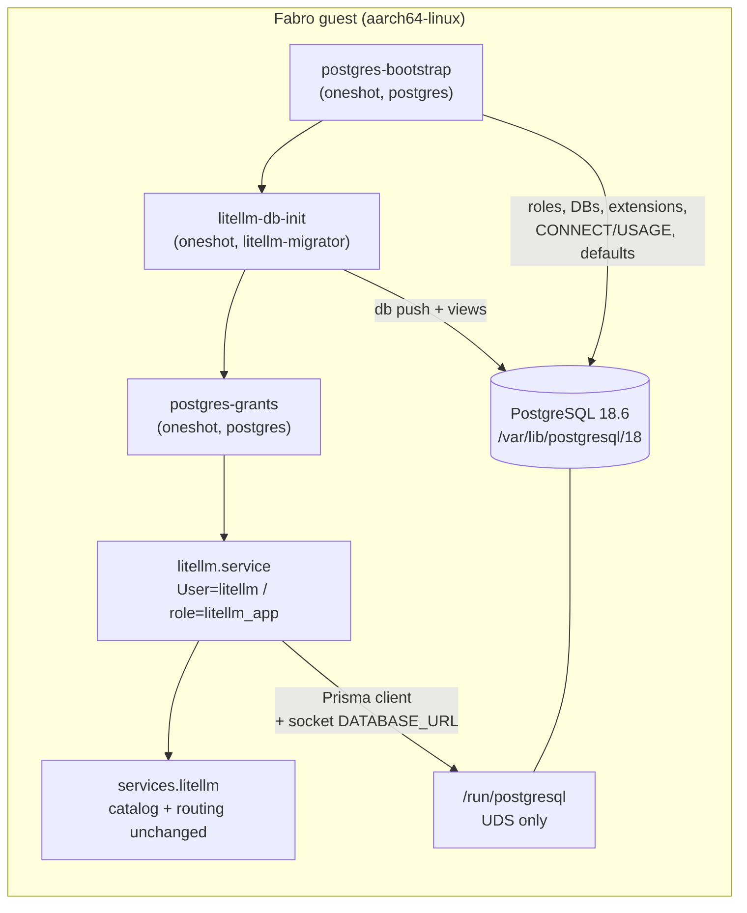
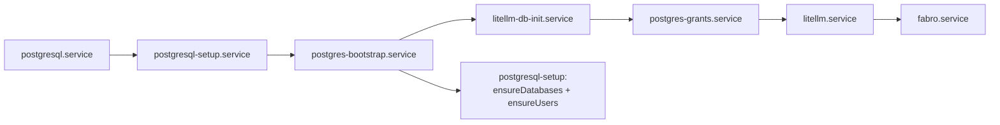
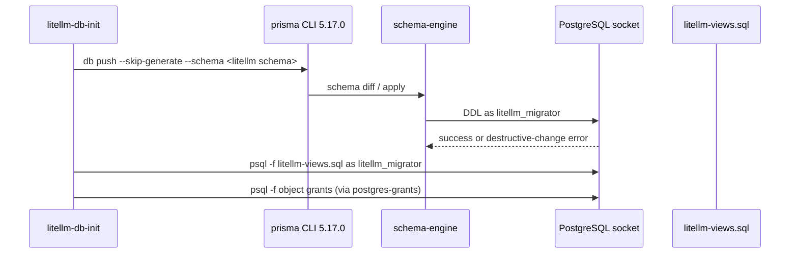
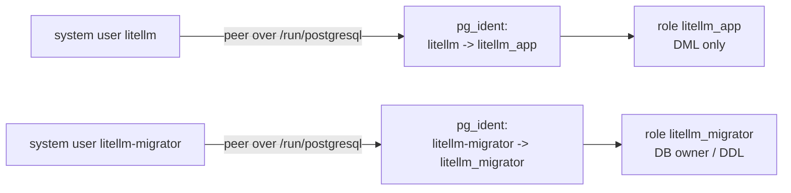
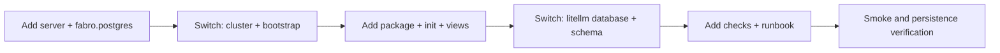

# Design Document

## Overview

This design implements `brief.md` and `requirements.md` as one socket-only
PostgreSQL 18.6 cluster, a `fabro.postgres` provisioning interface, and a
LiteLLM proxy whose Prisma-backed state lives in that cluster; `research.md`
records the version, module, Prisma, and socket facts used below. It adds the
server module, the provisioning adapter, a repo-owned LiteLLM package with a
generated Prisma client, a schema-initialization unit, evaluated and runtime
checks, and an operator runbook, without changing LiteLLM's catalog, routing,
master key, or loopback listener.

### Goals

- One PostgreSQL 18.6 cluster with data under `/var/lib/postgresql/18` and no
  TCP listener or network authentication rule.
- `pg_textsearch`, `pgvector` 0.8.7, and `pg_uuidv7` available to workload
  databases, with `pg_textsearch` preloaded.
- One declaration surface for databases, roles, extensions, and grants; the
  interface is the only source of workload database objects.
- LiteLLM persists its Prisma-backed state across restarts, with schema
  initialization in a separate unit before the proxy.
- `nix flake check` and a scratch-cluster check fail on exposure, extension,
  role, grant, or ordering regressions.

### Non-Goals

- total-recall's `memory` schema, migrations, roles, or iii runtime (that spec
  keeps them and consumes `fabro.postgres`).
- Backup, restore, PITR, replication, HA, monitoring, and tuning.
- LiteLLM virtual-key policy, budgets, spend-log retention, or admin-user
  lifecycle beyond persistence.
- TCP, tailnet, Tailscale Serve, or cross-host database access.
- The macOS launchd LiteLLM module and PostgreSQL major-version upgrades.

## Boundary Commitments

### This Spec Owns

- `configurations/fabro-vm/postgres.nix`: the `fabro.postgres` options,
  `services.postgresql` server configuration, `pg_hba`/`pg_ident` generation,
  the bootstrap and grant SQL, and their units.
- `configurations/fabro-vm/litellm-db.nix`: the `litellm` and
  `litellm-migrator` system accounts, the `litellm` database declarations, the
  schema-initialization unit, and the LiteLLM service overrides.
- `configurations/fabro-vm/postgres/litellm-views.sql`: the eight view
  definitions LiteLLM expects, transcribed from the pinned package.
- `overlays/litellm-db.nix` and `overlays/litellm-prisma/`: the Prisma 5.17.0
  CLI/engine pins, the generated client, and the `litellm-db` package.
- `fabro-vm-guest-eval` additions, `checks.aarch64-linux.postgres-scratch` and
  `checks.aarch64-linux.litellm-db-init`, the test fixtures, and
  `docs/postgres-litellm-runbook.md`.

### Out of Boundary

- total-recall's `memory` database body, its migration runner, its four roles,
  and every iii worker, adapter, Serve entry, and client (the approved
  `install-total-recall-on-fabro-vm` spec keeps them and replaces only its
  server/exposure decisions with this module).
- Any database data migration; LiteLLM has no prior database.
- PostgreSQL backups, restore, replication, tuning, and version upgrades.
- LiteLLM model routing, provider credentials, spend policy, and the existing
  ChatGPT login flow.
- Any listener, firewall opening, Serve advertisement, or `host` rule.

### Allowed Dependencies

- The locked `nixpkgs-unstable` input (PostgreSQL 18.6, `pg_textsearch` 1.5.1,
  `pgvector` 0.8.7, `pg_uuidv7` 1.7.0) and the NixOS `services.postgresql`
  module.
- The pinned LiteLLM 1.86.0 package and `python3Packages.prisma` 0.15.0
  (Prisma 5.17.0).
- The NixOS `services.litellm` module and `configurations/fabro-vm/litellm.nix`
  (catalog generation, bridge modules, health gate, master-key template).
- The guest sops store (`secrets/fabro.fabro.yaml`), the existing
  `/var/lib/litellm` state directory, and the existing Tailscale Serve lines.
- `lib.mkForce`, `lib.mkAfter`, `systemd.tmpfiles`, and the
  `flake.nix` `fabro-vm-guest-eval` check patterns.

### Revalidation Triggers

- A PostgreSQL major or extension package change, or a `psqlSchema` change
  that moves the data directory.
- A LiteLLM version bump that changes `schema.prisma`, `proxy_cli.py`,
  `check_view_exists`, or the Prisma client format.
- A prisma-client-py/Prisma bump that changes the CLI/engine pins or the
  generated-client layout.
- A change to the `fabro.postgres` option shape, the generated SQL, or the
  unit ordering contract.
- A change to the LiteLLM state directory, the fixed system user, or the
  `pg_hba`/`pg_ident` mapping.

## Architecture

### Existing Architecture Analysis

The guest is composed by `configurations/fabro-vm/default.nix` and deployed by
`lima-vm-deploy` plus `nixos-rebuild switch`. Its services are repo-owned
systemd units; secrets arrive through sops-nix templates; Tailscale Serve
advertises `svc:fabro`, `svc:litellm`, and `svc:opencode` from
`configurations/fabro-vm/tailscale.nix`. No module enables
`services.postgresql`; `configurations/fabro-vm/litellm.nix` runs the nixpkgs
`services.litellm` unit with `DynamicUser`, state directory `/var/lib/litellm`,
catalog-driven `model_list`/`router_settings`, and a health gate. The guest is
`aarch64-linux`; `pkgs.unstable` is already in its overlay chain.

The LiteLLM package is a `toPythonApplication` wrapper over
`python3Packages.litellm` with the proxy, extra-proxy, and proxy-runtime
dependencies merged. It ships `litellm/proxy/schema.prisma` and the Prisma
Python runtime, but no generated `prisma` client; its wrapper PATH also exposes
the Python Prisma CLI, which would attempt an online CLI install at startup.
Research records the exact package paths and behaviors.

### Architecture Pattern & Boundary Map

The design is a single-host data plane with a declarative provisioning adapter
and one packaged workload client. The server module owns the cluster and
exposure; `fabro.postgres` owns database/role/extension/grant declarations; the
LiteLLM module owns its schema initializer and role mapping; the package overlay
owns the offline Prisma client and CLI.



**Architecture Integration**:
- Selected pattern: one server module, one declaration adapter, one packaged
  client per workload; all state under `/var/lib`, all access through
  `/run/postgresql`.
- Domain boundaries: server/exposure (C1), provisioning (C2), package
  provenance (C3), LiteLLM wiring/ordering (C4), verification (C5).
- Existing patterns preserved: sops-nix templates, loopback services,
  `lib.mkForce`/`mkAfter` overrides of nixpkgs modules, pure-evaluation flake
  assertions, and the repo's `tests/<name>/default.nix` check fixtures.
- New components rationale: the overlay exists because no nixpkgs package
  generates LiteLLM's Prisma client offline; the bootstrap/grant units exist
  because `ensureDatabases`/`ensureUsers` cannot express extensions, ownership,
  or grants; the schema-init unit exists because LiteLLM's own startup path
  either mutates the schema as the application role or runs an online Prisma
  CLI check.
- Steering compliance: no secret enters the Nix store; the guest remains
  loopback/UDS-only; existing Serve entries and LiteLLM behavior stay intact.

### Technology Stack

| Layer | Choice / Version | Role in Feature | Notes |
|-------|------------------|-----------------|-------|
| Host configuration | NixOS module, `nixos-rebuild switch` | Cluster, units, users, tmpfiles | Guest composition unchanged |
| Data / server | `pkgs.unstable.postgresql_18` 18.6 | One cluster, data at `/var/lib/postgresql/18` | `psqlSchema = "18"` |
| Extensions | `pg_textsearch` 1.5.1, `pgvector` 0.8.7 (`vector`), `pg_uuidv7` 1.7.0 | Scratch and workload databases | `pg_textsearch` preloaded |
| Provisioning | `fabro.postgres` adapter + two oneshot units | Databases, roles, extensions, grants | Idempotent SQL |
| Workload | LiteLLM 1.86.0, Prisma 5.17.0, prisma-client-py 0.15.0 | Persistence, schema init | Generated client in the store |
| Packaging | Node 24, npm lock, patched Prisma engines | Offline CLI and query engine | `autoPatchelfHook` |
| Exposure | PostgreSQL UDS only; existing Tailscale Serve lines | No network listener | No firewall/Serve change |
| Verification | `nix flake check`, two aarch64-linux checks, runbook | Eval and runtime proof | Pure eval stays builder-free |

## File Structure Plan

### Directory Structure

```
configurations/fabro-vm/
├── postgres.nix                    # fabro.postgres options, server, units
├── postgres/
│   └── litellm-views.sql           # eight LiteLLM view definitions
├── litellm-db.nix                  # DB declarations, users, init unit, service overrides
├── default.nix                     # + imports, enable, package selection
└── litellm.nix                     # comment sync only; behavior unchanged

overlays/
├── litellm-db.nix                  # Prisma CLI/engines/client, litellm-db package
├── litellm-prisma/package-lock.json# prisma@5.17.0 npm closure
└── default.nix                     # + litellm-db in custom-packages

tests/
├── postgres-scratch/
│   ├── default.nix                 # aarch64-linux check derivation
│   ├── cluster.sh                  # initdb/pg_ctl/socket/TCP helpers
│   └── run.sh                      # extensions, preload, bootstrap idempotence
└── litellm-db-init/
    ├── default.nix                 # aarch64-linux check derivation
    └── run.sh                      # db push, views, grants, privileges

docs/postgres-litellm-runbook.md    # operator smoke, paths, declaration guide
```

### New Files

- `configurations/fabro-vm/postgres.nix` — the only module that enables
  `services.postgresql`; owns the cluster, exposure, and provisioning units.
- `configurations/fabro-vm/postgres/litellm-views.sql` — the eight view
  definitions copied from the pinned `litellm/proxy/db/create_views.py`,
  applied as `CREATE OR REPLACE VIEW` by the migration role.
- `configurations/fabro-vm/litellm-db.nix` — LiteLLM database declarations,
  system users, the init script/unit, and the service overrides.
- `overlays/litellm-db.nix` and `overlays/litellm-prisma/package-lock.json` —
  Prisma 5.17.0 CLI/engines, generated client, and `litellm-db`.
- `tests/postgres-scratch/*` and `tests/litellm-db-init/*` — the two
  aarch64-linux checks.
- `docs/postgres-litellm-runbook.md` — operator paths, declaration guide,
  schema-init inspection, and smoke procedure.

### Modified Files

- `configurations/fabro-vm/default.nix` — import `./postgres.nix` and
  `./litellm-db.nix`; enable `fabro.postgres`; install `litellm-db` in
  `environment.systemPackages` instead of `litellm`.
- `configurations/fabro-vm/litellm.nix` — update the `DynamicUser` comment to
  point at the fixed-user override; no setting changes.
- `overlays/default.nix` — add the `litellm-db` overlay to `custom-packages`.
- `flake.nix` — extend `fabro-vm-guest-eval`; add the two aarch64-linux checks;
  extend the guest report.
- `.kiro/specs/postgres-cluster-on-the-fabro-host-for-litellm-a/design.md` and
  `research.md` — this document and its evidence.

## System Flows

### Boot and switch ordering



- `postgresql-setup` creates the declared databases and roles; `postgres-bootstrap`
  then applies ownership, extensions, CONNECT/USAGE, and default privileges.
- `litellm-db-init` runs only after the `litellm` database and migration role
  exist; `postgres-grants` runs only after the schema-init unit(s) declared in
  `fabro.postgres.schemaInitUnits`.
- `litellm.service` requires both the init and grant units, so a failed or
  partial schema cannot leave the proxy serving on a half-schema database.
  `fabro.service` already requires `litellm.service`.

### Schema initialization



- The init script exits non-zero on any Prisma or `psql` failure; the unit
  stays failed and `litellm.service` does not start.
- `db push` never receives `--accept-data-loss`; a change that would drop data
  fails and is printed, satisfying the no-destructive-migration contract.
- The eight views are created by the migration role, so the default privileges
  declared through `fabro.postgres` cover them for the application role.

### Connection and role mapping



- No password is used; `pg_hba.conf` contains only `local` rules and a final
  `local all all reject`.
- The `postgres` superuser is reachable only by the `postgres` system account;
  no workload unit runs as `postgres`.

## Requirements Traceability

| Requirement | Criteria | Design elements | Interfaces / flows |
|-------------|----------|-----------------|--------------------|
| 1 One cluster | 1.1–1.9 | C1 server, data directory, fixed `postgres` account, boot flow | `services.postgresql`; boot flow |
| 2 Socket-only exposure | 2.1–2.8 | C1 `listen_addresses`, `pg_hba`, firewall/Serve invariants | Auth flow; C5 eval checks |
| 3 Required extensions | 3.1–3.6 | C1 extension set, preload, scratch database contract | Extension table; scratch check |
| 4 Declarative provisioning | 4.1–4.11 | C2 `fabro.postgres` options, bootstrap/grant units, SQL contract | Option schema; bootstrap flow |
| 5 Role separation and grants | 5.1–5.11 | C2 role/grant model; C3 package; C4 users and units | Role table; grants SQL |
| 6 LiteLLM persistence | 6.1–6.13 | C3 generated client; C4 `DATABASE_URL`, state dir, fixed user | Sequence; data model |
| 7 Schema initialization | 7.1–7.12 | C4 init script/unit; C3 package; C5 init check | Init sequence; unit matrix |
| 8 Verification | 8.1–8.18 | C5 eval assertions, scratch check, init check, runbook | Checks table; runbook |
| 9 Credential-free access | 9.1–9.5 | C1 peer/`pg_ident`, C2 no-password option, C4 env | Auth flow; Operator Provisioning |

## Components and Interfaces

| Component | Domain/Layer | Intent | Req Coverage | Key Dependencies (P0/P1) | Contracts |
|-----------|--------------|--------|--------------|--------------------------|-----------|
| C1 Cluster and exposure | Data / Runtime | One PostgreSQL 18.6 server, UDS-only, extensions | 1, 2, 3, 9 | `services.postgresql` (P0), `pkgs.unstable` (P0) | Service, State |
| C2 Provisioning adapter | Data / Config | Declare databases, roles, extensions, grants; converge | 4, 5, 9 | C1 (P0), `ensureDatabases`/`ensureUsers` (P0) | Service, Batch, State |
| C3 LiteLLM DB package | Packaging | Offline Prisma client, CLI, engines, `litellm-db` | 5, 6, 7, 8 | `pkgs.litellm` (P0), Prisma 5.17.0 (P0) | Package, Batch |
| C4 LiteLLM DB wiring | Runtime / Client | System users, init unit, service env/ordering | 5, 6, 7, 9 | C2 (P0), C3 (P0), `services.litellm` (P0) | Service, State |
| C5 Verification | Test / Docs | Eval assertions, scratch and init checks, runbook | 8 | C1–C4 (P0) | Batch |

### C1: Cluster and exposure

| Field | Detail |
|-------|--------|
| Intent | Run one PostgreSQL 18.6 server under the fixed `postgres` account, reachable only through `/run/postgresql` |
| Requirements | 1.1–1.9, 2.1–2.8, 3.1–3.6, 9.1–9.3 |

**Responsibilities & Constraints**
- `services.postgresql.enable` is true exactly once; no second server, cluster,
  or major version exists.
- The package is `pkgs.unstable.postgresql_18`; the data directory is the
  module default `/var/lib/postgresql/18`; the server runs as the module's
  `postgres` user.
- `listen_addresses` is the empty string; `unix_socket_directories` is
  `/run/postgresql`; no firewall opening and no Serve entry are added.
- `pg_hba.conf` is generated from the declared roles; only `local` lines and a
  final reject exist. `pg_ident.conf` maps declared system users to their roles.
- `pg_textsearch`, `pgvector` (SQL `vector`), and `pg_uuidv7` are in the
  server package; `shared_preload_libraries` names `pg_textsearch`.

**Dependencies**
- Inbound: `postgresql-setup.service` (creates declared DBs/roles), C2 units.
- Outbound: `pkgs.unstable.postgresql_18` and its extension packages.
- External: nixpkgs `services.postgresql`; PostgreSQL peer authentication.

**Contracts**: Service [x] / State [x]

```nix
services.postgresql = {
  enable = true;
  package = cfg.package;                     # pkgs.unstable.postgresql_18
  extensions = ps: [ ps.pg_textsearch ps.pgvector ps.pg_uuidv7 ];
  settings = {
    listen_addresses = lib.mkForce "";       # enableTCPIP=false is not enough
    unix_socket_directories = cfg.socketDir; # /run/postgresql
    shared_preload_libraries = "pg_textsearch";
    port = 5432;
  };
  authentication = lib.mkForce authLines;    # local rules + reject only
  identMap = lib.mkAfter identLines;         # keeps the postgres map
  ensureDatabases = lib.attrNames cfg.databases;
  ensureUsers = roleUsers;
};
```

| Nix package | SQL extension | Pinned version | Constraint |
|-------------|---------------|----------------|------------|
| `pg_textsearch` | `pg_textsearch` | 1.5.1 | Must be preloaded; relocatable `false` |
| `pgvector` | `vector` | 0.8.7 | SQL name differs from the package name; must be at least 0.8.6 |
| `pg_uuidv7` | `pg_uuidv7` | 1.7.0 | Provides `uuid_generate_v7()` |

- Preconditions: the guest is `aarch64-linux`; `pkgs.unstable` is available.
- Postconditions: `psql -h /run/postgresql` succeeds; `psql -h 127.0.0.1`
  fails; `SHOW shared_preload_libraries` contains `pg_textsearch`.
- Invariants: no `host` rule, no `md5`/`scram` rule, no `allowedTCPPorts`
  entry for 5432, and no `tailscale serve` line for PostgreSQL.

**Implementation Notes**
- Module-level assertions validate declaration names against
  `[a-z_][a-z0-9_]*`, reject any database/role named `postgres`, require every
  declared owner to be a declared role, and require every `systemUser` to exist
  in `users.users`.
- The flake's `fabro-vm-guest-eval` repeats the integration invariants against
  the rendered guest configuration, including the extension versions and the
  absence of a second PostgreSQL server unit or data directory.
- `services.postgresql.finalPackage` is the only package given to `psql`-based
  units, so the server and client versions match.

### C2: Provisioning adapter

| Field | Detail |
|-------|--------|
| Intent | Turn one declaration into an idempotent database, role, extension, and grant state |
| Requirements | 4.1–4.11, 5.4–5.11, 9.1–9.5 |

**Responsibilities & Constraints**
- `fabro.postgres` is the only source of workload databases, roles, extensions,
  and grants; `services.postgresql.ensureDatabases` and `ensureUsers` are
  projected from it, not edited independently.
- The interface accepts no password field and emits no `password` clause.
- `postgres-bootstrap.service` runs after `postgresql-setup.service` as
  `postgres`, applies ownership/extensions/connect/default privileges, and
  completes before `schemaInitUnits`.
- `postgres-grants.service` runs after `schemaInitUnits` as `postgres`, applies
  object grants, and completes before any consuming workload.

**Dependencies**
- Inbound: C1's `postgresql-setup.service`; `litellm-db-init` (through
  `schemaInitUnits`); future total-recall migration unit.
- Outbound: `services.postgresql.finalPackage` (`psql`),
  `config.services.postgresql.settings.port`, and `cfg.socketDir`.
- External: PostgreSQL `GRANT`, `ALTER DEFAULT PRIVILEGES`, `CREATE EXTENSION`.

**Contracts**: Service [x] / Batch [x] / State [x]

```nix
fabro.postgres = {
  enable = lib.mkEnableOption "the shared PostgreSQL cluster";
  package = lib.mkOption { default = pkgs.unstable.postgresql_18; };
  dataDir = lib.mkOption { default = "/var/lib/postgresql/18"; readOnly = true; };
  socketDir = lib.mkOption { default = "/run/postgresql"; readOnly = true; };
  roles = lib.mkOption {
    type = lib.types.attrsOf (lib.types.submodule ({ name, ... }: {
      options.systemUser = lib.mkOption { type = nameType; default = name; };
      options.connectionLimit = lib.mkOption { type = lib.types.int; default = -1; };
    }));
    default = { };
  };
  databases = lib.mkOption {
    type = lib.types.attrsOf (lib.types.submodule {
      options.owner = lib.mkOption { type = nameType; };
      options.extensions = lib.mkOption {
        type = lib.types.listOf (lib.types.enum [ "pg_textsearch" "vector" "pg_uuidv7" ]);
        default = [ ];
      };
    });
    default = { };
  };
  grants = lib.mkOption {
    type = lib.types.listOf (lib.types.submodule {
      options.database = lib.mkOption { type = nameType; };
      options.role = lib.mkOption { type = nameType; };
      options.privileges = lib.mkOption {
        type = lib.types.nonEmptyListOf (lib.types.enum [
          "CONNECT" "USAGE" "SELECT" "INSERT" "UPDATE" "DELETE"
        ]);
      };
      options.on = lib.mkOption {
        type = lib.types.enum [ "database" "schema" "all-tables" "all-sequences" ];
      };
    });
    default = [ ];
  };
  schemaInitUnits = lib.mkOption { type = lib.types.listOf lib.types.str; default = [ ]; };
};
```

| Declaration | Projection | SQL owner / unit |
|-------------|------------|------------------|
| `databases.<name>` | `services.postgresql.ensureDatabases` | `postgresql-setup` creates it |
| `roles.<name>` | `services.postgresql.ensureUsers` (`name = <name>`, `ensureClauses.connection_limit` when not `-1`) | `postgresql-setup` creates it |
| `roles.<name>.systemUser` | `pg_ident` map entry and `pg_hba` `local all <role> peer map=fabro-services` | C1 authentication |
| `databases.<name>.owner` | guarded `ALTER DATABASE "<db>" OWNER TO "<owner>"` | `postgres-bootstrap` |
| `databases.<name>.extensions` | `\connect "<db>"` + `CREATE EXTENSION IF NOT EXISTS "<ext>"` | `postgres-bootstrap` |
| `grants` on `database` | `REVOKE ALL ON DATABASE ... FROM PUBLIC` + `GRANT ... ON DATABASE` | `postgres-bootstrap` |
| `grants` on `schema` | `GRANT USAGE ON SCHEMA public` | `postgres-bootstrap` |
| `grants` on `all-tables` / `all-sequences` | object `GRANT` plus `ALTER DEFAULT PRIVILEGES FOR ROLE <owner>` | `postgres-grants` |

**SQL and unit contract**
- `bootstrapSqlFile`: one `psql -f` file with `\echo 'fabro.postgres:
  database <name>'`/`role <name>` markers before each block; guarded ownership;
  `CREATE EXTENSION IF NOT EXISTS`; database `REVOKE ALL`/`GRANT CONNECT`;
  `REVOKE CREATE ON DATABASE` and `REVOKE CREATE ON SCHEMA public` from
  `PUBLIC`; schema `GRANT USAGE`; `ALTER DEFAULT PRIVILEGES` for the database
  owner.
- `objectGrantsSqlFile`: one `psql -f` file with `\connect <db>` per database;
  `GRANT ... ON ALL TABLES/SEQUENCES IN SCHEMA public`; no `CREATE` or
  `ALTER ... OWNER` for application roles.
- `postgres-bootstrap.service`: `Type=oneshot`, `RemainAfterExit=true`,
  `User=postgres`, `requires`/`after` `postgresql.service` and
  `postgresql-setup.service`, `before` `schemaInitUnits`, `wantedBy`
  `multi-user.target`; `PGHOST=cfg.socketDir`, `PGPORT=5432`.
- `postgres-grants.service`: `Type=oneshot`, `RemainAfterExit=true`,
  `User=postgres`, `requires`/`after` `postgres-bootstrap.service` and every
  `schemaInitUnits` entry, `wantedBy` `multi-user.target`.
- Every statement is catalog-conditional or naturally idempotent
  (`GRANT`, `REVOKE`, `ALTER DEFAULT PRIVILEGES`, `CREATE EXTENSION IF NOT
  EXISTS`); a second run changes no object.

- Preconditions: names are validated; every referenced role/database exists;
  `postgres` can authenticate by peer over the socket.
- Postconditions: declared objects exist and are owned as declared; a re-run
  exits zero and leaves the catalog unchanged.
- Invariants: no literal password, no `SUPERUSER`/`CREATEDB`/`CREATEROLE`
  clause, no application-role `CREATE` privilege, and no manual SQL outside the
  generated files.

**Implementation Notes**
- The option set deliberately omits `password`, `superuser`, `createdb`, and
  `createrole`; an eval assertion fails if a caller adds one through a
  freeform escape hatch.
- An eval assertion restricts each grant's `on` to its valid privilege set:
  `database` to `CONNECT`, `schema` to `USAGE`, `all-tables` to
  `SELECT`/`INSERT`/`UPDATE`/`DELETE`, and `all-sequences` to
  `USAGE`/`SELECT`.
- A declared role with a `systemUser` different from its name gets a
  `pg_ident` entry; a role with no matching system user is a declaration
  error.
- Failure output names the declaration: the `\echo` marker precedes each block
  and `psql -v ON_ERROR_STOP=1` prints the failing statement.

### C3: LiteLLM database package

| Field | Detail |
|-------|--------|
| Intent | Ship an offline-capable LiteLLM with a generated Prisma client and the matching Prisma 5.17.0 CLI/engines |
| Requirements | 5.5–5.10, 6.1–6.13, 7.4–7.12 |

**Responsibilities & Constraints**
- `litellm-prisma-cli` pins the npm `prisma@5.17.0` closure through
  `overlays/litellm-prisma/package-lock.json` and `final.importNpmLock`; its
  wrapper sets `PRISMA_SCHEMA_ENGINE_BINARY` and `PRISMA_QUERY_ENGINE_BINARY`.
- `litellm-prisma-engines` fetches the 5.17.0 `query-engine` and
  `schema-engine` binaries for `linux-arm64-openssl-3.0.x`, applies
  `autoPatchelfHook` with glibc/gcc/openssl libraries, and records
  `passthru.engineCommit = "393aa359c9ad4a4bb28630fb5613f9c281cde053"`.
- `litellm-prisma-client` is the pinned `python3Packages.prisma` with a
  `postInstall` that copies LiteLLM's `schema.prisma`, sets the generator
  `output` to a temporary directory, runs `prisma generate`, replaces the
  installed `prisma` package with the generated one, and removes the
  `bin/prisma` and `bin/prisma-client-py` entry points so the generated
  package cannot expose an online Prisma CLI to the proxy's PATH.
- `litellm-db` is `python3Packages.toPythonApplication` over
  `python3Packages.litellm` with the same proxy/extra-proxy/proxy-runtime
  dependency merge as `pkgs.litellm`, `prisma` removed, and
  `litellm-prisma-client` added. `pname` stays `litellm` and `version` stays
  `1.86.0`.

**Dependencies**
- Inbound: `pkgs.litellm`/`python3Packages.litellm` (P0), pinned nixpkgs
  `nodejs` and `python3Packages.prisma` (P0), `pkgs.unstable` (P0).
- Outbound: npm registry tarball and `binaries.prisma.sh` fixed-output URLs.
- External: Prisma 5.17.0 CLI and engines; LiteLLM's `schema.prisma`.

**Contracts**: Package [x] / Batch [x]

```nix
# Attribute contract, not the derivation bodies.
litellm-prisma-cli       # bin/prisma, Prisma CLI 5.17.0 + npm closure
litellm-prisma-engines   # bin/query-engine, bin/schema-engine, patched
litellm-prisma-client    # lib/<python>/site-packages/prisma (generated)
litellm-db               # bin/litellm, pname=litellm, version=1.86.0
  passthru.schemaPath    # <litellm>/.../litellm/proxy/schema.prisma
  passthru.prismaClient  # litellm-prisma-client
  passthru.prismaVersion # "5.17.0"
```

- Preconditions: the guest is `aarch64-linux`; the npm lock and engine hashes
  are recorded; the LiteLLM schema is readable in the store.
- Postconditions: `python -c 'from prisma import Prisma'` succeeds in
  `litellm-db`; `prisma --version` reports 5.17.0; the query/schema engines
  execute `--version` in the sandbox.
- Invariants: no download or generation happens at proxy start; the generated
  client matches the LiteLLM schema in the same derivation closure; the
  generated package removes the Python Prisma CLI entry points, so the proxy's
  runtime PATH has no `prisma` executable and LiteLLM's optional online
  schema-update/diff branch cannot run.

**Implementation Notes**
- `litellm-prisma-client` retains the base `prisma` package's Python
  dependencies (click, httpx, jinja2, pydantic, python-dotenv, tomlkit,
  typing-extensions, nodeenv) through the overridden package, so the generated
  package needs no new runtime dependency list.
- The `postInstall` adds the package's own `$out/bin` to `PATH` for the
  `prisma-client-py` generator executable, invokes the pinned Node CLI
  (`${litellm-prisma-cli}/bin/prisma generate`) against the patched schema,
  replaces the installed package directory, and only then removes the two CLI
  entry points.
- `litellm-prisma-cli` builds with npm install scripts disabled
  (`NPM_CONFIG_IGNORE_SCRIPTS=1`); the 5.17.0 engines come only from
  `litellm-prisma-engines`, so neither the build nor the guest downloads an
  engine or a package.
- The generator copies the base package into its output; the `postInstall`
  replacement is therefore a complete `prisma` package, not a partial model
  set.
- `litellm-db` exposes a `passthru.tests.prismaClient` derivation that imports
  `prisma.Prisma` and the LiteLLM `PrismaClient` module without connecting, so
  the package check fails at build time if generation regresses.

### C4: LiteLLM database wiring

| Field | Detail |
|-------|--------|
| Intent | Run the proxy as a fixed system user against the `litellm` database, with a separate migration role and a mandatory schema-init unit |
| Requirements | 5.1–5.11, 6.1–6.13, 7.1–7.12, 9.1–9.5 |

**Responsibilities & Constraints**
- `users.users.litellm` and `users.users.litellm-migrator` are fixed system
  users; `litellm.service` runs as `litellm`, the init unit as
  `litellm-migrator`, and no workload runs as `postgres`.
- `fabro.postgres.databases.litellm` declares `owner = "litellm_migrator"`;
  roles `litellm_migrator` (`systemUser = "litellm-migrator"`) and
  `litellm_app` (`systemUser = "litellm"`); grants cover database CONNECT,
  schema USAGE, all tables, and all sequences for `litellm_app`;
  `fabro.postgres.schemaInitUnits = [ "litellm-db-init.service" ]`.
- `litellm-db-init.service` runs `prisma db push --skip-generate` as
  `litellm_migrator`, then applies `postgres/litellm-views.sql`; it never runs
  `--accept-data-loss` and never generates a client.
- `postgres-grants` applies the application privileges after the init unit;
  `litellm.service` requires both units.
- The proxy environment sets `DATABASE_URL` with the socket `host` parameter
  and `DISABLE_SCHEMA_UPDATE=true`; it sets
  `PRISMA_QUERY_ENGINE_BINARY` to the patched engine.
- `services.litellm.stateDir` remains `/var/lib/litellm`; a recursive tmpfiles
  rule re-owns the existing `chatgpt` subdirectory to the fixed user.

**Dependencies**
- Inbound: C2 units (P0), C3 package (P0), `services.litellm` module and
  `litellm.nix` (P0), sops `litellm-env` template (P0).
- Outbound: `pkgs.litellm-db` (P0), `pkgs.litellm-prisma-cli` (P0),
  `config.services.postgresql.finalPackage` (P0).
- External: LiteLLM's Prisma schema; the existing ChatGPT credential.

**Contracts**: Service [x] / State [x]

```nix
services.litellm.package = pkgs.litellm-db;
services.litellm.environment = {
  DATABASE_URL = "postgresql://litellm_app@localhost/litellm?host=/run/postgresql";
  DISABLE_SCHEMA_UPDATE = "true";
  PRISMA_QUERY_ENGINE_BINARY = "${pkgs.litellm-prisma-engines}/bin/query-engine";
};
systemd.services.litellm.serviceConfig = {
  User = "litellm";
  Group = "litellm";
  DynamicUser = lib.mkForce false;
  PrivateUsers = lib.mkForce false;   # keep peer-auth credentials visible
};
systemd.services.litellm.requires = [
  "litellm-db-init.service"
  "postgres-grants.service"
];
```

| Unit | User / group | Type | Ordering | Environment |
|------|--------------|------|----------|-------------|
| `litellm-db-init.service` | `litellm-migrator` / `litellm-migrator` | `oneshot`, `RemainAfterExit=true` | `requires`/`after` `postgres-bootstrap.service`; `before` `postgres-grants.service` | `DATABASE_URL=postgresql://litellm_migrator@localhost/litellm?host=/run/postgresql`; `PGHOST=/run/postgresql`; `PGPORT=5432`; `PGUSER=litellm_migrator`; `PGDATABASE=litellm`; `HOME=/tmp`; `CHECKPOINT_DISABLE=1`; `PRISMA_HIDE_UPDATE_MESSAGE=1`; `PRISMA_SCHEMA_ENGINE_BINARY`; `PRISMA_QUERY_ENGINE_BINARY`; `PRISMA_CLI_QUERY_ENGINE_TYPE=binary` |
| `postgres-grants.service` | `postgres` | `oneshot`, `RemainAfterExit=true` | `requires`/`after` `postgres-bootstrap.service` and `schemaInitUnits` | `PGHOST=/run/postgresql`, `PGPORT=5432` |
| `litellm.service` | `litellm` / `litellm` | `simple` (module default) | `requires`/`after` `litellm-db-init.service`, `postgres-grants.service`, `postgresql.service`, `postgresql-setup.service` | module env + `DATABASE_URL`, `DISABLE_SCHEMA_UPDATE`, `PRISMA_QUERY_ENGINE_BINARY`, existing `PYTHONPATH`, `HOME`, sops `litellm-env` |

- Preconditions: `litellm` and `litellm-migrator` system users exist; the
  `litellm` database and both roles are declared; the generated client is in
  `litellm-db`.
- Postconditions: the proxy starts only after `db push`, views, and grants
  succeed; the proxy reads/writes Prisma tables as `litellm_app`; a proxy
  restart preserves keys, spend logs, and admin users.
- Invariants: no `DATABASE_URL` password; no `prisma db push` in the proxy
  unit; no application-role DDL; no change to `model_list`, `router_settings`,
  `environmentFile`, or the health gate.

**Implementation Notes**
- `litellm-db-init` is a `pkgs.writeShellApplication` so the scratch check and
  the unit execute the same code; it accepts `DATABASE_URL` for Prisma and
  `PGHOST`/`PGPORT`/`PGUSER`/`PGDATABASE` for `psql`.
- `litellm-views.sql` applies `CREATE OR REPLACE VIEW` for each of the eight
  view names as the migration role, so an existing view is updated when the
  pinned LiteLLM definition changes; the init check compares the
  `pg_dump --schema-only` output across runs as the no-schema-churn assertion.
- `systemd.tmpfiles.rules = [ "d ${stateDir}/chatgpt 0700 litellm litellm - -" "Z ${stateDir}/chatgpt 0700 litellm litellm - -" ]`
  creates and recursively re-owns the existing OAuth credential directory
  after the DynamicUser removal; the rest of the state directory is owned by
  systemd's `StateDirectory`.
- The `litellm-chatgpt-login` wrapper's final `chown --reference=${stateDir}`
  still hands new credentials to the fixed user; only its comment changes.
- LiteLLM prints its `prisma package not found` diagnostic at startup because
  the CLI is intentionally absent; the generated client still connects. The
  runbook names this expected line so an operator does not mistake it for a
  database failure.

### C5: Verification and runbook

| Field | Detail |
|-------|--------|
| Intent | Fail evaluation or a scratch run on exposure, extension, role, grant, or ordering regressions; document the operator smoke |
| Requirements | 8.1–8.18, 9.1–9.5 |

**Responsibilities & Constraints**
- `fabro-vm-guest-eval` gains assertions for the rendered guest: server and
  data dir, empty `listen_addresses`, `local`-only authentication, extension
  set and preload, declared DB/roles, no privileged role clauses, fixed
  LiteLLM user, socket `DATABASE_URL`, `DISABLE_SCHEMA_UPDATE`, init/grant
  ordering, package/generated client, no firewall/Serve entry, and unchanged
  catalog/routing.
- `checks.aarch64-linux.postgres-scratch` starts the pinned PostgreSQL,
  creates a scratch database, installs the three extensions, asserts
  `uuid_generate_v7()`, connects over the socket, asserts TCP fails, runs the
  bootstrap twice, and compares schema dumps.
- `checks.aarch64-linux.litellm-db-init` starts the same cluster, applies the
  generated bootstrap/grants, runs `litellm-db-init` twice, and asserts the
  Prisma tables, eight views, application DML, application DDL denial, and
  second-run no-op.
- `docs/postgres-litellm-runbook.md` records the data/socket/state paths,
  declaration editing, schema-init inspection, and the five-step smoke with
  expected observations.

**Contracts**: Batch [x]

| Check | Gate | Asserts |
|-------|------|---------|
| `fabro-vm-guest-eval` | Pure evaluation; no Linux builder | 1.1–1.8, 2.1–2.7, 3.1–3.5, 4.1–4.11, 5.1–5.5, 6.1–6.13, 7.1–7.12, 8.1–8.9, 8.16, 9.1–9.3 |
| `postgres-scratch` | `aarch64-linux` build | 3.3–3.6, 8.10–8.15 |
| `litellm-db-init` | `aarch64-linux` build | 5.6–5.10, 7.4–7.8, 7.12, 8.15 |
| Operator smoke | Manual/runbook | 8.17–8.18, 6.4–6.7 |

- Preconditions: the flake's `pkgs` overlay chain includes `custom-packages`;
  the check derivations receive the guest's bootstrap/grant SQL and the same
  server/extensions.
- Postconditions: a failure names the offending unit, option, role, extension,
  or SQL step.
- Invariants: the guest eval never builds `fabro-vm-image`; the scratch checks
  never touch guest state.

## Data Models

### Domain Model

- **Cluster**: one server, one data directory, one socket directory, one
  `postgres` system account. The cluster has no application tables of its own.
- **Declaration**: a `fabro.postgres` value with databases, roles, extensions,
  grants, and schema-init unit names. It is the only source of workload
  database identity.
- **Workload database**: a database with an owner role, optional extensions,
  and role grants. `litellm` is the only workload database in this spec.
- **Schema artifact**: the upstream Prisma schema (tables) plus the
  repo-owned LiteLLM views; both are created by the migration role.

### Logical Data Model

| Object | Key / name | Owner | Consumer | Notes |
|--------|------------|-------|----------|-------|
| Cluster | `/var/lib/postgresql/18` | `postgres` system user | all workloads | No TCP; `/run/postgresql` only |
| `litellm` database | `litellm` | `litellm_migrator` | LiteLLM proxy/init | Owner has schema create; app role does not |
| `litellm_app` role | login role | cluster | proxy | DML on tables/sequences/views only |
| `litellm_migrator` role | login role | cluster | init unit | DB owner; no `SUPERUSER`/`CREATEDB`/`CREATEROLE` |
| Prisma tables | `LiteLLM_*` models | `litellm_migrator` | proxy | Created by `prisma db push`; 64 tables at 1.86.0 |
| LiteLLM views | eight names (below) | `litellm_migrator` | proxy/admin UI | Created by `litellm-views.sql`; default privileges grant `litellm_app` |
| `public` schema | `public` | `pg_database_owner` (`litellm_migrator`) | both roles | App role has `USAGE`, not `CREATE` |

| View | Purpose |
|------|---------|
| `LiteLLM_VerificationTokenView` | Token + team/project fields for auth (`p.project_alias` included) |
| `MonthlyGlobalSpend` | Last-30-day global spend by date |
| `Last30dKeysBySpend` | Last-30-day spend by key |
| `Last30dModelsBySpend` | Last-30-day spend by model |
| `MonthlyGlobalSpendPerKey` | Monthly spend per key |
| `MonthlyGlobalSpendPerUserPerKey` | Monthly spend per user and key |
| `Last30dTopEndUsersSpend` | Top end users by 30-day spend |
| `DailyTagSpend` | Daily spend by tag |

- Consistency: `litellm-db-init` runs `db push` then views; `postgres-grants`
  runs after; the proxy starts only after both.
- Integrity: the application role has no `CREATE` on the database or
  `public`; the migration role owns every table/view; default privileges apply
  to future migration-created tables and sequences.
- Temporal/versioning: the Prisma schema in `litellm-db` and the views in
  `litellm-views.sql` are versioned with the pinned LiteLLM package; a
  LiteLLM bump rebuilds the client and re-runs the idempotent init.

### Physical Data Model

- PostgreSQL 18.6 on `aarch64-linux`; data directory `/var/lib/postgresql/18`;
  socket directory `/run/postgresql`; port 5432 configured but not bound.
- Table definitions, columns, indexes, and constraints are owned by the pinned
  `litellm/proxy/schema.prisma`; this design does not restate them.
- The eight view definitions are owned by
  `configurations/fabro-vm/postgres/litellm-views.sql` and are catalog-guarded
  for idempotence.
- No backup/retention partitioning, replication, or tuning is introduced.

### Data Contracts & Integration

- **LiteLLM → PostgreSQL**: `DATABASE_URL` is
  `postgresql://<role>@localhost/litellm?host=/run/postgresql`; Prisma's
  PostgreSQL connector treats the `host` query parameter as the socket
  directory. The port is the default 5432; the authority host is not used for
  TCP when `host` is set.
- **Init → PostgreSQL**: the same URL with `litellm_migrator`, plus
  `PRISMA_SCHEMA_ENGINE_BINARY` and `PRISMA_QUERY_ENGINE_BINARY`.
- **Provisioning → cluster**: `psql` over the socket as `postgres`; the
  generated SQL is the only SQL that creates/changes workload objects.
- **Schema version**: the generated Prisma client and the `schema.prisma`
  passed to `db push` originate from the same `litellm-db` closure, so the
  proxy and init step cannot disagree.

## Operator Provisioning

This spec introduces **no new secret and no database password**. The cluster
uses peer authentication over the socket. The two existing operator-owned
secrets are reused unchanged; the design does not mint, rotate, or write them.

| Secret | Source | Provisioning command | Verification | Owner |
|--------|--------|----------------------|--------------|-------|
| `litellm-master-key` (existing) | 1Password `op://Private/LiteLLM/Master Key`, mirrored into `secrets/fabro.fabro.yaml` by `fabro.onePasswordSecrets` | `nix run .#fabro-sync-from-1password` on the workstation, then `lima-vm-deploy` / guest `nixos-rebuild switch` (only if the secret is missing or rotated) | `sudo test -s /run/secrets/litellm-master-key`; `curl -fsS http://127.0.0.1:4000/health/liveliness`; `journalctl -u litellm` | Operator |
| ChatGPT OAuth credential (existing) | ChatGPT device flow, written by the existing `litellm-chatgpt-login` wrapper into `/var/lib/litellm/chatgpt/auth.json` | `sudo litellm-chatgpt-login` on the guest (only if `auth.json` is absent or expired) | `sudo test -s /var/lib/litellm/chatgpt/auth.json`; `systemctl restart litellm`; a ChatGPT-backed model request succeeds | Operator |
| Database password | Not declared by this spec | — | The interface has no password field; `pg_hba` contains no `md5`/`scram` rule | Operator (only if a future spec declares a password, which must come from sops-nix) |

- The `litellm-master-key` template remains `sops.templates."litellm-env"` with
  `restartUnits = [ "litellm.service" ]`; this spec does not change its
  consumers or recipients.
- The ChatGPT credential is preserved by keeping `CHATGPT_TOKEN_DIR` under
  `/var/lib/litellm` and re-owning the `chatgpt` subdirectory to the fixed
  `litellm` user; no task generates or reads the credential value.
- A future database password, if ever required, follows
  `.kiro/settings/rules/secret-material-handling.md`: a sops secret plus a
  template with `restartUnits`; it is not a Kiro task.

## Error Handling

### Error Strategy

| Failure | Detection | Response |
|---------|-----------|----------|
| PostgreSQL does not start | `postgresql.service` failed | Systemd marks the unit failed; `journalctl -u postgresql` names the error; no workload unit starts |
| `pg_textsearch` cannot preload | Server startup error in the unit journal | Cluster does not start; `postgres-bootstrap`/workloads stay down |
| Declared extension/database/role cannot be applied | `psql` non-zero in `postgres-bootstrap` | Unit fails; `psql` prints the `\echo` declaration marker and the failing statement; `postgres-grants`/workloads do not start |
| Destructive Prisma change | `prisma db push` exits non-zero naming the change | `litellm-db-init` fails; `postgres-grants` and `litellm.service` do not start; no data is dropped |
| Transient DB/schema failure | `db push`/`psql` error | Init unit fails; a fixed switch or `systemctl start litellm-db-init` retries; `db push` and the SQL are idempotent |
| Proxy cannot reach the database at startup | Prisma import/connect error | `litellm.service` fails; journal names the connection error; `fabro.service` stays down via its `Requires` |
| Application role attempts DDL | `permission denied for schema public` | The proxy logs the error; the views/grants should prevent the attempt; no schema mutation occurs |
| Credential/state ownership mismatch | `litellm` cannot read `chatgpt/auth.json` | Startup error in the journal; the tmpfiles `Z` rule re-owns the directory; the operator can re-run `litellm-chatgpt-login` |
| Check regression | `lib.assertMsg` or a check script non-zero | The message names the unit, option, role, extension, or step; `nix flake check` fails |

### Error Categories and Responses

- **Configuration/declaration errors**: a name, owner, role, extension, or
  system user is invalid -> evaluation fails with the option path.
- **Provisioning errors**: an object cannot be created or updated -> the
  bootstrap/grant unit fails and names the declaration.
- **Schema errors**: a destructive or invalid Prisma change -> the init unit
  fails with the CLI's diff; the proxy never starts.
- **Runtime errors**: the proxy cannot connect or read its state -> the unit
  fails and the journal contains the error; no silent fallback.

### Monitoring

- `systemctl status postgresql postgresql-setup postgres-bootstrap
  litellm-db-init postgres-grants litellm` and the corresponding
  `journalctl -u ...` are the first checks.
- `psql -h /run/postgresql -d litellm -c "\dt"` and
  `SELECT viewname FROM pg_views WHERE schemaname = 'public'` show the schema
  and views.
- The LiteLLM health gate remains
  `http://127.0.0.1:4000/health/liveliness`; the runbook adds a
  keys/spend persistence check after a restart.

## Testing Strategy

### Pure-evaluation checks (`nix flake check`, no Linux builder)

`fabro-vm-guest-eval` asserts, with one named message per invariant:
- one enabled `services.postgresql`, package 18.6, data dir
  `/var/lib/postgresql/18`, and no second cluster;
- `settings.listen_addresses == ""`, all `authentication` lines start with
  `local`, no `host`/`md5`/`scram` rule, and no `allowedTCPPorts` entry for
  5432;
- `finalPackage.installedExtensions` contains the `pg_textsearch`,
  `pgvector`, and `pg_uuidv7` packages (their SQL names are `pg_textsearch`,
  `vector`, and `pg_uuidv7`); `shared_preload_libraries` contains
  `pg_textsearch`; the pgvector package version is at least 0.8.6;
- `ensureDatabases` equals the `fabro.postgres` database names and
  `ensureUsers` names equal the role names; `litellm` and both LiteLLM roles
  exist and are distinct; no role clause has `superuser`, `createdb`, or
  `createrole`; no declaration contains a password;
- `postgres-bootstrap`, `postgres-grants`, and `litellm-db-init` exist; the
  units have the declared users and ordering; `litellm.service` requires the
  init and grant units and runs as `litellm` with `DynamicUser=false`;
- `services.litellm.package` is `litellm-db`; it exposes the generated
  `prisma` client; `DATABASE_URL` contains `host=/run/postgresql` and no
  password; `DISABLE_SCHEMA_UPDATE=true`; `PRISMA_QUERY_ENGINE_BINARY` is set;
- `model_list`, `router_settings`, `environmentFile`, and the three existing
  `tailscale serve` lines are unchanged; no Serve line mentions PostgreSQL.
- The check remains pure evaluation (the report is a `runCommand` with a
  string `guestReport`; no guest package is built).

### Scratch-cluster check (`aarch64-linux`)

- Start `postgresql_18.withPackages [ pg_textsearch pgvector pg_uuidv7 ]` with
  `listen_addresses = ''`, `unix_socket_directories = <tmp>/run`, and
  `shared_preload_libraries = 'pg_textsearch'`.
- Create `scratch`; `CREATE EXTENSION pg_textsearch; CREATE EXTENSION vector;
  CREATE EXTENSION pg_uuidv7`; call `uuid_generate_v7()` and assert it returns
  a v7 UUID; assert `vector` `extversion >= 0.8.6`.
- Connect with `psql -h <tmp>/run`; probe `127.0.0.1:<port>` and assert
  `Connection refused`.
- Apply the guest's generated bootstrap and grant SQL twice after creating the
  declared databases and roles with the same names the guest's
  `ensureDatabases`/`ensureUsers` fixture uses; compare `pg_dump --schema-only`
  outputs after stripping pg_dump's per-run `\restrict`/`\unrestrict` guard
  lines, and assert identical.
- Each step prints `postgres-scratch: <step>` and exits non-zero on failure,
  naming the element.

### LiteLLM init check (`aarch64-linux`)

- Start the same scratch cluster; create the `litellm` database and the
  declared roles; apply the generated bootstrap/grants SQL.
- Run the generated `litellm-db-init` script twice; assert the first run creates
  the 64 Prisma tables and eight views, and the second run succeeds.
- Connect as `litellm_app`: `SELECT`/`INSERT` on a migrator-owned table and a
  view succeed; `CREATE TABLE` fails with `permission denied for schema public`.
- Assert the second run's normalized `pg_dump --schema-only` equals the first
  (no object churn; strip pg_dump's per-run `\restrict`/`\unrestrict` token
  lines) and that `LiteLLM_VerificationTokenView` contains `project_alias`.
- Assert the script fails when a destructive schema change is introduced
  (fixture schema), without touching the real database.

### Package and unit tests

- `litellm-db` `passthru.tests.prismaClient`: import `prisma.Prisma` and
  `litellm.proxy.db.prisma_client` without connecting.
- `litellm-prisma-cli --version` and both engines `--version` in the build
  sandbox.
- `litellm-views.sql` contains all eight view names; the init script's
  `--help`/dry-run prints the schema and view paths.

### Operator smoke

Documented in `docs/postgres-litellm-runbook.md`; the expected observation is
part of each step:

1. `systemctl is-active postgresql postgresql-setup postgres-bootstrap
   litellm-db-init postgres-grants litellm` -> all `active`.
2. `sudo -u postgres psql -h /run/postgresql -d postgres -c 'select 1'` ->
   succeeds; `psql -h 127.0.0.1 -p 5432 -c 'select 1'` -> connection refused;
   `ss -ltn | grep 5432` -> no output.
3. Scratch database: create `pg_textsearch`, `vector`, `pg_uuidv7`; `SELECT
   uuid_generate_v7()` -> UUID; `SELECT extversion FROM pg_extension WHERE
   extname='vector'` -> `0.8.7`.
4. `\du` shows `litellm_app`/`litellm_migrator` without superuser/createdb/
   createrole; `CREATE TABLE` as `litellm_app` fails; `SELECT` on
   `LiteLLM_VerificationToken` succeeds.
5. Create a virtual key via `/key/generate`, restart `litellm`, list keys and
   query `LiteLLM_SpendLogs`; the key/spend remains; an admin UI login works
   again after the restart.

## Security Considerations

- **No network path**: `listen_addresses = ""`, only `local` `pg_hba` rules,
  no firewall opening, no Serve entry. The TCP probe is part of the scratch
  check.
- **No database password**: peer authentication plus `pg_ident` maps the fixed
  `litellm` system user to `litellm_app` and `litellm-migrator` to
  `litellm_migrator`. The `fabro.postgres` interface has no password field.
- **Least privilege**: the application role has `CONNECT`, `USAGE` on
  `public`, and DML on tables/sequences/views; it has no `CREATE` on the
  database or schema and no `SUPERUSER`/`CREATEDB`/`CREATEROLE`. The migration
  role owns the database and objects and has no cluster-admin attribute.
- **No cross-workload access**: each database revokes `PUBLIC` and grants
  `CONNECT` only to its declared roles; a second workload cannot connect to
  `litellm` or read its tables.
- **No DDL from the proxy**: `DISABLE_SCHEMA_UPDATE=true`; the generated client
  is the only Prisma client; the Python `prisma` CLI is absent from the
  runtime, so LiteLLM's online schema-update/diff branch cannot run. The eight
  views are pre-created as the migration role, so the startup view check does
  not issue `CREATE VIEW` as the application role.
- **Secret handling**: the master key remains a sops template placeholder; the
  ChatGPT credential remains operator-provisioned in `/var/lib/litellm` and is
  only re-owned, never read or written by a Kiro task. No password or hash is
  rendered into the Nix store or unit environment.
- **Superuser boundary**: only `postgres-bootstrap`/`postgres-grants` run as
  `postgres`; no workload unit does. The superuser is reachable only from the
  `postgres` system account over the socket.

## Migration Strategy



- Phase 1 installs the server, users, roles, and declarations; the cluster and
  bootstrap units are active, but LiteLLM still runs without a database.
- Phase 2 installs `litellm-db`, the init unit, and the views; the first switch
  creates an empty `litellm` database and its schema. There is no prior
  LiteLLM data to migrate.
- Phase 3 enables the checks and runbook; the operator runs the smoke.
- Rollback: revert the switch (or set `fabro.postgres.enable = false` with the
  LiteLLM DB wiring disabled); the data directory remains for a later
  re-enable. No SQL `DROP` is run by the design.
- Downstream total-recall: replace its `services.postgresql` block with
  `fabro.postgres.databases.memory` and role/extension/grant declarations, add
  its migration unit to `schemaInitUnits`, and keep its schema/migrations and
  iii runtime. Its loopback TCP and PostgreSQL 17 decisions are superseded.

## Supporting References

- `research.md` — version, module, Prisma, socket, and local verification facts.
- `brief.md` — problem statement, approach, scope, and rejected alternatives.
- `requirements.md` — acceptance criteria traced above.
- Pinned nixpkgs `nixos/modules/services/databases/postgresql.nix` and
  `nixos/modules/services/misc/litellm.nix`.
- Pinned LiteLLM `litellm/proxy/schema.prisma`,
  `litellm/proxy/db/create_views.py`, and `litellm/proxy/proxy_cli.py`.
- Pinned `python3.13-prisma-0.15.0` `_config.py`,
  `generator/generator.py`, and `engine/utils.py`.
- Prisma PostgreSQL documentation, socket connections:
  https://www.prisma.io/docs/orm/overview/databases/postgresql
